# 6 Memory Hierarchy

Đến thời điểm này trong quá trình tìm hiểu hệ thống, chúng ta vẫn dựa vào một mô hình đơn giản của hệ thống máy tính: CPU thực thi các instruction và hệ thống bộ nhớ lưu giữ instruction cùng dữ liệu cho CPU. Trong mô hình đơn giản này, hệ thống bộ nhớ là một mảng byte tuyến tính, và CPU có thể truy cập mỗi vị trí bộ nhớ trong một khoảng thời gian không đổi. Mặc dù hữu ích ở một mức độ nhất định, mô hình này không phản ánh cách các hệ thống hiện đại thực sự hoạt động.

Trong thực tế, hệ thống bộ nhớ là một hệ thống phân cấp các thiết bị lưu trữ có dung lượng, chi phí và thời gian truy cập khác nhau. Các CPU register lưu giữ dữ liệu được sử dụng thường xuyên nhất. Các bộ nhớ cache nhỏ và nhanh nằm gần CPU đóng vai trò vùng lưu trữ trung gian cho một phần dữ liệu và instruction được lưu trong main memory tương đối chậm. Main memory lưu trữ trung gian dữ liệu nằm trên các đĩa dung lượng lớn và tốc độ chậm; đến lượt mình, các đĩa này thường đóng vai trò vùng lưu trữ trung gian cho dữ liệu nằm trên đĩa hoặc băng từ của những máy khác được kết nối qua mạng.

Memory hierarchy hoạt động hiệu quả vì các chương trình well-written có xu hướng truy cập thiết bị lưu trữ ở một cấp bất kỳ thường xuyên hơn so với thiết bị lưu trữ ở cấp ngay bên dưới. Vì vậy, thiết bị lưu trữ ở cấp tiếp theo có thể chậm hơn, nhờ đó có dung lượng lớn hơn và chi phí trên mỗi bit thấp hơn. Hiệu quả tổng thể là một vùng bộ nhớ lớn có chi phí tương đương thiết bị lưu trữ rẻ tiền gần đáy hệ thống phân cấp, nhưng cung cấp dữ liệu cho chương trình với tốc độ của thiết bị lưu trữ nhanh gần đỉnh hệ thống phân cấp.

Là lập trình viên, bạn cần hiểu memory hierarchy vì nó ảnh hưởng lớn đến hiệu năng ứng dụng. Nếu dữ liệu chương trình cần được lưu trong một CPU register, dữ liệu đó có thể được truy cập trong 0 chu kỳ khi thực thi instruction. Nếu được lưu trong cache, cần từ 4 đến 75 chu kỳ. Nếu được lưu trong main memory, cần hàng trăm chu kỳ. Còn nếu được lưu trên đĩa, cần hàng chục triệu chu kỳ!

Từ đó, chúng ta có một ý tưởng nền tảng và lâu bền trong hệ thống máy tính: nếu hiểu cách hệ thống di chuyển dữ liệu lên và xuống memory hierarchy, bạn có thể viết chương trình ứng dụng sao cho các mục dữ liệu được lưu ở những cấp cao hơn trong hệ thống phân cấp, nơi CPU có thể truy cập nhanh hơn.

Ý tưởng này xoay quanh một thuộc tính cơ bản của chương trình máy tính, được gọi là locality. Chương trình có locality tốt thường truy cập lặp đi lặp lại cùng một tập hợp các mục dữ liệu, hoặc truy cập những tập hợp các mục dữ liệu nằm gần nhau. Chương trình có locality tốt thường truy cập được nhiều mục dữ liệu từ các cấp trên của memory hierarchy hơn chương trình có locality kém, và nhờ vậy chạy nhanh hơn. Chẳng hạn, trên hệ thống Core i7 của chúng ta, thời gian chạy của các kernel nhân ma trận khác nhau, thực hiện cùng số phép toán số học nhưng có mức độ locality khác nhau, có thể chênh lệch gần 40 lần!

Trong chương này, chúng ta sẽ xem xét các công nghệ lưu trữ cơ bản—bộ nhớ SRAM, bộ nhớ DRAM, bộ nhớ ROM, đĩa quay và đĩa thể rắn—và mô tả cách tổ chức chúng thành các hệ thống phân cấp. Đặc biệt, chúng ta tập trung vào các bộ nhớ cache đóng vai trò vùng lưu trữ trung gian giữa CPU và main memory, bởi chúng ảnh hưởng nhiều nhất đến hiệu năng chương trình ứng dụng. Chúng ta sẽ chỉ ra cách phân tích locality của chương trình C và giới thiệu các kỹ thuật cải thiện locality trong chương trình. Bạn cũng sẽ học một cách thú vị để mô tả hiệu năng memory hierarchy trên một máy cụ thể dưới dạng “memory mountain”, thể hiện thời gian truy cập đọc theo locality.

## 6.1 Các công nghệ lưu trữ

Phần lớn thành công của công nghệ máy tính bắt nguồn từ những tiến bộ vượt bậc trong công nghệ lưu trữ. Máy tính thời kỳ đầu chỉ có vài kilobyte random access memory. Những IBM PC đầu tiên thậm chí không có đĩa cứng. Điều đó thay đổi khi IBM PC-XT được giới thiệu vào năm 1982 với đĩa 10-megabyte. Đến năm 2015, các máy thông thường có dung lượng lưu trữ đĩa lớn gấp 300,000 lần, và dung lượng lưu trữ tăng gấp 2 sau mỗi vài năm.

### 6.1.1 Random Access Memory

Random access memory (RAM) có hai loại—static và dynamic. Static RAM (SRAM) nhanh hơn và đắt hơn đáng kể so với dynamic RAM (DRAM). SRAM được dùng cho bộ nhớ cache, cả bên trong lẫn bên ngoài chip CPU. DRAM được dùng cho main memory cùng frame buffer của hệ thống đồ họa. Thông thường, một hệ thống desktop có không quá vài chục megabyte SRAM nhưng có hàng trăm hoặc hàng nghìn megabyte DRAM.

### Static RAM

SRAM lưu mỗi bit trong một memory cell có hai trạng thái ổn định. Mỗi cell được triển khai bằng một mạch six-transistor. Mạch này có đặc tính có thể duy trì vô thời hạn một trong hai cấu hình điện áp, hay trạng thái, khác nhau. Mọi trạng thái khác đều không ổn định—từ trạng thái đó, mạch sẽ nhanh chóng chuyển về một trong các trạng thái ổn định. Memory cell như vậy tương tự con lắc ngược được minh họa trong Hình 6.1.

Con lắc ổn định khi nghiêng hết sang trái hoặc hết sang phải. Từ mọi vị trí khác, con lắc sẽ đổ về một trong hai phía. Về nguyên tắc, con lắc cũng có thể giữ thăng bằng vô thời hạn ở vị trí thẳng đứng, nhưng đây là trạng thái siêu bền—nhiễu loạn nhỏ nhất cũng khiến nó bắt đầu đổ, và một khi đã đổ thì nó sẽ không bao giờ tự trở lại vị trí thẳng đứng.

Nhờ bản chất có hai trạng thái ổn định, một SRAM memory cell sẽ giữ giá trị vô thời hạn miễn là vẫn được cấp điện. Ngay cả khi một nhiễu loạn, chẳng hạn nhiễu điện, làm thay đổi các điện áp, mạch vẫn trở về giá trị ổn định khi nhiễu loạn bị loại bỏ.

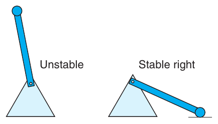

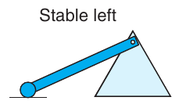

**Hình 6.1 Con lắc ngược. Tương tự một SRAM cell, con lắc chỉ có hai cấu hình, hay trạng thái, ổn định.**

|  | Transistor | Tương đối |  |  | Tương đối |  |
|---|---|---|---|---|---|---|
|  | trên mỗi bit | thời gian truy cập | Giữ được dữ liệu? | Nhạy với nhiễu loạn? | chi phí | Ứng dụng |
| SRAM | 6 | 1× | Có | Không | 1,000× | Bộ nhớ cache |
| DRAM | 1 | 10× | Không | Có | 1× | Main memory, frame buffer |

**Hình 6.2 Các đặc tính của bộ nhớ DRAM và SRAM.**

### Dynamic RAM

DRAM lưu mỗi bit dưới dạng điện tích trên một tụ điện. Tụ điện này rất nhỏ—thường khoảng 30 femtofarad—tức là 30 × 10<sup>−15</sup> farad. Tuy nhiên, hãy nhớ rằng farad là một đơn vị đo rất lớn. Bộ nhớ DRAM có thể được chế tạo với mật độ rất cao—mỗi cell gồm một tụ điện và một access transistor duy nhất. Tuy nhiên, khác với SRAM, một DRAM memory cell rất nhạy với mọi nhiễu loạn. Khi điện áp tụ điện bị thay đổi do nhiễu loạn, nó sẽ không bao giờ tự khôi phục. Việc tiếp xúc với tia sáng sẽ làm thay đổi điện áp tụ điện. Thực tế, các cảm biến trong máy ảnh số và máy quay phim về cơ bản là các mảng DRAM cell.

Các nguồn dòng rò khác nhau khiến một DRAM cell mất điện tích trong khoảng 10 đến 100 millisecond. May thay, với máy tính có thời gian chu kỳ clock tính bằng nanosecond, thời gian lưu giữ này khá dài. Hệ thống bộ nhớ phải định kỳ refresh mỗi bit bộ nhớ bằng cách đọc rồi ghi lại bit đó. Một số hệ thống còn sử dụng error-correcting code, trong đó các word của máy tính được mã hóa bằng một số bit bổ sung (ví dụ, một word 64-bit có thể được mã hóa bằng 72 bit), để mạch có thể phát hiện và sửa bất kỳ một bit sai đơn lẻ nào trong word.

Hình 6.2 tóm tắt các đặc tính của bộ nhớ SRAM và DRAM. SRAM giữ được dữ liệu miễn là được cấp điện. Khác với DRAM, SRAM không cần refresh. SRAM có thể được truy cập nhanh hơn DRAM. SRAM không nhạy với các nhiễu loạn như ánh sáng và nhiễu điện. Sự trade-off là các SRAM cell sử dụng nhiều transistor hơn DRAM cell, do đó có mật độ thấp hơn, đắt hơn và tiêu thụ nhiều điện năng hơn.

### DRAM thông thường

Các cell (bit) trong một chip DRAM được chia thành d supercell, mỗi supercell gồm w DRAM cell. Một DRAM d × w lưu tổng cộng dw bit thông tin. Các supercell được tổ chức thành một mảng hình chữ nhật có r hàng và c cột, trong đó rc = d. Mỗi supercell có địa chỉ dạng (i, j ), trong đó i biểu thị hàng và j biểu thị cột.

Ví dụ, Hình 6.3 thể hiện cách tổ chức một chip DRAM 16 × 8 với d = 16 supercell, w = 8 bit trên mỗi supercell, r = 4 hàng và c = 4 cột. Ô được tô đậm biểu thị supercell tại địa chỉ (2, 1). Thông tin đi vào và đi ra khỏi chip qua các đầu nối bên ngoài được gọi là pin. Mỗi pin mang một tín hiệu 1-bit. Hình 6.3 thể hiện hai nhóm pin này: tám data pin có thể truyền 1 byte vào hoặc ra khỏi chip, và hai addr pin mang địa chỉ hàng và cột two-bit của supercell. Các pin khác mang thông tin điều khiển không được thể hiện.

#### Thông tin thêm: Lưu ý về thuật ngữ

Cộng đồng lưu trữ chưa bao giờ thống nhất một tên chuẩn cho phần tử mảng DRAM. Các kiến trúc sư máy tính thường gọi nó là “cell”, khiến thuật ngữ này mang thêm nghĩa bên cạnh DRAM storage cell. Các nhà thiết kế mạch thường gọi nó là “word”, khiến thuật ngữ này mang thêm nghĩa bên cạnh word của main memory. Để tránh nhầm lẫn, chúng ta sử dụng thuật ngữ rõ nghĩa “supercell”.

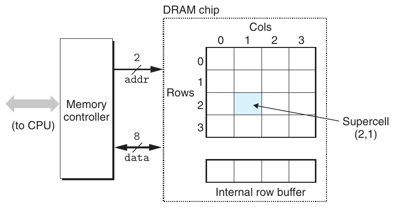

**Hình 6.3 Tổng quan High-level về một chip DRAM 128-bit 16 × 8.**

Mỗi chip DRAM được kết nối với một mạch, gọi là memory controller, có thể truyền w bit mỗi lần tới và từ từng chip DRAM. Để đọc nội dung supercell (i, j ), memory controller gửi địa chỉ hàng i tới DRAM, tiếp theo là địa chỉ cột j . DRAM đáp lại bằng cách gửi nội dung supercell (i, j ) về controller. Địa chỉ hàng i được gọi là yêu cầu RAS (row access strobe). Địa chỉ cột j được gọi là yêu cầu CAS (column access strobe). Chú ý rằng các yêu cầu RAS và CAS dùng chung các address pin của DRAM.

Ví dụ, để đọc supercell (2, 1) từ DRAM 16 × 8 trong Hình 6.3, memory controller gửi địa chỉ hàng 2 như trong Hình 6.4(a). DRAM đáp lại bằng cách sao chép toàn bộ nội dung hàng 2 vào một row buffer bên trong. Tiếp theo, memory controller gửi địa chỉ cột 1 như trong Hình 6.4(b). DRAM đáp lại bằng cách sao chép 8 bit trong supercell (2, 1) từ row buffer và gửi chúng tới memory controller.

Một lý do các nhà thiết kế mạch tổ chức DRAM thành mảng two-dimensional thay vì mảng tuyến tính là để giảm số address pin trên chip. Ví dụ, nếu DRAM 128-bit trong ví dụ của chúng ta được tổ chức thành mảng tuyến tính gồm 16 supercell với địa chỉ từ 0 đến 15, chip sẽ cần bốn address pin thay vì hai. Nhược điểm của cách tổ chức mảng two-dimensional là địa chỉ phải được gửi qua hai bước riêng biệt, làm tăng thời gian truy cập.

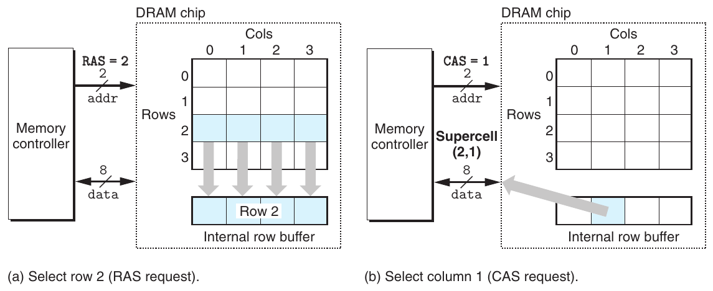

**Hình 6.4 Đọc nội dung của một DRAM supercell.**

### Memory Module

Các chip DRAM được đóng gói thành memory module cắm vào các khe mở rộng trên bo mạch chính của hệ thống (motherboard). Các hệ thống Core i7 sử dụng dual inline memory module (DIMM) 240-pin, truyền dữ liệu tới và từ memory controller theo từng khối 64-bit.

Hình 6.5 thể hiện ý tưởng cơ bản của memory module. Module ví dụ lưu tổng cộng 64 MB (megabyte) bằng tám chip DRAM 64-Mbit 8M × 8, được đánh số từ 0 đến 7. Mỗi supercell lưu 1 byte main memory, và mỗi word 64-bit tại địa chỉ byte A trong main memory được biểu diễn bằng tám supercell có địa chỉ supercell tương ứng là (i, j ). Trong ví dụ ở Hình 6.5, DRAM 0 lưu byte đầu tiên (lower-order), DRAM 1 lưu byte tiếp theo, và cứ như vậy.

Để lấy word tại địa chỉ bộ nhớ A, memory controller chuyển A thành địa chỉ supercell (i, j ) rồi gửi tới memory module; module sau đó phát i và j tới mọi DRAM. Đáp lại, mỗi DRAM xuất nội dung 8-bit của supercell (i, j ) của mình. Mạch trong module tập hợp các đầu ra này thành một word 64-bit rồi gửi về memory controller.

Có thể kết hợp main memory bằng cách kết nối nhiều memory module với memory controller. Trong trường hợp này, khi controller nhận địa chỉ A, nó chọn module k chứa A, chuyển A sang dạng (i, j ), rồi gửi (i, j ) tới module k.

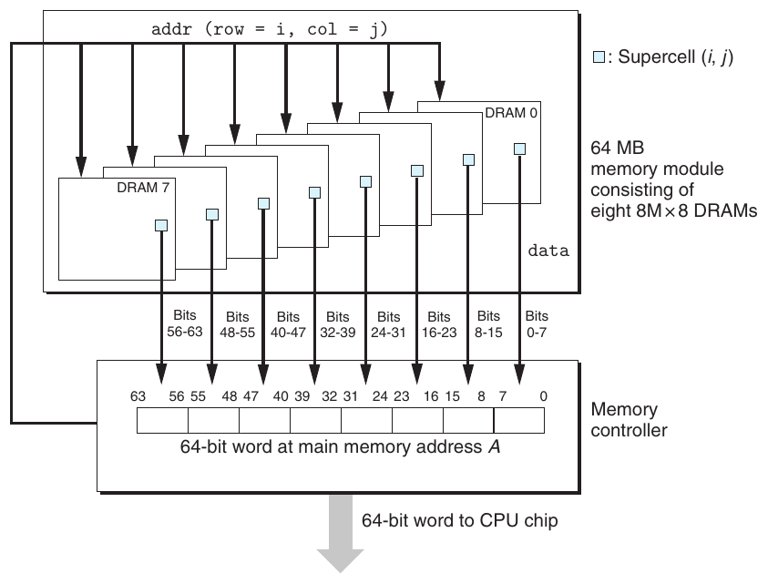

**Hình 6.5 Đọc nội dung của một memory module.**

#### Bài tập thực hành 6.1 (lời giải trang 696)

Trong phần sau, gọi r là số hàng của mảng DRAM, c là số cột, b<sub>r</sub> là số bit cần để định địa chỉ các hàng và b<sub>c</sub> là số bit cần để định địa chỉ các cột. Với mỗi DRAM dưới đây, hãy xác định các kích thước mảng power-of-2 sao cho max(b<sub>r</sub>, b<sub>c</sub>), tức số bit tối đa cần để định địa chỉ hàng hoặc cột của mảng, là nhỏ nhất.

| Cách tổ chức | r | c | b<sub>r</sub> | b<sub>c</sub> | max(b<sub>r</sub>, b<sub>c</sub>) |
|---|---|---|---|---|---|
| 16 × 1 | ______ | ______ | ______ | ______ | ______ |
| 16 × 4 | ______ | ______ | ______ | ______ | ______ |
| 128 × 8 | ______ | ______ | ______ | ______ | ______ |
| 512 × 4 | ______ | ______ | ______ | ______ | ______ |
| 1,024 × 4 | ______ | ______ | ______ | ______ | ______ |

### Các DRAM cải tiến

Có nhiều loại bộ nhớ DRAM, và những loại mới thường xuyên xuất hiện trên thị trường khi các nhà sản xuất cố gắng theo kịp tốc độ processor tăng nhanh. Mỗi loại đều dựa trên DRAM cell thông thường, với các tối ưu hóa giúp cải thiện tốc độ truy cập các DRAM cell cơ bản.

Fast page mode DRAM (FPM DRAM). DRAM thông thường sao chép toàn bộ một hàng supercell vào row buffer bên trong, sử dụng một supercell rồi loại bỏ phần còn lại. FPM DRAM cải tiến cách này bằng cách cho phép phục vụ trực tiếp từ row buffer các truy cập liên tiếp tới cùng một hàng. Ví dụ, để đọc bốn supercell từ hàng i của DRAM thông thường, memory controller phải gửi bốn yêu cầu RAS/CAS, mặc dù địa chỉ hàng i giống nhau trong mọi trường hợp. Để đọc các supercell từ cùng một hàng của FPM DRAM, memory controller gửi một yêu cầu RAS/CAS ban đầu, tiếp theo là ba yêu cầu CAS. Yêu cầu RAS/CAS ban đầu sao chép hàng i vào row buffer và trả về supercell được CAS định địa chỉ. Ba supercell tiếp theo được phục vụ trực tiếp từ row buffer, do đó được trả về nhanh hơn supercell ban đầu.

Extended data out DRAM (EDO DRAM). Một dạng cải tiến của FPM DRAM cho phép các tín hiệu CAS riêng lẻ có khoảng cách thời gian gần nhau hơn.

Synchronous DRAM (SDRAM). DRAM thông thường, FPM và EDO hoạt động bất đồng bộ theo nghĩa chúng giao tiếp với memory controller bằng một tập hợp các tín hiệu điều khiển tường minh. SDRAM thay thế nhiều tín hiệu điều khiển này bằng các cạnh lên của cùng một tín hiệu clock bên ngoài điều khiển memory controller. Không đi sâu vào chi tiết, hiệu quả tổng thể là SDRAM có thể xuất nội dung các supercell với tốc độ nhanh hơn những loại bất đồng bộ tương ứng.

Double Data-Rate Synchronous DRAM (DDR SDRAM). DDR SDRAM là một cải tiến của SDRAM, tăng gấp đôi tốc độ DRAM bằng cách sử dụng cả hai cạnh clock làm tín hiệu điều khiển. Các loại DDR SDRAM khác nhau được đặc trưng bởi kích thước một prefetch buffer nhỏ giúp tăng bandwidth hiệu dụng: DDR (2 bit), DDR2 (4 bit) và DDR3 (8 bit).

Video RAM (VRAM). Được dùng trong frame buffer của hệ thống đồ họa. Về ý tưởng, VRAM tương tự FPM DRAM. Hai điểm khác biệt lớn là (1) đầu ra VRAM được tạo bằng cách dịch tuần tự toàn bộ nội dung buffer bên trong và (2) VRAM cho phép đọc và ghi bộ nhớ đồng thời. Vì vậy, hệ thống có thể vẽ màn hình bằng các pixel trong frame buffer (đọc) trong khi đồng thời ghi các giá trị mới cho lần cập nhật tiếp theo (ghi).

### Nonvolatile Memory

DRAM và SRAM là volatile theo nghĩa chúng mất thông tin khi nguồn điện áp bị tắt. Ngược lại, nonvolatile memory vẫn giữ thông tin ngay cả khi đã tắt nguồn. Có nhiều loại nonvolatile memory. Vì lý do lịch sử, chúng được gọi chung là read-only memory (ROM), mặc dù một số loại ROM có thể được ghi cũng như đọc. Các ROM được phân biệt theo số lần có thể lập trình lại (ghi vào) và cơ chế lập trình lại.

#### Thông tin thêm: Mức độ phổ biến của các công nghệ DRAM qua lịch sử

Cho đến năm 1995, phần lớn PC được chế tạo với FPM DRAM. Từ 1996 đến 1999, EDO DRAM thống trị thị trường, còn FPM DRAM gần như biến mất. SDRAM xuất hiện lần đầu năm 1995 trong các hệ thống high-end, và đến năm 2002 phần lớn PC được chế tạo với SDRAM và DDR SDRAM. Đến năm 2010, phần lớn hệ thống server và desktop được chế tạo với DDR3 SDRAM. Thực tế, Intel Core i7 chỉ hỗ trợ DDR3 SDRAM.

Programmable ROM (PROM) có thể được lập trình đúng một lần. PROM có một dạng cầu chì gắn với mỗi memory cell, có thể bị làm đứt một lần bằng một xung dòng điện lớn.

Erasable programmable ROM (EPROM) có một cửa sổ thạch anh trong suốt cho phép ánh sáng chiếu tới các storage cell. Các EPROM cell được xóa về giá trị không bằng cách chiếu tia cực tím qua cửa sổ. Việc lập trình EPROM được thực hiện bằng một thiết bị đặc biệt để ghi các giá trị một vào EPROM. EPROM có thể được xóa và lập trình lại khoảng 1,000 lần. Electrically erasable PROM (EEPROM) tương tự EPROM, nhưng không đòi hỏi một thiết bị lập trình tách rời về mặt vật lý, do đó có thể được lập trình lại in-place ngay trên các bo mạch in. EEPROM có thể được lập trình lại khoảng 10<sup>5</sup> lần trước khi hao mòn đến mức không dùng được.

Flash memory là một loại nonvolatile memory dựa trên EEPROM, đã trở thành một công nghệ lưu trữ quan trọng. Flash memory có ở khắp nơi, cung cấp khả năng lưu trữ nonvolatile nhanh và bền cho hàng loạt thiết bị điện tử, bao gồm máy ảnh số, điện thoại di động và máy nghe nhạc, cũng như các hệ thống máy tính laptop, desktop và server. Trong Mục 6.1.3, chúng ta sẽ xem xét chi tiết một dạng ổ đĩa flash-based mới, gọi là solid state disk (SSD), cung cấp một lựa chọn nhanh hơn, chắc chắn hơn và ít power-hungry hơn so với đĩa quay thông thường.

Chương trình được lưu trong thiết bị ROM thường được gọi là firmware. Khi hệ thống máy tính được bật nguồn, nó chạy firmware được lưu trong ROM. Một số hệ thống cung cấp một tập hợp nhỏ các hàm nhập và xuất cơ bản trong firmware—ví dụ, các routine BIOS (basic input/output system) của PC. Những thiết bị phức tạp như card đồ họa và disk drive controller cũng dựa vào firmware để chuyển đổi các yêu cầu I/O (input/output) từ CPU.

### Truy cập main memory

Dữ liệu đi qua lại giữa processor và DRAM main memory trên các đường dẫn điện dùng chung, được gọi là bus. Mỗi lần truyền dữ liệu giữa CPU và bộ nhớ được thực hiện bằng một chuỗi bước gọi là bus transaction. Read transaction truyền dữ liệu từ main memory tới CPU. Write transaction truyền dữ liệu từ CPU tới main memory.

Bus là một tập hợp các dây song song mang tín hiệu địa chỉ, dữ liệu và điều khiển. Tùy thiết kế bus cụ thể, tín hiệu dữ liệu và địa chỉ có thể dùng chung một nhóm dây hoặc dùng các nhóm khác nhau. Ngoài ra, có thể có nhiều hơn hai thiết bị dùng chung một bus. Các dây điều khiển mang tín hiệu đồng bộ hóa transaction và xác định loại transaction đang được thực hiện. Ví dụ, transaction này liên quan đến main memory hay đến một thiết bị I/O khác như disk controller? Transaction là đọc hay ghi? Thông tin trên bus là địa chỉ hay một mục dữ liệu?

Hình 6.6 thể hiện cấu hình của một hệ thống máy tính ví dụ. Các thành phần chính là chip CPU, một chipset mà chúng ta sẽ gọi là I/O bridge (bao gồm memory controller), và các DRAM memory module tạo thành main memory. Các thành phần này được kết nối bằng một cặp bus: system bus nối CPU với I/O bridge, và memory bus nối I/O bridge với main memory. I/O bridge chuyển các tín hiệu điện của system bus thành các tín hiệu điện của memory bus. Như chúng ta sẽ thấy, I/O bridge còn kết nối system bus và memory bus với một I/O bus dùng chung cho các thiết bị I/O như đĩa và card đồ họa. Tuy nhiên, lúc này chúng ta tập trung vào memory bus.

#### Thông tin thêm: Lưu ý về thiết kế bus

Thiết kế bus là một khía cạnh phức tạp và thay đổi nhanh của hệ thống máy tính. Các nhà cung cấp khác nhau phát triển các kiến trúc bus khác nhau để tạo sự khác biệt cho sản phẩm. Ví dụ, một số hệ thống Intel sử dụng các chipset gọi là northbridge và southbridge để kết nối CPU lần lượt với bộ nhớ và thiết bị I/O. Trong các hệ thống Pentium và Core 2 cũ, front side bus (FSB) kết nối CPU với northbridge. Các hệ thống AMD thay FSB bằng HyperTransport interconnect, còn các hệ thống Intel Core i7 mới hơn sử dụng QuickPath interconnect. Chi tiết về các kiến trúc bus khác nhau này nằm ngoài phạm vi sách. Thay vào đó, chúng ta sẽ sử dụng kiến trúc bus high-level trong Hình 6.6 làm ví dụ xuyên suốt. Đây là một mô hình trừu tượng đơn giản nhưng hữu ích, cho phép chúng ta trình bày cụ thể. Nó thể hiện được những ý chính mà không gắn quá chặt với chi tiết của bất kỳ thiết kế độc quyền nào.

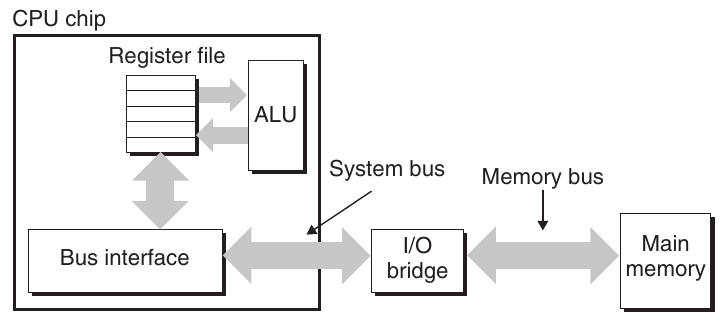

**Hình 6.6 Cấu trúc bus ví dụ kết nối CPU và main memory.**

Hãy xem điều gì xảy ra khi CPU thực hiện một thao tác load như

```
movq A,%rax
```

trong đó nội dung địa chỉ A được load vào register %rax. Mạch trên chip CPU được gọi là bus interface khởi tạo một read transaction trên bus. Read transaction gồm ba bước. Đầu tiên, CPU đặt địa chỉ A lên system bus. I/O bridge chuyển tiếp tín hiệu sang memory bus (Hình 6.7(a)). Tiếp theo, main memory phát hiện tín hiệu địa chỉ trên memory bus, đọc địa chỉ từ memory bus, lấy dữ liệu từ DRAM rồi ghi dữ liệu lên memory bus. I/O bridge chuyển tín hiệu memory bus thành tín hiệu system bus rồi chuyển tiếp lên system bus (Hình 6.7(b)). Cuối cùng, CPU phát hiện dữ liệu trên system bus, đọc dữ liệu từ bus rồi sao chép dữ liệu vào register %rax (Hình 6.7(c)).

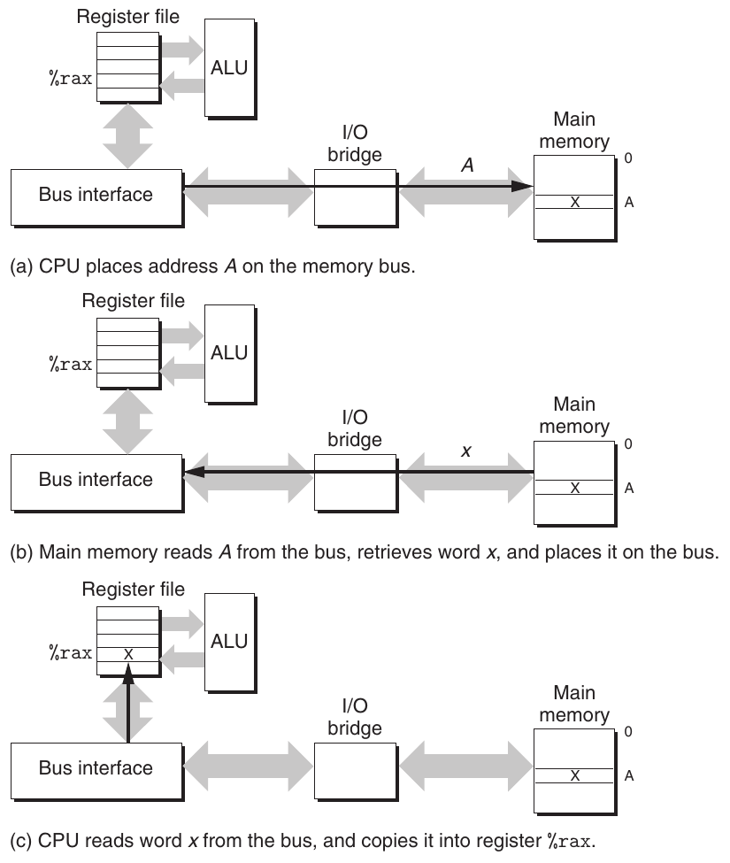

**Hình 6.7 Memory read transaction cho một thao tác load: movq A,%rax .**

Ngược lại, khi CPU thực hiện một thao tác store như

```
movq %rax,A
```

trong đó nội dung register %rax được ghi tới địa chỉ A, CPU khởi tạo một write transaction. Một lần nữa, có ba bước cơ bản. Đầu tiên, CPU đặt địa chỉ lên system bus. Bộ nhớ đọc địa chỉ từ memory bus và chờ dữ liệu tới (Hình 6.8(a)). Tiếp theo, CPU sao chép dữ liệu trong %rax lên system bus (Hình 6.8(b)). Cuối cùng, main memory đọc dữ liệu từ memory bus và lưu các bit vào DRAM (Hình 6.8(c)).

### 6.1.2 Lưu trữ trên đĩa

Đĩa là thiết bị lưu trữ chủ lực, chứa lượng dữ liệu khổng lồ, khoảng hàng trăm đến hàng nghìn gigabyte, so với hàng trăm hoặc hàng nghìn megabyte trong bộ nhớ RAM-based. Tuy nhiên, việc đọc thông tin từ đĩa mất khoảng millisecond, lâu hơn một trăm nghìn lần so với DRAM và một triệu lần so với SRAM.

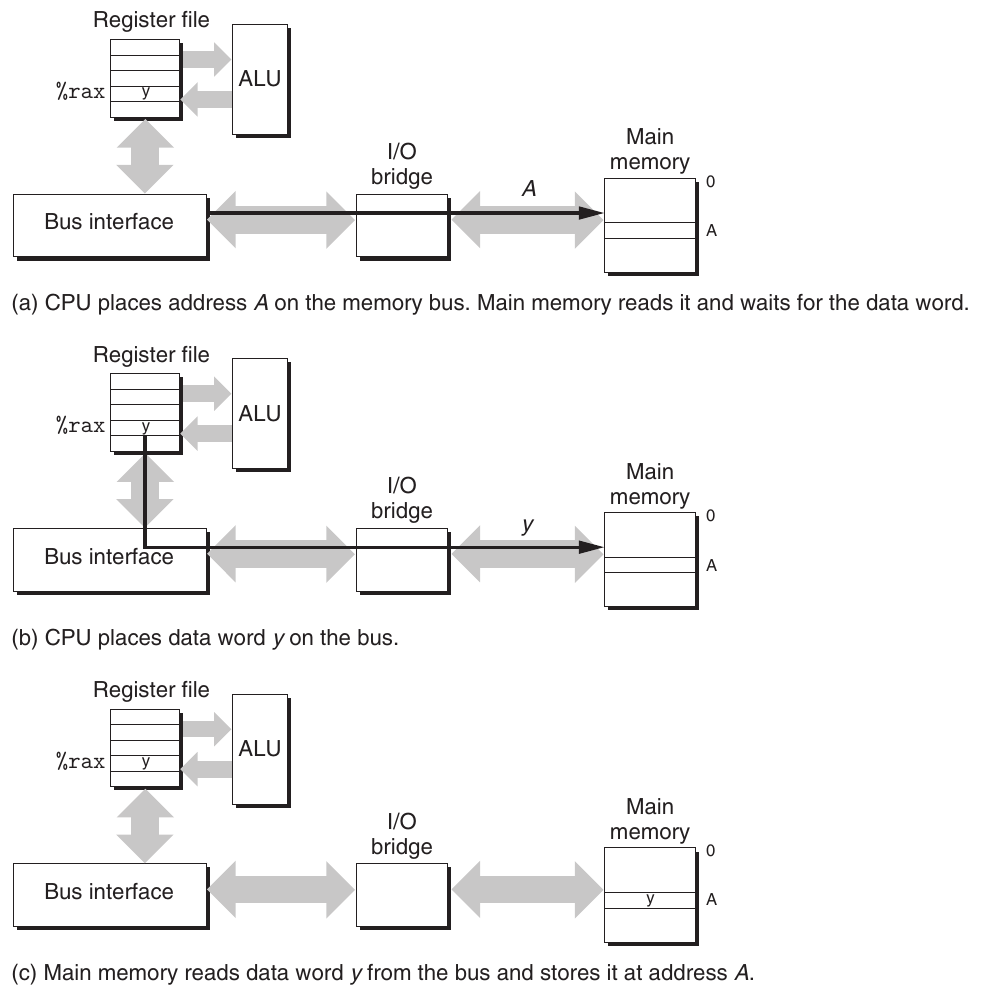

**Hình 6.8 Memory write transaction cho một thao tác store: movq %rax,A .**

### Hình học của đĩa

Đĩa được cấu tạo từ các platter. Mỗi platter gồm hai mặt, hay surface, được phủ vật liệu ghi từ tính. Một spindle quay ở tâm platter làm platter quay với tốc độ cố định, thường từ 5,400 đến 15,000 vòng mỗi phút (RPM). Một đĩa thường chứa một hoặc nhiều platter như vậy trong một vỏ kín.

Hình 6.9(a) thể hiện hình học của một mặt đĩa điển hình. Mỗi mặt gồm một tập hợp các vòng tròn đồng tâm gọi là track. Mỗi track được chia thành một tập hợp các sector. Mỗi sector chứa cùng một số bit dữ liệu (thường là 512 byte), được mã hóa trong vật liệu từ tính trên sector. Các sector được ngăn cách bởi những khoảng trống không lưu bit dữ liệu. Những khoảng trống này lưu các bit định dạng dùng để nhận diện sector.

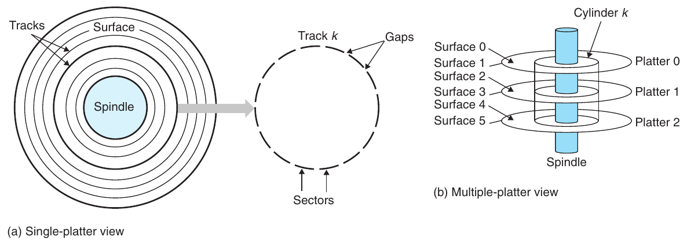

**Hình 6.9 Hình học của đĩa.**

Một đĩa gồm một hoặc nhiều platter xếp chồng lên nhau trong một vỏ kín, như trong Hình 6.9(b). Toàn bộ cụm thường được gọi là ổ đĩa, mặc dù chúng ta thường chỉ gọi đơn giản là đĩa. Đôi khi chúng ta gọi đĩa là đĩa quay để phân biệt với các solid state disk (SSD) flash-based không có bộ phận chuyển động.

Các nhà sản xuất đĩa mô tả hình học của những ổ đĩa multiple-platter theo cylinder, trong đó một cylinder là tập hợp các track trên mọi mặt có cùng khoảng cách tới tâm spindle. Ví dụ, nếu một ổ đĩa có ba platter và sáu mặt, và các track trên mỗi mặt được đánh số nhất quán, thì cylinder k là tập hợp sáu track mang số k.

### Dung lượng đĩa

Số bit tối đa có thể ghi lên đĩa được gọi là dung lượng tối đa, hay đơn giản là dung lượng. Dung lượng đĩa được quyết định bởi các yếu tố công nghệ sau:

Recording density (bits/in). Số bit có thể được bố trí trong một đoạn track dài 1-inch.

Track density (tracks/in). Số track có thể được bố trí trong một đoạn bán kính dài 1-inch tính từ tâm platter.

Areal density (bits/in<sup>2</sup>). Tích của recording density và track density.

Các nhà sản xuất đĩa không ngừng tìm cách tăng areal density (và nhờ đó tăng dung lượng), và đại lượng này tăng gấp đôi sau mỗi vài năm. Những đĩa đầu tiên, được thiết kế khi areal density còn thấp, chia mọi track thành cùng một số sector, được quyết định bởi số sector có thể ghi trên track trong cùng. Để duy trì số sector cố định trên mỗi track, các sector được đặt cách nhau xa hơn trên những track bên ngoài. Đây là cách tiếp cận hợp lý khi areal density còn tương đối thấp. Tuy nhiên, khi areal density tăng, các khoảng trống giữa sector (không lưu bit dữ liệu) trở nên lớn đến mức không thể chấp nhận. Do đó, các đĩa high-capacity hiện đại sử dụng kỹ thuật gọi là multiple zone recording, trong đó tập hợp các cylinder được chia thành các tập con không giao nhau gọi là recording zone. Mỗi zone gồm một tập hợp cylinder liên tiếp. Mỗi track trong mỗi cylinder của một zone có cùng số sector, được quyết định bởi số sector có thể bố trí trên track trong cùng của zone.

#### Thông tin thêm: Một gigabyte là bao nhiêu?

Đáng tiếc là ý nghĩa của các tiền tố như kilo (K), mega (M), giga (G) và tera (T) phụ thuộc vào ngữ cảnh. Với các phép đo liên quan đến dung lượng DRAM và SRAM, thông thường K = 2<sup>10</sup>, M = 2<sup>20</sup>, G = 2<sup>30</sup> và T = 2<sup>40</sup>. Với các phép đo liên quan đến dung lượng thiết bị I/O như đĩa và mạng, thông thường K = 10<sup>3</sup>, M = 10<sup>6</sup>, G = 10<sup>9</sup> và T = 10<sup>12</sup>. Các tốc độ và throughput thường cũng sử dụng những giá trị tiền tố này.

May thay, đối với các ước lượng back-of-the-envelope mà chúng ta thường dựa vào, giả định nào cũng phù hợp trong thực tế. Ví dụ, chênh lệch tương đối giữa 2<sup>30</sup> và 10<sup>9</sup> không lớn lắm: (2<sup>30</sup> − 10<sup>9</sup>)/10<sup>9</sup> ≈ 7%. Tương tự, (2<sup>40</sup> − 10<sup>12</sup>)/10<sup>12</sup> ≈ 10%.

Dung lượng đĩa được tính bằng công thức sau:

Capacity = (# bytes)/(sector) × (average # sectors)/(track) × (# tracks)/(surface) × (# surfaces)/(platter) × (# platters)/(disk)

Ví dụ, giả sử chúng ta có một đĩa gồm năm platter, 512 byte mỗi sector, 20,000 track mỗi mặt và trung bình 300 sector mỗi track. Khi đó dung lượng đĩa là

Capacity = (512 bytes)/(sector) × (300 sectors)/(track) × (20,000 tracks)/(surface) × (2 surfaces)/(platter) × (5 platters)/(disk)

= 30,720,000,000 bytes = 30.72 GB

Chú ý rằng các nhà sản xuất biểu thị dung lượng đĩa bằng đơn vị gigabyte (GB) hoặc terabyte (TB), trong đó 1 GB = 10<sup>9</sup> byte và 1 TB = 10<sup>12</sup> byte.

#### Bài tập thực hành 6.2 (lời giải trang 697)

Dung lượng của một đĩa có 3 platter, 15,000 cylinder, trung bình 500 sector mỗi track và 1,024 byte mỗi sector là bao nhiêu?

### Hoạt động của đĩa

Đĩa đọc và ghi các bit được lưu trên bề mặt từ tính bằng một đầu đọc/ghi gắn ở cuối một actuator arm, như trong Hình 6.10(a). Bằng cách di chuyển arm qua lại theo phương bán kính, ổ đĩa có thể đặt đầu đọc/ghi trên bất kỳ track nào của bề mặt. Chuyển động cơ học này được gọi là seek. Khi đầu đọc/ghi đã được đặt trên track mong muốn, mỗi khi một bit trên track đi qua bên dưới, đầu đọc/ghi có thể cảm nhận giá trị của bit (đọc bit) hoặc thay đổi giá trị của bit (ghi bit). Đĩa có nhiều platter có đầu đọc/ghi riêng cho mỗi mặt, như trong Hình 6.10(b). Các đầu đọc/ghi được xếp thẳng hàng theo phương đứng và di chuyển cùng nhau. Tại bất kỳ thời điểm nào, mọi đầu đọc/ghi đều nằm trên cùng một cylinder.

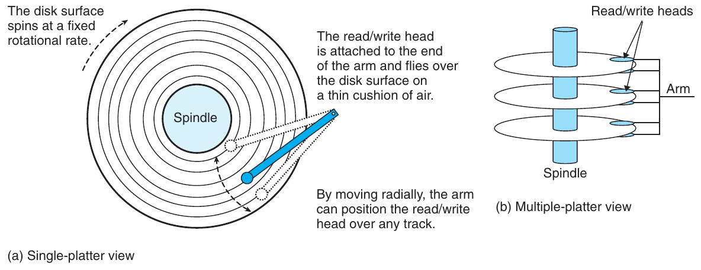

**Hình 6.10 Cơ chế chuyển động của đĩa.**

Đầu đọc/ghi ở cuối arm bay (theo đúng nghĩa đen) trên một đệm không khí mỏng phía trên mặt đĩa, ở độ cao khoảng 0.1 micron và tốc độ khoảng 80 km/h. Điều này tương tự đặt một tòa nhà chọc trời nằm ngang rồi cho nó bay vòng quanh thế giới ở độ cao 2.5 cm (1 inch) trên mặt đất, với mỗi vòng quanh Trái Đất chỉ mất 8 giây! Với những khoảng cách cho phép như vậy, một hạt bụi nhỏ trên bề mặt cũng giống một tảng đá khổng lồ. Nếu đầu đọc/ghi va vào một tảng đá như thế, nó sẽ ngừng bay và đâm vào bề mặt (một sự cố so-called head crash). Vì lý do này, đĩa luôn được đóng trong vỏ kín khí.

Đĩa đọc và ghi dữ liệu theo các block sector-size. Thời gian truy cập một sector có ba thành phần chính: seek time, rotational latency và transfer time:

Seek time. Để đọc nội dung của một sector đích, trước hết arm đặt đầu đọc/ghi trên track chứa sector đích. Thời gian cần để di chuyển arm được gọi là seek time. Seek time, T<sub>seek</sub>, phụ thuộc vào vị trí trước đó của đầu đọc/ghi và tốc độ arm di chuyển trên bề mặt. Seek time trung bình của ổ đĩa hiện đại, T<sub>avg seek</sub>, được đo bằng trung bình của vài nghìn lần seek tới các sector ngẫu nhiên, thường vào khoảng 3 đến 9 ms. Thời gian tối đa cho một lần seek, T<sub>max seek</sub>, có thể lên tới 20 ms.

Rotational latency. Khi đầu đọc/ghi đã nằm trên track, ổ đĩa chờ bit đầu tiên của sector đích đi qua bên dưới đầu đọc/ghi. Hiệu năng bước này phụ thuộc cả vào vị trí của bề mặt khi đầu đọc/ghi tới track đích lẫn tốc độ quay của đĩa. Trong trường hợp xấu nhất, đầu đọc/ghi vừa bỏ lỡ sector đích và phải chờ đĩa quay trọn một vòng. Vì vậy, rotational latency tối đa, tính bằng giây, được cho bởi

T<sub>max rotation</sub> = 1/RPM × (60 secs)/(1 min)

Rotational latency trung bình, T<sub>avg rotation</sub>, đơn giản bằng một nửa T<sub>max rotation</sub>.

Transfer time. Khi bit đầu tiên của sector đích nằm dưới đầu đọc/ghi, ổ đĩa có thể bắt đầu đọc hoặc ghi nội dung sector. Transfer time cho một sector phụ thuộc vào tốc độ quay và số sector mỗi track. Vì vậy, chúng ta có thể ước lượng gần đúng transfer time trung bình cho một sector, tính bằng giây, là

T<sub>avg transfer</sub> = 1/RPM × 1/(average # sectors/track) × (60 secs)/(1 min)

Chúng ta có thể ước lượng thời gian trung bình để truy cập nội dung một sector đĩa bằng tổng seek time trung bình, rotational latency trung bình và transfer time trung bình. Ví dụ, xét một đĩa có các tham số sau:

| Tham số | Giá trị |
|---|---|
| Tốc độ quay | 7,200 RPM |
| T<sub>avg seek</sub> | 9 ms |
| Số sector/track trung bình | 400 |

Với đĩa này, rotational latency trung bình (tính bằng ms) là

T<sub>avg rotation</sub> = 1/2 × T<sub>max rotation</sub>

= 1/2 × (60 secs/7,200 RPM) × 1,000 ms/sec ≈ 4 ms

Transfer time trung bình là

T<sub>avg transfer</sub> = 60/7,200 RPM × 1/400 sectors/track × 1,000 ms/sec

≈ 0.02 ms

Kết hợp tất cả, tổng thời gian truy cập ước lượng là

T<sub>access</sub> = T<sub>avg seek</sub> + T<sub>avg rotation</sub> + T<sub>avg transfer</sub>

= 9 ms + 4 ms + 0.02 ms = 13.02 ms

Ví dụ này minh họa một số điểm quan trọng:

- Thời gian truy cập 512 byte trong một sector đĩa chủ yếu do seek time và rotational latency quyết định. Truy cập byte đầu tiên trong sector mất nhiều thời gian, nhưng các byte còn lại về cơ bản không tốn thêm thời gian.

- Vì seek time và rotational latency xấp xỉ nhau, lấy hai lần seek time là một quy tắc đơn giản và hợp lý để ước lượng thời gian truy cập đĩa.

- Thời gian truy cập một word 64-bit được lưu trong SRAM khoảng 4 ns, và trong DRAM là 60 ns. Vì vậy, thời gian đọc một block sector-size 512-byte từ bộ nhớ khoảng 256 ns với SRAM và 4,000 ns với DRAM. Thời gian truy cập đĩa, khoảng 10 ms, lớn hơn khoảng 40,000 lần so với SRAM và khoảng 2,500 lần so với DRAM.

#### Bài tập thực hành 6.3 (lời giải trang 697)

Hãy ước lượng thời gian trung bình (tính bằng ms) để truy cập một sector trên đĩa sau:

| Tham số | Giá trị |
|---|---|
| Tốc độ quay | 12,000 RPM |
| T<sub>avg seek</sub> | 5 ms |
| Số sector/track trung bình | 300 |

### Logical Disk Block

Như đã thấy, các đĩa hiện đại có hình học phức tạp, với nhiều bề mặt và những recording zone khác nhau trên các bề mặt đó. Để che giấu sự phức tạp này khỏi operating system, đĩa hiện đại đưa ra cách nhìn đơn giản hơn về hình học của chúng: một dãy gồm B logical block sector-size, được đánh số 0, 1, . . . , B − 1. Một thiết bị hardware/firmware nhỏ trong vỏ đĩa, gọi là disk controller, duy trì ánh xạ giữa số logical block và các sector đĩa thực tế (vật lý).

Khi operating system muốn thực hiện một thao tác I/O, chẳng hạn đọc một sector đĩa vào main memory, nó gửi lệnh tới disk controller yêu cầu đọc một số logical block cụ thể. Firmware trên controller thực hiện tra cứu bảng nhanh để chuyển số logical block thành một bộ ba (surface, track, sector) xác định duy nhất sector vật lý tương ứng. Phần cứng trên controller diễn giải bộ ba này để di chuyển các đầu đọc/ghi tới cylinder thích hợp, chờ sector đi qua bên dưới đầu đọc/ghi, tập hợp các bit mà đầu đọc/ghi cảm nhận được vào một memory buffer nhỏ trên controller, rồi sao chép chúng vào main memory.

#### Bài tập thực hành 6.4 (lời giải trang 697)

Giả sử một file 1 MB gồm các logical block 512-byte được lưu trên một ổ đĩa có các đặc tính sau:

| Tham số | Giá trị |
|---|---|
| Tốc độ quay | 13,000 RPM |
| T<sub>avg seek</sub> | 6 ms |
| Số sector/track trung bình | 5,000 |
| Số mặt | 4 |
| Kích thước sector | 512 bytes |

Với mỗi trường hợp dưới đây, giả sử một chương trình đọc lần lượt các logical block của file theo thứ tự, và thời gian để đặt đầu đọc/ghi trên block đầu tiên là T<sub>avg seek</sub> + T<sub>avg rotation</sub>.

A. Trường hợp tốt nhất: Ước lượng thời gian tối ưu (tính bằng ms) cần để đọc file khi có ánh xạ tốt nhất có thể từ logical block tới sector đĩa (tức là tuần tự).

B. Trường hợp ngẫu nhiên: Ước lượng thời gian (tính bằng ms) cần để đọc file nếu các block được ánh xạ ngẫu nhiên tới sector đĩa.

#### Thông tin thêm: Dung lượng đĩa sau khi định dạng

Trước khi có thể dùng đĩa để lưu dữ liệu, disk controller phải định dạng đĩa. Quá trình này bao gồm điền thông tin nhận diện sector vào các khoảng trống giữa sector, xác định mọi cylinder có khuyết tật bề mặt và loại chúng khỏi sử dụng, đồng thời dành riêng một tập hợp cylinder trong mỗi zone làm dự phòng, có thể đưa vào sử dụng nếu một hoặc nhiều cylinder trong zone hỏng trong suốt vòng đời đĩa. Dung lượng sau khi định dạng do nhà sản xuất đĩa công bố nhỏ hơn dung lượng tối đa do có các cylinder dự phòng này.

### Kết nối thiết bị I/O

Các thiết bị input/output (I/O) như card đồ họa, màn hình, chuột, bàn phím và đĩa được kết nối với CPU và main memory bằng I/O bus. Khác với system bus và memory bus vốn là CPU-specific, I/O bus được thiết kế để độc lập với CPU bên dưới. Hình 6.11 thể hiện một cấu trúc I/O bus tiêu biểu kết nối CPU, main memory và thiết bị I/O.

Mặc dù I/O bus chậm hơn system bus và memory bus, nó có thể hỗ trợ nhiều loại thiết bị I/O third-party. Ví dụ, bus trong Hình 6.11 có ba loại thiết bị khác nhau được gắn vào.

- Universal Serial Bus (USB) controller là đường dẫn cho các thiết bị gắn với USB bus, một chuẩn cực kỳ phổ biến để kết nối nhiều loại thiết bị I/O ngoại vi, gồm bàn phím, chuột, modem, máy ảnh số, bộ điều khiển trò chơi, máy in, ổ đĩa ngoài và solid state disk. USB 3.0 bus có bandwidth tối đa 625 MB/s. USB 3.1 bus có bandwidth tối đa 1,250 MB/s.

- Card đồ họa (hay adapter) chứa logic phần cứng và phần mềm chịu trách nhiệm vẽ các pixel lên màn hình hiển thị thay cho CPU.

- Host bus adapter kết nối một hoặc nhiều đĩa với I/O bus bằng một giao thức truyền thông được xác định bởi host bus interface cụ thể. Hai interface phổ biến nhất như vậy cho đĩa là SCSI (phát âm “scuzzy”) và SATA (phát âm “sat-uh”). Đĩa SCSI thường nhanh hơn và đắt hơn ổ SATA. Một SCSI host bus adapter (thường gọi là SCSI controller) có thể hỗ trợ nhiều ổ đĩa, còn SATA adapter chỉ hỗ trợ một ổ.

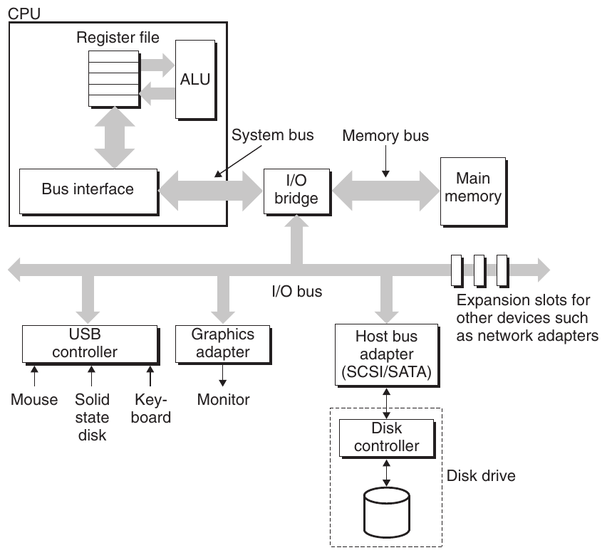

**Hình 6.11 Cấu trúc bus ví dụ kết nối CPU, main memory và thiết bị I/O.**

Có thể gắn thêm các thiết bị như network adapter vào I/O bus bằng cách cắm adapter vào những khe mở rộng còn trống trên motherboard, cung cấp kết nối điện trực tiếp tới bus.

### Truy cập đĩa

Mặc dù việc mô tả chi tiết cách các thiết bị I/O hoạt động và cách lập trình chúng nằm ngoài phạm vi ở đây, chúng ta có thể đưa ra một hình dung tổng quát. Ví dụ, Hình 6.12 tóm tắt các bước diễn ra khi CPU đọc dữ liệu từ đĩa.

#### Thông tin thêm: Những tiến bộ trong thiết kế I/O bus

I/O bus trong Hình 6.11 là một mô hình trừu tượng đơn giản cho phép chúng ta trình bày cụ thể mà không gắn quá chặt với chi tiết của hệ thống cụ thể nào. Mô hình dựa trên peripheral component interconnect (PCI) bus, phổ biến cho đến khoảng năm 2010. Trong mô hình PCI, mọi thiết bị trong hệ thống dùng chung bus, và tại một thời điểm chỉ một thiết bị có thể truy cập các dây này. Trong hệ thống hiện đại, PCI bus dùng chung đã được thay bằng PCI express (PCIe) bus, một tập hợp các liên kết nối tiếp high-speed, point-to-point được kết nối bằng switch, tương tự các mạng Ethernet chuyển mạch mà bạn sẽ tìm hiểu trong Chương 11. PCIe bus, với throughput tối đa 16 GB/s, nhanh hơn một bậc độ lớn so với PCI bus có throughput tối đa 533 MB/s. Ngoại trừ hiệu năng I/O đo được, sự khác biệt giữa các thiết kế bus không thể hiện ra đối với chương trình ứng dụng, vì vậy chúng ta sẽ sử dụng mô hình bus dùng chung đơn giản xuyên suốt sách.

CPU gửi lệnh tới thiết bị I/O bằng kỹ thuật gọi là memory-mapped I/O (Hình 6.12(a)). Trong hệ thống có memory-mapped I/O, một block địa chỉ trong address space được dành riêng để giao tiếp với các thiết bị I/O. Mỗi địa chỉ này được gọi là I/O port. Mỗi thiết bị được liên kết với (hay ánh xạ tới) một hoặc nhiều port khi gắn vào bus.

Ví dụ đơn giản, giả sử disk controller được ánh xạ tới port 0xa0. Khi đó CPU có thể khởi tạo một lần đọc đĩa bằng cách thực thi ba store instruction tới địa chỉ 0xa0: instruction đầu tiên gửi một command word yêu cầu đĩa bắt đầu đọc, cùng các tham số khác như có interrupt CPU khi đọc xong hay không. (Chúng ta sẽ thảo luận về interrupt trong Mục 8.1.) Instruction thứ hai chỉ định số logical block cần đọc. Instruction thứ ba chỉ định địa chỉ main memory nơi nội dung sector đĩa cần được lưu.

Sau khi gửi yêu cầu, CPU thường làm công việc khác trong khi đĩa thực hiện đọc. Hãy nhớ rằng một processor 1 GHz với chu kỳ clock 1 ns có khả năng thực thi 16 triệu instruction trong 16 ms cần để đọc đĩa. Chỉ chờ đợi và không làm gì trong lúc truyền dữ liệu sẽ vô cùng lãng phí.

Sau khi disk controller nhận lệnh đọc từ CPU, nó chuyển số logical block thành địa chỉ sector, đọc nội dung sector rồi truyền trực tiếp nội dung vào main memory mà không cần CPU can thiệp (Hình 6.12(b)). Quá trình một thiết bị tự thực hiện read hoặc write bus transaction mà không có sự tham gia của CPU được gọi là direct memory access (DMA). Việc truyền dữ liệu được gọi là DMA transfer.

Sau khi DMA transfer hoàn tất và nội dung sector đĩa đã được lưu an toàn trong main memory, disk controller thông báo cho CPU bằng cách gửi tín hiệu interrupt tới CPU (Hình 6.12(c)). Ý tưởng cơ bản là interrupt đưa tín hiệu tới một pin bên ngoài trên chip CPU. Điều này khiến CPU dừng công việc hiện tại và chuyển tới một routine của operating system. Routine ghi nhận rằng I/O đã hoàn tất rồi trả quyền điều khiển về vị trí CPU bị interrupt.

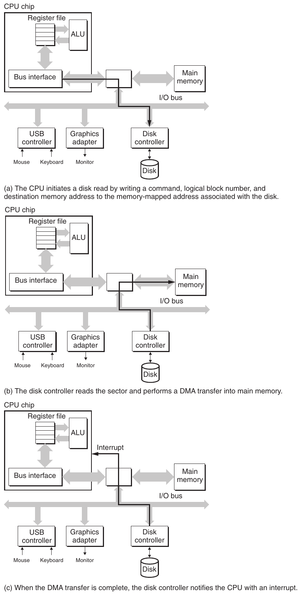

**Hình 6.12 Đọc một sector đĩa.**

#### Thông tin thêm: Các đặc tính của một ổ đĩa thương mại

Các nhà sản xuất đĩa công bố nhiều thông tin kỹ thuật high-level hữu ích trên website. Ví dụ, website Seagate có các thông tin sau (và còn nhiều nữa!) về một ổ đĩa phổ biến của họ, Barracuda 7400. (Seagate.com)

| Đặc tính hình học | Giá trị | Đặc tính hình học | Giá trị |
|---|---|---|---|
| Đường kính mặt đĩa | 3.5 in | Tốc độ quay | 7,200 RPM |
| Dung lượng sau định dạng | 3 TB | Rotational latency trung bình | 4.16 ms |
| Số platter | 3 | Seek time trung bình | 8.5 ms |
| Số mặt | 6 | Track-to-track seek time | 1.0 ms |
| Số logical block | 5,860,533,168 | Tốc độ truyền trung bình | 156 MB/s |
| Kích thước logical block | 512 bytes | Tốc độ truyền duy trì tối đa | 210 MB/s |

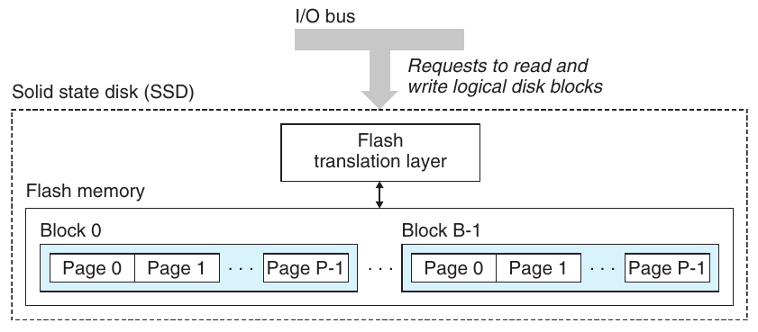

**Hình 6.13 Solid state disk (SSD).**

### 6.1.3 Solid State Disk

Solid state disk (SSD) là một công nghệ lưu trữ dựa trên flash memory (Mục 6.1.1), trong một số tình huống là lựa chọn hấp dẫn để thay thế đĩa quay thông thường. Hình 6.13 thể hiện ý tưởng cơ bản. Một cụm SSD được cắm vào khe đĩa tiêu chuẩn trên I/O bus (thường là USB hoặc SATA) và hoạt động như mọi đĩa khác, xử lý yêu cầu từ CPU để đọc và ghi logical disk block. Cụm SSD gồm một hoặc nhiều chip flash memory thay thế bộ truyền động cơ học trong đĩa quay thông thường, cùng một flash translation layer, tức thiết bị hardware/firmware đóng vai trò tương tự disk controller, chuyển các yêu cầu về logical block thành các truy cập thiết bị vật lý bên dưới.

Hình 6.14 thể hiện các đặc tính hiệu năng của một SSD điển hình. Chú ý rằng đọc từ SSD nhanh hơn ghi. Sự khác biệt giữa hiệu năng đọc và ghi ngẫu nhiên bắt nguồn từ một thuộc tính cơ bản của flash memory bên dưới. Như Hình 6.13 thể hiện, flash memory gồm một dãy B block, mỗi block gồm P page. Thông thường, page có kích thước từ 512 byte đến 4 KB, và một block gồm 32–128 page, với tổng kích thước block từ 16 KB đến 512 KB. Dữ liệu được đọc và ghi theo đơn vị page. Chỉ có thể ghi một page sau khi toàn bộ block chứa nó đã được xóa (thông thường, điều này nghĩa là mọi bit trong block được đặt thành 1). Tuy nhiên, sau khi một block được xóa, mỗi page trong block có thể được ghi một lần mà không cần xóa thêm. Một block hao mòn đến mức không dùng được sau khoảng 100,000 lần ghi lặp lại. Khi block đã hao mòn đến mức đó, nó không còn sử dụng được nữa.

| Đọc |  | Ghi |  |
|---|---|---|---|
| Throughput đọc tuần tự | 550 MB/s | Throughput ghi tuần tự | 470 MB/s |
| Throughput đọc ngẫu nhiên (IOPS) | 89,000 IOPS | Throughput ghi ngẫu nhiên (IOPS) | 74,000 IOPS |
| Throughput đọc ngẫu nhiên (MB/s) | 365 MB/s | Throughput ghi ngẫu nhiên (MB/s) | 303 MB/s |
| Thời gian truy cập đọc tuần tự trung bình | 50 μs | Thời gian truy cập ghi tuần tự trung bình | 60 μs |

**Hình 6.14 Các đặc tính hiệu năng của một solid state disk thương mại. Nguồn: Đặc tả sản phẩm Intel SSD 730 [53]. IOPS là số thao tác I/O mỗi giây. Các số liệu throughput dựa trên việc đọc và ghi các block 4 KB. (Đặc tả sản phẩm Intel SSD 730. Intel Corporation. 52.)**

Ghi ngẫu nhiên chậm hơn vì hai lý do. Thứ nhất, việc xóa một block mất thời gian tương đối dài, khoảng 1 ms, dài hơn trên một bậc độ lớn so với thời gian truy cập một page. Thứ hai, nếu một thao tác ghi cố sửa đổi page p đang chứa dữ liệu (tức là không phải toàn giá trị một), mọi page trong cùng block có chứa dữ liệu hữu ích phải được sao chép sang một block mới (đã xóa) trước khi có thể ghi page p. Các nhà sản xuất đã phát triển logic tinh vi trong flash translation layer để phân bổ chi phí xóa block cao và giảm thiểu số lần sao chép nội bộ khi ghi, nhưng khó có khả năng ghi ngẫu nhiên đạt hiệu năng ngang với đọc.

SSD có một số ưu điểm so với đĩa quay. Chúng được chế tạo từ bộ nhớ bán dẫn, không có bộ phận chuyển động, nên có thời gian truy cập ngẫu nhiên nhanh hơn nhiều so với đĩa quay, tiêu thụ ít điện năng hơn và chịu va đập tốt hơn. Tuy nhiên, cũng có một số nhược điểm. Thứ nhất, vì các flash block hao mòn sau nhiều lần ghi lặp lại, bản thân SSD cũng có thể hao mòn đến mức không sử dụng được. Logic Wear-leveling trong flash translation layer cố gắng tối đa hóa tuổi thọ mỗi block bằng cách phân bố đều các lần xóa trên mọi block. Trong thực tế, logic wear-leveling hiệu quả đến mức phải mất nhiều năm SSD mới hao mòn đến mức không dùng được (xem Bài tập thực hành 6.5). Thứ hai, chi phí trên mỗi byte của SSD đắt hơn khoảng 30 lần so với đĩa quay, do đó dung lượng lưu trữ thông thường nhỏ hơn đáng kể so với đĩa quay. Tuy nhiên, giá SSD đang giảm nhanh khi chúng trở nên phổ biến hơn, và khoảng cách giữa hai loại đang thu hẹp.

SSD đã thay thế hoàn toàn đĩa quay trong thiết bị nghe nhạc di động, là lựa chọn thay thế đĩa phổ biến trong laptop, và thậm chí đã bắt đầu xuất hiện trong desktop và server. Mặc dù đĩa quay vẫn sẽ tiếp tục tồn tại, rõ ràng SSD là một lựa chọn thay thế quan trọng.

#### Bài tập thực hành 6.5 (lời giải trang 698)

Như đã thấy, một nhược điểm tiềm tàng của SSD là flash memory bên dưới có thể hao mòn đến mức không sử dụng được. Ví dụ, với SSD trong Hình 6.14, Intel bảo đảm có thể ghi khoảng 128 petabyte (128 × 10<sup>15</sup> byte) trước khi ổ đĩa hao mòn đến mức không dùng được. Với giả định này, hãy ước lượng tuổi thọ (tính bằng năm) của SSD cho các workload sau:

A. Trường hợp xấu nhất cho ghi tuần tự: SSD được ghi liên tục với tốc độ 470 MB/s (throughput ghi tuần tự trung bình của thiết bị).

B. Trường hợp xấu nhất cho ghi ngẫu nhiên: SSD được ghi liên tục với tốc độ 303 MB/s (throughput ghi ngẫu nhiên trung bình của thiết bị).

C. Trường hợp trung bình: SSD được ghi với tốc độ 20 GB/day (tốc độ ghi hằng ngày trung bình được một số nhà sản xuất máy tính giả định trong mô phỏng workload máy tính di động).

### 6.1.4 Xu hướng công nghệ lưu trữ

Có một số khái niệm quan trọng cần rút ra từ phần thảo luận về các công nghệ lưu trữ.

Các công nghệ lưu trữ khác nhau có những trade-offs khác nhau giữa giá cả và hiệu năng. SRAM nhanh hơn DRAM một phần, còn DRAM nhanh hơn đĩa rất nhiều. Mặt khác, thiết bị lưu trữ nhanh luôn đắt hơn thiết bị chậm hơn. Chi phí trên mỗi byte của SRAM cao hơn DRAM. DRAM đắt hơn đĩa rất nhiều. SSD nằm giữa DRAM và đĩa quay.

Các đặc tính về giá cả và hiệu năng của những công nghệ lưu trữ khác nhau đang thay đổi với tốc độ rất khác nhau. Hình 6.15 tóm tắt các đặc tính giá cả và hiệu năng của các công nghệ lưu trữ kể từ năm 1985, ngay sau khi những PC đầu tiên được giới thiệu. Các số liệu được chọn lọc từ những số tạp chí chuyên ngành cũ và Web. Mặc dù được thu thập trong một khảo sát không chính thức, các số liệu vẫn cho thấy một số xu hướng thú vị.

Kể từ năm 1985, cả chi phí lẫn hiệu năng của công nghệ SRAM đều được cải thiện với tốc độ xấp xỉ nhau. Thời gian truy cập và chi phí trên mỗi megabyte đã giảm khoảng 100 lần (Hình 6.15(a)). Tuy nhiên, xu hướng của DRAM và đĩa mạnh hơn và phân kỳ hơn nhiều. Trong khi chi phí trên mỗi megabyte DRAM giảm 44,000 lần (hơn bốn bậc độ lớn!), thời gian truy cập DRAM chỉ giảm 10 lần (Hình 6.15(b)). Công nghệ đĩa đi theo cùng xu hướng với DRAM và còn rõ rệt hơn. Trong khi chi phí một megabyte lưu trữ đĩa giảm mạnh hơn 3,000,000 lần (hơn sáu bậc độ lớn!) kể từ năm 1980, thời gian truy cập được cải thiện chậm hơn nhiều, chỉ 25 lần (Hình 6.15(c)). Những xu hướng long-term đáng kinh ngạc này làm nổi bật một thực tế cơ bản của công nghệ bộ nhớ và đĩa: tăng mật độ (và nhờ đó giảm chi phí) dễ hơn nhiều so với giảm thời gian truy cập.

Hiệu năng DRAM và đĩa đang tụt lại so với hiệu năng CPU. Như trong Hình 6.15(d), thời gian chu kỳ CPU đã cải thiện 500 lần từ năm 1985 đến 2010. Nếu xét thời gian chu kỳ hiệu dụng—được định nghĩa là thời gian chu kỳ của một CPU (processor) riêng lẻ chia cho số processor core của nó—thì mức cải thiện từ năm 1985 đến 2010 còn lớn hơn, tới 2,000 lần.

| Chỉ số | 1985 | 1990 | 1995 | 2000 | 2005 | 2010 | 2015 | 2015:1985 |
|---|---|---|---|---|---|---|---|---|
| $/MB | 2,900 | 320 | 256 | 100 | 75 | 60 | 25 | 116 |
| Truy cập (ns) | 150 | 35 | 15 | 3 | 2 | 1.5 | 1.3 | 115 |

(a) Xu hướng SRAM

| Chỉ số | 1985 | 1990 | 1995 | 2000 | 2005 | 2010 | 2015 | 2015:1985 |
|---|---|---|---|---|---|---|---|---|
| $/MB | 880 | 100 | 30 | 1 | 0.1 | 0.06 | 0.02 | 44,000 |
| Truy cập (ns) | 200 | 100 | 70 | 60 | 50 | 40 | 20 | 10 |
| Kích thước thông thường (MB) | 0.256 | 4 | 16 | 64 | 2,000 | 8,000 | 16,000 | 62,500 |

(b) Xu hướng DRAM

| Chỉ số | 1985 | 1990 | 1995 | 2000 | 2005 | 2010 | 2015 | 2015:1985 |
|---|---|---|---|---|---|---|---|---|
| $/GB | 100,000 | 8,000 | 300 | 10 | 5 | 0.3 | 0.03 | 3,333,333 |
| Seek time tối thiểu (ms) | 75 | 28 | 10 | 8 | 5 | 3 | 3 | 25 |
| Kích thước thông thường (GB) | 0.01 | 0.16 | 1 | 20 | 160 | 1,500 | 3,000 | 300,000 |

(c) Xu hướng đĩa quay

| Chỉ số | 1985 | 1990 | 1995 | 2000 | 2003 | 2005 | 2010 | 2015 | 2015:1985 |
|---|---|---|---|---|---|---|---|---|---|
| Intel CPU | 80286 | 80386 | Pent. | P-III | Pent. 4 | Core 2 | Core i7 (n) | Core i7 (h) | — |
| Tần số clock (MHz) | 6 | 20 | 150 | 600 | 3,300 | 2,000 | 2,500 | 3,000 | 500 |
| Thời gian chu kỳ (ns) | 166 | 50 | 6 | 1.6 | 0.3 | 0.5 | 0.4 | 0.33 | 500 |
| Số core | 1 | 1 | 1 | 1 | 1 | 2 | 4 | 4 | 4 |
| Thời gian chu kỳ hiệu dụng (ns) | 166 | 50 | 6 | 1.6 | 0.30 | 0.25 | 0.10 | 0.08 | 2,075 |

(d) Xu hướng CPU

**Hình 6.15 Xu hướng công nghệ lưu trữ và xử lý. Core i7 vào khoảng năm 2010 sử dụng processor core Nehalem. Core i7 vào khoảng năm 2015 sử dụng core Haswell.**

Sự phân nhánh của đường cong hiệu năng CPU vào khoảng năm 2003 phản ánh sự xuất hiện của processor multi-core (xem phần thông tin thêm ở trang 641). Sau sự phân nhánh này, thời gian chu kỳ của từng core thực ra tăng nhẹ rồi mới bắt đầu giảm trở lại, dù với tốc độ chậm hơn trước.

Chú ý rằng mặc dù hiệu năng SRAM tụt lại, về cơ bản nó vẫn theo kịp. Tuy nhiên, khoảng cách giữa hiệu năng DRAM và đĩa với hiệu năng CPU thực sự đang rộng ra. Cho đến khi processor multi-core xuất hiện vào khoảng năm 2003, khoảng cách hiệu năng này phụ thuộc vào latency, khi thời gian truy cập DRAM và đĩa giảm chậm hơn thời gian chu kỳ của một processor riêng lẻ. Tuy nhiên, với sự xuất hiện của nhiều core, khoảng cách hiệu năng ngày càng phụ thuộc vào throughput, khi nhiều processor core gửi yêu cầu song song tới DRAM và đĩa.

Những xu hướng khác nhau được thể hiện rất rõ trong Hình 6.16, vẽ thời gian truy cập và thời gian chu kỳ từ Hình 6.15 trên thang semi-log.

Như sẽ thấy trong Mục 6.4, máy tính hiện đại sử dụng rộng rãi cache SRAM-based để cố gắng thu hẹp khoảng cách processor–bộ nhớ. Cách tiếp cận này hiệu quả nhờ một thuộc tính cơ bản của chương trình ứng dụng được gọi là locality, mà chúng ta sẽ thảo luận tiếp theo.

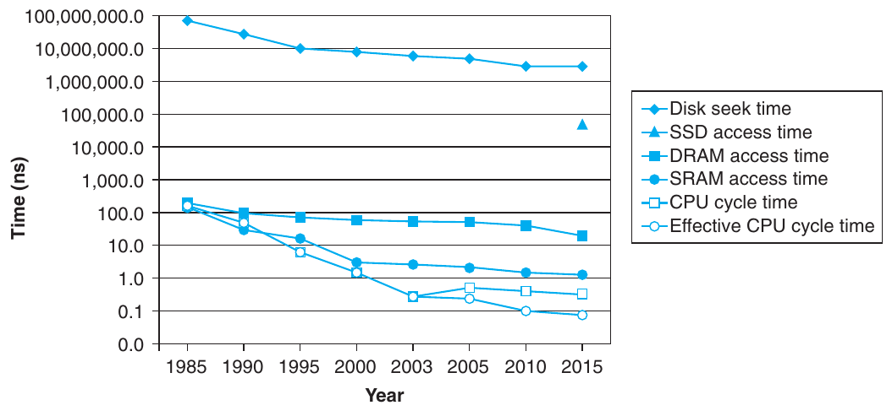

**Hình 6.16 Khoảng cách giữa tốc độ đĩa, DRAM và CPU.**

#### Bài tập thực hành 6.6 (lời giải trang 698)

Sử dụng dữ liệu từ năm 2005 đến 2015 trong Hình 6.15(c), hãy ước lượng năm mà bạn có thể mua một petabyte (10<sup>15</sup> byte) lưu trữ đĩa quay với giá $200. Giả sử dùng giá trị dollar thực tế (không tính lạm phát).

## 6.2 Locality

Chương trình máy tính Well-written có xu hướng thể hiện locality tốt. Nghĩa là chúng có xu hướng tham chiếu những mục dữ liệu nằm gần các mục vừa được tham chiếu, hoặc chính chúng vừa được tham chiếu. Xu hướng này, gọi là nguyên lý locality, là khái niệm bền vững có ảnh hưởng rất lớn đến thiết kế và hiệu năng hệ thống hardware và software.

Locality thường được mô tả gồm hai dạng riêng: temporal locality và spatial locality. Trong chương trình có temporal locality tốt, vị trí bộ nhớ được tham chiếu một lần có khả năng được tham chiếu lại nhiều lần trong tương lai gần. Trong chương trình có spatial locality tốt, nếu một vị trí bộ nhớ được tham chiếu, chương trình có khả năng tham chiếu vị trí gần đó trong tương lai gần.

### Thông tin thêm: Khi cycle time đứng yên: Sự xuất hiện của processor multi-core

Lịch sử máy tính ghi nhận một số sự kiện đặc biệt gây thay đổi sâu sắc cho ngành và thế giới. Thú vị là những bước ngoặt này có xu hướng xuất hiện khoảng mỗi thập niên một lần: phát triển Fortran vào thập niên 1950, giới thiệu IBM 360 đầu thập niên 1960, khởi đầu Internet (khi đó gọi là ARPANET) đầu thập niên 1970, giới thiệu IBM PC đầu thập niên 1980 và tạo World Wide Web đầu thập niên 1990.

Sự kiện gần nhất như vậy diễn ra đầu thế kỷ 21st, khi các nhà sản xuất máy tính đâm thẳng vào giới hạn so-called power wall, phát hiện không thể tăng CPU clock frequency nhanh như trước vì chip sẽ tiêu thụ quá nhiều điện. Giải pháp là cải thiện hiệu năng bằng cách thay processor lớn duy nhất bằng nhiều processor core nhỏ hơn, mỗi core là processor hoàn chỉnh có thể thực thi chương trình độc lập và song song với core khác. Cách multi-core này hoạt động một phần vì công suất processor tiêu thụ tỷ lệ với P = f CV<sup>2</sup>, trong đó f là clock frequency, C là điện dung và V là điện áp. Điện dung C xấp xỉ tỷ lệ với diện tích, nên có thể giữ công suất nhiều core không đổi miễn tổng diện tích không đổi. Miễn kích thước đặc trưng tiếp tục thu nhỏ theo tốc độ hàm mũ của Định luật Moore, số core trong mỗi processor, và do đó hiệu năng hiệu dụng, tiếp tục tăng.

Từ thời điểm này trở đi, máy tính sẽ nhanh hơn không phải vì clock frequency tăng mà vì số core mỗi processor tăng và những đổi mới kiến trúc tăng hiệu quả chương trình chạy trên core. Có thể thấy rõ xu hướng trong Hình 6.16. CPU cycle time đạt mức thấp nhất năm 2003 rồi thực sự tăng trước khi ổn định và bắt đầu giảm lại với tốc độ chậm hơn. Tuy nhiên, nhờ processor multi-core xuất hiện (dual-core năm 2004 và quad-core năm 2007), cycle time hiệu dụng tiếp tục giảm gần tốc độ trước đó.

Lập trình viên nên hiểu nguyên lý locality vì nhìn chung chương trình có locality tốt chạy nhanh hơn chương trình locality kém. Mọi tầng hệ thống máy tính hiện đại, từ hardware đến operating system và chương trình ứng dụng, đều được thiết kế để khai thác locality. Ở tầng hardware, nguyên lý này cho phép tăng tốc truy cập main memory bằng các bộ nhớ nhỏ nhanh gọi là cache memory, chứa block instruction và dữ liệu vừa được tham chiếu. Ở tầng operating system, nó cho phép dùng main memory làm cache cho các phần virtual address space vừa được tham chiếu. Tương tự, operating system dùng main memory cache các disk block dùng gần nhất trong disk file system. Nguyên lý locality cũng giữ vai trò quan trọng trong thiết kế ứng dụng. Ví dụ, Web browser khai thác temporal locality bằng cách cache tài liệu vừa tham chiếu trên đĩa cục bộ. Web server High-volume giữ tài liệu vừa yêu cầu trong disk cache front-end, đáp ứng yêu cầu tài liệu mà không cần server can thiệp.

```
1   int sumvec(int v[N])
2   {
3       int i, sum = 0;
4
5       for (i = 0; i < N; i++)
6           sum += v[i];
7       return sum;
8   }
```

(a)

| Address | 0 | 4 | 8 | 12 | 16 | 20 | 24 | 28 |
|---|---|---|---|---|---|---|---|---|
| Contents | v<sub>0</sub> | v<sub>1</sub> | v<sub>2</sub> | v<sub>3</sub> | v<sub>4</sub> | v<sub>5</sub> | v<sub>6</sub> | v<sub>7</sub> |
| Access order | 1 | 2 | 3 | 4 | 5 | 6 | 7 | 8 |

(b)

**Hình 6.17 (a) Hàm có locality tốt. (b) Mẫu tham chiếu vector v (N = 8). Lưu ý các phần tử vector được truy cập theo đúng thứ tự lưu trong bộ nhớ.**

### 6.2.1 Locality của tham chiếu dữ liệu chương trình

Xét hàm đơn giản trong Hình 6.17(a) tính tổng phần tử vector. Hàm có locality tốt không? Để trả lời, hãy xem mẫu tham chiếu của từng biến. Trong ví dụ, biến sum được tham chiếu một lần mỗi lượt lặp, nên có temporal locality tốt đối với sum. Ngược lại, vì sum là scalar nên không có spatial locality đối với sum.

Như Hình 6.17(b), các phần tử vector v được đọc tuần tự, lần lượt theo thứ tự lưu trong bộ nhớ (để tiện, giả sử array bắt đầu ở địa chỉ 0). Vì vậy, đối với biến v, hàm có spatial locality tốt nhưng temporal locality kém vì mỗi phần tử được truy cập đúng một lần. Vì hàm có spatial hoặc temporal locality tốt với mỗi biến trong thân vòng lặp, có thể kết luận sumvec có locality tốt.

Hàm như sumvec duyệt từng phần tử vector tuần tự được gọi là có mẫu tham chiếu stride-1 (tính theo kích thước phần tử). Đôi khi chúng ta gọi mẫu stride-1 là mẫu tham chiếu tuần tự. Duyệt mỗi phần tử thứ k của vector liên tục gọi là mẫu tham chiếu stride-k. Mẫu Stride-1 là nguồn spatial locality phổ biến và quan trọng trong chương trình. Nhìn chung, stride càng tăng thì spatial locality càng giảm.

Stride cũng quan trọng với chương trình tham chiếu array nhiều chiều. Ví dụ, xét hàm sumarrayrows trong Hình 6.18(a) tính tổng phần tử array two-dimensional.

Vòng lặp lồng hai tầng đọc các phần tử array theo thứ tự row-major. Nghĩa là vòng trong đọc các phần tử hàng đầu, rồi hàng thứ hai, v.v. Hàm sumarrayrows có spatial locality tốt vì tham chiếu array theo đúng thứ tự row-major mà array được lưu (Hình 6.18(b)). Kết quả là mẫu tham chiếu stride-1 với spatial locality rất tốt.

```
1   int sumarrayrows(int a[M][N])
2   {
3       int i, j, sum = 0;
4
5       for (i = 0; i < M; i++)
6           for (j = 0; j < N; j++)
7               sum += a[i][j];
8       return sum;
9   }
```

(a)

| Address | 0 | 4 | 8 | 12 | 16 | 20 |
|---|---|---|---|---|---|---|
| Contents | a<sub>00</sub> | a<sub>01</sub> | a<sub>02</sub> | a<sub>10</sub> | a<sub>11</sub> | a<sub>12</sub> |
| Access order | 1 | 2 | 3 | 4 | 5 | 6 |

(b)

**Hình 6.18 (a) Hàm khác có locality tốt. (b) Mẫu tham chiếu array a (M = 2, N = 3). Spatial locality tốt vì array được truy cập theo cùng thứ tự row-major mà nó được lưu trong bộ nhớ.**

```
1   int sumarraycols(int a[M][N])
2   {
3       int i, j, sum = 0;
4
5       for (j = 0; j < N; j++)
6           for (i = 0; i < M; i++)
7               sum += a[i][j];
8       return sum;
9   }
```

(a)

| Address | 0 | 4 | 8 | 12 | 16 | 20 |
|---|---|---|---|---|---|---|
| Contents | a<sub>00</sub> | a<sub>01</sub> | a<sub>02</sub> | a<sub>10</sub> | a<sub>11</sub> | a<sub>12</sub> |
| Access order | 1 | 3 | 5 | 2 | 4 | 6 |

(b)

**Hình 6.19 (a) Hàm có spatial locality kém. (b) Mẫu tham chiếu array a (M = 2, N = 3). Hàm có spatial locality kém vì quét bộ nhớ bằng mẫu tham chiếu stride-N.**

Những thay đổi tưởng tầm thường có thể ảnh hưởng lớn đến locality. Ví dụ, sumarraycols trong Hình 6.19(a) tính cùng kết quả như sumarrayrows trong Hình 6.18(a). Khác biệt duy nhất là đổi chỗ vòng lặp i và j. Việc đổi chỗ ảnh hưởng locality thế nào?

Hàm sumarraycols có spatial locality kém vì quét array column-wise thay vì row-wise. Vì array C được bố trí row-wise trong bộ nhớ, kết quả là mẫu tham chiếu stride-N như Hình 6.19(b).

### 6.2.2 Locality của instruction fetch

Vì instruction chương trình nằm trong bộ nhớ và phải được CPU lấy (đọc), cũng có thể đánh giá locality về instruction fetch. Ví dụ, trong Hình 6.17, instruction trong thân vòng lặp for được thực thi theo thứ tự bộ nhớ tuần tự, nên vòng lặp có spatial locality tốt. Vì thân vòng lặp được thực thi nhiều lần, nó cũng có temporal locality tốt.

Đặc tính quan trọng phân biệt code với dữ liệu chương trình là code hiếm khi bị sửa lúc chạy. Trong khi chương trình thực thi, CPU đọc instruction từ bộ nhớ. CPU hiếm khi ghi đè hoặc sửa những instruction này.

### 6.2.3 Tổng kết locality

Trong mục này, chúng ta giới thiệu ý tưởng nền tảng locality và xác định vài quy tắc đơn giản để đánh giá định tính locality của chương trình:

- Chương trình tham chiếu lặp lại cùng biến có temporal locality tốt.

- Với chương trình có mẫu tham chiếu stride-k, stride càng nhỏ thì spatial locality càng tốt. Chương trình có mẫu stride-1 có spatial locality tốt. Chương trình nhảy quanh bộ nhớ với stride lớn có spatial locality kém.

- Vòng lặp có temporal và spatial locality tốt về instruction fetch. Thân vòng lặp càng nhỏ và số lượt lặp càng lớn thì locality càng tốt.

Sau này trong chương, khi đã học cache memory và cách hoạt động, chúng ta sẽ định lượng locality bằng cache hit và miss. Bạn cũng sẽ hiểu rõ vì sao chương trình locality tốt thường nhanh hơn chương trình locality kém. Dù vậy, biết nhìn nhanh source code và có cảm nhận high-level về locality là kỹ năng hữu ích, quan trọng mà lập trình viên cần thành thạo.

#### Bài tập thực hành 6.7 (lời giải trang 698)

Hoán vị vòng lặp trong hàm sau để quét array three-dimensional a bằng mẫu tham chiếu stride-1.

```
 1   int productarray3d(int a[N][N][N])
 2   {
 3       int i, j, k, product = 1;
 4
 5       for (i = N-1; i >= 0; i--) {
 6           for (j = N-1; j >= 0; j--) {
 7               for (k = N-1; k >= 0; k--) {
 8                   product *= a[j][k][i];
 9               }
10           }
11       }
12       return product;
13   }
```

(a) Array các struct

```
1   #define N 1000
2
3   typedef struct {
4       int vel[3];
5       int acc[3];
6   } point;
7
8   point p[N];
```

(b) Hàm clear1

```
 1   void clear1(point *p, int n)
 2   {
 3       int i, j;
 4
 5       for (i = 0; i < n; i++) {
 6           for (j = 0; j < 3; j++)
 7               p[i].vel[j] = 0;
 8           for (j = 0; j < 3; j++)
 9               p[i].acc[j] = 0;
10       }
11   }
```

(c) Hàm clear2

```
 1   void clear2(point *p, int n)
 2   {
 3       int i, j;
 4
 5       for (i = 0; i < n; i++) {
 6           for (j = 0; j < 3; j++) {
 7               p[i].vel[j] = 0;
 8               p[i].acc[j] = 0;
 9           }
10       }
11   }
```

(d) Hàm clear3

```
 1   void clear3(point *p, int n)
 2   {
 3       int i, j;
 4
 5       for (j = 0; j < 3; j++) {
 6           for (i = 0; i < n; i++)
 7               p[i].vel[j] = 0;
 8           for (i = 0; i < n; i++)
 9               p[i].acc[j] = 0;
10       }
11   }
```

**Hình 6.20 Các ví dụ code cho Bài tập thực hành 6.8.**

#### Bài tập thực hành 6.8 (lời giải trang 699)

Ba hàm trong Hình 6.20 thực hiện cùng phép toán với mức spatial locality khác nhau. Hãy xếp hạng Rank-order các hàm theo spatial locality từng hàm có được. Giải thích cách bạn đưa ra thứ hạng.

## 6.3 Memory hierarchy

Mục 6.1 và 6.2 mô tả vài tính chất nền tảng, bền vững của công nghệ lưu trữ và software máy tính:

Công nghệ lưu trữ. Công nghệ khác nhau có access time rất khác nhau. Công nghệ nhanh hơn có giá mỗi byte cao hơn và dung lượng nhỏ hơn công nghệ chậm. Khoảng cách tốc độ CPU và main memory ngày càng rộng.

Software máy tính. Chương trình Well-written có xu hướng thể hiện locality tốt. Trong một trùng hợp may mắn của điện toán, những tính chất hardware và software cơ bản bổ sung cho nhau rất đẹp. Sự bổ sung lẫn nhau này gợi ra một cách tổ chức hệ thống bộ nhớ gọi là memory hierarchy, được dùng trong mọi hệ thống hiện đại. Hình 6.21 trình bày memory hierarchy điển hình.

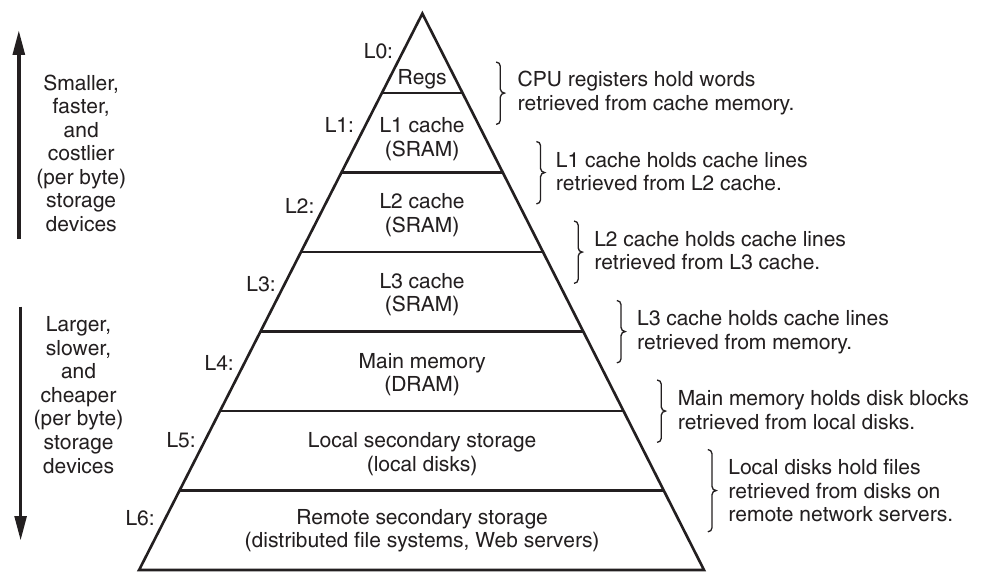

**Hình 6.21 Memory hierarchy.**

Nhìn chung, thiết bị lưu trữ chậm hơn, rẻ hơn và lớn hơn khi đi từ tầng cao xuống thấp. Tầng cao nhất (L0) có ít CPU register nhanh, truy cập được trong một clock cycle. Tiếp đến là một hoặc nhiều cache memory SRAM-based có kích thước từ nhỏ đến moderate-size, có thể được truy cập trong vài CPU clock cycle. Sau đó là main memory DRAM-based có dung lượng lớn, có thể được truy cập trong hàng chục đến hàng trăm clock cycle. Tiếp theo là đĩa cục bộ chậm nhưng rất lớn. Cuối cùng, một số hệ thống có thêm tầng đĩa trên server từ xa truy cập qua mạng. Ví dụ, distributed file system như Andrew File System (AFS) hoặc Network File System (NFS) cho phép chương trình truy cập file lưu trên server network-connected từ xa. Tương tự, World Wide Web cho phép truy cập file từ xa trên Web server ở bất kỳ đâu trên thế giới.

### 6.3.1 Caching trong memory hierarchy

Nhìn chung, cache (phát âm “cash”) là thiết bị lưu trữ nhỏ nhanh, làm vùng trung gian cho data object lưu trong thiết bị lớn chậm hơn. Quá trình dùng cache gọi là caching (phát âm “cashing”).

Ý tưởng cốt lõi của memory hierarchy là với mỗi k, thiết bị nhanh nhỏ ở tầng k làm cache cho thiết bị lớn chậm ở tầng k + 1. Nói cách khác, mỗi tầng cache data object từ tầng ngay dưới. Ví dụ, đĩa cục bộ làm cache cho file (như trang Web) lấy từ đĩa từ xa qua mạng, main memory làm cache cho dữ liệu đĩa cục bộ, v.v. cho đến cache nhỏ nhất là tập CPU register.

#### Thông tin thêm: Những memory hierarchy khác

Chúng ta đã trình bày một ví dụ memory hierarchy, nhưng những tổ hợp khác cũng có thể và thực tế phổ biến. Ví dụ, nhiều địa điểm, gồm Google datacenter, sao lưu đĩa cục bộ lên băng từ lưu trữ. Ở một số nơi, người vận hành gắn băng vào tape drive thủ công khi cần. Ở những nơi khác, robot xử lý băng thực hiện nhiệm vụ này tự động. Trong cả hai trường hợp, tập băng là một tầng memory hierarchy dưới đĩa cục bộ và những nguyên lý chung tương tự vẫn được áp dụng. Băng có giá mỗi byte rẻ hơn đĩa, cho phép lưu nhiều snapshot của đĩa cục bộ. Sự đánh đổi trade-off là truy cập băng lâu hơn đĩa. Ví dụ khác là solid state disk ngày càng quan trọng trong memory hierarchy, nối khoảng cách DRAM và đĩa quay.

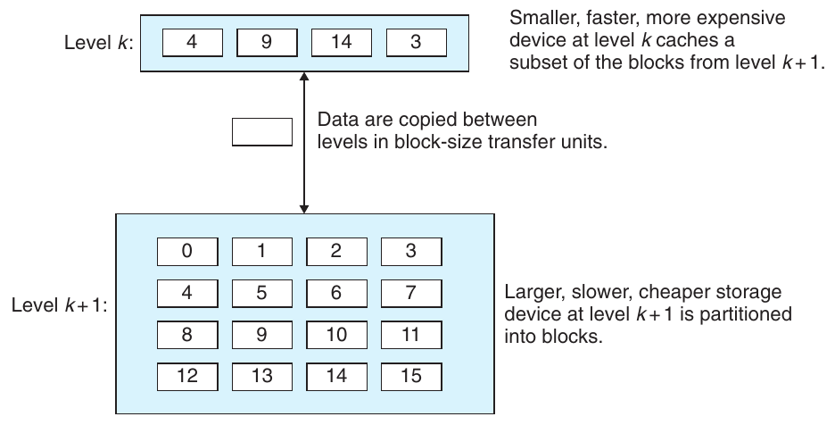

**Hình 6.22 Nguyên lý cơ bản của caching trong memory hierarchy.**

Hình 6.22 trình bày khái niệm chung của caching trong memory hierarchy. Lưu trữ tầng k + 1 được chia thành các đoạn data object liên tục gọi là block. Mỗi block có địa chỉ hoặc tên duy nhất phân biệt với block khác. Block có thể có kích thước cố định (thường gặp) hoặc thay đổi (ví dụ file HTML từ xa trên Web server). Ví dụ, lưu trữ tầng k + 1 trong Hình 6.22 được chia thành 16 block fixed-size, đánh số 0 đến 15.

Tương tự, lưu trữ tầng k được chia thành tập block nhỏ hơn có cùng kích thước block tầng k + 1. Tại mọi thời điểm, cache tầng k chứa bản sao một tập con block tầng k + 1. Ví dụ trong Hình 6.22, cache tầng k có chỗ cho bốn block và hiện chứa bản sao block 4, 9, 14 và 3.

Dữ liệu luôn được sao chép qua lại tầng k và k + 1 bằng đơn vị truyền block-size. Cần hiểu rằng mặc dù block size cố định giữa một cặp tầng kề nhau cụ thể, những cặp khác có thể dùng block size khác. Ví dụ, trong Hình 6.21, truyền giữa L1 và L0 thường dùng block word-size. Truyền giữa L2 và L1 (và L3 với L2, L4 với L3) thường dùng block hàng chục byte. Truyền giữa L5 và L4 dùng block hàng trăm hoặc hàng nghìn byte. Nhìn chung, thiết bị ở tầng thấp hơn (xa CPU hơn) có access time dài hơn, nên có xu hướng dùng block size lớn hơn để phân bổ chi phí của access time dài này.

### Cache hit

Khi chương trình cần data object d cụ thể ở tầng k + 1, trước hết nó tìm d trong một block hiện lưu tại tầng k. Nếu d được cache tại tầng k, ta có cache hit. Chương trình đọc d trực tiếp từ tầng k, theo bản chất memory hierarchy nhanh hơn đọc từ tầng k + 1. Ví dụ, chương trình có temporal locality tốt có thể đọc data object từ block 14, tạo cache hit ở tầng k.

### Cache miss

Ngược lại, nếu data object d không được cache ở tầng k, ta có cache miss. Khi miss, cache tầng k lấy block chứa d từ cache tầng k + 1, có thể ghi đè block hiện có nếu cache tầng k đã đầy.

Quá trình ghi đè block hiện có gọi là thay thế hoặc evict block. Block bị evict đôi khi gọi là victim block. Quyết định thay block nào do replacement policy của cache điều khiển. Ví dụ, cache có random replacement policy chọn victim block ngẫu nhiên. Cache có replacement policy least recently used (LRU) chọn block có lần truy cập cuối xa nhất trong quá khứ.

Sau khi cache tầng k lấy block từ tầng k + 1, chương trình có thể đọc d ở tầng k như trước. Ví dụ trong Hình 6.22, đọc data object từ block 12 ở cache tầng k tạo cache miss vì block 12 hiện không nằm trong cache này. Sau khi sao chép từ tầng k + 1 sang k, block 12 ở lại để chờ những truy cập sau.

### Các loại cache miss

Đôi khi nên phân biệt các loại cache miss. Nếu cache tầng k rỗng, mọi truy cập data object đều miss. Cache rỗng đôi khi được gọi là cold cache, và các miss dạng này được gọi là compulsory miss hoặc cold miss. Cold miss quan trọng vì thường là sự kiện tạm thời có thể không xuất hiện ở steady state, sau khi cache được làm nóng bằng truy cập bộ nhớ lặp lại.

Mỗi khi miss, cache tầng k phải triển khai placement policy xác định đặt block lấy từ tầng k + 1 ở đâu. Policy linh hoạt nhất cho phép một block bất kỳ của tầng k + 1 được lưu trong một block bất kỳ của tầng k. Với các cache ở tầng cao (gần CPU) được triển khai bằng hardware và đặt tốc độ lên hàng đầu, policy này thường quá tốn kém để triển khai, vì việc tìm những block được đặt ngẫu nhiên có chi phí cao.

Do đó, hardware cache thường dùng placement policy đơn giản hơn, hạn chế block cụ thể ở tầng k + 1 vào tập con nhỏ (đôi khi chỉ một block) ở tầng k. Ví dụ trong Hình 6.22, có thể quy định block i tầng k + 1 phải vào block (i mod 4) tầng k. Khi đó block 0, 4, 8 và 12 tầng k + 1 ánh xạ vào block 0 tầng k; block 1, 5, 9 và 13 vào block 1; v.v. Lưu ý cache ví dụ trong Hình 6.22 dùng policy này.

Placement policy hạn chế như vậy dẫn đến conflict miss: cache đủ lớn chứa data object được tham chiếu, nhưng vì chúng ánh xạ vào cùng cache block nên cache liên tục bị miss. Ví dụ trong Hình 6.22, nếu chương trình yêu cầu block 0, rồi 8, rồi 0, rồi 8, v.v., mỗi tham chiếu hai block đều miss tại cache tầng k, dù cache chứa được tổng bốn block.

Chương trình thường chạy theo một chuỗi phase (ví dụ các vòng lặp), trong đó mỗi phase truy cập một tập cache block tương đối cố định. Ví dụ, vòng lặp lồng có thể truy cập phần tử cùng array nhiều lần. Tập block này gọi là working set của phase. Khi working set lớn hơn cache, cache gặp capacity miss. Nói cách khác, cache quá nhỏ để xử lý working set cụ thể này.

### Quản lý cache

Như đã lưu ý, bản chất memory hierarchy là thiết bị lưu trữ mỗi tầng làm cache cho tầng ngay dưới. Mỗi tầng phải có logic quản lý cache. Nghĩa là phải có thành phần chia lưu trữ cache thành block, truyền block giữa tầng, xác định hit và miss rồi xử lý chúng. Logic quản lý cache có thể là hardware, software hoặc kết hợp cả hai.

Ví dụ, compiler quản lý register file, tầng cao nhất của cache hierarchy. Nó quyết định lúc phát hành load khi miss và chọn register lưu dữ liệu. Cache L1, L2 và L3 được quản lý hoàn toàn bằng hardware logic tích hợp trong cache. Trong hệ thống có virtual memory, DRAM main memory đóng vai trò cache cho data block lưu trên đĩa, được quản lý bằng tổ hợp operating system software và hardware chuyển địa chỉ trên CPU. Với máy có distributed file system như AFS, đĩa cục bộ làm cache do AFS client process chạy trên máy quản lý. Trong phần lớn trường hợp, cache hoạt động tự động, không đòi hỏi hành động cụ thể hay tường minh từ chương trình.

| Loại Nội dung cache Nơi cache | Latency (cycle) Được quản lý bởi |
|---|---|
| CPU register word 4-byte hoặc 8-byte CPU register On-chip | 0 Compiler |
| TLB Chuyển đổi địa chỉ TLB On-chip | 0 Hardware MMU |
| L1 cache block 64-byte L1 cache On-chip | 4 Hardware |
| L2 cache block 64-byte L2 cache On-chip | 10 Hardware |
| L3 cache block 64-byte L3 cache On-chip | 50 Hardware |
| Virtual memory page 4-KB Main memory | 200 Hardware + OS |
| Buffer cache Các phần của file Main memory | 200 OS |
| Disk cache Disk sector Disk controller | 100,000 Controller firmware |
| Network cache Các phần của file Đĩa cục bộ | 10,000,000 NFS client |
| Browser cache Trang Web Đĩa cục bộ | 10,000,000 Web browser |
| Web cache Trang Web Đĩa server từ xa | 1,000,000,000 Web proxy server |

**Hình 6.23 Caching hiện diện khắp hệ thống máy tính hiện đại. Các chữ viết tắt: TLB: translation lookaside buffer; MMU: memory management unit; OS: operating system; NFS: network file system.**

### 6.3.2 Tổng kết khái niệm memory hierarchy

Tổng kết lại, memory hierarchy dựa trên caching hoạt động vì lưu trữ chậm rẻ hơn lưu trữ nhanh và vì chương trình có xu hướng thể hiện locality:

Khai thác temporal locality. Nhờ temporal locality, cùng một data object có khả năng được tái sử dụng nhiều lần. Sau khi một data object được sao chép vào cache ở lần miss đầu tiên, chúng ta có thể kỳ vọng sẽ có nhiều hit tiếp theo đối với object đó. Vì cache nhanh hơn lưu trữ tầng ngay dưới, những hit này được phục vụ nhanh hơn nhiều so với miss ban đầu.

Khai thác spatial locality. Block thường chứa nhiều data object. Nhờ spatial locality, chúng ta có thể kỳ vọng chi phí sao chép block sau một lần miss sẽ được phân bổ qua các tham chiếu tiếp theo đến những object khác trong block đó.

Cache được dùng khắp hệ thống hiện đại. Như Hình 6.23, cache có trong CPU chip, operating system, distributed file system và World Wide Web. Chúng được xây dựng và quản lý bằng nhiều tổ hợp hardware, software. Lưu ý Hình 6.23 có một số thuật ngữ và viết tắt chưa được đề cập. Chúng được đưa vào để minh họa cache phổ biến thế nào.

## 6.4 Cache memory

Memory hierarchy của hệ thống máy tính thời đầu chỉ có ba tầng: CPU register, main memory và lưu trữ đĩa. Tuy nhiên, vì khoảng cách CPU và main memory tăng, người thiết kế phải chèn SRAM cache memory nhỏ, được gọi là L1 cache (level 1 cache) giữa CPU register file và main memory như Hình 6.24. Truy cập L1 cache gần nhanh như register, thường khoảng 4 clock cycle.

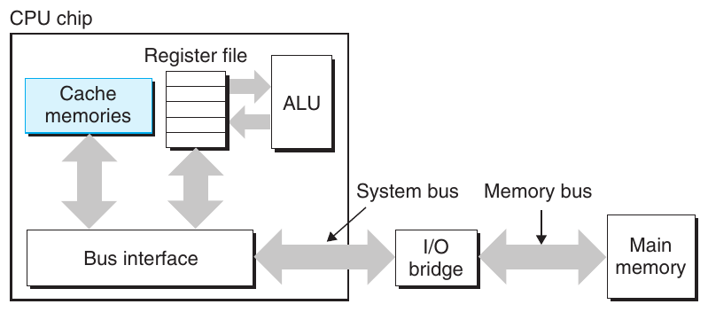

**Hình 6.24 Cấu trúc bus điển hình cho cache memory.**

Khi khoảng cách hiệu năng giữa CPU và main memory tiếp tục tăng, các nhà thiết kế thêm một cache lớn hơn, tên là L2, nằm giữa L1 và main memory, có thể được truy cập trong khoảng 10 clock cycle. Nhiều hệ thống hiện đại có một cache còn lớn hơn nữa, tên là L3, nằm giữa L2 và main memory, có thể được truy cập trong khoảng 50 cycle. Mặc dù cách bố trí rất đa dạng, các nguyên lý chung vẫn giống nhau. Trong phần thảo luận ở mục tiếp theo, chúng ta giả định một memory hierarchy đơn giản với một L1 cache nằm giữa CPU và main memory.

### 6.4.1 Tổ chức cache memory tổng quát

Xét một hệ thống trong đó mỗi địa chỉ bộ nhớ có m bit, tạo thành M = 2<sup>m</sup> địa chỉ duy nhất. Như trong Hình 6.25(a), cache được tổ chức thành một array gồm S = 2<sup>s</sup> cache set. Mỗi set gồm E cache line. Mỗi line gồm một data block có B = 2<sup>b</sup> byte, một valid bit cho biết line có chứa thông tin có nghĩa hay không, và t = m − (b + s) tag bit (một tập con các bit địa chỉ bộ nhớ của block hiện tại), xác định duy nhất block được lưu trong cache line.

Nhìn chung, tổ chức cache được đặc trưng bằng tuple (S, E, B, m). Kích thước (hay capacity) cache C được tính bằng tổng kích thước mọi block, không gồm tag bit và valid bit. Do đó, C = S × E × B.

Khi một load instruction yêu cầu CPU đọc một word từ địa chỉ A của main memory, CPU gửi A đến cache. Nếu cache giữ một bản sao của word tại địa chỉ A, nó gửi word đó về CPU ngay lập tức. Vậy cache biết mình có chứa bản sao của word được yêu cầu hay không bằng cách nào? Cache được tổ chức để có thể tìm word được yêu cầu chỉ bằng cách kiểm tra các bit địa chỉ, tương tự một hash table có hash function cực kỳ đơn giản. Cách hoạt động như sau:

Các tham số S và B phân chia m bit địa chỉ thành ba field như trong Hình 6.25(b). Các s set index bit trong A tạo thành index vào array gồm S set. Set đầu tiên là set 0, set thứ hai là set 1, v.v. Khi được diễn giải như một số nguyên unsigned, các set index bit cho biết word phải được lưu trong set nào. Khi đã xác định set, t tag bit trong A cho biết line nào trong set (nếu có) chứa word. Một line chứa word khi và chỉ khi valid bit được đặt và các tag bit của line khớp với các tag bit của địa chỉ A. Sau khi xác định line bằng tag trong set do set index xác định, b block offset bit cho biết offset của word trong data block B-byte.

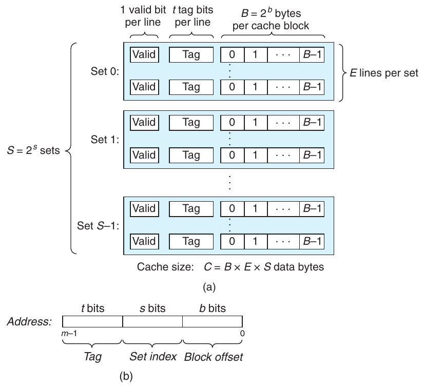

**Hình 6.25 Tổ chức tổng quát cache (S, E, B, m). (a) Cache là array các set. Mỗi set chứa một hoặc nhiều line. Mỗi line chứa valid bit, một số tag bit và data block. (b) Tổ chức cache phân chia m bit địa chỉ thành t tag bit, s set index bit và b block offset bit.**

Bạn có thể nhận thấy phần mô tả cache sử dụng khá nhiều ký hiệu. Hình 6.26 tổng kết các ký hiệu này để bạn tham khảo.

#### Bài tập thực hành 6.9 (lời giải trang 699)

Bảng sau cho tham số của một số cache khác nhau. Với mỗi cache, hãy xác định số cache set (S), tag bit (t), set index bit (s) và block offset bit (b).

| Cache | m | C | B | E | S | t | s | b |
|---|---|---|---|---|---|---|---|---|
| 1. | 32 | 1,024 | 4 | 1 | ______ | ______ | ______ | ______ |
| 2. | 32 | 1,024 | 8 | 4 | ______ | ______ | ______ | ______ |
| 3. | 32 | 1,024 | 32 | 32 | ______ | ______ | ______ | ______ |

| Tham số | Mô tả |
|---|---|
| Các tham số cơ bản |  |
| S = 2<sup>s</sup> | Số set |
| E | Số line mỗi set |
| B = 2<sup>b</sup> | Block size (byte) |
| m = log<sub>2</sub>(M) | Số bit địa chỉ vật lý (main memory) |
| Các đại lượng suy ra |  |
| M = 2<sup>m</sup> | Số địa chỉ bộ nhớ duy nhất tối đa |
| s = log<sub>2</sub>(S) | Số set index bit |
| b = log<sub>2</sub>(B) | Số block offset bit |
| t = m − (s + b) | Số tag bit |
| C = B × E × S | Kích thước cache (byte), không gồm overhead như valid bit và tag bit |

**Hình 6.26 Tổng kết tham số cache.**

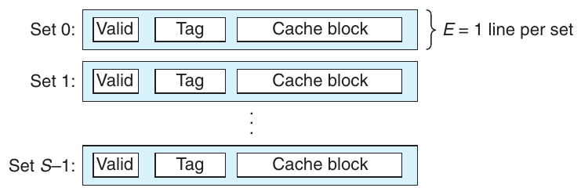

**Hình 6.27 Cache Direct-mapped (E = 1). Mỗi set có đúng một line.**

### 6.4.2 Cache Direct-Mapped

Cache được chia lớp dựa trên E, số cache line mỗi set. Cache có đúng một line mỗi set (E = 1) gọi là direct-mapped cache (Hình 6.27). Cache Direct-mapped là loại đơn giản nhất cả về cách triển khai lẫn cách tìm hiểu, nên chúng ta sử dụng nó để minh họa những khái niệm chung về hoạt động của cache.

Giả sử hệ thống có CPU, register file, L1 cache và main memory. Khi CPU thực thi instruction đọc memory word w, nó yêu cầu word từ L1 cache. Nếu L1 có bản sao w, ta có L1 cache hit, cache nhanh chóng trích xuất w và trả về CPU. Nếu không, ta có cache miss và CPU phải chờ trong khi L1 cache yêu cầu bản sao block chứa w từ main memory. Khi block được yêu cầu cuối cùng đến từ bộ nhớ, L1 cache lưu nó vào một cache line, trích xuất word w từ block đã lưu và trả word đó về CPU. Quá trình cache xác định yêu cầu hit hay miss rồi trích xuất word gồm ba bước: (1) chọn set, (2) so khớp line và (3) trích xuất word.

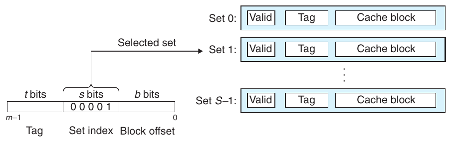

**Hình 6.28 Chọn set trong cache direct-mapped.**

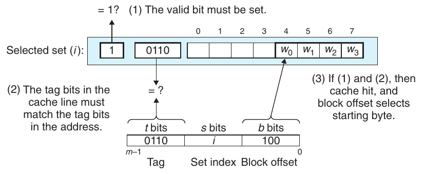

**Hình 6.29 So khớp line và chọn word trong cache direct-mapped. Trong cache block, w<sub>0</sub> chỉ byte low-order của word w, w<sub>1</sub> chỉ byte tiếp theo, v.v.**

### Chọn set trong cache Direct-Mapped

Ở bước này, cache trích xuất s set index bit từ giữa địa chỉ của w. Những bit này được diễn giải như một số nguyên unsigned tương ứng với số hiệu set. Nói cách khác, nếu xem cache là array one-dimensional các set, set index bit tạo index vào array. Hình 6.28 cho thấy chọn set trong cache direct-mapped. Trong ví dụ, set index bit 00001<sub>2</sub> được diễn giải là index số nguyên chọn set 1.

### So khớp line trong cache Direct-Mapped

Sau khi chọn set i ở bước trước, bước tiếp là xác định bản sao word w có lưu trong một cache line của set i không. Với cache direct-mapped, việc này dễ dàng và nhanh chóng vì mỗi set có đúng một line. Bản sao w nằm trong line khi và chỉ khi valid bit được đặt và tag của cache line khớp tag trong địa chỉ w.

Hình 6.29 cho thấy so khớp line trong cache direct-mapped. Trong ví dụ, set được chọn có đúng một cache line. Valid bit của line này được đặt, nên chúng ta biết các bit trong tag và block chứa thông tin có nghĩa. Vì tag bit của cache line khớp tag bit trong địa chỉ, chúng ta biết bản sao word cần tìm thực sự nằm trong line. Nói cách khác, chúng ta có cache hit. Ngược lại, nếu valid bit không đặt hoặc tag không khớp, sẽ là cache miss.

### Chọn word trong cache Direct-Mapped

Khi có hit, chúng ta biết w nằm đâu đó trong block. Bước cuối cùng là xác định vị trí bắt đầu của word mong muốn. Như Hình 6.29, block offset bit cho offset byte đầu của word. Tương tự xem cache như array line, có thể xem block như array byte, và byte offset là index. Trong ví dụ, block offset bit 100<sub>2</sub> cho biết bản sao w bắt đầu ở byte 4 của block. (Giả sử word dài 4 byte.)

### Thay line khi miss trong cache Direct-Mapped

Nếu miss, cache cần lấy block yêu cầu từ tầng memory hierarchy kế tiếp và lưu block mới vào một cache line của set do set index bit chỉ ra. Nhìn chung, nếu set đầy line hợp lệ, phải evict một line hiện có. Với cache direct-mapped có đúng một line mỗi set, replacement policy đơn giản: line hiện tại được thay bằng line mới lấy.

### Kết hợp lại: Cache Direct-Mapped hoạt động

Cơ chế cache dùng chọn set và xác định line cực kỳ đơn giản. Chúng buộc phải đơn giản vì hardware phải thực hiện trong vài nanosecond. Tuy nhiên, thao tác bit như vậy có thể gây khó hiểu cho con người. Ví dụ cụ thể giúp làm rõ. Giả sử cache direct-mapped được mô tả bằng

(S, E, B, m) = (4, 1, 2, 4)

Nói cách khác, cache có bốn set, một line mỗi set, 2 byte mỗi block và địa chỉ 4-bit. Cũng giả sử mỗi word là một byte. Tất nhiên, những giả định hoàn toàn không thực tế nhưng giúp ví dụ đơn giản.

Khi mới học cache, liệt kê toàn bộ address space và chia bit như Hình 6.30 cho ví dụ 4-bit có thể rất bổ ích. Có vài điểm thú vị cần lưu ý:

- Ghép tag bit và index bit xác định duy nhất từng block bộ nhớ. Ví dụ block 0 gồm địa chỉ 0 và 1, block 1 gồm 2 và 3, block 2 gồm 4 và 5, v.v.

- Vì có tám memory block nhưng chỉ bốn cache set, nhiều block ánh xạ cùng set (tức cùng set index). Ví dụ, block 0 và 4 đều ánh xạ vào set 0, block 1 và 5 đều ánh xạ vào set 1, v.v.

- Những block ánh xạ vào cùng cache set được phân biệt duy nhất bằng tag. Ví dụ block 0 có tag bit 0 còn block 4 có tag bit 1; block 1 có tag bit 0 còn block 5 có tag bit 1; v.v.

Các bit địa chỉ

| Address | Tag bits | Index bits | Offset bits | Block number |
|---|---|---|---|---|
| (decimal) | (t = 1) | (s = 2) | (b = 1) | (decimal) |
| 0 | 0 | 00 | 0 | 0 |
| 1 | 0 | 00 | 1 | 0 |
| 2 | 0 | 01 | 0 | 1 |
| 3 | 0 | 01 | 1 | 1 |
| 4 | 0 | 10 | 0 | 2 |
| 5 | 0 | 10 | 1 | 2 |
| 6 | 0 | 11 | 0 | 3 |
| 7 | 0 | 11 | 1 | 3 |
| 8 | 1 | 00 | 0 | 4 |
| 9 | 1 | 00 | 1 | 4 |
| 10 | 1 | 01 | 0 | 5 |
| 11 | 1 | 01 | 1 | 5 |
| 12 | 1 | 10 | 0 | 6 |
| 13 | 1 | 10 | 1 | 6 |
| 14 | 1 | 11 | 0 | 7 |
| 15 | 1 | 11 | 1 | 7 |

**Hình 6.30 Address space 4-bit của cache direct-mapped ví dụ.**

Hãy mô phỏng cache khi CPU thực hiện chuỗi phép đọc. Nhớ rằng ví dụ giả sử CPU đọc word 1-byte. Mặc dù mô phỏng thủ công tẻ nhạt và bạn có thể muốn bỏ qua, theo kinh nghiệm sinh viên chưa thực sự hiểu hoạt động cache cho đến khi tự làm vài ví dụ.

Ban đầu, cache rỗng (tức mỗi valid bit là 0):

| Set | Valid | Tag | block[0] | block[1] |
|---|---|---|---|---|
| 0 | 0 |  |  |  |
| 1 | 0 |  |  |  |
| 2 | 0 |  |  |  |
| 3 | 0 |  |  |  |

Mỗi hàng trong bảng là cache line. Cột đầu chỉ set của line, nhưng nhớ cột này chỉ để tiện và không thực sự là phần cache. Bốn cột tiếp theo biểu diễn bit thực tế của mỗi cache line. Giờ xem CPU thực hiện chuỗi phép đọc thế nào:

1. Đọc word tại địa chỉ 0. Vì valid bit của set 0 là 0, đây là cache miss. Cache lấy block 0 từ bộ nhớ (hoặc cache lower-level) và lưu vào set 0. Sau đó, cache trả về m[0] (nội dung vị trí bộ nhớ 0) từ block[0] của cache line mới lấy.

| Set | Valid | Tag | block[0] | block[1] |
|---|---|---|---|---|
| 0 | 1 | 0 | m[0] | m[1] |
| 1 | 0 |  |  |  |
| 2 | 0 |  |  |  |
| 3 | 0 |  |  |  |

2. Đọc word tại địa chỉ 1. Đây là cache hit. Cache trả ngay giá trị m[1] từ block[1] của cache line. Trạng thái cache không đổi.

3. Đọc word tại địa chỉ 13. Vì cache line trong set 2 không hợp lệ, đây là cache miss. Cache load block 6 vào set 2 và trả m[13] từ block[1] của cache line mới.

| Set | Valid | Tag | block[0] | block[1] |
|---|---|---|---|---|
| 0 | 1 | 0 | m[0] | m[1] |
| 1 | 0 |  |  |  |
| 2 | 1 | 1 | m[12] | m[13] |
| 3 | 0 |  |  |  |

4. Đọc word tại địa chỉ 8. Đây là miss. Cache line trong set 0 hợp lệ nhưng tag không khớp. Cache load block 4 vào set 0 (thay line có từ lần đọc địa chỉ 0) rồi trả m[8] từ block[0] của cache line mới.

| Set | Valid | Tag | block[0] | block[1] |
|---|---|---|---|---|
| 0 | 1 | 1 | m[8] | m[9] |
| 1 | 0 |  |  |  |
| 2 | 1 | 1 | m[12] | m[13] |
| 3 | 0 |  |  |  |

5. Đọc word tại địa chỉ 0. Đây lại là miss, vì không may chúng ta vừa thay block 0 ở lần tham chiếu địa chỉ 8 trước đó. Loại miss này, trong đó cache còn nhiều chỗ nhưng chương trình liên tục luân phiên tham chiếu những block ánh xạ vào cùng set, là một ví dụ conflict miss.

| Set | Valid | Tag | block[0] | block[1] |
|---|---|---|---|---|
| 0 | 1 | 0 | m[0] | m[1] |
| 1 | 0 |  |  |  |
| 2 | 1 | 1 | m[12] | m[13] |
| 3 | 0 |  |  |  |

### Conflict miss trong cache Direct-Mapped

Conflict miss phổ biến trong chương trình thực tế và có thể gây vấn đề hiệu năng khó hiểu. Conflict miss trong cache direct-mapped thường xảy ra khi chương trình truy cập array có kích thước lũy thừa của 2. Ví dụ, xét hàm tính dot product hai vector:

```
1   float dotprod(float x[8], float y[8])
2   {
3       float sum = 0.0;
4       int i;
5
6       for (i = 0; i < 8; i++)
7           sum += x[i] * y[i];
8       return sum;
9   }
```

Hàm có spatial locality tốt với x và y, nên có thể kỳ vọng nhiều cache hit. Đáng tiếc, không phải luôn đúng.

Giả sử float dài 4 byte, x được load vào 32 byte liên tục bắt đầu địa chỉ 0, và y ngay sau x tại địa chỉ 32. Để đơn giản, block dài 16 byte (đủ bốn float) và cache gồm hai set, tổng kích thước 32 byte. Giả sử sum thực sự nằm trong CPU register nên không cần tham chiếu bộ nhớ. Khi đó, mỗi x[i] và y[i] ánh xạ vào cùng cache set:

| Element | Address | Set index | Element | Address | Set index |
|---|---|---|---|---|---|
| x[0] | 0 | 0 | y[0] | 32 | 0 |
| x[1] | 4 | 0 | y[1] | 36 | 0 |
| x[2] | 8 | 0 | y[2] | 40 | 0 |
| x[3] | 12 | 0 | y[3] | 44 | 0 |
| x[4] | 16 | 1 | y[4] | 48 | 1 |
| x[5] | 20 | 1 | y[5] | 52 | 1 |
| x[6] | 24 | 1 | y[6] | 56 | 1 |
| x[7] | 28 | 1 | y[7] | 60 | 1 |

Khi chạy, lượt lặp đầu tiên tham chiếu x[0], gây miss khiến block chứa x[0]–x[3] được load vào set 0. Tham chiếu tiếp theo đến y[0] lại gây miss, khiến block chứa y[0]–y[3] được sao chép vào set 0, ghi đè những giá trị x từ lần tham chiếu trước. Ở lượt tiếp theo, tham chiếu x[1] miss, khiến block x[0]– x[3] load lại vào set 0, ghi đè block y[0]–y[3]. Lúc này chúng ta có conflict miss, và thực tế mọi tham chiếu tiếp theo đến x và y đều tạo conflict miss khi cache liên tục thrash qua lại giữa các block của x và y. Thuật ngữ thrashing mô tả mọi tình huống cache load và evict lặp lại cùng tập cache block.

#### Thông tin thêm: Vì sao đánh index bằng bit giữa?

Bạn có thể thắc mắc vì sao cache dùng bit giữa cho set index thay vì high-order. Có lý do hợp lý để bit giữa tốt hơn. Hình 6.31 giải thích: nếu dùng bit high-order làm index, một số memory block liên tục ánh xạ cùng set. Ví dụ, bốn block đầu tiên ánh xạ vào set đầu tiên, bốn block tiếp theo ánh xạ vào set thứ hai, v.v. Nếu chương trình spatial locality tốt quét array tuần tự, cache chỉ giữ được một đoạn block-size của array tại mỗi thời điểm. Đây là cách sử dụng cache kém hiệu quả. Trái lại, với middle-bit indexing, block kề luôn ánh xạ set khác. Trong trường hợp này, cache có thể giữ được toàn bộ một đoạn C-size của array, trong đó C là kích thước cache.

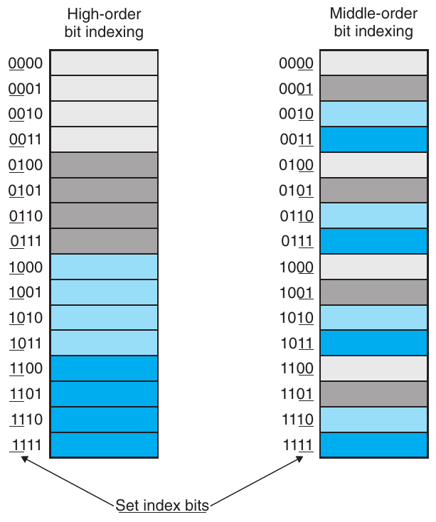

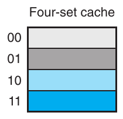

**Hình 6.31 Vì sao cache đánh index bằng bit giữa.**

Điểm chính là mặc dù chương trình có spatial locality tốt và cache đủ chỗ chứa block cho cả x[i] và y[i], mỗi tham chiếu đều conflict miss vì block ánh xạ cùng set. Thrashing như vậy thường làm chậm hệ số 2 hoặc 3. Cũng lưu ý dù ví dụ cực đơn giản, vấn đề có thật với cache direct-mapped lớn và thực tế hơn.

May mắn là lập trình viên dễ sửa thrashing khi nhận ra điều xảy ra. Giải pháp đơn giản là thêm B byte padding cuối mỗi array. Ví dụ thay vì float x[8], định nghĩa float x[12]. Giả sử y ngay sau x trong bộ nhớ, có ánh xạ phần tử vào set như sau:

| Element | Address | Set index | Element | Address | Set index |
|---|---|---|---|---|---|
| x[0] | 0 | 0 | y[0] | 48 | 1 |
| x[1] | 4 | 0 | y[1] | 52 | 1 |
| x[2] | 8 | 0 | y[2] | 56 | 1 |
| x[3] | 12 | 0 | y[3] | 60 | 1 |
| x[4] | 16 | 1 | y[4] | 64 | 0 |
| x[5] | 20 | 1 | y[5] | 68 | 0 |
| x[6] | 24 | 1 | y[6] | 72 | 0 |
| x[7] | 28 | 1 | y[7] | 76 | 0 |

Khi có padding ở cuối x, x[i] và y[i] giờ ánh xạ vào các set khác nhau, nhờ đó loại bỏ những conflict miss do thrashing.

#### Bài tập thực hành 6.10 (lời giải trang 699)

Trong ví dụ dotprod trước, sau khi thêm padding cho array x, tỷ lệ tham chiếu tạo hit trong tổng số tham chiếu đến x và y là bao nhiêu?

#### Bài tập thực hành 6.11 (lời giải trang 699)

Hình dung cache giả định dùng s bit high-order địa chỉ làm set index. Với cache như vậy, các đoạn memory block liên tục được ánh xạ vào cùng cache set.

A. Mỗi đoạn array liên tục có bao nhiêu block?

B. Xét code sau chạy trên hệ thống có cache dạng (S, E, B, m) = (512, 1, 32, 32):

```
int array[4096];

for (i = 0; i < 4096; i++)
    sum += array[i];
```

Số array block tối đa được lưu trong cache tại một thời điểm bất kỳ là bao nhiêu?

### 6.4.3 Set associative cache

Conflict miss trong cache direct-mapped xuất phát từ giới hạn mỗi set đúng một line (theo thuật ngữ ở đây E = 1). Set associative cache nới giới hạn để mỗi set chứa nhiều hơn một cache line. Cache có 1 < E < C/B thường gọi là E-way set associative cache. Trường hợp E = C/B được xét ở mục tiếp theo. Hình 6.32 trình bày tổ chức cache two-way set associative.

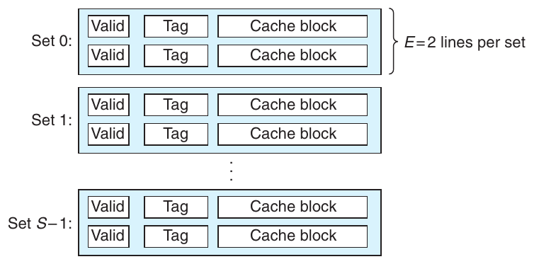

**Hình 6.32 Set associative cache (1 < E < C/B). Mỗi set chứa nhiều hơn một line. Ví dụ này là cache two-way set associative.**

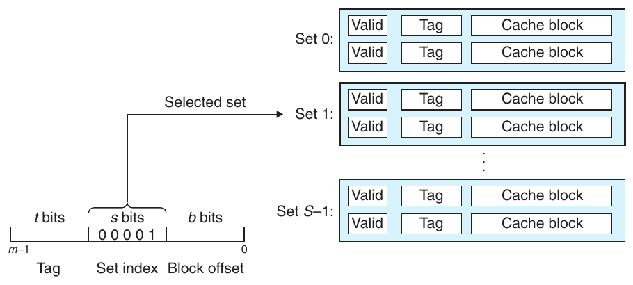

**Hình 6.33 Chọn set trong set associative cache.**

### Chọn set trong set associative cache

Chọn set giống hệt cache direct-mapped, với set index bit xác định set. Hình 6.33 tổng kết nguyên lý này.

### So khớp line và chọn word trong set associative cache

So khớp line trong set associative cache phức tạp hơn direct-mapped vì phải kiểm tra tag và valid bit của nhiều line để biết word yêu cầu có trong set không. Bộ nhớ thông thường là array giá trị nhận địa chỉ làm input và trả giá trị lưu tại đó. Ngược lại, associative memory là array cặp (key, value), nhận key và trả value của một cặp khớp key input. Vì vậy, có thể xem mỗi set là associative memory nhỏ với key ghép tag và valid bit, value là nội dung block.

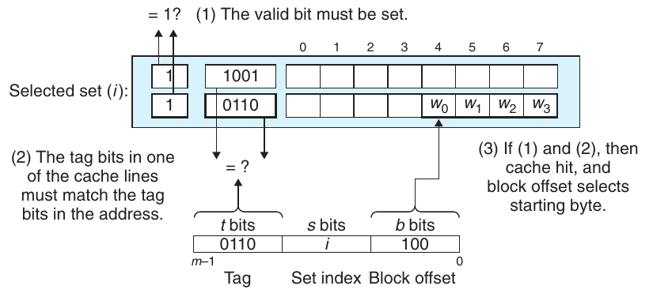

**Hình 6.34 So khớp line và chọn word trong set associative cache.**

Hình 6.34 trình bày ý tưởng cơ bản so khớp line trong associative cache. Ý quan trọng ở đây là bất kỳ line nào trong set cũng có thể chứa bất kỳ memory block nào ánh xạ vào set đó. Cache phải tìm trong từng line một line hợp lệ có tag khớp tag địa chỉ. Nếu cache tìm thấy line như vậy, chúng ta có hit và block offset chọn word từ block như trước.

### Thay line khi miss trong set associative cache

Nếu word CPU yêu cầu không có trong line nào của set, cache miss và phải lấy block chứa word từ bộ nhớ. Tuy nhiên, lấy rồi thì thay line nào? Nếu có line rỗng thì đó là ứng viên tốt. Nếu không có line rỗng trong set, chúng ta phải chọn một line không rỗng và hy vọng CPU sẽ không sớm tham chiếu lại line bị thay thế.

Lập trình viên rất khó khai thác kiến thức replacement policy trong code nên không đi sâu ở đây. Policy đơn giản nhất chọn line ngẫu nhiên để thay. Policy phức tạp hơn dựa trên locality để giảm xác suất line bị thay được tham chiếu sớm. Ví dụ, least frequently used (LFU) thay line được tham chiếu ít lần nhất trong một khoảng thời gian trước. Least recently used (LRU) thay line có lần truy cập cuối xa nhất trong quá khứ. Tất cả các policy này đều đòi hỏi thêm thời gian và hardware. Nhưng khi đi xuống memory hierarchy, xa CPU hơn, chi phí của miss tăng lên, nên việc dùng replacement policy tốt để giảm miss càng đáng thực hiện.

### 6.4.4 Fully associative cache

Fully associative cache gồm một set duy nhất (tức E = C/B) chứa mọi cache line. Hình 6.35 trình bày tổ chức cơ bản.

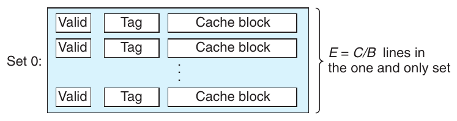

**Hình 6.35 Fully associative cache (E = C/B). Một set duy nhất chứa mọi line.**

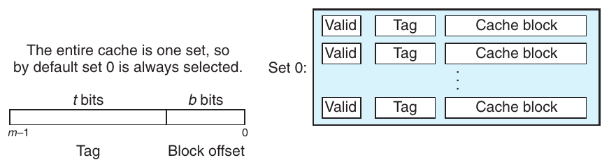

**Hình 6.36 Chọn set trong fully associative cache. Lưu ý không có set index bit.**

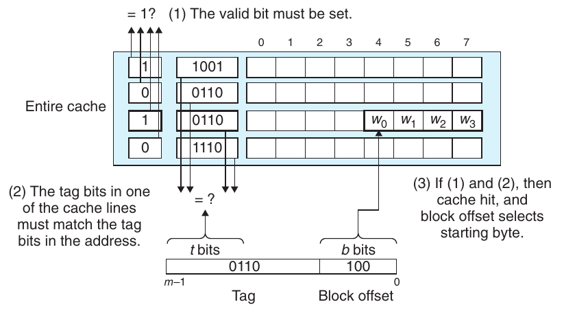

**Hình 6.37 So khớp line và chọn word trong fully associative cache.**

### Chọn set trong fully associative cache

Việc chọn set trong fully associative cache rất đơn giản vì chỉ có một set, như được tổng kết trong Hình 6.36. Lưu ý không có set index bit trong địa chỉ, chỉ chia thành tag và block offset.

### So khớp line và chọn word trong fully associative cache

So khớp line và chọn word trong fully associative cache giống set associative cache, như Hình 6.37. Khác biệt chủ yếu là quy mô.

Vì mạch cache phải tìm kiếm đồng thời nhiều tag khớp, việc xây dựng một associative cache vừa lớn vừa nhanh rất khó và tốn kém. Do đó fully associative cache chỉ hợp với cache nhỏ, như translation lookaside buffer (TLB) trong virtual memory system cache các page table entry (Mục 9.6.2).

#### Bài tập thực hành 6.12 (lời giải trang 699)

Những bài sau giúp củng cố hiểu biết cách cache hoạt động. Giả sử:

- Bộ nhớ định địa chỉ theo byte.

- Truy cập bộ nhớ đến word 1-byte (không phải 4-byte).

- Địa chỉ rộng 13 bit.

- Cache là two-way set associative (E = 2), block size 4-byte (B = 4), tám set (S = 8).

Nội dung cache như sau, mọi số ở ký pháp hexadecimal.

Cache 2-way set associative

|  |  |  |  | Line 0 |  |  |  |  |  | Line 1 |  |  |
|---|---|---|---|---|---|---|---|---|---|---|---|---|
| Set index | Tag | Valid | Byte 0 | Byte 1 | Byte 2 | Byte 3 | Tag | Valid | Byte 0 | Byte 1 | Byte 2 | Byte 3 |
| 0 | 09 | 1 | 86 | 30 | 3F | 10 | 00 | 0 | — | — | — | — |
| 1 | 45 | 1 | 60 | 4F | E0 | 23 | 38 | 1 | 00 | BC | 0B | 37 |
| 2 | EB | 0 | — | — | — | — | 0B | 0 | — | — | — | — |
| 3 | 06 | 0 | — | — | — | — | 32 | 1 | 12 | 08 | 7B | AD |
| 4 | C7 | 1 | 06 | 78 | 07 | C5 | 05 | 1 | 40 | 67 | C2 | 3B |
| 5 | 71 | 1 | 0B | DE | 18 | 4B | 6E | 0 | — | — | — | — |
| 6 | 91 | 1 | A0 | B7 | 26 | 2D | F0 | 0 | — | — | — | — |
| 7 | 46 | 0 | — | — | — | — | DE | 1 | 12 | C0 | 88 | 37 |

Hình sau trình bày format địa chỉ (1 bit mỗi ô). Hãy ghi nhãn sơ đồ để chỉ ra các field dùng xác định:

CO. Cache block offset

CI. Cache set index

CT. Cache tag

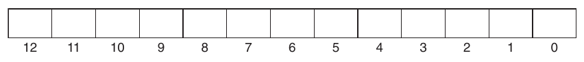

#### Bài tập thực hành 6.13 (lời giải trang 700)

Giả sử chương trình chạy trên máy trong Bài tập 6.12 tham chiếu word 1-byte tại địa chỉ 0x0D53. Chỉ ra cache entry được truy cập và giá trị cache byte trả về bằng hexadecimal. Cho biết có cache miss không. Nếu miss, điền “—” cho “Cache byte trả về”.

A. Format địa chỉ (1 bit mỗi ô):

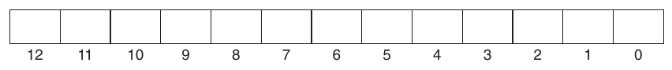

B. Tham chiếu bộ nhớ:

| Tham số | Giá trị |
|---|---|
| Cache block offset (CO) | 0x______ |
| Cache set index (CI) | 0x______ |
| Cache tag (CT) | 0x______ |
| Cache hit? (Y/N) | ______ |
| Cache byte trả về | 0x______ |

#### Bài tập thực hành 6.14 (lời giải trang 700)

Lặp lại Bài tập 6.13 cho địa chỉ bộ nhớ 0x0CB4.

A. Format địa chỉ (1 bit mỗi ô):


B. Tham chiếu bộ nhớ:

| Tham số | Giá trị |
|---|---|
| Cache block offset (CO) | 0x______ |
| Cache set index (CI) | 0x______ |
| Cache tag (CT) | 0x______ |
| Cache hit? (Y/N) | ______ |
| Cache byte trả về | 0x______ |

#### Bài tập thực hành 6.15 (lời giải trang 700)

Lặp lại Bài tập 6.13 cho địa chỉ bộ nhớ 0x0A31.

A. Format địa chỉ (1 bit mỗi ô):

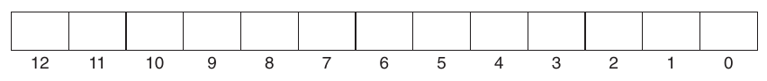

B. Tham chiếu bộ nhớ:

| Tham số | Giá trị |
|---|---|
| Cache block offset (CO) | 0x______ |
| Cache set index (CI) | 0x______ |
| Cache tag (CT) | 0x______ |
| Cache hit? (Y/N) | ______ |
| Cache byte trả về | 0x______ |

#### Bài tập thực hành 6.16 (lời giải trang 701)

Với cache trong Bài tập 6.12, hãy liệt kê mọi địa chỉ bộ nhớ hexadecimal tạo hit trong set 3.

### 6.4.5 Vấn đề với phép ghi

Như đã thấy, hoạt động của cache đối với phép đọc khá đơn giản. Trước hết tìm bản sao word w trong cache. Nếu hit, trả w ngay. Nếu miss, lấy block chứa w từ tầng ngay dưới, lưu vào cache line (có thể evict line hợp lệ) rồi trả w.

Ghi phức tạp hơn đôi chút. Giả sử chúng ta ghi một word w đã có trong cache (write hit). Sau khi cập nhật bản sao w, cache phải làm gì để cập nhật bản sao của w ở tầng ngay bên dưới? Cách đơn giản nhất, write-through, ghi ngay cache block của w xuống tầng dưới. Dù đơn giản, write-through gây bus traffic ở mọi phép ghi. Cách khác, write-back, hoãn cập nhật lâu nhất có thể bằng cách chỉ ghi block cập nhật xuống dưới khi bị replacement algorithm evict. Nhờ locality, write-back giảm bus traffic đáng kể nhưng phức tạp hơn. Cache phải duy trì một dirty bit bổ sung cho mỗi cache line để cho biết cache block đã bị sửa hay chưa.

Vấn đề khác là xử lý write miss. Cách write-allocate load block tương ứng từ tầng dưới vào cache rồi cập nhật block. Write-allocate cố khai thác spatial locality của ghi nhưng mỗi miss dẫn đến truyền block từ tầng dưới lên cache. Cách khác, no-write-allocate, bỏ qua cache và ghi word trực tiếp xuống dưới. Cache Write-through thường là no-write-allocate. Cache Write-back thường là write-allocate.

Tối ưu cache cho phép ghi là một vấn đề tinh tế và khó, mà ở đây chúng ta mới chỉ đề cập sơ lược. Các chi tiết khác nhau giữa các hệ thống, thường là thông tin độc quyền và ít được tài liệu hóa. Với lập trình viên muốn viết chương trình cache-friendly hợp lý, nên dùng mô hình giả định cache write-back, write-allocate. Có vài lý do: thông thường cache tầng thấp có xu hướng sử dụng write-back hơn write-through vì transfer time của chúng dài hơn. Ví dụ, virtual memory system (dùng main memory làm cache cho block trên đĩa) chỉ dùng write-back. Nhưng khi mật độ logic tăng, độ phức tạp write-back bớt cản trở và cache write-back xuất hiện ở mọi tầng hệ thống hiện đại. Giả định này phù hợp với các xu hướng hiện tại. Lý do khác để giả định write-back, write-allocate là nó đối xứng với cách xử lý phép đọc: write-back write-allocate cố khai thác locality. Vì vậy có thể phát triển chương trình ở high level với spatial, temporal locality tốt thay vì tối ưu cho hệ thống bộ nhớ cụ thể.

### 6.4.6 Cấu trúc cache hierarchy thực tế

Cho đến đây, giả định cache chỉ chứa dữ liệu chương trình. Nhưng thực tế có thể chứa cả instruction. Cache chỉ chứa instruction được gọi là i-cache. Cache chỉ chứa dữ liệu chương trình được gọi là d-cache. Cache chứa cả instruction và dữ liệu được gọi là unified cache. Processor hiện đại có i-caches và d-caches riêng. Có một số lý do cho cách tổ chức này. Với hai cache riêng biệt, processor có thể đọc một instruction word và một data word đồng thời. I-caches thường read-only nên đơn giản hơn. Hai cache thường được tối ưu cho những mẫu truy cập khác nhau và có thể có block size, associativity và capacity khác nhau. Cache riêng cũng bảo đảm truy cập dữ liệu không tạo conflict miss với truy cập instruction và ngược lại, đổi lại có thể tăng capacity miss.

Hình 6.38 trình bày cache hierarchy của Intel Core i7. Mỗi CPU chip có bốn core. Mỗi core có L1 i-cache, L1 d-cache và L2 unified cache riêng. Tất cả core chia sẻ L3 unified cache on-chip. Một đặc điểm thú vị của hierarchy này là mọi SRAM cache memory đều nằm trong CPU chip.

Hình 6.39 tổng kết đặc tính cơ bản cache Core i7.

### 6.4.7 Ảnh hưởng tham số cache đến hiệu năng

Hiệu năng cache được đánh giá bằng một số chỉ số sau:

Miss rate. Tỷ lệ những tham chiếu bộ nhớ trong quá trình thực thi chương trình hoặc một phần chương trình bị miss. Chỉ số này được tính bằng # misses/# references.

Hit rate. Tỷ lệ những tham chiếu bộ nhớ tạo hit. Chỉ số này được tính bằng 1 − miss rate.

Hit time. Thời gian đưa word trong cache đến CPU, gồm chọn set, xác định line và chọn word. Hit time của L1 cache khoảng vài clock cycle.

Miss penalty. Mọi thời gian bổ sung cần thiết do một lần miss. Penalty cho L1 miss được L2 phục vụ vào khoảng 10 cycle; được L3 phục vụ là 50 cycle; và được main memory phục vụ là 200 cycle.

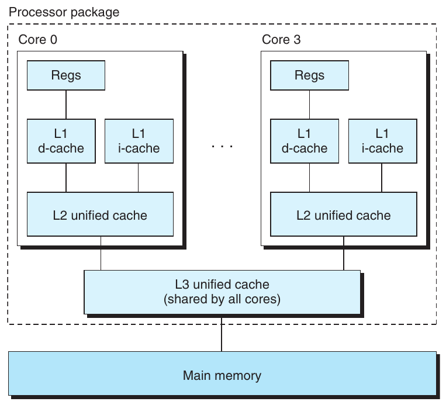

**Hình 6.38 Cache hierarchy Intel Core i7.**

| Loại cache | Access time (cycles) | Cache size (C) | Assoc. (E) | Block size (B) | Sets (S) |
|---|---|---|---|---|---|
| L1 i-cache | 4 | 32 KB | 8 | 64 B | 64 |
| L1 d-cache | 4 | 32 KB | 8 | 64 B | 64 |
| L2 unified cache | 10 | 256 KB | 8 | 64 B | 512 |
| L3 unified cache | 40–75 | 8 MB | 16 | 64 B | 8,192 |

**Hình 6.39 Đặc tính cache hierarchy Intel Core i7.**

Tối ưu những trade-offs giữa chi phí và hiệu năng của cache memory là công việc tinh tế, đòi hỏi mô phỏng sâu rộng trên benchmark code thực tế, nên vượt ngoài phạm vi ở đây. Tuy vậy, có thể xác định vài trade-offs định tính.

### Ảnh hưởng kích thước cache

Một mặt, cache lớn có xu hướng tăng hit rate. Mặt khác, làm bộ nhớ lớn chạy nhanh luôn khó hơn. Vì vậy cache lớn có xu hướng tăng hit time. Đây là lý do L1 nhỏ hơn L2, L2 nhỏ hơn L3.

### Ảnh hưởng block size

Block lớn vừa có lợi vừa có hại. Một mặt, chúng tăng hit rate bằng cách khai thác spatial locality có trong chương trình. Tuy nhiên, với một kích thước cache cho trước, block lớn hơn đồng nghĩa với ít cache line hơn, có thể làm giảm hit rate trong những chương trình có temporal locality mạnh hơn spatial locality. Block lớn hơn cũng ảnh hưởng xấu đến miss penalty vì làm tăng transfer time. Hệ thống hiện đại như Core i7 chọn thỏa hiệp với cache block 64 byte.

### Ảnh hưởng associativity

Vấn đề ở đây là ảnh hưởng của việc lựa chọn tham số E, số cache line trong mỗi set. Ưu điểm associativity cao (E lớn) là giảm nguy cơ thrashing do conflict miss. Tuy nhiên, associativity cao có chi phí đáng kể: triển khai tốn kém và khó đạt tốc độ cao, đòi hỏi thêm tag bit trên mỗi line, thêm LRU state bit trên mỗi line và thêm control logic. Độ phức tạp tăng có thể tăng hit time và miss penalty vì chọn victim line phức tạp hơn.

Cuối cùng, lựa chọn associativity là trade-off giữa hit time và miss penalty. Theo truyền thống, những hệ thống high-performance hướng tới clock rate cao chọn associativity nhỏ hơn cho L1 cache (nơi miss penalty chỉ vài cycle), và associativity lớn hơn cho các tầng thấp có miss penalty cao hơn. Ví dụ Intel Core i7, L1 và L2 là 8-way associative, L3 là 16-way.

### Ảnh hưởng chiến lược ghi

Cache Write-through đơn giản hơn để triển khai và có thể dùng write buffer hoạt động độc lập với cache để cập nhật bộ nhớ. Hơn nữa, read miss ít tốn kém vì không kích hoạt ghi bộ nhớ. Ngược lại, cache write-back dẫn đến ít lần truyền hơn, nhờ đó dành thêm bandwidth tới bộ nhớ cho những I/O device thực hiện DMA. Giảm số lần truyền càng quan trọng khi đi xuống hierarchy và transfer time tăng. Nhìn chung, cache tầng thấp có khả năng dùng write-back hơn write-through.

## 6.5 Viết code Cache-Friendly

Trong Mục 6.2, chúng ta đã giới thiệu khái niệm locality và thảo luận định tính về những yếu tố tạo nên locality tốt. Giờ đây, khi đã hiểu cách cache memory hoạt động, chúng ta có thể mô tả chính xác hơn. Chương trình có locality tốt hơn thường có miss rate thấp hơn, và chương trình có miss rate thấp hơn thường chạy nhanh hơn chương trình có miss rate cao. Vì vậy, lập trình viên giỏi nên luôn cố gắng viết code cache friendly, theo nghĩa code có locality tốt. Sau đây là cách tiếp cận cơ bản mà chúng ta sử dụng để cố bảo đảm code cache friendly.

### Thông tin thêm Cache line, set và block: Khác nhau thế nào?

Rất dễ nhầm lẫn sự khác nhau giữa cache line, set và block. Hãy xem lại các ý tưởng và bảo đảm chúng rõ ràng:

- Block là một gói thông tin fixed-size di chuyển qua lại giữa cache và main memory (hoặc cache lower-level).

- Line là một vùng chứa trong cache lưu một block cùng thông tin khác như valid bit và tag bit.

- Set là tập hợp một hoặc nhiều line. Set trong cache direct-mapped gồm một line duy nhất. Set trong cache set associative và fully associative gồm nhiều line.

Trong cache direct-mapped, set và line thực sự tương đương. Tuy nhiên, trong cache associative, chúng rất khác nhau và không thể dùng thuật ngữ thay thế cho nhau.

Vì line luôn lưu một block duy nhất, thuật ngữ “line” và “block” thường được dùng thay thế cho nhau. Ví dụ, chuyên gia hệ thống thường nói “line size” của cache khi thực ra muốn nói block size. Cách dùng này rất phổ biến và không gây nhầm lẫn nếu bạn hiểu sự khác nhau giữa block và line.

1. Làm cho trường hợp phổ biến chạy nhanh. Chương trình thường dành phần lớn thời gian trong một vài function cốt lõi. Các function này thường dành phần lớn thời gian trong một vài vòng lặp. Vì vậy hãy tập trung vào vòng lặp trong của các function cốt lõi và bỏ qua phần còn lại.

2. Giảm thiểu số cache miss trong mỗi vòng lặp trong. Khi các yếu tố khác như tổng số load và store bằng nhau, vòng lặp có miss rate tốt hơn sẽ chạy nhanh hơn.

Để xem cách này hoạt động thực tế, xét function sumvec từ Mục 6.2:

```
1   int sumvec(int v[N])
2   {
3       int i, sum = 0;
4
5       for (i = 0; i < N; i++)
6           sum += v[i];
7       return sum;
8   }
```

Function này có cache friendly không? Trước tiên, hãy lưu ý rằng thân vòng lặp có temporal locality tốt đối với các biến cục bộ i và sum. Thực tế, vì đây là các biến cục bộ, mọi optimizing compiler hợp lý đều cache chúng trong register file, mức cao nhất của phân cấp bộ nhớ. Bây giờ, hãy xét các tham chiếu stride-1 tới vector v. Nói chung, nếu cache có block size B byte, thì mẫu tham chiếu stride-k (trong đó k tính bằng word) gây ra trung bình min (1, (word size × k)/B) miss mỗi lần lặp. Giá trị này nhỏ nhất khi k = 1, nên các tham chiếu stride-1 tới v thực sự cache friendly. Ví dụ, giả sử v được alignment theo block, mỗi word có 4 byte, mỗi cache block có 4 word và cache ban đầu trống (cold cache). Khi đó, bất kể cách tổ chức cache, các tham chiếu tới v sẽ tạo ra mẫu hit và miss sau:

| v[i] | i = 0 | i = 1 | i = 2 | i = 3 | i = 4 | i = 5 | i = 6 | i = 7 |
|---|---|---|---|---|---|---|---|---|
| Thứ tự truy cập, [h]it hoặc [m]iss | 1 [m] | 2 [h] | 3 [h] | 4 [h] | 5 [m] | 6 [h] | 7 [h] | 8 [h] |

Trong ví dụ này, tham chiếu tới v[0] gây miss, và block tương ứng chứa v[0]–v[3] được nạp từ bộ nhớ vào cache. Vì vậy, ba tham chiếu tiếp theo đều hit. Tham chiếu tới v[4] gây ra một miss khác khi một block mới được nạp vào cache, ba tham chiếu tiếp theo đều hit, và cứ tiếp tục như vậy. Nói chung, ba trong bốn tham chiếu sẽ hit, là mức tốt nhất có thể đạt được trong trường hợp cold cache này.

Tóm lại, ví dụ sumvec đơn giản minh họa hai điểm quan trọng khi viết code cache-friendly:

- Tham chiếu lặp lại biến cục bộ có lợi vì compiler có thể cache chúng trong register file (temporal locality).

- Mẫu tham chiếu Stride-1 có lợi vì cache ở mọi mức phân cấp bộ nhớ đều lưu dữ liệu thành block liên tục (spatial locality).

Spatial locality đặc biệt quan trọng trong các chương trình thao tác trên array đa chiều. Ví dụ, hãy xét function sumarrayrows từ Mục 6.2, có nhiệm vụ tính tổng các phần tử của một array two-dimensional theo thứ tự row-major:

```
1   int sumarrayrows(int a[M][N])
2   {
3       int i, j, sum = 0;
4
5       for (i = 0; i < M; i++)
6           for (j = 0; j < N; j++)
7               sum += a[i][j];
8       return sum;
9   }
```

Vì C lưu array theo thứ tự row-major, vòng lặp trong của function này có cùng mẫu truy cập stride-1 mong muốn như sumvec. Ví dụ, giả sử chúng ta đưa ra các giả định về cache giống như đối với sumvec. Khi đó, các tham chiếu tới array a sẽ tạo ra mẫu hit và miss sau:

| a[i][j] | j = 0 | j = 1 | j = 2 | j = 3 | j = 4 | j = 5 | j = 6 | j = 7 |
|---|---|---|---|---|---|---|---|---|
| i = 0 | 1 [m] | 2 [h] | 3 [h] | 4 [h] | 5 [m] | 6 [h] | 7 [h] | 8 [h] |
| i = 1 | 9 [m] | 10 [h] | 11 [h] | 12 [h] | 13 [m] | 14 [h] | 15 [h] | 16 [h] |
| i = 2 | 17 [m] | 18 [h] | 19 [h] | 20 [h] | 21 [m] | 22 [h] | 23 [h] | 24 [h] |
| i = 3 | 25 [m] | 26 [h] | 27 [h] | 28 [h] | 29 [m] | 30 [h] | 31 [h] | 32 [h] |

Nhưng hãy xem điều xảy ra nếu thực hiện thay đổi có vẻ vô hại là hoán vị các vòng lặp:

```
1   int sumarraycols(int a[M][N])
2   {
3       int i, j, sum = 0;
4
5       for (j = 0; j < N; j++)
6           for (i = 0; i < M; i++)
7               sum += a[i][j];
8       return sum;
9   }
```

Trong trường hợp này, chúng ta quét array theo từng cột thay vì từng hàng. Nếu may mắn và toàn bộ array nằm vừa trong cache, chúng ta vẫn có cùng miss rate 1/4. Tuy nhiên, nếu array lớn hơn cache (trường hợp có khả năng xảy ra cao hơn), thì mọi truy cập tới a[i][j] đều miss!

| a[i][j] | j = 0 | j = 1 | j = 2 | j = 3 | j = 4 | j = 5 | j = 6 | j = 7 |
|---|---|---|---|---|---|---|---|---|
| i = 0 | 1 [m] | 5 [m] | 9 [m] | 13 [m] | 17 [m] | 21 [m] | 25 [m] | 29 [m] |
| i = 1 | 2 [m] | 6 [m] | 10 [m] | 14 [m] | 18 [m] | 22 [m] | 26 [m] | 30 [m] |
| i = 2 | 3 [m] | 7 [m] | 11 [m] | 15 [m] | 19 [m] | 23 [m] | 27 [m] | 31 [m] |
| i = 3 | 4 [m] | 8 [m] | 12 [m] | 16 [m] | 20 [m] | 24 [m] | 28 [m] | 32 [m] |

Miss rate cao hơn có thể tác động đáng kể đến thời gian chạy. Ví dụ, trên máy desktop của chúng ta, sumarrayrows chạy nhanh hơn sumarraycols 25 lần khi kích thước array lớn. Tóm lại, lập trình viên nên chú ý đến locality trong chương trình và cố gắng viết chương trình tận dụng đặc điểm này.

### Bài tập thực hành 6.17 (lời giải trang 701)

Chuyển vị hàng và cột ma trận là bài toán quan trọng trong xử lý tín hiệu và ứng dụng tính toán khoa học. Nó cũng thú vị từ góc nhìn locality vì mẫu tham chiếu vừa row-wise vừa column-wise. Ví dụ, xét routine chuyển vị sau:

```
 1   typedef int array[2][2];
 2
 3   void transpose1(array dst, array src)
 4   {
 5       int i, j;
 6
 7       for (i = 0; i < 2; i++) {
 8           for (j = 0; j < 2; j++) {
 9               dst[j][i] = src[i][j];
10           }
11       }
12   }
```

Giả sử code chạy trên máy có các tính chất sau:

- sizeof(int) = 4.

- Array src bắt đầu tại địa chỉ 0 và array dst bắt đầu tại địa chỉ 16 (thập phân).

- Có một data cache L1 duy nhất thuộc loại direct-mapped, write-through và write-allocate, với block size 8 byte.

- Cache có tổng kích thước 16 byte dữ liệu và ban đầu trống.

- Truy cập array src và dst lần lượt là nguồn duy nhất gây read miss và write miss.

A. Với mỗi row và col, chỉ ra truy cập src[row][col] và dst[row][col] là hit (h) hay miss (m). Ví dụ đọc src[0][0] là miss và ghi dst[0][0] cũng là miss.

|  | Array dst |  |  | Array src |  |
|---|---|---|---|---|---|
|  | Cột 0 | Cột 1 |  | Cột 0 | Cột 1 |
| Hàng 0 | m | ______ | Hàng 0 | m | ______ |
| Hàng 1 | ______ | ______ | Hàng 1 | ______ | ______ |

B. Lặp lại bài toán với cache có 32 byte dữ liệu.

### Bài tập thực hành 6.18 (lời giải trang 702)

Cốt lõi của trò chơi ăn khách gần đây SimAquarium là một vòng lặp gọn tính vị trí trung bình của 512 tảo. Bạn đang đánh giá hiệu năng cache trên máy có data cache direct-mapped 2,048-byte với block 32-byte (B = 32). Bạn được cung cấp các định nghĩa sau:

```
1   struct algae_position {
2       int x;
3       int y;
4   };
5
6   struct algae_position grid[32][32];
7   int total_x = 0, total_y = 0;
8   int i, j;
```

Bạn cũng nên giả sử các điều sau:

- sizeof(int) = 4.

- grid bắt đầu tại địa chỉ bộ nhớ 0.

- Cache ban đầu trống.

- Các truy cập bộ nhớ duy nhất là tới các entry của array grid. Các biến i, j, total_x và total_y được lưu trong register.

Xác định hiệu năng cache cho code sau:

```
 1       for (i = 31; i >= 0; i--) {
 2           for (j = 31; j >= 0; j--) {
 3               total_x += grid[i][j].x;
 4           }
 5       }
 6
 7       for (i = 31; i >= 0; i--) {
 8           for (j = 31; j >= 0; j--) {
 9               total_y += grid[i][j].y;
10           }
11       }
```

A. Tổng số lần đọc là bao nhiêu?

B. Tổng số lần đọc miss trong cache là bao nhiêu?

C. Miss rate là bao nhiêu?

### Bài tập thực hành 6.19 (lời giải trang 702)

Với các giả định của Bài tập thực hành 6.18, xác định hiệu năng cache của code sau:

```
1       for (i = 31; i >= 0; i--){
2           for (j = 31; j >= 0; j--) {
3               total_x += grid[j][i].x;
4               total_y += grid[j][i].y;
5           }
6       }
```

A. Tổng số lần đọc là bao nhiêu?

B. Tổng số lần đọc hit trong cache là bao nhiêu?

C. Hit rate là bao nhiêu?

D. Miss hit sẽ là bao nhiêu nếu cache lớn gấp đôi?

### Bài tập thực hành 6.20 (lời giải trang 702)

Với các giả định của Bài tập thực hành 6.18, xác định hiệu năng cache của code sau:

```
1       for (i = 31; i >= 0; i--){
2           for (j = 31; j >= 0; j--) {
3               total_x += grid[i][j].x;
4               total_y += grid[i][j].y;
5           }
6       }
```

A. Tổng số lần đọc là bao nhiêu?

B. Tổng số lần đọc hit trong cache là bao nhiêu?

C. Hit rate là bao nhiêu?

D. Hit rate sẽ là bao nhiêu nếu cache lớn gấp đôi?

## 6.6 Tổng hợp: Tác động của cache lên hiệu năng chương trình

Mục này kết thúc thảo luận phân cấp bộ nhớ bằng cách nghiên cứu tác động cache lên hiệu năng chương trình chạy trên máy thực tế.

### 6.6.1 Memory mountain

Tốc độ mà chương trình đọc dữ liệu từ hệ thống bộ nhớ được gọi là read throughput, đôi khi còn gọi là read bandwidth. Nếu chương trình đọc n byte trong khoảng thời gian s giây, thì read throughput trong khoảng đó là n/s, thường được biểu diễn bằng đơn vị megabyte mỗi giây (MB/s).

Nếu chúng ta viết một chương trình phát hành chuỗi yêu cầu đọc từ một vòng lặp gọn, thì read throughput đo được sẽ cho biết phần nào về hiệu năng hệ thống bộ nhớ đối với chuỗi đọc cụ thể đó. Hình 6.40 trình bày một cặp function đo read throughput cho một chuỗi đọc cụ thể.

Function test tạo chuỗi đọc bằng cách quét elems phần tử đầu của array với stride bằng stride. Để tăng tính song song sẵn có trong vòng lặp trong, nó dùng unroll 4 × 4 (Mục 5.9). Function run là wrapper gọi test và trả read throughput đo được. Lời gọi test ở dòng 37 làm ấm cache. Function fcyc2 ở dòng 38 gọi test với argument elems và ước tính thời gian chạy của test bằng CPU cycle. Lưu ý argument size của run tính bằng byte, còn argument elems tương ứng của test tính bằng phần tử array. Cũng lưu ý dòng 39 tính MB/s là 10<sup>6</sup> byte/s, thay vì 2<sup>20</sup> byte/s.

Các argument size và stride của function run cho phép điều khiển mức temporal và spatial locality trong chuỗi đọc thu được. Giá trị size nhỏ hơn tạo ra working set nhỏ hơn, từ đó mang lại temporal locality tốt hơn. Giá trị stride nhỏ hơn mang lại spatial locality tốt hơn. Nếu gọi run nhiều lần với các giá trị size và stride khác nhau, chúng ta có thể thu được một function two-dimensional thú vị biểu diễn read throughput theo temporal và spatial locality. Function này được gọi là memory mountain [112].

Mỗi máy tính có một memory mountain riêng, đặc trưng cho khả năng của hệ thống bộ nhớ. Ví dụ, Hình 6.41 thể hiện memory mountain của một hệ thống Intel Core i7 Haswell. Trong ví dụ này, size thay đổi từ 16 KB đến 128 MB, còn stride thay đổi từ 1 đến 12 phần tử, trong đó mỗi phần tử là một long int 8-byte.

```
                                                                   code/mem/mountain/mountain.c
 1   long data[MAXELEMS];      /* The global array we’ll be traversing */
 2
 3   /* test - Iterate over first "elems" elements of array "data" with
 4    *        stride of "stride", using 4 x 4 loop unrolling.
 5    */
 6   int test(int elems, int stride)
 7   {
 8       long i, sx2 = stride*2, sx3 = stride*3, sx4 = stride*4;
 9       long acc0 = 0, acc1 = 0, acc2 = 0, acc3 = 0;
10       long length = elems;
11       long limit = length - sx4;
12
13       /* Combine 4 elements at a time */
14       for (i = 0; i < limit; i += sx4) {
15           acc0 = acc0 + data[i];
16           acc1 = acc1 + data[i+stride];
17           acc2 = acc2 + data[i+sx2];
18           acc3 = acc3 + data[i+sx3];
19       }
20
21       /* Finish any remaining elements */
22       for (; i < length; i++) {
23           acc0 = acc0 + data[i];
24       }
25       return ((acc0 + acc1) + (acc2 + acc3));
26   }
27
28   /* run - Run test(elems, stride) and return read throughput (MB/s).
29    *       "size" is in bytes, "stride" is in array elements, and Mhz is
30    *       CPU clock frequency in Mhz.
31    */
32   double run(int size, int stride, double Mhz)
33   {
34       double cycles;
35       int elems = size / sizeof(double);
36
37       test(elems, stride);                     /* Warm up the cache */
38       cycles = fcyc2(test, elems, stride, 0);  /* Call test(elems,stride) */
39       return (size / stride) / (cycles / Mhz); /* Convert cycles to MB/s */
40   }
                                                                   code/mem/mountain/mountain.c
```

**Hình 6.40 Các function đo và tính read throughput. Có thể tạo memory mountain cho một máy cụ thể bằng cách gọi run với giá trị size (tương ứng temporal locality) và stride (tương ứng spatial locality) khác nhau.**

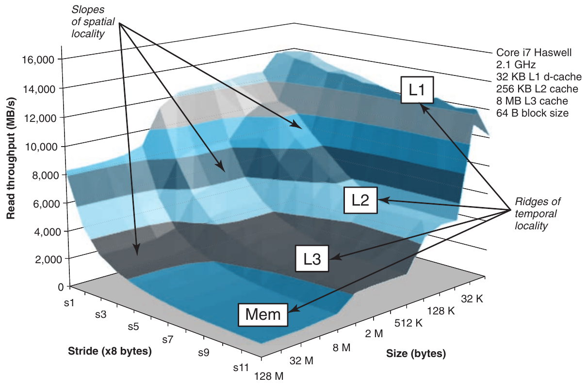

**Hình 6.41 Một memory mountain. Thể hiện read throughput dưới dạng function của temporal và spatial locality.**

Địa hình memory mountain của Core i7 cho thấy một cấu trúc phong phú. Vuông góc với trục size là bốn dãy núi, lần lượt tương ứng với các vùng temporal locality nơi working set nằm trọn trong cache L1, cache L2, cache L3 và main memory. Hãy lưu ý rằng có sự chênh lệch hơn một bậc độ lớn giữa đỉnh cao nhất của dãy L1, nơi CPU đọc với tốc độ trên 14 GB/s, và điểm thấp nhất của dãy main memory, nơi CPU đọc với tốc độ 900 MB/s.

Trên mỗi dãy L2, L3 và main memory có một sườn spatial locality dốc xuống khi stride tăng và spatial locality giảm. Hãy lưu ý rằng ngay cả khi working set quá lớn để nằm vừa trong bất kỳ cache nào, điểm cao nhất của dãy main memory vẫn cao gấp 8 lần điểm thấp nhất. Vì vậy, ngay cả khi chương trình có temporal locality kém, spatial locality vẫn có thể cứu vãn tình hình và tạo ra sự khác biệt đáng kể.

Có một đường sống núi phẳng đặc biệt thú vị kéo dài vuông góc với trục stride tại stride bằng 1, nơi read throughput khá phẳng ở 12 GB/s dù working set vượt capacity L1 và L2. Điều này dường như do cơ chế hardware prefetching trong hệ thống bộ nhớ Core i7 tự động nhận diện mẫu tham chiếu stride-1 tuần tự và cố fetch những block đó vào cache trước khi được truy cập. Dù chi tiết thuật toán prefetching cụ thể không được tài liệu hóa, memory mountain cho thấy rõ thuật toán hoạt động tốt nhất với stride nhỏ—thêm lý do ưu tiên truy cập stride-1 tuần tự trong code.

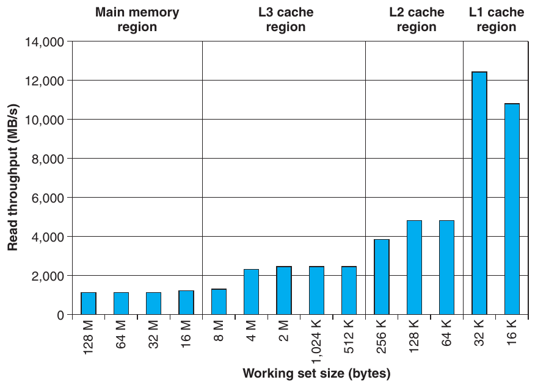

**Hình 6.42 Các dãy temporal locality trong memory mountain. Đồ thị thể hiện lát cắt qua Hình 6.41 với stride = 8.**

Nếu lấy một lát cắt qua ngọn núi, giữ stride cố định như trong Hình 6.42, chúng ta có thể thấy tác động của cache size và temporal locality lên hiệu năng. Với size tới 32 KB, working set nằm trọn trong d-cache L1, nên các yêu cầu đọc được phục vụ từ L1 với throughput khoảng 12 GB/s. Với size tới 256 KB, working set nằm trọn trong unified cache L2, còn với size tới 8 MB, working set nằm trọn trong unified cache L3. Những working set lớn hơn chủ yếu được phục vụ từ main memory.

Các chỗ sụt giảm read throughput tại mép trái của vùng cache L2 và L3—nơi working set có kích thước 256 KB và 8 MB, bằng kích thước cache tương ứng—rất thú vị. Chưa hoàn toàn rõ vì sao chúng xuất hiện. Cách duy nhất để chắc chắn là thực hiện mô phỏng cache chi tiết, nhưng có khả năng sự sụt giảm là do xung đột với các line code và dữ liệu khác.

Lấy lát cắt qua memory mountain theo hướng ngược lại, giữ working set size cố định, giúp chúng ta hiểu phần nào tác động của spatial locality lên read throughput. Ví dụ, Hình 6.43 trình bày lát cắt cho working set có kích thước cố định 4 MB. Lát cắt này đi dọc dãy L3 trong Hình 6.41, nơi working set nằm trọn trong cache L3 nhưng quá lớn đối với cache L2.

Lưu ý read throughput giảm đều khi stride tăng từ một đến tám word. Trong vùng này của ngọn núi, read miss ở L2 khiến block được chuyển từ L3 sang L2. Sau đó là một số hit vào block trong L2, tùy stride. Khi stride tăng, tỷ lệ L2 miss so với L2 hit tăng. Vì miss được phục vụ chậm hơn hit, read throughput giảm. Khi stride đạt tám word 8-byte, bằng block size 64 byte trên hệ thống này, mỗi yêu cầu đọc đều miss trong L2 và phải được phục vụ từ L3. Vì vậy read throughput cho stride ít nhất bằng tám là tốc độ cố định do tốc độ truyền cache block từ L3 vào L2 quyết định.

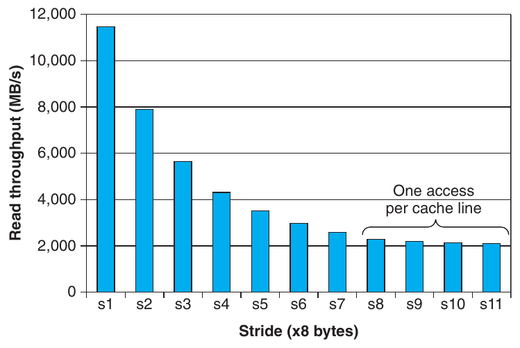

**Hình 6.43 Sườn spatial locality. Đồ thị thể hiện lát cắt qua Hình 6.41 với size = 4 MB.**

Để tổng kết thảo luận về memory mountain, hiệu năng hệ thống bộ nhớ không được đặc trưng bằng một con số duy nhất. Thay vào đó, nó là một ngọn núi temporal và spatial locality có độ cao có thể chênh lệch hơn một bậc độ lớn. Lập trình viên khôn ngoan cố gắng tổ chức chương trình sao cho nó chạy trên các đỉnh núi thay vì dưới thung lũng. Mục tiêu là tận dụng temporal locality để các word được sử dụng nhiều được fetch từ cache L1, đồng thời tận dụng spatial locality để truy cập càng nhiều word càng tốt từ một cache line L1 duy nhất.

#### Bài tập thực hành 6.21 (lời giải trang 702)

Dùng memory mountain trong Hình 6.41 để ước tính thời gian, tính bằng CPU cycle, đọc một word 16-byte từ d-cache L1.

### 6.6.2 Sắp xếp lại vòng lặp để tăng spatial locality

Xét bài toán nhân hai ma trận n × n: C = AB. Ví dụ, nếu n = 2, thì

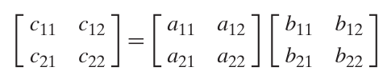

trong đó

c<sub>11</sub> = a<sub>11</sub>b<sub>11</sub> + a<sub>12</sub>b<sub>21</sub>

c<sub>12</sub> = a<sub>11</sub>b<sub>12</sub> + a<sub>12</sub>b<sub>22</sub>

c<sub>21</sub> = a<sub>21</sub>b<sub>11</sub> + a<sub>22</sub>b<sub>21</sub>

c<sub>22</sub> = a<sub>21</sub>b<sub>12</sub> + a<sub>22</sub>b<sub>22</sub>

Function nhân ma trận thường được triển khai bằng ba vòng lặp lồng nhau, được nhận diện bằng các chỉ số i, j và k. Nếu hoán vị các vòng lặp và thực hiện một số thay đổi nhỏ khác trong code, chúng ta có thể tạo ra sáu phiên bản nhân ma trận tương đương về chức năng như trong Hình 6.44. Mỗi phiên bản được nhận diện duy nhất bằng thứ tự các vòng lặp.

Ở mức tổng quát, sáu phiên bản khá giống nhau. Nếu cộng có tính kết hợp, mỗi phiên bản tính kết quả giống hệt.[^1]Mỗi phiên bản thực hiện tổng O(n<sup>3</sup>) thao tác và cùng số phép cộng, nhân. Mỗi phần tử trong n<sup>2</sup> phần tử của A và B được đọc n lần. Mỗi phần tử trong n<sup>2</sup> phần tử C được tính bằng tổng n giá trị. Tuy nhiên, phân tích hành vi vòng lặp trong cùng cho thấy khác biệt về số truy cập và locality. Để phân tích, chúng ta giả sử:

- Mỗi array là array double n × n, với sizeof(double) = 8.

- Có một cache duy nhất với block size 32-byte (B = 32).

- Kích thước array n lớn đến mức một hàng ma trận không vừa cache L1.

- Compiler lưu biến cục bộ trong register nên tham chiếu chúng trong vòng lặp không cần instruction load hoặc store.

Hình 6.45 tóm tắt kết quả phân tích inner-loop. Sáu phiên bản ghép đôi thành ba lớp tương đương, ký hiệu bằng cặp ma trận được truy cập trong vòng lặp trong. Ví dụ ij k và j ik thuộc lớp AB vì tham chiếu array A và B (không C) trong vòng lặp trong cùng. Với mỗi lớp, chúng ta đếm số load (đọc), store (ghi) mỗi lần lặp inner-loop, số tham chiếu A, B, C sẽ miss trong cache mỗi lần lặp và tổng cache miss mỗi lần lặp.

Vòng lặp trong của routine lớp AB (Hình 6.44(a) và (b)) quét một hàng A với stride bằng 1. Vì mỗi cache block giữ bốn word 8-byte, miss rate của A là 0.25 miss mỗi lần lặp. Ngược lại, vòng lặp trong quét cột B với stride n. Vì n lớn, mỗi truy cập B gây miss, tổng cộng 1.25 miss mỗi lần lặp.

Các vòng lặp trong của routine lớp AC (Hình 6.44(c) và (d)) có một số vấn đề. Mỗi lần lặp thực hiện hai load và một store (khác với routine lớp AB, vốn thực hiện hai load và không có store). Thứ hai, vòng lặp trong quét các cột của A và C với stride n. Kết quả là mỗi load đều miss, tổng cộng hai miss mỗi lần lặp. Hãy lưu ý rằng việc đổi thứ tự vòng lặp đã làm giảm spatial locality so với routine lớp AB.

(a) Phiên bản ij k (b) Phiên bản j ik

```
                     code/mem/matmult/mm.c                        code/mem/matmult/mm.c
 1   for (i = 0; i < n; i++)                 1   for (j = 0; j < n; j++)
 2       for (j = 0; j < n; j++) {           2        for (i = 0; i < n; i++) {
 3           sum = 0.0;                      3           sum = 0.0;
 4           for (k = 0; k < n; k++)         4           for (k = 0; k < n; k++)
 5               sum += A[i][k]*B[k][j];     5               sum += A[i][k]*B[k][j];
 6           C[i][j] += sum;                 6           C[i][j] += sum;
 7       }                                   7        }
______                                       ______
                     code/mem/matmult/mm.c                        code/mem/matmult/mm.c
```

(c) Phiên bản j ki (d) Phiên bản kj i

```
                     code/mem/matmult/mm.c                        code/mem/matmult/mm.c
 1   for (j = 0; j < n; j++)                 1   for (k = 0; k < n; k++)
 2       for (k = 0; k < n; k++) {           2        for (j = 0; j < n; j++) {
 3           r = B[k][j];                    3           r = B[k][j];
 4           for (i = 0; i < n; i++)         4           for (i = 0; i < n; i++)
 5               C[i][j] += A[i][k]*r;       5               C[i][j] += A[i][k]*r;
 6       }                                   6        }
______                                       ______
                     code/mem/matmult/mm.c                        code/mem/matmult/mm.c
```

(e) Phiên bản kij (f) Phiên bản ikj

```
                     code/mem/matmult/mm.c                        code/mem/matmult/mm.c
 1   for (k = 0; k < n; k++)                 1   for (i = 0; i < n; i++)
 2       for (i = 0; i < n; i++) {           2        for (k = 0; k < n; k++) {
 3           r = A[i][k];                    3           r = A[i][k];
 4           for (j = 0; j < n; j++)         4           for (j = 0; j < n; j++)
 5               C[i][j] += r*B[k][j];       5               C[i][j] += r*B[k][j];
 6       }                                   6        }
______                                       ______
                     code/mem/matmult/mm.c                        code/mem/matmult/mm.c
```

**Hình 6.44 Sáu phiên bản nhân ma trận. Mỗi phiên bản được nhận diện duy nhất bằng thứ tự vòng lặp.**

Mỗi lần lặp

| Phiên bản nhân ma trận (lớp) | Load | Store | Miss của A | Miss của B | Miss của C | Tổng miss |
|---|---|---|---|---|---|---|
| ij k & j ik (AB) | 2 | 0 | 0.25 | 1.00 | 0.00 | 1.25 |
| j ki & kj i (AC) | 2 | 1 | 1.00 | 0.00 | 1.00 | 2.00 |
| kij & ikj (BC) | 2 | 1 | 0.00 | 0.25 | 0.25 | 0.50 |

**Hình 6.45 Phân tích vòng lặp trong của nhân ma trận. Sáu phiên bản chia thành ba lớp tương đương, ký hiệu bằng cặp array được truy cập trong vòng lặp trong.**

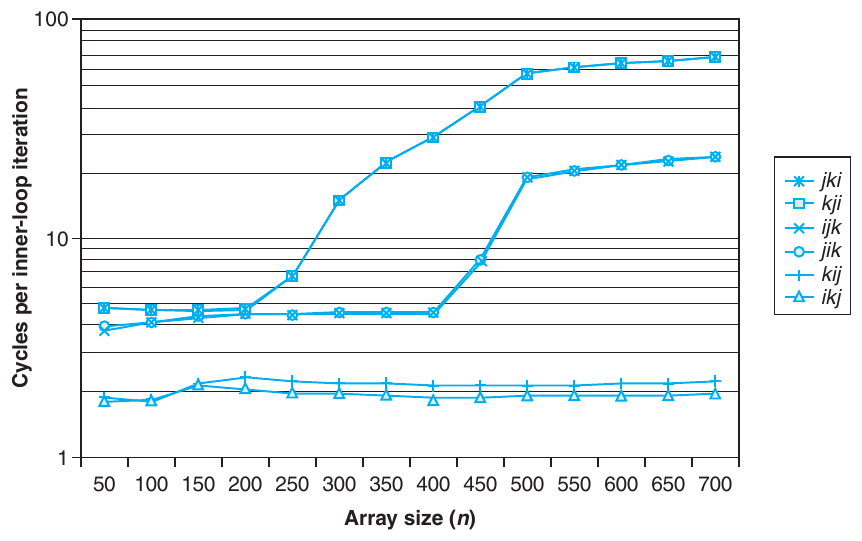

**Hình 6.46 Hiệu năng nhân ma trận trên Core i7.**

Các routine BC (Hình 6.44(e) và (f)) đưa ra trade-off thú vị: Với hai load và một store, chúng cần thêm một thao tác bộ nhớ so với AB. Ngược lại, vì vòng lặp trong quét cả B và C theo row-wise với mẫu stride-1, miss rate trên mỗi array chỉ 0.25 miss mỗi lần lặp, tổng 0.50 miss mỗi lần lặp.

Hình 6.46 tóm tắt hiệu năng các phiên bản nhân ma trận trên hệ thống Core i7. Đồ thị biểu diễn số CPU cycle đo được mỗi lần lặp inner-loop theo kích thước array (n).

Có một số điểm thú vị cần lưu ý trong đồ thị:

- Với n lớn, phiên bản nhanh nhất nhanh gần 40 lần phiên bản chậm nhất, dù mỗi phiên bản thực hiện cùng số phép toán số học floating-point.

- Các cặp phiên bản có cùng số tham chiếu bộ nhớ và miss mỗi lần lặp có hiệu năng đo được gần như giống hệt.

- Hai phiên bản có hành vi bộ nhớ tệ nhất về số truy cập và miss mỗi lần lặp chạy chậm hơn đáng kể bốn phiên bản kia, vốn ít miss hơn, ít truy cập hơn hoặc cả hai.

- Trong trường hợp này, miss rate dự đoán hiệu năng tốt hơn tổng số truy cập bộ nhớ. Ví dụ routine lớp BC, với 0.5 miss mỗi lần lặp, hoạt động tốt hơn nhiều AB với 1.25 miss, dù BC thực hiện nhiều tham chiếu hơn trong vòng lặp trong (hai load và một store) so với AB (hai load).

- Với các giá trị n lớn, hiệu năng của cặp phiên bản nhanh nhất (kij và ikj ) không thay đổi. Mặc dù array lớn hơn nhiều so với bất kỳ cache memory SRAM nào, phần cứng prefetching đủ thông minh để nhận ra mẫu truy cập stride-1 và đủ nhanh để theo kịp các truy cập bộ nhớ trong vòng lặp trong gọn. Đây là thành tựu đáng kinh ngạc của các kỹ sư Intel đã thiết kế hệ thống bộ nhớ này, tạo thêm động lực để lập trình viên phát triển các chương trình có spatial locality tốt.

#### Ghi chú Web MEM:BLOCKING Sử dụng blocking để tăng temporal locality

Có một kỹ thuật thú vị gọi là blocking, có thể cải thiện temporal locality của các vòng lặp trong. Ý tưởng tổng quát là tổ chức các cấu trúc dữ liệu trong chương trình thành những khối lớn gọi là block. (Trong bối cảnh này, “block” chỉ một khối dữ liệu application-level, không phải cache block.) Chương trình được tổ chức sao cho nó nạp một khối vào cache L1, thực hiện mọi thao tác đọc và ghi cần thiết trên khối đó, rồi loại bỏ khối, nạp khối tiếp theo, và cứ tiếp tục như vậy. Khác với các phép biến đổi vòng lặp đơn giản để cải thiện spatial locality, blocking khiến code khó đọc và khó hiểu hơn. Vì lý do này, nó phù hợp nhất với optimizing compiler hoặc các routine thư viện được thực thi thường xuyên. Blocking không cải thiện hiệu năng nhân ma trận trên Core i7 vì hệ thống có phần cứng prefetching tinh vi. Tuy vậy, kỹ thuật này vẫn đáng nghiên cứu và tìm hiểu, vì đây là khái niệm tổng quát có thể mang lại mức tăng hiệu năng lớn trên những hệ thống không prefetch.

### 6.6.3 Tận dụng locality trong chương trình

Như đã thấy, hệ thống bộ nhớ được tổ chức thành một phân cấp các thiết bị lưu trữ, với thiết bị nhỏ hơn và nhanh hơn ở phía trên, còn thiết bị lớn hơn và chậm hơn ở phía dưới. Do cách tổ chức phân cấp này, tốc độ hiệu dụng mà chương trình truy cập các vị trí bộ nhớ không thể được đặc trưng bằng một con số duy nhất. Thay vào đó, tốc độ này là một function biến thiên mạnh theo locality của chương trình (thứ chúng ta gọi là memory mountain), và có thể chênh lệch nhiều bậc độ lớn. Các chương trình có locality tốt truy cập phần lớn dữ liệu từ cache memory nhanh. Các chương trình có locality kém truy cập phần lớn dữ liệu từ main memory DRAM tương đối chậm.

Lập trình viên hiểu bản chất phân cấp bộ nhớ có thể tận dụng hiểu biết để viết chương trình hiệu quả hơn, bất kể tổ chức hệ thống cụ thể. Đặc biệt, chúng ta đề xuất các kỹ thuật sau:

- Tập trung chú ý vào vòng lặp trong, nơi diễn ra phần lớn phép tính và truy cập bộ nhớ.

- Cố tối đa hóa spatial locality bằng cách đọc đối tượng dữ liệu tuần tự với stride 1, theo thứ tự lưu trong bộ nhớ.

- Cố tối đa hóa temporal locality bằng cách sử dụng đối tượng dữ liệu thường xuyên nhất có thể sau khi đã đọc từ bộ nhớ.

## 6.7 Tổng kết

Các công nghệ lưu trữ cơ bản là random access memory (RAM), nonvolatile memory (ROM) và đĩa. RAM có hai dạng cơ bản. Static RAM (SRAM) nhanh hơn, đắt hơn và được sử dụng cho cache memory. Dynamic RAM (DRAM) chậm hơn, rẻ hơn và được sử dụng cho main memory cùng graphics frame buffer. ROM giữ nguyên thông tin ngay cả khi điện áp cấp bị tắt. Chúng được sử dụng để lưu firmware. Đĩa quay là thiết bị lưu trữ nonvolatile cơ học, chứa lượng dữ liệu khổng lồ với chi phí mỗi bit thấp nhưng có thời gian truy cập dài hơn DRAM nhiều. Solid state disk (SSD) dựa trên nonvolatile flash memory ngày càng trở thành phương án thay thế hấp dẫn cho đĩa quay trong một số ứng dụng.

Nói chung, các công nghệ lưu trữ nhanh hơn có chi phí mỗi bit cao hơn và capacity nhỏ hơn. Các đặc tính giá cả và hiệu năng của những công nghệ này đang thay đổi với tốc độ rất khác nhau. Đặc biệt, thời gian truy cập DRAM và đĩa lớn hơn nhiều so với CPU cycle. Các hệ thống thu hẹp những khoảng cách này bằng cách tổ chức bộ nhớ thành một phân cấp thiết bị lưu trữ, với thiết bị nhỏ hơn và nhanh hơn ở phía trên, còn thiết bị lớn hơn và chậm hơn ở phía dưới. Vì các chương trình well-written có locality tốt, phần lớn dữ liệu được phục vụ từ những mức cao hơn. Kết quả là hệ thống bộ nhớ hoạt động với tốc độ của các mức cao hơn nhưng có chi phí và capacity của các mức thấp hơn.

Lập trình viên có thể cải thiện đáng kể thời gian chạy bằng cách viết các chương trình có spatial và temporal locality tốt. Việc tận dụng cache memory SRAM-based đặc biệt quan trọng. Những chương trình chủ yếu fetch dữ liệu từ cache memory có thể chạy nhanh hơn nhiều so với những chương trình chủ yếu fetch dữ liệu từ bộ nhớ.

## Ghi chú tài liệu tham khảo

Công nghệ bộ nhớ và đĩa thay đổi nhanh. Theo kinh nghiệm, nguồn thông tin kỹ thuật tốt nhất là trang Web do nhà sản xuất duy trì. Micron, Toshiba và Samsung cung cấp lượng lớn thông tin kỹ thuật hiện hành về thiết bị bộ nhớ. Trang Seagate và Western Digital cung cấp thông tin hữu ích tương tự về đĩa.

Các giáo trình về thiết kế circuit và logic cung cấp thông tin chi tiết về công nghệ bộ nhớ [58, 89]. IEEE Spectrum xuất bản loạt bài khảo sát DRAM [55]. International Symposiums on Computer Architecture (ISCA) và High Performance Computer Architecture (HPCA) là những diễn đàn phổ biến về đặc trưng hiệu năng bộ nhớ DRAM [28, 29, 18].

Wilkes viết bài báo đầu tiên về cache memory [117]. Smith viết khảo sát kinh điển [104]. Przybylski viết cuốn sách có uy tín về thiết kế cache [86]. Hennessy và Patterson thảo luận toàn diện các vấn đề thiết kế cache [46]. Levinthal viết hướng dẫn hiệu năng toàn diện cho Intel Core i7 [70].

Stricker giới thiệu ý tưởng memory mountain như một cách đặc trưng toàn diện hệ thống bộ nhớ trong [112], và đề xuất không chính thức thuật ngữ “memory mountain” trong các lần trình bày công trình sau đó. Các nhà nghiên cứu compiler tìm cách tăng locality bằng cách tự động thực hiện những phép biến đổi code thủ công mà chúng ta đã thảo luận trong Mục 6.6 [22, 32, 66, 72, 79, 87, 119]. Carter cùng đồng nghiệp đã đề xuất một memory controller cache-aware [17]. Các nhà nghiên cứu khác đã phát triển những thuật toán cache-oblivious được thiết kế để chạy tốt mà không cần biết tường minh về cấu trúc cache memory bên dưới [30, 38, 39, 9].

Có một lượng lớn tài liệu về xây dựng và sử dụng lưu trữ đĩa. Nhiều nhà nghiên cứu lưu trữ tìm cách tập hợp các đĩa riêng lẻ thành những storage pool lớn hơn, vững chắc hơn và an toàn hơn [20, 40, 41, 83, 121]. Những người khác tìm cách sử dụng cache và locality để cải thiện hiệu năng truy cập đĩa [12, 21]. Các hệ thống như Exokernel cung cấp khả năng kiểm soát user-level cao hơn đối với tài nguyên đĩa và bộ nhớ [57]. Các hệ thống như Andrew File System [78] và Coda [94] mở rộng phân cấp bộ nhớ qua mạng máy tính và máy notebook di động. Schindler và Ganger phát triển một công cụ thú vị tự động xác định hình học và hiệu năng của SCSI disk drive [95]. Các nhà nghiên cứu đã tìm hiểu những kỹ thuật xây dựng và sử dụng SSD flash-based [8, 81].

## Bài tập về nhà

6.22 ◆◆ Giả sử bạn được yêu cầu thiết kế một đĩa quay có số bit trên mỗi track không đổi. Bạn biết rằng số bit trên mỗi track được quyết định bởi chu vi của track trong cùng, cũng có thể giả sử là chu vi của lỗ đĩa. Do đó, nếu làm lỗ ở tâm đĩa lớn hơn, số bit trên mỗi track tăng lên, nhưng tổng số track giảm xuống. Nếu gọi r là bán kính platter và x · r là bán kính lỗ, giá trị x nào làm dung lượng đĩa lớn nhất?

6.23 ◆ Ước tính thời gian trung bình (tính bằng ms) để truy cập một sector trên đĩa sau:

| Tham số | Giá trị |
|---|---|
| Tốc độ quay | 12,000 RPM |
| T<sub>avg seek</sub> | 3 ms |
| Số sector/track trung bình | 500 |

6.24 ◆◆ Giả sử một file 2 MB gồm các logical block 512-byte được lưu trên một disk drive có các đặc điểm sau:

| Tham số | Giá trị |
|---|---|
| Tốc độ quay | 18,000 RPM |
| T<sub>avg seek</sub> | 8 ms |
| Số sector/track trung bình | 2,000 |
| Số bề mặt | 4 |
| Kích thước sector | 512 byte |

Với mỗi trường hợp dưới đây, giả sử một chương trình đọc các logical block của file theo thứ tự tuần tự, lần lượt từng block, và thời gian định vị đầu đọc trên block đầu tiên là T<sub>avg seek</sub> + T<sub>avg rotation</sub>.

A. Trường hợp tốt nhất: Ước tính thời gian tối ưu (tính bằng ms) cần để đọc file khi có ánh xạ tốt nhất có thể từ logical block sang sector đĩa (tức là tuần tự).

B. Trường hợp ngẫu nhiên: Ước tính thời gian (tính bằng ms) cần để đọc file nếu các block được ánh xạ ngẫu nhiên đến các sector đĩa.

6.25 ◆ Bảng sau cung cấp các tham số cho một số cache khác nhau. Với mỗi cache, điền các field còn thiếu trong bảng. Nhớ rằng m là số bit địa chỉ vật lý, C là kích thước cache (số byte dữ liệu), B là kích thước block tính bằng byte, E là associativity, S là số cache set, t là số tag bit, s là số set index bit và b là số block offset bit.

| Cache | m | C | B | E | S | t | s | b |
|---|---|---|---|---|---|---|---|---|
| 1. | 32 | 1,024 | 4 | 4 | ______ | ______ | ______ | ______ |
| 2. | 32 | 1,024 | 4 | 256 | ______ | ______ | ______ | ______ |
| 3. | 32 | 1,024 | 8 | 1 | ______ | ______ | ______ | ______ |
| 4. | 32 | 1,024 | 8 | 128 | ______ | ______ | ______ | ______ |
| 5. | 32 | 1,024 | 32 | 1 | ______ | ______ | ______ | ______ |
| 6. | 32 | 1,024 | 32 | 4 | ______ | ______ | ______ | ______ |

6.26 ◆ Bảng sau cung cấp các tham số cho một số cache khác nhau. Nhiệm vụ của bạn là điền các field còn thiếu trong bảng. Nhớ rằng m là số bit địa chỉ vật lý, C là kích thước cache (số byte dữ liệu), B là kích thước block tính bằng byte, E là associativity, S là số cache set, t là số tag bit, s là số set index bit và b là số block offset bit.

| Cache | m | C | B | E | S | t | s | b |
|---|---|---|---|---|---|---|---|---|
| 1. | 32 | ______ | 8 | 1 | ______ | 21 | 8 | 3 |
| 2. | 32 | 2,048 | ______ | ______ | 128 | 23 | 7 | 2 |
| 3. | 32 | 1,024 | 2 | 8 | 64 | ______ | ______ | 1 |
| 4. | 32 | 1,024 | ______ | 2 | 16 | 23 | 4 | ______ |

6.27 ◆ Bài toán này liên quan đến cache trong Bài tập thực hành 6.12.

A. Liệt kê tất cả các địa chỉ bộ nhớ hex sẽ hit trong set 1.

B. Liệt kê tất cả các địa chỉ bộ nhớ hex sẽ hit trong set 6.

6.28 ◆◆ Bài toán này liên quan đến cache trong Bài tập thực hành 6.12.

A. Liệt kê tất cả các địa chỉ bộ nhớ hex sẽ hit trong set 2.

B. Liệt kê tất cả các địa chỉ bộ nhớ hex sẽ hit trong set 4.

C. Liệt kê tất cả các địa chỉ bộ nhớ hex sẽ hit trong set 5.

D. Liệt kê tất cả các địa chỉ bộ nhớ hex sẽ hit trong set 7.

6.29 ◆◆ Giả sử chúng ta có một hệ thống với các tính chất sau:

- Bộ nhớ có thể định địa chỉ theo byte.

- Các truy cập bộ nhớ là đến các word 1-byte (không phải word 4-byte).

- Địa chỉ rộng 12 bit.

- Cache là two-way set associative (E = 2), với kích thước block 4-byte (B = 4) và bốn set (S = 4).

Nội dung cache như sau, với tất cả địa chỉ, tag và giá trị được cho bằng ký hiệu hexadecimal:

| Set index | Tag | Valid | Byte 0 | Byte 1 | Byte 2 | Byte 3 |
|---|---|---|---|---|---|---|
| 0 | 00 | 1 | 40 | 41 | 42 | 43 |
|  | 83 | 1 | FE | 97 | CC | D0 |
| 1 | 00 | 1 | 44 | 45 | 46 | 47 |
|  | 83 | 0 | — | — | — | — |
| 2 | 00 | 1 | 48 | 49 | 4A | 4B |
|  | 40 | 0 | — | — | — | — |
| 3 | FF | 1 | 9A | C0 | 03 | FF |
|  | 00 | 0 | — | — | — | — |

A. Sơ đồ sau thể hiện định dạng của một địa chỉ (1 bit mỗi ô). Chỉ ra (bằng cách ghi nhãn trên sơ đồ) các field sẽ được dùng để xác định những thành phần sau:

CO. Cache block offset

CI. Cache set index

CT. Cache tag


B. Với mỗi truy cập bộ nhớ sau, chỉ ra nó sẽ là cache hit hay miss khi thực hiện theo thứ tự được liệt kê. Đồng thời cho biết giá trị đọc nếu có thể suy ra từ thông tin trong cache.

| Thao tác | Địa chỉ | Hit? | Giá trị đọc (hoặc không biết) |
|---|---|---|---|
| Đọc | 0x834 | ______ | ______ |
| Ghi | 0x836 | ______ | ______ |
| Đọc | 0xFFD | ______ | ______ |

6.30 ◆ Giả sử chúng ta có một hệ thống với các tính chất sau:

- Bộ nhớ có thể định địa chỉ theo byte.

- Các truy cập bộ nhớ là đến các word 1-byte (không phải word 4-byte).

- Địa chỉ rộng 13 bit.

- Cache là 4-way set associative (E = 4), với kích thước block 4-byte (B = 4) và tám set (S = 8).

Xét trạng thái cache sau. Tất cả địa chỉ, tag và giá trị được cho ở dạng hexadecimal. Cột Index chứa set index cho mỗi set gồm bốn line. Các cột Tag chứa giá trị tag của từng line. Các cột V chứa valid bit của từng line. Các cột Bytes 0–3 chứa dữ liệu cho từng line, được đánh số từ trái sang phải, bắt đầu bằng byte 0 bên trái.

Cache 4-way set associative

| Index | Tag | V | Bytes 0–3 | Tag | V | Bytes 0–3 | Tag | V | Bytes 0–3 | Tag | V | Bytes 0–3 |
|---|---|---|---|---|---|---|---|---|---|---|---|---|
| 0 | F0 | 1 | ED 32 0A A2 | 8A | 1 | BF 80 1D FC | 14 | 1 | EF 09 86 2A | BC | 0 | 25 44 6F 1A |
| 1 | BC | 0 | 03 3E CD 38 | A0 | 0 | 16 7B ED 5A | BC | 1 | 8E 4C DF 18 | E4 | 1 | FB B7 12 02 |
| 2 | BC | 1 | 54 9E 1E FA | B6 | 1 | DC 81 B2 14 | 00 | 0 | B6 1F 7B 44 | 74 | 0 | 10 F5 B8 2E |
| 3 | BE | 0 | 2F 7E 3D A8 | C0 | 1 | 27 95 A4 74 | C4 | 0 | 07 11 6B D8 | BC | 0 | C7 B7 AF C2 |
| 4 | 7E | 1 | 32 21 1C 2C | 8A | 1 | 22 C2 DC 34 | BC | 1 | BA DD 37 D8 | DC | 0 | E7 A2 39 BA |
| 5 | 98 | 0 | A9 76 2B EE | 54 | 0 | BC 91 D5 92 | 98 | 1 | 80 BA 9B F6 | BC | 1 | 48 16 81 0A |
| 6 | 38 | 0 | 5D 4D F7 DA | BC | 1 | 69 C2 8C 74 | 8A | 1 | A8 CE 7F DA | 38 | 1 | FA 93 EB 48 |
| 7 | 8A | 1 | 04 2A 32 6A | 9E | 0 | B1 86 56 0E | CC | 1 | 96 30 47 F2 | BC | 1 | F8 1D 42 30 |

A. Kích thước (C) của cache này tính bằng byte là bao nhiêu?

B. Khung sau thể hiện định dạng của một địa chỉ (1 bit mỗi ô). Chỉ ra (bằng cách ghi nhãn trên sơ đồ) các field sẽ được dùng để xác định những thành phần sau:

CO. Cache block offset

CI. Cache set index

CT. Cache tag

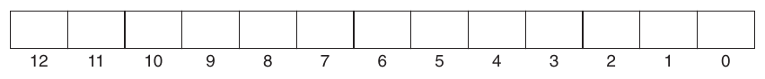

6.31 ◆◆ Giả sử một chương trình sử dụng cache trong Bài toán 6.30 tham chiếu word 1-byte tại địa chỉ 0x071A. Chỉ ra cache entry được truy cập và giá trị byte cache trả về ở dạng hex. Chỉ ra có xảy ra cache miss hay không. Nếu có cache miss, điền “—” cho “Byte cache trả về”. Gợi ý: Hãy chú ý các valid bit đó!

A. Định dạng địa chỉ (1 bit mỗi ô):

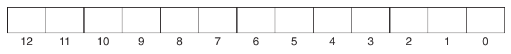

B. Tham chiếu bộ nhớ:

| Tham số | Giá trị |
|---|---|
| Block offset (CO) | 0x______ |
| Index (CI) | 0x______ |
| Cache tag (CT) | 0x______ |
| Cache hit? (Y/N) | ______ |
| Byte cache trả về | 0x______ |

6.32 ◆◆ Lặp lại Bài toán 6.31 cho địa chỉ bộ nhớ 0x16E8.

A. Định dạng địa chỉ (1 bit mỗi ô):

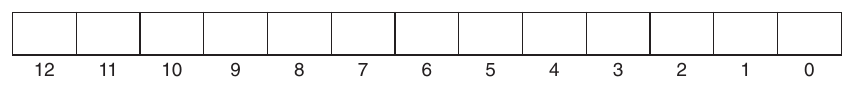

B. Tham chiếu bộ nhớ:

| Tham số | Giá trị |
|---|---|
| Cache offset (CO) | 0x______ |
| Cache index (CI) | 0x______ |
| Cache tag (CT) | 0x______ |
| Cache hit? (Y/N) | ______ |
| Byte cache trả về | 0x______ |

6.33 ◆◆ Với cache trong Bài toán 6.30, liệt kê tám địa chỉ bộ nhớ (ở dạng hex) sẽ hit trong set 2.

6.34 ◆◆ Xét thủ tục chuyển vị ma trận sau:

```
 1   typedef int array[4][4];
 2
 3   void transpose2(array dst, array src)
 4   {
 5       int i, j;
 6
 7       for (i = 0; i < 4; i++) {
 8           for (j = 0; j < 4; j++) {
 9               dst[j][i] = src[i][j];
10           }
11       }
12   }
```

Giả sử code này chạy trên máy có các tính chất sau:

- sizeof(int) = 4.

- Array src bắt đầu tại địa chỉ 0 và array dst bắt đầu tại địa chỉ 64 (thập phân).

- Có một data cache L1 duy nhất, là direct-mapped, write-through, write-allocate, với kích thước block 16 byte.

- Cache có tổng kích thước 32 byte dữ liệu, và ban đầu cache rỗng.

- Các truy cập vào array src và dst lần lượt là những nguồn read miss và write miss duy nhất.

A. Với mỗi row và col, chỉ ra truy cập src[row][col] và dst[row][col] là hit (h) hay miss (m). Ví dụ, đọc src[0][0] là miss và ghi dst[0][0] cũng là miss.

|  |  | Array dst |  |  |  |  | Array src |  |  |
|---|---|---|---|---|---|---|---|---|---|
|  | Cột 0 | Cột 1 | Cột 2 | Cột 3 |  | Cột 0 | Cột 1 | Cột 2 | Cột 3 |
| Hàng 0 | m | ______ | ______ | ______ | Hàng 0 | m | ______ | ______ | ______ |
| Hàng 1 | ______ | ______ | ______ | ______ | Hàng 1 | ______ | ______ | ______ | ______ |
| Hàng 2 | ______ | ______ | ______ | ______ | Hàng 2 | ______ | ______ | ______ | ______ |
| Hàng 3 | ______ | ______ | ______ | ______ | Hàng 3 | ______ | ______ | ______ | ______ |

6.35 ◆◆ Lặp lại Bài toán 6.34 cho một cache có tổng kích thước 128 byte dữ liệu.

|  |  | Array dst |  |  |  |  | Array src |  |  |
|---|---|---|---|---|---|---|---|---|---|
|  | Cột 0 | Cột 1 | Cột 2 | Cột 3 |  | Cột 0 | Cột 1 | Cột 2 | Cột 3 |
| Hàng 0 | ______ | ______ | ______ | ______ | Hàng 0 | ______ | ______ | ______ | ______ |
| Hàng 1 | ______ | ______ | ______ | ______ | Hàng 1 | ______ | ______ | ______ | ______ |
| Hàng 2 | ______ | ______ | ______ | ______ | Hàng 2 | ______ | ______ | ______ | ______ |
| Hàng 3 | ______ | ______ | ______ | ______ | Hàng 3 | ______ | ______ | ______ | ______ |

6.36 ◆◆ Bài toán này kiểm tra khả năng dự đoán hành vi cache của code C. Bạn được cho code sau để phân tích:

```
1       int x[2][128];
2       int i;
3       int sum = 0;
4
5       for (i = 0; i < 128; i++) {
6           sum += x[0][i] * x[1][i];
7       }
```

Giả sử chúng ta thực thi nó trong các điều kiện sau:

- sizeof(int) = 4.

- Array x bắt đầu tại địa chỉ bộ nhớ 0x0 và được lưu theo thứ tự row-major.

- Trong mỗi trường hợp dưới đây, ban đầu cache rỗng.

- Các truy cập bộ nhớ duy nhất là đến những phần tử của array x. Tất cả biến khác được lưu trong register.

Với các giả định này, ước tính miss rate cho những trường hợp sau:

A. Trường hợp 1: Giả sử cache có kích thước 512 byte, direct-mapped, với các cache block 16-byte. Miss rate là bao nhiêu?

B. Trường hợp 2: Miss rate là bao nhiêu nếu tăng gấp đôi kích thước cache lên 1,024 byte?

C. Trường hợp 3: Giờ giả sử cache có kích thước 512 byte, two-way set associative dùng chính sách thay thế LRU, với các cache block 16-byte. Cache miss rate là bao nhiêu?

D. Với trường hợp 3, kích thước cache lớn hơn có giúp giảm miss rate không? Vì sao có hoặc không?

E. Với trường hợp 3, kích thước block lớn hơn có giúp giảm miss rate không? Vì sao có hoặc không?

6.37 ◆◆ Đây là một bài toán khác kiểm tra khả năng phân tích hành vi cache của code C. Giả sử chúng ta thực thi ba hàm tính tổng trong Hình 6.47 trong các điều kiện sau:

- sizeof(int) = 4.

- Máy có cache direct-mapped 4 KB với kích thước block 16-byte.

- Trong hai vòng lặp, code chỉ sử dụng truy cập bộ nhớ cho dữ liệu array. Các chỉ số vòng lặp và giá trị sum được giữ trong register.

- Array a được lưu bắt đầu tại địa chỉ bộ nhớ 0x08000000.

Điền bảng về cache miss rate xấp xỉ cho hai trường hợp N = 64 và N = 60.

| Hàm | N = 64 | N = 60 |
|---|---|---|
| sumA | ______ | ______ |
| sumB | ______ | ______ |
| sumC | ______ | ______ |

```
 1   typedef int array_t[N][N];
 2
 3   int sumA(array_t a)
 4   {
 5       int i, j;
 6       int sum = 0;
 7       for (i = 0; i < N; i++)
 8           for (j = 0; j < N; j++) {
 9               sum += a[i][j];
10           }
11       return sum;
12   }
13
14   int sumB(array_t a)
15   {
16       int i, j;
17       int sum = 0;
18       for (j = 0; j < N; j++)
19           for (i = 0; i < N; i++) {
20               sum += a[i][j];
21           }
22       return sum;
23   }
24
25   int sumC(array_t a)
26   {
27       int i, j;
28       int sum = 0;
29       for (j = 0; j < N; j+=2)
30           for (i = 0; i < N; i+=2) {
31               sum += (a[i][j] + a[i+1][j]
32                       + a[i][j+1] + a[i+1][j+1]);
33           }
34       return sum;
35   }
```

**Hình 6.47 Các hàm được tham chiếu trong Bài toán 6.37.**

6.38 ◆ 3M quyết định làm Post-its bằng cách in các hình vuông màu vàng lên những tờ giấy trắng. Trong quá trình in, họ cần đặt giá trị CMYK (cyan, magenta, yellow, black) cho mọi điểm trong hình vuông. 3M thuê bạn xác định hiệu quả của các thuật toán sau trên một máy có data cache direct-mapped 1,024-byte với các block 16-byte. Bạn được cho các định nghĩa sau:

```
1   struct point_color {
2       int c;
3       int m;
4       int y;
5       int k;
6   };
7
8   struct point_color square[16][16];
9   int i, j;
```

Giả sử những điều sau:

- sizeof(int) = 4.

- square bắt đầu tại địa chỉ bộ nhớ 0.

- Ban đầu cache rỗng.

- Các truy cập bộ nhớ duy nhất là đến những phần tử của array square. Các biến i và j được lưu trong register.

Xác định hiệu năng cache của code sau:

```
1       for (i = 15; i >= 0; i--){
2           for (j = 15; j >= 0; j--) {
3               square[i][j].c = 0;
4               square[i][j].m = 0;
5               square[i][j].y = 1;
6               square[i][j].k = 0;
7           }
8       }
```

A. Tổng số phép ghi là bao nhiêu?

B. Tổng số phép ghi hit trong cache là bao nhiêu?

C. Hit rate là bao nhiêu?

6.39 ◆ Với các giả định trong Bài toán 6.38, xác định hiệu năng cache của code sau:

```
1       for (i = 15; i >= 0; i--){
2           for (j = 15; j >= 0; j--) {
3               square[j][i].c = 0;
4               square[j][i].m = 0;
5               square[j][i].y = 1;
6               square[j][i].k = 0;
7           }
8       }
```

A. Tổng số phép ghi là bao nhiêu?

B. Tổng số phép ghi hit trong cache là bao nhiêu?

C. Hit rate là bao nhiêu?

6.40 ◆ Với các giả định trong Bài toán 6.38, xác định hiệu năng cache của code sau:

```
 1       for (i = 15; i >= 0; i--) {
 2           for (j = 15; j >= 0; j--) {
 3               square[i][j].y = 1;
 4           }
 5       }
 6       for (i = 15; i >= 0; i--) {
 7           for (j = 15; j >= 0; j--) {
 8               square[i][j].c = 0;
 9               square[i][j].m = 0;
10               square[i][j].k = 0;
11           }
12       }
```

A. Tổng số phép ghi là bao nhiêu?

B. Tổng số phép ghi hit trong cache là bao nhiêu?

C. Hit rate là bao nhiêu?

6.41 ◆◆ Bạn đang viết một trò chơi 3D mới mà bạn hy vọng sẽ mang lại danh tiếng và tiền bạc. Hiện tại bạn đang làm một hàm xóa screen buffer trước khi vẽ frame tiếp theo. Màn hình bạn làm việc là một array pixel 640 × 480. Máy bạn đang dùng có cache direct-mapped 32 KB với các line 8-byte. Các cấu trúc C bạn đang sử dụng như sau:

```
 1   struct pixel {
 2       char r;
 3       char g;
 4       char b;
 5       char a;
 6   };
 7
 8   struct pixel buffer[480][640];
 9   int i, j;
10   char *cptr;
11   int *iptr;
```

Giả sử những điều sau:

- sizeof(char) = 1 và sizeof(int) = 4.

- buffer bắt đầu tại địa chỉ bộ nhớ 0.

- Ban đầu cache rỗng.

- Các truy cập bộ nhớ duy nhất là đến các phần tử của array buffer. Các biến i, j, cptr và iptr được lưu trong register.

Bao nhiêu phần trăm phép ghi trong code sau sẽ hit trong cache?

```
1       for (j = 639; j >= 0; j--) {
2           for (i = 479; i >= 0; i--){
3               buffer[i][j].r = 0;
4               buffer[i][j].g = 0;
5               buffer[i][j].b = 0;
6               buffer[i][j].a = 0;
7           }
8       }
```

6.42 ◆◆ Với các giả định trong Bài toán 6.41, bao nhiêu phần trăm phép ghi trong code sau sẽ hit trong cache?

```
1       char *cptr = (char *) buffer;
2       for (; cptr < (((char *) buffer) + 640 * 480 * 4); cptr++)
3           *cptr = 0;
```

6.43 ◆◆ Với các giả định trong Bài toán 6.41, bao nhiêu phần trăm phép ghi trong code sau sẽ hit trong cache?

```
1       int *iptr = (int *)buffer;
2       for (; iptr < ((int *)buffer + 640*480); iptr++)
3           *iptr = 0;
```

6.44 ◆◆◆ Tải chương trình mountain từ website CS:APP và chạy nó trên hệ thống PC/Linux bạn yêu thích. Dùng các kết quả để ước tính kích thước cache trên hệ thống của bạn.

6.45 ◆◆◆◆ Trong bài tập này, bạn sẽ áp dụng các khái niệm đã học trong Chương 5 và 6 vào bài toán tối ưu code cho một ứng dụng memory-intensive. Xét một thủ tục sao chép và chuyển vị các phần tử của một ma trận N × N kiểu int. Nghĩa là với ma trận nguồn S và ma trận đích D, chúng ta muốn sao chép mỗi phần tử s<sub>i,j</sub> sang d<sub>j,i</sub>. Code này có thể được viết bằng một vòng lặp đơn giản,

```
1   void transpose(int *dst, int *src, int dim)
2   {
3       int i, j;
4
5       for (i = 0; i < dim; i++)
6           for (j = 0; j < dim; j++)
7               dst[j*dim + i] = src[i*dim + j];
8   }
```

trong đó các đối số của thủ tục là pointer tới ma trận đích (dst) và nguồn (src), cũng như kích thước ma trận N (dim). Nhiệm vụ của bạn là nghĩ ra một thủ tục chuyển vị chạy nhanh nhất có thể.

6.46 ◆◆◆◆ Bài tập này là một biến thể thú vị của Bài toán 6.45. Xét bài toán chuyển một đồ thị có hướng g thành đồ thị vô hướng tương ứng g′. Đồ thị g′ có một cạnh từ đỉnh u đến đỉnh v khi và chỉ khi có một cạnh từ u đến v hoặc từ v đến u trong đồ thị g ban đầu. Đồ thị g được biểu diễn bằng ma trận kề G như sau. Nếu N là số đỉnh trong g, thì G là ma trận N × N và tất cả phần tử của nó đều là 0 hoặc 1. Giả sử các đỉnh của g được đặt tên là v<sub>0</sub>, v<sub>1</sub>, v<sub>2</sub>, . . . , v<sub>N−1</sub>. Khi đó G[i][j ] là 1 nếu có một cạnh từ v<sub>i</sub> đến v<sub>j</sub>, và là 0 trong trường hợp ngược lại. Lưu ý rằng các phần tử trên đường chéo của ma trận kề luôn là 1 và ma trận kề của một đồ thị vô hướng là đối xứng. Code này có thể được viết bằng một vòng lặp đơn giản:

```
1   void col_convert(int *G, int dim) {
2        int i, j;
3
4        for (i = 0; i < dim; i++)
5            for (j = 0; j < dim; j++)
6                G[j*dim + i] = G[j*dim + i] || G[i*dim + j];
7   }
```

Nhiệm vụ của bạn là nghĩ ra một thủ tục chuyển đổi chạy nhanh nhất có thể. Như trước, bạn sẽ cần áp dụng các khái niệm đã học trong Chương 5 và 6 để đưa ra lời giải tốt.

## Lời giải các bài tập thực hành

Lời giải Bài toán 6.1 (trang 620) Ý tưởng ở đây là giảm thiểu số bit địa chỉ bằng cách giảm thiểu aspect ratio max(r, c)/ min(r, c). Nói cách khác, array càng vuông thì càng cần ít bit địa chỉ.

| Cách tổ chức | r | c | b<sub>r</sub> | b<sub>c</sub> | max(b<sub>r</sub>, b<sub>c</sub>) |
|---|---|---|---|---|---|
| 16 × 1 | 4 | 4 | 2 | 2 | 2 |
| 16 × 4 | 4 | 4 | 2 | 2 | 2 |
| 128 × 8 | 16 | 8 | 4 | 3 | 4 |
| 512 × 4 | 32 | 16 | 5 | 4 | 5 |
| 1,024 × 4 | 32 | 32 | 5 | 5 | 5 |

Lời giải Bài toán 6.2 (trang 628) Mục đích của bài luyện tập nhỏ này là đảm bảo bạn hiểu mối quan hệ giữa cylinder và track. Khi đã hiểu rõ, chỉ cần thay số vào và tính:

Disk capacity = (1,024 bytes)/(sector) × (500 sectors)/(track) × (15,000 tracks)/(surface) × (2 surfaces)/(platter) × (3 platters)/(disk)

= 46,080,000,000 bytes = 46.08 GB

Lời giải Bài toán 6.3 (trang 631) Lời giải của bài toán này là ứng dụng trực tiếp công thức tính thời gian truy cập đĩa. Rotational latency trung bình (tính bằng ms) là

T<sub>avg rotation</sub> = 1/2 × T<sub>max rotation</sub>

= 1/2 × (60 secs/12,000 RPM) × 1,000 ms/sec ≈ 2.5 ms

Thời gian truyền trung bình là

T<sub>avg transfer</sub> = (60 secs/12,000 RPM) × 1/300 sectors/track × 1,000 ms/sec

≈ 0.016 ms

Kết hợp tất cả, tổng thời gian truy cập ước tính là

T<sub>access</sub> = T<sub>avg seek</sub> + T<sub>avg rotation</sub> + T<sub>avg transfer</sub>

= 5 ms + 2.5 ms + 0.016 ms ≈ 7.516 ms

Lời giải Bài toán 6.4 (trang 631) Đây là một phép kiểm tra tốt về hiểu biết của bạn đối với các yếu tố ảnh hưởng đến hiệu năng đĩa. Trước tiên cần xác định một vài tính chất cơ bản của file và đĩa. File gồm 10,000 logical block 512-byte. Với đĩa, T<sub>avg seek</sub> = 6 ms, T<sub>max rotation</sub> = 4.61 ms và T<sub>avg rotation</sub> = 2.30 ms.

A. Trường hợp tốt nhất: Trong trường hợp tối ưu, các block được ánh xạ đến những sector liền nhau, trên cùng cylinder, có thể được đọc lần lượt mà không di chuyển đầu đọc. Khi đầu đọc đã được định vị trên sector đầu tiên, cần hai vòng quay đầy đủ của đĩa (5,000 sector mỗi vòng) để đọc toàn bộ 10,000 block. Vì vậy, tổng thời gian đọc file là T<sub>avg seek</sub> + T<sub>avg rotation</sub> + 2 × T<sub>max rotation</sub> = 6 + 2.30 + 9.22 = 17.52 ms.

B. Trường hợp ngẫu nhiên: Trong trường hợp này, khi các block được ánh xạ ngẫu nhiên đến sector, đọc mỗi block trong số 10,000 block cần T<sub>avg seek</sub> + T<sub>avg rotation</sub> ms, nên tổng thời gian đọc file là (T<sub>avg seek</sub> + T<sub>avg rotation</sub>) × 10,000 = 83,000 ms (83 giây!).

Giờ bạn có thể thấy vì sao chống phân mảnh disk drive thường là một ý tưởng tốt!

Lời giải Bài toán 6.5 (trang 637) Đây là một bài toán đơn giản cho bạn một số hiểu biết thú vị về tính khả thi của SSD. Nhớ rằng với đĩa, 1 PB = 10<sup>9</sup> MB. Khi đó, phép chuyển đổi đơn vị trực tiếp sau cho ra các thời gian dự đoán sau cho mỗi trường hợp:

A. Ghi tuần tự Worst-case (520 MB/s):

(10<sup>9</sup> × 128) × (1/520) × (1/(86,400 × 365)) ≈ 7 năm

B. Ghi ngẫu nhiên Worst-case (205 MB/s):

(10<sup>9</sup> × 128) × (1/205) × (1/(86,400 × 365)) ≈ 19 năm

C. Trường hợp trung bình (50 GB/ngày):

(10<sup>9</sup> × 128) × (1/50,000) × (1/365) ≈ 6,912 năm

Vì vậy, ngay cả khi SSD hoạt động liên tục, nó vẫn có thể dùng ít nhất 7 năm, lâu hơn tuổi thọ dự kiến của hầu hết máy tính.

Lời giải Bài toán 6.6 (trang 640) Trong giai đoạn 10-year từ 2005 đến 2015, đơn giá của đĩa quay giảm 166 lần, nghĩa là giá giảm khoảng 2 lần sau mỗi khoảng 18 tháng. Giả sử xu hướng này tiếp tục, một petabyte lưu trữ, có giá khoảng $30,000 năm 2015, sẽ giảm xuống dưới $200 sau khoảng tám lần giảm factor-of-2 như vậy. Vì những lần giảm này xảy ra mỗi 18 tháng, chúng ta có thể kỳ vọng có thể mua một petabyte lưu trữ với giá $200 vào khoảng năm 2027.

Lời giải Bài toán 6.7 (trang 644) Để tạo một mẫu tham chiếu stride-1, phải hoán vị các vòng lặp sao cho các chỉ số ngoài cùng bên phải thay đổi nhanh nhất.

```
 1   int productarray3d(int a[N][N][N])
 2   {
 3       int i, j, k, product = 1;
 4
 5       for (j = N-1; j >= 0; j--) {
 6           for (k = N-1; k >= 0; k--) {
 7               for (i = N-1; i >= 0; i--) {
 8                   product *= a[j][k][i];
 9               }
10           }
11       }
12       return product;
13   }
```

Đây là một ý tưởng quan trọng. Hãy đảm bảo bạn hiểu vì sao phép hoán vị vòng lặp cụ thể này tạo ra mẫu truy cập stride-1.

Lời giải Bài toán 6.8 (trang 645) Chìa khóa để giải bài toán này là hình dung cách bố trí array trong bộ nhớ rồi phân tích các mẫu tham chiếu. Hàm clear1 truy cập array bằng mẫu tham chiếu stride-1 nên rõ ràng có spatial locality tốt nhất. Hàm clear2 quét lần lượt mỗi struct trong N struct, điều này tốt, nhưng trong mỗi struct, nó nhảy qua lại theo một mẫu non-stride-1 tại các offset sau tính từ đầu struct: 0, 12, 4, 16, 8, 20. Do đó clear2 có spatial locality kém hơn clear1. Hàm clear3 không chỉ nhảy qua lại trong mỗi struct mà còn nhảy từ struct này sang struct khác. Vì vậy clear3 có spatial locality kém hơn clear2 và clear1.

Lời giải Bài toán 6.9 (trang 652) Lời giải là ứng dụng trực tiếp các định nghĩa tham số cache khác nhau trong Hình 6.26. Không quá thú vị, nhưng bạn cần hiểu cách tổ chức cache tạo ra những phần phân chia này trong các bit địa chỉ trước khi thực sự hiểu cách cache hoạt động.

| Cache | m | C | B | E | S | t | s | b |
|---|---|---|---|---|---|---|---|---|
| 1. | 32 | 1,024 | 4 | 1 | 256 | 22 | 8 | 2 |
| 2. | 32 | 1,024 | 8 | 4 | 32 | 24 | 5 | 3 |
| 3. | 32 | 1,024 | 32 | 32 | 1 | 27 | 0 | 5 |

Lời giải Bài toán 6.10 (trang 660) Padding loại bỏ conflict miss. Do đó, three-fourths số tham chiếu là hit.

Lời giải Bài toán 6.11 (trang 660) Đôi khi, hiểu vì sao điều gì đó là một ý tưởng tồi giúp bạn hiểu vì sao cách thay thế là một ý tưởng tốt. Ở đây, ý tưởng tồi chúng ta đang xem xét là đánh chỉ số cache bằng các bit high-order thay vì các bit ở giữa.

A. Với cách đánh chỉ số bằng bit high-order, mỗi đoạn array liền nhau gồm 2<sup>t</sup> block, trong đó t là số tag bit. Do đó, 2<sup>t</sup> block liền nhau đầu tiên của array sẽ ánh xạ đến set 0, 2<sup>t</sup> block tiếp theo ánh xạ đến set 1, v.v.

B. Với một cache direct-mapped có (S, E, B, m) = (512, 1, 32, 32), dung lượng cache là 512 block 32-byte với t = 18 tag bit trong mỗi cache line. Do đó, 2<sup>18</sup> block đầu tiên trong array sẽ ánh xạ đến set 0, 2<sup>18</sup> block tiếp theo đến set 1. Vì array của chúng ta chỉ gồm (4,096 × 4)/32 = 512 block, tất cả block trong array đều ánh xạ đến set 0. Do đó, cache sẽ chứa nhiều nhất 1 block array tại bất kỳ thời điểm nào, mặc dù array đủ nhỏ để nằm toàn bộ trong cache. Rõ ràng, cách đánh chỉ số bằng bit high-order tận dụng cache kém.

Lời giải Bài toán 6.12 (trang 664) 2 bit low-order là block offset (CO), tiếp theo là 3 bit set index (CI), các bit còn lại đóng vai trò tag (CT):

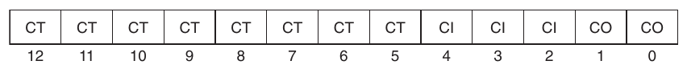

Lời giải Bài toán 6.13 (trang 664) Địa chỉ: 0x0D53

A. Định dạng địa chỉ (1 bit mỗi ô):

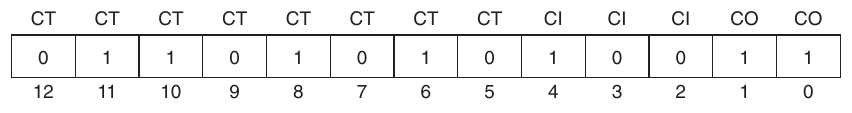

B. Tham chiếu bộ nhớ:

| Tham số | Giá trị |
|---|---|
| Cache block offset (CO) | 0x3 |
| Cache set index (CI) | 0x4 |
| Cache tag (CT) | 0x6A |
| Cache hit? (Y/N) | N |
| Byte cache trả về | — |

Lời giải Bài toán 6.14 (trang 665) Địa chỉ: 0x0CB4

A. Định dạng địa chỉ (1 bit mỗi ô):

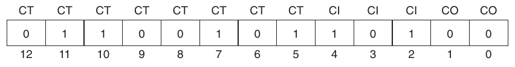

B. Tham chiếu bộ nhớ:

| Tham số | Giá trị |
|---|---|
| Cache block offset (CO) | 0x0 |
| Cache set index (CI) | 0x5 |
| Cache tag (CT) | 0x65 |
| Cache hit? (Y/N) | N |
| Byte cache trả về | — |

Lời giải Bài toán 6.15 (trang 665) Địa chỉ: 0x0A31

A. Định dạng địa chỉ (1 bit mỗi ô):

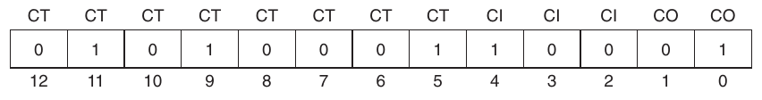

B. Tham chiếu bộ nhớ:

| Tham số | Giá trị |
|---|---|
| Cache block offset | 0x1 |
| Cache set index | 0x4 |
| Cache tag | 0x51 |
| Cache hit? (Y/N) | N |
| Byte cache trả về | —- |

Lời giải Bài toán 6.16 (trang 666) Bài toán này phần nào là phiên bản đảo ngược của các Bài tập thực hành 6.12–6.15, yêu cầu bạn suy ngược từ nội dung cache để suy ra những địa chỉ sẽ hit trong một set cụ thể. Trong trường hợp này, set 3 chứa một line hợp lệ có tag 0x32. Vì chỉ có một line hợp lệ trong set, bốn địa chỉ sẽ hit. Các địa chỉ này có dạng nhị phân 0 0110 0100 11xx. Do đó, bốn địa chỉ hex hit trong set 3 là

0x064C, 0x064D, 0x064E và 0x064F

Lời giải Bài toán 6.17 (trang 672)

A. Chìa khóa để giải bài toán này là hình dung sơ đồ trong Hình 6.48. Lưu ý rằng mỗi cache line chứa đúng một hàng của array, cache có kích thước vừa đủ để chứa một array, và với mọi i, hàng i của src và dst ánh xạ đến cùng cache line. Vì cache quá nhỏ để chứa cả hai array, các tham chiếu đến array này liên tục đẩy các line hữu ích của array kia ra. Ví dụ, phép ghi dst[0][0] đẩy ra line đã được load khi đọc src[0][0]. Do đó, khi đọc src[0][1] tiếp theo, chúng ta có miss.

|  | Array dst |  |  | Array src |  |
|---|---|---|---|---|---|
|  | Cột 0 | Cột 1 |  | Cột 0 | Cột 1 |
| Hàng 0 | m | m | Hàng 0 | m | m |
| Hàng 1 | m | m | Hàng 1 | m | h |

B. Khi cache có kích thước 32 byte, nó đủ lớn để chứa cả hai array. Do đó, các miss duy nhất là những cold miss ban đầu.

|  | Array dst |  |  | Array src |  |
|---|---|---|---|---|---|
|  | Cột 0 | Cột 1 |  | Cột 0 | Cột 1 |
| Hàng 0 | m | h | Hàng 0 | m | h |
| Hàng 1 | m | h | Hàng 1 | m | h |

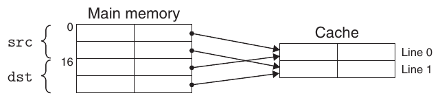

**Hình 6.48 Hình minh họa cho lời giải Bài toán 6.17.**

Lời giải Bài toán 6.18 (trang 673) Mỗi cache line 32-byte chứa hai cấu trúc algae_position liền nhau. Mỗi vòng lặp thăm các cấu trúc này theo thứ tự trong bộ nhớ, đọc một phần tử số nguyên mỗi lần. Vì vậy mẫu cho mỗi vòng lặp là miss, hit, miss, hit, v.v. Lưu ý rằng với bài toán này, chúng ta có thể dự đoán miss rate mà không thực sự liệt kê tổng số lần đọc và miss.

A. Tổng số truy cập đọc là bao nhiêu? 2,048 lần đọc.

B. Tổng số truy cập đọc miss trong cache là bao nhiêu? 1,024 miss.

C. Miss rate là bao nhiêu? 1024/2048 = 50%.

Lời giải Bài toán 6.19 (trang 674) Chìa khóa của bài toán này là nhận ra cache chỉ có thể chứa 1/2 array. Do đó, phép quét column-wise ở nửa sau array đẩy ra các line đã được load trong lúc quét nửa đầu. Ví dụ, đọc phần tử đầu tiên của grid[8][0] đẩy ra line đã được load khi đọc các phần tử từ grid[0][0]. Line này cũng chứa grid[0][1]. Vì vậy khi bắt đầu quét cột tiếp theo, tham chiếu đến phần tử đầu tiên của grid[0][1] bị miss.

A. Tổng số truy cập đọc là bao nhiêu? 2,048 lần đọc.

B. Tổng số truy cập đọc hit trong cache là bao nhiêu? 1,024 miss.

C. Hit rate là bao nhiêu? 1024/2048 = 50%.

D. Hit rate sẽ là bao nhiêu nếu cache lớn gấp đôi? Nếu cache lớn gấp đôi, nó có thể chứa toàn bộ array grid. Các miss duy nhất sẽ là cold miss ban đầu, và hit rate sẽ là 3/4 = 75%.

Lời giải Bài toán 6.20 (trang 674) Vòng lặp này có mẫu tham chiếu stride-1 tốt, nên các miss duy nhất là cold miss ban đầu.

A. Tổng số truy cập đọc là bao nhiêu? 2,048 lần đọc.

B. Tổng số truy cập đọc hit trong cache là bao nhiêu? 1,536 miss.

C. Hit rate là bao nhiêu? 1536/2048 = 75%.

D. Hit rate sẽ là bao nhiêu nếu cache lớn gấp đôi? Tăng kích thước cache thêm bất kỳ lượng nào cũng không thay đổi miss rate, vì cold miss không thể tránh được.

Lời giải Bài toán 6.21 (trang 679) Throughput duy trì khi dùng stride lớn từ L1 là khoảng 12,000 MB/s, clock frequency là 2,100 MHz, và từng truy cập đọc có đơn vị là long 16-byte. Do đó, từ đồ thị này có thể ước tính cần khoảng 2,100/12,000 × 16 = 2.8 ≈ 3.0 chu kỳ để truy cập một word từ L1 trên máy này, nhanh hơn khoảng 1.25 lần so với latency danh nghĩa 4-cycle từ L1. Điều này là do tính song song của vòng lặp unroll 4 × 4, cho phép nhiều load đang được xử lý cùng lúc.

---

[^1]: Như đã học trong Chương 2, phép cộng floating-point có tính giao hoán, nhưng nói chung không có tính kết hợp. Trong thực tế, nếu các ma trận không trộn giá trị cực lớn với giá trị cực nhỏ, như thường xảy ra khi ma trận lưu các tính chất vật lý, giả định về tính kết hợp là hợp lý.
