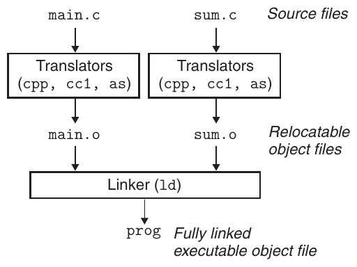
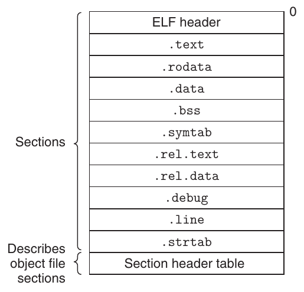
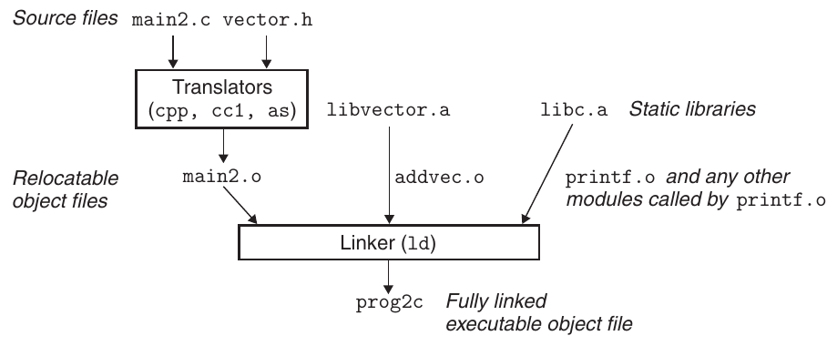
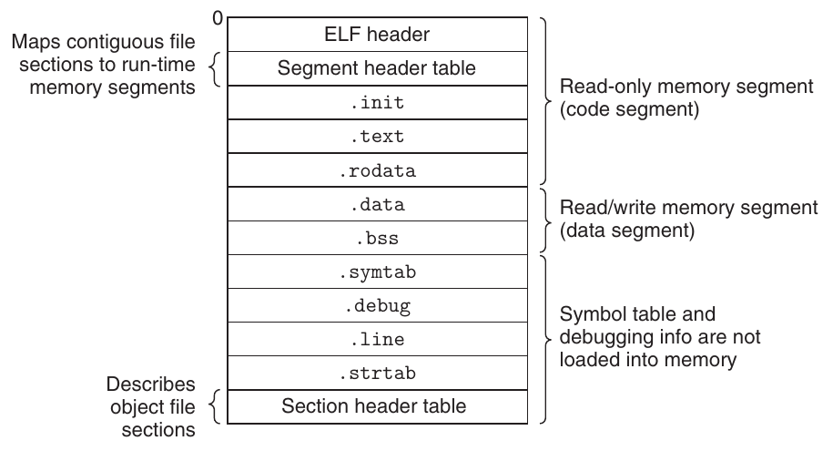
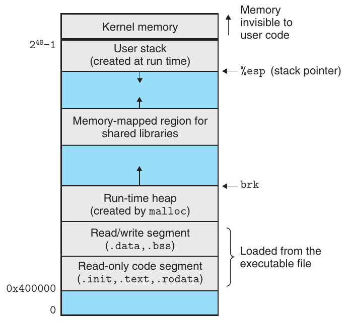
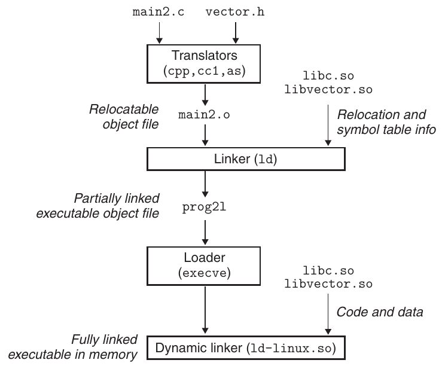
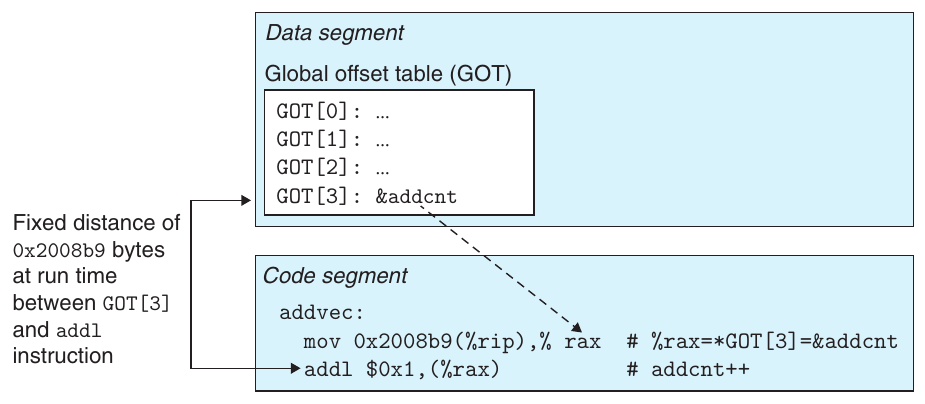
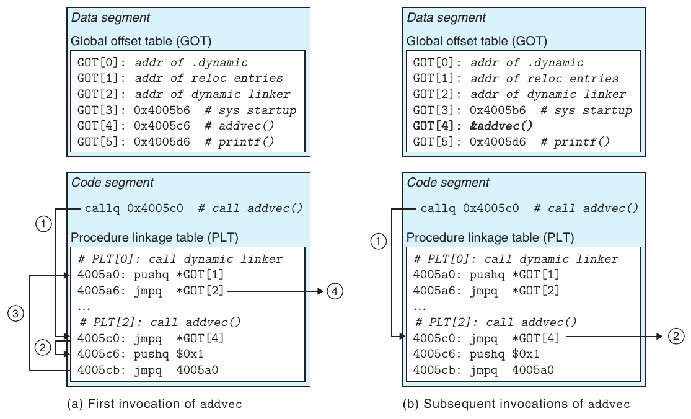

Phần II

**Chạy chương trình trên hệ thống**

Hành trình tìm hiểu hệ thống máy tính của chúng ta tiếp tục bằng việc xem xét kỹ hơn các phần mềm hệ thống dùng để xây dựng và chạy chương trình ứng dụng. Linker kết hợp những phần khác nhau của chương trình thành một file duy nhất có thể được load vào bộ nhớ và được processor thực thi. Operating system hiện đại phối hợp với phần cứng để tạo cho mỗi chương trình ảo giác rằng nó được độc quyền sử dụng một processor và main memory, trong khi thực tế nhiều chương trình đang chạy trên hệ thống tại bất kỳ thời điểm nào.

Trong phần đầu của sách, bạn đã hiểu rõ sự tương tác giữa chương trình và phần cứng. Phần II sẽ mở rộng góc nhìn của bạn về hệ thống bằng cách giúp bạn hiểu vững chắc sự tương tác giữa chương trình và operating system. Bạn sẽ học cách sử dụng các dịch vụ do operating system cung cấp để xây dựng những chương trình system-level như Unix shell và các gói cấp phát bộ nhớ động.

# 7 Linking

Linking là quá trình thu thập và kết hợp các phần code và dữ liệu khác nhau thành một file duy nhất có thể được load (sao chép) vào bộ nhớ và thực thi. Linking có thể được thực hiện tại compile time, khi source code được chuyển thành machine code; tại load time, khi chương trình được loader load vào bộ nhớ và thực thi; và thậm chí tại run time, bởi các chương trình ứng dụng. Trên những hệ thống máy tính thời kỳ đầu, linking được thực hiện thủ công. Trên hệ thống hiện đại, linking được thực hiện tự động bằng các chương trình gọi là linker.

Linker đóng vai trò quan trọng trong phát triển phần mềm vì chúng cho phép separate compilation. Thay vì tổ chức một ứng dụng lớn thành một source file nguyên khối, chúng ta có thể chia nó thành các module nhỏ hơn, dễ quản lý hơn và có thể được sửa đổi, compile riêng biệt. Khi thay đổi một module, chúng ta chỉ cần compile lại module đó rồi link lại ứng dụng mà không phải compile lại những file khác.

Linking thường được linker xử lý âm thầm và không phải vấn đề quan trọng đối với sinh viên xây dựng các chương trình nhỏ trong lớp lập trình nhập môn. Vậy tại sao cần tìm hiểu linking?

- Hiểu linker sẽ giúp bạn xây dựng các chương trình lớn. Lập trình viên xây dựng chương trình lớn thường gặp lỗi linker do thiếu module, thiếu thư viện hoặc các phiên bản thư viện không tương thích. Nếu không hiểu cách linker resolve các reference, thư viện là gì và linker sử dụng thư viện để resolve reference như thế nào, những lỗi này sẽ khiến bạn khó hiểu và bực bội.

- Hiểu linker sẽ giúp bạn tránh những lỗi lập trình nguy hiểm. Các quyết định của Linux linker khi resolve symbol reference có thể âm thầm ảnh hưởng đến tính đúng đắn của chương trình. Những chương trình định nghĩa sai nhiều global variable có thể đi qua linker mà không nhận được bất kỳ cảnh báo nào trong trường hợp mặc định. Chương trình thu được có thể biểu hiện hành vi run-time khó hiểu và cực kỳ khó debug. Chúng ta sẽ chỉ ra cách điều này xảy ra và cách tránh nó.

- Hiểu linking sẽ giúp bạn hiểu cách triển khai các quy tắc về scope của ngôn ngữ. Ví dụ, global variable và local variable khác nhau thế nào? Việc định nghĩa một variable hoặc function với thuộc tính static thực sự có ý nghĩa gì?

- Hiểu linking sẽ giúp bạn hiểu những khái niệm hệ thống quan trọng khác. Các executable object file do linker tạo ra giữ vai trò then chốt trong những chức năng hệ thống quan trọng như load và chạy chương trình, virtual memory, paging và memory mapping.

- Hiểu linking sẽ giúp bạn khai thác shared library. Trong nhiều năm, linking được xem là khá đơn giản và không mấy thú vị. Tuy nhiên, với vai trò ngày càng quan trọng của shared library và dynamic linking trong operating system hiện đại, linking trở thành một quá trình tinh vi mang lại khả năng đáng kể cho lập trình viên am hiểu. Ví dụ, nhiều sản phẩm phần mềm sử dụng shared library để nâng cấp các binary shrink-wrapped tại run time. Ngoài ra, nhiều Web server dựa vào dynamic linking của shared library để phục vụ nội dung động.

(a) main.c (b) sum.c

```
                           code/link/main.c                               code/link/sum.c
1   int sum(int *a, int n);                   1   int sum(int *a, int n)
2                                             2   {
3   int array[2] = {1, 2};                    3       int i, s = 0;
4                                             4
5   int main()                                5       for (i = 0; i < n; i++) {
6   {                                         6           s += a[i];
7       int val = sum(array, 2);              7       }
8       return val;                           8       return s;
9   }                                         9   }
                           code/link/main.c                               code/link/sum.c
```

**Hình 7.1 Chương trình ví dụ 1. Chương trình ví dụ gồm hai source file, main.c và sum.c . Hàm main khởi tạo một array gồm các int, sau đó gọi hàm sum để tính tổng các phần tử array.**

Chương này thảo luận kỹ lưỡng mọi khía cạnh của linking, từ static linking truyền thống, đến dynamic linking của shared library tại load time, rồi dynamic linking của shared library tại run time. Chúng ta sẽ mô tả các cơ chế cơ bản bằng ví dụ thực tế và xác định những tình huống mà vấn đề linking có thể ảnh hưởng đến hiệu năng và tính đúng đắn của chương trình. Để nội dung cụ thể và dễ hiểu, chúng ta đặt phần thảo luận trong bối cảnh hệ thống x86-64 chạy Linux và sử dụng định dạng object file chuẩn ELF-64 (từ đây gọi là ELF). Tuy nhiên, cần nhận ra rằng các khái niệm linking cơ bản có tính phổ quát, bất kể operating system, ISA hay định dạng object file. Chi tiết có thể khác nhau nhưng các khái niệm vẫn giống nhau.

## 7.1 Compiler Driver

Xét chương trình C trong Hình 7.1. Nó sẽ là ví dụ đơn giản xuyên suốt chương này, giúp chúng ta làm rõ một số điểm quan trọng về cách linker hoạt động.

Phần lớn hệ thống compilation cung cấp một compiler driver thay mặt người dùng gọi preprocessor của ngôn ngữ, compiler, assembler và linker khi cần. Ví dụ, để build chương trình ví dụ bằng hệ thống compilation GNU, chúng ta có thể gọi gcc driver bằng cách nhập lệnh sau vào shell:

```
linux> gcc -Og -o prog main.c sum.c
```

Hình 7.2 tóm tắt hoạt động của driver khi chuyển chương trình ví dụ từ một ASCII source file thành một executable object file. (Nếu muốn tự xem các bước này, hãy chạy gcc với tùy chọn -v.) Trước tiên, driver chạy C preprocessor (cpp),[^1] chuyển C source file main.c thành một file trung gian ASCII main.i:

```
cpp [other arguments] main.c /tmp/main.i
```



**Hình 7.2 Static linking. Linker kết hợp các relocatable object file để tạo thành executable object file prog .**

Tiếp theo, driver chạy C compiler (cc1), chuyển main.i thành một file assembly-language ASCII main.s:

```
cc1 /tmp/main.i -Og [other arguments] -o /tmp/main.s
```

Sau đó, driver chạy assembler (as), chuyển main.s thành một relocatable object file nhị phân main.o:

```
as [other arguments] -o /tmp/main.o /tmp/main.s
```

Driver thực hiện cùng quá trình đó để tạo sum.o. Cuối cùng, nó chạy chương trình linker ld, kết hợp main.o và sum.o cùng những system object file cần thiết để tạo executable object file nhị phân prog:

```
ld -o prog [system object files and args] /tmp/main.o /tmp/sum.o
```

Để chạy executable prog, chúng ta nhập tên của nó trên dòng lệnh của Linux shell:

```
linux> ./prog
```

Shell gọi một hàm trong operating system có tên loader, sao chép code và dữ liệu trong executable file prog vào bộ nhớ rồi chuyển quyền điều khiển tới điểm bắt đầu chương trình.

## 7.2 Static Linking

Các static linker như chương trình ld của Linux nhận đầu vào là một tập hợp relocatable object file và các đối số command-line, rồi tạo đầu ra là một executable object file đã được link hoàn chỉnh, có thể được load và chạy. Các relocatable object file đầu vào gồm nhiều code section và data section, trong đó mỗi section là một dãy byte liên tiếp. Instruction nằm trong một section, global variable đã khởi tạo nằm trong một section khác, còn variable chưa khởi tạo nằm trong một section khác nữa.

Để tạo executable, linker phải thực hiện hai nhiệm vụ chính:

Bước 1. Symbol resolution. Object file định nghĩa và tham chiếu các symbol, trong đó mỗi symbol tương ứng với một function, một global variable hoặc một static variable (tức là bất kỳ variable C nào được khai báo với thuộc tính static). Mục đích của symbol resolution là liên kết mỗi symbol reference với đúng một symbol definition.

Bước 2. Relocation. Compiler và assembler tạo ra các code section và data section bắt đầu tại địa chỉ 0. Linker relocate những section này bằng cách gắn một vị trí bộ nhớ với mỗi symbol definition, rồi sửa đổi mọi reference tới các symbol đó để chúng trỏ tới vị trí bộ nhớ này. Linker thực hiện các relocation một cách máy móc theo những chỉ dẫn chi tiết do assembler tạo ra, gọi là relocation entry.

Các mục tiếp theo mô tả chi tiết hơn những nhiệm vụ này. Khi đọc, hãy nhớ một số sự thật cơ bản về linker: Object file chỉ là các tập hợp block byte. Một số block chứa code chương trình, số khác chứa dữ liệu chương trình, còn những block khác chứa các cấu trúc dữ liệu hướng dẫn linker và loader. Linker nối các block với nhau, quyết định vị trí run-time cho các block đã nối, rồi sửa đổi nhiều vị trí bên trong code block và data block. Linker hiểu rất ít về máy đích. Compiler và assembler tạo ra object file đã thực hiện phần lớn công việc.

## 7.3 Object Files

Object file có ba dạng:

Relocatable object file. Chứa code nhị phân và dữ liệu ở dạng có thể kết hợp với những relocatable object file khác tại compile time để tạo một executable object file.

Executable object file. Chứa code nhị phân và dữ liệu ở dạng có thể được sao chép trực tiếp vào bộ nhớ và thực thi.

Shared object file. Một loại relocatable object file đặc biệt có thể được load vào bộ nhớ và link động tại load time hoặc run time.

Compiler và assembler tạo relocatable object file (bao gồm shared object file). Linker tạo executable object file. Về mặt kỹ thuật, object module là một dãy byte, còn object file là object module được lưu trên đĩa trong một file. Tuy nhiên, chúng ta sẽ sử dụng hai thuật ngữ này thay thế cho nhau.

Object file được tổ chức theo những định dạng object file cụ thể, khác nhau giữa các hệ thống. Các hệ thống Unix đầu tiên của Bell Labs sử dụng định dạng a.out. (Cho đến ngày nay, executable vẫn được gọi là file a.out.) Windows sử dụng định dạng Portable Executable (PE). Mac OS-X sử dụng định dạng Mach-O. Các hệ thống Linux và Unix x86-64 hiện đại sử dụng Executable and Linkable Format (ELF). Mặc dù phần thảo luận tập trung vào ELF, các khái niệm cơ bản vẫn tương tự bất kể định dạng cụ thể.



**Hình 7.3 Một ELF relocatable object file điển hình.**

## 7.4 Relocatable Object File

Hình 7.3 thể hiện định dạng của một ELF relocatable object file điển hình. ELF header bắt đầu bằng một dãy 16-byte mô tả word size và byte ordering của hệ thống tạo ra file. Phần còn lại của ELF header chứa thông tin cho phép linker phân tích và diễn giải object file. Thông tin này gồm kích thước ELF header, loại object file (ví dụ, relocatable, executable hoặc shared), loại máy (ví dụ, x86-64), file offset của section header table, cùng kích thước và số entry trong section header table. Vị trí và kích thước các section được mô tả bởi section header table, chứa một entry fixed-size cho mỗi section trong object file.

Nằm giữa ELF header và section header table là các section. Một ELF relocatable object file điển hình chứa các section sau:

.text Machine code của chương trình đã được compile.

.rodata Dữ liệu Read-only như các format string trong câu lệnh printf và jump table cho câu lệnh switch.

.data Các global variable và static variable C đã khởi tạo. Local variable C được duy trì trên stack tại run time và không xuất hiện trong section .data hay .bss.

.bss Các global variable và static variable C chưa khởi tạo, cùng mọi global variable hoặc static variable được khởi tạo bằng không. Section này không chiếm không gian thực tế trong object file; nó chỉ đóng vai trò placeholder. Định dạng object file phân biệt variable đã và chưa khởi tạo để tiết kiệm không gian: variable chưa khởi tạo không phải chiếm không gian đĩa thực tế trong object file. Tại run time, những variable này được cấp phát trong bộ nhớ với giá trị ban đầu bằng không.

### Thông tin thêm: Tại sao dữ liệu chưa khởi tạo được gọi là .bss?

Việc sử dụng thuật ngữ .bss để chỉ dữ liệu chưa khởi tạo là phổ biến khắp nơi. Ban đầu nó là từ viết tắt của directive “block started by symbol” trong assembly language của IBM 704 (khoảng năm 1957), và tên viết tắt đó được giữ lại. Một cách đơn giản để nhớ sự khác nhau giữa section .data và .bss là xem “bss” như viết tắt của “Better Save Space!” (Hãy tiết kiệm không gian!).

.symtab Một symbol table chứa thông tin về các function và global variable được định nghĩa và tham chiếu trong chương trình. Một số lập trình viên lầm tưởng rằng chương trình phải được compile với tùy chọn -g mới có thông tin symbol table. Thực tế, mọi relocatable object file đều có symbol table trong .symtab (trừ khi lập trình viên chủ động xóa nó bằng lệnh strip). Tuy nhiên, khác với symbol table bên trong compiler, symbol table .symtab không chứa entry cho local variable.

.rel.text Danh sách các vị trí trong section .text cần được sửa đổi khi linker kết hợp object file này với những object file khác. Nhìn chung, mọi instruction gọi external function hoặc tham chiếu global variable đều cần được sửa đổi. Ngược lại, các instruction gọi local function không cần được sửa đổi. Chú ý rằng thông tin relocation không cần thiết trong executable object file và thường bị bỏ qua trừ khi người dùng yêu cầu linker đưa vào một cách tường minh.

.rel.data Thông tin relocation cho mọi global variable được module tham chiếu hoặc định nghĩa. Nhìn chung, mọi global variable đã khởi tạo mà giá trị ban đầu là địa chỉ của một global variable hoặc một function được định nghĩa bên ngoài đều cần được sửa đổi.

.debug Một debugging symbol table chứa entry cho local variable và typedef được định nghĩa trong chương trình, global variable được định nghĩa và tham chiếu trong chương trình, và C source file gốc. Nó chỉ xuất hiện nếu compiler driver được gọi với tùy chọn -g.

.line Ánh xạ giữa số dòng trong chương trình C nguồn ban đầu và các machine code instruction trong section .text. Nó chỉ xuất hiện nếu compiler driver được gọi với tùy chọn -g.

.strtab Một string table cho các symbol table trong section .symtab và .debug, cũng như cho tên section trong các section header. String table là một dãy character string null-terminated.

## 7.5 Symbol và symbol table

Mỗi relocatable object module m có một symbol table chứa thông tin về các symbol được m định nghĩa và tham chiếu. Trong bối cảnh linker, có ba loại symbol khác nhau:

- Global symbol do module m định nghĩa và có thể được module khác tham chiếu. Global linker symbol tương ứng với các function C nonstatic và global variable.

- Global symbol được module m tham chiếu nhưng do một module khác định nghĩa. Những symbol này được gọi là external và tương ứng với các function C nonstatic cùng global variable được định nghĩa trong module khác.

- Local symbol chỉ được module m định nghĩa và tham chiếu. Chúng tương ứng với static function C và global variable được định nghĩa với thuộc tính static. Các symbol này có thể được nhìn thấy ở mọi nơi trong module m nhưng không thể được module khác tham chiếu.

Cần nhận ra rằng local linker symbol không giống local variable của chương trình. Symbol table trong .symtab không chứa symbol nào tương ứng với local variable nonstatic của chương trình. Chúng được quản lý trên stack tại run time và không liên quan đến linker.

Điều thú vị là local variable của procedure được định nghĩa với thuộc tính static của C không được quản lý trên stack. Thay vào đó, compiler cấp phát không gian trong .data hoặc .bss cho mỗi definition và tạo một local linker symbol có tên duy nhất trong symbol table. Ví dụ, giả sử hai function trong cùng module định nghĩa một static local variable x:

```
 1   int f()
 2   {
 3       static int x = 0;
 4       return x;
 5   }
 6
 7   int g()
 8   {
 9       static int x = 1;
10       return x;
11   }
```

Trong trường hợp này, compiler xuất cho assembler hai local linker symbol có tên khác nhau. Ví dụ, nó có thể sử dụng x.1 cho definition trong hàm f và x.2 cho definition trong hàm g.

Symbol table được assembler xây dựng bằng các symbol do compiler xuất vào file .s assembly-language. ELF symbol table nằm trong section .symtab. Nó chứa một array các entry. Hình 7.4 thể hiện định dạng của mỗi entry.

name là một byte offset vào string table, trỏ tới chuỗi tên null-terminated của symbol. value là địa chỉ symbol. Với relocatable module, value là offset tính từ đầu section nơi object được định nghĩa. Với executable object file, value là địa chỉ run-time tuyệt đối. size là kích thước (tính bằng byte) của object. type thường là data hoặc function. Symbol table cũng có thể chứa entry cho từng section riêng lẻ và đường dẫn của source file gốc. Vì vậy, những object này cũng có các type riêng biệt. Field binding cho biết symbol là local hay global.

### Mới học C? Ẩn tên variable và function bằng static

Lập trình viên C sử dụng thuộc tính static để ẩn các khai báo variable và function bên trong module, tương tự cách bạn sử dụng khai báo public và private trong Java và C++. Trong C, source file đóng vai trò module. Mọi global variable hoặc function được khai báo với thuộc tính static đều là private đối với module đó. Tương tự, mọi global variable hoặc function được khai báo không có thuộc tính static đều là public và có thể được bất kỳ module nào khác truy cập. Bảo vệ variable và function bằng thuộc tính static ở bất cứ nơi nào có thể là một thói quen lập trình tốt.

```
                                                     code/link/elfstructs.c
1   typedef struct {
2       int   name;      /* String table offset */
3       char  type:4,    /* Function or data (4 bits) */
4             binding:4; /* Local or global (4 bits) */
5       char  reserved;  /* Unused */
6       short section;   /* Section header index */
7       long  value;     /* Section offset or absolute address */
8       long  size;      /* Object size in bytes */
9   } Elf64_Symbol;
                                                     code/link/elfstructs.c
```

**Hình 7.4 ELF symbol table entry. Mỗi field type và binding có 4 bit.**

Mỗi symbol được gán cho một section của object file, được biểu thị bởi field section, là index vào section header table. Có ba pseudosection đặc biệt không có entry trong section header table: ABS dành cho symbol không nên được relocate. UNDEF dành cho undefined symbol—tức symbol được tham chiếu trong object module này nhưng được định nghĩa ở nơi khác. COMMON dành cho data object chưa khởi tạo và chưa được cấp phát. Với COMMON symbol, field value cho biết yêu cầu alignment, còn size cho biết kích thước tối thiểu. Chú ý rằng các pseudosection này chỉ tồn tại trong relocatable object file; chúng không tồn tại trong executable object file.

Sự phân biệt giữa COMMON và .bss khá tinh tế. Các phiên bản gcc hiện đại gán symbol trong relocatable object file vào COMMON và .bss theo quy ước sau:

| COMMON | Global variable chưa khởi tạo |
|---|---|
| .bss | Static variable chưa khởi tạo và global variable hoặc static variable được khởi tạo bằng không |

Lý do của sự phân biệt có vẻ tùy ý này bắt nguồn từ cách linker thực hiện symbol resolution, mà chúng ta sẽ giải thích trong Mục 7.6.

Chương trình GNU readelf là công cụ tiện dụng để xem nội dung object file. Ví dụ, dưới đây là ba symbol table entry cuối cùng của relocatable object file main.o từ chương trình ví dụ trong Hình 7.1. Tám entry đầu tiên không được thể hiện là các local symbol được linker sử dụng nội bộ.

```
Num:    Value          Size Type    Bind   Vis      Ndx Name
  8: 0000000000000000    24 FUNC    GLOBAL DEFAULT    1 main
  9: 0000000000000000     8 OBJECT  GLOBAL DEFAULT    3 array
 10: 0000000000000000     0 NOTYPE  GLOBAL DEFAULT  UND sum
```

Trong ví dụ này, chúng ta thấy một entry cho definition của global symbol main, một function 24-byte nằm tại offset (tức value) bằng không trong section .text. Tiếp theo là definition của global symbol array, một object 8-byte nằm tại offset bằng không trong section .data. Entry cuối cùng bắt nguồn từ reference tới external symbol sum. readelf nhận diện mỗi section bằng một index số nguyên. Ndx=1 biểu thị section .text, còn Ndx=3 biểu thị section .data.

### Bài tập thực hành 7.1 (lời giải trang 753)

Bài toán này liên quan đến các module m.o và swap.o trong Hình 7.5. Với mỗi symbol được định nghĩa hoặc tham chiếu trong swap.o, hãy cho biết nó có symbol table entry trong section .symtab của module swap.o hay không. Nếu có, hãy chỉ ra module định nghĩa symbol (swap.o hoặc m.o), loại symbol (local, global hoặc extern) và section (.text, .data, .bss hoặc COMMON) mà nó được gán vào trong module.

(a) m.c (b) swap.c

<pre>                              code/link/m.c                            code/link/swap.c
1   void swap();                           1   extern int buf[];
2                                          2
3   int buf[2] = {1, 2};                   3   int *bufp0 = &amp;buf[0];
4                                          4   int *bufp1;
5   int main()                             5
6   {                                      6   void swap()
7       swap();                            7   {
8       return 0;                          8       int temp;
9   }                                      9
                              code/link/m.c10      bufp1 = &amp;buf[1];
                                           11      temp = *bufp0;
                                           12      *bufp0 = *bufp1;
                                           13      *bufp1 = temp;
                                           14  }
                                                                       code/link/swap.c</pre>

**Hình 7.5 Chương trình ví dụ cho Bài tập thực hành 7.1.**

| Symbol | Có entry trong .symtab? | Loại symbol | Module định nghĩa | Section |
|---|---|---|---|---|
| buf | ______ | ______ | ______ | ______ |
| bufp0 | ______ | ______ | ______ | ______ |
| bufp1 | ______ | ______ | ______ | ______ |
| swap | ______ | ______ | ______ | ______ |
| temp | ______ | ______ | ______ | ______ |

## 7.6 Symbol Resolution

Linker resolve symbol reference bằng cách liên kết mỗi reference với đúng một symbol definition từ các symbol table của những relocatable object file đầu vào. Symbol resolution khá đơn giản đối với reference tới local symbol được định nghĩa trong cùng module chứa reference. Compiler chỉ cho phép một definition của mỗi local symbol trong mỗi module. Compiler cũng bảo đảm các static local variable, vốn được gán local linker symbol, có tên duy nhất.

Tuy nhiên, việc resolve reference tới global symbol phức tạp hơn. Khi compiler gặp một symbol (tên variable hoặc function) không được định nghĩa trong module hiện tại, nó giả định symbol được định nghĩa trong một module khác, tạo một linker symbol table entry rồi để linker xử lý. Nếu linker không tìm được definition cho symbol được tham chiếu trong bất kỳ module đầu vào nào, nó in thông báo lỗi (thường khó hiểu) rồi kết thúc. Ví dụ, nếu chúng ta thử compile và link source file sau trên máy Linux,

```
1   void foo(void);
2
3   int main() {
4       foo();
5       return 0;
6   }
```

thì compiler chạy trơn tru, nhưng linker kết thúc khi không thể resolve reference tới foo:

```
linux> gcc -Wall -Og -o linkerror linkerror.c
/tmp/ccSz5uti.o: In function ‘main’:
/tmp/ccSz5uti.o(.text+0x7): undefined reference to ‘foo’
```

Symbol resolution cho global symbol cũng phức tạp vì nhiều object module có thể định nghĩa các global symbol cùng tên. Trong trường hợp này, linker phải báo lỗi hoặc bằng cách nào đó chọn một definition rồi loại bỏ những definition còn lại. Cách tiếp cận được các hệ thống Linux sử dụng đòi hỏi sự phối hợp giữa compiler, assembler và linker, và có thể gây ra những bug khó hiểu cho lập trình viên thiếu thận trọng.

### Thông tin thêm: Mangling linker symbol trong C++ và Java

Cả C++ và Java đều cho phép các method overload có cùng tên trong source code nhưng khác danh sách tham số. Vậy linker phân biệt các function overload này thế nào? Function overload trong C++ và Java hoạt động được vì compiler mã hóa mỗi tổ hợp method và danh sách tham số riêng biệt thành một tên duy nhất cho linker. Quá trình mã hóa này gọi là mangling, còn quá trình ngược lại gọi là demangling.

May thay, C++ và Java sử dụng các cơ chế mangling tương thích. Tên class đã mangle gồm một số nguyên là số ký tự trong tên, theo sau bởi tên gốc. Ví dụ, class Foo được mã hóa thành 3Foo. Method được mã hóa bằng tên method gốc, theo sau bởi __, rồi tên class đã mangle, rồi các mã một chữ cái của từng argument. Ví dụ, Foo::bar(int, long) được mã hóa thành bar__3Fooil. Các cơ chế tương tự được dùng để mangle tên global variable và template.

### 7.6.1 Cách linker resolve các tên symbol trùng nhau

Đầu vào của linker là một tập hợp relocatable object module. Mỗi module định nghĩa một tập symbol, trong đó một số là local (chỉ được nhìn thấy trong module định nghĩa nó), số khác là global (được các module khác nhìn thấy). Điều gì xảy ra nếu nhiều module định nghĩa các global symbol cùng tên? Dưới đây là cách tiếp cận mà các hệ thống compilation Linux sử dụng.

Tại compile time, compiler xuất mỗi global symbol cho assembler dưới dạng strong hoặc weak, và assembler mã hóa ngầm thông tin này trong symbol table của relocatable object file. Function và global variable đã khởi tạo được gán strong symbol. Global variable chưa khởi tạo được gán weak symbol.

Với khái niệm strong symbol và weak symbol này, Linux linker sử dụng những quy tắc sau để xử lý các tên symbol trùng nhau:

Quy tắc 1. Không cho phép nhiều strong symbol có cùng tên.

Quy tắc 2. Khi có một strong symbol và nhiều weak symbol cùng tên, chọn strong symbol.

Quy tắc 3. Khi có nhiều weak symbol cùng tên, chọn một weak symbol bất kỳ.

Ví dụ, giả sử chúng ta thử compile và link hai module C sau:

```
1   /* foo1.c */
2   int main()
3   {
4       return 0;
5   }

1   /* bar1.c */
2   int main()
3   {
4       return 0;
5   }
```

Trong trường hợp này, linker tạo thông báo lỗi vì strong symbol main được định nghĩa nhiều lần (quy tắc 1):

```
linux> gcc foo1.c bar1.c
/tmp/ccq2Uxnd.o: In function ‘main’:
bar1.c:(.text+0x0): multiple definition of ‘main’
```

Tương tự, linker tạo thông báo lỗi cho các module sau vì strong symbol x được định nghĩa hai lần (quy tắc 1):

```
1   /* foo2.c */
2   int x = 15213;
3
4   int main()
5   {
6       return 0;
7   }

1   /* bar2.c */
2   int x = 15213;
3
4   void f()
5   {
6   }
```

Tuy nhiên, nếu x chưa được khởi tạo trong một module, linker sẽ âm thầm chọn strong symbol được định nghĩa trong module còn lại (quy tắc 2):

```
 1   /* foo3.c */
 2   #include <stdio.h>
 3   void f(void);
 4
 5   int x = 15213;
 6
 7   int main()
 8   {
 9       f();
10       printf("x = %d\n", x);
11       return 0;
12   }

 1   /* bar3.c */
 2   int x;
 3
 4   void f()
 5   {
 6       x = 15212;
 7   }
```

Tại run time, hàm f thay đổi giá trị x từ 15213 thành 15212, điều có thể gây bất ngờ không mong muốn cho tác giả hàm main! Chú ý rằng linker thường không đưa ra dấu hiệu nào cho biết nó đã phát hiện nhiều definition của x:

```
linux> gcc -o foobar3 foo3.c bar3.c
linux> ./foobar3
x = 15212
```

Điều tương tự có thể xảy ra nếu có hai weak definition của x (quy tắc 3):

```
 1   /* foo4.c */
 2   #include <stdio.h>
 3   void f(void);
 4
 5   int x;
 6
 7   int main()
 8   {
 9       x = 15213;
10       f();
11       printf("x = %d\n", x);
12       return 0;
13   }

 1   /* bar4.c */
 2   int x;
 3
 4   void f()
 5   {
 6       x = 15212;
 7   }
```

Việc áp dụng quy tắc 2 và 3 có thể gây ra những bug run-time âm thầm mà lập trình viên thiếu thận trọng không thể hiểu nổi, đặc biệt khi các symbol definition trùng nhau có type khác nhau. Xét ví dụ sau, trong đó x vô tình được định nghĩa là int trong một module và double trong module khác:

```
 1   /* foo5.c */
 2   #include <stdio.h>
 3   void f(void);
 4
 5   int y = 15212;
 6   int x = 15213;
 7
 8   int main()
 9   {
10       f();
11       printf("x = 0x%x y = 0x%x \n",
12              x, y);
13       return 0;
14   }

 1   /* bar5.c */
 2   double x;
 3
 4   void f()
 5   {
 6       x = -0.0;
 7   }
```

Trên máy x86-64/Linux, double dài 8 byte và int dài 4 byte. Trên hệ thống của chúng ta, địa chỉ x là 0x601020 và địa chỉ y là 0x601024. Vì vậy, phép gán x = -0.0 tại dòng 6 của bar5.c sẽ ghi đè các vị trí bộ nhớ dành cho x và y (dòng 5 và 6 trong foo5.c) bằng biểu diễn double-precision floating-point của số không âm!

```
linux> gcc -Wall -Og -o foobar5 foo5.c bar5.c
/usr/bin/ld: Warning: alignment 4 of symbol ‘x’ in /tmp/cclUFK5g.o
is smaller than 8 in /tmp/ccbTLcb9.o
linux> ./foobar5
x = 0x0 y = 0x80000000
```

Đây là một bug tinh vi và khó chịu, đặc biệt vì nó chỉ khiến linker đưa ra cảnh báo và thường biểu hiện muộn hơn nhiều trong quá trình thực thi chương trình, ở xa nơi xảy ra lỗi. Trong hệ thống lớn có hàng trăm module, bug kiểu này cực kỳ khó sửa, nhất là vì nhiều lập trình viên không biết cách linker hoạt động và thường bỏ qua cảnh báo compiler. Khi không chắc chắn, hãy gọi linker với một flag như gcc -fno-common, tạo lỗi nếu gặp global symbol multiply-defined. Hoặc sử dụng tùy chọn -Werror để biến mọi cảnh báo thành lỗi.

Trong Mục 7.5, chúng ta đã thấy cách compiler gán symbol vào COMMON và .bss theo một quy ước có vẻ tùy ý. Thực ra, quy ước này bắt nguồn từ việc linker cho phép nhiều module định nghĩa global symbol cùng tên trong một số trường hợp. Khi compiler chuyển đổi một module và gặp một weak global symbol, chẳng hạn x, nó không biết các module khác có định nghĩa x hay không; nếu có, nó cũng không thể dự đoán linker sẽ chọn instance nào trong số nhiều instance của x. Vì vậy, compiler hoãn quyết định cho linker bằng cách gán x vào COMMON. Ngược lại, nếu x được khởi tạo bằng không, nó là strong symbol (và do đó phải duy nhất theo quy tắc 2), nên compiler có thể tự tin gán nó vào .bss. Tương tự, static symbol vốn đã duy nhất theo cách xây dựng, nên compiler có thể tự tin gán chúng vào .data hoặc .bss.

#### Bài tập thực hành 7.2 (lời giải trang 754)

Trong bài này, gọi REF(x.i) → DEF(x.k) là ký hiệu biểu thị linker liên kết một reference bất kỳ tới symbol x trong module i với definition của x trong module k. Với mỗi ví dụ sau, hãy dùng ký hiệu này để chỉ ra cách linker resolve reference tới symbol multiply-defined trong từng module. Nếu có lỗi link-time (quy tắc 1), viết “error”. Nếu linker tùy ý chọn một definition (quy tắc 3), viết “unknown”.

```
A. /* Module 1 */          /* Module 2 */
   int main()              int main;
   {                      int p2()
   }                      {
                          }
```

(a) REF(main.1) → DEF(______ .______)

(b) REF(main.2) → DEF(\_\_\_\_\_\_.\_\_\_\_\_\_)

```
B. /* Module 1 */          /* Module 2 */
   void main()             int main = 1;
   {                       int p2()
   }                       {
                           }
```

(a) REF(main.1) → DEF(______ .______)

(b) REF(main.2) → DEF(\_\_\_\_\_\_.\_\_\_\_\_\_)

```
C. /* Module 1 */          /* Module 2 */
   int x;                  double x = 1.0;
   void main()             int p2()
   {                       {
   }                       }
```

(a) REF(x.1) → DEF(\_\_\_\_\_\_.\_\_\_\_\_\_)

(b) REF(x.2) → DEF(\_\_\_\_\_\_.\_\_\_\_\_\_)

### 7.6.2 Linking với static library

Cho đến đây, chúng ta giả định linker đọc một tập hợp relocatable object file và link chúng thành một executable file đầu ra. Trong thực tế, mọi hệ thống compilation đều cung cấp cơ chế đóng gói các object module liên quan vào một file duy nhất gọi là static library, sau đó có thể đưa vào linker làm đầu vào. Khi xây dựng executable đầu ra, linker chỉ sao chép các object module trong thư viện được chương trình ứng dụng tham chiếu.

Tại sao hệ thống hỗ trợ khái niệm thư viện? Xét ISO C99, định nghĩa một tập hợp phong phú các hàm I/O chuẩn, xử lý chuỗi và toán học số nguyên như atoi, printf, scanf, strcpy và rand. Chúng có sẵn cho mọi chương trình C trong thư viện libc.a. ISO C99 cũng định nghĩa một tập hợp phong phú các hàm toán học floating-point như sin, cos và sqrt trong thư viện libm.a.

Xét những cách tiếp cận khác nhau mà nhà phát triển compiler có thể dùng để cung cấp các hàm này cho người dùng nếu không có static library. Một cách là để compiler nhận diện lời gọi các hàm chuẩn và trực tiếp tạo code thích hợp. Pascal, vốn cung cấp một tập hợp nhỏ các hàm chuẩn, sử dụng cách này; nhưng nó không khả thi với C vì số lượng hàm chuẩn được chuẩn C định nghĩa rất lớn. Cách này làm compiler phức tạp hơn đáng kể và đòi hỏi phiên bản compiler mới mỗi khi một hàm được thêm, xóa hoặc sửa đổi. Tuy nhiên, với lập trình viên ứng dụng, cách tiếp cận này khá thuận tiện vì các hàm chuẩn luôn có sẵn.

Một cách khác là đặt mọi hàm C chuẩn trong một relocatable object module duy nhất, chẳng hạn libc.o, để lập trình viên ứng dụng có thể link vào executable của mình:

```
linux> gcc main.c /usr/lib/libc.o
```

Ưu điểm của cách này là tách biệt việc triển khai các hàm chuẩn khỏi việc triển khai compiler, đồng thời vẫn tương đối thuận tiện cho lập trình viên. Tuy nhiên, nhược điểm lớn là mọi executable file trong hệ thống sẽ chứa một bản sao đầy đủ của toàn bộ tập hợp hàm chuẩn, cực kỳ lãng phí không gian đĩa. (Trên hệ thống của chúng ta, libc.a khoảng 5 MB và libm.a khoảng 2 MB.) Tệ hơn, mỗi chương trình đang chạy sẽ chứa bản sao riêng của các hàm này trong bộ nhớ, cực kỳ lãng phí bộ nhớ. Một nhược điểm lớn khác là bất kỳ thay đổi nào đối với bất kỳ hàm chuẩn nào, dù nhỏ đến đâu, cũng yêu cầu nhà phát triển thư viện compile lại toàn bộ source file, một thao tác time-consuming khiến việc phát triển và bảo trì các hàm chuẩn phức tạp hơn.

Chúng ta có thể giải quyết một số vấn đề này bằng cách tạo relocatable file riêng cho mỗi hàm chuẩn rồi lưu chúng trong một thư mục well-known. Tuy nhiên, cách này đòi hỏi lập trình viên ứng dụng link tường minh các object module thích hợp vào executable, một quá trình dễ sai sót và tốn thời gian:

```
linux> gcc main.c /usr/lib/printf.o /usr/lib/scanf.o . . .
```

Khái niệm static library được phát triển để khắc phục nhược điểm của những cách tiếp cận trên. Các hàm liên quan có thể được compile thành những object module riêng rồi đóng gói vào một static library file duy nhất. Chương trình ứng dụng sau đó có thể sử dụng bất kỳ hàm nào được định nghĩa trong thư viện bằng cách chỉ định một filename duy nhất trên dòng lệnh. Ví dụ, chương trình sử dụng các hàm từ thư viện C chuẩn và thư viện toán học có thể được compile và link bằng một lệnh có dạng

```
linux> gcc main.c /usr/lib/libm.a /usr/lib/libc.a
```

(a) addvec.o (b) multvec.o

```
                           code/link/addvec.c                           code/link/multvec.c
 1   int addcnt = 0;                           1   int multcnt = 0;
 2                                             2
 3   void addvec(int *x, int *y,               3   void multvec(int *x, int *y,
 4               int *z, int n)                4                int *z, int n)
 5   {                                         5   {
 6       int i;                                6       int i;
 7                                             7
 8       addcnt++;                             8       multcnt++;
 9                                             9
10       for (i = 0; i < n; i++)              10       for (i = 0; i < n; i++)
11           z[i] = x[i] + y[i];              11           z[i] = x[i] * y[i];
12   }                                        12   }
                           code/link/addvec.c                           code/link/multvec.c
```

**Hình 7.6 Các object file thành viên trong thư viện libvector.**

Tại link time, linker chỉ sao chép những object module được chương trình tham chiếu, làm giảm kích thước executable trên đĩa và trong bộ nhớ. Mặt khác, lập trình viên ứng dụng chỉ cần đưa vào tên của một vài file thư viện. (Thực tế, C compiler driver luôn chuyển libc.a tới linker, nên reference tới libc.a đã nêu ở trên là không cần thiết.)

Trên hệ thống Linux, static library được lưu trên đĩa theo một định dạng file cụ thể gọi là archive. Archive là tập hợp các relocatable object file được nối với nhau, kèm một header mô tả kích thước và vị trí của mỗi object file thành viên. Tên archive có hậu tố .a.

Để phần thảo luận thư viện được cụ thể, xét hai vector routine trong Hình 7.6. Mỗi routine, được định nghĩa trong object module riêng, thực hiện một phép toán vector trên hai input vector và lưu kết quả vào một output vector. Như một side effect, mỗi routine ghi nhận số lần nó được gọi bằng cách tăng một global variable. (Điều này sẽ hữu ích khi chúng ta giải thích ý tưởng position-independent code trong Mục 7.12.)

Để tạo static library cho các hàm này, chúng ta sử dụng công cụ ar như sau:

```
linux> gcc -c addvec.c multvec.c
linux> ar rcs libvector.a addvec.o multvec.o
```

Để sử dụng thư viện, chúng ta có thể viết một ứng dụng như main2.c trong Hình 7.7, gọi library routine addvec. Include file (hay header file) vector.h định nghĩa các function prototype cho những routine trong libvector.a,

Để tạo executable, chúng ta compile và link các file đầu vào main2.o và libvector.a:

```
linux> gcc -c main2.c
linux> gcc -static -o prog2c main2.o ./libvector.a
```

hoặc tương đương,

```
linux> gcc -c main2.c
linux> gcc -static -o prog2c main2.o -L. -lvector
```

```
                                                        code/link/main2.c
 1   #include <stdio.h>
 2   #include "vector.h"
 3
 4   int x[2] = {1, 2};
 5   int y[2] = {3, 4};
 6   int z[2];
 7
 8   int main()
 9   {
10       addvec(x, y, z, 2);
11       printf("z = [%d %d]\n", z[0], z[1]);
12       return 0;
13   }
                                                        code/link/main2.c
```

**Hình 7.7 Chương trình ví dụ 2. Chương trình này gọi một hàm trong thư viện libvector.**



**Hình 7.8 Linking với static library.**

Hình 7.8 tóm tắt hoạt động của linker. Đối số -static cho compiler driver biết linker cần tạo một executable object file được link hoàn chỉnh, có thể được load vào bộ nhớ và chạy mà không cần linking thêm tại load time. Đối số -lvector là cách viết tắt của libvector.a, và đối số -L. yêu cầu linker tìm libvector.a trong thư mục hiện tại.

Khi chạy, linker xác định symbol addvec do addvec.o định nghĩa được main2.o tham chiếu, nên sao chép addvec.o vào executable. Vì chương trình không tham chiếu bất kỳ symbol nào do multvec.o định nghĩa, linker không sao chép module này vào executable. Linker cũng sao chép module printf.o từ libc.a, cùng một số module khác của hệ thống run-time C.

### 7.6.3 Cách linker sử dụng static library để resolve reference

Mặc dù hữu ích, static library cũng gây nhầm lẫn cho lập trình viên vì cách Linux linker sử dụng chúng để resolve external reference. Trong giai đoạn symbol resolution, linker quét các relocatable object file và archive từ trái sang phải, theo đúng thứ tự chúng xuất hiện trên dòng lệnh compiler driver. (Driver tự động chuyển mọi file .c trên dòng lệnh thành file .o.) Trong quá trình quét, linker duy trì tập E gồm các relocatable object file sẽ được hợp nhất để tạo executable, tập U gồm các unresolved symbol (tức symbol đã được tham chiếu nhưng chưa được định nghĩa), và tập D gồm các symbol đã được định nghĩa trong những file đầu vào trước đó. Ban đầu, E, U và D đều rỗng.

- Với mỗi file đầu vào f trên dòng lệnh, linker xác định f là object file hay archive. Nếu f là object file, linker thêm f vào E, cập nhật U và D để phản ánh các symbol definition và reference trong f, rồi chuyển sang file đầu vào tiếp theo.

- Nếu f là archive, linker cố gắng so khớp các unresolved symbol trong U với các symbol do những thành viên archive định nghĩa. Nếu một thành viên archive m định nghĩa một symbol resolve được một reference trong U, m được thêm vào E, và linker cập nhật U cùng D để phản ánh các symbol definition và reference trong m. Quá trình này lặp qua các object file thành viên trong archive cho đến khi đạt điểm cố định, nơi U và D không còn thay đổi. Lúc này, những object file thành viên không nằm trong E đơn giản bị loại bỏ và linker chuyển sang file đầu vào tiếp theo.

- Nếu U chưa rỗng khi linker quét xong các file đầu vào trên dòng lệnh, nó in thông báo lỗi rồi kết thúc. Ngược lại, nó hợp nhất và relocate các object file trong E để tạo executable file đầu ra.

Đáng tiếc, thuật toán này có thể gây ra những lỗi link-time khó hiểu vì thứ tự thư viện và object file trên dòng lệnh có ý nghĩa quan trọng. Nếu thư viện định nghĩa một symbol xuất hiện trên dòng lệnh trước object file tham chiếu symbol đó, reference sẽ không được resolve và linking thất bại. Ví dụ, xét trường hợp sau:

```
linux> gcc -static ./libvector.a main2.c
/tmp/cc9XH6Rp.o: In function ‘main’:
/tmp/cc9XH6Rp.o(.text+0x18): undefined reference to ‘addvec’
```

Điều gì đã xảy ra? Khi libvector.a được xử lý, U rỗng nên không object file thành viên nào từ libvector.a được thêm vào E. Vì vậy, reference tới addvec không bao giờ được resolve, và linker phát thông báo lỗi rồi kết thúc.

Quy tắc chung với thư viện là đặt chúng ở cuối dòng lệnh. Nếu các thành viên của những thư viện khác nhau độc lập, nghĩa là không thành viên nào tham chiếu symbol do thành viên khác định nghĩa, có thể đặt các thư viện ở cuối dòng lệnh theo bất kỳ thứ tự nào. Ngược lại, nếu các thư viện không độc lập, chúng phải được sắp xếp sao cho với mỗi symbol s được một thành viên archive tham chiếu từ bên ngoài, có ít nhất một definition của s nằm sau một reference tới s trên dòng lệnh. Ví dụ, giả sử foo.c gọi các hàm trong libx.a và libz.a, và các hàm này gọi những hàm trong liby.a. Khi đó, libx.a và libz.a phải đứng trước liby.a trên dòng lệnh:

```
linux> gcc foo.c libx.a libz.a liby.a
```

Có thể lặp lại thư viện trên dòng lệnh nếu cần để đáp ứng các yêu cầu phụ thuộc. Ví dụ, giả sử foo.c gọi một hàm trong libx.a, hàm này gọi một hàm trong liby.a, rồi hàm đó lại gọi một hàm trong libx.a. Khi đó, phải lặp lại libx.a trên dòng lệnh:

```
linux> gcc foo.c libx.a liby.a libx.a
```

Một cách khác là kết hợp libx.a và liby.a thành một archive duy nhất.

#### Bài tập thực hành 7.3 (lời giải trang 754)

Gọi a và b là các object module hoặc static library trong thư mục hiện tại, và a→b biểu thị a phụ thuộc vào b, theo nghĩa b định nghĩa một symbol được a tham chiếu. Với mỗi tình huống sau, hãy đưa ra dòng lệnh tối thiểu (tức có ít đối số object file và thư viện nhất) cho phép static linker resolve mọi symbol reference.

A. p.o → libx.a

B. p.o → libx.a → liby.a

C. p.o → libx.a → liby.a và liby.a → libx.a → p.o

## 7.7 Relocation

Khi linker hoàn tất bước symbol resolution, nó đã liên kết mỗi symbol reference trong code với đúng một symbol definition (tức một symbol table entry trong một object module đầu vào). Lúc này, linker biết chính xác kích thước các code section và data section trong những object module đầu vào. Nó sẵn sàng bắt đầu bước relocation, trong đó hợp nhất các module đầu vào và gán địa chỉ run-time cho mỗi symbol. Relocation gồm hai bước:

1. Relocate section và symbol definition. Trong bước này, linker hợp nhất mọi section cùng loại thành một section tổng hợp mới cùng loại. Ví dụ, các section .data từ những module đầu vào đều được hợp nhất thành một section sẽ trở thành section .data của executable object file đầu ra. Sau đó, linker gán địa chỉ bộ nhớ run-time cho các section tổng hợp mới, từng section do module đầu vào định nghĩa và từng symbol do module đầu vào định nghĩa. Khi bước này hoàn tất, mỗi instruction và global variable trong chương trình có một địa chỉ bộ nhớ run-time duy nhất.

2. Relocate symbol reference bên trong section. Trong bước này, linker sửa đổi mọi symbol reference trong phần thân code section và data section để chúng trỏ tới đúng địa chỉ run-time. Để thực hiện bước này, linker dựa vào những cấu trúc dữ liệu trong relocatable object module gọi là relocation entry, mà chúng ta sẽ mô tả tiếp theo.

### 7.7.1 Relocation Entry

Khi assembler tạo object module, nó không biết code và dữ liệu cuối cùng sẽ được lưu ở đâu trong bộ nhớ. Nó cũng không biết vị trí của bất kỳ function hoặc global variable được định nghĩa bên ngoài nào mà module tham chiếu. Vì vậy, mỗi khi assembler gặp reference tới một object chưa biết vị trí cuối cùng, nó tạo relocation entry cho linker biết cách sửa đổi reference khi hợp nhất object file vào executable. Relocation entry cho code được đặt trong .rel.text. Relocation entry cho dữ liệu được đặt trong .rel.data.

Hình 7.9 thể hiện định dạng của ELF relocation entry. offset là section offset của reference cần được sửa đổi. symbol xác định symbol mà reference đã sửa phải trỏ tới. type cho linker biết cách sửa đổi reference mới. addend là một hằng số signed được một số loại relocation sử dụng để điều chỉnh giá trị của reference đã sửa.

ELF định nghĩa 32 loại relocation khác nhau, nhiều loại khá khó hiểu. Chúng ta chỉ quan tâm hai loại relocation cơ bản nhất:

R_X86_64_PC32. Relocate một reference sử dụng địa chỉ PC-relative 32-bit. Nhớ lại từ Mục 3.6.3 rằng địa chỉ PC-relative là offset tính từ giá trị run-time hiện tại của program counter (PC). Khi CPU thực thi instruction sử dụng PC-relative addressing, nó tạo effective address (ví dụ, đích của call instruction) bằng cách cộng giá trị 32-bit được mã hóa trong instruction với giá trị run-time hiện tại của PC, luôn là địa chỉ instruction tiếp theo trong bộ nhớ.

R_X86_64_32. Relocate một reference sử dụng địa chỉ tuyệt đối 32-bit. Với absolute addressing, CPU trực tiếp dùng giá trị 32-bit được mã hóa trong instruction làm effective address mà không sửa đổi thêm.

```
                                                     code/link/elfstructs.c
1   typedef struct {
2       long offset;    /* Offset of the reference to relocate */
3       long type:32,   /* Relocation type */
4            symbol:32; /* Symbol table index */
5       long addend;    /* Constant part of relocation expression */
6   } Elf64_Rela;
                                                     code/link/elfstructs.c
```

**Hình 7.9 ELF relocation entry. Mỗi entry xác định một reference phải được relocate và chỉ định cách tính reference đã sửa đổi.**

Hai loại relocation này hỗ trợ small code model của x86-64, giả định tổng kích thước code và dữ liệu trong executable object file nhỏ hơn 2 GB và do đó có thể được truy cập tại run-time bằng địa chỉ PC-relative 32-bit. Small code model là mặc định của gcc. Chương trình lớn hơn 2 GB có thể được compile bằng flag -mcmodel=medium (medium code model) và -mcmodel=large (large code model), nhưng chúng ta sẽ không thảo luận các trường hợp đó.

### 7.7.2 Relocate symbol reference

Hình 7.10 thể hiện pseudocode cho thuật toán relocation của linker. Dòng 1 và 2 lặp qua mỗi section s và mỗi relocation entry r gắn với từng section. Để cụ thể, giả sử mỗi section s là một array byte và mỗi relocation entry r là một struct thuộc type Elf64_Rela được định nghĩa trong Hình 7.9. Đồng thời, giả sử khi thuật toán chạy, linker đã chọn địa chỉ run-time cho từng section (ký hiệu ADDR(s)) và từng symbol (ký hiệu ADDR(r.symbol)). Dòng 3 tính địa chỉ trong array s của reference 4-byte cần được relocate. Nếu reference này sử dụng PC-relative addressing, nó được relocate bởi dòng 5–9. Nếu reference sử dụng absolute addressing, nó được relocate bởi dòng 11–13.

```
 1   foreach section s {
 2       foreach relocation entry r {
 3           refptr = s + r.offset;  /* ptr to reference to be relocated */
 4
 5           /* Relocate a PC-relative reference */
 6           if (r.type == R_X86_64_PC32) {
 7               refaddr = ADDR(s) + r.offset; /* ref’s run-time address */
 8               *refptr = (unsigned) (ADDR(r.symbol) + r.addend - refaddr);
 9           }
10
11           /* Relocate an absolute reference */
12           if (r.type == R_X86_64_32)
13               *refptr = (unsigned) (ADDR(r.symbol) + r.addend);
14       }
15   }
```

**Hình 7.10 Thuật toán relocation.**

```
                                                        code/link/main-relo.d
1   0000000000000000 <main>:
2      0:   48 83 ec 08             sub    $0x8,%rsp
3      4:   be 02 00 00 00          mov    $0x2,%esi
4      9:   bf 00 00 00 00          mov    $0x0,%edi        %edi = &array
5                           a: R_X86_64_32 array            Relocation entry

6      e:   e8 00 00 00 00          callq  13 <main+0x13>   sum()
7                           f: R_X86_64_PC32 sum-0x4        Relocation entry
8     13:   48 83 c4 08             add    $0x8,%rsp
9     17:   c3                      retq
                                                        code/link/main-relo.d
```

**Hình 7.11 Code và relocation entry từ main.o . Code C gốc nằm trong Hình 7.1.**

Hãy xem linker sử dụng thuật toán này để relocate các reference trong chương trình ví dụ ở Hình 7.1 như thế nào. Hình 7.11 thể hiện code disassembly từ main.o do công cụ GNU objdump tạo ra (objdump -dx main.o).

Hàm main tham chiếu hai global symbol, array và sum. Với mỗi reference, assembler tạo một relocation entry được hiển thị ở dòng tiếp theo.[^2] Các relocation entry cho linker biết reference tới sum cần được relocate bằng địa chỉ PC-relative 32-bit, còn reference tới array cần được relocate bằng địa chỉ tuyệt đối 32-bit. Hai mục tiếp theo trình bày chi tiết cách linker relocate những reference này.

### Relocate reference PC-Relative

Trong dòng 6 của Hình 7.11, hàm main gọi hàm sum được định nghĩa trong module sum.o. Call instruction bắt đầu tại section offset 0xe và gồm opcode 1-byte 0xe8, theo sau bởi placeholder cho reference PC-relative 32-bit tới đích sum.

Relocation entry r tương ứng gồm bốn field:

```
r.offset = 0xf
r.symbol = sum
r.type   = R_X86_64_PC32
r.addend = -4
```

Các field này yêu cầu linker sửa reference PC-relative 32-bit bắt đầu tại offset 0xf để nó trỏ tới routine sum tại run time. Bây giờ, giả sử linker đã xác định rằng

```
ADDR(s) = ADDR(.text) = 0x4004d0
```

và

```
ADDR(r.symbol) = ADDR(sum) = 0x4004e8
```

Sử dụng thuật toán trong Hình 7.10, trước tiên linker tính địa chỉ run-time của reference (dòng 7):

```
refaddr = ADDR(s)  + r.offset
        = 0x4004d0 + 0xf
        = 0x4004df
```

Sau đó, nó cập nhật reference để trỏ tới routine sum tại run time (dòng 8):

```
*refptr = (unsigned) (ADDR(r.symbol) + r.addend - refaddr)
        = (unsigned) (0x4004e8       + (-4)     - 0x4004df)
        = (unsigned) (0x5)
```

Trong executable object file thu được, call instruction có dạng đã relocate như sau:

```
4004de:  e8 05 00 00 00          callq  4004e8 <sum>      sum()
```

Tại run time, call instruction nằm ở địa chỉ 0x4004de. Khi CPU thực thi call instruction, PC có giá trị 0x4004e3, là địa chỉ instruction ngay sau call instruction. Để thực thi call instruction, CPU thực hiện các bước sau:

1. Push PC lên stack

2. PC ← PC + 0x5 = 0x4004e3 + 0x5 = 0x4004e8

Vì vậy, instruction tiếp theo được thực thi là instruction đầu tiên của routine sum, đúng như chúng ta mong muốn!

### Relocate reference tuyệt đối

Relocate reference tuyệt đối khá đơn giản. Ví dụ, tại dòng 4 trong Hình 7.11, mov instruction sao chép địa chỉ array (một immediate value 32-bit) vào register %edi. Mov instruction bắt đầu tại section offset 0x9 và gồm opcode 1-byte 0xbf, theo sau bởi placeholder cho reference tuyệt đối 32-bit tới array.

Relocation entry r tương ứng gồm bốn field:

```
r.offset = 0xa
r.symbol = array
r.type   = R_X86_64_32
r.addend = 0
```

Các field này yêu cầu linker sửa reference tuyệt đối bắt đầu tại offset 0xa để nó trỏ tới byte đầu tiên của array tại run time. Bây giờ, giả sử linker đã xác định rằng

```
ADDR(r.symbol) = ADDR(array) = 0x601018
```

(a) Section .text đã được relocate

```
 1   00000000004004d0 <main>:
 2     4004d0:  48 83 ec 08             sub    $0x8,%rsp
 3     4004d4:  be 02 00 00 00          mov    $0x2,%esi
 4     4004d9:  bf 18 10 60 00          mov    $0x601018,%edi    %edi = &array
 5     4004de:  e8 05 00 00 00          callq  4004e8 <sum>      sum()
 6     4004e3:  48 83 c4 08             add    $0x8,%rsp
 7     4004e7:  c3                      retq

 8   00000000004004e8 <sum>:
 9     4004e8:  b8 00 00 00 00          mov    $0x0,%eax
10     4004ed:  ba 00 00 00 00          mov    $0x0,%edx
11     4004f2:  eb 09                   jmp    4004fd <sum+0x15>
12     4004f4:  48 63 ca                movslq %edx,%rcx
13     4004f7:  03 04 8f                add    (%rdi,%rcx,4),%eax
14     4004fa:  83 c2 01                add    $0x1,%edx
15     4004fd:  39 f2                   cmp    %esi,%edx
16     4004ff:  7c f3                   jl     4004f4 <sum+0xc>
17     400501:  f3 c3                   repz retq
```

(b) Section .data đã được relocate

```
1   0000000000601018 <array>:
2     601018:  01 00 00 00 02 00 00 00
```

**Hình 7.12 Các section .text và .data đã được relocate cho executable file prog . Code C gốc nằm trong Hình 7.1.**

Linker cập nhật reference bằng dòng 13 của thuật toán trong Hình 7.10:

```
*refptr = (unsigned) (ADDR(r.symbol) + r.addend)
        = (unsigned) (0x601018       + 0)
        = (unsigned) (0x601018)
```

Trong executable object file thu được, reference có dạng đã relocate như sau:

```
4004d9:  bf 18 10 60 00         mov    $0x601018,%edi   %edi = &array
```

Kết hợp tất cả, Hình 7.12 thể hiện các section .text và .data đã được relocate trong executable object file cuối cùng. Tại load time, loader có thể sao chép trực tiếp các byte từ những section này vào bộ nhớ và thực thi instruction mà không cần sửa đổi thêm.

#### Bài tập thực hành 7.4 (lời giải trang 754)

Bài toán này liên quan đến chương trình đã relocate trong Hình 7.12(a).

A. Địa chỉ hex của reference đã relocate tới sum ở dòng 5 là bao nhiêu?

B. Giá trị hex của reference đã relocate tới sum ở dòng 5 là bao nhiêu?

#### Bài tập thực hành 7.5 (lời giải trang 754)

Xét lời gọi hàm swap trong object file m.o (Hình 7.5).

```
9:   e8 00 00 00 00          callq  e <main+0xe>      swap()
```

với relocation entry sau:

```
r.offset = 0xa
r.symbol = swap
r.type   = R_X86_64_PC32
r.addend = -4
```

Bây giờ, giả sử linker relocate .text trong m.o tới địa chỉ 0x4004d0 và swap tới địa chỉ 0x4004e8. Khi đó, giá trị của reference đã relocate tới swap trong callq instruction là bao nhiêu?

## 7.8 Executable Object File

Chúng ta đã thấy cách linker hợp nhất nhiều object file thành một executable object file duy nhất. Chương trình C ví dụ ban đầu là một tập hợp ASCII text file, nay đã được chuyển thành một file nhị phân duy nhất chứa mọi thông tin cần để load chương trình vào bộ nhớ và chạy. Hình 7.13 tóm tắt các loại thông tin trong một ELF executable file điển hình.



**Hình 7.13 Một ELF executable object file điển hình.**

```
                                                                            code/link/prog-exe.d
    Read-only code segment
1   LOAD off    0x0000000000000000 vaddr 0x0000000000400000 paddr 0x0000000000400000 align 2**21
2        filesz 0x000000000000069c memsz 0x000000000000069c flags r-x

    Read/write data segment
3   LOAD off    0x0000000000000df8 vaddr 0x0000000000600df8 paddr 0x0000000000600df8 align 2**21
4        filesz 0x0000000000000228 memsz 0x0000000000000230 flags rw-
                                                                            code/link/prog-exe.d
```

**Hình 7.14 Program header table của executable ví dụ prog . off: offset trong object file; vaddr/paddr : địa chỉ bộ nhớ; align : yêu cầu alignment; filesz : kích thước segment trong object file; memsz : kích thước segment trong bộ nhớ; flags : quyền truy cập run-time.**

Định dạng executable object file tương tự relocatable object file. ELF header mô tả định dạng tổng thể của file. Nó còn chứa entry point của chương trình, là địa chỉ instruction đầu tiên được thực thi khi chương trình chạy. Các section .text, .rodata và .data tương tự trong relocatable object file, ngoại trừ việc chúng đã được relocate tới địa chỉ bộ nhớ run-time cuối cùng. Section .init định nghĩa một hàm nhỏ tên _init, sẽ được code khởi tạo của chương trình gọi. Vì executable đã được link hoàn chỉnh (relocate), nó không cần các section .rel.

ELF executable được thiết kế để dễ load vào bộ nhớ, với những khối liên tiếp của executable file được ánh xạ tới các memory segment liên tiếp. Ánh xạ này được mô tả bởi program header table. Hình 7.14 thể hiện một phần program header table của executable ví dụ prog, như objdump hiển thị.

Từ program header table, chúng ta thấy hai memory segment sẽ được khởi tạo bằng nội dung executable object file. Dòng 1 và 2 cho biết segment đầu tiên (code segment) có quyền đọc/thực thi, bắt đầu tại địa chỉ bộ nhớ 0x400000, có tổng kích thước trong bộ nhớ là 0x69c byte, và được khởi tạo bằng 0x69c byte đầu tiên của executable object file, bao gồm ELF header, program header table và các section .init, .text, .rodata.

Dòng 3 và 4 cho biết segment thứ hai (data segment) có quyền đọc/ghi, bắt đầu tại địa chỉ bộ nhớ 0x600df8, có tổng kích thước bộ nhớ là 0x230 byte, và được khởi tạo bằng 0x228 byte trong section .data bắt đầu tại offset 0xdf8 trong object file. 8 byte còn lại của segment tương ứng với dữ liệu .bss sẽ được khởi tạo bằng không tại run time.

Với mỗi segment s, linker phải chọn địa chỉ bắt đầu vaddr sao cho

vaddr mod align = off mod align

trong đó off là offset của section đầu tiên của segment trong object file, và align là alignment được chỉ định trong program header (2<sup>21</sup> = 0x200000). Ví dụ, trong data segment ở Hình 7.14,

vaddr mod align = 0x600df8 mod 0x200000 = 0xdf8

và

off mod align = 0xdf8 mod 0x200000 = 0xdf8

Yêu cầu alignment này là một tối ưu hóa cho phép truyền hiệu quả các segment trong object file vào bộ nhớ khi chương trình thực thi. Lý do khá tinh tế và bắt nguồn từ cách virtual memory được tổ chức thành những khối byte liên tiếp lớn, có kích thước power-of-2. Bạn sẽ tìm hiểu đầy đủ về virtual memory trong Chương 9.

## 7.9 Load executable object file

Để chạy executable object file prog, chúng ta có thể nhập tên của nó trên dòng lệnh Linux shell:

```
linux> ./prog
```

Vì prog không tương ứng với một lệnh shell built-in, shell giả định prog là executable object file và chạy nó bằng cách gọi một đoạn code operating system memory-resident được gọi là loader. Mọi chương trình Linux đều có thể gọi loader bằng hàm execve, mà chúng ta sẽ mô tả chi tiết trong Mục 8.4.6. Loader sao chép code và dữ liệu trong executable object file từ đĩa vào bộ nhớ rồi chạy chương trình bằng cách nhảy tới instruction đầu tiên, hay entry point. Quá trình sao chép chương trình vào bộ nhớ rồi chạy nó được gọi là loading.

Mỗi chương trình Linux đang chạy có một run-time memory image tương tự Hình 7.15. Trên hệ thống Linux x86-64, code segment bắt đầu tại địa chỉ 0x400000, theo sau bởi data segment. run-time heap nằm sau data segment và tăng trưởng lên trên thông qua các lời gọi thư viện malloc. (Chúng ta sẽ mô tả chi tiết malloc và heap trong Mục 9.9.) Tiếp theo là vùng dành riêng cho shared module. User stack bắt đầu bên dưới địa chỉ user hợp lệ lớn nhất (2<sup>48</sup> − 1) và tăng trưởng xuống dưới, về phía các địa chỉ bộ nhớ nhỏ hơn. Vùng phía trên stack, bắt đầu tại địa chỉ 2<sup>48</sup>, được dành riêng cho code và dữ liệu trong kernel, là phần memory-resident của operating system.

Để đơn giản, chúng ta vẽ heap, data segment và code segment liền sát nhau, đồng thời đặt đỉnh stack tại địa chỉ user hợp lệ lớn nhất. Trong thực tế, có một khoảng trống giữa code segment và data segment do yêu cầu alignment của segment .data (Mục 7.8). Ngoài ra, linker sử dụng address-space layout randomization (ASLR, Mục 3.10.4) khi gán địa chỉ run-time cho các segment stack, shared library và heap. Mặc dù vị trí của các vùng này thay đổi mỗi lần chương trình chạy, vị trí tương đối của chúng vẫn giống nhau.

Khi chạy, loader tạo một memory image tương tự Hình 7.15. Dựa vào program header table, nó sao chép các khối của executable object file vào code segment và data segment. Tiếp theo, loader nhảy tới entry point của chương trình, luôn là địa chỉ hàm _start. Hàm này được định nghĩa trong system object file crt1.o và giống nhau với mọi chương trình C. Hàm _start gọi hàm khởi động hệ thống __libc_start_main được định nghĩa trong libc.so. Hàm này khởi tạo môi trường thực thi, gọi hàm main user-level, xử lý giá trị trả về và trả quyền điều khiển cho kernel nếu cần.



**Hình 7.15 run-time memory image của Linux x86-64. Không thể hiện các khoảng trống do yêu cầu alignment của segment và address-space layout randomization (ASLR). Hình không theo tỷ lệ.**

## 7.10 Dynamic linking với shared library

Các static library được tìm hiểu trong Mục 7.6.2 giải quyết nhiều vấn đề liên quan đến việc cung cấp cho chương trình ứng dụng những tập hợp lớn các hàm liên quan. Tuy nhiên, static library vẫn có một số nhược điểm đáng kể. Giống mọi phần mềm, static library cần được bảo trì và cập nhật định kỳ. Nếu lập trình viên ứng dụng muốn sử dụng phiên bản thư viện mới nhất, bằng cách nào đó họ phải biết thư viện đã thay đổi, rồi chủ động link lại chương trình với thư viện đã cập nhật.

Một vấn đề khác là hầu hết chương trình C đều sử dụng hàm I/O chuẩn như printf và scanf. Tại run time, code của các hàm này được sao chép lặp lại trong text segment của mỗi process đang chạy. Trên hệ thống điển hình có hàng trăm process, điều này có thể gây lãng phí đáng kể tài nguyên bộ nhớ vốn khan hiếm. (Một đặc tính thú vị của bộ nhớ là nó luôn là tài nguyên khan hiếm, bất kể hệ thống có bao nhiêu. Không gian đĩa và thùng rác nhà bếp cũng có đặc tính này.)

### Thông tin thêm: Loader thực sự hoạt động thế nào?

Mô tả loading của chúng ta đúng về mặt khái niệm nhưng cố ý chưa hoàn toàn chính xác. Để hiểu cách loading thực sự hoạt động, bạn phải hiểu các khái niệm process, virtual memory và memory mapping, vốn chưa được thảo luận. Khi gặp các khái niệm này trong Chương 8 và 9, chúng ta sẽ quay lại loading và dần hé lộ bí ẩn cho bạn.

Với bạn đọc nóng lòng muốn biết, dưới đây là cái nhìn trước về cách loading thực sự hoạt động: Mỗi chương trình trong hệ thống Linux chạy trong ngữ cảnh một process có virtual address space riêng. Khi shell chạy chương trình, shell process cha fork một process con là bản sao của cha. Process con gọi loader qua system call execve. Loader xóa các virtual memory segment hiện có của process con rồi tạo một tập hợp code segment, data segment, heap segment và stack segment mới. Các stack segment và heap segment mới được khởi tạo bằng không. Các code segment và data segment mới được khởi tạo bằng nội dung executable file thông qua ánh xạ các page trong virtual address space tới các khối page-size của executable file. Cuối cùng, loader nhảy tới địa chỉ _start, rồi cuối cùng gọi routine main của ứng dụng. Ngoài một số thông tin header, không có dữ liệu nào được sao chép từ đĩa vào bộ nhớ trong quá trình loading. Việc sao chép được hoãn cho đến khi CPU tham chiếu một virtual page đã được ánh xạ; lúc đó operating system tự động chuyển page từ đĩa vào bộ nhớ bằng cơ chế paging.

Shared library là một cải tiến hiện đại khắc phục nhược điểm của static library. Shared library là object module có thể được load tại một địa chỉ bộ nhớ bất kỳ và link với chương trình trong bộ nhớ tại run time hoặc load time. Quá trình này gọi là dynamic linking và được thực hiện bởi chương trình gọi là dynamic linker. Shared library còn được gọi là shared object và trên hệ thống Linux được biểu thị bằng hậu tố .so. Operating system của Microsoft sử dụng rộng rãi shared library, gọi chúng là DLL (dynamic link library).

Shared library được “chia sẻ” theo hai cách khác nhau. Thứ nhất, trong một file system bất kỳ, có đúng một file .so cho một thư viện cụ thể. Code và dữ liệu trong file .so này được dùng chung bởi mọi executable object file tham chiếu thư viện, khác với nội dung static library được sao chép và nhúng vào các executable tham chiếu chúng. Thứ hai, một bản sao duy nhất của section .text của shared library trong bộ nhớ có thể được nhiều process đang chạy dùng chung. Chúng ta sẽ tìm hiểu kỹ hơn khi học virtual memory trong Chương 9.

Hình 7.16 tóm tắt quá trình dynamic linking cho chương trình ví dụ trong Hình 7.7. Để xây dựng shared library libvector.so từ các vector routine ví dụ trong Hình 7.6, chúng ta gọi compiler driver với một số chỉ thị đặc biệt cho compiler và linker:

```
linux> gcc -shared -fpic -o libvector.so addvec.c multvec.c
```

Flag -fpic yêu cầu compiler tạo position-independent code (sẽ nói thêm trong mục tiếp theo). Flag -shared yêu cầu linker tạo shared object file. Sau khi tạo thư viện, chúng ta link nó vào chương trình ví dụ trong Hình 7.7:

```
linux> gcc -o prog2l main2.c ./libvector.so
```



**Hình 7.16 Dynamic linking với shared library.**

Lệnh này tạo executable object file prog2l ở dạng có thể được link với libvector.so tại run time. Ý tưởng cơ bản là thực hiện một phần linking theo cách static khi tạo executable file, rồi hoàn tất quá trình linking theo cách dynamic khi chương trình được load. Cần nhận ra rằng tại thời điểm này, không code section hay data section nào từ libvector.so thực sự được sao chép vào executable prog2l. Thay vào đó, linker sao chép một số thông tin relocation và symbol table để cho phép resolve reference tới code và dữ liệu trong libvector.so tại load time.

Khi loader load và chạy executable prog2l, nó load executable prog2l đã được link một phần bằng các kỹ thuật thảo luận trong Mục 7.9. Tiếp theo, nó nhận thấy prog2l chứa section .interp, lưu đường dẫn của dynamic linker, bản thân cũng là shared object (ví dụ, ld-linux.so trên hệ thống Linux). Thay vì chuyển quyền điều khiển cho ứng dụng như thông thường, loader load và chạy dynamic linker. Dynamic linker sau đó hoàn tất nhiệm vụ linking bằng các relocation sau:

- Relocate text và dữ liệu của libc.so vào một memory segment

- Relocate text và dữ liệu của libvector.so vào một memory segment khác

- Relocate mọi reference trong prog2l tới các symbol do libc.so và libvector.so định nghĩa

Cuối cùng, dynamic linker chuyển quyền điều khiển cho ứng dụng. Từ thời điểm này, vị trí các shared library được cố định và không thay đổi trong quá trình chương trình thực thi.

## 7.11 Load và link shared library từ ứng dụng

Cho đến đây, chúng ta thảo luận tình huống dynamic linker load và link shared library khi ứng dụng được load, ngay trước khi thực thi. Tuy nhiên, ứng dụng cũng có thể yêu cầu dynamic linker load và link các shared library bất kỳ trong khi ứng dụng đang chạy mà không phải link ứng dụng với những thư viện đó tại compile time.

Dynamic linking là một kỹ thuật mạnh mẽ và hữu ích. Dưới đây là một số ví dụ thực tế:

- Phân phối phần mềm. Các nhà phát triển ứng dụng Microsoft Windows thường sử dụng shared library để phân phối bản cập nhật phần mềm. Họ tạo bản sao mới của shared library để người dùng tải xuống và thay thế phiên bản hiện tại. Lần tiếp theo chạy ứng dụng, nó tự động link và load shared library mới.

- Xây dựng Web server high-performance. Nhiều Web server tạo nội dung động như trang Web cá nhân hóa, số dư tài khoản và banner quảng cáo. Những Web server đầu tiên tạo nội dung động bằng cách sử dụng fork và execve để tạo process con và chạy một “chương trình CGI” trong ngữ cảnh process con. Tuy nhiên, Web server high-performance hiện đại có thể tạo nội dung động theo cách hiệu quả và tinh vi hơn dựa trên dynamic linking. Ý tưởng là đóng gói mỗi hàm tạo nội dung động trong một shared library. Khi nhận yêu cầu từ Web browser, server load và link động hàm thích hợp rồi gọi trực tiếp, thay vì sử dụng fork và execve để chạy hàm trong ngữ cảnh process con. Hàm được giữ lại trong cache ở address space của server, nên các yêu cầu tiếp theo có thể được xử lý với chi phí của một function call đơn giản. Điều này có thể ảnh hưởng đáng kể đến throughput của một website bận rộn. Hơn nữa, có thể cập nhật hàm hiện có và thêm hàm mới tại run time mà không dừng server.

Hệ thống Linux cung cấp một interface đơn giản tới dynamic linker, cho phép chương trình ứng dụng load và link shared library tại run time.

```
#include <dlfcn.h>

void *dlopen(const char *filename, int flag);
```

Trả về: pointer tới handle nếu thành công, NULL nếu có lỗi

Hàm dlopen load và link shared library filename. Các external symbol trong filename được resolve bằng những thư viện đã mở trước đó với flag RTLD_GLOBAL. Nếu executable hiện tại được compile với flag -rdynamic, các global symbol của nó cũng có sẵn cho symbol resolution. Đối số flag phải chứa RTLD_NOW, yêu cầu linker resolve reference tới external symbol ngay lập tức, hoặc flag RTLD_LAZY, yêu cầu linker hoãn symbol resolution cho đến khi code trong thư viện được thực thi. Mỗi giá trị này đều có thể được kết hợp bằng phép OR với flag RTLD_GLOBAL.

```
#include <dlfcn.h>

void *dlsym(void *handle, char *symbol);
```

Trả về: pointer tới symbol nếu thành công, NULL nếu có lỗi

Hàm dlsym nhận một handle tới shared library đã mở trước đó và một tên symbol, rồi trả về địa chỉ symbol nếu tồn tại, hoặc NULL nếu không.

```
#include <dlfcn.h>

int dlclose (void *handle);
```

Trả về: 0 nếu thành công, −1 nếu có lỗi

Hàm dlclose unload shared library nếu không còn shared library nào khác sử dụng nó.

```
#include <dlfcn.h>

const char *dlerror(void);
```

Trả về: thông báo lỗi nếu lời gọi dlopen , dlsym hoặc dlclose trước đó thất bại; NULL nếu lời gọi trước đó thành công

Hàm dlerror trả về một string mô tả lỗi gần nhất xảy ra do gọi dlopen, dlsym hoặc dlclose, hoặc NULL nếu không có lỗi.

Hình 7.17 thể hiện cách sử dụng interface này để link động shared library libvector.so tại run time rồi gọi routine addvec của nó. Để compile chương trình, chúng ta gọi gcc như sau:

```
linux> gcc -rdynamic -o prog2r dll.c -ldl
```

```
                                                           code/link/dll.c
 1   #include <stdio.h>
 2   #include <stdlib.h>
 3   #include <dlfcn.h>
 4
 5   int x[2] = {1, 2};
 6   int y[2] = {3, 4};
 7   int z[2];
 8
 9   int main()
10   {
11       void *handle;
12       void (*addvec)(int *, int *, int *, int);
13       char *error;
14
15       /* Dynamically load the shared library containing addvec() */
16       handle = dlopen("./libvector.so", RTLD_LAZY);
17       if (!handle) {
18           fprintf(stderr, "%s\n", dlerror());
19           exit(1);
20       }
21
22       /* Get a pointer to the addvec() function we just loaded */
23       addvec = dlsym(handle, "addvec");
24       if ((error = dlerror()) != NULL) {
25           fprintf(stderr, "%s\n", error);
26           exit(1);
27       }
28
29       /* Now we can call addvec() just like any other function */
30       addvec(x, y, z, 2);
31       printf("z = [%d %d]\n", z[0], z[1]);
32
33       /* Unload the shared library */
34       if (dlclose(handle) < 0) {
35           fprintf(stderr, "%s\n", dlerror());
36           exit(1);
37       }
38       return 0;
39   }
                                                           code/link/dll.c
```

**Hình 7.17 Chương trình ví dụ 3. Load và link động shared library libvector.so tại run time.**

### Thông tin thêm: Shared library và Java Native Interface

Java định nghĩa một calling convention chuẩn gọi là Java Native Interface (JNI), cho phép các hàm C và C++ “native” được gọi từ chương trình Java. Ý tưởng cơ bản của JNI là compile hàm C native, chẳng hạn foo, thành shared library, chẳng hạn foo.so. Khi chương trình Java đang chạy cố gọi hàm foo, Java interpreter sử dụng interface dlopen (hoặc tương tự) để link và load động foo.so rồi gọi foo.

## 7.12 Position-Independent Code (PIC)

Một mục đích chủ yếu của shared library là cho phép nhiều process đang chạy dùng chung code thư viện trong bộ nhớ, qua đó tiết kiệm tài nguyên bộ nhớ quý giá. Vậy nhiều process có thể dùng chung một bản sao chương trình bằng cách nào? Một cách là gán trước một vùng address space riêng cho mỗi shared library, rồi yêu cầu loader luôn load shared library tại địa chỉ đó. Mặc dù đơn giản, cách này tạo ra một số vấn đề nghiêm trọng. Nó sử dụng address space kém hiệu quả vì các phần không gian vẫn được cấp phát ngay cả khi process không sử dụng thư viện. Nó cũng khó quản lý. Chúng ta phải bảo đảm không có vùng nào chồng lấn. Mỗi khi thư viện được sửa đổi, phải bảo đảm nó vẫn nằm vừa vùng đã gán. Nếu không, phải tìm vùng mới. Nếu tạo thư viện mới, phải tìm chỗ cho nó. Theo thời gian, với hàng trăm thư viện và phiên bản thư viện trong hệ thống, rất khó ngăn address space phân mảnh thành nhiều khoảng trống nhỏ không dùng nhưng cũng không thể sử dụng được. Tệ hơn, việc gán thư viện vào bộ nhớ khác nhau giữa các hệ thống, gây thêm nhiều khó khăn quản lý.

Để tránh những vấn đề này, hệ thống hiện đại compile code segment của shared module sao cho chúng có thể được load ở bất kỳ đâu trong bộ nhớ mà không cần linker sửa đổi. Với cách này, một bản sao duy nhất của code segment của shared module có thể được số lượng process không giới hạn dùng chung. (Tất nhiên, mỗi process vẫn có bản sao riêng của data segment đọc/ghi.)

Code có thể được load mà không cần relocation được gọi là position-independent code (PIC). Người dùng yêu cầu hệ thống compilation GNU tạo code PIC bằng tùy chọn -fpic của gcc. Shared library luôn phải được compile với tùy chọn này.

Trên hệ thống x86-64, reference tới symbol trong cùng executable object module không cần xử lý đặc biệt để trở thành PIC. Những reference này có thể được compile bằng PC-relative addressing và được static linker relocate khi xây dựng object file. Tuy nhiên, reference tới external procedure và global variable được shared module định nghĩa cần những kỹ thuật đặc biệt, mà chúng ta sẽ mô tả tiếp theo.

### PIC data reference

Compiler tạo PIC reference tới global variable bằng cách khai thác thực tế thú vị sau: bất kể load object module (bao gồm shared object module) ở đâu trong bộ nhớ, data segment luôn cách code segment một khoảng không đổi. Vì vậy, khoảng cách giữa một instruction bất kỳ trong code segment và một variable bất kỳ trong data segment là hằng số run-time, không phụ thuộc vào vị trí bộ nhớ tuyệt đối của code segment và data segment.



**Hình 7.18 Sử dụng GOT để tham chiếu global variable. Routine addvec trong libvector.so tham chiếu addcnt gián tiếp qua GOT của libvector.so .**

Compiler muốn tạo PIC reference tới global variable khai thác thực tế này bằng cách tạo một bảng gọi là global offset table (GOT) ở đầu data segment. GOT chứa một entry 8-byte cho mỗi global data object (procedure hoặc global variable) được object module tham chiếu. Compiler cũng tạo một relocation record cho mỗi entry trong GOT. Tại load time, dynamic linker relocate từng GOT entry để nó chứa địa chỉ tuyệt đối của object. Mỗi object module tham chiếu global object có GOT riêng.

Hình 7.18 thể hiện GOT của shared module ví dụ libvector.so. Routine addvec load gián tiếp địa chỉ global variable addcnt thông qua GOT[3], sau đó tăng addcnt trong bộ nhớ. Ý tưởng then chốt ở đây là offset trong reference PC-relative tới GOT[3] là hằng số run-time.

Vì addcnt được module libvector.so định nghĩa, compiler có thể khai thác khoảng cách không đổi giữa code segment và data segment bằng cách tạo một reference PC-relative trực tiếp tới addcnt và thêm relocation để linker resolve khi xây dựng shared module. Tuy nhiên, nếu addcnt được một shared module khác định nghĩa, truy cập gián tiếp qua GOT sẽ là cần thiết. Trong trường hợp này, compiler chọn giải pháp tổng quát nhất, GOT, cho mọi reference.

### PIC function call

Giả sử chương trình gọi một hàm được shared library định nghĩa. Compiler không có cách dự đoán địa chỉ run-time của hàm vì shared module định nghĩa nó có thể được load ở bất kỳ đâu tại run time. Cách thông thường là tạo relocation record cho reference để dynamic linker resolve khi chương trình được load. Tuy nhiên, cách này không phải PIC vì đòi hỏi linker sửa code segment của module gọi. Hệ thống compilation GNU giải quyết vấn đề bằng một kỹ thuật thú vị gọi là lazy binding, hoãn việc binding mỗi địa chỉ procedure cho đến lần đầu procedure được gọi.

Động cơ của lazy binding là chương trình ứng dụng điển hình chỉ gọi một số ít trong hàng trăm hoặc hàng nghìn hàm do shared library như libc.so xuất ra. Bằng cách hoãn resolve địa chỉ hàm cho đến khi nó thực sự được gọi, dynamic linker tránh được hàng trăm hoặc hàng nghìn relocation không cần thiết tại load time. Có một overhead run-time đáng kể ở lần gọi hàm đầu tiên, nhưng mỗi lời gọi sau đó chỉ tốn một instruction và một memory reference cho việc truy cập gián tiếp.

Lazy binding được triển khai bằng sự tương tác gọn nhưng tương đối phức tạp giữa hai cấu trúc dữ liệu: GOT và procedure linkage table (PLT). Nếu object module gọi bất kỳ hàm nào được shared library định nghĩa, nó có GOT và PLT riêng. GOT thuộc data segment. PLT thuộc code segment.

Hình 7.19 thể hiện cách PLT và GOT phối hợp để resolve địa chỉ hàm tại run time. Trước tiên, hãy xem xét nội dung của từng bảng.

Procedure linkage table (PLT). PLT là một array các code entry 16-byte. PLT[0] là entry đặc biệt nhảy vào dynamic linker. Mỗi hàm shared library được executable gọi có một PLT entry riêng. Mỗi entry này chịu trách nhiệm gọi một hàm cụ thể. PLT[1] (không được thể hiện ở đây) gọi hàm khởi động hệ thống (__libc_start_main), khởi tạo môi trường thực thi, gọi hàm main và xử lý giá trị trả về của nó. Các entry bắt đầu từ PLT[2] gọi những hàm do user code gọi. Trong ví dụ, PLT[2] gọi addvec và PLT[3] (không được thể hiện) gọi printf.

Global offset table (GOT). Như đã thấy, GOT là một array các address entry 8-byte. Khi được sử dụng cùng PLT, GOT[0] và GOT[1] chứa thông tin mà dynamic linker sử dụng khi resolve địa chỉ hàm. GOT[2] là entry point của dynamic linker trong module ld-linux.so. Mỗi entry còn lại tương ứng với một hàm được gọi mà địa chỉ cần được resolve tại run time. Mỗi entry có PLT entry tương ứng. Ví dụ, GOT[4] và PLT[2] tương ứng với addvec. Ban đầu, mỗi GOT entry trỏ tới instruction thứ hai trong PLT entry tương ứng.



**Hình 7.19 Sử dụng PLT và GOT để gọi external function. Dynamic linker resolve địa chỉ addvec trong lần đầu hàm được gọi.**

Hình 7.19(a) thể hiện cách GOT và PLT phối hợp để resolve theo cơ chế lazy địa chỉ run-time của hàm addvec trong lần đầu nó được gọi:

Bước 1. Thay vì trực tiếp gọi addvec, chương trình gọi vào PLT[2], là PLT entry dành cho addvec.

Bước 2. PLT instruction đầu tiên thực hiện indirect jump qua GOT[4]. Vì ban đầu mỗi GOT entry trỏ tới instruction thứ hai trong PLT entry tương ứng, indirect jump chỉ đơn giản chuyển quyền điều khiển trở lại instruction tiếp theo trong PLT[2].

Bước 3. Sau khi push ID của addvec (0x1) lên stack, PLT[2] nhảy tới PLT[0].

Bước 4. PLT[0] push một đối số cho dynamic linker gián tiếp qua GOT[1], rồi nhảy vào dynamic linker gián tiếp qua GOT[2]. Dynamic linker sử dụng hai stack entry để xác định vị trí run-time của addvec, ghi đè GOT[4] bằng địa chỉ này rồi chuyển quyền điều khiển tới addvec.

Hình 7.19(b) thể hiện control flow cho mọi lời gọi addvec tiếp theo:

Bước 1. Quyền điều khiển chuyển tới PLT[2] như trước.

Bước 2. Tuy nhiên, lần này indirect jump qua GOT[4] chuyển quyền điều khiển trực tiếp tới addvec.

## 7.13 Library Interpositioning

Linux linker hỗ trợ một kỹ thuật mạnh mẽ gọi là library interpositioning, cho phép bạn chặn lời gọi các hàm shared library và thay vào đó thực thi code của mình. Với interpositioning, bạn có thể theo dõi số lần một hàm thư viện cụ thể được gọi, kiểm tra tính hợp lệ và theo dõi các giá trị đầu vào, đầu ra của nó, hoặc thậm chí thay thế nó bằng một cách triển khai hoàn toàn khác.

Ý tưởng cơ bản như sau: Với một hàm đích cần interpose, bạn tạo wrapper function có prototype giống hệt hàm đích. Sau đó, sử dụng một cơ chế interpositioning cụ thể, bạn khiến hệ thống gọi wrapper function thay cho hàm đích. Wrapper function thường thực hiện logic riêng, rồi gọi hàm đích và chuyển giá trị trả về của nó cho caller.

Interpositioning có thể diễn ra tại compile time, link time hoặc run time khi chương trình được load và thực thi. Để tìm hiểu những cơ chế này, chúng ta sử dụng chương trình trong Hình 7.20(a) làm ví dụ xuyên suốt. Nó gọi các hàm malloc và free từ thư viện C chuẩn (libc.so). Lời gọi malloc cấp phát một block 32 byte từ heap và trả về pointer tới block. Lời gọi free trả block về heap để các lời gọi malloc sau sử dụng. Mục tiêu của chúng ta là sử dụng interpositioning để theo dõi lời gọi malloc và free khi chương trình chạy.

### 7.13.1 Compile-Time Interpositioning

Hình 7.20 thể hiện cách sử dụng C preprocessor để interpose tại compile time. Mỗi wrapper function trong mymalloc.c (Hình 7.20(c)) gọi hàm đích, in trace rồi trả về. Header file malloc.h cục bộ (Hình 7.20(b)) yêu cầu preprocessor thay mỗi lời gọi hàm đích bằng lời gọi wrapper của nó. Dưới đây là cách compile và link chương trình:

```
linux> gcc -DCOMPILETIME -c mymalloc.c
linux> gcc -I. -o intc int.c mymalloc.o
```

Interpositioning xảy ra nhờ đối số -I., yêu cầu C preprocessor tìm malloc.h trong thư mục hiện tại trước khi tìm trong các thư mục hệ thống thông thường. Chú ý rằng các wrapper trong mymalloc.c được compile với header file malloc.h chuẩn.

Chạy chương trình cho trace sau:

```
linux> ./intc
malloc(32)=0x9ee010
free(0x9ee010)
```

### 7.13.2 Link-Time Interpositioning

Linux static linker hỗ trợ interpositioning link-time bằng flag --wrap f. Flag này yêu cầu linker resolve reference tới symbol f thành __wrap_f (hai dấu gạch dưới ở tiền tố), và resolve reference tới symbol __real_f (hai dấu gạch dưới ở tiền tố) thành f. Hình 7.21 thể hiện các wrapper cho chương trình ví dụ của chúng ta.

Dưới đây là cách compile các source file thành relocatable object file:

```
linux> gcc -DLINKTIME -c mymalloc.c
linux> gcc -c int.c
```

(a) Chương trình ví dụ int.c

```
                                                       code/link/interpose/int.c
1   #include <stdio.h>
2   #include <malloc.h>
3
4   int main()
5   {
6       int *p = malloc(32);
7       free(p);
8       return(0);
9   }
                                                       code/link/interpose/int.c
```

(b) File malloc.h cục bộ

```
                                                   code/link/interpose/malloc.h
1   #define malloc(size) mymalloc(size)
2   #define free(ptr) myfree(ptr)
3
4   void *mymalloc(size_t size);
5   void myfree(void *ptr);
                                                   code/link/interpose/malloc.h
```

(c) Các wrapper function trong mymalloc.c

```
                                                  code/link/interpose/mymalloc.c
 1   #ifdef COMPILETIME
 2   #include <stdio.h>
 3   #include <malloc.h>
 4
 5   /* malloc wrapper function */
 6   void *mymalloc(size_t size)
 7   {
 8       void *ptr = malloc(size);
 9       printf("malloc(%d)=%p\n",
10              (int)size, ptr);
11       return ptr;
12   }
13
14   /* free wrapper function */
15   void myfree(void *ptr)
16   {
17       free(ptr);
18       printf("free(%p)\n", ptr);
19   }
20   #endif
                                                  code/link/interpose/mymalloc.c
```

**Hình 7.20 Interpositioning Compile-time bằng C preprocessor.**

```
                                              code/link/interpose/mymalloc.c
 1   #ifdef LINKTIME
 2   #include <stdio.h>
 3
 4   void *__real_malloc(size_t size);
 5   void __real_free(void *ptr);
 6
 7   /* malloc wrapper function */
 8   void *__wrap_malloc(size_t size)
 9   {
10       void *ptr = __real_malloc(size); /* Call libc malloc */
11       printf("malloc(%d) = %p\n", (int)size, ptr);
12       return ptr;
13   }
14
15   /* free wrapper function */
16   void __wrap_free(void *ptr)
17   {
18       __real_free(ptr); /* Call libc free */
19       printf("free(%p)\n", ptr);
20   }
21   #endif
                                              code/link/interpose/mymalloc.c
```

**Hình 7.21 Interpositioning Link-time bằng flag --wrap.**

Và dưới đây là cách link các object file thành executable:

```
linux> gcc -Wl,--wrap,malloc -Wl,--wrap,free -o intl int.o mymalloc.o
```

Flag -Wl,option chuyển option tới linker. Mỗi dấu phẩy trong option được thay bằng một dấu cách. Vì vậy, -Wl,--wrap,malloc chuyển --wrap malloc tới linker, và tương tự với -Wl,--wrap,free.

Chạy chương trình cho trace sau:

```
linux> ./intl
malloc(32) = 0x18cf010
free(0x18cf010)
```

### 7.13.3 Run-Time Interpositioning

Interpositioning Compile-time đòi hỏi quyền truy cập các source file của chương trình. Interpositioning Link-time đòi hỏi quyền truy cập các relocatable object file của nó. Tuy nhiên, có một cơ chế interpositioning tại run time chỉ cần truy cập executable object file. Cơ chế thú vị này dựa trên environment variable LD_PRELOAD của dynamic linker.

Nếu environment variable LD_PRELOAD được đặt thành một danh sách đường dẫn shared library (phân cách bằng dấu cách hoặc dấu hai chấm), thì khi bạn load và thực thi chương trình, dynamic linker (ld-linux.so) sẽ tìm các thư viện LD_PRELOAD trước mọi shared library khác khi resolve undefined reference. Với cơ chế này, bạn có thể interpose bất kỳ hàm nào trong bất kỳ shared library nào, bao gồm libc.so, khi load và thực thi bất kỳ executable nào.

Hình 7.22 thể hiện các wrapper cho malloc và free. Trong mỗi wrapper, lời gọi dlsym trả về pointer tới hàm libc đích. Sau đó, wrapper gọi hàm đích, in trace rồi trả về.

Dưới đây là cách xây dựng shared library chứa các wrapper function:

```
linux> gcc -DRUNTIME -shared -fpic -o mymalloc.so mymalloc.c -ldl
```

Dưới đây là cách compile chương trình chính:

```
linux> gcc -o intr int.c
```

Dưới đây là cách chạy chương trình từ bash shell:[^3]

```
linux> LD_PRELOAD="./mymalloc.so" ./intr
malloc(32) = 0x1bf7010
free(0x1bf7010)
```

Và dưới đây là cách chạy từ csh hoặc tcsh shell:

```
linux> (setenv LD_PRELOAD "./mymalloc.so"; ./intr; unsetenv LD_PRELOAD)
malloc(32) = 0x2157010
free(0x2157010)
```

Chú ý rằng bạn có thể sử dụng LD_PRELOAD để interpose các lời gọi thư viện của bất kỳ chương trình executable nào!

```
linux> LD_PRELOAD="./mymalloc.so" /usr/bin/uptime
malloc(568) = 0x21bb010
free(0x21bb010)
malloc(15) = 0x21bb010
malloc(568) = 0x21bb030
malloc(2255) = 0x21bb270
free(0x21bb030)
malloc(20) = 0x21bb030
malloc(20) = 0x21bb050
malloc(20) = 0x21bb070
malloc(20) = 0x21bb090
malloc(20) = 0x21bb0b0
malloc(384) = 0x21bb0d0
 20:47:36 up 85 days,  6:04,  1 user,  load average: 0.10, 0.04, 0.05
```

```
                                                               code/link/interpose/mymalloc.c
 1   #ifdef RUNTIME
 2   #define _GNU_SOURCE
 3   #include <stdio.h>
 4   #include <stdlib.h>
 5   #include <dlfcn.h>
 6
 7   /* malloc wrapper function */
 8   void *malloc(size_t size)
 9   {
10       void *(*mallocp)(size_t size);
11       char *error;
12
13       mallocp = dlsym(RTLD_NEXT, "malloc"); /* Get address of libc malloc */
14       if ((error = dlerror()) != NULL) {
15           fputs(error, stderr);
16           exit(1);
17       }
18       char *ptr = mallocp(size); /* Call libc malloc */
19       printf("malloc(%d) = %p\n", (int)size, ptr);
20       return ptr;
21   }
22
23   /* free wrapper function */
24   void free(void *ptr)
25   {
26       void (*freep)(void *) = NULL;
27       char *error;
28
29       if (!ptr)
30           return;
31
32       freep = dlsym(RTLD_NEXT, "free"); /* Get address of libc free */
33       if ((error = dlerror()) != NULL) {
34           fputs(error, stderr);
35           exit(1);
36       }
37       freep(ptr); /* Call libc free */
38       printf("free(%p)\n", ptr);
39   }
40   #endif
                                                               code/link/interpose/mymalloc.c
```

**Hình 7.22 Interpositioning Run-time bằng LD_PRELOAD .**

## 7.14 Các công cụ thao tác object file

Hệ thống Linux có sẵn nhiều công cụ giúp bạn hiểu và thao tác object file. Đặc biệt, gói GNU binutils rất hữu ích và chạy trên mọi nền tảng Linux.

ar. Tạo static library, đồng thời chèn, xóa, liệt kê và trích xuất thành viên.

strings. Liệt kê mọi string có thể in được chứa trong object file.

strip. Xóa thông tin symbol table khỏi object file.

nm. Liệt kê các symbol được định nghĩa trong symbol table của object file.

size. Liệt kê tên và kích thước các section trong object file.

readelf. Hiển thị cấu trúc đầy đủ của object file, bao gồm mọi thông tin được mã hóa trong ELF header. Bao hàm chức năng của size và nm.

objdump. Công cụ bao trùm mọi công cụ nhị phân. Có thể hiển thị mọi thông tin trong object file. Chức năng hữu ích nhất là disassemble các instruction nhị phân trong section .text.

Hệ thống Linux còn cung cấp chương trình ldd để thao tác shared library:

ldd: Liệt kê các shared library mà executable cần tại run time.

## 7.15 Tổng kết

Linking có thể được static linker thực hiện tại compile time và được dynamic linker thực hiện tại load time hoặc run time. Linker thao tác các file nhị phân gọi là object file, có ba dạng khác nhau: relocatable, executable và shared. Các relocatable object file được static linker kết hợp thành một executable object file có thể được load vào bộ nhớ và thực thi. Shared object file (shared library) được dynamic linker link và load tại run time, hoặc ngầm khi chương trình gọi được load và bắt đầu thực thi, hoặc theo yêu cầu khi chương trình gọi các hàm trong thư viện dlopen.

Hai nhiệm vụ chính của linker là symbol resolution, trong đó mỗi global symbol trong object file được gắn với một definition duy nhất, và relocation, trong đó địa chỉ bộ nhớ cuối cùng của mỗi symbol được xác định và các reference tới những object đó được sửa đổi.

Static linker được các compiler driver như gcc gọi. Chúng kết hợp nhiều relocatable object file thành một executable object file duy nhất. Nhiều object file có thể định nghĩa cùng một symbol, và các quy tắc linker sử dụng để âm thầm resolve những definition trùng nhau này có thể gây ra bug tinh vi trong chương trình người dùng.

Nhiều object file có thể được nối trong một static library duy nhất. Linker sử dụng thư viện để resolve symbol reference trong các object module khác. Phép quét tuần tự left-to-right mà nhiều linker sử dụng để resolve symbol reference là một nguồn khác gây lỗi link-time khó hiểu.

Loader ánh xạ nội dung executable file vào bộ nhớ rồi chạy chương trình. Linker cũng có thể tạo executable object file được link một phần, với unresolved reference tới các routine và dữ liệu được định nghĩa trong shared library. Tại load time, loader ánh xạ executable được link một phần vào bộ nhớ rồi gọi dynamic linker, hoàn tất nhiệm vụ linking bằng cách load shared library và relocate các reference trong chương trình.

Shared library được compile thành position-independent code có thể được load ở bất kỳ đâu và được nhiều process dùng chung tại run time. Ứng dụng cũng có thể sử dụng dynamic linker tại run time để load, link và truy cập các hàm cùng dữ liệu trong shared library.

## Ghi chú tài liệu tham khảo

Linking ít được ghi chép đầy đủ trong tài liệu hệ thống máy tính. Vì nằm ở giao điểm giữa compiler, kiến trúc máy tính và operating system, linking đòi hỏi hiểu biết về code generation, lập trình machine-language, việc khởi tạo chương trình và virtual memory. Nó không nằm gọn trong bất kỳ chuyên ngành hệ thống máy tính thông thường nào, do đó không được các giáo trình kinh điển trong những lĩnh vực này trình bày đầy đủ. Tuy nhiên, chuyên khảo của Levine là tài liệu tham khảo tổng quát tốt về chủ đề này [69]. Các đặc tả IA32 gốc cho ELF và DWARF (đặc tả nội dung section .debug và .line) được mô tả trong [54]. Các phần mở rộng x86-64 cho định dạng file ELF được mô tả trong [36]. Application binary interface (ABI) của x86-64 mô tả các quy ước compile, link và chạy chương trình x86-64, bao gồm quy tắc relocation và position-independent code [77].

## Bài tập về nhà

7.6 ◆ Bài toán này liên quan đến module m.o trong Hình 7.5 và phiên bản sau của hàm swap.c, đếm số lần nó được gọi:

```
 1   extern int buf[];
 2
 3   int *bufp0 = &buf[0];
 4   static int *bufp1;
 5
 6   static void incr()
 7   {
 8       static int count=0;
 9
10       count++;
11   }
12
13   void swap()
14   {
15       int temp;
16
17       incr();
18       bufp1 = &buf[1];
19       temp = *bufp0;
20       *bufp0 = *bufp1;
21       *bufp1 = temp;
22   }
```

Với mỗi symbol được định nghĩa và tham chiếu trong swap.o, hãy cho biết nó có symbol table entry trong section .symtab của module swap.o hay không. Nếu có, hãy chỉ ra module định nghĩa symbol (swap.o hoặc m.o), loại symbol (local, global hoặc extern) và section (.text, .data hoặc .bss) mà nó chiếm trong module đó.

| Symbol | Có entry trong .symtab của swap.o? | Loại symbol | Module định nghĩa | Section |
|---|---|---|---|---|
| buf | ______ | ______ | ______ | ______ |
| bufp0 | ______ | ______ | ______ | ______ |
| bufp1 | ______ | ______ | ______ | ______ |
| swap | ______ | ______ | ______ | ______ |
| temp | ______ | ______ | ______ | ______ |
| incr | ______ | ______ | ______ | ______ |
| count | ______ | ______ | ______ | ______ |

7.7 ◆ Không thay đổi bất kỳ tên variable nào, hãy sửa bar5.c ở trang 719 để foo5.c in đúng giá trị x và y (tức biểu diễn hex của các số nguyên 15213 và 15212).

7.8 ◆ Trong bài này, gọi REF(x.i) → DEF(x.k) là ký hiệu biểu thị linker liên kết một reference bất kỳ tới symbol x trong module i với definition của x trong module k. Với mỗi ví dụ dưới đây, hãy sử dụng ký hiệu này để chỉ ra cách linker resolve reference tới symbol multiply-defined trong từng module. Nếu có lỗi link-time (quy tắc 1), viết “error”. Nếu linker tùy ý chọn một definition (quy tắc 3), viết “unknown”.

```
A. /* Module 1 */          /* Module 2 */
   int main()              static int main=1[
   {                       int p2()
   }                       {
                           }
```

(a) REF(main.1) → DEF(\_\_\_\_\_\_.\_\_\_\_\_\_)

(b) REF(main.2) → DEF(______ .______)

```
B. /* Module 1 */          /* Module 2 */
   int x;                  double x;
   void main()             int p2()
   {                       {
   }                       }
```

(a) REF(x.1) → DEF(\_\_\_\_\_\_.\_\_\_\_\_\_)

(b) REF(x.2) → DEF(\_\_\_\_\_\_.\_\_\_\_\_\_)

```
C. /* Module 1 */          /* Module 2 */
   int x=1;                double x=1.0;
   void main()             int p2()
   {                       {
   }                       }
```

(a) REF(x.1) → DEF(\_\_\_\_\_\_.\_\_\_\_\_\_)

(b) REF(x.2) → DEF(\_\_\_\_\_\_.\_\_\_\_\_\_)

7.9 ◆ Xét chương trình sau, gồm hai object module:

```
1   /* foo6.c */
2   void p2(void);
3
4   int main()
5   {
6       p2();
7       return 0;
8   }

1   /* bar6.c */
2   #include <stdio.h>
3
4   char main;
5
6   void p2()
7   {
8       printf("0x%x\n", main);
9   }
```

Khi chương trình này được compile và thực thi trên hệ thống Linux x86-64, nó in string 0x48\n rồi kết thúc bình thường, mặc dù hàm p2 không bao giờ khởi tạo variable main. Bạn có giải thích được điều này không?

7.10 ◆◆ Gọi a và b là các object module hoặc static library trong thư mục hiện tại, và a→b biểu thị a phụ thuộc vào b, theo nghĩa b định nghĩa một symbol được a tham chiếu. Với mỗi tình huống sau, hãy đưa ra dòng lệnh tối thiểu (tức có ít đối số object file và thư viện nhất) cho phép static linker resolve mọi symbol reference:

A. p.o → libx.a → p.o

B. p.o → libx.a → liby.a and liby.a → libx.a

C. p.o → libx.a → liby.a → libz.a and liby.a → libx.a → libz.a

7.11 ◆◆ Program header trong Hình 7.14 cho biết data segment chiếm 0x230 byte trong bộ nhớ. Tuy nhiên, chỉ 0x228 byte đầu tiên trong số đó đến từ các section của executable file. Điều gì gây ra chênh lệch này?

7.12 ◆◆ Xét lời gọi hàm swap trong object file m.o (Bài toán 7.6).

```
9:   e8 00 00 00 00          callq  e <main+0xe>      swap()
```

với relocation entry sau:

```
r.offset = 0xa
r.symbol = swap
r.type   = R_X86_64_PC32
r.addend = -4
```

A. Giả sử linker relocate .text trong m.o tới địa chỉ 0x4004e0 và swap tới địa chỉ 0x4004f8. Khi đó, giá trị reference đã relocate tới swap trong callq instruction là bao nhiêu?

B. Giả sử linker relocate .text trong m.o tới địa chỉ 0x4004d0 và swap tới địa chỉ 0x400500. Khi đó, giá trị reference đã relocate tới swap trong callq instruction là bao nhiêu?

7.13 ◆◆ Thực hiện các nhiệm vụ sau sẽ giúp bạn làm quen hơn với những công cụ thao tác object file.

A. Có bao nhiêu object file trong các phiên bản libc.a và libm.a trên hệ thống của bạn?

B. gcc -Og có tạo executable code khác với gcc -Og -g không?

C. gcc driver trên hệ thống của bạn sử dụng những shared library nào?

## Lời giải các bài tập thực hành

Lời giải Bài toán 7.1 (trang 714) Mục đích của bài toán này là giúp bạn hiểu mối quan hệ giữa linker symbol với variable và function C. Chú ý rằng local variable C temp không có symbol table entry.

| Symbol | Có entry trong .symtab? | Loại symbol | Module định nghĩa | Section |
|---|---|---|---|---|
| buf | Có | extern | m.o | .data |
| bufp0 | Có | global | swap.o | .data |
| bufp1 | Có | global | swap.o | COMMON |
| swap | Có | global | swap.o | .text |
| temp | Không | — | — | — |

Lời giải Bài toán 7.2 (trang 720) Đây là một bài luyện tập đơn giản kiểm tra hiểu biết của bạn về các quy tắc Unix linker sử dụng khi resolve global symbol được định nghĩa trong nhiều hơn một module. Hiểu các quy tắc này có thể giúp bạn tránh một số bug lập trình khó chịu.

A. Linker chọn strong symbol được định nghĩa trong module 1 thay vì weak symbol được định nghĩa trong module 2 (quy tắc 2):

(a) REF(main.1) → DEF(main.1)

(b) REF(main.2) → DEF(main.1)

B. Đây là lỗi vì mỗi module đều định nghĩa một strong symbol main (quy tắc 1).

C. Linker chọn strong symbol được định nghĩa trong module 2 thay vì weak symbol được định nghĩa trong module 1 (quy tắc 2):

(a) REF(x.1) → DEF(x.2)

(b) REF(x.2) → DEF(x.2)

Lời giải Bài toán 7.3 (trang 725) Đặt static library sai thứ tự trên dòng lệnh là nguyên nhân lỗi linker phổ biến khiến nhiều lập trình viên bối rối. Tuy nhiên, khi hiểu cách linker sử dụng static library để resolve reference, vấn đề khá đơn giản. Bài luyện tập nhỏ này kiểm tra hiểu biết của bạn về ý tưởng đó:

A. linux> gcc p.o libx.a

B. linux> gcc p.o libx.a liby.a

C. linux> gcc p.o libx.a liby.a libx.a

Lời giải Bài toán 7.4 (trang 730) Bài toán này liên quan đến disassembly listing trong Hình 7.12(a). Mục đích của chúng ta là giúp bạn luyện đọc disassembly listing và kiểm tra hiểu biết về PC-relative addressing.

A. Địa chỉ hex của reference đã relocate ở dòng 5 là 0x4004df.

B. Giá trị hex của reference đã relocate ở dòng 5 là 0x5. Nhớ rằng disassembly listing thể hiện giá trị reference theo byte order little-endian.

Lời giải Bài toán 7.5 (trang 731) Bài toán này kiểm tra hiểu biết của bạn về cách linker relocate reference PC-relative. Đề bài cho biết

```
ADDR(s) = ADDR(.text) = 0x4004d0
```

và

```
ADDR(r.symbol) = ADDR(swap) = 0x4004e8
```

Sử dụng thuật toán trong Hình 7.10, trước tiên linker tính địa chỉ run-time của reference:

```
refaddr = ADDR(s)  + r.offset
        = 0x4004d0 + 0xa
        = 0x4004da
```

Sau đó, nó cập nhật reference:

```
*refptr = (unsigned) (ADDR(r.symbol) + r.addend - refaddr)
        = (unsigned) (0x4004e8       + (-4)     - 0x4004da)
        = (unsigned) (0xa)
```

Vì vậy, trong executable object file thu được, reference PC-relative tới swap có giá trị 0xa:

```
4004d9:  e8 0a 00 00 00          callq  4004e8 <swap>
```

---

[^1]: Trong một số phiên bản gcc, preprocessor được tích hợp vào compiler driver.

[^2]: Nhớ rằng relocation entry và instruction thực ra được lưu trong các section khác nhau của object file. Công cụ objdump hiển thị chúng cùng nhau để thuận tiện.

[^3]: Nếu không biết mình đang chạy shell nào, hãy nhập printenv SHELL trên dòng lệnh.
