# 8 Exceptional Control Flow

Từ lúc bạn cấp điện lần đầu cho processor cho đến khi tắt nó, program counter nhận một dãy giá trị

a<sub>0</sub>, a<sub>1</sub>, . . . , a<sub>n−1</sub>

trong đó mỗi a<sub>k</sub> là địa chỉ của instruction I<sub>k</sub> tương ứng. Mỗi lần chuyển từ a<sub>k</sub> sang a<sub>k+1</sub> được gọi là control transfer. Một dãy các control transfer như vậy được gọi là flow of control, hay control flow, của processor.

Dạng control flow đơn giản nhất là một dãy “trơn tru”, trong đó mỗi I<sub>k</sub> và I<sub>k+1</sub> nằm kề nhau trong bộ nhớ. Thông thường, những thay đổi đột ngột của luồng này, khi I<sub>k+1</sub> không nằm kề I<sub>k</sub>, do các instruction quen thuộc như jump, call và return gây ra. Những instruction này là cơ chế cần thiết cho phép chương trình phản ứng với thay đổi trạng thái nội bộ được biểu diễn bằng các variable chương trình.

Nhưng hệ thống cũng phải có khả năng phản ứng với những thay đổi trạng thái hệ thống không được biểu diễn bằng các variable nội bộ và không nhất thiết liên quan đến việc thực thi chương trình. Ví dụ, hardware timer kích hoạt định kỳ và phải được xử lý. Packet đến network adapter và phải được lưu trong bộ nhớ. Chương trình yêu cầu dữ liệu từ đĩa rồi sleep cho đến khi được thông báo dữ liệu đã sẵn sàng. Parent process tạo child process phải được thông báo khi child process kết thúc.

Hệ thống hiện đại phản ứng với những tình huống này bằng cách thay đổi control flow đột ngột. Nhìn chung, chúng ta gọi những thay đổi đột ngột đó là exceptional control flow (ECF). ECF xuất hiện ở mọi cấp của hệ thống máy tính. Ví dụ, ở cấp phần cứng, các event do phần cứng phát hiện kích hoạt control transfer đột ngột tới exception handler. Ở cấp operating system, kernel chuyển quyền điều khiển từ user process này sang user process khác qua context switch. Ở cấp ứng dụng, process có thể gửi signal tới process khác, làm chuyển đột ngột quyền điều khiển tới signal handler ở bên nhận. Một chương trình riêng lẻ có thể phản ứng với lỗi bằng cách bỏ qua quy tắc stack thông thường và thực hiện nonlocal jump tới vị trí bất kỳ trong hàm khác.

Với lập trình viên, có một số lý do khiến việc hiểu ECF trở nên quan trọng:

- Hiểu ECF giúp bạn hiểu các khái niệm hệ thống quan trọng. ECF là cơ chế cơ bản mà operating system sử dụng để triển khai I/O, process và virtual memory. Trước khi thực sự hiểu những ý tưởng quan trọng này, bạn cần hiểu ECF.

- Hiểu ECF giúp bạn hiểu cách ứng dụng tương tác với operating system. Ứng dụng yêu cầu dịch vụ từ operating system bằng một dạng ECF gọi là trap hay system call. Ví dụ, ghi dữ liệu ra đĩa, đọc dữ liệu từ mạng, tạo process mới và kết thúc process hiện tại đều được thực hiện bằng cách chương trình ứng dụng gọi system call. Hiểu cơ chế system call cơ bản giúp bạn hiểu cách cung cấp những dịch vụ này cho ứng dụng.

- Hiểu ECF giúp bạn viết những chương trình ứng dụng mới thú vị. Operating system cung cấp các cơ chế ECF mạnh mẽ cho chương trình ứng dụng để tạo process mới, chờ process kết thúc, thông báo cho process khác về event bất thường trong hệ thống, cũng như phát hiện và phản ứng với những event đó. Nếu hiểu các cơ chế ECF này, bạn có thể dùng chúng để viết các chương trình thú vị như Unix shell và Web server.

- Hiểu ECF giúp bạn hiểu concurrency. ECF là cơ chế cơ bản để triển khai concurrency trong hệ thống máy tính. Những trường hợp sau đều là ví dụ về concurrency: exception handler ngắt việc thực thi chương trình ứng dụng; process và thread có thời gian thực thi chồng lấn; signal handler ngắt việc thực thi chương trình ứng dụng. Hiểu ECF là bước đầu tiên để hiểu concurrency. Chúng ta sẽ quay lại nghiên cứu chi tiết hơn trong Chương 12.

- Hiểu ECF giúp bạn hiểu cách software exception hoạt động. Các ngôn ngữ như C++ và Java cung cấp cơ chế software exception thông qua câu lệnh try, catch và throw. Software exception cho phép chương trình thực hiện nonlocal jump (tức các jump vi phạm quy tắc call/return stack thông thường) để phản ứng với điều kiện lỗi. Nonlocal jump là một dạng ECF application-level, được cung cấp trong C thông qua hàm setjmp và longjmp. Hiểu các hàm low-level này giúp bạn hiểu cách triển khai software exception higher-level.

Đến thời điểm này trong quá trình tìm hiểu hệ thống, bạn đã học cách ứng dụng tương tác với phần cứng. Chương này mang tính bước ngoặt vì bạn bắt đầu học cách ứng dụng tương tác với operating system. Điều thú vị là mọi tương tác này đều xoay quanh ECF. Chúng ta mô tả các dạng ECF tồn tại ở mọi cấp của hệ thống máy tính. Bắt đầu là exception, nằm ở giao điểm giữa phần cứng và operating system. Chúng ta cũng thảo luận system call, tức exception cung cấp entry point vào operating system cho ứng dụng. Sau đó, chúng ta nâng cấp độ trừu tượng để mô tả process và signal, nằm ở giao điểm giữa ứng dụng và operating system. Cuối cùng, chúng ta thảo luận nonlocal jump, một dạng ECF application-level.

## 8.1 Exceptions

Exception là một dạng exceptional control flow được triển khai một phần bằng phần cứng và một phần bằng operating system. Vì được triển khai một phần trong phần cứng, chi tiết khác nhau giữa các hệ thống. Tuy nhiên, ý tưởng cơ bản giống nhau với mọi hệ thống. Mục tiêu của mục này là cung cấp hiểu biết tổng quát về exception và exception handling, đồng thời giúp làm rõ một khía cạnh thường gây bối rối của hệ thống máy tính hiện đại.

Exception là sự thay đổi đột ngột trong control flow để phản ứng với một thay đổi trạng thái processor. Hình 8.1 thể hiện ý tưởng cơ bản.

Trong hình, processor đang thực thi instruction hiện tại I<sub>curr</sub> khi một thay đổi đáng kể trong trạng thái processor xảy ra. Trạng thái được mã hóa trong các bit và tín hiệu khác nhau bên trong processor. Thay đổi trạng thái được gọi là event. Event có thể liên quan trực tiếp đến việc thực thi instruction hiện tại. Ví dụ, xảy ra virtual memory page fault, arithmetic overflow hoặc một instruction thử chia cho không. Ngược lại, event có thể không liên quan đến việc thực thi instruction hiện tại. Ví dụ, system timer kích hoạt hoặc một yêu cầu I/O hoàn tất.

### Thông tin thêm: Hardware exception và software exception

Lập trình viên C++ và Java hẳn nhận thấy thuật ngữ “exception” cũng được dùng để mô tả cơ chế ECF application-level do C++ và Java cung cấp dưới dạng câu lệnh catch, throw và try. Nếu muốn hoàn toàn rõ ràng, chúng ta có thể phân biệt exception “hardware” và “software”, nhưng thường không cần thiết vì ý nghĩa đã rõ từ ngữ cảnh.

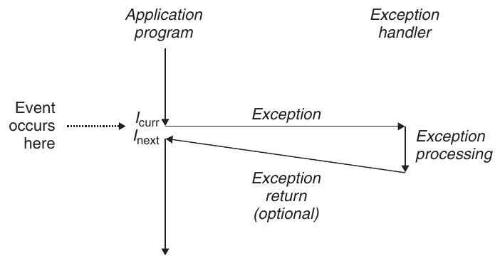

**Hình 8.1 Cấu trúc của một exception. Thay đổi trạng thái processor (event) kích hoạt một control transfer đột ngột (exception) từ chương trình ứng dụng tới exception handler. Sau khi xử lý xong, handler trả quyền điều khiển về chương trình bị ngắt hoặc abort.**

Trong mọi trường hợp, khi processor phát hiện event đã xảy ra, nó thực hiện indirect procedure call (exception), thông qua jump table gọi là exception table, tới một subroutine của operating system (exception handler) được thiết kế riêng để xử lý loại event cụ thể này. Khi exception handler xử lý xong, một trong ba điều sau xảy ra tùy theo loại event gây exception:

1. Handler trả quyền điều khiển về instruction hiện tại I<sub>curr</sub>, tức instruction đang thực thi khi event xảy ra.

2. Handler trả quyền điều khiển về I<sub>next</sub>, tức instruction lẽ ra sẽ được thực thi tiếp theo nếu exception không xảy ra.

3. Handler abort chương trình bị ngắt.

Mục 8.1.2 trình bày thêm về các khả năng này.

### 8.1.1 Exception Handling

Exception có thể khó hiểu vì việc xử lý đòi hỏi sự phối hợp chặt chẽ giữa phần cứng và phần mềm. Rất dễ nhầm lẫn thành phần nào thực hiện nhiệm vụ nào. Hãy xem kỹ hơn sự phân công giữa phần cứng và phần mềm.

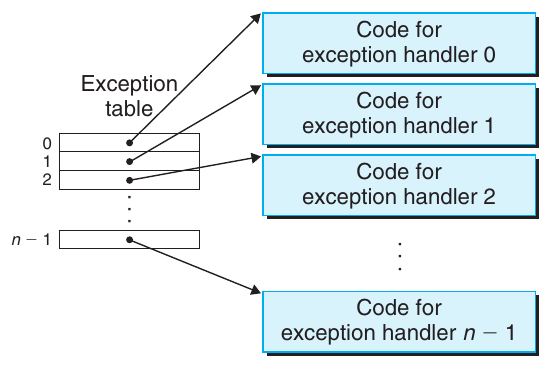

**Hình 8.2 Exception table. Exception table là jump table có entry k chứa địa chỉ code handler cho exception k.**

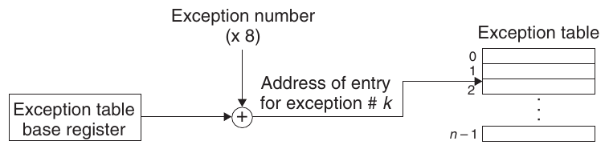

**Hình 8.3 Tạo địa chỉ exception handler. Exception number là index vào exception table.**

Mỗi loại exception có thể xảy ra trong hệ thống được gán một exception number là số nguyên không âm duy nhất. Một số số hiệu do nhà thiết kế processor gán. Các số khác do nhà thiết kế kernel của operating system (phần memory-resident của operating system) gán. Ví dụ của nhóm đầu gồm chia cho không, page fault, vi phạm truy cập bộ nhớ, breakpoint và arithmetic overflow. Ví dụ của nhóm sau gồm system call và signal từ thiết bị I/O bên ngoài.

Tại thời điểm boot hệ thống (khi máy tính được reset hoặc bật nguồn), operating system cấp phát và khởi tạo jump table gọi là exception table sao cho entry k chứa địa chỉ handler của exception k. Hình 8.2 thể hiện định dạng exception table.

Tại run time (khi hệ thống đang thực thi một chương trình), processor phát hiện event đã xảy ra và xác định exception number k tương ứng. Sau đó, processor kích hoạt exception bằng indirect procedure call qua entry k của exception table tới handler tương ứng. Hình 8.3 thể hiện cách processor dùng exception table để tạo địa chỉ exception handler thích hợp. Exception number là index vào exception table, có địa chỉ bắt đầu nằm trong CPU register đặc biệt gọi là exception table base register.

Exception tương tự procedure call nhưng có một số khác biệt quan trọng:

- Tương tự procedure call, processor push return address lên stack trước khi chuyển tới handler. Tuy nhiên, tùy loại exception, return address là instruction hiện tại (instruction đang thực thi khi event xảy ra) hoặc instruction tiếp theo (instruction lẽ ra được thực thi sau instruction hiện tại nếu event không xảy ra).

- Processor còn push thêm một số trạng thái processor lên stack, cần thiết để khởi động lại chương trình bị ngắt khi handler trả về. Ví dụ, hệ thống x86-64 push register EFLAGS chứa các condition code hiện tại, cùng các thông tin khác, lên stack.

- Khi quyền điều khiển được chuyển từ user program tới kernel, mọi thông tin này được push lên kernel stack thay vì user stack.

- Exception handler chạy trong kernel mode (Mục 8.2.4), nghĩa là có quyền truy cập đầy đủ mọi tài nguyên hệ thống.

Sau khi phần cứng kích hoạt exception, phần công việc còn lại được exception handler thực hiện bằng phần mềm. Sau khi xử lý event, handler có thể trở về chương trình bị ngắt bằng cách thực thi instruction đặc biệt “return from interrupt”, pop trạng thái thích hợp trở lại các control register và data register của processor, khôi phục trạng thái về user mode (Mục 8.2.4) nếu exception ngắt user program, rồi trả quyền điều khiển về chương trình bị ngắt.

### 8.1.2 Các loại exception

Exception có thể được chia thành bốn loại: interrupt, trap, fault và abort. Bảng trong Hình 8.4 tóm tắt thuộc tính của các loại này.

### Interrupts

Interrupt xảy ra bất đồng bộ do tín hiệu từ thiết bị I/O nằm ngoài processor. Hardware interrupt bất đồng bộ theo nghĩa không do việc thực thi một instruction cụ thể nào gây ra. Exception handler cho hardware interrupt thường được gọi là interrupt handler.

Hình 8.5 tóm tắt việc xử lý interrupt. Các thiết bị I/O như network adapter, disk controller và timer chip kích hoạt interrupt bằng cách đưa tín hiệu tới một pin trên chip processor và đặt lên system bus exception number nhận diện thiết bị gây interrupt.

| Loại | Nguyên nhân | Bất đồng bộ/đồng bộ | Hành vi trả về |
|---|---|---|---|
| Interrupt | Tín hiệu từ thiết bị I/O | Bất đồng bộ | Luôn trở về instruction tiếp theo |
| Trap | Exception có chủ ý | Đồng bộ | Luôn trở về instruction tiếp theo |
| Fault | Lỗi có khả năng khôi phục | Đồng bộ | Có thể trở về instruction hiện tại |
| Abort | Lỗi không thể khôi phục | Đồng bộ | Không bao giờ trở về |

**Hình 8.4 Các loại exception. Exception bất đồng bộ xảy ra do event trong thiết bị I/O nằm ngoài processor. Exception đồng bộ xảy ra do kết quả trực tiếp của việc thực thi instruction.**

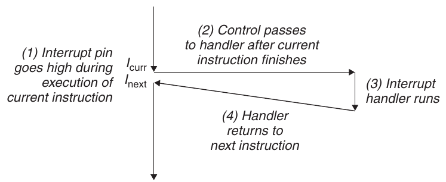

**Hình 8.5 Xử lý interrupt. Interrupt handler trả quyền điều khiển về instruction tiếp theo trong control flow của chương trình ứng dụng.**

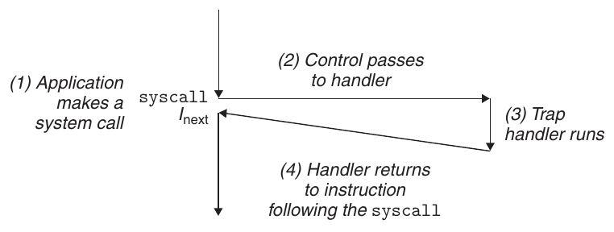

**Hình 8.6 Xử lý trap. Trap handler trả quyền điều khiển về instruction tiếp theo trong control flow của chương trình ứng dụng.**

Sau khi instruction hiện tại thực thi xong, processor nhận thấy interrupt pin đã lên mức cao, đọc exception number từ system bus rồi gọi interrupt handler thích hợp. Khi handler trả về, nó trả quyền điều khiển về instruction tiếp theo (tức instruction lẽ ra theo sau instruction hiện tại trong control flow nếu interrupt không xảy ra). Kết quả là chương trình tiếp tục thực thi như thể interrupt chưa từng xảy ra.

Các loại exception còn lại (trap, fault và abort) xảy ra đồng bộ do thực thi instruction hiện tại. Chúng ta gọi instruction này là faulting instruction.

### Trap và system call

Trap là exception có chủ ý xảy ra do thực thi instruction. Giống interrupt handler, trap handler trả quyền điều khiển về instruction tiếp theo. Công dụng quan trọng nhất của trap là cung cấp một interface procedure-like giữa user program và kernel, được gọi là system call.

User program thường cần yêu cầu dịch vụ từ kernel như đọc file (read), tạo process mới (fork), load chương trình mới (execve) và kết thúc process hiện tại (exit). Để cho phép truy cập có kiểm soát các dịch vụ kernel này, processor cung cấp instruction đặc biệt syscall n mà user program có thể thực thi khi muốn yêu cầu dịch vụ n. Thực thi syscall instruction gây trap tới exception handler, giải mã đối số và gọi kernel routine thích hợp. Hình 8.6 tóm tắt xử lý system call.

Từ góc nhìn lập trình viên, system call giống hệt function call thông thường. Tuy nhiên, cách triển khai rất khác nhau. Hàm thông thường chạy trong user mode, giới hạn các loại instruction có thể thực thi, và truy cập cùng stack với hàm gọi. System call chạy trong kernel mode, cho phép thực thi privileged instruction và truy cập stack được định nghĩa trong kernel. Mục 8.2.4 thảo luận chi tiết hơn về user mode và kernel mode.

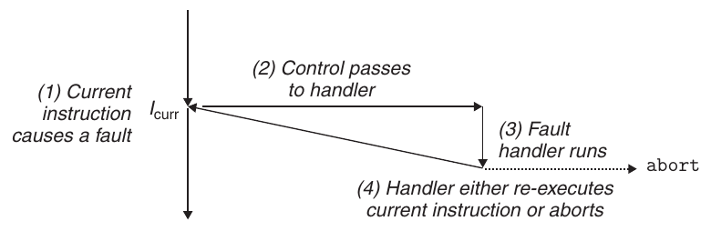

**Hình 8.7 Xử lý fault. Tùy việc fault có thể được sửa hay không, fault handler re-executes faulting instruction hoặc abort.**

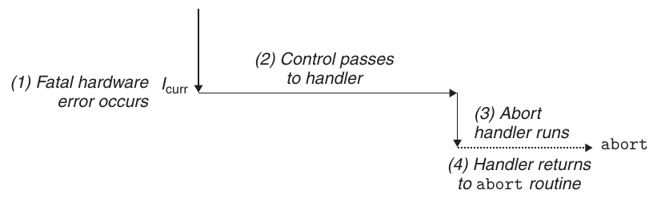

**Hình 8.8 Xử lý abort. Abort handler chuyển quyền điều khiển tới kernel abort routine để kết thúc chương trình ứng dụng.**

### Faults

Fault bắt nguồn từ các điều kiện lỗi mà handler có thể sửa được. Khi fault xảy ra, processor chuyển quyền điều khiển tới fault handler. Nếu handler sửa được điều kiện lỗi, nó trả quyền điều khiển về faulting instruction, qua đó re-executing instruction. Nếu không, handler trở về một abort routine trong kernel để kết thúc chương trình ứng dụng gây fault. Hình 8.7 tóm tắt xử lý fault.

Ví dụ kinh điển của fault là page fault exception, xảy ra khi instruction tham chiếu virtual address có page tương ứng không nằm trong bộ nhớ nên phải lấy từ đĩa. Như sẽ thấy trong Chương 9, page là một block liên tiếp (thường 4 KB) của virtual memory. Page fault handler load page thích hợp từ đĩa rồi trả quyền điều khiển về instruction gây fault. Khi instruction thực thi lại, page thích hợp đã nằm trong bộ nhớ và instruction có thể chạy đến hết mà không gây fault.

### Aborts

Abort bắt nguồn từ lỗi nghiêm trọng không thể khôi phục, thường là lỗi phần cứng như parity error khi bit DRAM hoặc SRAM bị hỏng. Abort handler không bao giờ trả quyền điều khiển về chương trình ứng dụng. Như Hình 8.8 thể hiện, handler trả quyền điều khiển về abort routine để kết thúc chương trình ứng dụng.

| Exception number | Mô tả | Loại exception |
|---|---|---|
| 0 | Divide error | Fault |
| 13 | General protection fault | Fault |
| 14 | Page fault | Fault |
| 18 | Machine check | Abort |
| 32–255 | Exception OS-defined | Interrupt hoặc trap |

**Hình 8.9 Ví dụ về exception trong hệ thống x86-64.**

### 8.1.3 Exception trong hệ thống Linux/x86-64

Để cụ thể hơn, hãy xem một số exception được định nghĩa cho hệ thống x86-64. Có tối đa 256 loại exception khác nhau [50]. Các số từ 0 đến 31 tương ứng với exception do các kiến trúc sư Intel định nghĩa, do đó giống nhau trên mọi hệ thống x86-64. Các số từ 32 đến 255 tương ứng với interrupt và trap do operating system định nghĩa. Hình 8.9 đưa ra một vài ví dụ.

### Fault và abort trong Linux/x86-64

Divide error. Divide error (exception 0) xảy ra khi ứng dụng thử chia cho không hoặc khi kết quả divide instruction quá lớn đối với destination operand. Unix không cố khôi phục divide error mà chọn abort chương trình. Linux shell thường báo divide error là “Floating exceptions.”

General protection fault. General protection fault nổi tiếng (exception 13) xảy ra vì nhiều lý do, thường do chương trình tham chiếu vùng virtual memory không xác định hoặc thử ghi vào text segment read-only. Linux không cố khôi phục fault này. Linux shell thường báo general protection fault là “Segmentation faults.”

Page fault. Page fault (exception 14) là ví dụ exception mà faulting instruction được khởi động lại. Handler ánh xạ page virtual memory thích hợp trên đĩa vào một page physical memory rồi khởi động lại faulting instruction. Chúng ta sẽ xem chi tiết cách page fault hoạt động trong Chương 9.

Machine check. Machine check (exception 18) xảy ra do lỗi phần cứng nghiêm trọng được phát hiện trong lúc thực thi faulting instruction. Machine check handler không bao giờ trả quyền điều khiển về chương trình ứng dụng.

### System call trong Linux/x86-64

Linux cung cấp hàng trăm system call để chương trình ứng dụng sử dụng khi muốn yêu cầu dịch vụ từ kernel như đọc file, ghi file và tạo process mới. Hình 8.10 liệt kê một số system call Linux phổ biến. Mỗi system call có một số nguyên duy nhất tương ứng với offset trong jump table của kernel. (Chú ý jump table này không giống exception table.)

| Số Tên Mô tả | Số Tên Mô tả |
|---|---|
| 0 read Đọc file | 33 pause Tạm dừng process đến khi signal tới |
| 1 write Ghi file | 37 alarm Lên lịch gửi alarm signal |
| 2 open Mở file | 39 getpid Lấy process ID |
| 3 close Đóng file | 57 fork Tạo process |
| 4 stat Lấy thông tin file | 59 execve Thực thi chương trình |
| 9 mmap Ánh xạ memory page tới file | 60 _exit Kết thúc process |
| 12 brk Đặt lại đỉnh heap | 61 wait4 Chờ process kết thúc |
| 32 dup2 Sao chép file descriptor | 62 kill Gửi signal tới process |

**Hình 8.10 Ví dụ system call phổ biến trong hệ thống Linux x86-64.**

Chương trình C có thể trực tiếp gọi bất kỳ system call nào bằng hàm syscall. Tuy nhiên, trong thực tế hiếm khi cần làm vậy. Thư viện C chuẩn cung cấp tập hợp wrapper function thuận tiện cho hầu hết system call. Wrapper function đóng gói đối số, trap vào kernel bằng system call instruction thích hợp rồi chuyển trạng thái trả về của system call về chương trình gọi. Xuyên suốt sách, chúng ta gọi chung system call và wrapper function tương ứng là system-level function.

System call được cung cấp trên hệ thống x86-64 thông qua trapping instruction tên syscall. Việc nghiên cứu cách chương trình dùng instruction này để gọi trực tiếp Linux system call khá thú vị. Mọi đối số của Linux system call được truyền qua general-purpose register thay vì stack. Theo quy ước, register %rax chứa syscall number, với tối đa sáu đối số trong %rdi, %rsi, %rdx, %r10, %r8 và %r9. Đối số đầu tiên nằm trong %rdi, thứ hai trong %rsi, và cứ như vậy. Khi system call trả về, register %rcx và %r11 bị phá hủy, còn %rax chứa giá trị trả về. Giá trị trả về âm từ −4,095 đến −1 biểu thị lỗi tương ứng với errno âm.

Ví dụ, xét phiên bản sau của chương trình hello quen thuộc, được viết bằng system-level function write (Mục 10.4) thay vì printf:

```
1   int main()
2   {
3       write(1, "hello, world\n", 13);
4       _exit(0);
5   }
```

Đối số đầu tiên của write gửi đầu ra tới stdout. Đối số thứ hai là dãy byte cần ghi, còn đối số thứ ba cho biết số byte cần ghi.

#### Thông tin thêm: Lưu ý về thuật ngữ

Thuật ngữ cho các loại exception khác nhau giữa các hệ thống. Đặc tả ISA của processor thường phân biệt “interrupt” bất đồng bộ và “exception” đồng bộ nhưng không cung cấp thuật ngữ bao quát cho những khái niệm rất tương tự này. Để tránh liên tục phải nói “exception và interrupt” hay “exception hoặc interrupt”, chúng ta sử dụng “exception” làm thuật ngữ chung và chỉ phân biệt exception bất đồng bộ (interrupt) với exception đồng bộ (trap, fault và abort) khi thích hợp. Như đã lưu ý, ý tưởng cơ bản giống nhau với mọi hệ thống, nhưng bạn cần biết một số tài liệu nhà sản xuất chỉ dùng “exception” để chỉ thay đổi control flow do event đồng bộ gây ra.

```
                                                    code/ecf/hello-asm64.sa
 1   .section .data
 2   string:
 3     .ascii "hello, world\n"
 4   string_end:
 5     .equ len, string_end - string
 6   .section .text
 7   .globl main
 8   main:
       First, call write(1, "hello, world\n", 13)
 9     movq $1, %rax          write is system call 1
10     movq $1, %rdi          Arg1: stdout has descriptor 1
11     movq $string, %rsi     Arg2: hello world string
12     movq $len, %rdx        Arg3: string length
13     syscall                Make the system call

       Next, call _exit(0)
14     movq $60, %rax         _exit is system call 60
15     movq $0, %rdi          Arg1: exit status is 0
16     syscall                Make the system call
                                                    code/ecf/hello-asm64.sa
```

**Hình 8.11 Triển khai chương trình hello trực tiếp bằng Linux system call.**

Hình 8.11 thể hiện phiên bản assembly-language của hello sử dụng syscall instruction để trực tiếp gọi system call write và exit. Dòng 9–13 gọi hàm write. Trước tiên, dòng 9 lưu số hiệu system call write trong %rax, và dòng 10–12 thiết lập danh sách đối số. Sau đó, dòng 13 sử dụng syscall instruction để gọi system call. Tương tự, dòng 14–16 gọi system call _exit.

## 8.2 Processes

Exception là những thành phần cơ bản cho phép kernel của operating system cung cấp khái niệm process, một trong những ý tưởng sâu sắc và thành công nhất của khoa học máy tính.

Khi chạy chương trình trên hệ thống hiện đại, chúng ta có ảo giác chương trình của mình là chương trình duy nhất đang chạy trong hệ thống. Chương trình dường như được độc quyền sử dụng cả processor và bộ nhớ. Processor dường như thực thi các instruction trong chương trình lần lượt mà không bị gián đoạn. Cuối cùng, code và dữ liệu chương trình dường như là những object duy nhất trong bộ nhớ hệ thống. Khái niệm process cung cấp cho chúng ta những ảo giác này.

Định nghĩa kinh điển của process là một instance của chương trình đang thực thi. Mỗi chương trình trong hệ thống chạy trong context của một process. Context gồm trạng thái chương trình cần để chạy đúng. Trạng thái này bao gồm code và dữ liệu chương trình lưu trong bộ nhớ, stack, nội dung các general-purpose register, program counter, environment variable và tập hợp file descriptor đang mở.

Mỗi khi người dùng chạy chương trình bằng cách nhập tên executable object file vào shell, shell tạo process mới rồi chạy executable object file trong context của process mới này. Chương trình ứng dụng cũng có thể tạo process mới và chạy code của chính mình hoặc ứng dụng khác trong context của process mới.

Thảo luận chi tiết cách operating system triển khai process nằm ngoài phạm vi của chúng ta. Thay vào đó, chúng ta tập trung vào những abstraction chủ yếu mà process cung cấp cho ứng dụng:

- Một logical control flow độc lập, tạo ảo giác chương trình được độc quyền sử dụng processor.

- Một private address space, tạo ảo giác chương trình được độc quyền sử dụng hệ thống bộ nhớ.

Hãy xem kỹ hơn các abstraction này.

### 8.2.1 Logical Control Flow

Process cung cấp cho mỗi chương trình ảo giác rằng nó được độc quyền sử dụng processor, mặc dù thường có nhiều chương trình khác đang chạy đồng thời trên hệ thống. Nếu dùng debugger để single-step việc thực thi chương trình, chúng ta sẽ quan sát một dãy giá trị program counter (PC) chỉ tương ứng với instruction trong executable object file của chương trình hoặc trong các shared object được link động vào chương trình tại run time. Dãy giá trị PC này gọi là logical control flow, hay đơn giản là logical flow.

Xét hệ thống chạy ba process như Hình 8.12. Physical control flow duy nhất của processor được chia thành ba logical flow, mỗi process có một flow. Mỗi đường thẳng đứng biểu diễn một phần logical flow của process. Trong ví dụ, việc thực thi ba logical flow được xen kẽ. Process A chạy một lúc, tiếp theo là B chạy đến hết. Process C sau đó chạy một lúc, tiếp theo là A chạy đến hết. Cuối cùng, C có thể chạy đến hết.

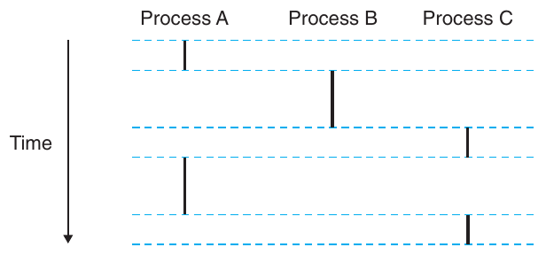

**Hình 8.12 Logical control flow. Process cung cấp cho mỗi chương trình ảo giác rằng nó được độc quyền sử dụng processor. Mỗi thanh dọc biểu diễn một phần logical control flow của process.**

Điểm then chốt trong Hình 8.12 là các process thay phiên sử dụng processor. Mỗi process thực thi một phần flow rồi bị preempt (tạm thời đình chỉ) trong khi process khác đến lượt. Với chương trình chạy trong context của một trong những process này, nó dường như được độc quyền sử dụng processor. Bằng chứng ngược lại duy nhất là nếu đo chính xác thời gian trôi qua của mỗi instruction, chúng ta nhận thấy CPU dường như định kỳ dừng lại giữa việc thực thi một số instruction. Tuy nhiên, sau mỗi lần dừng, processor tiếp tục thực thi chương trình mà không thay đổi nội dung các vị trí bộ nhớ hoặc register của chương trình.

### 8.2.2 Concurrent Flow

Logical flow có nhiều dạng khác nhau trong hệ thống máy tính. Exception handler, process, signal handler, thread và Java process đều là ví dụ về logical flow.

Logical flow có thời gian thực thi chồng lấn với flow khác được gọi là concurrent flow, và hai flow được nói là chạy concurrently. Chính xác hơn, flow X và Y concurrent với nhau khi và chỉ khi X bắt đầu sau khi Y bắt đầu và trước khi Y kết thúc, hoặc Y bắt đầu sau khi X bắt đầu và trước khi X kết thúc. Ví dụ, trong Hình 8.12, process A và B chạy concurrently, cũng như A và C. Ngược lại, B và C không chạy concurrently vì instruction cuối cùng của B thực thi trước instruction đầu tiên của C.

Hiện tượng tổng quát nhiều flow thực thi concurrently được gọi là concurrency. Khái niệm process thay phiên với process khác cũng gọi là multitasking. Mỗi khoảng thời gian process thực thi một phần flow được gọi là time slice. Vì vậy, multitasking còn được gọi là time slicing. Ví dụ, trong Hình 8.12, flow của process A gồm hai time slice.

Chú ý rằng ý tưởng concurrent flow độc lập với số processor core hay máy tính mà các flow chạy trên đó. Nếu hai flow chồng lấn về thời gian, chúng concurrent ngay cả khi chạy trên cùng processor. Tuy nhiên, đôi khi việc xác định một tập con thực sự của concurrent flow, gọi là parallel flow, sẽ hữu ích. Nếu hai flow chạy concurrently trên các processor core hoặc máy tính khác nhau, chúng ta nói chúng là parallel flow, chạy song song và có parallel execution.

#### Bài tập thực hành 8.1 (lời giải trang 831)

Xét ba process với thời điểm bắt đầu và kết thúc sau:

| Process | Thời điểm bắt đầu | Thời điểm kết thúc |
|---|---|---|
| A | 1 | 3 |
| B | 2 | 5 |
| C | 4 | 6 |

Với mỗi cặp process, hãy cho biết chúng chạy concurrently (Y) hay không (N):

| Cặp process | Concurrent? |
|---|---|
| AB | ______ |
| AC | ______ |
| BC | ______ |

### 8.2.3 Private Address Space

Process cung cấp cho mỗi chương trình ảo giác được độc quyền sử dụng address space hệ thống. Trên máy có địa chỉ n-bit, address space là tập hợp 2<sup>n</sup> địa chỉ có thể có, 0, 1, . . . , 2<sup>n</sup> − 1. Process cung cấp private address space riêng cho mỗi chương trình. Không gian này private theo nghĩa một byte bộ nhớ gắn với địa chỉ cụ thể trong không gian đó nhìn chung không thể được process khác đọc hoặc ghi.

Mặc dù nội dung bộ nhớ gắn với mỗi private address space nhìn chung khác nhau, mọi không gian như vậy có cùng cách tổ chức tổng quát. Ví dụ, Hình 8.13 thể hiện cách tổ chức address space cho một Linux process x86-64.

Phần thấp của address space dành cho user program, với các code segment, data segment, heap segment và stack segment thông thường. Code segment luôn bắt đầu tại địa chỉ 0x400000. Phần cao của address space dành cho kernel (phần memory-resident của operating system). Phần address space này chứa code, dữ liệu và stack mà kernel sử dụng khi thực thi instruction thay mặt process (ví dụ, khi chương trình ứng dụng thực thi system call).

### 8.2.4 User Mode và Kernel Mode

Để kernel của operating system cung cấp process abstraction chặt chẽ, processor phải cung cấp cơ chế giới hạn các instruction mà ứng dụng có thể thực thi, cũng như các phần address space mà nó được truy cập.

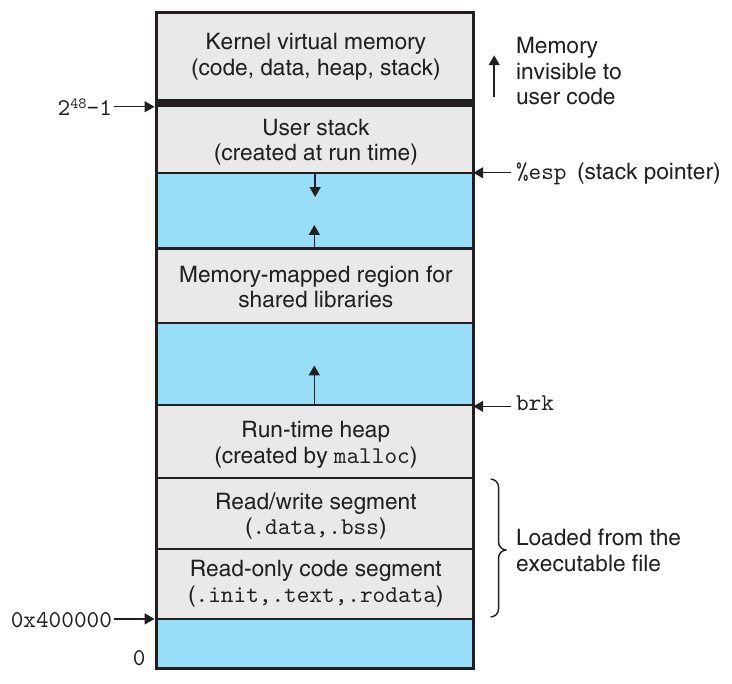

**Hình 8.13 Process address space.**

Processor thường cung cấp khả năng này bằng mode bit trong một control register, biểu thị đặc quyền process hiện có. Khi mode bit được đặt, process chạy trong kernel mode (đôi khi gọi là supervisor mode). Process chạy trong kernel mode có thể thực thi bất kỳ instruction nào trong instruction set và truy cập bất kỳ vị trí bộ nhớ nào trong hệ thống.

Khi mode bit không được đặt, process chạy trong user mode. Process trong user mode không được thực thi privileged instruction để làm những việc như dừng processor, thay đổi mode bit hoặc bắt đầu thao tác I/O. Nó cũng không được trực tiếp tham chiếu code hay dữ liệu trong vùng kernel của address space. Mọi nỗ lực như vậy dẫn đến protection fault nghiêm trọng. Thay vào đó, user program phải truy cập code và dữ liệu kernel gián tiếp qua system call interface.

Process chạy application code ban đầu ở user mode. Cách duy nhất để process chuyển từ user mode sang kernel mode là qua exception như interrupt, fault hoặc trapping system call. Khi exception xảy ra và quyền điều khiển chuyển tới exception handler, processor chuyển từ user mode sang kernel mode. Handler chạy trong kernel mode. Khi nó trở về application code, processor chuyển từ kernel mode về user mode.

Linux cung cấp cơ chế thông minh gọi là /proc filesystem, cho phép process user mode truy cập nội dung các cấu trúc dữ liệu kernel. /proc filesystem xuất nội dung nhiều cấu trúc dữ liệu kernel dưới dạng một hệ thống phân cấp text file mà user program có thể đọc. Ví dụ, bạn có thể dùng /proc filesystem để tìm các thuộc tính hệ thống tổng quát như loại CPU (/proc/cpuinfo), hoặc memory segment được process cụ thể sử dụng (/proc/process-id/maps). Phiên bản 2.6 của Linux kernel giới thiệu /sys filesystem, xuất thêm thông tin low-level về system bus và thiết bị.

### 8.2.5 Context Switch

Kernel của operating system triển khai multitasking bằng một dạng exceptional control flow higher-level gọi là context switch. Cơ chế context switch được xây dựng trên cơ chế exception lower-level đã thảo luận trong Mục 8.1.

Kernel duy trì context cho mỗi process. Context là trạng thái kernel cần để khởi động lại process đã bị preempt. Nó gồm giá trị các object như general-purpose register, floating-point register, program counter, user stack, status register, kernel stack và các cấu trúc dữ liệu kernel khác nhau như page table mô tả address space, process table chứa thông tin process hiện tại và file table chứa thông tin về những file process đã mở.

Tại một số thời điểm trong quá trình process thực thi, kernel có thể quyết định preempt process hiện tại và khởi động lại process đã bị preempt trước đó. Quyết định này gọi là scheduling và được xử lý bởi code trong kernel gọi là scheduler. Khi kernel chọn process mới để chạy, chúng ta nói kernel đã schedule process đó. Sau khi schedule process mới, kernel preempt process hiện tại và chuyển quyền điều khiển tới process mới bằng cơ chế context switch: (1) lưu context của process hiện tại, (2) khôi phục context đã lưu của một process bị preempt trước đó và (3) chuyển quyền điều khiển tới process vừa được khôi phục.

Context switch có thể xảy ra khi kernel đang thực thi system call thay mặt người dùng. Nếu system call block vì chờ event xảy ra, kernel có thể đưa process hiện tại vào sleep và chuyển sang process khác. Ví dụ, nếu system call read yêu cầu truy cập đĩa, kernel có thể chọn thực hiện context switch và chạy process khác thay vì chờ dữ liệu từ đĩa. Ví dụ khác là system call sleep, một yêu cầu tường minh đưa process gọi vào sleep. Nhìn chung, ngay cả khi system call không block, kernel vẫn có thể quyết định context switch thay vì trả quyền điều khiển về process gọi.

Context switch cũng có thể xảy ra do interrupt. Ví dụ, mọi hệ thống đều có cơ chế tạo timer interrupt định kỳ, thường mỗi 1 ms hoặc 10 ms. Mỗi khi timer interrupt xảy ra, kernel có thể quyết định process hiện tại đã chạy đủ lâu và chuyển sang process mới.

Hình 8.14 thể hiện ví dụ context switching giữa hai process A và B. Ban đầu, process A chạy trong user mode cho đến khi trap vào kernel bằng cách thực thi system call read. Trap handler trong kernel yêu cầu DMA transfer từ disk controller và sắp xếp để đĩa interrupt processor sau khi disk controller chuyển xong dữ liệu từ đĩa vào bộ nhớ.

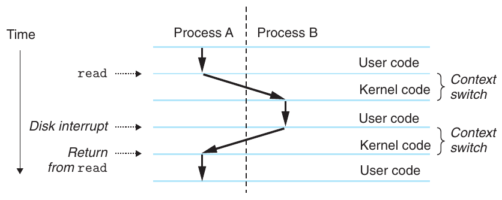

**Hình 8.14 Cấu trúc của process context switch.**

Đĩa mất thời gian tương đối dài để lấy dữ liệu (khoảng hàng chục millisecond), nên thay vì chờ và không làm gì trong thời gian đó, kernel thực hiện context switch từ process A sang B. Chú ý rằng trước khi switch, kernel đang thực thi instruction trong user mode thay mặt process A (tức không có kernel process riêng). Trong phần đầu của switch, kernel thực thi instruction trong kernel mode thay mặt process A. Sau đó, tại một thời điểm, nó bắt đầu thực thi instruction (vẫn trong kernel mode) thay mặt process B. Sau switch, kernel thực thi instruction trong user mode thay mặt process B.

Process B sau đó chạy một lúc trong user mode cho đến khi đĩa gửi interrupt báo dữ liệu đã được chuyển từ đĩa vào bộ nhớ. Kernel quyết định process B đã chạy đủ lâu và thực hiện context switch từ B sang A, trả quyền điều khiển trong process A về instruction ngay sau system call read. Process A tiếp tục chạy đến exception tiếp theo, và cứ như vậy.

## 8.3 Xử lý lỗi system call

Khi các system-level function Unix gặp lỗi, chúng thường trả về −1 và đặt global integer variable errno để chỉ ra lỗi. Lập trình viên luôn cần kiểm tra lỗi, nhưng đáng tiếc nhiều người bỏ qua vì kiểm tra lỗi làm code dài hơn và khó đọc hơn. Ví dụ, dưới đây là cách kiểm tra lỗi khi gọi hàm fork của Linux:

```
1       if ((pid = fork()) < 0) {
2           fprintf(stderr, "fork error: %s\n", strerror(errno));
3           exit(0);
4       }
```

Hàm strerror trả về text string mô tả lỗi gắn với giá trị errno cụ thể. Chúng ta có thể đơn giản hóa code phần nào bằng cách định nghĩa hàm error-reporting sau:

```
1   void unix_error(char *msg) /* Unix-style error */
2   {
3       fprintf(stderr, "%s: %s\n", msg, strerror(errno));
4       exit(0);
5   }
```

Với hàm này, lời gọi fork giảm từ bốn dòng xuống hai dòng:

```
1       if ((pid = fork()) < 0)
2           unix_error("fork error");
```

Chúng ta có thể đơn giản hóa code hơn nữa bằng wrapper error-handling, được Stevens tiên phong sử dụng trong [110]. Với base function foo, chúng ta định nghĩa wrapper function Foo có cùng đối số nhưng viết hoa chữ cái đầu tên. Wrapper gọi base function, kiểm tra lỗi và kết thúc nếu có vấn đề. Ví dụ, dưới đây là wrapper error-handling cho hàm fork:

```
1   pid_t Fork(void)
2   {
3       pid_t pid;
4
5       if ((pid = fork()) < 0)
6           unix_error("Fork error");
7       return pid;
8   }
```

Với wrapper này, lời gọi fork thu gọn thành một dòng:

```
1       pid = Fork();
```

Chúng ta sẽ sử dụng wrapper error-handling trong phần còn lại của sách. Chúng giúp giữ ví dụ code ngắn gọn mà không tạo ấn tượng sai rằng có thể bỏ qua kiểm tra lỗi. Chú ý rằng khi thảo luận các system-level function trong sách, chúng ta luôn dùng tên base function viết thường thay vì tên wrapper viết hoa.

Xem Phụ lục A để tìm hiểu xử lý lỗi Unix và wrapper error-handling được sử dụng xuyên suốt sách. Các wrapper được định nghĩa trong file csapp.c và prototype nằm trong header file csapp.h. Chúng có sẵn trực tuyến trên website CS:APP.

## 8.4 Process Control

Unix cung cấp một số system call để thao tác process từ chương trình C. Mục này mô tả các hàm quan trọng và đưa ra ví dụ sử dụng.

### 8.4.1 Lấy process ID

Mỗi process có một process ID (PID) là số dương (khác không) duy nhất. Hàm getpid trả về PID của process gọi. Hàm getppid trả về PID của parent process (tức process tạo ra process gọi).

```
#include <sys/types.h>
#include <unistd.h>

pid_t getpid(void);
pid_t getppid(void);
```

Trả về: PID của caller hoặc parent

Các routine getpid và getppid trả về giá trị số nguyên thuộc type pid_t, được định nghĩa trong types.h là int trên hệ thống Linux.

### 8.4.2 Tạo và kết thúc process

Từ góc nhìn lập trình viên, chúng ta có thể xem process đang ở một trong ba trạng thái:

Running. Process đang thực thi trên CPU hoặc chờ được thực thi và cuối cùng sẽ được kernel schedule.

Stopped. Việc thực thi process bị đình chỉ và process sẽ không được schedule. Process dừng do nhận signal SIGSTOP, SIGTSTP, SIGTTIN hoặc SIGTTOU, và giữ trạng thái dừng đến khi nhận SIGCONT; lúc đó nó trở lại running. (Signal là một dạng software interrupt sẽ được mô tả chi tiết trong Mục 8.5.)

Terminated. Process bị dừng vĩnh viễn. Process chuyển sang terminated vì một trong ba lý do: (1) nhận signal có hành động mặc định là kết thúc process, (2) trả về từ routine main hoặc (3) gọi hàm exit.

```
#include <stdlib.h>

void exit(int status);
```

Hàm này không trả về

Hàm exit kết thúc process với exit status là status. (Cách khác để đặt exit status là trả về giá trị số nguyên từ routine main.)

Parent process tạo một child process mới đang running bằng cách gọi hàm fork.

```
#include <sys/types.h>
#include <unistd.h>

pid_t fork(void);
```

Trả về: 0 cho child, PID của child cho parent, −1 nếu có lỗi

Child process mới được tạo gần như, nhưng chưa hoàn toàn, giống parent. Child nhận bản sao giống hệt (nhưng riêng biệt) của virtual address space user-level của parent, gồm code segment, data segment, heap, shared library và user stack. Child cũng nhận bản sao giống hệt của mọi file descriptor đang mở của parent, nghĩa là child có thể đọc và ghi mọi file được mở trong parent khi gọi fork. Khác biệt quan trọng nhất giữa parent và child mới tạo là chúng có PID khác nhau.

Hàm fork thú vị (và thường gây bối rối) vì được gọi một lần nhưng trả về hai lần: một lần trong process gọi (parent), và một lần trong child process mới tạo. Trong parent, fork trả về PID của child. Trong child, fork trả về 0. Vì PID của child luôn khác không, giá trị trả về cung cấp cách rõ ràng để xác định chương trình đang thực thi trong parent hay child.

Hình 8.15 thể hiện ví dụ đơn giản về parent process sử dụng fork để tạo child process. Khi lời gọi fork trả về ở dòng 6, x có giá trị 1 trong cả parent và child. Child tăng và in bản sao x của mình ở dòng 8. Tương tự, parent giảm và in bản sao x của mình ở dòng 13.

Khi chạy chương trình trên hệ thống Unix, chúng ta nhận kết quả sau:

```
linux> ./fork
parent: x=0
child : x=2
```

Ví dụ đơn giản này có một số khía cạnh tinh tế.

Gọi một lần, trả về hai lần. Hàm fork được parent gọi một lần nhưng trả về hai lần: một lần cho parent và một lần cho child mới tạo. Điều này khá dễ hiểu với chương trình tạo một child duy nhất. Nhưng chương trình có nhiều lần gọi fork có thể gây bối rối và cần được suy luận cẩn thận.

Thực thi concurrent. Parent và child là hai process riêng biệt chạy concurrently. Instruction trong logical control flow của chúng có thể được kernel xen kẽ tùy ý. Khi chạy chương trình trên hệ thống của chúng ta, parent process hoàn tất câu lệnh printf trước, rồi đến child. Tuy nhiên, trên hệ thống khác thứ tự có thể ngược lại. Nhìn chung, lập trình viên không bao giờ được giả định cách xen kẽ instruction giữa các process khác nhau.

Address space giống nhau nhưng riêng biệt. Nếu có thể dừng cả parent và child ngay sau khi hàm fork trả về trong mỗi process, chúng ta thấy address space của chúng giống hệt nhau. Mỗi process có cùng user stack, giá trị local variable, heap, giá trị global variable và code. Vì vậy, trong chương trình ví dụ, local variable x có giá trị 1 trong cả parent và child khi hàm fork trả về ở dòng 6. Tuy nhiên, vì parent và child là các process riêng, mỗi process có private address space riêng. Mọi thay đổi tiếp theo mà parent hoặc child thực hiện với x là riêng tư và không được phản ánh trong bộ nhớ process còn lại. Đó là lý do variable x có giá trị khác nhau trong parent và child khi chúng gọi câu lệnh printf tương ứng.

File dùng chung. Khi chạy chương trình ví dụ, chúng ta thấy cả parent và child đều in đầu ra lên màn hình. Lý do là child kế thừa mọi file đang mở của parent. Khi parent gọi fork, file stdout đang mở và hướng tới màn hình. Child kế thừa file này, do đó đầu ra của nó cũng hướng tới màn hình.

```
                                                          code/ecf/fork.c
 1   int main()
 2   {
 3       pid_t pid;
 4       int x = 1;
 5
 6       pid = Fork();
 7       if (pid == 0) {  /* Child */
 8           printf("child : x=%d\n", ++x);
 9           exit(0);
10       }
11
12       /* Parent */
13       printf("parent: x=%d\n", --x);
14       exit(0);
15   }
                                                          code/ecf/fork.c
```

**Hình 8.15 Sử dụng fork để tạo process mới.**

Khi mới học hàm fork, việc phác họa process graph thường hữu ích. Đây là một loại precedence graph đơn giản nắm bắt thứ tự bộ phận của các câu lệnh chương trình. Mỗi đỉnh a tương ứng với việc thực thi một câu lệnh. Cạnh có hướng a → b biểu thị câu lệnh a “xảy ra trước” câu lệnh b. Cạnh có thể được gắn nhãn thông tin như giá trị hiện tại của variable. Đỉnh tương ứng câu lệnh printf có thể được gắn nhãn bằng đầu ra printf. Mỗi graph bắt đầu bằng một đỉnh tương ứng parent process gọi main. Đỉnh này không có cạnh vào và có đúng một cạnh ra. Dãy đỉnh của mỗi process kết thúc bằng đỉnh tương ứng lời gọi exit. Đỉnh này có một cạnh vào và không có cạnh ra.

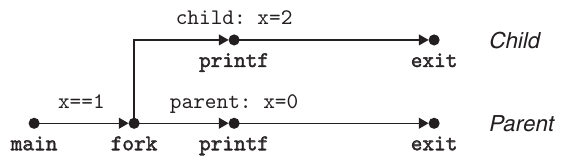

**Hình 8.16 Process graph cho chương trình ví dụ trong Hình 8.15.**

```
1   int main()
2   {
3       Fork();
4       Fork();
5       printf("hello\n");
6       exit(0);
7   }
```

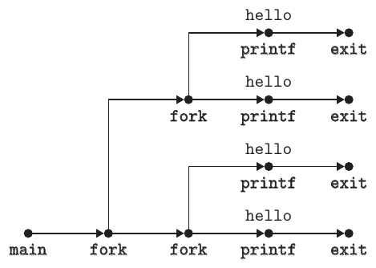

**Hình 8.17 Process graph cho fork lồng nhau.**

Ví dụ, Hình 8.16 thể hiện process graph cho chương trình trong Hình 8.15. Ban đầu, parent đặt variable x thành 1. Parent gọi fork, tạo child process chạy concurrently với parent trong private address space riêng.

Với chương trình chạy trên một processor, mọi topological sort của các đỉnh trong process graph tương ứng đều biểu diễn một thứ tự toàn phần khả thi của các câu lệnh chương trình. Một cách đơn giản để hiểu topological sort là: Với một hoán vị các đỉnh trong process graph, vẽ dãy đỉnh trên một đường từ trái sang phải rồi vẽ từng cạnh có hướng. Hoán vị là topological sort khi và chỉ khi mọi cạnh đều đi từ trái sang phải. Vì vậy, trong chương trình ví dụ ở Hình 8.15, câu lệnh printf trong parent và child có thể xảy ra theo bất kỳ thứ tự nào vì mỗi thứ tự tương ứng một topological sort của các đỉnh graph.

Process graph đặc biệt hữu ích để hiểu chương trình có lời gọi fork lồng nhau. Ví dụ, Hình 8.17 thể hiện chương trình có hai lời gọi fork trong source code. Process graph tương ứng giúp thấy chương trình này chạy bốn process, mỗi process gọi printf và có thể thực thi theo bất kỳ thứ tự nào.

#### Bài tập thực hành 8.2 (lời giải trang 831)

Xét chương trình sau:

```
                                                code/ecf/global-forkprob0.c
1   int main()
2   {
3       int a = 9;
4
5       if (Fork() == 0)
6           printf("p1: a=%d\n", a--);
7       printf("p2: a=%d\n", a++);
8       exit(0);
9   }
                                                code/ecf/global-forkprob0.c
```

A. Đầu ra của child process là gì?

B. Đầu ra của parent process là gì?

### 8.4.3 Reap child process

Khi process kết thúc vì bất kỳ lý do gì, kernel không loại bỏ nó khỏi hệ thống ngay. Thay vào đó, process được giữ ở trạng thái terminated cho đến khi được parent reap. Khi parent reap child đã kết thúc, kernel chuyển exit status của child cho parent rồi loại bỏ process đã kết thúc; lúc đó process không còn tồn tại. Process đã kết thúc nhưng chưa được reap gọi là zombie.

Khi parent process kết thúc, kernel sắp xếp để process init trở thành parent nuôi của các child mồ côi. Process init có PID 1, được kernel tạo trong quá trình start-up hệ thống, không bao giờ kết thúc và là tổ tiên của mọi process. Nếu parent process kết thúc mà chưa reap các zombie child, kernel sắp xếp để init reap chúng. Tuy nhiên, chương trình long-running như shell hoặc server luôn cần reap zombie child. Mặc dù zombie không chạy, chúng vẫn tiêu thụ tài nguyên bộ nhớ hệ thống.

Process chờ child kết thúc hoặc dừng bằng cách gọi hàm waitpid.

```
#include <sys/types.h>
#include <sys/wait.h>

pid_t waitpid(pid_t pid, int *statusp, int options);
```

Trả về: PID của child nếu thành công, 0 (nếu WNOHANG), hoặc −1 nếu có lỗi

#### Thông tin thêm: Tại sao child đã kết thúc được gọi là zombie?

Trong dân gian, zombie là xác sống, một thực thể nửa sống nửa chết. Zombie process tương tự ở chỗ mặc dù đã kết thúc, kernel vẫn duy trì một phần trạng thái của nó cho đến khi parent có thể reap.

Hàm waitpid khá phức tạp. Theo mặc định (khi options = 0), waitpid đình chỉ việc thực thi process gọi cho đến khi một child process trong wait set kết thúc. Nếu process trong wait set đã kết thúc tại thời điểm gọi, waitpid trả về ngay. Trong cả hai trường hợp, waitpid trả về PID của child đã kết thúc khiến waitpid trả về. Lúc này child đã được reap và kernel xóa mọi dấu vết của nó khỏi hệ thống.

### Xác định thành viên của wait set

Thành viên của wait set được xác định bởi đối số pid:

- Nếu pid > 0, wait set chỉ gồm child process có process ID bằng pid.

- Nếu pid = -1, wait set gồm mọi child process của parent.

Hàm waitpid cũng hỗ trợ những loại wait set khác liên quan đến Unix process group mà chúng ta không thảo luận.

### Sửa đổi hành vi mặc định

Có thể sửa hành vi mặc định bằng cách đặt options thành các tổ hợp của hằng số WNOHANG, WUNTRACED và WCONTINUED:

WNOHANG. Trả về ngay (với giá trị 0) nếu chưa có child process nào trong wait set kết thúc. Hành vi mặc định đình chỉ process gọi cho đến khi một child kết thúc; tùy chọn này hữu ích khi bạn muốn tiếp tục làm việc có ích trong lúc chờ child kết thúc.

WUNTRACED. Đình chỉ việc thực thi process gọi cho đến khi một process trong wait set kết thúc hoặc dừng. Trả về PID của child đã kết thúc hoặc dừng gây ra việc trả về. Hành vi mặc định chỉ trả về cho child đã kết thúc; tùy chọn này hữu ích khi muốn kiểm tra cả child đã kết thúc và child bị dừng.

WCONTINUED. Đình chỉ việc thực thi process gọi cho đến khi một process đang running trong wait set kết thúc hoặc một process đang stopped trong wait set được tiếp tục do nhận signal SIGCONT. (Signal được giải thích trong Mục 8.5.)

Bạn có thể kết hợp tùy chọn bằng phép OR. Ví dụ:

- WNOHANG | WUNTRACED: Trả về ngay với giá trị 0 nếu không child nào trong wait set dừng hoặc kết thúc; hoặc trả về giá trị bằng PID của một child đã dừng hoặc kết thúc.

### Kiểm tra exit status của child đã được reap

Nếu đối số statusp là non-NULL, waitpid mã hóa thông tin trạng thái của child gây ra việc trả về trong status, là giá trị mà statusp trỏ tới. Include file wait.h định nghĩa một số macro để diễn giải đối số status:

WIFEXITED(status). Trả về true nếu child kết thúc bình thường qua lời gọi exit hoặc return.

WEXITSTATUS(status). Trả về exit status của child kết thúc bình thường. Trạng thái này chỉ được định nghĩa nếu WIFEXITED() trả về true.

WIFSIGNALED(status). Trả về true nếu child process kết thúc do một signal không được catch.

WTERMSIG(status). Trả về số hiệu signal khiến child process kết thúc. Trạng thái này chỉ được định nghĩa nếu WIFSIGNALED() trả về true.

WIFSTOPPED(status). Trả về true nếu child gây ra việc trả về hiện đang stopped.

WSTOPSIG(status). Trả về số hiệu signal khiến child dừng. Trạng thái này chỉ được định nghĩa nếu WIFSTOPPED() trả về true.

WIFCONTINUED(status). Trả về true nếu child process được khởi động lại do nhận signal SIGCONT.

### Điều kiện lỗi

Nếu process gọi không có child, waitpid trả về −1 và đặt errno thành ECHILD. Nếu hàm waitpid bị signal ngắt, nó trả về −1 và đặt errno thành EINTR.

#### Bài tập thực hành 8.3 (lời giải trang 833)

Liệt kê mọi dãy đầu ra có thể có của chương trình sau:

```
                                                code/ecf/global-waitprob0.c
 1   int main()
 2   {
 3       if (Fork() == 0) {
 4           printf("9"); fflush(stdout);
 5       }
 6       else {
 7           printf("0"); fflush(stdout);
 8           waitpid(-1, NULL, 0);
 9       }
10       printf("3"); fflush(stdout);
11       printf("6"); exit(0);
12   }
                                                           code/ecf/global-waitprob0.c
```

### Hàm wait

Hàm wait là phiên bản đơn giản hơn của waitpid.

```
#include <sys/types.h>
#include <sys/wait.h>

pid_t wait(int *statusp);
```

Trả về: PID của child nếu thành công hoặc −1 nếu có lỗi

Gọi wait(&status) tương đương gọi waitpid(-1, &status, 0).

### Ví dụ sử dụng waitpid

Vì hàm waitpid tương đối phức tạp, xem một vài ví dụ sẽ hữu ích. Hình 8.18 thể hiện chương trình sử dụng waitpid để chờ mọi child trong số N child kết thúc mà không theo thứ tự cụ thể. Tại dòng 11, parent tạo từng child trong số N child, và tại dòng 12 mỗi child thoát với exit status riêng.

#### Thông tin thêm: Hằng số liên quan đến hàm Unix

Các hằng số như WNOHANG và WUNTRACED được system header file định nghĩa. Ví dụ, WNOHANG và WUNTRACED được header file wait.h định nghĩa (gián tiếp):

```
/* Bits in the third argument to ‘waitpid’. */
#define WNOHANG    1   /* Don’t block waiting. */
#define WUNTRACED  2   /* Report status of stopped children. */
```

Để sử dụng các hằng số này, bạn phải include header file wait.h trong code:

```
#include <sys/wait.h>
```

Man page của mỗi hàm Unix liệt kê các header file cần include mỗi khi dùng hàm đó trong code. Ngoài ra, để kiểm tra return code như ECHILD và EINTR, bạn phải include errno.h. Để đơn giản hóa ví dụ code, chúng ta include một header file duy nhất tên csapp.h, include các header file cho mọi hàm sử dụng trong sách. Header file csapp.h có sẵn trực tuyến trên website CS:APP.

```
                                                                        code/ecf/waitpid1.c
 1   #include "csapp.h"
 2   #define N 2
 3
 4   int main()
 5   {
 6       int status, i;
 7       pid_t pid;
 8
 9       /* Parent creates N children */
10       for (i = 0; i < N; i++)
11           if ((pid = Fork()) == 0)  /* Child */
12               exit(100+i);
13
14       /* Parent reaps N children in no particular order */
15       while ((pid = waitpid(-1, &status, 0)) > 0) {
16           if (WIFEXITED(status))
17               printf("child %d terminated normally with exit status=%d\n",
18                      pid, WEXITSTATUS(status));
19           else
20               printf("child %d terminated abnormally\n", pid);
21       }
22
23       /* The only normal termination is if there are no more children */
24       if (errno != ECHILD)
25           unix_error("waitpid error");
26
27       exit(0);
28   }
                                                                        code/ecf/waitpid1.c
```

**Hình 8.18 Sử dụng hàm waitpid để reap zombie child không theo thứ tự cụ thể.**

Trước khi tiếp tục, hãy bảo đảm bạn hiểu vì sao dòng 12 được từng child thực thi nhưng parent không thực thi.

Tại dòng 15, parent chờ mọi child kết thúc bằng cách dùng waitpid làm điều kiện kiểm tra của vòng lặp while. Vì đối số đầu tiên là −1, lời gọi waitpid block cho đến khi một child bất kỳ kết thúc. Khi mỗi child kết thúc, lời gọi waitpid trả về PID khác không của child đó. Dòng 16 kiểm tra exit status của child. Nếu child kết thúc bình thường—trong trường hợp này bằng cách gọi hàm exit—parent trích xuất exit status và in lên stdout.

Khi mọi child đã được reap, lời gọi waitpid tiếp theo trả về −1 và đặt errno thành ECHILD. Dòng 24 kiểm tra hàm waitpid đã kết thúc bình thường, nếu không sẽ in thông báo lỗi. Khi chạy chương trình trên hệ thống Linux, nó tạo đầu ra sau:

```
linux> ./waitpid1
child 22966 terminated normally with exit status=100
child 22967 terminated normally with exit status=101
```

Chú ý chương trình reap child không theo thứ tự cụ thể. Thứ tự chúng được reap là thuộc tính của hệ thống máy tính cụ thể này. Trên hệ thống khác, hoặc thậm chí lần chạy khác trên cùng hệ thống, hai child có thể được reap theo thứ tự ngược lại. Đây là ví dụ về hành vi nondeterministic khiến việc suy luận concurrency rất khó. Cả hai kết quả đều đúng như nhau, và lập trình viên không bao giờ được giả định một kết quả luôn xảy ra, bất kể kết quả kia có vẻ khó xảy ra đến đâu. Giả định đúng duy nhất là mỗi kết quả có thể xảy ra đều có khả năng như nhau.

Hình 8.19 thể hiện một thay đổi đơn giản loại bỏ tính nondeterministic trong thứ tự đầu ra bằng cách reap child theo đúng thứ tự parent tạo chúng. Tại dòng 11, parent lưu PID của các child theo thứ tự rồi chờ từng child theo cùng thứ tự bằng cách gọi waitpid với PID thích hợp ở đối số đầu tiên.

#### Bài tập thực hành 8.4 (lời giải trang 833)

Xét chương trình sau:

```
                                                code/ecf/global-waitprob1.c
 1   int main()
 2   {
 3       int status;
 4       pid_t pid;
 5
 6       printf("Start\n");
 7       pid = Fork();
 8       printf("%d\n", !pid);
 9       if (pid == 0) {
10           printf("Child\n");
11       }
12       else if ((waitpid(-1, &status, 0) > 0) &&
                    (WIFEXITED(status) != 0)) {
13           printf("%d\n", WEXITSTATUS(status));
14       }
15       printf("Stop\n");
16       exit(2);
17   }
                                                code/ecf/global-waitprob1.c
```

A. Chương trình này tạo bao nhiêu dòng đầu ra?

B. Một thứ tự có thể có của các dòng đầu ra này là gì?

```
                                                                        code/ecf/waitpid2.c
 1   #include "csapp.h"
 2   #define N 2
 3
 4   int main()
 5   {
 6       int status, i;
 7       pid_t pid[N], retpid;
 8
 9       /* Parent creates N children */
10       for (i = 0; i < N; i++)
11           if ((pid[i] = Fork()) == 0)  /* Child */
12               exit(100+i);
13
14       /* Parent reaps N children in order */
15       i = 0;
16       while ((retpid = waitpid(pid[i++], &status, 0)) > 0) {
17           if (WIFEXITED(status))
18               printf("child %d terminated normally with exit status=%d\n",
19                      retpid, WEXITSTATUS(status));
20           else
21               printf("child %d terminated abnormally\n", retpid);
22       }
23
24       /* The only normal termination is if there are no more children */
25       if (errno != ECHILD)
26           unix_error("waitpid error");
27
28       exit(0);
29   }
                                                                        code/ecf/waitpid2.c
```

**Hình 8.19 Sử dụng waitpid để reap zombie child theo thứ tự chúng được tạo.**

### 8.4.4 Đưa process vào sleep

Hàm sleep đình chỉ process trong một khoảng thời gian xác định.

```
#include <unistd.h>

unsigned int sleep(unsigned int secs);
```

Trả về: số giây còn lại cần sleep

Sleep trả về không nếu khoảng thời gian yêu cầu đã trôi qua, nếu không thì trả về số giây vẫn còn cần sleep. Trường hợp sau có thể xảy ra nếu hàm sleep trả về sớm do bị signal ngắt. Chúng ta sẽ thảo luận chi tiết signal trong Mục 8.5.

Hàm khác hữu ích là pause, đưa hàm gọi vào sleep cho đến khi process nhận một signal.

```
#include <unistd.h>

int pause(void);
```

Luôn trả về −1

#### Bài tập thực hành 8.5 (lời giải trang 833)

Viết wrapper function cho sleep tên wakeup, với interface sau:

```
unsigned int wakeup(unsigned int secs);
```

Hàm wakeup hoạt động giống hệt sleep, ngoại trừ việc in thông báo mô tả thời điểm process thực sự thức dậy:

```
Woke up at 4 secs.
```

### 8.4.5 Load và chạy chương trình

Hàm execve load và chạy chương trình mới trong context của process hiện tại.

```
#include <unistd.h>

int execve(const char *filename, const char *argv[],
           const char *envp[]);
```

Không trả về nếu thành công; trả về −1 nếu có lỗi

Hàm execve load và chạy executable object file filename với danh sách đối số argv và danh sách environment variable envp. Execve chỉ trả về chương trình gọi nếu có lỗi, như không tìm thấy filename. Vì vậy, khác fork được gọi một lần nhưng trả về hai lần, execve được gọi một lần và không bao giờ trả về.

Danh sách đối số được biểu diễn bằng cấu trúc dữ liệu trong Hình 8.20. Variable argv trỏ tới một array pointer null-terminated, mỗi pointer trỏ tới một argument string. Theo quy ước, argv[0] là tên executable object file. Danh sách environment variable được biểu diễn bằng cấu trúc dữ liệu tương tự trong Hình 8.21. Variable envp trỏ tới array null-terminated gồm pointer tới environment variable string, mỗi string là cặp name-value dạng name=value.

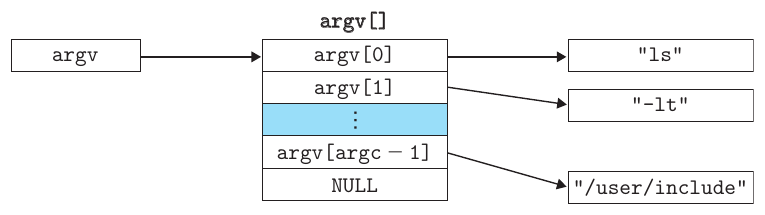

**Hình 8.20 Tổ chức danh sách đối số.**

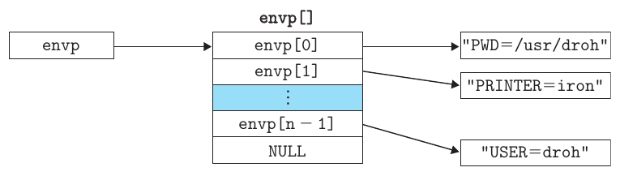

**Hình 8.21 Tổ chức danh sách environment variable.**

Sau khi execve load filename, nó gọi code start-up được mô tả trong Mục 7.9. Code start-up thiết lập stack và chuyển quyền điều khiển tới routine main của chương trình mới, có prototype dạng

```
int main(int argc, char **argv, char **envp);
```

hoặc tương đương,

```
int main(int argc, char *argv[], char *envp[]);
```

Khi main bắt đầu thực thi, user stack có cách tổ chức như Hình 8.22. Hãy đi từ đáy stack (địa chỉ cao nhất) tới đỉnh (địa chỉ thấp nhất). Đầu tiên là các argument string và environment string. Tiếp theo, ở phía cao hơn trên stack, là array pointer null-terminated, mỗi pointer trỏ tới environment variable string trên stack. Global variable environ trỏ tới pointer đầu tiên, envp[0]. Sau environment array là array argv[] null-terminated, mỗi phần tử trỏ tới argument string trên stack. Ở đỉnh stack là stack frame của hàm start-up hệ thống libc_start_main (Mục 7.9).

Hàm main có ba đối số, mỗi đối số được lưu trong register theo quy tắc stack x86-64: (1) argc cho biết số pointer non-null trong array argv[]; (2) argv trỏ tới entry đầu tiên trong array argv[]; và (3) envp trỏ tới entry đầu tiên trong array envp[].

Linux cung cấp một số hàm để thao tác environment array:

```
#include <stdlib.h>

char *getenv(const char *name);
```

Trả về: pointer tới name nếu tồn tại, NULL nếu không khớp

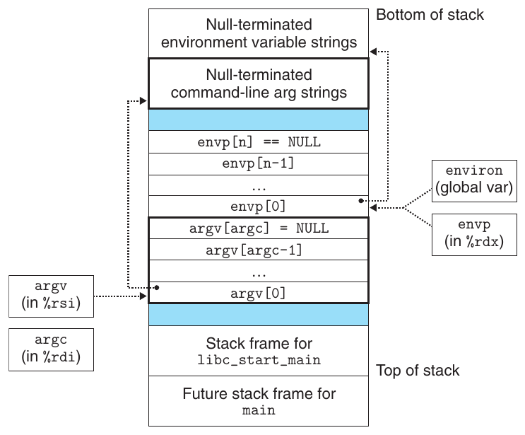

**Hình 8.22 Tổ chức điển hình của user stack khi chương trình mới bắt đầu.**

Hàm getenv tìm string name=value trong environment array. Nếu tìm thấy, nó trả về pointer tới value; nếu không, trả về NULL.

```
#include <stdlib.h>

int setenv(const char *name, const char *newvalue, int overwrite);
```

Trả về: 0 nếu thành công, −1 nếu có lỗi

```
void unsetenv(const char *name);
```

Trả về: không có gì

Nếu environment array chứa string dạng name=oldvalue, unsetenv xóa nó và setenv thay oldvalue bằng newvalue, nhưng chỉ khi overwrite khác không. Nếu name không tồn tại, setenv thêm name=newvalue vào array.

#### Bài tập thực hành 8.6 (lời giải trang 833)

Viết chương trình myecho in các đối số command-line và environment variable. Ví dụ:

```
linux> ./myecho arg1 arg2
Command-ine arguments:
    argv[ 0]: myecho
    argv[ 1]: arg1
    argv[ 2]: arg2
Environment variables:
envp[ 0]: PWD=/usr0/droh/ics/code/ecf
envp[ 1]: TERM=emacs
.
.
.
envp[25]: USER=droh
envp[26]: SHELL=/usr/local/bin/tcsh
envp[27]: HOME=/usr0/droh
```

### 8.4.6 Sử dụng fork và execve để chạy chương trình

Các chương trình như Unix shell và Web server sử dụng rộng rãi hàm fork và execve. Shell là chương trình tương tác application-level chạy các chương trình khác thay mặt người dùng. Shell đầu tiên là chương trình sh, sau đó có các biến thể như csh, tcsh, ksh và bash. Shell thực hiện một dãy bước đọc/đánh giá rồi kết thúc. Bước đọc đọc dòng lệnh từ người dùng. Bước đánh giá phân tích dòng lệnh và chạy chương trình thay mặt người dùng.

Hình 8.23 thể hiện routine main của shell đơn giản. Shell in command-line prompt, chờ người dùng nhập dòng lệnh trên stdin rồi đánh giá dòng lệnh.

Hình 8.24 thể hiện code đánh giá dòng lệnh. Nhiệm vụ đầu tiên là gọi hàm parseline (Hình 8.25), phân tích các đối số command-line space-separated và xây dựng vector argv cuối cùng sẽ được chuyển tới execve. Đối số đầu tiên được giả định là tên lệnh shell built-in được diễn giải ngay, hoặc executable object file sẽ được load và chạy trong context của child process mới.

Nếu đối số cuối cùng là ký tự ‘&’, parseline trả về 1, biểu thị chương trình cần được thực thi ở background (shell không chờ nó hoàn tất). Nếu không, hàm trả về 0, biểu thị chương trình cần chạy ở foreground (shell chờ nó hoàn tất).

#### Thông tin thêm: Chương trình và process

Đây là lúc thích hợp để dừng lại và bảo đảm bạn hiểu sự phân biệt giữa chương trình và process. Chương trình là tập hợp code và dữ liệu; chương trình có thể tồn tại dưới dạng object file trên đĩa hoặc segment trong address space. Process là instance cụ thể của chương trình đang thực thi; chương trình luôn chạy trong context của một process. Hiểu sự phân biệt này rất quan trọng nếu muốn hiểu fork và execve. Hàm fork chạy cùng chương trình trong child process mới là bản sao của parent. Hàm execve load và chạy chương trình mới trong context của process hiện tại. Mặc dù ghi đè address space của process hiện tại, nó không tạo process mới. Chương trình mới vẫn có cùng PID và kế thừa mọi file descriptor đang mở tại thời điểm gọi execve.

```
                                                         code/ecf/shellex.c
 1   #include "csapp.h"
 2   #define MAXARGS   128
 3
 4   /* Function prototypes */
 5   void eval(char *cmdline);
 6   int parseline(char *buf, char **argv);
 7   int builtin_command(char **argv);
 8
 9   int main()
10   {
11       char cmdline[MAXLINE]; /* Command line */
12
13       while (1) {
14           /* Read */
15           printf("> ");
16           Fgets(cmdline, MAXLINE, stdin);
17           if (feof(stdin))
18               exit(0);
19
20           /* Evaluate */
21           eval(cmdline);
22       }
23   }
                                                         code/ecf/shellex.c
```

**Hình 8.23 Routine main của chương trình shell đơn giản.**

Sau khi phân tích dòng lệnh, hàm eval gọi builtin_command, kiểm tra đối số command-line đầu tiên có phải lệnh shell built-in hay không. Nếu có, nó diễn giải lệnh ngay và trả về 1. Nếu không, trả về 0. Shell đơn giản của chúng ta chỉ có một lệnh built-in là quit, kết thúc shell. Shell thực tế có nhiều lệnh như pwd, jobs và fg.

Nếu builtin_command trả về 0, shell tạo child process và thực thi chương trình được yêu cầu trong child. Nếu người dùng yêu cầu chạy chương trình ở background, shell trở về đầu vòng lặp và chờ dòng lệnh tiếp theo. Nếu không, shell sử dụng waitpid để chờ job kết thúc. Khi job kết thúc, shell chuyển sang lần lặp tiếp theo.

Chú ý shell đơn giản này có thiếu sót vì không reap bất kỳ background child nào. Sửa thiếu sót này cần sử dụng signal, được mô tả trong mục tiếp theo.

```
                                                        code/ecf/shellex.c
 1   /* eval - Evaluate a command line */
 2   void eval(char *cmdline)
 3   {
 4       char *argv[MAXARGS]; /* Argument list execve() */
 5       char buf[MAXLINE];   /* Holds modified command line */
 6       int bg;              /* Should the job run in bg or fg? */
 7       pid_t pid;           /* Process id */
 8
 9       strcpy(buf, cmdline);
10       bg = parseline(buf, argv);
11       if (argv[0] == NULL)
12           return;   /* Ignore empty lines */
13
14       if (!builtin_command(argv)) {
15           if ((pid = Fork()) == 0) {   /* Child runs user job */
16               if (execve(argv[0], argv, environ) < 0) {
17                   printf("%s: Command not found.\n", argv[0]);
18                   exit(0);
19               }
20           }
21
22           /* Parent waits for foreground job to terminate */
23           if (!bg) {
24               int status;
25               if (waitpid(pid, &status, 0) < 0)
26                   unix_error("waitfg: waitpid error");
27           }
28           else
29               printf("%d %s", pid, cmdline);
30       }
31       return;
32   }
33
34   /* If first arg is a builtin command, run it and return true */
35   int builtin_command(char **argv)
36   {
37       if (!strcmp(argv[0], "quit")) /* quit command */
38           exit(0);
39       if (!strcmp(argv[0], "&"))    /* Ignore singleton & */
40           return 1;
41       return 0;                     /* Not a builtin command */
42   }
                                                        code/ecf/shellex.c
```

**Hình 8.24 eval đánh giá dòng lệnh shell.**

```
                                                                         code/ecf/shellex.c
 1   /* parseline - Parse the command line and build the argv array */
 2   int parseline(char *buf, char **argv)
 3   {
 4       char *delim;         /* Points to first space delimiter */
 5       int argc;            /* Number of args */
 6       int bg;              /* Background job? */
 7
 8       buf[strlen(buf)-1] = ’ ’;  /* Replace trailing ’\n’ with space */
 9       while (*buf && (*buf == ’ ’)) /* Ignore leading spaces */
10           buf++;
11
12       /* Build the argv list */
13       argc = 0;
14       while ((delim = strchr(buf, ’ ’))) {
15           argv[argc++] = buf;
16           *delim = ’\0’;
17           buf = delim + 1;
18           while (*buf && (*buf == ’ ’)) /* Ignore spaces */
19                  buf++;
20       }
21       argv[argc] = NULL;
22
23       if (argc == 0)  /* Ignore blank line */
24           return 1;
25
26       /* Should the job run in the background? */
27       if ((bg = (*argv[argc-1] == ’&’)) != 0)
28           argv[--argc] = NULL;
29
30       return bg;
31   }
                                                                         code/ecf/shellex.c
```

**Hình 8.25 parseline phân tích một dòng đầu vào cho shell.**

## 8.5 Signals

Đến thời điểm này khi nghiên cứu exceptional control flow, chúng ta đã thấy cách phần cứng và phần mềm phối hợp cung cấp cơ chế exception low-level cơ bản. Chúng ta cũng thấy cách operating system dùng exception để hỗ trợ một dạng exceptional control flow gọi là process context switch. Trong mục này, chúng ta nghiên cứu một dạng exceptional control flow phần mềm higher-level gọi là Linux signal, cho phép process và kernel interrupt process khác.

| Số | Tên | Hành động mặc định | Event tương ứng |
|---|---|---|---|
| 1 | SIGHUP | Kết thúc | Ngắt kết nối đường terminal |
| 2 | SIGINT | Kết thúc | Interrupt từ bàn phím |
| 3 | SIGQUIT | Kết thúc | Quit từ bàn phím |
| 4 | SIGILL | Kết thúc | Instruction không hợp lệ |
| 5 | SIGTRAP | Kết thúc và dump core<sup>a</sup> | Trace trap |
| 6 | SIGABRT | Kết thúc và dump core<sup>a</sup> | Abort signal từ hàm abort |
| 7 | SIGBUS | Kết thúc | Bus error |
| 8 | SIGFPE | Kết thúc và dump core<sup>a</sup> | Exception Floating-point |
| 9 | SIGKILL | Kết thúc<sup>b</sup> | Kill chương trình |
| 10 | SIGUSR1 | Kết thúc | Signal User-defined 1 |
| 11 | SIGSEGV | Kết thúc và dump core<sup>a</sup> | Memory reference không hợp lệ (seg fault) |
| 12 | SIGUSR2 | Kết thúc | Signal User-defined 2 |
| 13 | SIGPIPE | Kết thúc | Ghi vào pipe không có bên đọc |
| 14 | SIGALRM | Kết thúc | Timer signal từ hàm alarm |
| 15 | SIGTERM | Kết thúc | Signal kết thúc bằng phần mềm |
| 16 | SIGSTKFLT | Kết thúc | Stack fault trên coprocessor |
| 17 | SIGCHLD | Bỏ qua | Child process đã dừng hoặc kết thúc |
| 18 | SIGCONT | Bỏ qua | Tiếp tục process nếu đang dừng |
| 19 | SIGSTOP | Dừng đến SIGCONT tiếp theo<sup>b</sup> | Stop signal không đến từ terminal |
| 20 | SIGTSTP | Dừng đến SIGCONT tiếp theo | Stop signal từ terminal |
| 21 | SIGTTIN | Dừng đến SIGCONT tiếp theo | Background process đọc từ terminal |
| 22 | SIGTTOU | Dừng đến SIGCONT tiếp theo | Background process ghi vào terminal |
| 23 | SIGURG | Bỏ qua | Điều kiện khẩn cấp trên socket |
| 24 | SIGXCPU | Kết thúc | Vượt giới hạn thời gian CPU |
| 25 | SIGXFSZ | Kết thúc | Vượt giới hạn kích thước file |
| 26 | SIGVTALRM | Kết thúc | Virtual timer hết hạn |
| 27 | SIGPROF | Kết thúc | Profiling timer hết hạn |
| 28 | SIGWINCH | Bỏ qua | Kích thước cửa sổ thay đổi |
| 29 | SIGIO | Kết thúc | Hiện có thể thực hiện I/O trên descriptor |
| 30 | SIGPWR | Kết thúc | Mất điện |

**Hình 8.26 Linux signal. Ghi chú: (a) Nhiều năm trước, main memory được triển khai bằng công nghệ gọi là core memory. “Dumping core” là thuật ngữ lịch sử chỉ việc ghi image của code memory segment và data memory segment ra đĩa. (b) Signal này không thể được catch hay bỏ qua. (Nguồn: man 7 signal. Dữ liệu từ Linux Foundation.)**

Signal là thông điệp nhỏ thông báo cho process rằng một loại event đã xảy ra trong hệ thống. Hình 8.26 thể hiện 30 loại signal khác nhau được hệ thống Linux hỗ trợ.

Mỗi loại signal tương ứng với một loại system event. Hardware exception Low-level được exception handler của kernel xử lý và thường không hiển lộ đối với user process. Signal cung cấp cơ chế cho user process biết những exception đó đã xảy ra. Ví dụ, nếu process thử chia cho không, kernel gửi signal SIGFPE (số 8) tới nó. Nếu process thực thi instruction không hợp lệ, kernel gửi SIGILL (số 4). Nếu process thực hiện memory reference không hợp lệ, kernel gửi SIGSEGV (số 11). Các signal khác tương ứng với software event higher-level trong kernel hoặc user process khác. Ví dụ, nếu bạn gõ Ctrl+C (tức nhấn đồng thời phím Ctrl và ‘c’) trong khi process chạy ở foreground, kernel gửi SIGINT (số 2) tới mỗi process trong foreground process group. Process có thể buộc process khác kết thúc bằng cách gửi SIGKILL (số 9). Khi child process kết thúc hoặc dừng, kernel gửi SIGCHLD (số 17) tới parent.

### 8.5.1 Thuật ngữ signal

Việc chuyển signal tới process đích diễn ra qua hai bước riêng biệt:

Gửi signal. Kernel gửi (deliver) signal tới process đích bằng cách cập nhật một số trạng thái trong context của process đích. Signal được deliver vì một trong hai lý do: (1) Kernel phát hiện system event như lỗi divide-by-zero hoặc child process kết thúc. (2) Process đã gọi hàm kill (thảo luận ở mục tiếp theo) để yêu cầu tường minh kernel gửi signal tới process đích. Process có thể gửi signal cho chính mình.

Nhận signal. Process đích nhận signal khi bị kernel buộc phản ứng theo một cách nào đó với việc signal được deliver. Process có thể bỏ qua signal, kết thúc hoặc catch signal bằng cách thực thi user-level function gọi là signal handler. Hình 8.27 thể hiện ý tưởng cơ bản của handler catch signal.

Signal đã được gửi nhưng chưa được nhận gọi là pending signal. Tại bất kỳ thời điểm nào, có tối đa một pending signal thuộc một loại cụ thể. Nếu process có pending signal loại k, mọi signal loại k tiếp theo gửi tới process không được xếp hàng mà đơn giản bị loại bỏ. Process có thể chọn lọc việc block việc nhận một số signal nhất định. Khi signal bị block, nó có thể được deliver, nhưng pending signal tạo ra sẽ không được nhận cho đến khi process unblock signal đó.

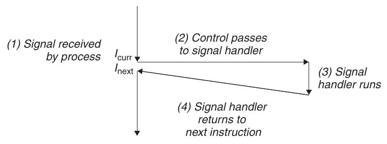

**Hình 8.27 Signal handling. Việc nhận signal kích hoạt control transfer tới signal handler. Sau khi xử lý xong, handler trả quyền điều khiển về chương trình bị ngắt.**

Pending signal được nhận tối đa một lần. Với mỗi process, kernel duy trì tập pending signal trong bit vector pending, và tập blocked signal trong bit vector blocked.[^1] Kernel đặt bit k trong pending mỗi khi signal loại k được deliver và xóa bit k trong pending mỗi khi signal loại k được nhận.

### 8.5.2 Gửi signal

Hệ thống Unix cung cấp một số cơ chế gửi signal tới process. Mọi cơ chế đều dựa trên khái niệm process group.

### Process Group

Mỗi process thuộc đúng một process group, được nhận diện bằng process group ID là số nguyên dương. Hàm getpgrp trả về process group ID của process hiện tại.

```
#include <unistd.h>

pid_t getpgrp(void);
```

Trả về: process group ID của process gọi

Theo mặc định, child process thuộc cùng process group với parent. Process có thể thay đổi process group của mình hoặc process khác bằng hàm setpgid:

```
#include <unistd.h>

int setpgid(pid_t pid, pid_t pgid);
```

Trả về: 0 nếu thành công, −1 nếu có lỗi

Hàm setpgid thay đổi process group của process pid thành pgid. Nếu pid bằng không, PID của process hiện tại được sử dụng. Nếu pgid bằng không, PID của process do pid chỉ định được dùng làm process group ID. Ví dụ, nếu process 15213 là process gọi, thì

```
setpgid(0, 0);
```

tạo một process group mới có process group ID 15213 và thêm process 15213 vào group mới này.

### Gửi signal bằng chương trình /bin/kill

Chương trình /bin/kill gửi signal bất kỳ tới process khác. Ví dụ, lệnh

```
linux> /bin/kill -9 15213
```

gửi signal 9 (SIGKILL) tới process 15213. PID âm khiến signal được gửi tới mọi process trong process group PID. Ví dụ, lệnh

```
linux> /bin/kill -9 -15213
```

gửi signal SIGKILL tới mọi process trong process group 15213. Chú ý chúng ta dùng đường dẫn đầy đủ /bin/kill vì một số Unix shell có lệnh kill built-in riêng.

### Gửi signal từ bàn phím

Unix shell sử dụng abstraction job để biểu diễn các process được tạo khi đánh giá một dòng lệnh. Tại bất kỳ thời điểm nào, có tối đa một foreground job và không hoặc nhiều background job. Ví dụ, gõ

```
linux> ls | sort
```

tạo foreground job gồm hai process nối bằng Unix pipe: một chạy chương trình ls, một chạy chương trình sort. Shell tạo process group riêng cho mỗi job. Thông thường, process group ID được lấy từ một parent process trong job. Ví dụ, Hình 8.28 thể hiện shell với một foreground job và hai background job. Parent process trong foreground job có PID 20 và process group ID 20. Parent đã tạo hai child, mỗi child cũng thuộc process group 20.

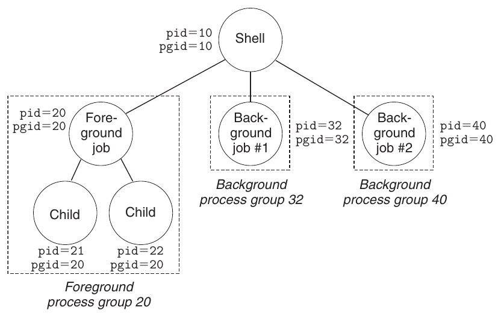

**Hình 8.28 Foreground process group và background process group.**

Gõ Ctrl+C trên bàn phím khiến kernel gửi signal SIGINT tới mọi process trong foreground process group. Theo mặc định, kết quả là kết thúc foreground job. Tương tự, gõ Ctrl+Z khiến kernel gửi SIGTSTP tới mọi process trong foreground process group. Theo mặc định, kết quả là dừng (đình chỉ) foreground job.

### Gửi signal bằng hàm kill

Process gửi signal tới process khác (bao gồm chính mình) bằng cách gọi hàm kill.

```
#include <sys/types.h>
#include <signal.h>

int kill(pid_t pid, int sig);
```

Trả về: 0 nếu thành công, −1 nếu có lỗi

Nếu pid lớn hơn không, hàm kill gửi signal số sig tới process pid. Nếu pid bằng không, kill gửi signal sig tới mọi process trong process group của process gọi, gồm chính process gọi. Nếu pid nhỏ hơn không, kill gửi signal sig tới mọi process trong process group |pid| (giá trị tuyệt đối của pid). Hình 8.29 thể hiện ví dụ parent dùng hàm kill gửi SIGKILL tới child.

```
                                                           code/ecf/kill.c
 1   #include "csapp.h"
 2
 3   int main()
 4   {
 5       pid_t pid;
 6
 7       /* Child sleeps until SIGKILL signal received, then dies */
 8       if ((pid = Fork()) == 0) {
 9           Pause();  /* Wait for a signal to arrive */
10           printf("control should never reach here!\n");
11           exit(0);
12       }
13
14       /* Parent sends a SIGKILL signal to a child */
15       Kill(pid, SIGKILL);
16       exit(0);
17   }
                                                           code/ecf/kill.c
```

**Hình 8.29 Sử dụng hàm kill để gửi signal tới child.**

### Gửi signal bằng hàm alarm

Process có thể gửi signal SIGALRM cho chính mình bằng hàm alarm.

```
#include <unistd.h>

unsigned int alarm(unsigned int secs);
```

Trả về: số giây còn lại của alarm trước đó, hoặc 0 nếu không có alarm trước đó

Hàm alarm sắp xếp để kernel gửi SIGALRM tới process gọi sau secs giây. Nếu secs bằng 0, không alarm mới nào được lên lịch. Trong mọi trường hợp, lời gọi alarm hủy mọi alarm đang chờ và trả về số giây còn lại đến thời điểm alarm đang chờ lẽ ra được deliver (nếu lời gọi alarm này không hủy nó), hoặc 0 nếu không có alarm đang chờ.

### 8.5.3 Nhận signal

Khi kernel chuyển process p từ kernel mode sang user mode (ví dụ, trở về từ system call hoặc hoàn tất context switch), nó kiểm tra tập pending signal không bị block (pending & ~blocked) của p. Nếu tập này rỗng (trường hợp thông thường), kernel chuyển quyền điều khiển tới instruction tiếp theo (I<sub>next</sub>) trong logical control flow của p. Nếu tập không rỗng, kernel chọn một signal k trong tập (thường là k nhỏ nhất) và buộc p nhận signal k. Việc nhận signal kích hoạt một hành động của process. Sau khi process hoàn tất hành động, quyền điều khiển trở về instruction tiếp theo (I<sub>next</sub>) trong logical control flow của p. Mỗi loại signal có một hành động mặc định được định nghĩa trước, là một trong các hành động sau:

- Process kết thúc.

- Process kết thúc và dump core.

- Process dừng (đình chỉ) cho đến khi được signal SIGCONT khởi động lại.

- Process bỏ qua signal.

Hình 8.26 thể hiện hành động mặc định gắn với mỗi loại signal. Ví dụ, hành động mặc định khi nhận SIGKILL là kết thúc process nhận. Ngược lại, hành động mặc định khi nhận SIGCHLD là bỏ qua signal. Process có thể thay đổi hành động mặc định gắn với signal bằng hàm signal. Ngoại lệ duy nhất là SIGSTOP và SIGKILL, có hành động mặc định không thể thay đổi.

```
#include <signal.h>
typedef void (*sighandler_t)(int);

sighandler_t signal(int signum, sighandler_t handler);
```

Trả về: pointer tới handler trước đó nếu thành công, SIG_ERR nếu có lỗi (không đặt errno )

Hàm signal có thể thay đổi hành động gắn với signal signum theo một trong ba cách:

- Nếu handler là SIG_IGN, signal loại signum bị bỏ qua.

- Nếu handler là SIG_DFL, hành động cho signal loại signum trở lại mặc định.

- Nếu không, handler là địa chỉ một hàm user-defined gọi là signal handler, sẽ được gọi mỗi khi process nhận signal loại signum. Thay đổi hành động mặc định bằng cách truyền địa chỉ handler cho hàm signal gọi là cài đặt handler. Việc gọi handler gọi là catch signal. Việc thực thi handler gọi là handle signal.

Khi process catch signal loại k, handler được cài cho signal k được gọi với một đối số số nguyên duy nhất bằng k. Đối số này cho phép cùng một handler function có thể catch các loại signal khác nhau.

Khi handler thực thi câu lệnh return, quyền điều khiển (thường) trở về instruction trong control flow nơi process bị ngắt do nhận signal. Chúng ta nói “thường” vì trên một số hệ thống, system call bị ngắt trả về ngay với lỗi.

Hình 8.30 thể hiện chương trình catch signal SIGINT được gửi mỗi khi người dùng gõ Ctrl+C trên bàn phím. Hành động mặc định cho SIGINT là kết thúc process ngay. Trong ví dụ này, chúng ta sửa hành vi mặc định để catch signal, in thông báo rồi kết thúc process.

```
                                                          code/ecf/sigint.c
 1   #include "csapp.h"
 2
 3   void sigint_handler(int sig) /* SIGINT handler */
 4   {
 5       printf("Caught SIGINT!\n");
 6       exit(0);
 7   }
 8
 9   int main()
10   {
11       /* Install the SIGINT handler */
12       if (signal(SIGINT, sigint_handler) == SIG_ERR)
13           unix_error("signal error");
14
15       pause(); /* Wait for the receipt of a signal */
16
17       return 0;
18   }
                                                          code/ecf/sigint.c
```

**Hình 8.30 Chương trình sử dụng signal handler để catch signal SIGINT.**

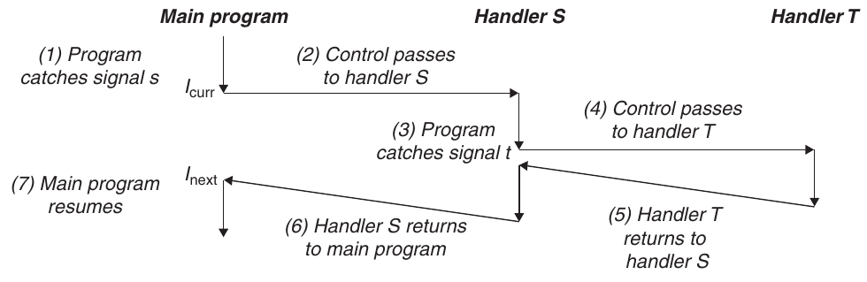

**Hình 8.31 Handler có thể bị handler khác ngắt.**

Signal handler có thể bị handler khác ngắt, như Hình 8.31. Trong ví dụ này, chương trình chính catch signal s, ngắt chương trình chính và chuyển quyền điều khiển tới handler S. Trong khi S đang chạy, chương trình catch signal t ≠ s, ngắt S và chuyển quyền điều khiển tới handler T . Khi T trả về, S tiếp tục từ nơi bị ngắt. Cuối cùng, S trả về, chuyển quyền điều khiển về chương trình chính để tiếp tục từ nơi dừng trước đó.

#### Bài tập thực hành 8.7 (lời giải trang 834)

Viết chương trình snooze nhận một đối số command-line, gọi hàm snooze trong Bài toán 8.5 với đối số này rồi kết thúc. Viết chương trình sao cho người dùng có thể ngắt hàm snooze bằng Ctrl+C trên bàn phím. Ví dụ:

```
linux> ./snooze 5
CTRL+C                      User hits Crtl+C after 3 seconds
Slept for 3 of 5 secs.
linux>
```

### 8.5.4 Block và unblock signal

Linux cung cấp cơ chế ngầm và tường minh để block signal:

Cơ chế block ngầm. Theo mặc định, kernel block mọi pending signal cùng loại với signal hiện được handler xử lý. Ví dụ, trong Hình 8.31, giả sử chương trình đã catch signal s và đang chạy handler S. Nếu signal s khác được gửi tới process, s trở thành pending nhưng không được nhận cho đến khi handler S trả về.

Cơ chế block tường minh. Ứng dụng có thể chủ động block và unblock các signal được chọn bằng hàm sigprocmask và các hàm hỗ trợ.

```
#include <signal.h>

int sigprocmask(int how, const sigset_t *set, sigset_t *oldset);
int sigemptyset(sigset_t *set);
int sigfillset(sigset_t *set);
int sigaddset(sigset_t *set, int signum);
int sigdelset(sigset_t *set, int signum);
```

Trả về: 0 nếu thành công, −1 nếu có lỗi

```
int sigismember(const sigset_t *set, int signum);
```

Trả về: 1 nếu là thành viên, 0 nếu không, −1 nếu có lỗi

Hàm sigprocmask thay đổi tập signal hiện bị block (bit vector blocked được mô tả trong Mục 8.5.1). Hành vi cụ thể phụ thuộc giá trị how:

SIG_BLOCK. Thêm các signal trong set vào blocked (blocked = blocked | set).

SIG_UNBLOCK. Loại bỏ các signal trong set khỏi blocked (blocked = blocked & ~set).

SIG_SETMASK. blocked = set.

Nếu oldset là non-NULL, giá trị trước đó của bit vector blocked được lưu trong oldset.

Signal set như set được thao tác bằng các hàm sau: sigemptyset khởi tạo set thành tập rỗng. Hàm sigfillset thêm mọi signal vào set. Hàm sigaddset thêm signum vào set, sigdelset xóa signum khỏi set, và sigismember trả về 1 nếu signum là thành viên set, hoặc 0 nếu không.

Ví dụ, Hình 8.32 thể hiện cách sử dụng sigprocmask để tạm thời block việc nhận signal SIGINT.

```
 1       sigset_t mask, prev_mask;
 2
 3       Sigemptyset(&mask);
 4       Sigaddset(&mask, SIGINT);
 5
 6       /* Block SIGINT and save previous blocked set */
 7       Sigprocmask(SIG_BLOCK, &mask, &prev_mask);
         .
 8       .  // Code region that will not be interrupted by SIGINT
         .
 9       /* Restore previous blocked set, unblocking SIGINT */
10       Sigprocmask(SIG_SETMASK, &prev_mask, NULL);
11
```

**Hình 8.32 Tạm thời block việc nhận signal.**

### 8.5.5 Viết signal handler

Signal handling là một trong những khía cạnh khó khăn của lập trình system-level Linux. Handler có một số thuộc tính khiến việc suy luận khó khăn: (1) Handler chạy concurrently với chương trình chính và dùng chung global variable, nên có thể can thiệp vào chương trình chính và handler khác. (2) Quy tắc về cách và thời điểm signal được nhận thường trái trực giác. (3) Các hệ thống khác nhau có thể có ngữ nghĩa signal-handling khác nhau.

Trong mục này, chúng ta giải quyết các vấn đề đó và đưa ra hướng dẫn cơ bản để viết signal handler an toàn, đúng đắn và portable.

### Signal handling an toàn

Signal handler khó xử lý vì có thể chạy concurrently với chương trình chính và với nhau, như đã thấy trong Hình 8.31. Nếu handler và chương trình chính truy cập concurrently cùng global data structure, kết quả có thể không thể dự đoán và thường gây lỗi nghiêm trọng.

Chúng ta sẽ tìm hiểu chi tiết lập trình concurrent trong Chương 12. Mục tiêu ở đây là đưa ra những hướng dẫn thận trọng để viết handler an toàn khi chạy concurrently. Nếu bỏ qua, bạn có nguy cơ đưa vào những lỗi concurrency tinh vi. Với những lỗi này, chương trình hoạt động đúng phần lớn thời gian. Tuy nhiên, khi thất bại, nó thất bại theo cách không thể dự đoán và không thể lặp lại, cực kỳ khó debug. Biết trước để phòng ngừa!

G0. Giữ handler đơn giản nhất có thể. Cách tốt nhất để tránh rắc rối là giữ handler nhỏ và đơn giản nhất có thể. Ví dụ, handler có thể chỉ đặt một global flag rồi trả về ngay; mọi xử lý liên quan đến việc nhận signal được chương trình chính thực hiện, bằng cách định kỳ kiểm tra (và reset) flag.

G1. Chỉ gọi hàm async-signal-safe trong handler. Hàm async-signal-safe, hay đơn giản là safe, có đặc tính có thể được gọi an toàn từ signal handler vì nó reentrant (ví dụ, chỉ truy cập local variable; xem Mục 12.7.2), hoặc vì không thể bị signal handler ngắt. Hình 8.33 liệt kê các system-level function mà Linux bảo đảm an toàn. Chú ý nhiều hàm phổ biến như printf, sprintf, malloc và exit không nằm trong danh sách.

Cách an toàn duy nhất để tạo đầu ra từ signal handler là sử dụng hàm write (xem Mục 10.1). Đặc biệt, gọi printf hoặc sprintf là không an toàn. Để vượt qua hạn chế đáng tiếc này, chúng ta phát triển một số hàm an toàn gọi là gói Sio (Safe I/O), có thể dùng để in thông báo đơn giản từ signal handler.

```
_Exit             fexecve         poll                 sigqueue
_exit             fork            posix_trace_event    sigset
abort             fstat           pselect              sigsuspend
accept            fstatat         raise                sleep
access            fsync           read                 sockatmark
aio_error         ftruncate       readlink             socket
aio_return        futimens        readlinkat           socketpair
aio_suspend       getegid         recv                 stat
alarm             geteuid         recvfrom             symlink
bind              getgid          recvmsg              symlinkat
cfgetispeed       getgroups       rename               tcdrain
cfgetospeed       getpeername     renameat             tcflow
cfsetispeed       getpgrp         rmdir                tcflush
cfsetospeed       getpid          select               tcgetattr
chdir             getppid         sem_post             tcgetpgrp
chmod             getsockname     send                 tcsendbreak
chown             getsockopt      sendmsg              tcsetattr
clock_gettime     getuid          sendto               tcsetpgrp
close             kill            setgid               time
connect           link            setpgid              timer_getoverrun
creat             linkat          setsid               timer_gettime
dup               listen          setsockopt           timer_settime
dup2              lseek           setuid               times
execl             lstat           shutdown             umask
execle            mkdir           sigaction            uname
execv             mkdirat         sigaddset            unlink
execve            mkfifo          sigdelset            unlinkat
faccessat         mkfifoat        sigemptyset          utime
fchmod            mknod           sigfillset           utimensat
fchmodat          mknodat         sigismember          utimes
fchown            open            signal               wait
fchownat          openat          sigpause             waitpid
fcntl             pause           sigpending           write
fdatasync         pipe            sigprocmask
```

**Hình 8.33 Các hàm Async-signal-safe. (Nguồn: man 7 signal . Dữ liệu từ Linux Foundation.)**

```
#include "csapp.h"

ssize_t sio_putl(long v);
ssize_t sio_puts(char s[]);
```

Trả về: số byte được truyền nếu thành công, −1 nếu có lỗi

```
void sio_error(char s[]);
```

Trả về: không có gì

Các hàm sio_putl và sio_puts lần lượt xuất một long và một string tới standard output. Hàm sio_error in thông báo lỗi rồi kết thúc.

Hình 8.34 thể hiện cách triển khai gói Sio, sử dụng hai hàm reentrant private từ csapp.c. Hàm sio_strlen ở dòng 3 trả về độ dài string s. Hàm sio_ltoa ở dòng 10, dựa trên hàm itoa trong [61], chuyển v thành biểu diễn string cơ số b trong s. Hàm _exit ở dòng 17 là biến thể async-signal-safe của exit.

Hình 8.35 thể hiện phiên bản an toàn của SIGINT handler trong Hình 8.30.

```
                                                              code/src/csapp.c
 1   ssize_t sio_puts(char s[]) /* Put string */
 2   {
 3       return write(STDOUT_FILENO, s, sio_strlen(s));
 4   }
 5
 6   ssize_t sio_putl(long v) /* Put long */
 7   {
 8       char s[128];
 9
10       sio_ltoa(v, s, 10); /* Based on K&R itoa() */
11       return sio_puts(s);
12   }
13
14   void sio_error(char s[]) /* Put error message and exit */
15   {
16       sio_puts(s);
17       _exit(1);
18   }
                                                              code/src/csapp.c
```

**Hình 8.34 Gói Sio (Safe I/O) cho signal handler.**

```
                                                      code/ecf/sigintsafe.c
1   #include "csapp.h"
2
3   void sigint_handler(int sig) /* Safe SIGINT handler */
4   {
5       Sio_puts("Caught SIGINT!\n"); /* Safe output */
6       _exit(0);                     /* Safe exit */
7   }
                                                      code/ecf/sigintsafe.c
```

**Hình 8.35 Phiên bản an toàn của SIGINT handler trong Hình 8.30.**

G2. Lưu và khôi phục errno. Nhiều hàm async-signal-safe của Linux đặt errno khi trả về lỗi. Gọi các hàm này trong handler có thể ảnh hưởng đến phần khác của chương trình dựa vào errno.

Cách khắc phục là lưu errno vào local variable khi vào handler và khôi phục nó trước khi handler trả về. Chú ý điều này chỉ cần thiết nếu handler trả về. Không cần nếu handler kết thúc process bằng cách gọi _exit.

G3. Bảo vệ truy cập global data structure dùng chung bằng cách block mọi signal. Nếu handler dùng chung global data structure với chương trình chính hoặc handler khác, handler và chương trình chính cần tạm thời block mọi signal khi truy cập (đọc hoặc ghi) cấu trúc dữ liệu đó. Lý do là truy cập data structure d từ chương trình chính thường đòi hỏi một dãy instruction. Nếu dãy instruction bị handler truy cập d ngắt, handler có thể thấy d ở trạng thái không nhất quán, cho kết quả không thể dự đoán. Tạm thời block signal khi truy cập d bảo đảm handler không ngắt dãy instruction.

G4. Khai báo global variable với volatile. Xét handler và routine main dùng chung global variable g. Handler cập nhật g, còn main đọc g định kỳ. Với optimizing compiler, dường như giá trị g không bao giờ thay đổi trong main, nên có thể an toàn dùng bản sao g được cache trong register để đáp ứng mọi reference tới g. Trong trường hợp này, hàm main không bao giờ thấy giá trị được handler cập nhật.

Bạn có thể yêu cầu compiler không cache variable bằng cách khai báo nó với type qualifier volatile. Ví dụ:

```
volatile int g;
```

Qualifier volatile buộc compiler đọc giá trị g từ bộ nhớ mỗi khi được tham chiếu trong code. Nhìn chung, như mọi data structure dùng chung, mỗi truy cập global variable cần được bảo vệ bằng cách tạm thời block signal.

G5. Khai báo flag với sig_atomic_t. Trong một thiết kế handler phổ biến, handler ghi nhận việc nhận signal bằng cách ghi vào global flag. Chương trình chính định kỳ đọc flag, phản ứng với signal rồi xóa flag. Với flag dùng chung theo cách này, C cung cấp integer data type sig_atomic_t, có thao tác đọc và ghi được bảo đảm atomic (không thể bị ngắt) vì có thể được triển khai bằng một instruction duy nhất:

```
volatile sig_atomic_t flag;
```

Vì không thể bị ngắt, bạn có thể đọc và ghi variable sig_atomic_t an toàn mà không cần tạm block signal. Chú ý bảo đảm atomicity chỉ áp dụng cho từng phép đọc và ghi riêng lẻ. Nó không áp dụng cho cập nhật như flag++ hoặc flag = flag + 10, có thể đòi hỏi nhiều instruction.

Hãy nhớ các hướng dẫn trên mang tính thận trọng, theo nghĩa không phải lúc nào cũng thực sự cần thiết. Ví dụ, nếu biết handler không bao giờ sửa errno, bạn không cần lưu và khôi phục errno. Hoặc nếu chứng minh không instance nào của printf có thể bị handler ngắt, gọi printf từ handler là an toàn. Điều tương tự áp dụng với truy cập global data structure dùng chung. Tuy nhiên, nhìn chung rất khó chứng minh những khẳng định này. Vì vậy, chúng ta khuyên chọn cách thận trọng và tuân theo hướng dẫn: giữ handler đơn giản nhất có thể, gọi hàm an toàn, lưu và khôi phục errno, bảo vệ truy cập data structure dùng chung, sử dụng volatile và sig_atomic_t.

### Signal handling đúng đắn

Một khía cạnh trái trực giác của signal là pending signal không được xếp hàng. Vì bit vector pending chứa đúng một bit cho mỗi loại signal, có tối đa một pending signal thuộc một loại cụ thể. Vì vậy, nếu hai signal loại k được gửi tới process đích trong khi signal k bị block vì process đích đang thực thi handler cho signal k, signal thứ hai đơn giản bị loại bỏ; nó không được xếp hàng. Ý tưởng then chốt là sự tồn tại của pending signal chỉ cho biết ít nhất một signal đã tới.

Để thấy điều này ảnh hưởng tính đúng đắn ra sao, xét ứng dụng đơn giản có bản chất tương tự chương trình thực tế như shell và Web server. Cấu trúc cơ bản là parent process tạo một số child chạy độc lập một lúc rồi kết thúc. Parent phải reap child để tránh để lại zombie trong hệ thống. Nhưng chúng ta cũng muốn parent được tự do làm việc khác khi child đang chạy. Vì vậy, chúng ta quyết định reap child bằng SIGCHLD handler thay vì chờ tường minh child kết thúc. (Nhớ rằng kernel gửi SIGCHLD cho parent mỗi khi một child kết thúc hoặc dừng.)

Hình 8.36 thể hiện lần thử đầu tiên. Parent cài SIGCHLD handler rồi tạo ba child. Trong khi đó, parent chờ một dòng đầu vào từ terminal rồi xử lý. Việc xử lý được mô hình hóa bằng vòng lặp vô hạn. Khi mỗi child kết thúc, kernel thông báo cho parent bằng SIGCHLD. Parent catch SIGCHLD, reap một child, thực hiện thêm công việc dọn dẹp (mô hình hóa bằng câu lệnh sleep) rồi trả về.

```
                                                        code/ecf/signal1.c
 1   /* WARNING: This code is buggy! */
 2
 3   void handler1(int sig)
 4   {
 5       int olderrno = errno;
 6
 7       if ((waitpid(-1, NULL, 0)) < 0)
 8           sio_error("waitpid error");
 9       Sio_puts("Handler reaped child\n");
10       Sleep(1);
11       errno = olderrno;
12   }
13
14   int main()
15   {
16       int i, n;
17       char buf[MAXBUF];
18
19       if (signal(SIGCHLD, handler1) == SIG_ERR)
20           unix_error("signal error");
21
22       /* Parent creates children */
23       for (i = 0; i < 3; i++) {
24           if (Fork() == 0) {
25               printf("Hello from child %d\n", (int)getpid());
26               exit(0);
27           }
28       }
29
30       /* Parent waits for terminal input and then processes it */
31       if ((n = read(STDIN_FILENO, buf, sizeof(buf))) < 0)
32           unix_error("read");
33
34       printf("Parent processing input\n");
35       while (1)
36           ;
37
38       exit(0);
39   }
                                                        code/ecf/signal1.c
```

**Hình 8.36 signal1 . Chương trình này có lỗi vì giả định signal được xếp hàng.**

Chương trình signal1 trong Hình 8.36 có vẻ khá đơn giản. Tuy nhiên, khi chạy trên hệ thống Linux, chúng ta nhận đầu ra sau:

```
linux> ./signal1
Hello from child 14073
Hello from child 14074
Hello from child 14075
Handler reaped child
Handler reaped child
CR
Parent processing input
```

Từ đầu ra, chúng ta thấy mặc dù ba signal SIGCHLD được gửi tới parent, chỉ hai signal được nhận, nên parent chỉ reap được hai child. Nếu đình chỉ parent process, chúng ta thấy child process 14075 thực sự chưa bao giờ được reap và vẫn là zombie (biểu thị bằng string &lt;defunct&gt; trong đầu ra lệnh ps):

```
Ctrl+Z
Suspended
linux> ps t
  PID TTY      STAT   TIME COMMAND
  .
  .
  .
14072 pts/3    T      0:02 ./signal1
14075 pts/3    Z      0:00 [signal1] <defunct>
14076 pts/3    R+     0:00 ps t
```

Điều gì sai? Vấn đề là code không tính đến việc signal không được xếp hàng. Diễn biến như sau: Signal đầu tiên được parent nhận và catch. Trong khi handler vẫn xử lý signal đầu tiên, signal thứ hai được deliver và thêm vào tập pending signal. Tuy nhiên, vì SIGCHLD bị SIGCHLD handler block, signal thứ hai chưa được nhận. Ngay sau đó, khi handler vẫn xử lý signal đầu tiên, signal thứ ba tới. Vì đã có một pending SIGCHLD, signal SIGCHLD thứ ba bị loại bỏ. Một lúc sau, khi handler đã trả về, kernel nhận thấy có pending SIGCHLD và buộc parent nhận signal. Parent catch signal và thực thi handler lần thứ hai. Sau khi handler xử lý xong signal thứ hai, không còn pending SIGCHLD và sẽ không bao giờ có nữa vì mọi thông tin về SIGCHLD thứ ba đã mất. Bài học quan trọng là không thể dùng signal để đếm số lần event xảy ra trong process khác.

Để sửa vấn đề, cần nhớ sự tồn tại của pending signal chỉ ngụ ý ít nhất một signal đã được deliver kể từ lần cuối process nhận signal cùng loại. Vì vậy, chúng ta phải sửa SIGCHLD handler để reap nhiều zombie child nhất có thể mỗi khi được gọi. Hình 8.37 thể hiện SIGCHLD handler đã sửa.

```
                                                        code/ecf/signal2.c
 1   void handler2(int sig)
 2   {
 3       int olderrno = errno;
 4
 5       while (waitpid(-1, NULL, 0) > 0) {
 6           Sio_puts("Handler reaped child\n");
 7       }
 8       if (errno != ECHILD)
 9           Sio_error("waitpid error");
10       Sleep(1);
11       errno = olderrno;
12   }
                                                        code/ecf/signal2.c
```

**Hình 8.37 signal2 . Phiên bản cải tiến của Hình 8.36, tính đúng đến việc signal không được xếp hàng.**

Khi chạy signal2 trên hệ thống Linux, nó đã reap đúng mọi zombie child:

```
linux> ./signal2
Hello from child 15237
Hello from child 15238
Hello from child 15239
Handler reaped child
Handler reaped child
Handler reaped child
CR
Parent processing input
```

#### Bài tập thực hành 8.8 (lời giải trang 835)

Đầu ra của chương trình sau là gì?

```
                                                    code/ecf/signalprob0.c
 1   volatile long counter = 2;
 2
 3   void handler1(int sig)
 4   {
 5       sigset_t mask, prev_mask;
 6
 7       Sigfillset(&mask);
 8       Sigprocmask(SIG_BLOCK, &mask, &prev_mask);  /* Block sigs */
 9       Sio_putl(--counter);
10       Sigprocmask(SIG_SETMASK, &prev_mask, NULL); /* Restore sigs */
11
12       _exit(0);
13   }
14
15   int main()
16   {
17       pid_t pid;
18       sigset_t mask, prev_mask;
19
20       printf("%ld", counter);
21       fflush(stdout);
22
23       signal(SIGUSR1, handler1);
24       if ((pid = Fork()) == 0) {
25           while(1) {};
26       }
27       Kill(pid, SIGUSR1);
28       Waitpid(-1, NULL, 0);
29
30       Sigfillset(&mask);
31       Sigprocmask(SIG_BLOCK, &mask, &prev_mask);  /* Block sigs */
32       printf("%ld", ++counter);
33       Sigprocmask(SIG_SETMASK, &prev_mask, NULL); /* Restore sigs */
34
35       exit(0);
36   }
                                                                code/ecf/signalprob0.c
```

### Signal handling portable

Một khía cạnh khó chịu khác của Unix signal handling là các hệ thống khác nhau có ngữ nghĩa signal-handling khác nhau. Ví dụ:

- Ngữ nghĩa của hàm signal khác nhau. Một số hệ thống Unix cũ khôi phục hành động mặc định cho signal k sau khi handler catch signal k. Trên các hệ thống này, handler phải chủ động cài lại chính nó bằng cách gọi signal mỗi lần chạy.

- System call có thể bị ngắt. System call như read, wait và accept có khả năng block process trong thời gian dài được gọi là slow system call. Trên một số phiên bản Unix cũ, slow system call bị ngắt khi handler catch signal không tiếp tục khi signal handler trả về, mà trả về ngay cho người dùng với điều kiện lỗi và errno bằng EINTR. Trên các hệ thống này, lập trình viên phải thêm code khởi động lại thủ công system call bị ngắt.

```
                                                                          code/src/csapp.c
 1   handler_t *Signal(int signum, handler_t *handler)
 2   {
 3       struct sigaction action, old_action;
 4
 5       action.sa_handler = handler;
 6       sigemptyset(&action.sa_mask); /* Block sigs of type being handled */
 7       action.sa_flags = SA_RESTART; /* Restart syscalls if possible */
 8
 9       if (sigaction(signum, &action, &old_action) < 0)
10           unix_error("Signal error");
11       return (old_action.sa_handler);
12   }
                                                                          code/src/csapp.c
```

**Hình 8.38 Signal . Wrapper cho sigaction cung cấp signal handling portable trên hệ thống Posix-compliant.**

Để giải quyết, chuẩn Posix định nghĩa hàm sigaction, cho phép người dùng chỉ định rõ ngữ nghĩa signal-handling mong muốn khi cài handler.

```
#include <signal.h>

int sigaction(int signum,  struct sigaction *act,
              struct sigaction *oldact);
```

Trả về: 0 nếu thành công, −1 nếu có lỗi

Hàm sigaction khó sử dụng vì yêu cầu người dùng đặt các entry của một cấu trúc phức tạp. Cách gọn hơn, ban đầu do W. Richard Stevens đề xuất [110], là định nghĩa wrapper function tên Signal gọi sigaction giúp chúng ta. Hình 8.38 thể hiện định nghĩa Signal, được gọi giống hàm signal.

Wrapper Signal cài signal handler với ngữ nghĩa signal-handling sau:

- Chỉ signal cùng loại với signal đang được handler xử lý bị block.

- Như mọi cách triển khai signal, signal không được xếp hàng.

- System call bị ngắt được tự động khởi động lại bất cứ khi nào có thể.

- Sau khi được cài, signal handler giữ nguyên cho đến khi Signal được gọi với đối số handler là SIG_IGN hoặc SIG_DFL.

Chúng ta sẽ sử dụng wrapper Signal trong mọi code.

### 8.5.6 Đồng bộ flow để tránh bug concurrency khó chịu

Bài toán lập trình các concurrent flow đọc và ghi cùng vị trí lưu trữ đã thách thức nhiều thế hệ nhà khoa học máy tính. Nhìn chung, số cách xen kẽ flow có thể có tăng theo hàm mũ của số instruction. Một số cách xen kẽ tạo kết quả đúng, số khác thì không. Vấn đề nền tảng là bằng cách nào đó đồng bộ concurrent flow để cho phép tập hợp lớn nhất các cách xen kẽ khả thi, sao cho mỗi cách đều tạo kết quả đúng.

Lập trình concurrent là vấn đề sâu sắc và quan trọng sẽ được thảo luận kỹ hơn trong Chương 12. Tuy nhiên, chúng ta có thể sử dụng kiến thức exceptional control flow trong chương này để giúp bạn hình dung những thách thức trí tuệ thú vị gắn với concurrency. Ví dụ, xét chương trình trong Hình 8.39, nắm bắt cấu trúc của Unix shell điển hình. Parent theo dõi các child hiện tại bằng entry trong global job list, mỗi job một entry. Các hàm addjob và deletejob thêm và xóa entry khỏi job list.

Sau khi parent tạo child process mới, nó thêm child vào job list. Khi parent reap child đã kết thúc (zombie) trong SIGCHLD signal handler, nó xóa child khỏi job list.

Thoạt nhìn, code có vẻ đúng. Đáng tiếc, dãy event sau có thể xảy ra:

1. Parent thực thi hàm fork và kernel schedule child mới tạo chạy thay parent.

2. Trước khi parent có thể chạy lại, child kết thúc và trở thành zombie, khiến kernel deliver SIGCHLD tới parent.

3. Sau đó, khi parent có thể chạy lại nhưng trước khi được thực thi, kernel nhận thấy pending SIGCHLD và khiến signal được nhận bằng cách chạy signal handler trong parent.

4. Signal handler reap child đã kết thúc và gọi deletejob, không làm gì vì parent chưa thêm child vào danh sách.

5. Sau khi handler hoàn tất, kernel chạy parent, trả về từ fork và thêm sai child (không còn tồn tại) vào job list bằng addjob.

Vì vậy, với một số cách xen kẽ routine main của parent và các flow signal-handling, deletejob có thể được gọi trước addjob. Điều này tạo entry sai trên job list, cho một job không còn tồn tại và sẽ không bao giờ được loại bỏ. Ngược lại, cũng có cách xen kẽ mà event xảy ra đúng thứ tự. Ví dụ, nếu kernel tình cờ schedule parent chạy khi fork trả về thay vì child, parent thêm đúng child vào job list trước khi child kết thúc và signal handler xóa job khỏi danh sách.

Đây là ví dụ của lỗi đồng bộ kinh điển gọi là race. Trong trường hợp này, race diễn ra giữa lời gọi addjob trong routine main và lời gọi deletejob trong handler. Nếu addjob thắng race, kết quả đúng. Nếu không, kết quả sai. Những lỗi này cực kỳ khó debug vì thường không thể kiểm tra mọi cách xen kẽ. Bạn có thể chạy code một tỷ lần không gặp vấn đề, nhưng lần kiểm tra tiếp theo lại tạo cách xen kẽ kích hoạt race.

```
                                                                      code/ecf/procmask1.c
 1   /* WARNING: This code is buggy! */
 2   void handler(int sig)
 3   {
 4       int olderrno = errno;
 5       sigset_t mask_all, prev_all;
 6       pid_t pid;
 7
 8       Sigfillset(&mask_all);
 9       while ((pid = waitpid(-1, NULL, 0)) > 0) { /* Reap a zombie child */
10           Sigprocmask(SIG_BLOCK, &mask_all, &prev_all);
11           deletejob(pid); /* Delete the child from the job list */
12           Sigprocmask(SIG_SETMASK, &prev_all, NULL);
13       }
14       if (errno != ECHILD)
15           Sio_error("waitpid error");
16       errno = olderrno;
17   }
18
19   int main(int argc, char **argv)
20   {
21       int pid;
22       sigset_t mask_all, prev_all;
23
24       Sigfillset(&mask_all);
25       Signal(SIGCHLD, handler);
26       initjobs(); /* Initialize the job list */
27
28       while (1) {
29           if ((pid = Fork()) == 0) { /* Child process */
30               Execve("/bin/date", argv, NULL);
31           }
32           Sigprocmask(SIG_BLOCK, &mask_all, &prev_all); /* Parent process */
33           addjob(pid);  /* Add the child to the job list */
34           Sigprocmask(SIG_SETMASK, &prev_all, NULL);
35       }
36       exit(0);
37   }
                                                                      code/ecf/procmask1.c
```

**Hình 8.39 Chương trình shell có lỗi đồng bộ tinh vi. Nếu child kết thúc trước khi parent có thể chạy, addjob và deletejob được gọi sai thứ tự.**

Hình 8.40 thể hiện một cách loại bỏ race trong Hình 8.39. Bằng cách block SIGCHLD trước khi gọi fork và chỉ unblock sau khi gọi addjob, chúng ta bảo đảm child được reap sau khi đã thêm vào job list. Chú ý child kế thừa blocked set của parent, nên phải cẩn thận unblock SIGCHLD trong child trước khi gọi execve.

### 8.5.7 Chờ signal tường minh

Đôi khi chương trình chính cần chờ tường minh một signal handler chạy. Ví dụ, khi Linux shell tạo foreground job, nó phải chờ job kết thúc và được SIGCHLD handler reap trước khi nhận lệnh người dùng tiếp theo.

Hình 8.41 thể hiện ý tưởng cơ bản. Parent cài handler cho SIGINT và SIGCHLD rồi vào vòng lặp vô hạn. Nó block SIGCHLD để tránh race giữa parent và child đã thảo luận trong Mục 8.5.6. Sau khi tạo child, nó reset pid về không, unblock SIGCHLD rồi chờ trong spin loop đến khi pid khác không. Sau khi child kết thúc, handler reap và gán PID khác không của child cho global variable pid. Điều này kết thúc spin loop, và parent tiếp tục công việc bổ sung trước khi bắt đầu lần lặp tiếp theo.

Mặc dù code này đúng, spin loop lãng phí tài nguyên processor. Chúng ta có thể muốn sửa bằng cách chèn pause vào thân spin loop:

```
while (!pid)  /* Race! */
    pause();
```

Chú ý vẫn cần vòng lặp vì pause có thể bị ngắt do nhận một hoặc nhiều SIGINT. Tuy nhiên, code này có race condition nghiêm trọng: nếu SIGCHLD được nhận sau phép kiểm tra while nhưng trước pause, pause sẽ sleep mãi mãi.

Lựa chọn khác là thay pause bằng sleep:

```
while (!pid) /* Too slow! */
    sleep(1);
```

Mặc dù đúng, code này quá chậm. Nếu signal được nhận sau while và trước sleep, chương trình phải chờ một khoảng thời gian dài (tương đối) trước khi có thể kiểm tra lại điều kiện kết thúc vòng lặp. Dùng hàm sleep higher-resolution như nanosleep cũng không chấp nhận được vì không có quy tắc tốt để xác định khoảng sleep. Khoảng quá nhỏ khiến vòng lặp quá lãng phí. Khoảng quá lớn khiến chương trình quá chậm.

```
                                                                      code/ecf/procmask2.c
 1   void handler(int sig)
 2   {
 3       int olderrno = errno;
 4       sigset_t mask_all, prev_all;
 5       pid_t pid;
 6
 7       Sigfillset(&mask_all);
 8       while ((pid = waitpid(-1, NULL, 0)) > 0) { /* Reap a zombie child */
 9           Sigprocmask(SIG_BLOCK, &mask_all, &prev_all);
10           deletejob(pid); /* Delete the child from the job list */
11           Sigprocmask(SIG_SETMASK, &prev_all, NULL);
12       }
13       if (errno != ECHILD)
14           Sio_error("waitpid error");
15       errno = olderrno;
16   }
17
18   int main(int argc, char **argv)
19   {
20       int pid;
21       sigset_t mask_all, mask_one, prev_one;
22
23       Sigfillset(&mask_all);
24       Sigemptyset(&mask_one);
25       Sigaddset(&mask_one, SIGCHLD);
26       Signal(SIGCHLD, handler);
27       initjobs(); /* Initialize the job list */
28
29       while (1) {
30           Sigprocmask(SIG_BLOCK, &mask_one, &prev_one); /* Block SIGCHLD */
31           if ((pid = Fork()) == 0) { /* Child process */
32               Sigprocmask(SIG_SETMASK, &prev_one, NULL); /* Unblock SIGCHLD */
33               Execve("/bin/date", argv, NULL);
34           }
35           Sigprocmask(SIG_BLOCK, &mask_all, NULL); /* Parent process */
36           addjob(pid);  /* Add the child to the job list */
37           Sigprocmask(SIG_SETMASK, &prev_one, NULL);  /* Unblock SIGCHLD */
38       }
39       exit(0);
40   }
                                                                      code/ecf/procmask2.c
```

**Hình 8.40 Sử dụng sigprocmask để đồng bộ process. Trong ví dụ này, parent bảo đảm addjob thực thi trước deletejob tương ứng.**

```
                                                                     code/ecf/waitforsignal.c
 1   #include "csapp.h"
 2
 3   volatile sig_atomic_t pid;
 4
 5   void sigchld_handler(int s)
 6   {
 7       int olderrno = errno;
 8       pid = waitpid(-1, NULL, 0);
 9       errno = olderrno;
10   }
11
12   void sigint_handler(int s)
13   {
14   }
15
16   int main(int argc, char **argv)
17   {
18       sigset_t mask, prev;
19
20       Signal(SIGCHLD, sigchld_handler);
21       Signal(SIGINT, sigint_handler);
22       Sigemptyset(&mask);
23       Sigaddset(&mask, SIGCHLD);
24
25       while (1) {
26           Sigprocmask(SIG_BLOCK, &mask, &prev); /* Block SIGCHLD */
27           if (Fork() == 0) /* Child */
28               exit(0);
29
30           /* Parent */
31           pid = 0;
32           Sigprocmask(SIG_SETMASK, &prev, NULL); /* Unblock SIGCHLD */
33
34           /* Wait for SIGCHLD to be received (wasteful) */
35           while (!pid)
36               ;
37
38           /* Do some work after receiving SIGCHLD */
39           printf(".");
40       }
41       exit(0);
42   }
                                                                     code/ecf/waitforsignal.c
```

**Hình 8.41 Chờ signal bằng spin loop. Code này đúng nhưng spin loop lãng phí.**

Giải pháp thích hợp là sử dụng sigsuspend.

```
#include <signal.h>

int sigsuspend(const sigset_t *mask);
```

Trả về: −1

Hàm sigsuspend tạm thay blocked set hiện tại bằng mask rồi đình chỉ process cho đến khi nhận signal có hành động là chạy handler hoặc kết thúc process. Nếu hành động là kết thúc, process kết thúc mà không trả về từ sigsuspend. Nếu hành động là chạy handler, sigsuspend trả về sau khi handler trả về, khôi phục blocked set về trạng thái lúc sigsuspend được gọi.

Hàm sigsuspend tương đương phiên bản atomic (không thể bị ngắt) của đoạn sau:

```
1       sigprocmask(SIG_BLOCK, &mask, &prev);
2       pause();
3       sigprocmask(SIG_SETMASK, &prev, NULL);
```

Thuộc tính atomic bảo đảm lời gọi sigprocmask (dòng 1) và pause (dòng 2) xảy ra cùng nhau, không bị ngắt. Điều này loại bỏ race tiềm tàng khi signal được nhận sau lời gọi sigprocmask nhưng trước lời gọi pause.

Hình 8.42 thể hiện cách sử dụng sigsuspend thay spin loop trong Hình 8.41. Trước mỗi lời gọi sigsuspend, SIGCHLD bị block. sigsuspend tạm unblock SIGCHLD rồi sleep cho đến khi parent catch signal. Trước khi trả về, nó khôi phục blocked set ban đầu, block SIGCHLD trở lại. Nếu parent catch SIGINT, phép kiểm tra vòng lặp thành công và lần lặp tiếp theo lại gọi sigsuspend. Nếu parent catch SIGCHLD, phép kiểm tra thất bại và chúng ta thoát vòng lặp. Lúc này SIGCHLD bị block, nên chúng ta có thể unblock nó nếu muốn. Điều này hữu ích trong shell thực tế có background job cần được reap.

Phiên bản sigsuspend ít lãng phí hơn spin loop ban đầu, tránh race do pause gây ra và hiệu quả hơn sleep.

```
                                                     code/ecf/sigsuspend.c
 1   #include "csapp.h"
 2
 3   volatile sig_atomic_t pid;
 4
 5   void sigchld_handler(int s)
 6   {
 7       int olderrno = errno;
 8       pid = Waitpid(-1, NULL, 0);
 9       errno = olderrno;
10   }
11
12   void sigint_handler(int s)
13   {
14   }
15
16   int main(int argc, char **argv)
17   {
18       sigset_t mask, prev;
19
20       Signal(SIGCHLD, sigchld_handler);
21       Signal(SIGINT, sigint_handler);
22       Sigemptyset(&mask);
23       Sigaddset(&mask, SIGCHLD);
24
25       while (1) {
26           Sigprocmask(SIG_BLOCK, &mask, &prev); /* Block SIGCHLD */
27           if (Fork() == 0) /* Child */
28               exit(0);
29
30           /* Wait for SIGCHLD to be received */
31           pid = 0;
32           while (!pid)
33               sigsuspend(&prev);
34
35           /* Optionally unblock SIGCHLD */
36           Sigprocmask(SIG_SETMASK, &prev, NULL);
37
38           /* Do some work after receiving SIGCHLD */
39           printf(".");
40       }
41       exit(0);
42   }
                                                     code/ecf/sigsuspend.c
```

**Hình 8.42 Chờ signal bằng sigsuspend .**

## 8.6 Nonlocal Jump

C cung cấp một dạng exceptional control flow user-level gọi là nonlocal jump, chuyển quyền điều khiển trực tiếp từ một hàm sang hàm khác hiện đang thực thi mà không phải đi qua trình tự call-and-return thông thường. Nonlocal jump được cung cấp bởi hàm setjmp và longjmp.

```
#include <setjmp.h>

int setjmp(jmp_buf env);
int sigsetjmp(sigjmp_buf env, int savesigs);
```

Trả về: 0 từ setjmp , khác không từ các longjmp

Hàm setjmp lưu calling environment hiện tại trong buffer env để longjmp sử dụng sau này, rồi trả về 0. Calling environment gồm program counter, stack pointer và general-purpose register. Vì những lý do tinh tế ngoài phạm vi sách, không nên gán giá trị setjmp trả về cho variable:

```
rc = setjmp(env);  /* Wrong! */
```

Tuy nhiên, có thể dùng nó an toàn làm điều kiện kiểm tra trong switch hoặc câu lệnh điều kiện [62].

```
#include <setjmp.h>

void longjmp(jmp_buf env, int retval);
void siglongjmp(sigjmp_buf env, int retval);
```

Không bao giờ trả về

Hàm longjmp khôi phục calling environment từ buffer env rồi kích hoạt việc trả về từ lời gọi setjmp gần nhất đã khởi tạo env. setjmp sau đó trả về với giá trị khác không retval.

Tương tác giữa setjmp và longjmp thoạt nhìn có thể gây bối rối. Hàm setjmp được gọi một lần nhưng trả về nhiều lần: một lần khi setjmp được gọi lần đầu và calling environment được lưu trong buffer env, và một lần cho mỗi lời gọi longjmp tương ứng. Ngược lại, hàm longjmp được gọi một lần nhưng không bao giờ trả về.

Ứng dụng quan trọng của nonlocal jump là cho phép trở về ngay từ function call lồng sâu, thường do phát hiện điều kiện lỗi. Nếu phát hiện lỗi ở sâu trong function call lồng nhau, chúng ta có thể dùng nonlocal jump để trở về trực tiếp một error handler chung tập trung tại một nơi, thay vì vất vả unwind call stack.

Hình 8.43 thể hiện ví dụ cách hoạt động. Routine main trước tiên gọi setjmp để lưu calling environment hiện tại rồi gọi hàm foo, hàm này gọi bar. Nếu foo hoặc bar gặp lỗi, chúng trả về ngay từ setjmp thông qua lời gọi longjmp. Giá trị trả về khác không của setjmp biểu thị loại lỗi, sau đó có thể được giải mã và xử lý tại một nơi trong code.

Khả năng của longjmp bỏ qua mọi lời gọi trung gian có thể gây hậu quả ngoài ý muốn. Ví dụ, nếu một số data structure được cấp phát trong các function call trung gian với ý định giải phóng ở cuối hàm, đoạn code giải phóng sẽ bị bỏ qua, tạo memory leak.

```
                                                         code/ecf/setjmp.c
 1   #include "csapp.h"
 2
 3   jmp_buf buf;
 4
 5   int error1 = 0;
 6   int error2 = 1;
 7
 8   void foo(void), bar(void);
 9
10   int main()
11   {
12       switch(setjmp(buf)) {
13       case 0:
14           foo();
15           break;
16       case 1:
17           printf("Detected an error1 condition in foo\n");
18           break;
19       case 2:
20           printf("Detected an error2 condition in foo\n");
21           break;
22       default:
23           printf("Unknown error condition in foo\n");
24       }
25       exit(0);
26   }
27
28   /* Deeply nested function foo */
29   void foo(void)
30   {
31       if (error1)
32           longjmp(buf, 1);
33       bar();
34   }
35
36   void bar(void)
37   {
38       if (error2)
39           longjmp(buf, 2);
40   }
                                                         code/ecf/setjmp.c
```

**Hình 8.43 Ví dụ nonlocal jump. Ví dụ thể hiện khuôn mẫu sử dụng nonlocal jump để khôi phục từ điều kiện lỗi trong hàm lồng sâu mà không phải unwind toàn bộ stack.**

```
                                                         code/ecf/restart.c
 1   #include "csapp.h"
 2
 3   sigjmp_buf buf;
 4
 5   void handler(int sig)
 6   {
 7       siglongjmp(buf, 1);
 8   }
 9
10   int main()
11   {
12       if (!sigsetjmp(buf, 1)) {
13           Signal(SIGINT, handler);
14           Sio_puts("starting\n");
15       }
16       else
17           Sio_puts("restarting\n");
18
19       while(1) {
20           Sleep(1);
21           Sio_puts("processing...\n");
22       }
23       exit(0); /* Control never reaches here */
24   }
                                                         code/ecf/restart.c
```

**Hình 8.44 Chương trình sử dụng nonlocal jump để tự khởi động lại khi người dùng gõ Ctrl+C.**

Ứng dụng quan trọng khác của nonlocal jump là chuyển từ signal handler tới vị trí code cụ thể thay vì trở về instruction bị ngắt khi signal tới. Hình 8.44 thể hiện chương trình đơn giản minh họa kỹ thuật cơ bản này. Chương trình dùng signal và nonlocal jump để thực hiện soft restart mỗi khi người dùng gõ Ctrl+C trên bàn phím. Hàm sigsetjmp và siglongjmp là các phiên bản setjmp và longjmp có thể được signal handler sử dụng.

Lời gọi sigsetjmp ban đầu lưu calling environment và signal context (gồm vector signal pending và blocked) khi chương trình mới bắt đầu. Routine main sau đó vào vòng lặp xử lý vô hạn. Khi người dùng gõ Ctrl+C, kernel gửi SIGINT tới process để được catch. Thay vì trả về từ signal handler, vốn sẽ chuyển quyền điều khiển về vòng lặp xử lý bị ngắt, handler thực hiện nonlocal jump về đầu chương trình chính. Khi chạy chương trình trên hệ thống, chúng ta nhận đầu ra sau:

```
linux> ./restart
starting
processing...
processing...
Ctrl+C
restarting
processing...
Ctrl+C
restarting
processing...
```

Chương trình có một số điểm thú vị. Thứ nhất, để tránh race, chúng ta phải cài handler sau khi gọi sigsetjmp. Nếu không, có nguy cơ handler chạy trước khi lời gọi sigsetjmp ban đầu thiết lập calling environment cho siglongjmp. Thứ hai, bạn có thể nhận thấy sigsetjmp và siglongjmp không nằm trong danh sách hàm async-signal-safe ở Hình 8.33. Lý do là nhìn chung siglongjmp có thể nhảy vào code bất kỳ, nên phải cẩn thận chỉ gọi hàm an toàn trong mọi code có thể được thực thi sau siglongjmp. Trong ví dụ, chúng ta gọi các hàm an toàn sio_puts và sleep. Hàm không an toàn exit không thể tới được.

### Thông tin thêm: Software exception trong C++ và Java

Cơ chế exception do C++ và Java cung cấp là phiên bản higher-level, có cấu trúc hơn của hàm setjmp và longjmp trong C. Bạn có thể xem mệnh đề catch trong câu lệnh try tương tự hàm setjmp. Tương tự, câu lệnh throw giống hàm longjmp.

## 8.7 Các công cụ thao tác process

Hệ thống Linux cung cấp một số công cụ hữu ích để theo dõi và thao tác process:

strace. In trace của mỗi system call do chương trình đang chạy và các child gọi. Đây là công cụ thú vị cho sinh viên tò mò. Compile chương trình với -static để có trace gọn hơn, không có nhiều đầu ra liên quan đến shared library.

ps. Liệt kê process (gồm zombie) hiện có trong hệ thống.

top. In thông tin sử dụng tài nguyên của các process hiện tại.

pmap. Hiển thị memory map của process.

/proc. Virtual filesystem xuất nội dung nhiều cấu trúc dữ liệu kernel dưới dạng ASCII text mà user program đọc được. Ví dụ, gõ cat /proc/loadavg để xem load average hiện tại trên hệ thống Linux.

## 8.8 Tổng kết

Exceptional control flow (ECF) xảy ra ở mọi cấp của hệ thống máy tính và là cơ chế cơ bản để cung cấp concurrency trong hệ thống.

Ở cấp phần cứng, exception là thay đổi đột ngột trong control flow được event trong processor kích hoạt. Control flow chuyển tới software handler, thực hiện một số xử lý rồi trả quyền điều khiển về control flow bị ngắt.

Có bốn loại exception khác nhau: interrupt, fault, abort và trap. Interrupt xảy ra bất đồng bộ (đối với mọi instruction) khi thiết bị I/O bên ngoài như timer chip hoặc disk controller đặt interrupt pin trên chip processor. Quyền điều khiển trở về instruction sau faulting instruction. Fault và abort xảy ra đồng bộ do thực thi instruction. Fault handler khởi động lại faulting instruction, còn abort handler không bao giờ trả quyền điều khiển về flow bị ngắt. Cuối cùng, trap giống function call được dùng để triển khai system call, cung cấp entry point có kiểm soát vào code operating system cho ứng dụng.

Ở cấp operating system, kernel dùng ECF để cung cấp khái niệm process cơ bản. Process cung cấp hai abstraction quan trọng cho ứng dụng: (1) logical control flow cho mỗi chương trình ảo giác được độc quyền sử dụng processor và (2) private address space cho ảo giác mỗi chương trình được độc quyền sử dụng main memory.

Tại interface giữa operating system và ứng dụng, ứng dụng có thể tạo child process, chờ child dừng hoặc kết thúc, chạy chương trình mới và catch signal từ process khác. Ngữ nghĩa signal handling tinh tế và có thể khác nhau giữa các hệ thống. Tuy nhiên, trên hệ thống Posix-compliant có các cơ chế cho phép chương trình chỉ định rõ ngữ nghĩa signal-handling mong đợi.

Cuối cùng, ở cấp ứng dụng, chương trình C có thể dùng nonlocal jump để bỏ qua quy tắc call/return stack thông thường và chuyển trực tiếp từ hàm này sang hàm khác.

## Ghi chú tài liệu tham khảo

Kerrisk là tài liệu tham khảo thiết yếu cho mọi khía cạnh lập trình trong môi trường Linux [62]. Đặc tả Intel ISA thảo luận chi tiết exception và interrupt trên processor Intel [50]. Giáo trình operating system [102, 106, 113] chứa thông tin bổ sung về exception, process và signal. Công trình kinh điển của W. Richard Stevens [111] mô tả có giá trị và rất dễ đọc về cách làm việc với process và signal từ chương trình ứng dụng. Bovet và Cesati [11] đưa ra mô tả đặc biệt rõ ràng về Linux kernel, gồm chi tiết triển khai process và signal.

## Bài tập về nhà

8.9 ◆ Xét bốn process có thời điểm bắt đầu và kết thúc sau:

| Process | Thời điểm bắt đầu | Thời điểm kết thúc |
|---|---|---|
| A | 6 | 8 |
| B | 3 | 5 |
| C | 4 | 7 |
| D | 2 | 9 |

Với mỗi cặp process, hãy cho biết chúng chạy concurrently (Y) hay không (N):

| Cặp process | Concurrent? |
|---|---|
| AB | ______ |
| AC | ______ |
| AD | ______ |
| BC | ______ |
| BD | ______ |
| CD | ______ |

8.10 ◆ Trong chương này, chúng ta đã giới thiệu một số hàm có hành vi gọi và trả về khác thường: getenv, setenv, unsetenv và execve. Ghép mỗi hàm với một hành vi sau:

A. Được gọi một lần, chỉ trả về nếu có lỗi

B. Được gọi một lần, không trả về gì

C. Được gọi một lần, trả về pointer hoặc NULL

8.11 ◆ Chương trình này in bao nhiêu dòng đầu ra “Example”?

```
                                                code/ecf/global-forkprob1.c
 1   #include "csapp.h"
 2
 3   int main()
 4   {
 5       int i;
 6
 7       for (i = 3; i > 0; i--)
 8           Fork();
 9       printf("Example\n");
10       exit(0);
11   }
                                                code/ecf/global-forkprob1.c
```

8.12 ◆ Chương trình này in bao nhiêu dòng đầu ra “Example”?

```
                                                code/ecf/global-forkprob4.c
 1   #include "csapp.h"
 2
 3   void try()
 4   {
 5       Fork();
 6       printf("Example\n");
 7       Fork();
 8       return;
 9   }
10
11   int main()
12   {
13       try(); Fork();
14       printf("Example\n");
15       exit(0);
16   }
                                                code/ecf/global-forkprob4.c
```

8.13 ◆ Một đầu ra có thể có của chương trình sau là gì?

```
                                                code/ecf/global-forkprob3.c
 1   #include "csapp.h"
 2
 3   int main()
 4   {
 5       int a = 5;
 6
 7       if (Fork() != 0)
 8           printf("a=%d\n", --a);
 9
10       printf("a=%d\n", ++a);
11       exit(0);
12   }
                                                code/ecf/global-forkprob3.c
```

8.14 ◆ Chương trình này in bao nhiêu dòng đầu ra “Example”?

```
                                                code/ecf/global-forkprob5.c
 1   #include "csapp.h"
 2
 3   void try()
 4   {
 5       if (Fork() != 0) {
 6           Fork();
 7           printf("Example\n");
 8           exit(0);
 9       }
10       return;
11   }
12
13   int main()
14   {
15       try();
16       fork(); printf("Example\n");
17       exit(0);
18   }
                                                           code/ecf/global-forkprob5.c
```

8.15 ◆ Chương trình này in bao nhiêu dòng “Example”?

```
                                                code/ecf/global-forkprob6.c
 1   #include "csapp.h"
 2
 3   void try()
 4   {
 5       if (Fork() == 0) {
 6           Fork(); Fork();
 7           printf("Example\n");
 8           return;
 9       }
10       return;
11   }
12
13   int main()
14   {
15       try();
16       printf("Example\n");
17       exit(0);
18   }
                                                code/ecf/global-forkprob6.c
```

8.16 ◆ Đầu ra của chương trình sau là gì?

```
                                                code/ecf/global-forkprob7.c
 1   #include "csapp.h"
 2   int counter = 1;
 3
 4   int main()
 5   {
 6       if (fork() == 0) {
 7           counter++;
 8           exit(0);
 9       }
10       else {
11           Wait(NULL);
12           counter++; printf("counter = %d\n", counter);
13       }
14       exit(0);
15   }
                                    code/ecf/global-forkprob7.c
```

8.17 ◆ Liệt kê mọi đầu ra có thể có của chương trình trong Bài tập thực hành 8.4.

8.18 ◆◆ Xét chương trình sau:

```
                                                      code/ecf/forkprob2.c
 1   #include "csapp.h"
 2
 3   void end(void)
 4   {
 5       printf("2"); fflush(stdout);
 6   }
 7
 8   int main()
 9   {
10       if (Fork() == 0)
11           atexit(end);
12       if (Fork() == 0) {
13           printf("0"); fflush(stdout);
14       }
15       else {
16           printf("1"); fflush(stdout);
17       }
18       exit(0);
19   }
                                                      code/ecf/forkprob2.c
```

Xác định những đầu ra nào sau đây có thể xảy ra. Chú ý: Hàm atexit nhận pointer tới một hàm rồi thêm vào danh sách hàm (ban đầu rỗng) sẽ được gọi khi hàm exit được gọi.

A. 112002

B. 211020

C. 102120

D. 122001

E. 100212

8.19 ◆◆ Hàm sau in bao nhiêu dòng đầu ra nếu giá trị n người dùng nhập là 6?

```
                                                code/ecf/global-forkprob8.c
1   void foo(int n)
2   {
3       int i;
4
5       for (i = n - 1; i >= 0; i -= 2)
6           Fork();
7       printf("hello\n");
8       exit(0);
9   }
                                                code/ecf/global-forkprob8.c
```

8.20 ◆◆ Sử dụng execve để viết chương trình myls có hành vi giống hệt chương trình /bin/ls. Chương trình cần chấp nhận cùng đối số command-line, diễn giải cùng environment variable và tạo đầu ra giống hệt.

Chương trình ls lấy chiều rộng màn hình từ environment variable COLUMNS. Nếu COLUMNS chưa được đặt, ls giả định màn hình rộng 80 cột. Vì vậy, bạn có thể kiểm tra xử lý environment variable bằng cách đặt environment COLUMNS nhỏ hơn 80:

```
linux> setenv COLUMNS 40
linux> ./myls
  .
  .  // Output is 40 columns wide
  .
linux> unsetenv COLUMNS
linux> ./myls
  .
  .  // Output is now 80 columns wide
  .
```

8.21 ◆◆ Các dãy đầu ra có thể có của chương trình sau là gì?

```
                                                code/ecf/global-waitprob3.c
 1   int main()
 2   {
 3       printf("p"); fflush(stdout);
 4       if (fork() != 0) {
 5           printf("q"); fflush(stdout);
 6           return 0;
 7       }
 8       else {
 9           printf("r"); fflush(stdout);
10           waitpid(-1, NULL, 0);
11       }
12       return 0;
13   }
                                    code/ecf/global-waitprob3.c
```

8.22 ◆◆◆ Viết phiên bản riêng của hàm system trong Unix

```
int mysystem(char *command);
```

Hàm mysystem thực thi command bằng cách gọi /bin/sh -c command, rồi trả về sau khi command hoàn tất. Nếu command thoát bình thường (bằng hàm exit hoặc câu lệnh return), mysystem trả về exit status của command. Ví dụ, nếu command kết thúc bằng exit(8), mysystem trả về 8. Nếu không, khi command kết thúc bất thường, mysystem trả về status do shell trả về.

8.23 ◆◆ Một đồng nghiệp đang nghĩ đến việc dùng signal để parent process đếm event xảy ra trong child process. Ý tưởng là thông báo cho parent mỗi lần event xảy ra bằng signal và để signal handler của parent tăng global counter variable, rồi parent kiểm tra sau khi child kết thúc. Tuy nhiên, khi chạy chương trình kiểm tra trong Hình 8.45 trên hệ thống, anh ấy phát hiện khi parent gọi printf, counter luôn có giá trị 2 dù child đã gửi năm signal tới parent. Bối rối, anh ấy nhờ bạn giúp. Bạn giải thích được bug này không?

8.24 ◆◆◆ Sửa chương trình trong Hình 8.18 để thỏa mãn hai điều kiện sau:

1. Mỗi child kết thúc bất thường sau khi thử ghi vào vị trí trong text segment read-only.

2. Parent in đầu ra giống hệt (ngoại trừ PID) như sau:

```
child 12255 terminated by signal 11: Segmentation fault
child 12254 terminated by signal 11: Segmentation fault
```

Gợi ý: Đọc man page của psignal(3).

```
                                                    code/ecf/counterprob.c
 1   #include "csapp.h"
 2
 3   int counter = 0;
 4
 5   void handler(int sig)
 6   {
 7       counter++;
 8       sleep(1); /* Do some work in the handler */
 9       return;
10   }
11
12   int main()
13   {
14       int i;
15
16       Signal(SIGUSR2, handler);
17
18       if (Fork() == 0) {  /* Child */
19           for (i = 0; i < 5; i++) {
20               Kill(getppid(), SIGUSR2);
21               printf("sent SIGUSR2 to parent\n");
22           }
23           exit(0);
24       }
25
26       Wait(NULL);
27       printf("counter=%d\n", counter);
28       exit(0);
29   }
                                                    code/ecf/counterprob.c
```

**Hình 8.45 Chương trình counter được tham chiếu trong Bài toán 8.23.**

8.25 ◆◆◆ Viết phiên bản hàm fgets tên tfgets có timeout sau 5 giây. Hàm tfgets nhận cùng đầu vào như fgets. Nếu người dùng không nhập một dòng trong 5 giây, tfgets trả về NULL. Nếu không, nó trả về pointer tới dòng đầu vào.

8.26 ◆◆◆ Dùng ví dụ trong Hình 8.23 làm điểm bắt đầu, viết chương trình shell hỗ trợ job control. Shell cần có những đặc điểm sau:

- Dòng lệnh người dùng nhập gồm name và không hoặc nhiều đối số, đều được phân cách bằng một hoặc nhiều dấu cách. Nếu name là lệnh built-in, shell xử lý ngay rồi chờ dòng lệnh tiếp theo. Nếu không, shell giả định name là executable file, load và chạy nó trong context của child process ban đầu (job). Process group ID của job giống PID của child.

- Mỗi job được nhận diện bằng process ID (PID) hoặc job ID (JID), là số nguyên dương nhỏ tùy ý do shell gán. JID được biểu thị trên dòng lệnh bằng tiền tố ‘%’. Ví dụ, ‘%5’ biểu thị JID 5, còn ‘5’ biểu thị PID 5.

- Nếu dòng lệnh kết thúc bằng dấu &, shell chạy job ở background. Nếu không, shell chạy job ở foreground.

- Gõ Ctrl+C (Ctrl+Z) khiến kernel gửi SIGINT (SIGTSTP) tới shell, rồi shell chuyển tiếp tới mọi process trong foreground process group.[^2]

- Lệnh built-in jobs liệt kê mọi background job.

- Lệnh built-in bg job khởi động lại job bằng cách gửi SIGCONT rồi chạy ở background. Đối số job có thể là PID hoặc JID.

- Lệnh built-in fg job khởi động lại job bằng cách gửi SIGCONT rồi chạy ở foreground.

- Shell reap mọi zombie child. Nếu job kết thúc vì nhận signal không được catch, shell in thông báo lên terminal với PID của job và mô tả signal gây kết thúc.

Hình 8.46 thể hiện một phiên làm việc shell ví dụ.

```
linux> ./shell                            Run your shell program
>bogus
bogus: Command not found.                 Execve can’t find executable
>foo 10
Job 5035 terminated by signal: Interrupt  User types Ctrl+C
>foo 100 &
[1] 5036 foo 100 &
>foo 200 &
[2] 5037 foo 200 &
>jobs
[1] 5036 Running    foo 100 &
[2] 5037 Running    foo 200 &
>fg %1
Job [1] 5036 stopped by signal: Stopped   User types Ctrl+Z
>jobs
[1] 5036 Stopped    foo 100 &
[2] 5037 Running    foo 200 &
>bg 5035
5035: No such process
>bg 5036
[1] 5036 foo 100 &
>/bin/kill 5036
Job 5036 terminated by signal: Terminated
> fg %2                                   Wait for fg job to finish
>quit
linux>                                    Back to the Unix shell
```

**Hình 8.46 Phiên làm việc shell mẫu cho Bài toán 8.26.**

## Lời giải các bài tập thực hành

Lời giải Bài toán 8.1 (trang 770) Process A và B concurrent với nhau, cũng như B và C, vì thời gian thực thi tương ứng chồng lấn—tức process này bắt đầu trước khi process kia kết thúc. Process A và C không concurrent vì thời gian thực thi không chồng lấn; A kết thúc trước khi C bắt đầu.

Lời giải Bài toán 8.2 (trang 779) Trong chương trình ví dụ ở Hình 8.15, parent và child thực thi các tập instruction rời nhau. Tuy nhiên, trong chương trình này, parent và child thực thi các tập instruction không rời nhau, có thể xảy ra vì parent và child có code segment giống hệt. Đây có thể là trở ngại khó về mặt khái niệm, nên hãy bảo đảm bạn hiểu lời giải. Hình 8.47 thể hiện process graph.

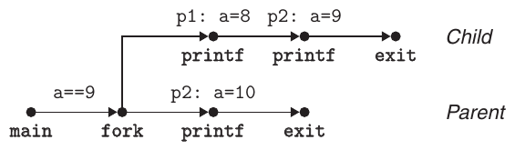

**Hình 8.47 Process graph cho Bài tập thực hành 8.2.**

A. Ý tưởng then chốt là child thực thi cả hai câu lệnh printf. Sau khi fork trả về, nó thực thi printf ở dòng 6. Sau đó, nó ra khỏi câu lệnh if và thực thi printf ở dòng 7. Dưới đây là đầu ra do child tạo:

```
p1: a=8
p2: a=9
```

B. Parent chỉ thực thi printf ở dòng 7:

```
p1: a=10
```

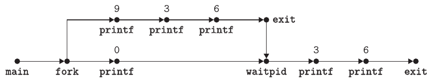

**Hình 8.48 Process graph cho Bài tập thực hành 8.3.**

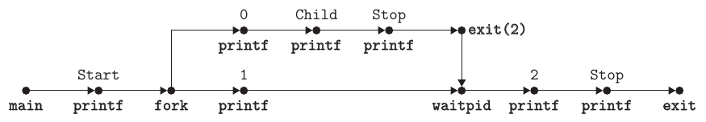

**Hình 8.49 Process graph cho Bài tập thực hành 8.4.**

Lời giải Bài toán 8.3 (trang 781) Chúng ta biết các dãy 936036, 903636 và 093636 có thể xảy ra vì tương ứng với topological sort của process graph (Hình 8.48). Tuy nhiên, các dãy như 036936 và 360369 không tương ứng với bất kỳ topological sort nào nên không khả thi.

Lời giải Bài toán 8.4 (trang 784)

A. Có thể xác định số dòng đầu ra bằng cách đếm các đỉnh printf trong process graph (Hình 8.49). Trong trường hợp này có bảy đỉnh như vậy, do đó chương trình in bảy dòng đầu ra.

B. Mọi dãy đầu ra tương ứng với topological sort của graph đều có thể xảy ra. Ví dụ: Start, 0, 1, Child, Stop, 2, Stop là khả thi.

Lời giải Bài toán 8.5 (trang 786)

```
                                                  code/ecf/global-snooze.c
1   unsigned int wakeup(unsigned int secs) {
2       unsigned int rc = sleep(secs);
3
4       printf("Woke up at %d secs.\n", secs-rc+1);
5       return rc;
6   }
                                                  code/ecf/global-snooze.c
```

Lời giải Bài toán 8.6 (trang 788)

```
                                                       code/ecf/myecho.c
 1   #include "csapp.h"
 2
 3   int main(int argc, char *argv[], char *envp[])
 4   {
 5       int i;
 6
 7       printf("Command-line arguments:\n");
 8       for (i=0; argv[i] != NULL; i++)
 9           printf("    argv[%2d]: %s\n", i, argv[i]);
10
11       printf("\n");
12       printf("Environment variables:\n");
13       for (i=0; envp[i] != NULL; i++)
14           printf("    envp[%2d]: %s\n", i, envp[i]);
15
16       exit(0);
17   }
                                                                   code/ecf/myecho.c
```

Lời giải Bài toán 8.7 (trang 800) Hàm sleep trả về sớm mỗi khi process đang sleep nhận signal không bị bỏ qua. Nhưng vì hành động mặc định khi nhận SIGINT là kết thúc process (Hình 8.26), chúng ta phải cài SIGINT handler để cho phép hàm sleep trả về. Handler chỉ catch SIGNAL rồi trả quyền điều khiển về hàm sleep, trả về ngay lập tức.

```
                                                        code/ecf/snooze.c
 1   #include "csapp.h"
 2
 3   /* SIGINT handler */
 4   void handler(int sig)
 5   {
 6       return; /* Catch the signal and return */
 7   }
 8
 9   unsigned int snooze(unsigned int secs) {
10       unsigned int rc = sleep(secs);
11
12       printf("Slept for %d of %d secs.\n", secs-rc, secs);
13       return rc;
14   }
15
16   int main(int argc, char **argv) {
17
18       if (argc != 2) {
19           fprintf(stderr, "usage: %s <secs>\n", argv[0]);
20           exit(0);
21       }
22
23       if (signal(SIGINT, handler) == SIG_ERR) /* Install SIGINT */
24           unix_error("signal error\n");       /* handler        */
25       (void)snooze(atoi(argv[1]));
26       exit(0);
27   }
                                             code/ecf/snooze.c
```

Lời giải Bài toán 8.8 (trang 809) Chương trình in string 213, là tên viết tắt của môn CS:APP tại Carnegie Mellon. Parent bắt đầu bằng cách in ‘2’, rồi fork child, và child chạy một vòng lặp vô hạn. Parent sau đó gửi signal tới child và chờ nó kết thúc. Child catch signal (ngắt vòng lặp vô hạn), giảm counter (từ giá trị ban đầu 2), in ‘1’ rồi kết thúc. Sau khi parent reap child, nó tăng counter (từ giá trị ban đầu 2), in ‘3’ rồi kết thúc.

---

[^1]: Còn gọi là signal mask.

[^2]: Chú ý đây là mô tả đơn giản hóa cách shell thực tế hoạt động. Với shell thực tế, kernel phản ứng với Ctrl+C (Ctrl+Z) bằng cách gửi SIGINT (SIGTSTP) trực tiếp tới từng process trong terminal foreground process group. Shell quản lý thành viên group bằng hàm tcsetpgrp và quản lý thuộc tính terminal bằng hàm tcsetattr, cả hai nằm ngoài phạm vi sách. Xem [62] để biết chi tiết.
