# 9 Virtual Memory

Các process trong hệ thống dùng chung CPU và main memory với những process khác.

Tuy nhiên, dùng chung main memory đặt ra một số thách thức đặc biệt. Khi nhu cầu CPU tăng, các process chậm lại tương đối đều đặn. Nhưng nếu quá nhiều process cần quá nhiều bộ nhớ, một số process đơn giản không thể chạy. Khi chương trình hết không gian, nó cũng hết đường xoay xở. Bộ nhớ còn dễ bị hỏng. Nếu một process vô tình ghi vào bộ nhớ process khác đang sử dụng, process đó có thể thất bại theo cách khó hiểu, hoàn toàn không liên quan đến logic chương trình.

Để quản lý bộ nhớ hiệu quả hơn và ít lỗi hơn, hệ thống hiện đại cung cấp abstraction của main memory gọi là virtual memory (VM). Virtual memory là sự phối hợp tinh tế giữa hardware exception, hardware address translation, main memory, file trên đĩa và phần mềm kernel, cung cấp cho mỗi process một address space lớn, đồng nhất và riêng tư. Chỉ với một cơ chế rõ ràng, virtual memory cung cấp ba khả năng quan trọng: (1) Sử dụng main memory hiệu quả bằng cách xem nó là cache cho address space lưu trên đĩa, chỉ giữ các vùng đang hoạt động trong main memory và truyền dữ liệu qua lại giữa đĩa và bộ nhớ khi cần. (2) Đơn giản hóa memory management bằng cách cung cấp address space đồng nhất cho mỗi process. (3) Bảo vệ address space của mỗi process khỏi bị process khác làm hỏng.

Virtual memory là một trong những ý tưởng lớn của hệ thống máy tính. Một lý do chủ yếu cho thành công của nó là hoạt động âm thầm và tự động, không cần lập trình viên ứng dụng can thiệp. Vì virtual memory hoạt động tốt như vậy ở hậu trường, tại sao lập trình viên cần hiểu nó? Có một số lý do.

- Virtual memory có vai trò trung tâm. Virtual memory hiện diện ở mọi cấp của hệ thống máy tính, giữ vai trò then chốt trong thiết kế hardware exception, assembler, linker, loader, shared object, file và process. Hiểu virtual memory giúp bạn hiểu rõ hơn cách hệ thống hoạt động nói chung.

- Virtual memory rất mạnh mẽ. Virtual memory cung cấp cho ứng dụng khả năng tạo và hủy các khối bộ nhớ, ánh xạ các khối bộ nhớ tới những phần của file trên đĩa và dùng chung bộ nhớ với process khác. Ví dụ, bạn có biết có thể đọc hoặc sửa nội dung file trên đĩa bằng cách đọc và ghi các vị trí bộ nhớ? Hoặc có thể load nội dung file vào bộ nhớ mà không sao chép tường minh? Hiểu virtual memory giúp bạn khai thác những khả năng mạnh mẽ này trong ứng dụng.

- Virtual memory có thể nguy hiểm. Ứng dụng tương tác với virtual memory mỗi khi tham chiếu variable, dereference pointer hoặc gọi gói dynamic allocation như malloc. Nếu dùng virtual memory không đúng, ứng dụng có thể gặp các bug memory-related khó hiểu và âm thầm. Ví dụ, chương trình có pointer sai có thể crash ngay với “segmentation fault” hoặc “protection fault”, chạy âm thầm nhiều giờ trước khi crash, hoặc đáng sợ nhất là chạy đến hết nhưng cho kết quả sai. Hiểu virtual memory và các gói allocation như malloc quản lý nó giúp bạn tránh những lỗi này.

Chương này xem xét virtual memory từ hai góc độ. Nửa đầu mô tả cách virtual memory hoạt động. Nửa sau mô tả cách ứng dụng sử dụng và quản lý virtual memory. Không thể phủ nhận VM phức tạp, và một số phần thảo luận phản ánh điều đó. Tin tốt là nếu tìm hiểu kỹ chi tiết, bạn sẽ có thể tự mô phỏng cơ chế virtual memory của hệ thống nhỏ bằng tay, và ý tưởng virtual memory sẽ không còn bí ẩn.

Nửa sau xây dựng trên hiểu biết này, chỉ ra cách sử dụng và quản lý virtual memory trong chương trình. Bạn sẽ học cách quản lý virtual memory qua memory mapping tường minh và lời gọi dynamic storage allocator như gói malloc. Bạn cũng sẽ tìm hiểu nhiều lỗi memory-related phổ biến trong chương trình C và cách tránh.

## 9.1 Physical Addressing và Virtual Addressing

Main memory của hệ thống máy tính được tổ chức thành array gồm M cell byte-size liên tiếp. Mỗi byte có physical address (PA) duy nhất. Byte đầu tiên có địa chỉ 0, byte tiếp theo có địa chỉ 1, byte tiếp theo có địa chỉ 2, và cứ như vậy. Với cách tổ chức đơn giản này, cách tự nhiên nhất để CPU truy cập bộ nhớ là sử dụng physical address. Chúng ta gọi cách này là physical addressing. Hình 9.1 thể hiện ví dụ physical addressing trong bối cảnh load instruction đọc word 4-byte bắt đầu tại physical address 4. Khi CPU thực thi load instruction, nó tạo effective physical address và chuyển tới main memory qua memory bus. Main memory lấy word 4-byte bắt đầu tại physical address 4 và trả về CPU để lưu vào register.

PC thời kỳ đầu sử dụng physical addressing, và các hệ thống như digital signal processor, embedded microcontroller và siêu máy tính Cray vẫn tiếp tục dùng. Tuy nhiên, processor hiện đại dùng dạng addressing gọi là virtual addressing, như Hình 9.2.

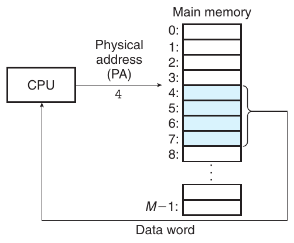

**Hình 9.1 Hệ thống sử dụng physical addressing.**

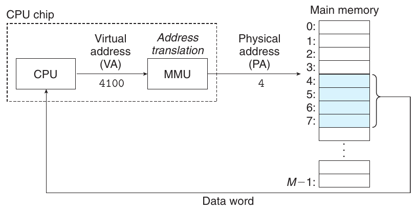

**Hình 9.2 Hệ thống sử dụng virtual addressing.**

Với virtual addressing, CPU truy cập main memory bằng cách tạo virtual address (VA), được chuyển thành physical address thích hợp trước khi gửi tới main memory. Nhiệm vụ chuyển virtual address thành physical address gọi là address translation. Giống exception handling, address translation đòi hỏi phối hợp chặt chẽ giữa phần cứng CPU và operating system. Phần cứng chuyên dụng trên chip CPU gọi là memory management unit (MMU) chuyển đổi virtual address ngay trong quá trình xử lý, sử dụng lookup table lưu trong main memory có nội dung do operating system quản lý.

## 9.2 Address Space

Address space là một tập hợp có thứ tự các địa chỉ số nguyên không âm

{0, 1, 2, . . .}

Nếu các số nguyên trong address space liên tiếp, chúng ta gọi đó là linear address space. Để đơn giản hóa thảo luận, chúng ta luôn giả định linear address space. Trong hệ thống có virtual memory, CPU tạo virtual address từ address space gồm N = 2<sup>n</sup> địa chỉ gọi là virtual address space:

{0, 1, 2, . . . , N − 1}

Kích thước address space được đặc trưng bằng số bit cần để biểu diễn địa chỉ lớn nhất. Ví dụ, virtual address space gồm N = 2<sup>n</sup> địa chỉ được gọi là address space n-bit. Hệ thống hiện đại thường hỗ trợ virtual address space 32-bit hoặc 64-bit.

Hệ thống còn có physical address space tương ứng với M byte physical memory trong hệ thống:

{0, 1, 2, . . . , M − 1}

M không bắt buộc là lũy thừa của 2, nhưng để đơn giản hóa thảo luận, chúng ta giả định M = 2<sup>m</sup>.

Khái niệm address space quan trọng vì phân biệt rõ data object (byte) với thuộc tính của chúng (địa chỉ). Khi nhận ra sự phân biệt này, chúng ta có thể khái quát và cho phép mỗi data object có nhiều địa chỉ độc lập, mỗi địa chỉ được chọn từ address space khác nhau. Đây là ý tưởng cơ bản của virtual memory. Mỗi byte main memory có virtual address được chọn từ virtual address space và physical address được chọn từ physical address space.

### Bài tập thực hành 9.1 (lời giải trang 916)

Hoàn thành bảng sau bằng cách điền các entry còn thiếu và thay mỗi dấu hỏi bằng số nguyên thích hợp. Sử dụng các đơn vị: K = 2<sup>10</sup> (kilo), M = 2<sup>20</sup> (mega), G = 2<sup>30</sup> (giga), T = 2<sup>40</sup> (tera), P = 2<sup>50</sup> (peta) hoặc E = 2<sup>60</sup> (exa).

| Số | Số |  |
|---|---|---|
| virtual address bit (n) | virtual address (N) | Virtual address lớn nhất có thể |
| 4 | ______ | ______ |
| ______ | 2<sup>?</sup> = 16 K | ______ |
| ______ | ______ | 2<sup>24</sup> − 1 =? M − 1 |
| ______ | 2<sup>?</sup> = 64 T | ______ |
| 54 | ______ | ______ |

## 9.3 VM làm công cụ caching

Về khái niệm, virtual memory được tổ chức thành array gồm N cell byte-size liên tiếp lưu trên đĩa. Mỗi byte có virtual address duy nhất làm index vào array. Nội dung array trên đĩa được cache trong main memory. Giống mọi cache khác trong memory hierarchy, dữ liệu trên đĩa (cấp dưới) được chia thành các block làm đơn vị truyền giữa đĩa và main memory (cấp trên). Hệ thống VM thực hiện điều này bằng cách chia virtual memory thành block fixed-size gọi là virtual page (VP). Mỗi virtual page có kích thước P = 2<sup>p</sup> byte. Tương tự, physical memory được chia thành physical page (PP), cũng có kích thước P byte. (Physical page còn được gọi là page frame.)

Tại bất kỳ thời điểm nào, tập virtual page được chia thành ba tập con rời nhau:

Unallocated. Các page chưa được hệ thống VM cấp phát (hoặc tạo). Block unallocated không gắn với dữ liệu nào nên không chiếm không gian trên đĩa.

Cached. Các page đã cấp phát hiện được cache trong physical memory.

Uncached. Các page đã cấp phát nhưng không được cache trong physical memory.

Ví dụ trong Hình 9.3 thể hiện virtual memory nhỏ gồm tám virtual page. Virtual page 0 và 3 chưa được cấp phát nên chưa tồn tại trên đĩa. Virtual page 1, 4 và 6 được cache trong physical memory. Page 2, 5 và 7 đã cấp phát nhưng hiện không được cache trong physical memory.

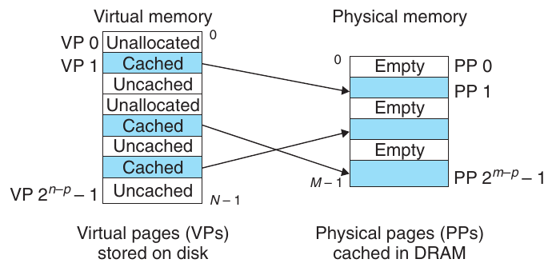

**Hình 9.3 Cách hệ thống VM sử dụng main memory làm cache.**

### 9.3.1 Tổ chức DRAM cache

Để phân biệt rõ các cache trong memory hierarchy, chúng ta dùng thuật ngữ SRAM cache chỉ các bộ nhớ cache L1, L2 và L3 giữa CPU và main memory, còn DRAM cache chỉ cache của hệ thống VM lưu virtual page trong main memory.

Vị trí DRAM cache trong memory hierarchy ảnh hưởng lớn tới cách tổ chức nó. Nhớ rằng DRAM chậm hơn SRAM ít nhất 10 lần và đĩa chậm hơn DRAM khoảng 100,000 lần. Vì vậy, miss trong DRAM cache rất tốn kém so với miss trong SRAM cache, vì DRAM cache miss được phục vụ từ đĩa, còn SRAM cache miss thường được phục vụ từ main memory DRAM-based. Hơn nữa, chi phí đọc byte đầu tiên từ sector đĩa chậm hơn khoảng 100,000 lần so với đọc các byte tiếp theo trong sector. Do đó, cách tổ chức DRAM cache hoàn toàn do chi phí miss khổng lồ chi phối.

Do miss penalty lớn và truy cập byte đầu tiên tốn kém, virtual page thường lớn—thường từ 4 KB đến 2 MB. Do miss penalty lớn, DRAM cache là fully associative; nghĩa là virtual page bất kỳ có thể được đặt trong physical page bất kỳ. Replacement policy khi miss cũng quan trọng hơn vì penalty do thay nhầm virtual page rất cao. Vì vậy, operating system sử dụng replacement algorithm cho DRAM cache tinh vi hơn nhiều so với phần cứng dùng cho SRAM cache. (Các replacement algorithm này nằm ngoài phạm vi ở đây.) Cuối cùng, vì access time của đĩa lớn, DRAM cache luôn dùng write-back thay vì write-through.

### 9.3.2 Page Table

Như mọi cache, hệ thống VM phải có cách xác định virtual page có được cache ở đâu đó trong DRAM hay không. Nếu có, hệ thống phải xác định nó được cache trong physical page nào. Nếu miss, hệ thống phải xác định virtual page được lưu ở đâu trên đĩa, chọn victim page trong physical memory rồi sao chép virtual page từ đĩa vào DRAM để thay victim page.

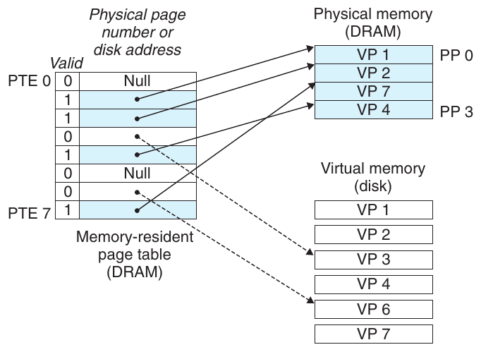

**Hình 9.4 Page table.**

Các khả năng này được cung cấp bằng sự kết hợp giữa phần mềm operating system, phần cứng address translation trong MMU (memory management unit) và data structure lưu trong physical memory gọi là page table, ánh xạ virtual page tới physical page. Phần cứng address translation đọc page table mỗi khi chuyển virtual address thành physical address. Operating system chịu trách nhiệm duy trì nội dung page table và chuyển page qua lại giữa đĩa và DRAM.

Hình 9.4 thể hiện tổ chức cơ bản của page table. Page table là array các page table entry (PTE). Mỗi page trong virtual address space có PTE tại offset cố định trong page table. Trong phạm vi này, chúng ta giả định mỗi PTE gồm valid bit và address field n-bit. Valid bit cho biết virtual page hiện có được cache trong DRAM hay không. Nếu valid bit được đặt, address field cho biết điểm bắt đầu physical page tương ứng trong DRAM nơi virtual page được cache. Nếu valid bit không được đặt, null address biểu thị virtual page chưa được cấp phát. Nếu không, địa chỉ trỏ tới điểm bắt đầu virtual page trên đĩa.

Ví dụ trong Hình 9.4 thể hiện page table cho hệ thống có tám virtual page và bốn physical page. Bốn virtual page (VP 1, VP 2, VP 4 và VP 7) hiện được cache trong DRAM. Hai page (VP 0 và VP 5) chưa được cấp phát, còn những page khác (VP 3 và VP 6) đã cấp phát nhưng hiện không được cache. Điểm quan trọng cần lưu ý trong Hình 9.4 là vì DRAM cache fully associative, physical page bất kỳ có thể chứa virtual page bất kỳ.

#### Bài tập thực hành 9.2 (lời giải trang 917)

Xác định số page table entry (PTE) cần cho các tổ hợp virtual address size (n) và page size (P ) sau:

| n | P = 2<sup>p</sup> | Số PTE |
|---|---|---|
| 12 | 1 K | ______ |
| 16 | 16 K | ______ |
| 24 | 2 M | ______ |
| 36 | 1 G | ______ |

### 9.3.3 Page Hit

Xét điều xảy ra khi CPU đọc word virtual memory nằm trong VP 2, được cache trong DRAM (Hình 9.5). Dùng kỹ thuật sẽ được mô tả chi tiết trong Mục 9.6, phần cứng address translation sử dụng virtual address làm index để xác định PTE 2 và đọc nó từ bộ nhớ. Vì valid bit được đặt, phần cứng address translation biết VP 2 được cache trong bộ nhớ. Do đó, nó dùng physical memory address trong PTE (trỏ tới đầu cached page trong PP 1) để xây dựng physical address của word.

### 9.3.4 Page Fault

Theo thuật ngữ virtual memory, DRAM cache miss được gọi là page fault. Hình 9.6 thể hiện trạng thái page table ví dụ trước fault. CPU đã tham chiếu word trong VP 3, không được cache trong DRAM. Phần cứng address translation đọc PTE 3 từ bộ nhớ, suy ra từ valid bit rằng VP 3 không được cache và kích hoạt page fault exception. Page fault exception gọi page fault exception handler trong kernel, chọn victim page—trong trường hợp này là VP 4 lưu trong PP 3. Nếu VP 4 đã bị sửa, kernel sao chép nó trở lại đĩa. Trong mọi trường hợp, kernel sửa page table entry của VP 4 để phản ánh việc VP 4 không còn được cache trong main memory.

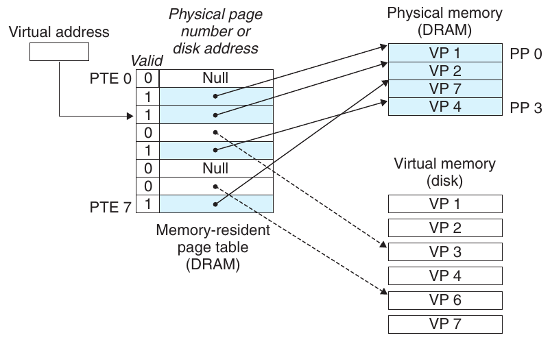

**Hình 9.5 VM page hit. Reference tới word trong VP 2 là hit.**


**Hình 9.6 VM page fault (trước). Reference tới word trong VP 3 là miss và kích hoạt page fault.**

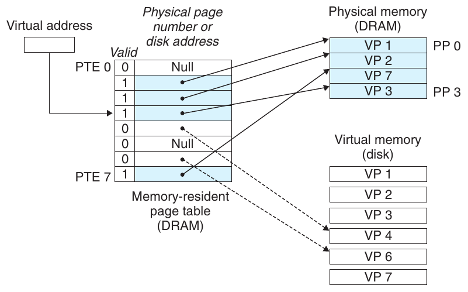

**Hình 9.7 VM page fault (sau). Page fault handler chọn VP 4 làm victim và thay bằng bản sao VP 3 từ đĩa. Sau khi page fault handler khởi động lại faulting instruction, nó đọc word từ bộ nhớ bình thường mà không tạo exception.**

Tiếp theo, kernel sao chép VP 3 từ đĩa vào PP 3 trong bộ nhớ, cập nhật PTE 3 rồi trả về. Khi handler trả về, nó khởi động lại faulting instruction, gửi lại faulting virtual address tới phần cứng address translation. Nhưng lúc này VP 3 đã được cache trong main memory và page hit được phần cứng address translation xử lý bình thường. Hình 9.7 thể hiện trạng thái page table ví dụ sau page fault.

Virtual memory được phát minh đầu thập niên 1960, rất lâu trước khi khoảng cách CPU-memory ngày càng rộng dẫn tới SRAM cache. Vì vậy, hệ thống virtual memory sử dụng thuật ngữ khác SRAM cache dù nhiều ý tưởng tương tự nhau. Trong thuật ngữ virtual memory, block được gọi là page. Hoạt động truyền page giữa đĩa và bộ nhớ gọi là swapping hoặc paging. Page được swapped in (paged in) từ đĩa vào DRAM và swapped out (paged out) từ DRAM ra đĩa. Chiến lược chờ đến thời điểm cuối cùng mới swap in page khi xảy ra miss gọi là demand paging. Những cách khác như dự đoán miss và swap page vào trước khi được tham chiếu thực sự cũng khả thi. Tuy nhiên, mọi hệ thống hiện đại đều dùng demand paging.

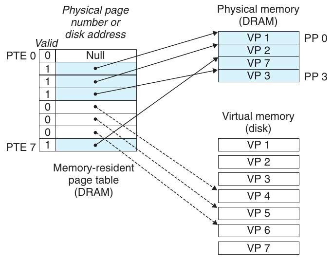

**Hình 9.8 Cấp phát virtual page mới. Kernel cấp phát VP 5 trên đĩa và trỏ PTE 5 tới vị trí mới này.**

### 9.3.5 Cấp phát page

Hình 9.8 thể hiện ảnh hưởng lên page table ví dụ khi operating system cấp phát page virtual memory mới—ví dụ, do gọi malloc. Trong ví dụ, VP 5 được cấp phát bằng cách tạo không gian trên đĩa và cập nhật PTE 5 để trỏ tới page mới tạo trên đĩa.

### 9.3.6 Locality lại cứu nguy

Khi mới học ý tưởng virtual memory, ấn tượng đầu tiên của nhiều người thường là nó chắc hẳn cực kỳ kém hiệu quả. Với miss penalty lớn, chúng ta lo paging phá hỏng hiệu năng chương trình. Trong thực tế, virtual memory hoạt động tốt chủ yếu nhờ người bạn cũ locality.

Mặc dù tổng số page riêng biệt chương trình tham chiếu trong toàn bộ lần chạy có thể vượt tổng kích thước physical memory, nguyên lý locality bảo đảm tại bất kỳ thời điểm nào, chương trình thường làm việc trên tập active page nhỏ hơn gọi là working set hoặc resident set. Sau overhead ban đầu đưa working set vào bộ nhớ bằng paging, các reference tiếp theo tới working set đều hit mà không tạo thêm disk traffic.

Miễn chương trình có temporal locality tốt, hệ thống virtual memory hoạt động khá tốt. Nhưng tất nhiên không phải chương trình nào cũng có temporal locality tốt. Nếu kích thước working set vượt kích thước physical memory, chương trình có thể tạo tình huống không mong muốn gọi là thrashing, trong đó page được swap in và swap out liên tục. Mặc dù virtual memory thường hiệu quả, nếu hiệu năng chương trình chậm như rùa, lập trình viên khôn ngoan sẽ cân nhắc khả năng nó đang thrashing.

#### Thông tin thêm: Đếm page fault

Bạn có thể theo dõi số page fault (và nhiều thông tin khác) bằng hàm getrusage của Linux.

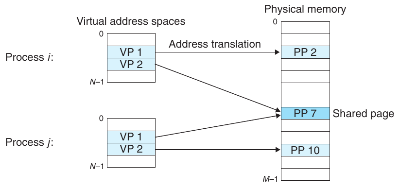

**Hình 9.9 Cách VM cung cấp address space riêng cho process. Operating system duy trì page table riêng cho mỗi process trong hệ thống.**

## 9.4 VM làm công cụ memory management

Trong mục trước, chúng ta thấy cách virtual memory cung cấp cơ chế dùng DRAM để cache page từ virtual address space thường lớn hơn. Điều thú vị là một số hệ thống thời kỳ đầu như DEC PDP-11/70 hỗ trợ virtual address space nhỏ hơn physical memory sẵn có. Tuy nhiên, virtual memory vẫn hữu ích vì đơn giản hóa đáng kể memory management và cung cấp cách tự nhiên để bảo vệ bộ nhớ.

Cho đến đây, chúng ta giả định một page table duy nhất ánh xạ một virtual address space duy nhất tới physical address space. Thực tế, operating system cung cấp page table riêng, do đó virtual address space riêng, cho mỗi process. Hình 9.9 thể hiện ý tưởng cơ bản. Trong ví dụ, page table của process i ánh xạ VP 1 tới PP 2 và VP 2 tới PP 7. Tương tự, page table của process j ánh xạ VP 1 tới PP 7 và VP 2 tới PP 10. Chú ý nhiều virtual page có thể được ánh xạ tới cùng shared physical page.

Sự kết hợp demand paging và virtual address space riêng ảnh hưởng sâu sắc tới cách sử dụng và quản lý bộ nhớ trong hệ thống. Đặc biệt, VM đơn giản hóa linking và loading, chia sẻ code và dữ liệu, cũng như cấp phát bộ nhớ cho ứng dụng.

- Đơn giản hóa linking. Address space riêng cho phép mỗi process dùng cùng định dạng cơ bản cho memory image, bất kể code và dữ liệu thực sự nằm ở đâu trong physical memory. Ví dụ, như đã thấy trong Hình 8.13, mọi process trên một hệ thống Linux cụ thể có định dạng bộ nhớ tương tự. Với address space 64-bit, code segment luôn bắt đầu tại virtual address 0x400000. Data segment theo sau code segment sau một khoảng trống alignment thích hợp. Stack chiếm phần cao nhất của user process address space và tăng trưởng xuống dưới. Sự đồng nhất này đơn giản hóa đáng kể thiết kế và triển khai linker, cho phép tạo executable được link hoàn chỉnh độc lập với vị trí cuối cùng của code và dữ liệu trong physical memory.

- Đơn giản hóa loading. Virtual memory còn giúp dễ load executable object file và shared object file vào bộ nhớ. Để load section .text và .data của object file vào process mới tạo, Linux loader cấp phát virtual page cho code segment và data segment, đánh dấu chúng invalid (tức không được cache) và trỏ page table entry tới vị trí thích hợp trong object file. Điểm thú vị là loader không bao giờ thực sự sao chép dữ liệu từ đĩa vào bộ nhớ. Dữ liệu được paged in tự động theo yêu cầu bởi hệ thống virtual memory khi mỗi page được tham chiếu lần đầu, hoặc bởi CPU khi fetch instruction, hoặc bởi instruction đang thực thi khi tham chiếu vị trí bộ nhớ.

  Khái niệm ánh xạ một tập virtual page liên tiếp tới vị trí bất kỳ trong file bất kỳ gọi là memory mapping. Linux cung cấp system call mmap cho phép chương trình ứng dụng tự thực hiện memory mapping. Chúng ta sẽ mô tả memory mapping application-level chi tiết hơn trong Mục 9.8.

- Đơn giản hóa chia sẻ. Address space riêng cung cấp cho operating system cơ chế nhất quán để quản lý chia sẻ giữa user process và chính operating system. Nhìn chung, mỗi process có các vùng code, dữ liệu, heap và stack riêng không dùng chung với process khác. Khi đó, operating system tạo page table ánh xạ các virtual page tương ứng tới physical page rời nhau.

  Tuy nhiên, trong một số trường hợp, process cần chia sẻ code và dữ liệu. Ví dụ, mọi process phải gọi cùng code kernel của operating system, và mọi chương trình C gọi routine trong thư viện C chuẩn như printf. Thay vì đưa bản sao riêng của kernel và thư viện C chuẩn vào mỗi process, operating system có thể sắp xếp để nhiều process dùng chung một bản sao code bằng cách ánh xạ virtual page thích hợp trong các process khác nhau tới cùng physical page, như Hình 9.9.

- Đơn giản hóa memory allocation. Virtual memory cung cấp cơ chế đơn giản để cấp phát thêm bộ nhớ cho user process. Khi chương trình chạy trong user process yêu cầu thêm không gian heap (ví dụ, do gọi malloc), operating system cấp phát số lượng thích hợp, chẳng hạn k, virtual memory page liên tiếp và ánh xạ chúng tới k physical page bất kỳ nằm ở bất kỳ đâu trong physical memory. Do cách page table hoạt động, operating system không cần tìm k physical memory page liên tiếp. Các page có thể phân tán ngẫu nhiên trong physical memory.

## 9.5 VM làm công cụ memory protection

Mọi hệ thống máy tính hiện đại phải cung cấp phương tiện để operating system kiểm soát truy cập hệ thống bộ nhớ. User process không được phép sửa code section read-only của mình. Nó cũng không được đọc hoặc sửa code và data structure trong kernel. Nó không được đọc hoặc ghi private memory của process khác và không được sửa virtual page dùng chung với process khác, trừ khi mọi bên cho phép tường minh (qua lời gọi system call interprocess communication tường minh).

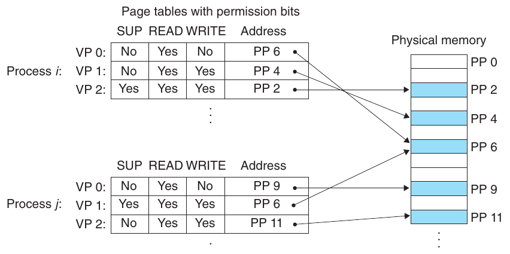

**Hình 9.10 Sử dụng VM để cung cấp memory protection page-level.**

Như đã thấy, cung cấp virtual address space riêng giúp dễ cô lập private memory của các process khác nhau. Nhưng cơ chế address translation có thể được mở rộng tự nhiên để kiểm soát truy cập chi tiết hơn nữa. Vì phần cứng address translation đọc PTE mỗi khi CPU tạo địa chỉ, có thể dễ dàng kiểm soát truy cập nội dung virtual page bằng cách thêm permission bit vào PTE. Hình 9.10 thể hiện ý tưởng tổng quát.

Trong ví dụ này, chúng ta thêm ba permission bit vào mỗi PTE. Bit SUP cho biết process có phải chạy trong kernel (supervisor) mode để truy cập page hay không. Process chạy trong kernel mode có thể truy cập bất kỳ page nào, nhưng process chạy trong user mode chỉ được truy cập page có SUP bằng 0. Bit READ và WRITE kiểm soát truy cập đọc và ghi page. Ví dụ, nếu process i chạy trong user mode, nó được đọc VP 0 và đọc hoặc ghi VP 1. Tuy nhiên, nó không được truy cập VP 2.

Nếu instruction vi phạm các quyền này, CPU kích hoạt general protection fault, chuyển quyền điều khiển tới exception handler trong kernel để gửi SIGSEGV tới process vi phạm. Linux shell thường báo exception này là “segmentation fault.”

## 9.6 Address Translation

Mục này trình bày cơ bản về address translation. Mục tiêu là giúp bạn hiểu vai trò phần cứng trong hỗ trợ virtual memory, với đủ chi tiết để tự giải một số ví dụ cụ thể bằng tay. Tuy nhiên, hãy nhớ chúng ta bỏ qua một số chi tiết, đặc biệt liên quan timing, quan trọng với nhà thiết kế phần cứng nhưng ngoài phạm vi sách. Để tham khảo, Hình 9.11 tóm tắt ký hiệu sẽ được sử dụng trong toàn bộ mục này.

| Ký hiệu | Mô tả |
|---|---|
| Tham số cơ bản |  |
| N = 2<sup>n</sup> | Số địa chỉ trong virtual address space |
| M = 2<sup>m</sup> | Số địa chỉ trong physical address space |
| P = 2<sup>p</sup> | Page size (byte) |
| Các thành phần virtual address (VA) |  |
| VPO | Virtual page offset (byte) |
| VPN | Virtual page number |
| TLBI | TLB index |
| TLBT | TLB tag |
| Các thành phần physical address (PA) |  |
| PPO | Physical page offset (byte) |
| PPN | Physical page number |
| CO | Byte offset trong cache block |
| CI | Cache index |
| CT | Cache tag |

**Hình 9.11 Tổng kết ký hiệu address translation.**

Về hình thức, address translation là ánh xạ giữa các phần tử của virtual address space (VAS) N -element và physical address space (PAS) M-element,

MAP: VAS → PAS ∪ ∅

trong đó

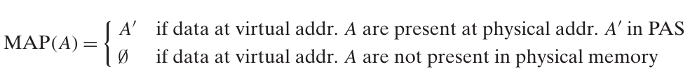

Hình 9.12 thể hiện cách MMU dùng page table thực hiện ánh xạ này. Một control register trong CPU, page table base register (PTBR), trỏ tới page table hiện tại. Virtual address n-bit có hai thành phần: virtual page offset (VPO) p-bit và virtual page number (VPN) (n − p)-bit. MMU dùng VPN chọn PTE thích hợp. Ví dụ, VPN 0 chọn PTE 0, VPN 1 chọn PTE 1, và cứ như vậy. Physical address tương ứng là phép nối physical page number (PPN) từ page table entry với VPO từ virtual address. Chú ý vì physical page và virtual page đều có P byte, physical page offset (PPO) giống hệt VPO.

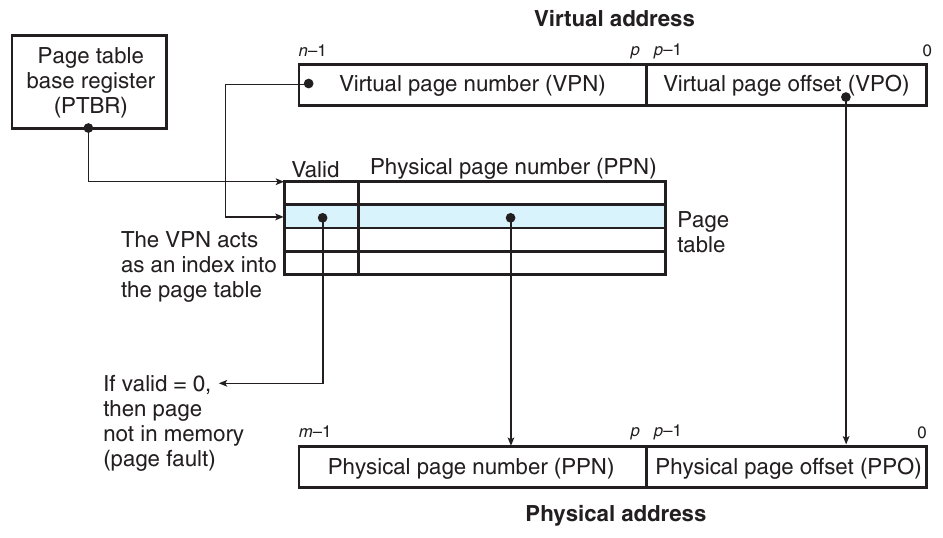

**Hình 9.12 Address translation bằng page table.**

Hình 9.13(a) thể hiện các bước phần cứng CPU thực hiện khi có page hit.

Bước 1. Processor tạo virtual address và gửi tới MMU.

Bước 2. MMU tạo địa chỉ PTE và yêu cầu PTE từ cache/main memory.

Bước 3. Cache/main memory trả PTE về MMU.

Bước 4. MMU xây dựng physical address và gửi tới cache/main memory.

Bước 5. Cache/main memory trả data word được yêu cầu về processor.

Khác với page hit được xử lý hoàn toàn bằng phần cứng, xử lý page fault đòi hỏi phối hợp giữa phần cứng và kernel của operating system (Hình 9.13(b)).

Bước 1 đến 3. Giống bước 1 đến 3 trong Hình 9.13(a).

Bước 4. Valid bit trong PTE bằng không, nên MMU kích hoạt exception chuyển quyền điều khiển trong CPU tới page fault exception handler trong kernel của operating system.

Bước 5. Fault handler xác định victim page trong physical memory, và nếu page đã bị sửa thì page out ra đĩa.

Bước 6. Fault handler page in page mới và cập nhật PTE trong bộ nhớ.

Bước 7. Fault handler trở về process ban đầu, khiến faulting instruction được khởi động lại. CPU gửi lại virtual address gây lỗi tới MMU. Vì virtual page hiện được cache trong physical memory, có hit; sau khi MMU thực hiện các bước trong Hình 9.13(a), main memory trả word được yêu cầu về processor.

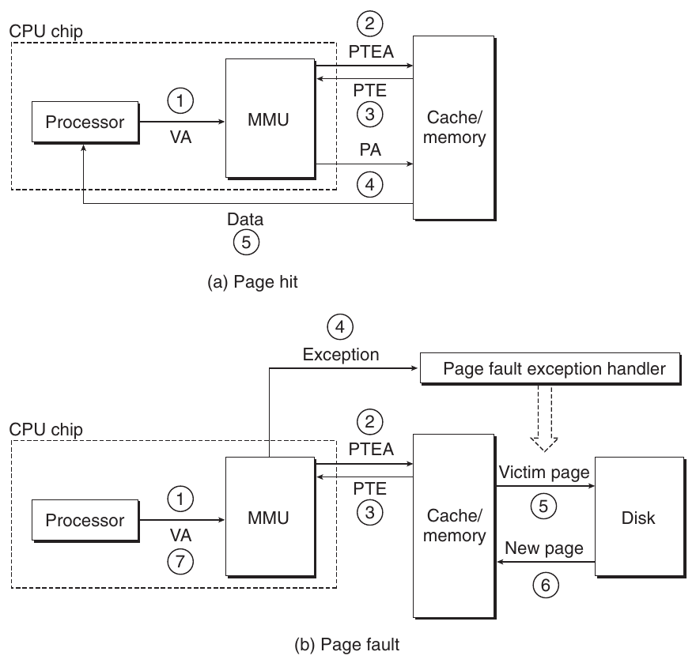

**Hình 9.13 Góc nhìn hoạt động của page hit và page fault. VA: virtual address. PTEA: page table entry address. PTE: page table entry. PA: physical address.**

### Bài tập thực hành 9.3 (lời giải trang 917)

Với virtual address space 64-bit và physical address 32-bit, xác định số bit trong VPN, VPO, PPN và PPO cho các page size P sau:

Số

| P | bit VPN | bit VPO | bit PPN | bit PPO |
|---|---|---|---|---|
| 1 KB | ______ | ______ | ______ | ______ |
| 2 KB | ______ | ______ | ______ | ______ |
| 4 KB | ______ | ______ | ______ | ______ |
| 16 KB | ______ | ______ | ______ | ______ |

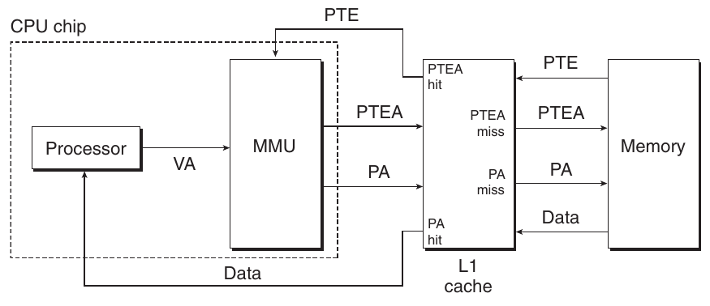

**Hình 9.14 Tích hợp VM với cache dùng physical address. VA: virtual address. PTEA: page table entry address. PTE: page table entry. PA: physical address.**

### 9.6.1 Tích hợp cache và VM

Trong mọi hệ thống dùng cả virtual memory và SRAM cache, vấn đề đặt ra là dùng virtual address hay physical address để truy cập SRAM cache. Mặc dù thảo luận chi tiết các trade-offs nằm ngoài phạm vi sách, phần lớn hệ thống chọn physical addressing. Với physical addressing, nhiều process dễ có block trong cache đồng thời và dùng chung block từ cùng virtual page. Hơn nữa, cache không phải xử lý vấn đề protection vì quyền truy cập được kiểm tra như một phần của address translation.

Hình 9.14 thể hiện cách tích hợp cache dùng physical address với virtual memory. Ý tưởng chính là address translation xảy ra trước cache lookup. Chú ý page table entry có thể được cache giống mọi data word khác.

### 9.6.2 Tăng tốc address translation bằng TLB

Như đã thấy, mỗi lần CPU tạo virtual address, MMU phải tham chiếu PTE để chuyển virtual address thành physical address. Trong trường hợp xấu nhất, việc này đòi hỏi thêm một lần fetch từ bộ nhớ, tốn hàng chục đến hàng trăm chu kỳ. Nếu PTE tình cờ được cache trong L1, chi phí giảm còn vài chu kỳ. Tuy nhiên, nhiều hệ thống cố loại bỏ cả chi phí này bằng cách đưa vào MMU một cache PTE nhỏ gọi là translation lookaside buffer (TLB).

TLB là cache nhỏ dùng virtual address, mỗi line giữ một block gồm một PTE duy nhất. TLB thường có associativity cao. Như Hình 9.15, các field index và tag dùng để chọn set và so khớp line được trích từ virtual page number trong virtual address. Nếu TLB có T = 2<sup>t</sup> set, TLB index (TLBI) gồm t bit ít quan trọng nhất của VPN, còn TLB tag (TLBT) gồm các bit còn lại trong VPN.

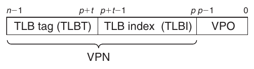

**Hình 9.15 Các thành phần virtual address dùng để truy cập TLB.**

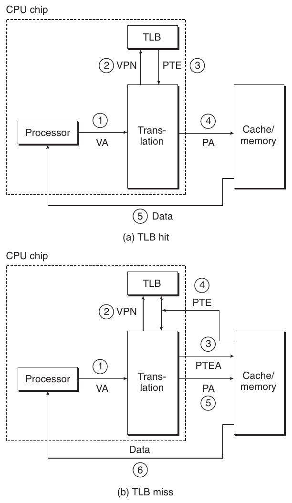

**Hình 9.16 Góc nhìn hoạt động của TLB hit và miss.**

Hình 9.16(a) thể hiện các bước khi có TLB hit (trường hợp thông thường). Điểm then chốt là mọi bước address translation đều được thực hiện bên trong MMU on-chip nên rất nhanh.

Bước 1. CPU tạo virtual address.

Bước 2 và 3. MMU fetch PTE thích hợp từ TLB.

Bước 4. MMU chuyển virtual address thành physical address và gửi tới cache/main memory.

Bước 5. Cache/main memory trả data word được yêu cầu về CPU.

Khi có TLB miss, MMU phải fetch PTE từ L1 cache, như Hình 9.16(b). PTE vừa fetch được lưu trong TLB, có thể ghi đè entry hiện có.

### 9.6.3 Page table Multi-Level

Cho đến đây, chúng ta giả định hệ thống dùng một page table duy nhất để address translation. Nhưng nếu có address space 32-bit, page 4 KB và PTE 4-byte, chúng ta cần page table 4 MB luôn nằm trong bộ nhớ, ngay cả khi ứng dụng chỉ tham chiếu một phần nhỏ virtual address space. Vấn đề càng trầm trọng với hệ thống có address space 64-bit.

Cách phổ biến để thu gọn page table là dùng hệ thống phân cấp page table. Ý tưởng dễ hiểu nhất qua ví dụ cụ thể. Xét virtual address space 32-bit được chia thành page 4 KB, với page table entry mỗi entry 4 byte. Giả sử tại thời điểm này virtual address space có dạng: 2 K page đầu tiên được cấp phát cho code và dữ liệu, 6 K page tiếp theo chưa cấp phát, 1,023 page tiếp theo cũng chưa cấp phát, và page tiếp theo được cấp phát cho user stack. Hình 9.17 thể hiện cách xây dựng hệ thống page table two-level cho virtual address space này.

Mỗi PTE trong bảng level 1 chịu trách nhiệm ánh xạ một khối 4 MB của virtual address space, mỗi khối gồm 1,024 page liên tiếp. Ví dụ, PTE 0 ánh xạ khối đầu tiên, PTE 1 ánh xạ khối tiếp theo, và cứ như vậy. Vì address space là 4 GB, 1,024 PTE đủ bao phủ toàn bộ không gian.

Nếu mọi page trong khối i chưa cấp phát, PTE i ở level 1 là null. Ví dụ, trong Hình 9.17, các khối 2–7 chưa cấp phát. Tuy nhiên, nếu ít nhất một page trong khối i đã cấp phát, PTE i ở level 1 trỏ tới đầu một page table level 2. Ví dụ, trong Hình 9.17, toàn bộ hoặc một phần các khối 0, 1 và 8 đã cấp phát, nên PTE level 1 tương ứng trỏ tới page table level 2.

Mỗi PTE trong page table level 2 chịu trách nhiệm ánh xạ page virtual memory 4-KB, như trước khi xem page table single-level. Chú ý với PTE 4-byte, mỗi page table level 1 và level 2 có kích thước 4 kilobyte, thuận tiện bằng kích thước một page.

Cơ chế này giảm yêu cầu bộ nhớ theo hai cách. Thứ nhất, nếu PTE trong bảng level 1 là null, page table level 2 tương ứng thậm chí không cần tồn tại. Điều này có thể tiết kiệm đáng kể vì phần lớn virtual address space 4 GB của chương trình điển hình chưa được cấp phát. Thứ hai, chỉ bảng level 1 cần luôn nằm trong main memory. Page table level 2 có thể được hệ thống VM tạo và paged in, paged out khi cần, giảm áp lực main memory. Chỉ những page table level 2 dùng nhiều nhất cần được cache trong main memory.

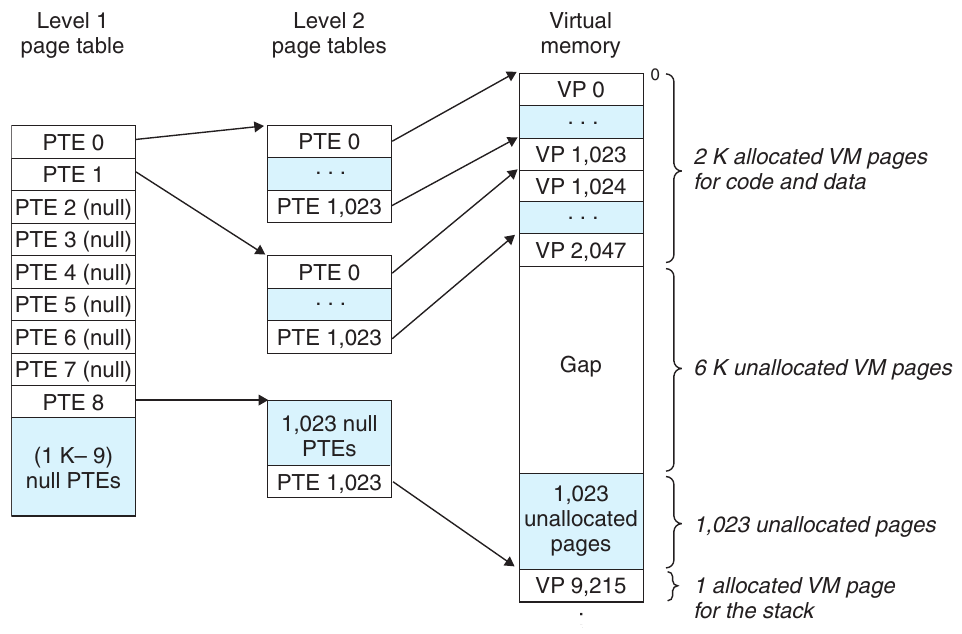

**Hình 9.17 Hệ thống phân cấp page table two-level. Chú ý địa chỉ tăng từ trên xuống dưới.**

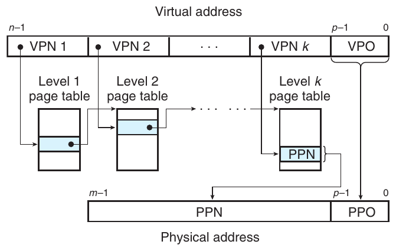

**Hình 9.18 Address translation bằng page table k-level.**

Hình 9.18 tóm tắt address translation bằng hệ thống page table k-level. Virtual address được chia thành k VPN và một VPO. Mỗi VPN i, 1 ≤ i ≤ k, là index vào page table level i. Mỗi PTE trong bảng level j, 1 ≤ j ≤ k − 1, trỏ tới đầu page table ở level j + 1. Mỗi PTE trong bảng level k chứa PPN của physical page hoặc địa chỉ disk block. Để xây dựng physical address, MMU phải truy cập k PTE trước khi xác định được PPN. Như hệ thống single-level, PPO giống hệt VPO.

Truy cập k PTE thoạt nhìn có vẻ tốn kém và thiếu thực tế. Tuy nhiên, TLB cứu nguy bằng cách cache PTE từ các page table ở những level khác nhau. Trong thực tế, address translation bằng page table multi-level không chậm hơn đáng kể so với page table single-level.

### 9.6.4 Tổng hợp: Address translation End-to-End

Trong mục này, chúng ta kết hợp mọi thứ bằng ví dụ cụ thể về address translation end-to-end trên hệ thống nhỏ có TLB và L1 d-cache. Để dễ xử lý, chúng ta đưa ra các giả định sau:

- Bộ nhớ định địa chỉ theo byte.

- Truy cập bộ nhớ tới word 1-byte (không phải word 4-byte).

- Virtual address rộng 14 bit (n = 14).

- Physical address rộng 12 bit (m = 12).

- Page size là 64 byte (P = 64).

- TLB là 4-way set associative với tổng cộng 16 entry.

- L1 d-cache dùng physical address và direct mapped, có line size 4-byte và tổng cộng 16 set.

Hình 9.19 thể hiện định dạng virtual address và physical address. Vì mỗi page có 2<sup>6</sup> = 64 byte, 6 bit low-order của virtual address và physical address lần lượt làm VPO và PPO. 8 bit high-order của virtual address làm VPN. 6 bit high-order của physical address làm PPN.

Hình 9.20 thể hiện snapshot của hệ thống bộ nhớ nhỏ, gồm TLB (Hình 9.20(a)), một phần page table (Hình 9.20(b)) và L1 cache (Hình 9.20(c)). Phía trên hình TLB và cache, chúng ta còn thể hiện cách phần cứng chia các bit virtual address và physical address khi truy cập những thiết bị này.

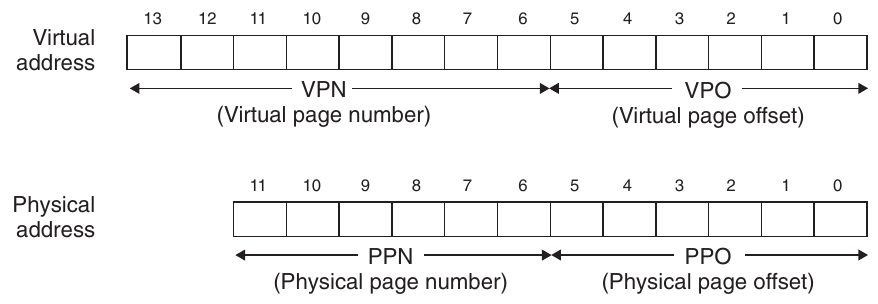

**Hình 9.19 Addressing cho hệ thống bộ nhớ nhỏ. Giả định virtual address 14-bit (n = 14), physical address 12-bit (m = 12) và page 64-byte (P = 64).**

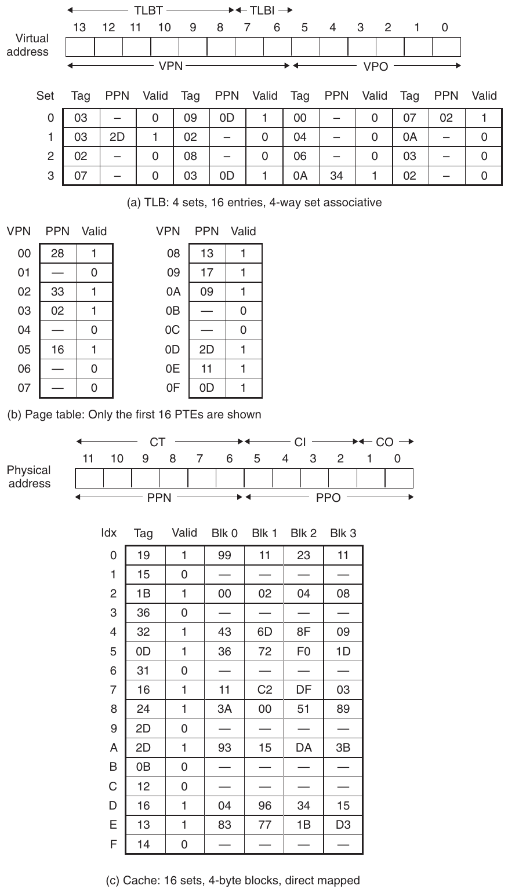

**Hình 9.20 TLB, page table và cache cho hệ thống bộ nhớ nhỏ. Mọi giá trị trong TLB, page table và cache đều ở dạng hexadecimal.**

TLB. TLB dùng virtual address thông qua các bit VPN. Vì TLB có bốn set, 2 bit low-order của VPN làm set index (TLBI). 6 bit high-order còn lại làm tag (TLBT), phân biệt các VPN khác nhau có thể ánh xạ tới cùng TLB set.

Page table. Page table có thiết kế single-level với tổng cộng 2<sup>8</sup> = 256 page table entry (PTE). Tuy nhiên, chúng ta chỉ quan tâm 16 entry đầu tiên. Để tiện, mỗi PTE được gắn nhãn VPN dùng làm index tới nó; nhưng hãy nhớ VPN này không thuộc page table và không được lưu trong bộ nhớ. Ngoài ra, chú ý PPN của mỗi PTE invalid được biểu thị bằng dấu gạch ngang để nhấn mạnh rằng các giá trị bit có thể được lưu ở đó không có ý nghĩa.

Cache. Cache direct-mapped được định địa chỉ bởi các field trong physical address. Vì mỗi block có 4 byte, 2 bit low-order của physical address làm block offset (CO). Vì có 16 set, 4 bit tiếp theo làm set index (CI). 6 bit còn lại làm tag (CT).

Với thiết lập ban đầu này, hãy xem điều xảy ra khi CPU thực thi load instruction đọc byte tại địa chỉ 0x03d4. (Nhớ rằng CPU giả định của chúng ta đọc word 1-byte thay vì 4-byte.) Khi bắt đầu mô phỏng thủ công, việc viết ra các bit virtual address, nhận diện field cần dùng và xác định giá trị hex của chúng rất hữu ích. Phần cứng thực hiện nhiệm vụ tương tự khi giải mã địa chỉ.

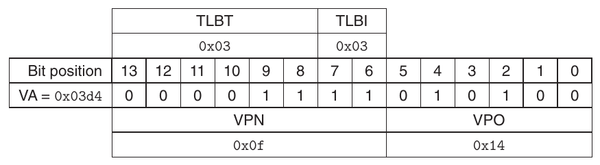

Đầu tiên, MMU trích VPN (0x0F) từ virtual address và kiểm tra TLB xem đã cache bản sao PTE 0x0F từ memory reference trước hay chưa. TLB trích TLB index (0x03) và TLB tag (0x3) từ VPN, hit với một entry hợp lệ khớp ở vị trí thứ hai của set 0x3, rồi trả cached PPN (0x0D) về MMU.

Nếu TLB miss, MMU cần fetch PTE từ main memory. Tuy nhiên, trong trường hợp này chúng ta may mắn có TLB hit. MMU hiện có mọi thứ cần để tạo physical address. Nó nối PPN (0x0D) từ PTE với VPO (0x14) từ virtual address, tạo physical address (0x354).

Tiếp theo, MMU gửi physical address tới cache, trích cache offset CO (0x0), cache set index CI (0x5) và cache tag CT (0x0D) từ physical address.

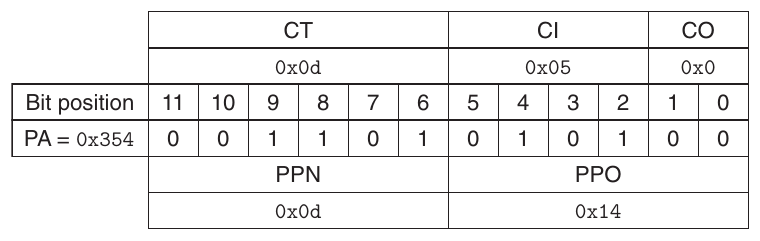

Vì tag trong set 0x5 khớp CT, cache phát hiện hit, đọc data byte (0x36) tại offset CO và trả về MMU, rồi MMU chuyển về CPU.

Các đường đi khác qua quá trình translation cũng có thể xảy ra. Ví dụ, nếu TLB miss, MMU phải fetch PPN từ PTE trong page table. Nếu PTE thu được invalid, có page fault và kernel phải page in page thích hợp rồi chạy lại load instruction. Khả năng khác là PTE valid nhưng memory block cần thiết miss trong cache.

#### Bài tập thực hành 9.4 (lời giải trang 917)

Chỉ ra cách hệ thống bộ nhớ ví dụ trong Mục 9.6.4 chuyển virtual address thành physical address và truy cập cache. Với virtual address cho trước, chỉ ra TLB entry được truy cập, physical address và giá trị cache byte trả về. Cho biết TLB có miss không, page fault có xảy ra không và cache miss có xảy ra không. Nếu cache miss, điền “—” cho “Cache byte trả về”. Nếu page fault, điền “—” cho “PPN” và để trống phần C, D.

Virtual address: 0x03d7

A. Định dạng virtual address

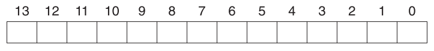

B. Address translation

| Tham số | Giá trị |
|---|---|
| VPN | ______ |
| TLB index | ______ |
| TLB tag | ______ |
| TLB hit? (Y/N) | ______ |
| Page fault? (Y/N) | ______ |
| PPN | ______ |

C. Định dạng physical address

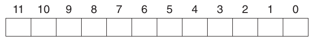

D. Physical memory reference

| Tham số | Giá trị |
|---|---|
| Byte offset | ______ |
| Cache index | ______ |
| Cache tag | ______ |
| Cache hit? (Y/N) | ______ |
| Cache byte trả về | ______ |

## 9.7 Nghiên cứu trường hợp: Hệ thống bộ nhớ Intel Core i7/Linux

Chúng ta kết thúc phần thảo luận cơ chế virtual memory bằng nghiên cứu hệ thống thực tế: Intel Core i7 chạy Linux. Mặc dù Haswell microarchitecture bên dưới cho phép virtual address space và physical address space 64-bit đầy đủ, các triển khai Core i7 hiện tại (và trong tương lai gần có thể dự đoán) hỗ trợ virtual address space 48-bit (256 TB) và physical address space 52-bit (4 PB), cùng compatibility mode hỗ trợ virtual address space và physical address space 32-bit (4 GB).

Hình 9.21 nêu các điểm nổi bật của hệ thống bộ nhớ Core i7. Processor package (chip) gồm bốn core, L3 cache lớn dùng chung cho mọi core và DDR3 memory controller. Mỗi core chứa hệ thống phân cấp TLB, hệ thống phân cấp data cache và instruction cache, cùng tập liên kết point-to-point nhanh dựa trên công nghệ QuickPath để giao tiếp trực tiếp với core khác và I/O bridge bên ngoài. TLB dùng virtual address và là 4-way set associative. Cache L1, L2 và L3 dùng physical address, với block size 64 byte. L1 và L2 là 8-way set associative, còn L3 là 16-way set associative. Page size có thể được cấu hình tại start-up là 4 KB hoặc 4 MB. Linux dùng page 4 KB.

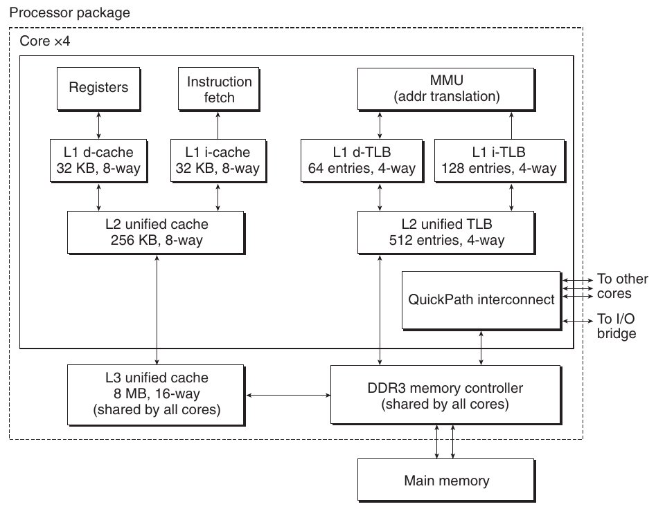

**Hình 9.21 Hệ thống bộ nhớ Core i7.**

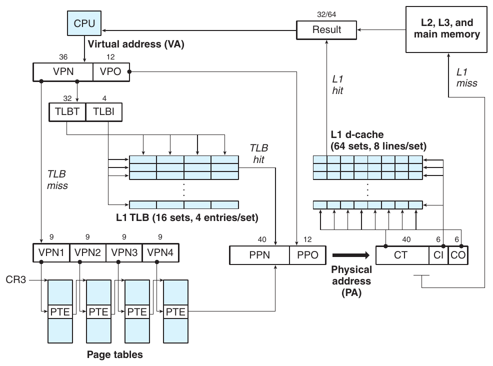

**Hình 9.22 Tổng kết address translation Core i7. Để đơn giản, không thể hiện i-caches, i-TLB và L2 unified TLB.**

### 9.7.1 Address translation Core i7

Hình 9.22 tóm tắt toàn bộ quá trình address translation Core i7, từ lúc CPU tạo virtual address đến khi data word tới từ bộ nhớ. Core i7 dùng hệ thống phân cấp page table four-level. Mỗi process có hệ thống page table riêng. Khi Linux process chạy, các page table gắn với page đã cấp phát đều memory-resident, mặc dù kiến trúc Core i7 cho phép swap in và swap out chúng. Control register CR3 chứa physical address của đầu page table level 1 (L1). Giá trị CR3 thuộc context của mỗi process và được khôi phục trong mỗi context switch.

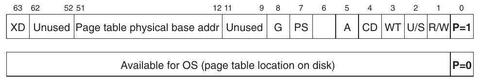

| Field | Mô tả |
|---|---|
| P | Child page table có trong physical memory (1) hay không (0). |
| R/W | Quyền truy cập Read-only hoặc read-write cho mọi page có thể tới được. |
| U/S | Quyền truy cập user mode hoặc supervisor (kernel) mode cho mọi page có thể tới được. |
| WT | Cache policy Write-through hoặc write-back cho child page table. |
| CD | Tắt hoặc bật caching cho child page table. |
| A | Reference bit (MMU đặt khi đọc và ghi, phần mềm xóa). |
| PS | Page size là 4 KB hoặc 4 MB (chỉ định nghĩa cho PTE level 1). |
| Base addr | 40 bit quan trọng nhất của physical base address của child page table. |
| XD | Tắt hoặc bật instruction fetch từ mọi page có thể tới được từ PTE này. |

**Hình 9.23 Định dạng page table entry level 1, level 2 và level 3. Mỗi entry tham chiếu child page table 4 KB.**

Hình 9.23 thể hiện định dạng entry trong page table level 1, level 2 hoặc level 3. Khi P = 1 (luôn đúng với Linux), address field chứa physical page number (PPN) 40-bit trỏ tới đầu page table thích hợp. Chú ý điều này áp đặt yêu cầu alignment 4 KB cho page table.

Hình 9.24 thể hiện định dạng entry trong page table level 4. Khi P = 1, address field chứa PPN 40-bit trỏ tới đầu một page trong physical memory. Một lần nữa, điều này áp đặt yêu cầu alignment 4 KB cho physical page.

PTE có ba permission bit kiểm soát truy cập page. Bit R/W xác định nội dung page là đọc/ghi hay read-only. Bit U/S xác định page có thể được truy cập trong user mode hay không, bảo vệ code và dữ liệu trong kernel của operating system khỏi user program. Bit XD (execute disable), được giới thiệu trong hệ thống 64-bit, có thể dùng để tắt instruction fetch từ từng memory page. Đây là tính năng mới quan trọng cho phép kernel giảm nguy cơ buffer overflow attack bằng cách giới hạn thực thi trong code segment read-only.

Khi MMU chuyển đổi mỗi virtual address, nó còn cập nhật hai bit khác mà page fault handler của kernel có thể dùng. MMU đặt bit A, gọi là reference bit, mỗi khi page được truy cập. Kernel có thể dùng reference bit để triển khai page replacement algorithm. MMU đặt bit D, hay dirty bit, mỗi khi page được ghi. Page đã bị sửa đôi khi gọi là dirty page. Dirty bit cho kernel biết có phải ghi victim page trở lại trước khi sao chép replacement page vào hay không. Kernel có thể gọi instruction kernel-mode đặc biệt để xóa reference bit hoặc dirty bit.

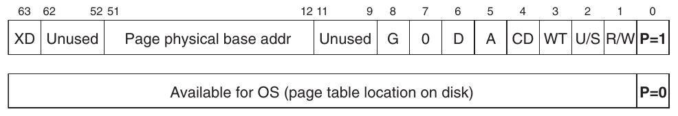

| Field | Mô tả |
|---|---|
| P | Child page có trong physical memory (1) hay không (0). |
| R/W | Quyền truy cập Read-only hoặc đọc/ghi cho child page. |
| U/S | Quyền truy cập user mode hoặc supervisor mode (kernel mode) cho child page. |
| WT | Cache policy Write-through hoặc write-back cho child page. |
| CD | Tắt hoặc bật cache. |
| A | Reference bit (MMU đặt khi đọc và ghi, phần mềm xóa). |
| D | Dirty bit (MMU đặt khi ghi, phần mềm xóa). |
| G | Global page (không evict khỏi TLB khi task switch). |
| Base addr | 40 bit quan trọng nhất của physical base address của child page. |
| XD | Tắt hoặc bật instruction fetch từ child page. |

**Hình 9.24 Định dạng page table entry level 4. Mỗi entry tham chiếu child page 4 KB.**

Hình 9.25 thể hiện cách Core i7 MMU dùng bốn level page table để chuyển virtual address thành physical address. VPN 36-bit được chia thành bốn khối 9-bit, mỗi khối được dùng làm offset vào page table. Register CR3 chứa physical address của L1 page table. VPN 1 cung cấp offset tới L1 PTE, chứa base address của L2 page table. VPN 2 cung cấp offset tới L2 PTE, và cứ như vậy.

### 9.7.2 Hệ thống virtual memory Linux

Hệ thống virtual memory đòi hỏi phối hợp chặt chẽ giữa phần cứng và kernel. Chi tiết khác nhau giữa các phiên bản, và mô tả đầy đủ nằm ngoài phạm vi sách. Tuy nhiên, mục tiêu ở đây là mô tả đủ về hệ thống virtual memory Linux để bạn hình dung cách operating system thực tế tổ chức virtual memory và xử lý page fault.

Linux duy trì virtual address space riêng cho mỗi process theo dạng Hình 9.26. Chúng ta đã thấy hình này nhiều lần, với các segment quen thuộc: code, data, heap, shared library và stack. Bây giờ đã hiểu address translation, chúng ta có thể bổ sung chi tiết về kernel virtual memory nằm trên user stack.

Kernel virtual memory chứa code và data structure trong kernel. Một số vùng kernel virtual memory được ánh xạ tới physical page dùng chung cho mọi process. Ví dụ, mỗi process dùng chung code và global data structure của kernel. Điều thú vị là Linux còn ánh xạ tập virtual page liên tiếp (có kích thước bằng tổng dung lượng DRAM của hệ thống) tới tập physical page liên tiếp tương ứng. Điều này cung cấp cách thuận tiện để kernel truy cập vị trí cụ thể bất kỳ trong physical memory—ví dụ, khi cần truy cập page table hoặc thực hiện thao tác I/O memory-mapped trên thiết bị được ánh xạ tới vị trí physical memory cụ thể.

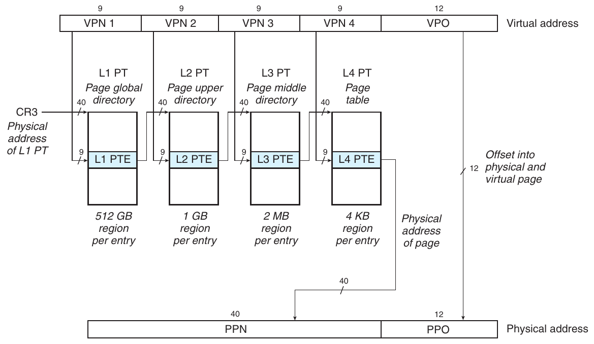

**Hình 9.25 Core i7 page table translation. PT: page table; PTE: page table entry; VPN: virtual page number; VPO: virtual page offset; PPN: physical page number; PPO: physical page offset. Tên Linux cho bốn level page table cũng được thể hiện.**

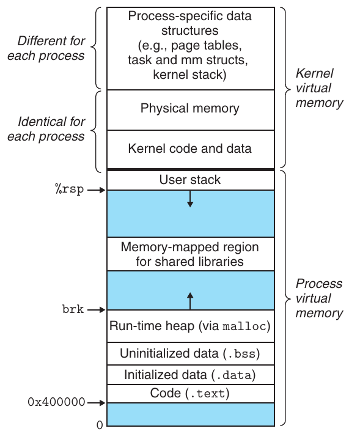

**Hình 9.26 Virtual memory của Linux process.**

#### Thông tin thêm: Tối ưu address translation

Trong phần thảo luận address translation, chúng ta mô tả quá trình two-step tuần tự, trong đó MMU (1) chuyển virtual address thành physical address rồi (2) chuyển physical address tới L1 cache. Tuy nhiên, triển khai phần cứng thực tế dùng một mẹo hay cho phép các bước chồng lấn một phần, tăng tốc truy cập L1 cache. Ví dụ, virtual address trên Core i7 với page 4 KB có 12 bit VPO, giống hệt 12 bit PPO trong physical address tương ứng. Vì L1 cache dùng physical address, 8-way set associative có 64 set và cache block 64-byte, mỗi physical address có 6 (log<sub>2</sub> 64) cache offset bit và 6 (log<sub>2</sub> 64) index bit. 12 bit này nằm vừa khít trong VPO 12-bit của virtual address, hoàn toàn không phải ngẫu nhiên! Khi CPU cần chuyển virtual address, nó gửi VPN tới MMU và VPO tới L1 cache. Trong khi MMU yêu cầu page table entry từ TLB, L1 cache dùng các bit VPO để tìm set thích hợp và đọc tám tag cùng data word tương ứng trong set đó. Khi MMU nhận PPN từ TLB, cache đã sẵn sàng thử so khớp PPN với một trong tám tag.

Những vùng khác của kernel virtual memory chứa dữ liệu khác nhau cho mỗi process. Ví dụ gồm page table, stack mà kernel dùng khi thực thi code trong context của process và các data structure theo dõi tổ chức hiện tại của virtual address space.

### Virtual Memory Area trong Linux

Linux tổ chức virtual memory thành tập hợp area (còn gọi là segment). Area là khối liên tiếp của virtual memory hiện có (đã cấp phát) có các page liên quan theo một cách nào đó. Ví dụ, code segment, data segment, heap, shared library segment và user stack đều là area riêng biệt. Mỗi virtual page hiện có nằm trong một area, và virtual page không thuộc area nào thì không tồn tại và không thể được process tham chiếu. Khái niệm area quan trọng vì cho phép virtual address space có khoảng trống. Kernel không theo dõi virtual page không tồn tại, và page như vậy không tiêu thụ tài nguyên bổ sung trong bộ nhớ, trên đĩa hoặc trong chính kernel.

Hình 9.27 làm nổi bật các cấu trúc dữ liệu kernel theo dõi virtual memory area trong process. Kernel duy trì task structure riêng (task_struct trong source code) cho mỗi process trong hệ thống. Các phần tử task structure chứa hoặc trỏ tới mọi thông tin kernel cần để chạy process (ví dụ, PID, pointer tới user stack, tên executable object file và program counter).

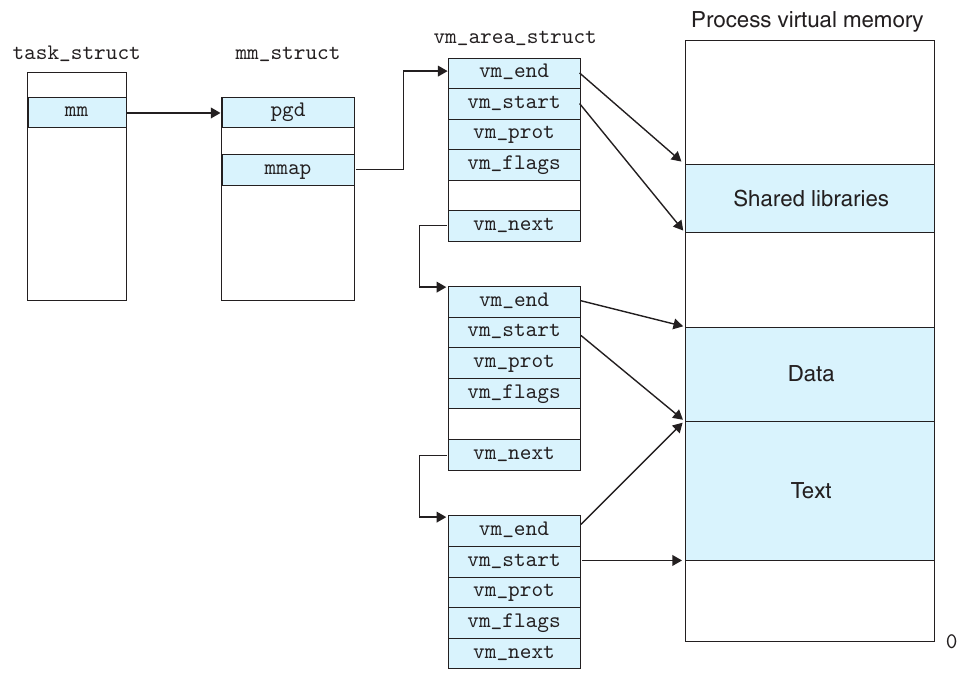

**Hình 9.27 Cách Linux tổ chức virtual memory.**

Một entry trong task structure trỏ tới mm_struct mô tả trạng thái hiện tại của virtual memory. Hai field chúng ta quan tâm là pgd, trỏ tới đầu bảng level 1 (page global directory), và mmap, trỏ tới danh sách vm_area_struct (area struct), mỗi struct mô tả một area của virtual address space hiện tại. Khi kernel chạy process này, nó lưu pgd trong control register CR3.

Trong phạm vi này, area struct của một area cụ thể chứa các field sau:

fvm_start. Trỏ tới đầu area.

vm_end. Trỏ tới cuối area.

vm_prot. Mô tả quyền đọc/ghi của mọi page trong area.

vm_flags. Mô tả (cùng các thông tin khác) các page trong area dùng chung với process khác hay riêng cho process này.

vm_next. Trỏ tới area struct tiếp theo trong danh sách.

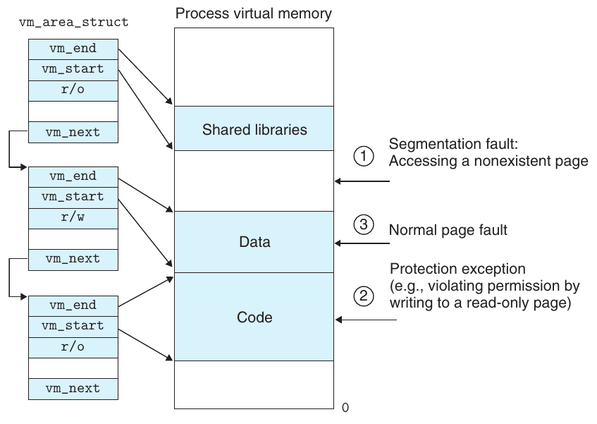

**Hình 9.28 Xử lý page fault trong Linux.**

### Xử lý page fault exception trong Linux

Giả sử MMU kích hoạt page fault khi thử chuyển một virtual address A. Exception chuyển quyền điều khiển tới page fault handler của kernel, rồi thực hiện các bước sau:

1. Virtual address A có hợp lệ không? Nói cách khác, A có nằm trong area do một area struct định nghĩa không? Để trả lời, fault handler tìm trong danh sách area struct, so sánh A với vm_start và vm_end của mỗi area struct. Nếu instruction không hợp lệ, fault handler kích hoạt segmentation fault để kết thúc process. Tình huống này được gắn nhãn “1” trong Hình 9.28.

   Vì process có thể tạo số lượng tùy ý virtual memory area mới (bằng hàm mmap được mô tả ở mục tiếp theo), tìm tuần tự trong danh sách area struct có thể rất tốn kém. Vì vậy, trong thực tế Linux đặt thêm một cây lên danh sách bằng một số field không được thể hiện và thực hiện tìm kiếm trên cây này.

2. Truy cập bộ nhớ được thử có hợp lệ không? Nói cách khác, process có quyền đọc, ghi hoặc thực thi page trong area này không? Ví dụ, page fault có phải do store instruction thử ghi vào page read-only trong code segment? Page fault có phải do process chạy trong user mode thử đọc word từ kernel virtual memory? Nếu truy cập không hợp lệ, fault handler kích hoạt protection exception để kết thúc process. Tình huống này được gắn nhãn “2” trong Hình 9.28.

3. Lúc này, kernel biết page fault bắt nguồn từ thao tác hợp lệ trên virtual address hợp lệ. Nó xử lý fault bằng cách chọn victim page, swap out victim page nếu dirty, swap in page mới và cập nhật page table. Khi page fault handler trả về, CPU khởi động lại faulting instruction, gửi A tới MMU lần nữa. Lần này MMU chuyển A bình thường mà không tạo page fault.

## 9.8 Memory Mapping

Linux khởi tạo nội dung virtual memory area bằng cách gắn nó với một object trên đĩa, quá trình gọi là memory mapping. Area có thể được ánh xạ tới một trong hai loại object:

1. Regular file trong Linux file system: Area có thể được ánh xạ tới phần liên tiếp của regular disk file, như executable object file. Phần file được chia thành các phần page-size, mỗi phần chứa nội dung ban đầu của virtual page. Do demand paging, không virtual page nào thực sự được swap vào physical memory cho đến khi CPU chạm page lần đầu (tức phát virtual address nằm trong vùng address space của page đó). Nếu area lớn hơn phần file, area được đệm bằng các số không.

2. Anonymous file: Area cũng có thể được ánh xạ tới anonymous file do kernel tạo, chứa toàn số không nhị phân. Lần đầu CPU chạm virtual page trong area như vậy, kernel tìm victim page thích hợp trong physical memory, swap out nếu dirty, ghi đè victim page bằng số không nhị phân rồi cập nhật page table để đánh dấu page resident. Chú ý không dữ liệu nào thực sự được truyền giữa đĩa và bộ nhớ. Vì vậy, page trong area ánh xạ tới anonymous file đôi khi được gọi là page demand-zero.

Trong cả hai trường hợp, sau khi virtual page được khởi tạo, nó được swap qua lại với swap file đặc biệt do kernel duy trì. Swap file còn gọi là swap space hoặc swap area. Điểm quan trọng cần nhận ra là tại bất kỳ thời điểm nào, swap space giới hạn tổng lượng virtual page có thể được các process hiện đang chạy cấp phát.

### 9.8.1 Xem lại shared object

Ý tưởng memory mapping bắt nguồn từ nhận xét thông minh rằng nếu hệ thống virtual memory được tích hợp vào file system thông thường, nó có thể cung cấp cách đơn giản và hiệu quả để load chương trình cùng dữ liệu vào bộ nhớ.

Như đã thấy, process abstraction hứa hẹn cung cấp cho mỗi process virtual address space riêng được bảo vệ khỏi việc đọc hoặc ghi sai của process khác. Tuy nhiên, nhiều process có code area read-only giống hệt nhau. Ví dụ, mỗi process chạy chương trình Linux shell bash có cùng code area. Hơn nữa, nhiều chương trình cần truy cập các bản sao giống hệt của code thư viện run-time read-only. Ví dụ, mọi chương trình C cần hàm từ thư viện C chuẩn như printf. Sẽ cực kỳ lãng phí nếu mỗi process giữ bản sao trùng lặp của code thường dùng này trong physical memory. May thay, memory mapping cung cấp cơ chế rõ ràng để kiểm soát cách nhiều process dùng chung object.

Object có thể được ánh xạ vào virtual memory area dưới dạng shared object hoặc private object. Nếu process ánh xạ shared object vào một area của virtual address space, mọi thao tác ghi vào area đó đều được process khác cũng đã ánh xạ shared object vào virtual memory của mình nhìn thấy. Hơn nữa, thay đổi còn được phản ánh trong object gốc trên đĩa.

Ngược lại, thay đổi trên area ánh xạ tới private object không được process khác nhìn thấy, và mọi thao tác ghi vào area không được phản ánh trở lại object trên đĩa. Virtual memory area có shared object được ánh xạ vào thường gọi là shared area. Tương tự với private area.

Giả sử process 1 ánh xạ shared object vào một area của virtual memory như Hình 9.29(a). Bây giờ giả sử process 2 ánh xạ cùng shared object vào address space (không nhất thiết cùng virtual address như process 1), như Hình 9.29(b).

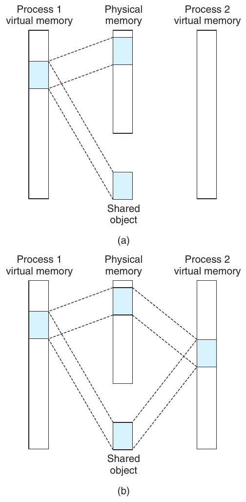

**Hình 9.29 Shared object. (a) Sau khi process 1 ánh xạ shared object. (b) Sau khi process 2 ánh xạ cùng shared object. (Chú ý physical page không nhất thiết liên tiếp.)**

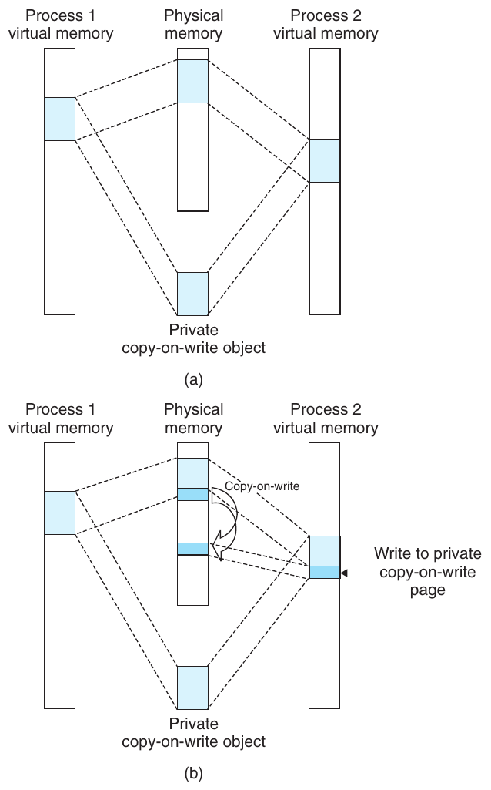

**Hình 9.30 Private object copy-on-write. (a) Sau khi cả hai process ánh xạ private object copy-on-write. (b) Sau khi process 2 ghi vào page trong private area.**

Vì mỗi object có filename duy nhất, kernel có thể nhanh chóng xác định process 1 đã ánh xạ object này và trỏ page table entry trong process 2 tới physical page thích hợp. Điểm then chốt là chỉ cần lưu một bản sao shared object trong physical memory, dù object được ánh xạ vào nhiều shared area. Để thuận tiện, chúng ta thể hiện physical page liên tiếp, nhưng tất nhiên nhìn chung không phải vậy.

Private object được ánh xạ vào virtual memory bằng kỹ thuật thông minh gọi là copy-on-write. Private object bắt đầu giống hệt shared object, với một bản sao duy nhất lưu trong physical memory. Ví dụ, Hình 9.30(a) thể hiện hai process ánh xạ private object vào những area khác nhau của virtual memory nhưng dùng chung một physical copy. Với mỗi process ánh xạ private object, page table entry của private area tương ứng được đánh dấu read-only, và area struct được đánh dấu private copy-on-write. Miễn cả hai process không thử ghi vào private area tương ứng, chúng tiếp tục dùng chung một bản sao object trong physical memory. Tuy nhiên, ngay khi process thử ghi vào page trong private area, phép ghi kích hoạt protection fault.

Khi fault handler nhận thấy protection exception do process thử ghi vào page trong private area copy-on-write, nó tạo bản sao page mới trong physical memory, cập nhật page table entry để trỏ tới bản sao mới rồi khôi phục quyền ghi page, như Hình 9.30(b). Khi fault handler trả về, CPU re-executes phép ghi, lúc này diễn ra bình thường trên page mới tạo.

Bằng cách hoãn sao chép page trong private object đến thời điểm muộn nhất có thể, copy-on-write sử dụng hiệu quả nhất physical memory khan hiếm.

### 9.8.2 Xem lại hàm fork

Bây giờ đã hiểu virtual memory và memory mapping, chúng ta có thể hình dung rõ cách fork tạo process mới có virtual address space độc lập.

Khi process hiện tại gọi fork, kernel tạo các data structure cho process mới và gán PID duy nhất. Để tạo virtual memory cho process mới, nó sao chép chính xác mm_struct, area struct và page table của process hiện tại. Nó đánh dấu mỗi page trong cả hai process là read-only và đánh dấu mỗi area struct trong cả hai process là private copy-on-write.

Khi fork trả về trong process mới, process này có bản sao chính xác virtual memory tại thời điểm fork được gọi. Khi một trong hai process thực hiện thao tác ghi sau đó, cơ chế copy-on-write tạo page mới, qua đó bảo toàn abstraction private address space cho mỗi process.

### 9.8.3 Xem lại hàm execve

Virtual memory và memory mapping còn giữ vai trò then chốt trong quá trình load chương trình vào bộ nhớ. Bây giờ đã hiểu các khái niệm này, chúng ta có thể hiểu cách execve thực sự load và thực thi chương trình. Giả sử chương trình chạy trong process hiện tại gọi như sau:

```
execve("a.out", NULL, NULL);
```

Như đã học trong Chương 8, hàm execve load và chạy chương trình chứa trong executable object file a.out bên trong process hiện tại, thực chất thay thế chương trình hiện tại bằng chương trình a.out. Load và chạy a.out đòi hỏi các bước sau:

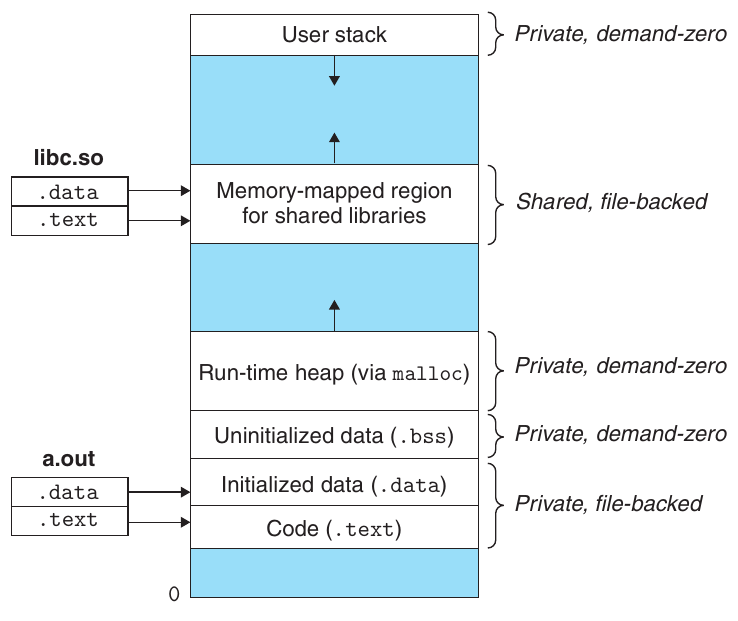

**Hình 9.31 Cách loader ánh xạ các area của user address space.**

1. Xóa user area hiện có. Xóa area struct hiện có trong phần user của virtual address của process hiện tại.

2. Ánh xạ private area. Tạo area struct mới cho các vùng code, data, bss và stack của chương trình mới. Mọi area mới đều private copy-on-write. Code area và data area được ánh xạ tới section .text và .data của file a.out. Area bss là demand-zero, ánh xạ tới anonymous file có kích thước chứa trong a.out. Stack area và heap area cũng demand-zero, ban đầu dài bằng không. Hình 9.31 tóm tắt các ánh xạ khác nhau của private area.

3. Ánh xạ shared area. Nếu chương trình a.out được link với shared object như thư viện C chuẩn libc.so, các object này được link động vào chương trình rồi ánh xạ vào shared region của user virtual address space.

4. Đặt program counter (PC). Việc cuối cùng execve thực hiện là đặt program counter trong context process hiện tại trỏ tới entry point trong code area.

Lần tiếp theo process được schedule, nó bắt đầu thực thi từ entry point. Linux sẽ swap in code page và data page khi cần.

### 9.8.4 Memory mapping User-Level bằng hàm mmap

Linux process có thể dùng mmap để tạo virtual memory area mới và ánh xạ object vào các area này.

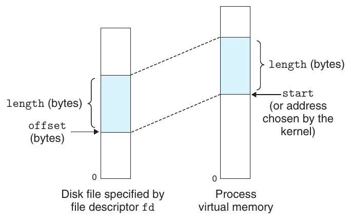

**Hình 9.32 Diễn giải trực quan các đối số mmap.**

```
#include <unistd.h>
#include <sys/mman.h>

void  *mmap(void *start, size_t length, int prot, int flags,
            int fd, off_t offset);
```

Trả về: pointer tới mapped area nếu thành công, MAP_FAILED (−1) nếu có lỗi

Hàm mmap yêu cầu kernel tạo virtual memory area mới, ưu tiên bắt đầu tại địa chỉ start, và ánh xạ khối liên tiếp của object do file descriptor fd chỉ định vào area mới. Khối object liên tiếp có kích thước length byte và bắt đầu tại offset byte tính từ đầu file. Địa chỉ start chỉ là gợi ý và thường được chỉ định là NULL. Trong phạm vi này, chúng ta luôn giả định start là NULL. Hình 9.32 minh họa ý nghĩa các đối số.

Đối số prot chứa các bit mô tả quyền truy cập virtual memory area vừa ánh xạ (tức các bit vm_prot trong area struct tương ứng).

PROT_EXEC. Page trong area chứa instruction có thể được CPU thực thi.

PROT_READ. Page trong area có thể được đọc.

PROT_WRITE. Page trong area có thể được ghi.

PROT_NONE. Page trong area không thể được truy cập.

Đối số flags gồm các bit mô tả loại object được ánh xạ. Nếu flag bit MAP_ANON được đặt, backing store là anonymous object và virtual page tương ứng là demand-zero. MAP_PRIVATE biểu thị private object copy-on-write, còn MAP_SHARED biểu thị shared object. Ví dụ,

```
bufp = Mmap(NULL, size, PROT_READ, MAP_PRIVATE|MAP_ANON, 0, 0);
```

yêu cầu kernel tạo virtual memory area mới read-only, private, demand-zero chứa size byte. Nếu lời gọi thành công, bufp chứa địa chỉ area mới.

Hàm munmap xóa các vùng virtual memory:

```
#include <unistd.h>
#include <sys/mman.h>

int munmap(void *start, size_t length);
```

Trả về: 0 nếu thành công, −1 nếu có lỗi

Hàm munmap xóa area bắt đầu tại virtual address start và gồm length byte tiếp theo. Các reference sau đó tới vùng đã xóa dẫn đến segmentation fault.

#### Bài tập thực hành 9.5 (lời giải trang 918)

Viết chương trình C mmapcopy.c dùng mmap để sao chép disk file arbitrary-size tới stdout. Tên input file cần được truyền làm đối số command-line.

## 9.9 Dynamic Memory Allocation

Mặc dù hoàn toàn có thể dùng hàm low-level mmap và munmap để tạo và xóa virtual memory area, lập trình viên C thường thấy thuận tiện và portable hơn khi dùng dynamic memory allocator để lấy thêm virtual memory tại run time.

Dynamic memory allocator duy trì một area của virtual memory process gọi là heap (Hình 9.33). Chi tiết khác nhau giữa các hệ thống, nhưng không mất tính tổng quát, chúng ta giả định heap là vùng bộ nhớ demand-zero bắt đầu ngay sau uninitialized data area và tăng trưởng lên trên (về địa chỉ cao hơn). Với mỗi process, kernel duy trì variable brk (phát âm “break”) trỏ tới đỉnh heap.

Allocator duy trì heap như tập hợp block various-size. Mỗi block là khối virtual memory liên tiếp, ở trạng thái allocated hoặc free. Block allocated đã được dành riêng tường minh cho ứng dụng sử dụng. Block free sẵn sàng để cấp phát. Block free giữ trạng thái free đến khi được ứng dụng cấp phát tường minh. Block allocated giữ trạng thái allocated đến khi được giải phóng, hoặc tường minh bởi ứng dụng hoặc ngầm bởi chính memory allocator.

Allocator có hai kiểu cơ bản. Cả hai yêu cầu ứng dụng cấp phát block tường minh. Chúng khác nhau ở thực thể chịu trách nhiệm giải phóng block đã cấp phát.

- Explicit allocator yêu cầu ứng dụng giải phóng tường minh mọi block đã cấp phát. Ví dụ, thư viện C chuẩn cung cấp explicit allocator gọi là gói malloc. Chương trình C cấp phát block bằng hàm malloc và giải phóng block bằng hàm free. Các lời gọi new và delete trong C++ tương đương.

- Ngược lại, implicit allocator yêu cầu allocator phát hiện khi block đã cấp phát không còn được chương trình sử dụng rồi giải phóng. Implicit allocator còn gọi là garbage collector, và quá trình tự động giải phóng block đã cấp phát không còn dùng gọi là garbage collection. Ví dụ, ngôn ngữ higher-level như Lisp, ML và Java dựa vào garbage collection để giải phóng block đã cấp phát.

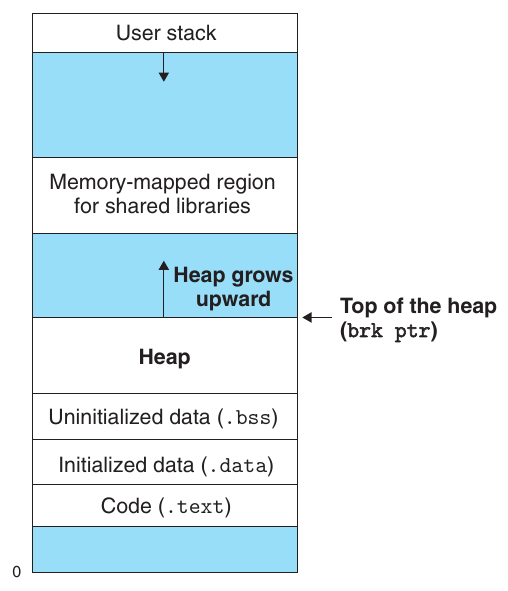

**Hình 9.33 Heap.**

Phần còn lại của mục này thảo luận thiết kế và triển khai explicit allocator. Chúng ta sẽ thảo luận implicit allocator trong Mục 9.10. Để cụ thể, phần thảo luận tập trung vào allocator quản lý heap memory. Tuy nhiên, cần biết memory allocation là ý tưởng tổng quát xuất hiện trong nhiều bối cảnh. Ví dụ, ứng dụng thao tác graph chuyên sâu thường dùng standard allocator để lấy block virtual memory lớn rồi dùng allocator application-specific quản lý bộ nhớ trong block khi các node graph được tạo và hủy.

### 9.9.1 Hàm malloc và free

Thư viện C chuẩn cung cấp explicit allocator gọi là gói malloc. Chương trình cấp phát block từ heap bằng hàm malloc.

```
#include <stdlib.h>

void *malloc(size_t size);
```

Trả về: pointer tới block đã cấp phát nếu thành công, NULL nếu có lỗi

#### Thông tin thêm: Một word lớn bao nhiêu?

Nhớ lại từ phần machine code trong Chương 3 rằng Intel gọi object 4-byte là double word. Tuy nhiên, trong toàn mục này, chúng ta giả định word là object 4-byte và double word là object 8-byte, phù hợp thuật ngữ thông thường.

Hàm malloc trả pointer tới block bộ nhớ ít nhất size byte, được alignment thích hợp cho mọi loại data object có thể chứa trong block. Trong thực tế, alignment phụ thuộc code được compile để chạy trong mode 32-bit (gcc -m32) hay mode 64-bit (mặc định). Trong mode 32-bit, malloc trả block có địa chỉ luôn là bội của 8. Trong mode 64-bit, địa chỉ luôn là bội của 16.

Nếu malloc gặp vấn đề (ví dụ, chương trình yêu cầu block bộ nhớ lớn hơn virtual memory sẵn có), nó trả NULL và đặt errno. Malloc không khởi tạo bộ nhớ trả về. Ứng dụng muốn dynamic memory đã khởi tạo có thể dùng calloc, một wrapper mỏng quanh malloc khởi tạo bộ nhớ đã cấp phát bằng không. Ứng dụng muốn đổi kích thước block đã cấp phát trước đó có thể dùng realloc.

Dynamic memory allocator như malloc có thể cấp phát hoặc giải phóng heap memory tường minh bằng mmap và munmap, hoặc dùng hàm sbrk:

```
#include <unistd.h>

void *sbrk(intptr_t incr);
```

Trả về: brk pointer cũ nếu thành công, −1 nếu có lỗi

Hàm sbrk tăng hoặc giảm heap bằng cách cộng incr vào brk pointer của kernel. Nếu thành công, nó trả giá trị brk cũ; nếu không, trả −1 và đặt errno thành ENOMEM. Nếu incr bằng không, sbrk trả giá trị brk hiện tại. Gọi sbrk với incr âm là hợp lệ nhưng khó xử lý vì giá trị trả về (brk cũ) trỏ tới vị trí cách đỉnh heap mới abs(incr) byte về phía sau.

Chương trình giải phóng heap block đã cấp phát bằng hàm free.

```
#include <stdlib.h>

void free(void *ptr);
```

Trả về: không có gì

Đối số ptr phải trỏ tới đầu block đã cấp phát từ malloc, calloc hoặc realloc. Nếu không, hành vi free là undefined. Tệ hơn, vì không trả về gì, free không báo cho ứng dụng biết có vấn đề. Như sẽ thấy trong Mục 9.11, điều này có thể tạo lỗi run-time khó hiểu.

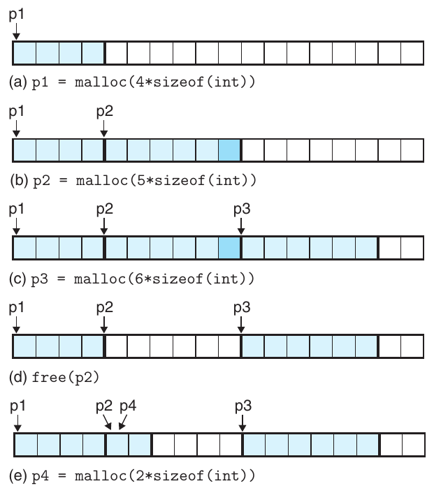

**Hình 9.34 Cấp phát và giải phóng block bằng malloc và free . Mỗi ô vuông tương ứng một word. Mỗi hình chữ nhật nét đậm tương ứng một block. Block allocated được tô màu. Vùng padding của block allocated có màu xanh đậm hơn. Block free không được tô màu. Địa chỉ heap tăng từ trái sang phải.**

Hình 9.34 thể hiện cách triển khai malloc và free có thể quản lý heap (rất) nhỏ gồm 16 word cho chương trình C. Mỗi ô biểu diễn word 4-byte. Hình chữ nhật heavy-lined tương ứng block allocated (tô màu) và block free (không tô màu). Ban đầu, heap gồm một free block 16-word double-word-aligned duy nhất.[^1]

Hình 9.34(a). Chương trình yêu cầu block four-word. Malloc đáp ứng bằng cách tách block four-word từ đầu free block và trả pointer tới word đầu tiên của block.

Hình 9.34(b). Chương trình yêu cầu block five-word. Malloc đáp ứng bằng cách cấp phát block six-word từ đầu free block. Trong ví dụ này, malloc đệm block thêm một word để giữ free block aligned trên ranh giới double-word.

Hình 9.34(c). Chương trình yêu cầu block six-word và malloc đáp ứng bằng cách tách block six-word từ free block.

Hình 9.34(d). Chương trình giải phóng block six-word đã cấp phát trong Hình 9.34(b). Chú ý sau khi free trả về, pointer p2 vẫn trỏ tới block đã giải phóng. Ứng dụng có trách nhiệm không dùng p2 lại cho đến khi được khởi tạo lại bằng lời gọi malloc mới.

Hình 9.34(e). Chương trình yêu cầu block two-word. Trong trường hợp này, malloc cấp phát một phần block đã giải phóng ở bước trước và trả pointer tới block mới.

### 9.9.2 Tại sao cần dynamic memory allocation?

Lý do quan trọng nhất chương trình dùng dynamic memory allocation là thường không biết kích thước một số data structure cho đến khi thực sự chạy. Ví dụ, giả sử được yêu cầu viết chương trình C đọc danh sách n số nguyên ASCII, mỗi dòng một số, từ stdin vào C array. Đầu vào gồm số nguyên n, theo sau bởi n số nguyên cần đọc và lưu vào array. Cách đơn giản nhất là định nghĩa array tĩnh với kích thước tối đa hard-coded:

```
 1   #include "csapp.h"
 2   #define MAXN 15213
 3
 4   int array[MAXN];
 5
 6   int main()
 7   {
 8       int i, n;
 9
10       scanf("%d", &n);
11       if (n > MAXN)
12           app_error("Input file too big");
13       for (i = 0; i < n; i++)
14           scanf("%d", &array[i]);
15       exit(0);
16   }
```

Cấp phát array với kích thước hard-coded như vậy thường không tốt. Giá trị MAXN tùy ý và không liên quan lượng virtual memory thực tế sẵn có trên máy. Hơn nữa, nếu người dùng muốn đọc file lớn hơn MAXN, cách duy nhất là compile lại chương trình với MAXN lớn hơn. Mặc dù không thành vấn đề trong ví dụ đơn giản này, giới hạn array hard-coded có thể trở thành ác mộng bảo trì cho sản phẩm phần mềm lớn có hàng triệu dòng code và nhiều người dùng.

Cách tốt hơn là cấp phát array động tại run time sau khi biết giá trị n. Với cách này, kích thước array tối đa chỉ bị giới hạn bởi lượng virtual memory sẵn có.

```
 1   #include "csapp.h"
 2
 3   int main()
 4   {
 5       int *array, i, n;
 6
 7       scanf("%d", &n);
 8       array = (int *)Malloc(n * sizeof(int));
 9       for (i = 0; i < n; i++)
10           scanf("%d", &array[i]);
11       free(array);
12       exit(0);
13   }
```

Dynamic memory allocation là kỹ thuật lập trình hữu ích và quan trọng. Tuy nhiên, để sử dụng allocator đúng và hiệu quả, lập trình viên cần hiểu cách chúng hoạt động. Chúng ta sẽ thảo luận một số lỗi nghiêm trọng do dùng allocator sai trong Mục 9.11.

### 9.9.3 Yêu cầu và mục tiêu của allocator

Explicit allocator phải hoạt động trong những ràng buộc khá nghiêm ngặt:

Xử lý dãy yêu cầu tùy ý. Ứng dụng có thể đưa ra dãy yêu cầu allocate và free tùy ý, với ràng buộc mỗi yêu cầu free phải tương ứng block hiện đã allocated từ yêu cầu allocate trước đó. Vì vậy, allocator không thể giả định thứ tự yêu cầu allocate và free. Ví dụ, không thể giả định mọi yêu cầu allocate đều đi kèm yêu cầu free tương ứng, hoặc các yêu cầu allocate và free tương ứng được lồng nhau.

Phản hồi yêu cầu ngay lập tức. Allocator phải phản hồi ngay yêu cầu allocate. Vì vậy, allocator không được sắp xếp lại hoặc buffer yêu cầu để cải thiện hiệu năng.

Chỉ sử dụng heap. Để allocator có khả năng mở rộng, mọi data structure nonscalar mà nó sử dụng phải được lưu ngay trong heap.

Align block (yêu cầu alignment). Allocator phải align block sao cho có thể chứa mọi loại data object.

Không sửa block allocated. Allocator chỉ được thao tác hoặc thay đổi free block. Đặc biệt, không được sửa hay di chuyển block sau khi đã allocated. Vì vậy, kỹ thuật như compaction các block allocated không được phép.

Trong những ràng buộc này, tác giả allocator cố đáp ứng các mục tiêu hiệu năng thường xung đột: tối đa throughput và memory utilization.

Mục tiêu 1: Tối đa throughput. Với một dãy n yêu cầu allocate và free

R<sub>0</sub>, R<sub>1</sub>, . . . , R<sub>k</sub>, . . . , R<sub>n−1</sub>

chúng ta muốn tối đa throughput của allocator, được định nghĩa là số yêu cầu hoàn tất trên mỗi đơn vị thời gian. Ví dụ, nếu allocator hoàn tất 500 yêu cầu allocate và 500 yêu cầu free trong 1 giây, throughput là 1,000 thao tác mỗi giây. Nhìn chung, có thể tối đa throughput bằng cách giảm thời gian trung bình đáp ứng yêu cầu allocate và free. Như sẽ thấy, không quá khó phát triển allocator có hiệu năng tương đối tốt, với thời gian chạy worst-case của yêu cầu allocate tuyến tính theo số free block và thời gian chạy yêu cầu free không đổi.

Mục tiêu 2: Tối đa memory utilization. Lập trình viên thiếu kinh nghiệm thường lầm tưởng virtual memory là tài nguyên vô hạn. Thực tế, tổng lượng virtual memory mọi process trong hệ thống cấp phát bị giới hạn bởi swap space trên đĩa. Lập trình viên giỏi biết virtual memory hữu hạn và phải được dùng hiệu quả. Điều này đặc biệt đúng với dynamic memory allocator có thể được yêu cầu cấp phát và giải phóng những block bộ nhớ lớn.

Có một số cách đặc trưng mức hiệu quả allocator sử dụng heap. Theo kinh nghiệm, chỉ số hữu ích nhất là peak utilization. Như trước, chúng ta có dãy n yêu cầu allocate và free

R<sub>0</sub>, R<sub>1</sub>, . . . , R<sub>k</sub>, . . . , R<sub>n−1</sub>

Nếu ứng dụng yêu cầu block p byte, block allocated thu được có payload p byte. Sau khi yêu cầu R<sub>k</sub> hoàn tất, gọi aggregate payload, ký hiệu P<sub>k</sub>, là tổng payload của các block hiện allocated, và H<sub>k</sub> là kích thước hiện tại của heap (đơn điệu không giảm).

Khi đó peak utilization trên k + 1 yêu cầu đầu tiên, ký hiệu U<sub>k</sub>, được cho bởi

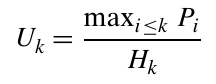

Mục tiêu allocator là tối đa peak utilization U<sub>n−1</sub> trên toàn dãy. Như sẽ thấy, có sự giằng co giữa tối đa throughput và utilization. Đặc biệt, dễ viết allocator tối đa throughput bằng cách hy sinh heap utilization. Một thách thức thú vị trong thiết kế allocator là tìm sự cân bằng thích hợp giữa hai mục tiêu.

#### Thông tin thêm: Nới lỏng giả định đơn điệu

Chúng ta có thể nới lỏng giả định đơn điệu không giảm trong định nghĩa U<sub>k</sub>, cho phép heap tăng và giảm bằng cách để H<sub>k</sub> là mức high-water mark trên k + 1 yêu cầu đầu tiên.

### 9.9.4 Fragmentation

Nguyên nhân chủ yếu khiến heap utilization kém là hiện tượng fragmentation, xảy ra khi bộ nhớ không được sử dụng lại không sẵn có để đáp ứng yêu cầu allocate. Có hai dạng: internal fragmentation và external fragmentation.

Internal fragmentation xảy ra khi block allocated lớn hơn payload. Điều này có thể do nhiều nguyên nhân. Ví dụ, triển khai allocator có thể áp đặt kích thước tối thiểu cho block allocated lớn hơn một số payload được yêu cầu. Hoặc như Hình 9.34(b), allocator tăng block size để đáp ứng ràng buộc alignment.

Internal fragmentation dễ định lượng. Nó đơn giản là tổng chênh lệch giữa kích thước block allocated và payload của chúng. Vì vậy, tại bất kỳ thời điểm nào, lượng internal fragmentation chỉ phụ thuộc mẫu yêu cầu trước đó và cách triển khai allocator.

External fragmentation xảy ra khi tổng free memory đủ đáp ứng yêu cầu allocate nhưng không free block riêng lẻ nào đủ lớn. Ví dụ, nếu yêu cầu trong Hình 9.34(e) là tám word thay vì hai, không thể đáp ứng mà không yêu cầu thêm virtual memory từ kernel, dù heap còn tám free word. Vấn đề là tám word này phân bố trên hai free block.

External fragmentation khó định lượng hơn internal fragmentation nhiều vì không chỉ phụ thuộc mẫu yêu cầu trước đó và triển khai allocator mà còn phụ thuộc mẫu yêu cầu tương lai. Ví dụ, giả sử sau k yêu cầu, mọi free block đều có kích thước đúng bốn word. Heap này có external fragmentation không? Câu trả lời phụ thuộc các yêu cầu tương lai. Nếu mọi yêu cầu allocate tương lai dành cho block không lớn hơn bốn word, không có external fragmentation. Ngược lại, nếu một hoặc nhiều yêu cầu đòi block lớn hơn bốn word, heap có external fragmentation.

Vì external fragmentation khó định lượng và không thể dự đoán, allocator thường sử dụng heuristic cố duy trì ít free block lớn thay vì nhiều free block nhỏ.

### 9.9.5 Vấn đề triển khai

Allocator đơn giản nhất có thể tưởng tượng tổ chức heap thành array byte lớn và pointer p ban đầu trỏ tới byte đầu tiên. Để cấp phát size byte, malloc lưu giá trị p hiện tại trên stack, tăng p thêm size rồi trả p cũ cho caller. Free chỉ trở về caller mà không làm gì.

Allocator đơn sơ này là điểm cực đoan trong không gian thiết kế. Vì mỗi malloc và free chỉ thực thi vài instruction, throughput cực kỳ tốt. Tuy nhiên, vì không bao giờ tái sử dụng block, memory utilization cực kỳ kém. Allocator thực tế cân bằng tốt hơn throughput và utilization phải xem xét các vấn đề sau:

Tổ chức free block. Theo dõi free block bằng cách nào?

Placement. Chọn free block thích hợp để đặt block mới allocated bằng cách nào?

Splitting. Sau khi đặt block mới allocated trong free block, xử lý phần còn lại của free block thế nào?

Coalescing. Xử lý block vừa được giải phóng thế nào?

Phần còn lại của mục này xem xét chi tiết các vấn đề trên. Vì kỹ thuật placement, splitting và coalescing cơ bản áp dụng cho nhiều cách tổ chức free block, chúng ta giới thiệu chúng trong bối cảnh cách tổ chức đơn giản gọi là implicit free list.

### 9.9.6 Implicit Free List

Mọi allocator thực tế cần data structure để phân biệt ranh giới block và phân biệt block allocated với block free. Phần lớn allocator nhúng thông tin ngay trong block. Một cách đơn giản được thể hiện trong Hình 9.35.

Trong trường hợp này, block gồm header one-word, payload và có thể thêm padding. Header mã hóa block size (gồm header và padding) cùng trạng thái allocated hay free. Nếu áp đặt ràng buộc alignment double-word, block size luôn là bội của 8 và 3 bit low-order của block size luôn bằng không. Vì vậy, chỉ cần lưu 29 bit high-order của block size, dành 3 bit còn lại mã hóa thông tin khác. Ở đây, chúng ta dùng bit ít quan trọng nhất (allocated bit) để chỉ block allocated hay free. Ví dụ, giả sử có block allocated kích thước 24 (0x18) byte. Khi đó header là

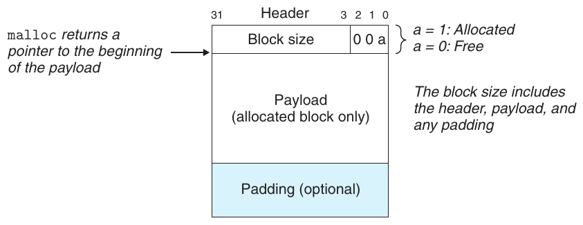

**Hình 9.35 Định dạng heap block đơn giản.**

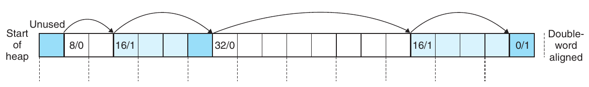

**Hình 9.36 Tổ chức heap bằng implicit free list. Block allocated được tô màu. Free block không tô màu. Header được gắn nhãn (size (byte)/allocated bit).**

```
0x00000018 | 0x1 = 0x00000019
```

Tương tự, free block kích thước 40 (0x28) byte có header

```
0x00000028 | 0x0 = 0x00000028
```

Sau header là payload mà ứng dụng yêu cầu khi gọi malloc. Sau payload là một khối padding không sử dụng, có kích thước tùy ý. Có một số lý do cần padding. Ví dụ, padding có thể là một phần trong chiến lược của allocator để chống external fragmentation. Hoặc nó có thể cần thiết để đáp ứng yêu cầu alignment.

Với định dạng block trong Hình 9.35, chúng ta có thể tổ chức heap thành dãy block allocated và free liên tiếp như Hình 9.36.

Chúng ta gọi cách tổ chức này là implicit free list vì free block được liên kết ngầm bằng size field trong header. Allocator có thể duyệt gián tiếp toàn bộ free block bằng cách duyệt mọi block trong heap. Chú ý cần một loại end block được đánh dấu đặc biệt—trong ví dụ này là header kết thúc có allocated bit được đặt và size bằng không. (Như sẽ thấy trong Mục 9.9.12, đặt allocated bit đơn giản hóa coalescing free block.)

Ưu điểm implicit free list là đơn giản. Nhược điểm đáng kể là chi phí mọi thao tác cần tìm kiếm free list, như đặt block allocated, tuyến tính theo tổng số block allocated và free trong heap.

Cần nhận ra yêu cầu alignment của hệ thống và lựa chọn định dạng block của allocator áp đặt minimum block size. Không block allocated hay free nào được nhỏ hơn mức tối thiểu này. Ví dụ, nếu giả định alignment double-word, kích thước mỗi block phải là bội của hai word (8 byte). Vì vậy, định dạng block trong Hình 9.35 tạo minimum block size hai word: một cho header, một để duy trì alignment. Ngay cả khi ứng dụng yêu cầu một byte, allocator vẫn tạo block two-word.

#### Bài tập thực hành 9.6 (lời giải trang 919)

Xác định block size và giá trị header thu được từ dãy yêu cầu malloc sau. Giả định: (1) Allocator duy trì alignment double-word và dùng implicit free list với định dạng block trong Hình 9.35. (2) Block size được làm tròn lên bội gần nhất của 8 byte.

| Yêu cầu | Block size (byte thập phân) | Block header (hex) |
|---|---|---|
| malloc(2) | ______ | ______ |
| malloc(9) | ______ | ______ |
| malloc(15) | ______ | ______ |
| malloc(20) | ______ | ______ |

### 9.9.7 Đặt block allocated

Khi ứng dụng yêu cầu block k byte, allocator tìm trong free list một free block đủ lớn chứa block được yêu cầu. Cách thực hiện tìm kiếm do placement policy quyết định. Một số policy phổ biến là first fit, next fit và best fit.

First fit tìm free list từ đầu và chọn free block đầu tiên vừa yêu cầu. Next fit tương tự first fit, nhưng thay vì bắt đầu mỗi lần tìm từ đầu danh sách, nó bắt đầu nơi lần tìm trước dừng lại. Best fit xét mọi free block và chọn block nhỏ nhất vừa yêu cầu.

Ưu điểm first fit là thường giữ lại free block lớn ở cuối danh sách. Nhược điểm là thường để lại các “mảnh vụn” free block nhỏ ở đầu danh sách, tăng thời gian tìm block lớn hơn. Next fit do Donald Knuth đề xuất đầu tiên thay first fit, dựa trên ý tưởng nếu lần trước tìm được free block vừa yêu cầu, khả năng cao lần sau cũng tìm được trong phần còn lại của block. Next fit có thể nhanh hơn first fit đáng kể, đặc biệt khi đầu danh sách có nhiều mảnh nhỏ. Tuy nhiên, một số nghiên cứu cho thấy next fit có memory utilization kém hơn first fit. Nghiên cứu cho thấy best fit nhìn chung có memory utilization tốt hơn cả first fit và next fit. Tuy nhiên, nhược điểm khi dùng best fit với tổ chức đơn giản như implicit free list là cần tìm toàn bộ heap. Sau này, chúng ta sẽ xem cách tổ chức segregated free list tinh vi hơn, xấp xỉ policy best-fit mà không tìm toàn heap.

### 9.9.8 Split free block

Sau khi tìm được free block vừa yêu cầu, allocator phải quyết định tiếp cấp phát bao nhiêu phần của free block. Một lựa chọn là dùng toàn bộ free block. Mặc dù đơn giản và nhanh, nhược điểm chính là tạo internal fragmentation. Nếu placement policy thường tạo độ vừa tốt, có thể chấp nhận thêm một ít internal fragmentation.

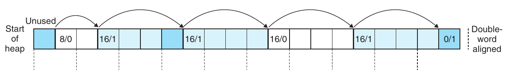

**Hình 9.37 Split free block để đáp ứng yêu cầu allocation three-word. Block allocated được tô màu. Free block không tô màu. Header được gắn nhãn (size (byte)/allocated bit).**

Tuy nhiên, nếu block không vừa sát, allocator thường chọn split free block thành hai phần. Phần đầu trở thành block allocated, phần còn lại trở thành free block mới. Hình 9.37 thể hiện cách allocator split free block eight-word trong Hình 9.36 để đáp ứng yêu cầu ba word heap memory của ứng dụng.

### 9.9.9 Lấy thêm heap memory

Điều gì xảy ra nếu allocator không tìm được block vừa với yêu cầu? Một lựa chọn là thử tạo các free block lớn hơn bằng cách hợp nhất (coalescing) những free block liền kề vật lý trong bộ nhớ (mục tiếp theo). Tuy nhiên, nếu cách này không tạo được block đủ lớn, hoặc các free block đã được coalesce tối đa, allocator yêu cầu thêm heap memory từ kernel bằng cách gọi hàm sbrk. Allocator chuyển phần bộ nhớ bổ sung thành một free block lớn, chèn block đó vào free list, rồi đặt block được yêu cầu trong free block mới này.

### 9.9.10 Coalesce free block

Khi allocator giải phóng block allocated, có thể có free block khác liền kề block vừa giải phóng. Những free block liền kề gây hiện tượng false fragmentation, trong đó nhiều free memory sẵn có bị cắt thành free block nhỏ không dùng được. Ví dụ, Hình 9.38 thể hiện kết quả giải phóng block đã cấp phát trong Hình 9.37. Kết quả là hai free block liền kề có payload mỗi block ba word. Do đó, yêu cầu tiếp theo có payload bốn word thất bại dù tổng kích thước hai free block đủ đáp ứng.

Để chống false fragmentation, mọi allocator thực tế phải hợp nhất free block liền kề trong quá trình coalescing. Điều này đặt ra quyết định policy quan trọng về lúc coalesce. Allocator có thể chọn immediate coalescing bằng cách hợp nhất block liền kề mỗi khi block được giải phóng. Hoặc chọn deferred coalescing, chờ hợp nhất free block vào thời điểm sau. Ví dụ, allocator có thể hoãn coalescing đến khi yêu cầu allocation thất bại rồi quét toàn heap, coalesce mọi free block.

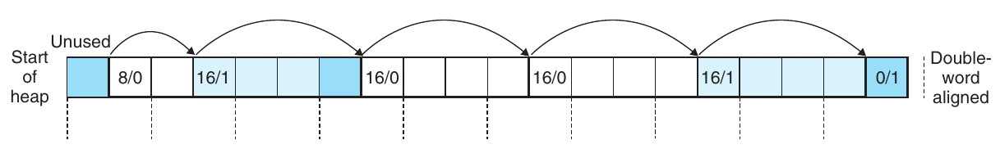

**Hình 9.38 Ví dụ false fragmentation. Block allocated được tô màu. Free block không tô màu. Header được gắn nhãn (size (byte)/allocated bit).**

Immediate coalescing đơn giản và có thể thực hiện trong thời gian không đổi, nhưng với một số mẫu yêu cầu nó tạo dạng thrashing, trong đó block liên tục được coalesce rồi split ngay sau đó. Ví dụ, trong Hình 9.38, mẫu lặp cấp phát và giải phóng block three-word tạo nhiều splitting và coalescing không cần thiết. Khi thảo luận allocator, chúng ta giả định immediate coalescing, nhưng bạn cần biết allocator nhanh thường chọn một dạng deferred coalescing.

### 9.9.11 Coalescing bằng boundary tag

Allocator triển khai coalescing thế nào? Gọi block muốn giải phóng là current block. Khi đó coalesce free block tiếp theo (trong bộ nhớ) đơn giản và hiệu quả. Header current block trỏ tới header next block, có thể được kiểm tra để xác định next block có free không. Nếu có, chỉ cần cộng size của nó vào size trong current header và coalesce block trong thời gian không đổi.

Nhưng coalesce previous block thế nào? Với implicit free list gồm block có header, lựa chọn duy nhất là tìm toàn danh sách, ghi nhớ vị trí previous block cho đến current block. Với implicit free list, mỗi lời gọi free cần thời gian tuyến tính theo kích thước heap. Ngay cả với cách tổ chức free list tinh vi hơn, thời gian tìm cũng không cố định.

Knuth phát triển kỹ thuật thông minh và tổng quát gọi là boundary tag, cho phép coalescing constant-time với previous block. Ý tưởng trong Hình 9.39 là thêm footer (boundary tag) ở cuối mỗi block, là bản sao header. Nếu mỗi block có footer như vậy, allocator xác định vị trí bắt đầu và trạng thái previous block bằng cách xem footer của nó, luôn cách đầu current block một word.

Xét mọi trường hợp có thể khi allocator giải phóng current block:

1. Previous block và next block đều allocated.

2. Previous block allocated và next block free.

3. Previous block free và next block allocated.

4. Previous block và next block đều free.

Hình 9.40 thể hiện cách coalesce trong bốn trường hợp.

Trường hợp 1, cả hai block liền kề allocated nên không thể coalesce. Chỉ đổi trạng thái current block từ allocated sang free. Trường hợp 2, current block hợp nhất với next block. Header current block và footer next block được cập nhật bằng tổng kích thước current và next block. Trường hợp 3, previous block hợp nhất với current block. Header previous block và footer current block được cập nhật bằng tổng kích thước hai block. Trường hợp 4, cả ba block hợp nhất thành một free block, với header previous block và footer next block được cập nhật bằng tổng kích thước ba block. Trong mọi trường hợp, coalescing diễn ra trong thời gian không đổi.

Ý tưởng boundary tag đơn giản và tinh tế, khái quát cho nhiều loại allocator và cách tổ chức free list. Tuy nhiên, có nhược điểm tiềm tàng. Yêu cầu mỗi block có cả header và footer có thể tạo memory overhead đáng kể nếu ứng dụng thao tác nhiều block nhỏ. Ví dụ, nếu ứng dụng graph tạo và hủy node động bằng các lời gọi malloc và free lặp lại, mỗi node chỉ cần vài word, header và footer sẽ tiêu thụ nửa block allocated.

May thay, có tối ưu boundary tag thông minh loại bỏ nhu cầu footer trong block allocated. Nhớ rằng khi coalesce current block với previous và next block trong bộ nhớ, size field trong footer previous block chỉ cần nếu previous block free. Nếu lưu allocated/free bit của previous block trong một bit low-order dư của current block, block allocated không cần footer và có thể dùng không gian đó cho payload. Tuy nhiên, chú ý free block vẫn cần footer.

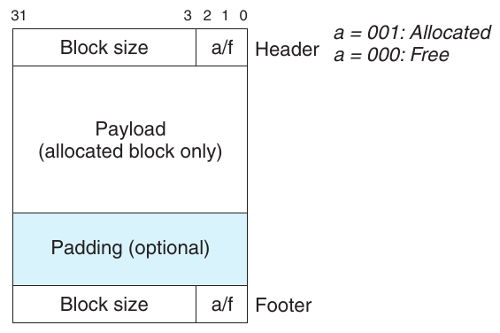

**Hình 9.39 Định dạng heap block dùng boundary tag.**

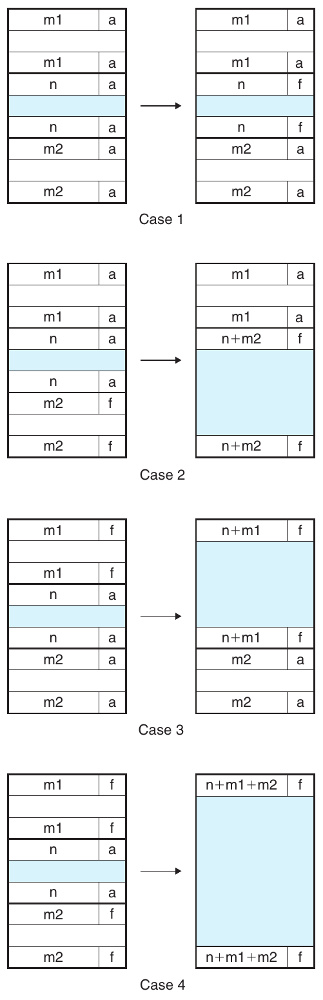

**Hình 9.40 Coalescing bằng boundary tag. Trường hợp 1: prev và next allocated. Trường hợp 2: prev allocated, next free. Trường hợp 3: prev free, next allocated. Trường hợp 4: next và prev free.**

#### Bài tập thực hành 9.7 (lời giải trang 919)

Xác định minimum block size cho mỗi tổ hợp yêu cầu alignment và định dạng block sau. Giả định: Implicit free list, không cho phép payload zero-size, header và footer được lưu trong word 4-byte.

| Alignment | Block allocated | Free block | Minimum block size (byte) |
|---|---|---|---|
| Single word | Header và footer | Header và footer | ______ |
| Single word | Header, không có footer | Header và footer | ______ |
| Double word | Header và footer | Header và footer | ______ |
| Double word | Header, không có footer | Header và footer | ______ |

### 9.9.12 Tổng hợp: Triển khai allocator đơn giản

Xây dựng allocator là một nhiệm vụ đầy thách thức. Không gian thiết kế rất lớn, với nhiều lựa chọn cho định dạng block và free list, cũng như các policy placement, splitting và coalescing. Một thách thức khác là bạn thường buộc phải lập trình ngoài giới hạn an toàn, quen thuộc của type system, dựa vào pointer casting và pointer arithmetic vốn error-prone và điển hình trong lập trình hệ thống low-level.

Mặc dù allocator không cần lượng code khổng lồ, chúng tinh tế và không dung thứ sai sót. Sinh viên quen ngôn ngữ higher-level như C++ hay Java thường gặp trở ngại khái niệm khi mới gặp kiểu lập trình này. Để giúp vượt qua, chúng ta sẽ tìm hiểu triển khai allocator đơn giản dựa trên implicit free list với coalescing boundary-tag tức thì. Maximum block size là 2<sup>32</sup> = 4 GB. Code là 64-bit clean, chạy không sửa đổi trong process 32-bit (gcc -m32) hoặc 64-bit (gcc -m64).

### Thiết kế allocator tổng quát

Allocator của chúng ta dùng mô hình hệ thống bộ nhớ do gói memlib.c trong Hình 9.41 cung cấp. Mục đích mô hình là cho phép chạy allocator mà không can thiệp gói malloc system-level hiện có.

Hàm mem_init mô hình hóa virtual memory sẵn có cho heap thành array byte lớn aligned theo double-word. Byte giữa mem_heap và mem_brk biểu diễn virtual memory đã cấp phát. Byte sau mem_brk biểu diễn virtual memory chưa cấp phát. Allocator yêu cầu thêm heap memory bằng mem_sbrk, có cùng interface và ngữ nghĩa với sbrk hệ thống, ngoại trừ việc từ chối yêu cầu thu nhỏ heap.

Bản thân allocator nằm trong source file (mm.c) mà người dùng có thể compile và link vào ứng dụng. Allocator xuất ba hàm cho chương trình ứng dụng:

```
1   extern int mm_init(void);
2   extern void *mm_malloc (size_t size);
3   extern void mm_free (void *ptr);
```

Hàm mm_init khởi tạo allocator, trả về 0 nếu thành công và −1 nếu không. Hàm mm_malloc và mm_free có cùng interface và ngữ nghĩa với hàm hệ thống tương ứng. Allocator dùng định dạng block trong Hình 9.39. Minimum block size là 16 byte. Free list được tổ chức thành implicit free list với dạng bất biến trong Hình 9.42.

```
                                                                   code/vm/malloc/memlib.c
 1   /* Private global variables */
 2   static char *mem_heap;     /* Points to first byte of heap */
 3   static char *mem_brk;      /* Points to last byte of heap plus 1 */
 4   static char *mem_max_addr; /* Max legal heap addr plus 1*/
 5
 6   /*
 7    * mem_init - Initialize the memory system model
 8    */
 9   void mem_init(void)
10   {
11       mem_heap = (char *)Malloc(MAX_HEAP);
12       mem_brk = (char *)mem_heap;
13       mem_max_addr = (char *)(mem_heap + MAX_HEAP);
14   }
15
16   /*
17    * mem_sbrk - Simple model of the sbrk function. Extends the heap
18    *    by incr bytes and returns the start address of the new area. In
19    *    this model, the heap cannot be shrunk.
20    */
21   void *mem_sbrk(int incr)
22   {
23       char *old_brk = mem_brk;
24
25       if ( (incr < 0) || ((mem_brk + incr) > mem_max_addr)) {
26           errno = ENOMEM;
27           fprintf(stderr, "ERROR: mem_sbrk failed. Ran out of memory...\n");
28           return (void *)-1;
29       }
30       mem_brk += incr;
31       return (void *)old_brk;
32   }
                                                                   code/vm/malloc/memlib.c
```

**Hình 9.41 memlib.c: Mô hình hệ thống bộ nhớ.**

Word đầu tiên là padding word không dùng, aligned theo ranh giới double-word. Sau padding là prologue block đặc biệt, một block allocated 8-byte chỉ gồm header và footer. Prologue block được tạo khi khởi tạo và không bao giờ giải phóng. Sau prologue block là không hoặc nhiều block thông thường do malloc hoặc free tạo. Heap luôn kết thúc bằng epilogue block đặc biệt, là block allocated zero-size chỉ gồm header. Prologue và epilogue block là mẹo loại bỏ edge condition trong coalescing. Allocator dùng một global variable private (static) duy nhất (heap_listp) luôn trỏ tới prologue block. (Một tối ưu nhỏ là cho nó trỏ tới next block thay prologue block.)

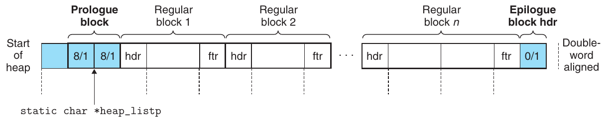

**Hình 9.42 Dạng bất biến của implicit free list.**

### Hằng số và macro cơ bản để thao tác free list

Hình 9.43 thể hiện một số hằng số và macro cơ bản dùng xuyên suốt code allocator. Dòng 2–4 định nghĩa hằng số kích thước cơ bản: kích thước word (WSIZE), double word (DSIZE), kích thước free block ban đầu và kích thước mặc định để mở rộng heap (CHUNKSIZE).

Thao tác header và footer trong free list có thể phiền phức vì cần dùng nhiều casting và pointer arithmetic. Vì vậy, định nghĩa tập macro nhỏ để truy cập và duyệt free list (dòng 9–25) rất hữu ích. Macro PACK (dòng 9) kết hợp size với allocate bit và trả giá trị có thể lưu trong header hoặc footer.

Macro GET (dòng 12) đọc và trả word được đối số p tham chiếu. Casting ở đây rất quan trọng. Đối số p thường là pointer (void *), không thể dereference trực tiếp. Tương tự, macro PUT (dòng 13) lưu val trong word mà đối số p trỏ tới.

Macro GET_SIZE và GET_ALLOC (dòng 16–17) lần lượt trả size và allocated bit từ header hoặc footer tại địa chỉ p. Macro còn lại thao tác block pointer (ký hiệu bp) trỏ tới byte payload đầu tiên. Với block pointer bp, macro HDRP và FTRP (dòng 20–21) lần lượt trả pointer tới block header và footer. Macro NEXT_BLKP và PREV_BLKP (dòng 24–25) lần lượt trả block pointer của next block và previous block.

Có thể kết hợp macro theo nhiều cách để thao tác free list. Ví dụ, với pointer bp tới current block, có thể dùng dòng code sau để xác định size của next block trong bộ nhớ:

```
size_t size = GET_SIZE(HDRP(NEXT_BLKP(bp)));
```

```
                                                                      code/vm/malloc/mm.c
 1   /* Basic constants and macros */
 2   #define WSIZE       4       /* Word and header/footer size (bytes) */
 3   #define DSIZE       8       /* Double word size (bytes) */
 4   #define CHUNKSIZE  (1<<12)  /* Extend heap by this amount (bytes) */
 5
 6   #define MAX(x, y) ((x) > (y)? (x) : (y))
 7
 8   /* Pack a size and allocated bit into a word */
 9   #define PACK(size, alloc)  ((size) | (alloc))
10
11   /* Read and write a word at address p */
12   #define GET(p)       (*(unsigned int *)(p))
13   #define PUT(p, val)  (*(unsigned int *)(p) = (val))
14
15   /* Read the size and allocated fields from address p */
16   #define GET_SIZE(p)  (GET(p) & ~0x7)
17   #define GET_ALLOC(p) (GET(p) & 0x1)
18
19   /* Given block ptr bp, compute address of its header and footer */
20   #define HDRP(bp)       ((char *)(bp) - WSIZE)
21   #define FTRP(bp)       ((char *)(bp) + GET_SIZE(HDRP(bp)) - DSIZE)
22
23   /* Given block ptr bp, compute address of next and previous blocks */
24   #define NEXT_BLKP(bp)  ((char *)(bp) + GET_SIZE(((char *)(bp) - WSIZE)))
25   #define PREV_BLKP(bp)  ((char *)(bp) - GET_SIZE(((char *)(bp) - DSIZE)))
                                                                      code/vm/malloc/mm.c
```

**Hình 9.43 Hằng số và macro cơ bản để thao tác free list.**

### Tạo free list ban đầu

Trước khi gọi mm_malloc hoặc mm_free, ứng dụng phải khởi tạo heap bằng mm_init (Hình 9.44).

Hàm mm_init lấy bốn word từ hệ thống bộ nhớ và khởi tạo để tạo free list rỗng (dòng 4–10). Sau đó gọi extend_heap (Hình 9.45), mở rộng heap CHUNKSIZE byte và tạo free block ban đầu. Lúc này allocator đã khởi tạo và sẵn sàng nhận yêu cầu allocate, free từ ứng dụng.

Hàm extend_heap được gọi trong hai hoàn cảnh: (1) khi khởi tạo heap và (2) khi mm_malloc không tìm được block phù hợp. Để duy trì alignment, extend_heap làm tròn size yêu cầu lên bội gần nhất của 2 word (8 byte) rồi yêu cầu thêm không gian heap từ hệ thống bộ nhớ (dòng 7–9).

```
                                                                      code/vm/malloc/mm.c
 1   int mm_init(void)
 2   {
 3       /* Create the initial empty heap */
 4       if ((heap_listp = mem_sbrk(4*WSIZE)) == (void *)-1)
 5           return -1;
 6       PUT(heap_listp, 0);                          /* Alignment padding */
 7       PUT(heap_listp + (1*WSIZE), PACK(DSIZE, 1)); /* Prologue header */
 8       PUT(heap_listp + (2*WSIZE), PACK(DSIZE, 1)); /* Prologue footer */
 9       PUT(heap_listp + (3*WSIZE), PACK(0, 1));     /* Epilogue header */
10       heap_listp += (2*WSIZE);
11
12       /* Extend the empty heap with a free block of CHUNKSIZE bytes */
13       if (extend_heap(CHUNKSIZE/WSIZE) == NULL)
14           return -1;
15       return 0;
16   }
                                                                      code/vm/malloc/mm.c
```

**Hình 9.44 mm_init tạo heap với free block ban đầu.**

```
                                                                      code/vm/malloc/mm.c
 1   static void *extend_heap(size_t words)
 2   {
 3       char *bp;
 4       size_t size;
 5
 6       /* Allocate an even number of words to maintain alignment */
 7       size = (words % 2) ? (words+1) * WSIZE : words * WSIZE;
 8       if ((long)(bp = mem_sbrk(size)) == -1)
 9           return NULL;
10
11       /* Initialize free block header/footer and the epilogue header */
12       PUT(HDRP(bp), PACK(size, 0));         /* Free block header */
13       PUT(FTRP(bp), PACK(size, 0));         /* Free block footer */
14       PUT(HDRP(NEXT_BLKP(bp)), PACK(0, 1)); /* New epilogue header */
15
16       /* Coalesce if the previous block was free */
17       return coalesce(bp);
18   }
                                                                      code/vm/malloc/mm.c
```

**Hình 9.45 extend_heap mở rộng heap bằng free block mới.**

Phần còn lại của extend_heap (dòng 12–17) khá tinh tế. Heap bắt đầu trên ranh giới aligned double-word, và mỗi lời gọi extend_heap trả block có size bằng số nguyên lần double word. Vì vậy, mỗi lời gọi mem_sbrk trả khối bộ nhớ aligned double-word ngay sau header epilogue block. Header này trở thành header free block mới (dòng 12), và word cuối của khối trở thành header epilogue block mới (dòng 14). Cuối cùng, trong trường hợp có khả năng cao heap trước đó kết thúc bằng free block, chúng ta gọi coalesce để hợp nhất hai free block và trả block pointer của block đã hợp nhất (dòng 17).

### Giải phóng và coalesce block

Ứng dụng giải phóng block đã cấp phát bằng mm_free (Hình 9.46), giải phóng block được yêu cầu (bp) rồi hợp nhất free block liền kề bằng kỹ thuật coalescing boundary-tags trong Mục 9.9.11.

Code trong helper function coalesce triển khai trực tiếp bốn trường hợp trong Hình 9.40. Có một khía cạnh khá tinh tế. Định dạng free list đã chọn—với prologue và epilogue block luôn đánh dấu allocated—cho phép bỏ qua edge condition dễ gây rắc rối khi block bp ở đầu hoặc cuối heap. Không có những block đặc biệt này, code rối hơn, dễ lỗi hơn và chậm hơn vì phải kiểm tra edge condition hiếm gặp trong mọi yêu cầu free.

### Cấp phát block

Ứng dụng yêu cầu block bộ nhớ size byte bằng mm_malloc (Hình 9.47). Sau khi kiểm tra yêu cầu không hợp lệ, allocator phải điều chỉnh block size yêu cầu để đủ chỗ cho header và footer, đồng thời đáp ứng alignment double-word. Dòng 12–13 áp đặt minimum block size 16 byte: 8 byte đáp ứng alignment và 8 byte nữa cho overhead header, footer. Với yêu cầu trên 8 byte (dòng 15), quy tắc chung là cộng overhead byte rồi làm tròn lên bội gần nhất của 8.

Sau khi điều chỉnh kích thước được yêu cầu, allocator tìm trong free list một free block thích hợp (dòng 18). Nếu tìm được block vừa với yêu cầu, allocator đặt block được yêu cầu vào đó, có thể split phần dư (dòng 19), rồi trả về địa chỉ của block mới được allocated.

Nếu không tìm được block vừa yêu cầu, allocator mở rộng heap bằng free block mới (dòng 24–26), đặt block yêu cầu vào free block mới, có thể split block (dòng 27), rồi trả pointer tới block mới allocated.

```
                                                     code/vm/malloc/mm.c
 1   void mm_free(void *bp)
 2   {
 3       size_t size = GET_SIZE(HDRP(bp));
 4
 5       PUT(HDRP(bp), PACK(size, 0));
 6       PUT(FTRP(bp), PACK(size, 0));
 7       coalesce(bp);
 8   }
 9
10   static void *coalesce(void *bp)
11   {
12       size_t prev_alloc = GET_ALLOC(FTRP(PREV_BLKP(bp)));
13       size_t next_alloc = GET_ALLOC(HDRP(NEXT_BLKP(bp)));
14       size_t size = GET_SIZE(HDRP(bp));
15
16       if (prev_alloc && next_alloc) {            /* Case 1 */
17           return bp;
18       }
19
20       else if (prev_alloc && !next_alloc) {      /* Case 2 */
21           size += GET_SIZE(HDRP(NEXT_BLKP(bp)));
22           PUT(HDRP(bp), PACK(size, 0));
23           PUT(FTRP(bp), PACK(size,0));
24       }
25
26       else if (!prev_alloc && next_alloc) {      /* Case 3 */
27           size += GET_SIZE(HDRP(PREV_BLKP(bp)));
28           PUT(FTRP(bp), PACK(size, 0));
29           PUT(HDRP(PREV_BLKP(bp)), PACK(size, 0));
30           bp = PREV_BLKP(bp);
31       }
32
33       else {                                     /* Case 4 */
34           size += GET_SIZE(HDRP(PREV_BLKP(bp))) +
35               GET_SIZE(FTRP(NEXT_BLKP(bp)));
36           PUT(HDRP(PREV_BLKP(bp)), PACK(size, 0));
37           PUT(FTRP(NEXT_BLKP(bp)), PACK(size, 0));
38           bp = PREV_BLKP(bp);
39       }
40       return bp;
41   }
                                                     code/vm/malloc/mm.c
```

**Hình 9.46 mm_free giải phóng block và dùng coalescing boundary-tag để hợp nhất với free block liền kề trong thời gian không đổi.**

```
                                                                      code/vm/malloc/mm.c
 1   void *mm_malloc(size_t size)
 2   {
 3       size_t asize;      /* Adjusted block size */
 4       size_t extendsize; /* Amount to extend heap if no fit */
 5       char *bp;
 6
 7       /* Ignore spurious requests */
 8       if (size == 0)
 9           return NULL;
10
11       /* Adjust block size to include overhead and alignment reqs. */
12       if (size <= DSIZE)
13           asize = 2*DSIZE;
14       else
15           asize = DSIZE * ((size + (DSIZE) + (DSIZE-1)) / DSIZE);
16
17       /* Search the free list for a fit */
18       if ((bp = find_fit(asize)) != NULL) {
19           place(bp, asize);
20           return bp;
21       }
22
23       /* No fit found. Get more memory and place the block */
24       extendsize = MAX(asize,CHUNKSIZE);
25       if ((bp = extend_heap(extendsize/WSIZE)) == NULL)
26           return NULL;
27       place(bp, asize);
28       return bp;
29   }
                                                                      code/vm/malloc/mm.c
```

**Hình 9.47 mm_malloc cấp phát block từ free list.**

#### Bài tập thực hành 9.8 (lời giải trang 920)

Triển khai hàm find_fit cho allocator đơn giản được mô tả trong Mục 9.9.12.

```
static void *find_fit(size_t asize)
```

Lời giải cần thực hiện tìm kiếm first-fit trên implicit free list.

#### Bài tập thực hành 9.9 (lời giải trang 920)

Triển khai hàm place cho allocator ví dụ.

```
static void place(void *bp, size_t asize)
```

Lời giải cần đặt block được yêu cầu ở đầu free block, chỉ split nếu kích thước phần còn lại bằng hoặc vượt minimum block size.

### 9.9.13 Explicit Free List

Implicit free list cung cấp một cách đơn giản để giới thiệu các khái niệm cơ bản về allocator. Tuy nhiên, vì thời gian cấp phát block tuyến tính theo tổng số heap block, implicit free list không thích hợp cho allocator general-purpose (mặc dù có thể phù hợp với allocator special-purpose khi biết trước số heap block là nhỏ).

Cách tốt hơn là tổ chức free block thành một dạng data structure tường minh. Vì theo định nghĩa chương trình không cần phần thân free block, các pointer triển khai data structure có thể lưu trong thân free block. Ví dụ, heap có thể được tổ chức thành free list liên kết đôi bằng cách thêm pointer pred (predecessor) và succ (successor) vào mỗi free block như Hình 9.48.

Dùng danh sách liên kết đôi thay implicit free list giảm thời gian allocation first-fit từ tuyến tính theo tổng số block xuống tuyến tính theo số free block. Tuy nhiên, thời gian giải phóng block có thể tuyến tính hoặc không đổi, tùy policy sắp xếp block trong free list.

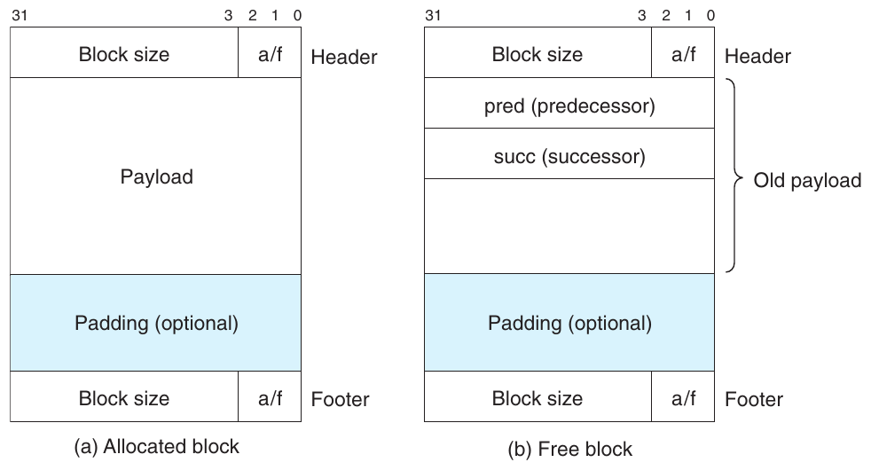

**Hình 9.48 Định dạng heap block dùng free list liên kết đôi.**

Một cách là duy trì danh sách theo thứ tự last-in first-out (LIFO), chèn block vừa giải phóng vào đầu danh sách. Với thứ tự LIFO và placement policy first-fit, allocator kiểm tra block dùng gần nhất trước. Khi đó, giải phóng block có thể thực hiện trong thời gian không đổi. Nếu dùng boundary tag, coalescing cũng có thể thực hiện trong thời gian không đổi.

Cách khác là duy trì danh sách theo thứ tự địa chỉ, trong đó địa chỉ mỗi block nhỏ hơn địa chỉ successor. Khi đó, giải phóng block cần tìm kiếm linear-time để xác định predecessor thích hợp. Sự trade-off là first fit address-ordered có memory utilization tốt hơn first fit LIFO-ordered, gần utilization của best fit.

Nhược điểm chung của explicit list là free block phải đủ lớn chứa mọi pointer cần thiết, cùng header và có thể cả footer. Điều này làm minimum block size lớn hơn và tăng khả năng internal fragmentation.

### 9.9.14 Segregated Free List

Như đã thấy, allocator dùng một danh sách liên kết free block duy nhất cần thời gian tuyến tính theo số free block để cấp phát. Cách phổ biến giảm allocation time, thường gọi là segregated storage, là duy trì nhiều free list, mỗi list giữ các block có size xấp xỉ nhau. Ý tưởng chung là chia tập mọi block size có thể thành các lớp tương đương gọi là size class. Có nhiều cách định nghĩa size class. Ví dụ, có thể chia block size theo lũy thừa của 2:

{1}, {2}, {3, 4}, {5–8}, · · · , {1,025–2,048}, {2,049–4,096}, {4,097–∞}

Hoặc gán block nhỏ vào size class riêng và chia block lớn theo lũy thừa của 2:

{1}, {2}, {3}, · · · , {1,023}, {1,024}, {1,025–2,048}, {2,049–4,096}, {4,097–∞}

Allocator duy trì array free list, mỗi size class một free list, sắp theo size tăng dần. Khi cần block size n, allocator tìm free list thích hợp. Nếu không tìm được block vừa yêu cầu, nó tìm list tiếp theo, và cứ như vậy.

Tài liệu dynamic storage allocation mô tả hàng chục biến thể segregated storage khác nhau ở cách định nghĩa size class, thời điểm coalescing, thời điểm yêu cầu thêm heap memory từ operating system, có cho phép splitting hay không, v.v. Để bạn hình dung các khả năng, chúng ta mô tả hai cách cơ bản: simple segregated storage và segregated fits.

### Simple Segregated Storage

Với simple segregated storage, free list của mỗi size class chứa block same-size, mỗi block có size bằng phần tử lớn nhất của class. Ví dụ, nếu size class được định nghĩa là {17–32}, free list của class chỉ chứa block size 32.

Để cấp phát block có size cho trước, chúng ta kiểm tra free list thích hợp. Nếu list không rỗng, cấp phát toàn bộ block đầu tiên. Free block không bao giờ split để đáp ứng yêu cầu allocation. Nếu list rỗng, allocator yêu cầu khối bộ nhớ bổ sung fixed-size từ operating system (thường là bội page size), chia khối thành block equal-size rồi liên kết thành free list mới. Để giải phóng block, allocator chỉ chèn block vào đầu free list thích hợp.

Cơ chế đơn giản này có một số ưu điểm. Cấp phát và giải phóng block đều là thao tác constant-time nhanh. Hơn nữa, kết hợp block same-size trong mỗi khối, không splitting và không coalescing đồng nghĩa memory overhead per-block rất ít. Vì mỗi khối chỉ có block same-size, có thể suy ra size của block allocated từ địa chỉ. Vì không coalescing, block allocated không cần allocated/free flag trong header. Do đó, block allocated không cần header, và vì không coalescing cũng không cần footer. Vì allocate và free chèn, xóa block ở đầu free list, list chỉ cần liên kết đơn thay vì liên kết đôi. Kết quả là field duy nhất bắt buộc là succ pointer one-word trong mỗi free block, nên minimum block size chỉ một word.

Nhược điểm đáng kể là simple segregated storage dễ bị internal và external fragmentation. Internal fragmentation có thể xảy ra vì free block không bao giờ split. Tệ hơn, một số mẫu reference có thể tạo external fragmentation cực lớn vì free block không bao giờ coalesce (Bài tập thực hành 9.10).

#### Bài tập thực hành 9.10 (lời giải trang 921)

Mô tả mẫu reference gây external fragmentation nghiêm trọng trong allocator dựa trên simple segregated storage.

### Segregated Fits

Với cách này, allocator duy trì array free list. Mỗi free list gắn với size class và được tổ chức thành một loại explicit list hoặc implicit list. Mỗi list có thể chứa block different-size có size thuộc size class. Có nhiều biến thể segregated fits allocator. Ở đây chúng ta mô tả phiên bản đơn giản.

Để cấp phát block, xác định size class của yêu cầu và tìm kiếm first-fit trong free list thích hợp để tìm block vừa yêu cầu. Nếu tìm thấy, có thể split và chèn phần dư vào free list thích hợp. Nếu không tìm được, tìm free list cho size class lớn hơn kế tiếp. Lặp lại đến khi tìm được block vừa yêu cầu. Nếu không free list nào có block phù hợp, yêu cầu thêm heap memory từ operating system, cấp phát block từ heap memory mới rồi đặt phần còn lại vào size class thích hợp. Để giải phóng block, coalesce và đặt kết quả vào free list thích hợp.

Segregated fits là lựa chọn phổ biến với allocator production-quality như gói GNU malloc trong thư viện C chuẩn vì vừa nhanh vừa hiệu quả bộ nhớ. Thời gian tìm giảm vì chỉ tìm trong phần cụ thể của heap thay vì toàn heap. Memory utilization có thể cải thiện nhờ thực tế thú vị rằng tìm kiếm first-fit đơn giản trên segregated free list xấp xỉ tìm kiếm best-fit trên toàn heap.

### Buddy System

Buddy system là trường hợp đặc biệt của segregated fits, mỗi size class là lũy thừa của 2. Ý tưởng cơ bản là với heap gồm 2<sup>m</sup> word, duy trì free list riêng cho mỗi block size 2<sup>k</sup>, trong đó 0 ≤ k ≤ m. Block size yêu cầu được làm tròn lên lũy thừa gần nhất của 2. Ban đầu có một free block size 2<sup>m</sup> word.

Để cấp phát block size 2<sup>k</sup>, tìm block sẵn có đầu tiên size 2<sup>j</sup>, sao cho k ≤ j ≤ m. Nếu j = k thì xong. Nếu không, đệ quy split block thành hai nửa cho đến j = k. Khi splitting, mỗi nửa còn lại (gọi là buddy) được đặt vào free list thích hợp. Để giải phóng block size 2<sup>k</sup>, tiếp tục coalesce với free buddy. Khi gặp buddy allocated, dừng coalescing.

Một thực tế then chốt của buddy system là với địa chỉ và size block, rất dễ tính địa chỉ buddy. Ví dụ, block size 32 byte có địa chỉ

xxx . . . x00000

có buddy tại địa chỉ

xxx . . . x10000

Nói cách khác, địa chỉ block và buddy khác nhau đúng một vị trí bit.

Ưu điểm chính của buddy system allocator là tìm kiếm và coalescing nhanh. Nhược điểm chính là yêu cầu power-of-2 của block size có thể gây internal fragmentation đáng kể. Vì vậy, buddy system allocator không thích hợp workload general-purpose. Tuy nhiên, với một số workload application-specific biết trước block size là lũy thừa của 2, buddy system allocator có sức hấp dẫn nhất định.

## 9.10 Garbage Collection

Với explicit allocator như gói malloc của C, ứng dụng cấp phát và giải phóng heap block bằng malloc và free. Ứng dụng chịu trách nhiệm giải phóng mọi block đã cấp phát không còn cần.

Không giải phóng block allocated là lỗi lập trình phổ biến. Ví dụ, xét hàm C sau cấp phát block lưu trữ tạm thời trong quá trình xử lý:

```
1   void garbage()
2   {
3       int *p = (int *)Malloc(15213);
4
5       return; /* Array p is garbage at this point */
6   }
```

Vì chương trình không cần p nữa, block đáng lẽ phải được giải phóng trước khi garbage trả về. Đáng tiếc, lập trình viên quên giải phóng block. Nó giữ trạng thái allocated suốt vòng đời chương trình, chiếm vô ích không gian heap có thể dùng đáp ứng yêu cầu allocation tiếp theo.

Garbage collector là dynamic storage allocator tự động giải phóng block allocated không còn được chương trình cần. Những block đó gọi là garbage (do đó có thuật ngữ “garbage collector”). Quá trình tự động thu hồi heap storage gọi là garbage collection. Trong hệ thống hỗ trợ garbage collection, ứng dụng cấp phát heap block tường minh nhưng không bao giờ giải phóng tường minh. Trong chương trình C, ứng dụng gọi malloc nhưng không gọi free. Thay vào đó, garbage collector định kỳ xác định garbage block và gọi free thích hợp để đưa chúng trở lại free list.

Garbage collection có từ hệ thống Lisp do John McCarthy phát triển tại MIT đầu thập niên 1960. Nó là phần quan trọng của hệ thống ngôn ngữ hiện đại như Java, ML, Perl và Mathematica, đồng thời vẫn là lĩnh vực nghiên cứu tích cực và quan trọng. Tài liệu mô tả vô số cách garbage collection. Chúng ta giới hạn thảo luận ở thuật toán Mark&Sweep ban đầu của McCarthy, thú vị vì có thể xây dựng trên gói malloc hiện có để cung cấp garbage collection cho chương trình C và C++.

### 9.10.1 Cơ bản về garbage collector

Garbage collector nhìn bộ nhớ như directed reachability graph dạng Hình 9.49. Node graph được chia thành tập root node và tập heap node. Mỗi heap node tương ứng block allocated trong heap. Cạnh có hướng p → q nghĩa là vị trí nào đó trong block p trỏ tới vị trí nào đó trong block q. Root node tương ứng vị trí ngoài heap chứa pointer vào heap. Những vị trí này có thể là register, variable trên stack hoặc global variable trong vùng dữ liệu đọc/ghi của virtual memory.

Chúng ta nói node p reachable nếu có đường có hướng từ một root node bất kỳ tới p. Tại bất kỳ thời điểm nào, node unreachable tương ứng garbage mà ứng dụng không bao giờ dùng lại được. Vai trò garbage collector là duy trì một biểu diễn reachability graph và định kỳ thu hồi node unreachable bằng cách giải phóng rồi trả về free list.

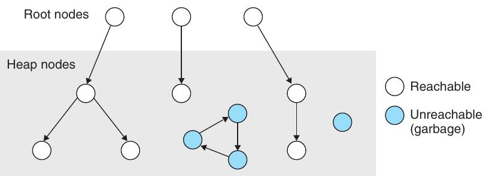

**Hình 9.49 Cách garbage collector nhìn bộ nhớ như directed graph.**

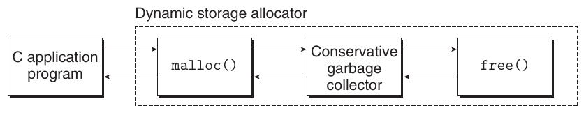

**Hình 9.50 Tích hợp conservative garbage collector và gói malloc của C.**

Garbage collector cho ngôn ngữ như ML và Java, kiểm soát chặt cách ứng dụng tạo và dùng pointer, có thể duy trì biểu diễn chính xác reachability graph và thu hồi mọi garbage. Tuy nhiên, collector cho ngôn ngữ như C và C++ nhìn chung không thể duy trì biểu diễn chính xác reachability graph. Chúng được gọi là conservative garbage collector. Chúng conservative theo nghĩa mỗi block reachable được xác định đúng là reachable, trong khi một số node unreachable có thể bị xác định nhầm là reachable.

Collector có thể cung cấp dịch vụ theo yêu cầu hoặc chạy như thread riêng song song ứng dụng, liên tục cập nhật reachability graph và thu hồi garbage. Ví dụ, xét cách tích hợp conservative collector cho chương trình C vào gói malloc hiện có, như Hình 9.50.

Ứng dụng gọi malloc như thường lệ khi cần heap space. Nếu malloc không tìm được free block vừa yêu cầu, nó gọi garbage collector với hy vọng thu hồi garbage về free list. Collector xác định garbage block và trả về heap bằng free. Ý tưởng then chốt là collector gọi free thay ứng dụng. Khi lời gọi collector trả về, malloc thử tìm free block phù hợp lần nữa. Nếu thất bại, có thể yêu cầu thêm bộ nhớ từ operating system. Cuối cùng, malloc trả pointer tới block yêu cầu (nếu thành công) hoặc NULL pointer (nếu thất bại).

### 9.10.2 Garbage collector Mark&Sweep

Garbage collector Mark&Sweep gồm mark phase đánh dấu mọi descendant reachable và allocated của root node, tiếp theo là sweep phase giải phóng mỗi block allocated không được đánh dấu. Thông thường, một bit low-order dư trong block header được dùng để chỉ block có được đánh dấu không.

(a) Hàm mark (b) Hàm sweep

```
void mark(ptr p) {                       void sweep(ptr b, ptr end) {
   if ((b = isPtr(p)) == NULL)              while (b < end) {
     return;                                   if (blockMarked(b))
   if (blockMarked(b))                            unmarkBlock(b);
     return;                                   else if (blockAllocated(b))
   markBlock(b);                                  free(b);
   len = length(b);                            b = nextBlock(b);
   for (i=0; i < len; i++)                  }
     mark(b[i]);                            return;
   return;                               }
}
```

**Hình 9.51 Pseudocode cho hàm mark và sweep.**

Mô tả Mark&Sweep giả định các hàm sau, trong đó ptr được định nghĩa là typedef void *ptr:

ptr isPtr(ptr p). Nếu p trỏ tới word trong block allocated, trả pointer b tới đầu block đó. Nếu không, trả NULL.

int blockMarked(ptr b). Trả true nếu block b đã được đánh dấu.

int blockAllocated(ptr b). Trả true nếu block b allocated.

void markBlock(ptr b). Đánh dấu block b.

int length(ptr b). Trả độ dài tính bằng word (không gồm header) của block b.

void unmarkBlock(ptr b). Đổi trạng thái block b từ marked sang unmarked.

ptr nextBlock(ptr b). Trả successor của block b trong heap.

Mark phase gọi hàm mark trong Hình 9.51(a) một lần cho mỗi root node. Hàm mark trả về ngay nếu p không trỏ tới một heap block vừa allocated vừa unmarked. Nếu không, nó đánh dấu block rồi gọi đệ quy chính nó trên mỗi word trong block. Mỗi lời gọi mark đánh dấu những descendant chưa được marked và reachable của một root node. Khi mark phase kết thúc, mọi block allocated không được đánh dấu chắc chắn là unreachable, do đó là garbage có thể được thu hồi trong sweep phase.

Sweep phase là một lời gọi duy nhất tới hàm sweep trong Hình 9.51(b). Hàm sweep lặp qua mỗi block trong heap, giải phóng mọi block allocated unmarked (tức garbage) gặp được.

Hình 9.52 thể hiện diễn giải bằng hình của Mark&Sweep cho heap nhỏ. Ranh giới block được chỉ bằng nét đậm. Mỗi ô vuông tương ứng một word bộ nhớ. Mỗi block có header one-word, được marked hoặc unmarked.

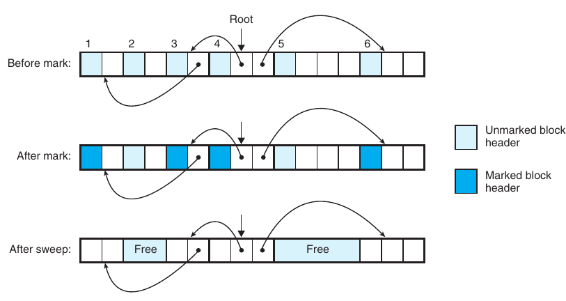

**Hình 9.52 Ví dụ Mark&Sweep. Chú ý mũi tên trong ví dụ biểu thị memory reference, không phải free list pointer.**

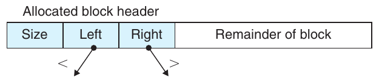

**Hình 9.53 Pointer trái và phải trong balanced tree của block allocated.**

Ban đầu, heap trong Hình 9.52 gồm sáu block allocated, mỗi block chưa marked. Block 3 chứa pointer tới block 1. Block 4 chứa pointer tới block 3 và 6. Root trỏ tới block 4. Sau mark phase, block 1, 3, 4 và 6 được đánh dấu vì reachable từ root. Block 2 và 5 không được đánh dấu vì unreachable. Sau sweep phase, hai block unreachable được thu hồi về free list.

### 9.10.3 Conservative Mark&Sweep cho chương trình C

Mark&Sweep phù hợp garbage collection cho chương trình C vì hoạt động tại chỗ mà không di chuyển block. Tuy nhiên, ngôn ngữ C đặt ra một số thách thức thú vị cho triển khai isPtr.

Thứ nhất, C không gắn thông tin type vào vị trí bộ nhớ. Vì vậy, không có cách rõ ràng để isPtr xác định tham số đầu vào p có phải pointer không. Thứ hai, ngay cả khi biết p là pointer, cũng không có cách rõ ràng để isPtr xác định p có trỏ tới vị trí trong payload của block allocated hay không.

Một giải pháp cho vấn đề sau là duy trì tập block allocated dưới dạng balanced binary tree, giữ bất biến mọi block trong subtree trái có địa chỉ nhỏ hơn và mọi block trong subtree phải có địa chỉ lớn hơn. Như Hình 9.53, điều này đòi hỏi thêm hai field (left và right) trong header mỗi block allocated. Mỗi field trỏ tới header một block allocated. Hàm isPtr(ptr p) dùng cây để binary search các block allocated. Tại mỗi bước, nó dựa vào size field trong block header để xác định p nằm trong phạm vi block hay không.

Cách dùng balanced tree đúng theo nghĩa bảo đảm đánh dấu mọi node reachable từ root. Đây là bảo đảm cần thiết vì người dùng ứng dụng chắc chắn không muốn block đã cấp phát của mình bị trả về free list quá sớm. Tuy nhiên, nó conservative theo nghĩa có thể đánh dấu sai block thực sự unreachable, nên có thể không giải phóng được một phần garbage. Mặc dù không ảnh hưởng tính đúng đắn chương trình ứng dụng, nó có thể gây external fragmentation không cần thiết.

Lý do nền tảng khiến collector Mark&Sweep cho C phải conservative là C không gắn thông tin type cho vị trí bộ nhớ. Vì vậy, scalar như int hoặc float có thể giả dạng pointer. Ví dụ, giả sử block allocated reachable chứa int trong payload có giá trị tình cờ tương ứng địa chỉ trong payload của block allocated khác b. Collector không có cách suy ra dữ liệu thực sự là int chứ không phải pointer. Vì vậy, allocator phải thận trọng đánh dấu block b reachable dù thực tế có thể không phải vậy.

## 9.11 Bug Memory-Related phổ biến trong chương trình C

Quản lý và sử dụng virtual memory có thể là nhiệm vụ khó và error-prone với lập trình viên C. Bug Memory-related thuộc nhóm đáng sợ nhất vì thường biểu hiện ở xa nguồn bug cả về thời gian và không gian. Ghi sai dữ liệu vào sai vị trí, chương trình có thể chạy hàng giờ trước khi thất bại ở phần xa nào đó. Chúng ta kết thúc phần thảo luận virtual memory bằng cách xem một số bug memory-related phổ biến.

### 9.11.1 Dereference pointer sai

Như đã học trong Mục 9.7.2, virtual address space của process có những khoảng trống lớn không ánh xạ tới dữ liệu có nghĩa. Nếu thử dereference pointer vào một khoảng trống, operating system kết thúc chương trình bằng segmentation exception. Ngoài ra, một số vùng virtual memory là read-only. Thử ghi vào các vùng này kết thúc chương trình bằng protection exception.

Ví dụ phổ biến dereference pointer sai là bug scanf kinh điển. Giả sử muốn dùng scanf đọc số nguyên từ stdin vào variable. Cách đúng là truyền cho scanf format string và địa chỉ variable:

```
scanf("%d", &val)
```

Tuy nhiên, lập trình viên C mới (và cả người có kinh nghiệm!) dễ truyền nội dung val thay địa chỉ:

```
scanf("%d", val)
```

Trong trường hợp này, scanf diễn giải nội dung val thành địa chỉ và thử ghi word tới vị trí đó. Trường hợp tốt nhất, chương trình kết thúc ngay bằng exception. Trường hợp xấu nhất, nội dung val tương ứng vùng virtual memory đọc/ghi hợp lệ và chúng ta ghi đè bộ nhớ, thường gây hậu quả nghiêm trọng và khó hiểu mãi về sau.

### 9.11.2 Đọc bộ nhớ chưa khởi tạo

Mặc dù vị trí bộ nhớ bss (như global variable C chưa khởi tạo) luôn được loader khởi tạo bằng không, heap memory không như vậy. Lỗi phổ biến là giả định heap memory được khởi tạo bằng không:

```
 1   /* Return y = Ax */
 2   int *matvec(int **A, int *x, int n)
 3   {
 4       int i, j;
 5
 6       int *y = (int *)Malloc(n * sizeof(int));
 7
 8       for (i = 0; i < n; i++)
 9           for (j = 0; j < n; j++)
10               y[i] += A[i][j] * x[j];
11       return y;
12   }
```

Trong ví dụ này, lập trình viên giả định sai rằng vector y đã được khởi tạo bằng không. Triển khai đúng cần chủ động đặt y[i] bằng không hoặc dùng calloc.

### 9.11.3 Cho phép stack buffer overflow

Như đã thấy trong Mục 3.10.3, chương trình có bug buffer overflow nếu ghi vào target buffer trên stack mà không kiểm tra kích thước input string. Ví dụ, hàm sau có bug buffer overflow vì gets sao chép string arbitrary-length vào buffer. Để sửa, cần dùng fgets giới hạn kích thước input string.

```
1   void bufoverflow()
2   {
3       char buf[64];
4
5       gets(buf); /* Here is the stack buffer overflow bug */
6       return;
7   }
```

### 9.11.4 Giả định pointer và object mà nó trỏ tới có cùng kích thước

Lỗi phổ biến là giả định pointer tới object có cùng kích thước object mà nó trỏ tới:

```
 1   /* Create an nxm array */
 2   int **makeArray1(int n, int m)
 3   {
 4       int i;
 5       int **A = (int **)Malloc(n * sizeof(int));
 6
 7       for (i = 0; i < n; i++)
 8           A[i] = (int *)Malloc(m * sizeof(int));
 9       return A;
10   }
```

Ý định ở đây là tạo array n pointer, mỗi pointer trỏ tới array m int. Tuy nhiên, vì lập trình viên viết sizeof(int) thay sizeof(int *) ở dòng 5, code thực sự tạo array int.

Code này chạy tốt trên máy có int và pointer tới int cùng size. Nhưng nếu chạy trên máy như Core i7, nơi pointer lớn hơn int, vòng lặp dòng 7–8 sẽ ghi quá cuối array A. Vì một trong các word này có thể là footer boundary-tag của block allocated, chúng ta có thể không phát hiện lỗi cho đến khi giải phóng block rất lâu sau trong chương trình; lúc đó code coalescing trong allocator thất bại nghiêm trọng không rõ nguyên nhân. Đây là ví dụ âm thầm của kiểu “tác động từ xa” rất điển hình cho bug lập trình memory-related.

### 9.11.5 Gây lỗi Off-by-One

Lỗi Off-by-one là nguồn phổ biến khác của bug ghi đè:

```
 1   /* Create an nxm array */
 2   int **makeArray2(int n, int m)
 3   {
 4       int i;
 5       int **A = (int **)Malloc(n * sizeof(int *));
 6
 7       for (i = 0; i <= n; i++)
 8           A[i] = (int *)Malloc(m * sizeof(int));
 9       return A;
10   }
```

Đây là phiên bản khác của chương trình mục trước. Chúng ta tạo array n-element pointer ở dòng 5 nhưng thử khởi tạo n + 1 phần tử ở dòng 7 và 8, qua đó ghi đè một phần bộ nhớ sau array A.

### 9.11.6 Tham chiếu pointer thay vì object mà nó trỏ tới

Nếu không cẩn thận về precedence và associativity của operator C, chúng ta thao tác sai lên pointer thay vì object mà nó trỏ tới. Ví dụ, xét hàm sau có mục đích xóa phần tử đầu trong binary heap gồm *size phần tử rồi reheapify *size - 1 phần tử còn lại:

```
1   int *binheapDelete(int **binheap, int *size)
2   {
3       int *packet = binheap[0];
4
5       binheap[0] = binheap[*size - 1];
6       *size--; /* This should be (*size)-- */
7       heapify(binheap, *size, 0);
8       return(packet);
9   }
```

Tại dòng 6, ý định là giảm giá trị số nguyên mà pointer size trỏ tới. Tuy nhiên, vì unary operator -- và * có cùng precedence và kết hợp từ phải sang trái, code dòng 6 thực sự giảm chính pointer thay vì giá trị số nguyên nó trỏ tới. Nếu may mắn, chương trình crash ngay. Nhưng nhiều khả năng chúng ta sẽ bối rối khi chương trình cho kết quả sai mãi về sau trong quá trình thực thi. Bài học là dùng dấu ngoặc khi không chắc precedence và associativity. Ví dụ, dòng 6 cần thể hiện rõ ý định bằng biểu thức (*size)--.

### 9.11.7 Hiểu sai pointer arithmetic

Lỗi phổ biến khác là quên các phép toán số học trên pointer được thực hiện theo đơn vị kích thước object mà nó trỏ tới, không nhất thiết là byte. Ví dụ, hàm sau muốn quét array int và trả pointer tới lần xuất hiện đầu tiên của val:

```
1   int *search(int *p, int val)
2   {
3       while (*p && *p != val)
4           p += sizeof(int); /* Should be p++ */
5       return p;
6   }
```

Tuy nhiên, vì dòng 4 tăng pointer thêm 4 (số byte trong số nguyên) mỗi vòng lặp, hàm quét sai bằng cách chỉ xét mỗi số nguyên thứ tư trong array.

### 9.11.8 Tham chiếu variable không tồn tại

Lập trình viên C thiếu kinh nghiệm, không hiểu quy tắc stack đôi khi tham chiếu local variable không còn hợp lệ, như ví dụ sau:

```
1   int *stackref ()
2   {
3       int val;
4
5       return &val;
6   }
```

Hàm này trả pointer (gọi là p) tới local variable trên stack rồi pop stack frame. Mặc dù p vẫn trỏ tới địa chỉ bộ nhớ hợp lệ, nó không còn trỏ tới variable hợp lệ. Khi hàm khác được gọi sau đó, bộ nhớ được tái sử dụng cho stack frame của chúng. Sau này, nếu chương trình gán giá trị cho *p, nó có thể thực sự sửa entry trong stack frame của hàm khác, với hậu quả tiềm tàng nghiêm trọng và khó hiểu.

### 9.11.9 Tham chiếu dữ liệu trong heap block đã free

Lỗi tương tự là tham chiếu dữ liệu trong heap block đã giải phóng. Xét ví dụ sau, cấp phát integer array x ở dòng 6, giải phóng block x quá sớm tại dòng 10 rồi tham chiếu lại ở dòng 14:

```
 1   int *heapref(int n, int m)
 2   {
 3       int i;
 4       int *x, *y;
 5
 6       x = (int *)Malloc(n * sizeof(int));
 7
         .
 8       .  // Other calls to malloc and free go here
         .
 9
10       free(x);
11
12       y = (int *)Malloc(m * sizeof(int));
13       for (i = 0; i < m; i++)
14           y[i] = x[i]++; /* Oops! x[i] is a word in a free block */
15
16       return y;
17   }
```

Tùy mẫu lời gọi malloc và free giữa dòng 6 và 10, khi chương trình tham chiếu x[i] tại dòng 14, array x có thể thuộc heap block allocated khác và đã bị ghi đè. Như nhiều bug memory-related, lỗi chỉ lộ ra sau đó khi nhận thấy các giá trị trong y bị hỏng.

### 9.11.10 Gây memory leak

Memory leak là sát thủ chậm và âm thầm, xảy ra khi lập trình viên vô tình tạo garbage trong heap vì quên giải phóng block allocated. Ví dụ, hàm sau cấp phát heap block x rồi trả về mà không giải phóng:

```
1   void leak(int n)
2   {
3       int *x = (int *)Malloc(n * sizeof(int));
4
5       return;  /* x is garbage at this point */
6   }
```

Nếu leak được gọi thường xuyên, heap sẽ dần đầy garbage và trong trường hợp xấu nhất sẽ tiêu thụ toàn bộ virtual address space. Memory leak đặc biệt nghiêm trọng với những chương trình như daemon và server, vốn theo định nghĩa không bao giờ kết thúc.

## 9.12 Tổng kết

Virtual memory là abstraction của main memory. Processor hỗ trợ virtual memory tham chiếu main memory bằng dạng truy cập gián tiếp gọi là virtual addressing. Processor tạo virtual address, được chuyển thành physical address trước khi gửi tới main memory. Chuyển địa chỉ từ virtual address space sang physical address space đòi hỏi phối hợp chặt chẽ giữa phần cứng và phần mềm. Phần cứng chuyên dụng chuyển virtual address bằng page table có nội dung do operating system cung cấp.

Virtual memory cung cấp ba khả năng quan trọng. Thứ nhất, tự động cache trong main memory những nội dung gần đây được sử dụng của virtual address space lưu trên đĩa. Block trong virtual memory cache gọi là page. Reference tới page trên đĩa kích hoạt page fault chuyển quyền điều khiển tới fault handler trong operating system. Fault handler sao chép page từ đĩa vào main memory cache, write back page bị evict nếu cần. Thứ hai, virtual memory đơn giản hóa memory management, qua đó đơn giản hóa linking, chia sẻ dữ liệu giữa process, cấp phát bộ nhớ cho process và loading chương trình. Cuối cùng, virtual memory đơn giản hóa memory protection bằng cách đưa protection bit vào mọi page table entry.

Quá trình address translation phải được tích hợp với hoạt động mọi hardware cache trong hệ thống. Phần lớn page table entry nằm trong L1 cache, nhưng chi phí truy cập chúng từ L1 thường được loại bỏ nhờ cache page table entry on-chip gọi là TLB.

Hệ thống hiện đại khởi tạo các khối virtual memory bằng cách gắn với khối file trên đĩa, quá trình gọi là memory mapping. Memory mapping cung cấp cơ chế hiệu quả để chia sẻ dữ liệu, tạo process mới và load chương trình. Ứng dụng có thể tự tạo và xóa area trong virtual address space bằng mmap. Tuy nhiên, phần lớn chương trình dựa vào dynamic memory allocator như malloc, quản lý bộ nhớ trong area virtual address space gọi là heap. Dynamic memory allocator là chương trình application-level mang phong cách system-level, trực tiếp thao tác bộ nhớ mà không được type system hỗ trợ nhiều. Allocator có hai loại. Explicit allocator yêu cầu ứng dụng giải phóng memory block tường minh. Implicit allocator (garbage collector) tự động giải phóng mọi block không dùng và unreachable.

Quản lý và dùng bộ nhớ là nhiệm vụ khó và error-prone với lập trình viên C. Ví dụ lỗi phổ biến gồm dereference pointer sai, đọc bộ nhớ chưa khởi tạo, cho phép stack buffer overflow, giả định pointer và object được trỏ tới có cùng size, tham chiếu pointer thay object được trỏ tới, hiểu sai pointer arithmetic, tham chiếu variable không tồn tại và gây memory leak.

## Ghi chú tài liệu tham khảo

Kilburn cùng đồng nghiệp công bố mô tả đầu tiên về virtual memory [63]. Giáo trình kiến trúc chứa chi tiết bổ sung về vai trò phần cứng trong virtual memory [46]. Giáo trình operating system chứa thêm thông tin về vai trò operating system [102, 106, 113]. Bovet và Cesati [11] mô tả chi tiết hệ thống virtual memory Linux. Intel Corporation cung cấp tài liệu chi tiết về address translation 32-bit và 64-bit trên processor IA [52].

Knuth viết công trình kinh điển về storage allocation năm 1968 [64]. Từ đó, lĩnh vực này có lượng công trình nghiên cứu khổng lồ. Wilson, Johnstone, Neely và Boles viết khảo sát cùng đánh giá hiệu năng xuất sắc về explicit allocator [118]. Nhận xét tổng quát trong sách này về throughput và utilization của các chiến lược allocator được diễn giải từ khảo sát đó. Jones và Lins cung cấp khảo sát toàn diện về garbage collection [56]. Kernighan và Ritchie [61] đưa ra toàn bộ code allocator đơn giản dựa trên explicit free list với block size và successor pointer trong mỗi free block. Code thú vị vì dùng union loại bỏ nhiều pointer arithmetic phức tạp, nhưng đổi lại thao tác free linear-time (thay vì constant-time). Doug Lea phát triển gói malloc open-source được dùng rộng rãi tên dlmalloc [67].

## Bài tập về nhà

9.11 ◆ Trong dãy bài sau, hãy chỉ ra cách hệ thống bộ nhớ ví dụ trong Mục 9.6.4 chuyển virtual address thành physical address và truy cập cache. Với virtual address cho trước, chỉ ra TLB entry được truy cập, physical address và giá trị cache byte trả về. Cho biết TLB có miss không, page fault có xảy ra không và cache miss có xảy ra không. Nếu cache miss, điền “—” cho “Cache byte trả về”. Nếu page fault, điền “—” cho “PPN” và để trống phần C, D.

Virtual address: 0x027c

A. Định dạng virtual address


B. Address translation

| Tham số | Giá trị |
|---|---|
| VPN | ______ |
| TLB index | ______ |
| TLB tag | ______ |
| TLB hit? (Y/N) | ______ |
| Page fault? (Y/N) | ______ |
| PPN | ______ |

C. Định dạng physical address


D. Physical memory reference

| Tham số | Giá trị |
|---|---|
| Byte offset | ______ |
| Cache index | ______ |
| Cache tag | ______ |
| Cache hit? (Y/N) | ______ |
| Cache byte trả về | ______ |

9.12 ◆ Lặp lại Bài toán 9.11 cho địa chỉ sau.

Virtual address: 0x03a9

A. Định dạng virtual address


B. Address translation

| Tham số | Giá trị |
|---|---|
| VPN | ______ |
| TLB index | ______ |
| TLB tag | ______ |
| TLB hit? (Y/N) | ______ |
| Page fault? (Y/N) | ______ |
| PPN | ______ |

C. Định dạng physical address


D. Physical memory reference

| Tham số | Giá trị |
|---|---|
| Byte offset | ______ |
| Cache index | ______ |
| Cache tag | ______ |
| Cache hit? (Y/N) | ______ |
| Cache byte trả về | ______ |

9.13 ◆ Lặp lại Bài toán 9.11 cho địa chỉ sau.

Virtual address: 0x0040


A. Address translation

| Tham số | Giá trị |
|---|---|
| VPN | ______ |
| TLB index | ______ |
| TLB tag | ______ |
| TLB hit? (Y/N) | ______ |
| Page fault? (Y/N) | ______ |
| PPN | ______ |

B. Định dạng physical address


C. Physical memory reference

| Tham số | Giá trị |
|---|---|
| Byte offset | ______ |
| Cache index | ______ |
| Cache tag | ______ |
| Cache hit? (Y/N) | ______ |
| Cache byte trả về | ______ |

9.14 ◆◆ Với input file hello.txt chứa string Hello, world!\n, viết chương trình C dùng mmap đổi nội dung hello.txt thành Jello, world!\n.

9.15 ◆ Xác định block size và giá trị header thu được từ dãy yêu cầu malloc sau. Giả định: (1) Allocator duy trì alignment double-word và dùng implicit free list với định dạng block trong Hình 9.35. (2) Block size được làm tròn lên bội gần nhất của 8 byte.

| Yêu cầu | Block size (byte thập phân) | Block header (hex) |
|---|---|---|
| malloc(4) | ______ | ______ |
| malloc(7) | ______ | ______ |
| malloc(19) | ______ | ______ |
| malloc(22) | ______ | ______ |

9.16 ◆ Xác định minimum block size cho mỗi tổ hợp yêu cầu alignment và định dạng block sau. Giả định: Explicit free list, pointer pred và succ 4-byte trong mỗi free block, không cho phép payload zero-size, header và footer lưu trong word 4-byte.

| Alignment | Block allocated | Free block | Minimum block size (byte) |
|---|---|---|---|
| Single word | Header và footer | Header và footer | ______ |
| Single word | Header, không có footer | Header và footer | ______ |
| Double word | Header và footer | Header và footer | ______ |
| Double word | Header, không có footer | Header và footer | ______ |

9.17 ◆◆◆ Phát triển phiên bản allocator trong Mục 9.9.12 thực hiện tìm kiếm next-fit thay first-fit.

9.18 ◆◆◆ Allocator trong Mục 9.9.12 cần cả header và footer cho mỗi block để thực hiện coalescing constant-time. Sửa allocator để free block cần header và footer nhưng block allocated chỉ cần header.

9.19 ◆ Dưới đây là ba nhóm phát biểu liên quan memory management và garbage collection. Trong mỗi nhóm chỉ một phát biểu đúng. Nhiệm vụ của bạn là chỉ ra phát biểu đúng.

1. (a) Trong buddy system, có thể lãng phí tới 50% không gian do internal fragmentation.

(b) Thuật toán memory allocation first-fit chậm hơn thuật toán best-fit (trung bình).

(c) Deallocation dùng boundary tag chỉ nhanh khi free block list được sắp theo địa chỉ bộ nhớ tăng dần.

(d) Buddy system chịu internal fragmentation nhưng không chịu external fragmentation.

2. (a) Dùng thuật toán first-fit trên free list sắp theo block size giảm dần dẫn tới hiệu năng allocation thấp nhưng tránh external fragmentation.

(b) Với phương pháp best-fit, free block list cần được sắp theo địa chỉ bộ nhớ tăng dần.

(c) Phương pháp best-fit chọn free block lớn nhất chứa vừa segment yêu cầu.

(d) Dùng thuật toán first-fit trên free list sắp theo block size tăng dần tương đương dùng best-fit.

3. Garbage collector Mark&Sweep được gọi là conservative nếu

(a) Chỉ coalesce bộ nhớ đã giải phóng khi không thể đáp ứng yêu cầu bộ nhớ.

(b) Xem mọi thứ trông giống pointer là pointer.

(c) Chỉ thực hiện garbage collection khi hết bộ nhớ.

(d) Không giải phóng memory block tạo thành cyclic list.

9.20 ◆◆◆◆ Viết phiên bản malloc và free riêng, so sánh thời gian chạy và space utilization với phiên bản malloc trong thư viện C chuẩn.

## Lời giải các bài tập thực hành

Lời giải Bài toán 9.1 (trang 841) Bài toán giúp bạn hình dung kích thước các address space khác nhau. Từng có thời address space 32-bit dường như lớn đến khó tin. Nhưng nay đã có ứng dụng database và khoa học cần nhiều hơn, và bạn có thể kỳ vọng xu hướng tiếp diễn. Vào một thời điểm trong đời, hãy chờ đến lúc chính bạn phàn nàn address space 64-bit chật chội trên máy tính cá nhân!

| Số | Số |  |
|---|---|---|
| address bit (n) | virtual address (N ) | Virtual address lớn nhất có thể |
| 4 | 2<sup>4</sup> = 16 | 2<sup>4</sup> − 1 = 15 |
| 14 | 2<sup>14</sup> = 16 K | 2<sup>14</sup> − 1 = 16 K − 1 |
| 24 | 2<sup>24</sup> = 16 M | 2<sup>24</sup> − 1 = 16 M − 1 |
| 46 | 2<sup>46</sup> = 64 T | 2<sup>46</sup> − 1 = 64 T − 1 |
| 54 | 2<sup>54</sup> = 16 P | 2<sup>54</sup> − 1 = 16 P − 1 |

Lời giải Bài toán 9.2 (trang 843) Vì mỗi virtual page có P = 2<sup>p</sup> byte, hệ thống có tổng cộng 2<sup>n</sup>/2<sup>p</sup> = 2<sup>n−p</sup> page có thể có, mỗi page cần page table entry (PTE).

| n | P = 2<sup>p</sup> | Số PTE |
|---|---|---|
| 12 | 1 K | 4 |
| 16 | 16 K | 4 |
| 24 | 2 M | 8 |
| 36 | 1 G | 64 |

Lời giải Bài toán 9.3 (trang 852) Bạn cần hiểu rõ loại bài này để nắm đầy đủ address translation. Cách giải bài nhỏ đầu tiên như sau: Có n = 64 virtual address bit và m = 32 physical address bit. Page size P = 1 KB nghĩa là cần log<sub>2</sub>(1 K) = 10 bit cho cả VPO và PPO. (Nhớ VPO và PPO giống hệt.) Các address bit còn lại lần lượt là VPN và PPN.

Số

| P | bit VPN | bit VPO | bit PPN | bit PPO |
|---|---|---|---|---|
| 1 KB | 54 | 10 | 22 | 10 |
| 2 KB | 53 | 11 | 21 | 11 |
| 4 KB | 52 | 12 | 20 | 12 |
| 16 KB | 50 | 14 | 18 | 14 |

Lời giải Bài toán 9.4 (trang 860) Thực hiện vài mô phỏng thủ công là cách tuyệt vời để củng cố hiểu biết address translation. Bạn có thể thấy hữu ích khi viết mọi bit địa chỉ rồi vẽ ô bao quanh các bit field khác nhau như VPN, TLBI, v.v. Trong bài cụ thể này, không có miss loại nào: TLB có bản sao PTE và cache có bản sao data word được yêu cầu. Xem Bài toán 9.11, 9.12 và 9.13 để có các tổ hợp hit, miss khác.

A. 00 0011 1101 0111

| B. Tham số | Giá trị |
|---|---|
| VPN | 0xf |
| TLB index | 0x3 |
| TLB tag | 0x3 |
| TLB hit? (Y/N) | Y |
| Page fault? (Y/N) | N |
| PPN | 0xd |

C. 0011 0101 0111

| D. Tham số | Giá trị |
|---|---|
| Byte offset | 0x3 |
| Cache index | 0x5 |
| Cache tag | 0xd |
| Cache hit? (Y/N) | Y |
| Cache byte trả về | 0x1d |

Lời giải Bài toán 9.5 (trang 875) Giải bài này giúp bạn hiểu rõ ý tưởng memory mapping. Hãy tự thử. Chúng ta chưa thảo luận hàm open, fstat hoặc write nên bạn cần đọc man page để biết cách hoạt động.

```
                                                     code/vm/mmapcopy.c
 1   #include "csapp.h"
 2
 3   /*
 4    * mmapcopy - uses mmap to copy file fd to stdout
 5    */
 6   void mmapcopy(int fd, int size)
 7   {
 8       char *bufp; /* ptr to memory-mapped VM area */
 9
10       bufp = Mmap(NULL, size, PROT_READ, MAP_PRIVATE, fd, 0);
11       Write(1, bufp, size);
12       return;
13   }
14
15   /* mmapcopy driver */
16   int main(int argc, char **argv)
17   {
18       struct stat stat;
19       int fd;
20
21       /* Check for required command-line argument */
22       if (argc != 2) {
23           printf("usage: %s <filename>\n", argv[0]);
24           exit(0);
25       }
26
27       /* Copy the input argument to stdout */
28       fd = Open(argv[1], O_RDONLY, 0);
29       fstat(fd, &stat);
30       mmapcopy(fd, stat.st_size);
31       exit(0);
32   }
                                         code/vm/mmapcopy.c
```

Lời giải Bài toán 9.6 (trang 885) Bài toán đề cập một số ý tưởng cốt lõi như yêu cầu alignment, minimum block size và mã hóa header. Cách chung để xác định block size là làm tròn tổng payload yêu cầu và header size lên bội gần nhất của yêu cầu alignment (ở đây là 8 byte). Ví dụ, block size cho malloc(2) là 4 + 2 = 6 làm tròn lên 8. Block size cho malloc(20) là 20 + 4 = 24 làm tròn lên 24. Không cần làm tròn vì đã aligned.

| Yêu cầu | Block size (byte thập phân) | Block header (hex) |
|---|---|---|
| malloc(2) | 8 | 0x9 |
| malloc(9) | 16 | 0x11 |
| malloc(15) | 24 | 0x19 |
| malloc(20) | 24 | 0x19 |

Lời giải Bài toán 9.7 (trang 888) Minimum block size có thể ảnh hưởng đáng kể internal fragmentation. Vì vậy, nên hiểu minimum block size gắn với các thiết kế allocator và yêu cầu alignment khác nhau. Điểm khó là nhận ra cùng block có thể allocated hoặc free ở các thời điểm khác nhau. Do đó, minimum block size là giá trị lớn hơn giữa minimum allocated block size và minimum free block size. Ví dụ, trong bài nhỏ cuối cùng, minimum allocated block size là header 4-byte và payload 1-byte làm tròn lên 8 byte. Minimum free block size là header 4-byte và footer 4-byte, vốn là bội của 8 nên không cần làm tròn. Vì vậy minimum block size cho allocator này là 8 byte.

| Alignment | Block allocated | Free block | Minimum block size (byte) |
|---|---|---|---|
| Single word | Header và footer | Header và footer | 12 |
| Single word | Header, không có footer | Header và footer | 8 |
| Double word | Header và footer | Header và footer | 16 |
| Double word | Header, không có footer | Header và footer | 8 |

Lời giải Bài toán 9.8 (trang 897) Không có gì quá khó ở đây. Nhưng lời giải yêu cầu bạn hiểu phần còn lại của allocator implicit-list đơn giản hoạt động thế nào và cách thao tác, duyệt block.

```
                                                            code/vm/malloc/mm.c
 1   static void *find_fit(size_t asize)
 2   {
 3       /* First-fit search */
 4       void *bp;
 5
 6       for (bp = heap_listp; GET_SIZE(HDRP(bp)) > 0; bp = NEXT_BLKP(bp)) {
 7           if (!GET_ALLOC(HDRP(bp)) && (asize <= GET_SIZE(HDRP(bp)))) {
 8               return bp;
 9           }
10       }
11       return NULL; /* No fit */
12   #endif
13   }
                                                            code/vm/malloc/mm.c
```

Lời giải Bài toán 9.9 (trang 897) Đây là bài warm-up khác giúp làm quen allocator. Chú ý allocator này có minimum block size 16 byte. Nếu phần còn lại sau splitting lớn hơn hoặc bằng minimum block size, chúng ta split block (dòng 6–10). Điểm khó duy nhất là nhận ra cần đặt block allocated mới (dòng 6 và 7) trước khi chuyển tới next block (dòng 8).

```
                                                     code/vm/malloc/mm.c
 1   static void place(void *bp, size_t asize)
 2   {
 3       size_t csize = GET_SIZE(HDRP(bp));
 4
 5       if ((csize - asize) >= (2*DSIZE)) {
 6           PUT(HDRP(bp), PACK(asize, 1));
 7           PUT(FTRP(bp), PACK(asize, 1));
 8           bp = NEXT_BLKP(bp);
 9           PUT(HDRP(bp), PACK(csize-asize, 0));
10           PUT(FTRP(bp), PACK(csize-asize, 0));
11       }
12       else {
13           PUT(HDRP(bp), PACK(csize, 1));
14           PUT(FTRP(bp), PACK(csize, 1));
15       }
16   }
                                                     code/vm/malloc/mm.c
```

Lời giải Bài toán 9.10 (trang 900) Đây là một mẫu gây external fragmentation: Ứng dụng đưa ra nhiều yêu cầu allocation và free cho size class đầu tiên, tiếp theo nhiều yêu cầu cho size class thứ hai, rồi size class thứ ba, và cứ như vậy. Với mỗi size class, allocator tạo nhiều bộ nhớ không bao giờ thu hồi vì không coalesce, và vì ứng dụng không bao giờ yêu cầu block từ size class đó nữa.

---

[^1]: Xuyên suốt mục này, chúng ta giả định allocator trả block aligned theo ranh giới double- word 8-byte.
