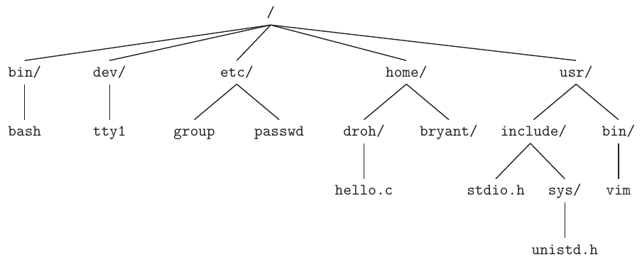
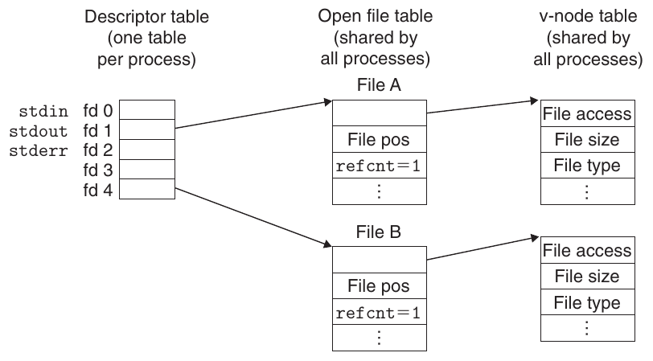
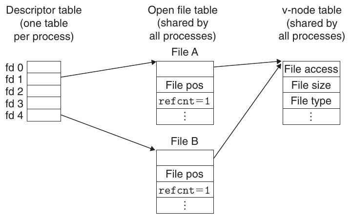
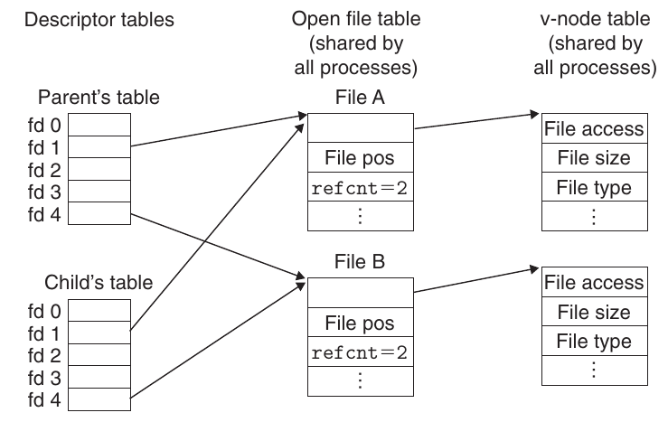
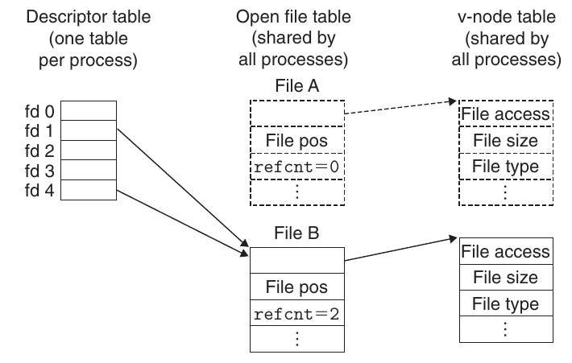
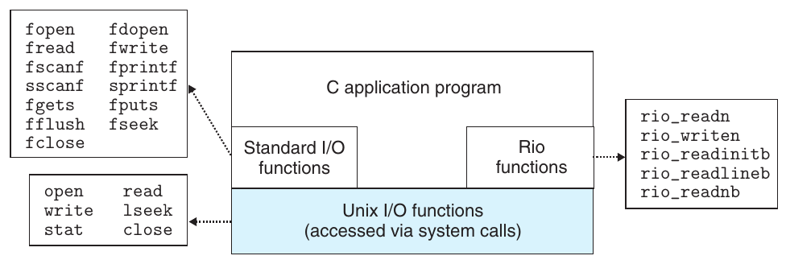

Phần III

**Tương tác và giao tiếp giữa các chương trình**

Đến thời điểm này trong quá trình nghiên cứu hệ thống máy tính, chúng ta giả định chương trình chạy độc lập với đầu vào và đầu ra tối thiểu. Tuy nhiên, trong thực tế, chương trình ứng dụng sử dụng dịch vụ do operating system cung cấp để giao tiếp với thiết bị I/O và chương trình khác.

Phần này giúp bạn hiểu các dịch vụ I/O cơ bản do operating system Unix cung cấp và cách sử dụng để xây dựng ứng dụng như Web client và server giao tiếp qua Internet. Bạn sẽ học kỹ thuật viết chương trình concurrent, như Web server có thể phục vụ nhiều client cùng lúc. Viết chương trình ứng dụng concurrent còn cho phép chúng thực thi nhanh hơn trên processor multi-core hiện đại. Khi hoàn tất phần này, bạn sẽ tiến gần tới việc trở thành lập trình viên giỏi, hiểu sâu hệ thống máy tính và ảnh hưởng của chúng tới chương trình.

# 10 System-Level I/O

Input/output (I/O) là quá trình sao chép dữ liệu giữa main memory và thiết bị bên ngoài như ổ đĩa, terminal và mạng. Thao tác input sao chép dữ liệu từ thiết bị I/O vào main memory, còn thao tác output sao chép dữ liệu từ bộ nhớ tới thiết bị.

Mọi hệ thống run-time của ngôn ngữ đều cung cấp phương tiện higher-level để thực hiện I/O. Ví dụ, ANSI C cung cấp thư viện standard I/O với các hàm như printf và scanf thực hiện buffered I/O. C++ cung cấp chức năng tương tự qua operator overload << (“đưa tới”) và >> (“lấy từ”). Trên hệ thống Linux, các hàm I/O higher-level này được triển khai bằng hàm Unix I/O system-level do kernel cung cấp. Phần lớn thời gian, hàm I/O higher-level hoạt động tốt và không cần dùng Unix I/O trực tiếp. Vậy tại sao cần học Unix I/O?

- Hiểu Unix I/O giúp bạn hiểu các khái niệm hệ thống khác. I/O là phần thiết yếu trong hoạt động hệ thống, vì vậy chúng ta thường gặp phụ thuộc vòng giữa I/O và các ý tưởng hệ thống khác. Ví dụ, I/O đóng vai trò then chốt trong tạo và thực thi process. Ngược lại, tạo process đóng vai trò then chốt trong cách các process dùng chung file. Vì vậy, để thực sự hiểu I/O, bạn cần hiểu process và ngược lại. Chúng ta đã đề cập các khía cạnh I/O khi thảo luận memory hierarchy, linking và loading, process và virtual memory. Bây giờ đã hiểu rõ hơn những ý tưởng này, chúng ta có thể khép kín vòng liên hệ và tìm hiểu I/O chi tiết hơn.

- Đôi khi bạn không có lựa chọn nào ngoài Unix I/O. Có những trường hợp quan trọng mà dùng hàm I/O higher-level là bất khả thi hoặc không phù hợp. Ví dụ, thư viện standard I/O không cung cấp cách truy cập file metadata như kích thước file hay thời điểm tạo file. Hơn nữa, thư viện standard I/O có các vấn đề khiến việc dùng nó cho network programming tiềm ẩn rủi ro.

Chương này giới thiệu khái niệm tổng quát về Unix I/O và standard I/O, đồng thời chỉ ra cách sử dụng chúng tin cậy từ chương trình C. Ngoài vai trò nhập môn chung, chương này tạo nền tảng vững chắc cho phần nghiên cứu network programming và concurrency tiếp theo.

## 10.1 Unix I/O

Linux file là dãy m byte:

B<sub>0</sub>, B<sub>1</sub>, . . . , B<sub>k</sub>, . . . , B<sub>m−1</sub>

Mọi thiết bị I/O như mạng, đĩa và terminal đều được mô hình hóa thành file, và mọi input, output được thực hiện bằng cách đọc, ghi file thích hợp. Ánh xạ thiết bị thành file tinh tế này cho phép Linux kernel cung cấp application interface low-level đơn giản gọi là Unix I/O, cho phép thực hiện mọi input, output theo cách đồng nhất và nhất quán:

Mở file. Ứng dụng thông báo ý định truy cập thiết bị I/O bằng cách yêu cầu kernel mở file tương ứng. Kernel trả số nguyên nhỏ không âm gọi là descriptor, nhận diện file trong mọi thao tác tiếp theo. Kernel theo dõi mọi thông tin về file đang mở. Ứng dụng chỉ theo dõi descriptor.

Mỗi process do Linux shell tạo bắt đầu với ba file mở: standard input (descriptor 0), standard output (descriptor 1) và standard error (descriptor 2). Header file <unistd.h> định nghĩa hằng số STDIN_FILENO, STDOUT_FILENO và STDERR_FILENO, có thể dùng thay giá trị descriptor tường minh.

Thay đổi current file position. Kernel duy trì file position k, ban đầu 0, cho mỗi file mở. File position là byte offset tính từ đầu file. Ứng dụng có thể đặt current file position k tường minh bằng thao tác seek.

Đọc và ghi file. Thao tác read sao chép n > 0 byte từ file vào bộ nhớ, bắt đầu tại current file position k rồi tăng k thêm n. Với file kích thước m byte, thực hiện read khi k ≥ m kích hoạt điều kiện end-of-file (EOF) mà ứng dụng có thể phát hiện. Không có “ký tự EOF” tường minh ở cuối file.

Tương tự, thao tác write sao chép n > 0 byte từ bộ nhớ vào file, bắt đầu tại current file position k rồi cập nhật k.

Đóng file. Khi truy cập file xong, ứng dụng thông báo cho kernel bằng yêu cầu đóng file. Kernel đáp ứng bằng cách giải phóng data structure tạo khi mở file và trả descriptor về tập descriptor sẵn có. Khi process kết thúc vì bất kỳ lý do gì, kernel đóng mọi file mở và giải phóng tài nguyên bộ nhớ của chúng.

## 10.2 File

Mỗi Linux file có type chỉ vai trò trong hệ thống:

- Regular file chứa dữ liệu tùy ý. Chương trình ứng dụng thường phân biệt text file, tức regular file chỉ chứa ký tự ASCII hoặc Unicode, với binary file là mọi loại còn lại. Với kernel, text file và binary file không khác nhau. Linux text file gồm dãy dòng văn bản, mỗi dòng là dãy ký tự kết thúc bằng ký tự newline (‘\n’). Ký tự newline giống ký tự line feed (LF) ASCII và có giá trị số 0x0a.

- Directory là file gồm array link, mỗi link ánh xạ filename tới file, có thể là directory khác. Mỗi directory chứa ít nhất hai entry: . (dot) liên kết tới chính directory đó, còn .. (dot-dot) liên kết tới parent directory trong hệ thống phân cấp directory (xem dưới). Bạn có thể tạo directory bằng mkdir, xem nội dung bằng ls và xóa bằng rmdir.

### Thông tin thêm: Ký hiệu end of line (EOL)

Một khía cạnh bất tiện khi làm việc với text file là các hệ thống dùng ký tự khác nhau để đánh dấu cuối dòng. Linux và Mac OS X dùng ’\n’ (0xa), là ký tự line feed (LF) ASCII. Tuy nhiên, MS Windows và giao thức Internet như HTTP dùng dãy ‘\r\n’ (0xd 0xa), tức ký tự carriage return (CR) ASCII theo sau bởi line feed (LF). Nếu tạo file foo.txt trong Windows rồi xem trong Linux text editor, bạn thấy ^M khó chịu ở cuối mỗi dòng, là cách công cụ Linux hiển thị CR. Có thể xóa các CR không mong muốn ngay trong foo.txt bằng lệnh sau:

```
linux> perl -pi -e "s/\r\n/\n/g" foo.txt
```

- Socket là file dùng để giao tiếp với process khác qua mạng (Mục 11.4).

Các loại file khác gồm named pipe, symbolic link, character device và block device, nằm ngoài phạm vi sách.

Linux kernel tổ chức mọi file trong một hệ thống phân cấp directory duy nhất neo tại root directory tên / (slash). Mỗi file trong hệ thống là hậu duệ trực tiếp hoặc gián tiếp của root directory. Hình 10.1 thể hiện một phần hệ thống phân cấp directory trên hệ thống Linux của chúng ta.

Là một phần context, mỗi process có current working directory xác định vị trí hiện tại trong hệ thống phân cấp directory. Bạn có thể đổi current working directory của shell bằng cd.



**Hình 10.1 Một phần hệ thống phân cấp directory Linux. Dấu slash cuối biểu thị directory.**

Vị trí trong hệ thống phân cấp directory được chỉ định bằng pathname. Pathname là string gồm dấu slash tùy chọn, theo sau bởi dãy filename phân cách bằng slash. Pathname có hai dạng:

- Absolute pathname bắt đầu bằng slash và biểu thị đường dẫn từ root node. Ví dụ, trong Hình 10.1, absolute pathname cho hello.c là /home/droh/hello.c.

- Relative pathname bắt đầu bằng filename và biểu thị đường dẫn từ current working directory. Ví dụ, trong Hình 10.1, nếu /home/droh là current working directory, relative pathname cho hello.c là ./hello.c. Ngược lại, nếu /home/bryant là current working directory, relative pathname là ../home/droh/hello.c.

## 10.3 Mở và đóng file

Process mở file hiện có hoặc tạo file mới bằng hàm open.

```
#include <sys/types.h>
#include <sys/stat.h>
#include <fcntl.h>

int open(char *filename, int flags, mode_t mode);
```

Trả về: file descriptor mới nếu thành công, −1 nếu có lỗi

Hàm open chuyển filename thành file descriptor và trả số descriptor. Descriptor trả về luôn là descriptor nhỏ nhất hiện chưa mở trong process. Đối số flags chỉ cách process định truy cập file:

O_RDONLY. Chỉ đọc

O_WRONLY. Chỉ ghi

O_RDWR. Đọc và ghi

Ví dụ, dưới đây là cách mở file hiện có để đọc:

```
fd = Open("foo.txt", O_RDONLY, 0);
```

Đối số flags cũng có thể được OR với một hoặc nhiều bit mask cung cấp chỉ dẫn bổ sung cho ghi:

O_CREAT. Nếu file không tồn tại, tạo phiên bản truncated (rỗng) của nó.

O_TRUNC. Nếu file đã tồn tại, truncate nó.

O_APPEND. Trước mỗi thao tác write, đặt file position tới cuối file.

| Mask | Mô tả |
|---|---|
| S_IRUSR | User (chủ sở hữu) có thể đọc file này |
| S_IWUSR | User (chủ sở hữu) có thể ghi file này |
| S_IXUSR | User (chủ sở hữu) có thể thực thi file này |
| S_IRGRP | Thành viên group của chủ sở hữu có thể đọc file này |
| S_IWGRP | Thành viên group của chủ sở hữu có thể ghi file này |
| S_IXGRP | Thành viên group của chủ sở hữu có thể thực thi file này |
| S_IROTH | Người khác (bất kỳ ai) có thể đọc file này |
| S_IWOTH | Người khác (bất kỳ ai) có thể ghi file này |
| S_IXOTH | Người khác (bất kỳ ai) có thể thực thi file này |

**Hình 10.2 Các access permission bit. Được định nghĩa trong sys/stat.h .**

Ví dụ, dưới đây là cách mở file hiện có với ý định nối thêm dữ liệu:

```
fd = Open("foo.txt", O_WRONLY|O_APPEND, 0);
```

Đối số mode chỉ định access permission bit của file mới. Tên ký hiệu cho các bit được thể hiện trong Hình 10.2.

Là một phần context, mỗi process có umask được đặt bằng hàm umask. Khi process tạo file mới bằng open với đối số mode, access permission bit của file được đặt thành mode & ~umask. Ví dụ, giả sử có các giá trị mode và umask mặc định sau:

```
#define DEF_MODE   S_IRUSR|S_IWUSR|S_IRGRP|S_IWGRP|S_IROTH|S_IWOTH
#define DEF_UMASK  S_IWGRP|S_IWOTH
```

Khi đó, đoạn code sau tạo file mới mà chủ sở hữu có quyền đọc và ghi, còn mọi người dùng khác có quyền đọc:

```
umask(DEF_UMASK);
fd = Open("foo.txt", O_CREAT|O_TRUNC|O_WRONLY, DEF_MODE);
```

Cuối cùng, process đóng file đang mở bằng hàm close.

```
#include <unistd.h>

int close(int fd);
```

Trả về: 0 nếu thành công, −1 nếu có lỗi

Đóng descriptor đã đóng là lỗi.

### Bài tập thực hành 10.1 (lời giải trang 951)

Đầu ra của chương trình sau là gì?

```
 1   #include "csapp.h"
 2
 3   int main()
 4   {
 5       int fd1, fd2;
 6
 7       fd1 = Open("foo.txt", O_RDONLY, 0);
 8       Close(fd1);
 9       fd2 = Open("baz.txt", O_RDONLY, 0);
10       printf("fd2 = %d\n", fd2);
11       exit(0);
12   }
```

## 10.4 Đọc và ghi file

Ứng dụng thực hiện input và output bằng cách lần lượt gọi read và write.

```
#include <unistd.h>

ssize_t read(int fd, void *buf, size_t n);
```

Trả về: số byte đọc được nếu thành công, 0 khi EOF, −1 nếu có lỗi

```
ssize_t write(int fd, const void *buf, size_t n);
```

Trả về: số byte ghi được nếu thành công, −1 nếu có lỗi

Hàm read sao chép tối đa n byte từ current file position của descriptor fd tới vị trí bộ nhớ buf. Giá trị trả về −1 biểu thị lỗi, còn 0 biểu thị EOF. Nếu không, giá trị trả về cho biết số byte thực sự đã truyền.

Hàm write sao chép tối đa n byte từ vị trí bộ nhớ buf tới current file position của descriptor fd. Hình 10.3 thể hiện chương trình sử dụng các lời gọi read và write để sao chép standard input sang standard output, mỗi lần 1 byte.

Ứng dụng có thể sửa current file position tường minh bằng lseek, nằm ngoài phạm vi sách.

Trong một số tình huống, read và write truyền ít byte hơn ứng dụng yêu cầu. Những short count như vậy không biểu thị lỗi. Chúng xảy ra vì một số lý do:

### Thông tin thêm: ssize_t và size_t khác nhau thế nào?

Bạn có thể nhận thấy read có đối số đầu vào size_t và giá trị trả về ssize_t. Vậy hai type khác nhau thế nào? Trên hệ thống x86-64, size_t được định nghĩa là unsigned long, còn ssize_t (signed size) là long. Hàm read trả signed size thay unsigned size vì phải trả −1 khi có lỗi. Điều thú vị là khả năng trả một giá trị −1 duy nhất làm giảm maximum read size đi 2 lần.

```
                                                         code/io/cpstdin.c
 1   #include "csapp.h"
 2
 3   int main(void)
 4   {
 5       char c;
 6
 7       while(Read(STDIN_FILENO, &c, 1) != 0)
 8           Write(STDOUT_FILENO, &c, 1);
 9       exit(0);
10   }
                                                         code/io/cpstdin.c
```

**Hình 10.3 Sử dụng read và write để sao chép standard input sang standard output, mỗi lần 1 byte.**

Gặp EOF khi đọc. Giả sử sẵn sàng đọc file chỉ còn 20 byte tính từ current file position và đang đọc theo khối 50-byte. Lần read tiếp theo trả short count 20, và lần read sau đó báo EOF bằng cách trả short count 0.

Đọc dòng văn bản từ terminal. Nếu file mở gắn với terminal (tức bàn phím và màn hình), mỗi lần gọi read truyền một dòng văn bản, trả short count bằng kích thước dòng.

Đọc và ghi network socket. Nếu file mở tương ứng network socket (Mục 11.4), ràng buộc buffering nội bộ và độ trễ mạng dài có thể khiến read và write trả short count. Short count cũng có thể xảy ra khi gọi read và write trên Linux pipe, cơ chế interprocess communication nằm ngoài phạm vi sách.

Trong thực tế, bạn không gặp short count khi đọc disk file trừ EOF, và không gặp short count khi ghi disk file. Tuy nhiên, nếu muốn xây dựng ứng dụng mạng robust (tin cậy) như Web server, phải xử lý short count bằng cách gọi read và write lặp lại đến khi truyền đủ mọi byte yêu cầu.

## 10.5 Đọc và ghi tin cậy bằng gói Rio

Trong mục này, chúng ta phát triển gói I/O tên Rio (Robust I/O), tự động xử lý short count giúp bạn. Gói Rio cung cấp I/O thuận tiện, tin cậy và hiệu quả trong ứng dụng như chương trình mạng có thể gặp short count. Rio cung cấp hai loại hàm:

Hàm unbuffered input và output. Những hàm này truyền trực tiếp dữ liệu giữa bộ nhớ và file, không có buffering application-level. Chúng đặc biệt hữu ích để đọc và ghi dữ liệu nhị phân từ và tới mạng.

Hàm buffered input. Các hàm này cho phép đọc hiệu quả dòng văn bản và dữ liệu nhị phân từ file có nội dung được cache trong buffer application-level, tương tự buffer dành cho hàm standard I/O như printf. Khác buffered I/O routine trong [110], các hàm buffered input Rio là thread-safe (Mục 12.7.1) và có thể xen kẽ tùy ý trên cùng descriptor. Ví dụ, bạn có thể đọc vài dòng văn bản từ descriptor, rồi một ít dữ liệu nhị phân, rồi thêm vài dòng văn bản.

Chúng ta trình bày Rio routine vì hai lý do. Thứ nhất, sẽ sử dụng chúng trong ứng dụng mạng phát triển ở hai chương tiếp theo. Thứ hai, nghiên cứu code các routine này giúp bạn hiểu sâu hơn Unix I/O nói chung.

### 10.5.1 Hàm unbuffered input và output của Rio

Ứng dụng có thể truyền trực tiếp dữ liệu giữa bộ nhớ và file bằng rio_readn và rio_writen.

```
#include "csapp.h"

ssize_t rio_readn(int fd, void *usrbuf, size_t n);
ssize_t rio_writen(int fd, void *usrbuf, size_t n);
```

Trả về: số byte đã truyền nếu thành công, 0 khi EOF (chỉ rio_readn), −1 nếu có lỗi

Hàm rio_readn truyền tối đa n byte từ current file position của descriptor fd tới vị trí bộ nhớ usrbuf. Tương tự, rio_writen truyền n byte từ usrbuf tới descriptor fd. rio_readn chỉ có thể trả short count nếu gặp EOF. rio_writen không bao giờ trả short count. Các lời gọi rio_readn và rio_writen có thể được xen kẽ tùy ý trên cùng descriptor.

Hình 10.4 thể hiện code của rio_readn và rio_writen. Chú ý rằng mỗi hàm tự khởi động lại read hoặc write nếu nó bị ngắt khi một signal handler của ứng dụng trả về. Để có tính portable cao nhất, chúng ta tính đến các system call bị ngắt và khởi động lại chúng khi cần.

### 10.5.2 Hàm buffered input của Rio

Giả sử muốn viết chương trình đếm số dòng text file. Có thể làm thế nào? Một cách là dùng read truyền mỗi lần 1 byte từ file vào bộ nhớ người dùng, kiểm tra mỗi byte có phải newline không. Nhược điểm là kém hiệu quả, cần trap vào kernel để đọc từng byte trong file.

Cách tốt hơn là gọi wrapper function (rio_readlineb) sao chép dòng văn bản từ read buffer nội bộ, tự động gọi read nạp lại buffer mỗi khi rỗng. Với file chứa cả dòng văn bản và dữ liệu nhị phân (như HTTP response mô tả trong Mục 11.5.3), chúng ta còn cung cấp phiên bản buffered của rio_readn tên rio_readnb, truyền raw byte từ cùng read buffer như rio_readlineb.

```
#include "csapp.h"

void rio_readinitb(rio_t *rp, int fd);
```

Trả về: không có gì

```
ssize_t rio_readlineb(rio_t *rp, void *usrbuf, size_t maxlen);
ssize_t rio_readnb(rio_t *rp, void *usrbuf, size_t n);
```

Trả về: số byte đọc được nếu thành công, 0 khi EOF, −1 nếu có lỗi

Hàm rio_readinitb được gọi một lần cho mỗi descriptor mở. Nó gắn descriptor fd với read buffer thuộc type rio_t tại địa chỉ rp.

Hàm rio_readlineb đọc dòng văn bản tiếp theo từ file rp (gồm ký tự newline kết thúc), sao chép tới vị trí bộ nhớ usrbuf rồi kết thúc dòng bằng ký tự NULL (không). rio_readlineb đọc tối đa maxlen-1 byte, dành chỗ cho ký tự NULL kết thúc. Dòng vượt maxlen-1 byte bị cắt ngắn và kết thúc bằng NULL.

Hàm rio_readnb đọc tối đa n byte từ file rp tới vị trí bộ nhớ usrbuf. Lời gọi rio_readlineb và rio_readnb có thể xen kẽ tùy ý trên cùng descriptor. Tuy nhiên, không nên xen kẽ lời gọi các hàm buffered này với hàm unbuffered rio_readn.

Bạn sẽ gặp nhiều ví dụ hàm Rio trong phần còn lại của sách. Hình 10.5 thể hiện cách dùng hàm Rio sao chép text file từ standard input sang standard output, mỗi lần một dòng.

Hình 10.6 thể hiện định dạng read buffer và code hàm rio_readinitb khởi tạo nó. rio_readinitb thiết lập read buffer rỗng và gắn file descriptor đang mở với buffer đó.

```
                                                                          code/src/csapp.c
 1   ssize_t rio_readn(int fd, void *usrbuf, size_t n)
 2   {
 3       size_t nleft = n;
 4       ssize_t nread;
 5       char *bufp = usrbuf;
 6
 7       while (nleft > 0) {
 8           if ((nread = read(fd, bufp, nleft)) < 0) {
 9               if (errno == EINTR) /* Interrupted by sig handler return */
10                   nread = 0;      /* and call read() again */
11               else
12                   return -1;      /* errno set by read() */
13           }
14           else if (nread == 0)
15               break;              /* EOF */
16           nleft -= nread;
17           bufp += nread;
18       }
19       return (n - nleft);         /* Return >= 0 */
20   }
                                                                          code/src/csapp.c

                                                                          code/src/csapp.c
 1   ssize_t rio_writen(int fd, void *usrbuf, size_t n)
 2   {
 3       size_t nleft = n;
 4       ssize_t nwritten;
 5       char *bufp = usrbuf;
 6
 7       while (nleft > 0) {
 8           if ((nwritten = write(fd, bufp, nleft)) <= 0) {
 9               if (errno == EINTR)  /* Interrupted by sig handler return */
10                   nwritten = 0;    /* and call write() again */
11               else
12                   return -1;       /* errno set by write() */
13           }
14           nleft -= nwritten;
15           bufp += nwritten;
16       }
17       return n;
18   }
                                                                          code/src/csapp.c
```

**Hình 10.4 Hàm rio_readn và rio_writen.**

```
                                                                           code/io/cpfile.c
 1   #include "csapp.h"
 2
 3   int main(int argc, char **argv)
 4   {
 5       int n;
 6       rio_t rio;
 7       char buf[MAXLINE];
 8
 9       Rio_readinitb(&rio, STDIN_FILENO);
10       while((n = Rio_readlineb(&rio, buf, MAXLINE)) != 0)
11           Rio_writen(STDOUT_FILENO, buf, n);
12   }
                                                                           code/io/cpfile.c
```

**Hình 10.5 Sao chép text file từ standard input sang standard output.**

```
                                                                      code/include/csapp.h
1   #define RIO_BUFSIZE 8192
2   typedef struct {
3       int rio_fd;                /* Descriptor for this internal buf */
4       int rio_cnt;               /* Unread bytes in internal buf */
5       char *rio_bufptr;          /* Next unread byte in internal buf */
6       char rio_buf[RIO_BUFSIZE]; /* Internal buffer */
7   } rio_t;
                                                                      code/include/csapp.h

                                                                         code/src/csapp.c
1   void rio_readinitb(rio_t *rp, int fd)
2   {
3       rp->rio_fd = fd;
4       rp->rio_cnt = 0;
5       rp->rio_bufptr = rp->rio_buf;
6   }
                                                                         code/src/csapp.c
```

**Hình 10.6 Read buffer thuộc type rio_t và hàm rio_readinitb khởi tạo nó.**

Cốt lõi của các Rio read routine là hàm rio_read trong Hình 10.7. Hàm rio_read là phiên bản buffered của Linux read. Khi rio_read được gọi với yêu cầu đọc n byte, read buffer có rp->rio_cnt byte chưa đọc. Nếu buffer rỗng, nó được nạp lại bằng một lời gọi read. Nhận short count từ lời gọi read này không phải lỗi; điều đó chỉ khiến read buffer được nạp một phần. Khi buffer không còn rỗng, rio_read sao chép số byte bằng giá trị nhỏ hơn giữa n và rp->rio_cnt từ read buffer sang user buffer, rồi trả về số byte đã sao chép.

```
                                                                          code/src/csapp.c
 1   static ssize_t rio_read(rio_t *rp, char *usrbuf, size_t n)
 2   {
 3       int cnt;
 4
 5       while (rp->rio_cnt <= 0) {  /* Refill if buf is empty */
 6           rp->rio_cnt = read(rp->rio_fd, rp->rio_buf,
 7                              sizeof(rp->rio_buf));
 8           if (rp->rio_cnt < 0) {
 9               if (errno != EINTR) /* Interrupted by sig handler return */
10                   return -1;
11           }
12           else if (rp->rio_cnt == 0)  /* EOF */
13               return 0;
14           else
15               rp->rio_bufptr = rp->rio_buf; /* Reset buffer ptr */
16       }
17
18       /* Copy min(n, rp->rio_cnt) bytes from internal buf to user buf */
19       cnt = n;
20       if (rp->rio_cnt < n)
21           cnt = rp->rio_cnt;
22       memcpy(usrbuf, rp->rio_bufptr, cnt);
23       rp->rio_bufptr += cnt;
24       rp->rio_cnt -= cnt;
25       return cnt;
26   }
                                                                          code/src/csapp.c
```

**Hình 10.7 Hàm rio_read nội bộ.**

Với chương trình ứng dụng, rio_read có cùng ngữ nghĩa với Linux read. Khi lỗi, nó trả −1 và đặt errno thích hợp. Khi EOF, trả 0. Nó trả short count nếu số byte yêu cầu vượt số byte chưa đọc trong read buffer. Sự tương đồng giúp dễ xây dựng các loại buffered read function khác nhau bằng cách thay read bằng rio_read. Ví dụ, rio_readnb trong Hình 10.8 có cùng cấu trúc rio_readn, với rio_read thay read. Tương tự, routine rio_readlineb trong Hình 10.8 gọi rio_read tối đa maxlen-1 lần. Mỗi lời gọi trả 1 byte từ read buffer, rồi byte được kiểm tra có phải newline kết thúc không.

```
                                                         code/src/csapp.c
 1   ssize_t rio_readlineb(rio_t *rp, void *usrbuf, size_t maxlen)
 2   {
 3       int n, rc;
 4       char c, *bufp = usrbuf;
 5
 6       for (n = 1; n < maxlen; n++) {
 7           if ((rc = rio_read(rp, &c, 1)) == 1) {
 8               *bufp++ = c;
 9               if (c == ’\n’) {
10                   n++;
11                   break;
12               }
13           } else if (rc == 0) {
14               if (n == 1)
15                   return 0; /* EOF, no data read */
16               else
17                   break;    /* EOF, some data was read */
18           } else
19               return -1;    /* Error */
20       }
21       *bufp = 0;
22       return n-1;
23   }
                                                         code/src/csapp.c

                                                         code/src/csapp.c
 1   ssize_t rio_readnb(rio_t *rp, void *usrbuf, size_t n)
 2   {
 3       size_t nleft = n;
 4       ssize_t nread;
 5       char *bufp = usrbuf;
 6
 7       while (nleft > 0) {
 8           if ((nread = rio_read(rp, bufp, nleft)) < 0)
 9               return -1;             /* errno set by read() */
10           else if (nread == 0)
11               break;                 /* EOF */
12           nleft -= nread;
13           bufp += nread;
14       }
15       return (n - nleft);            /* Return >= 0 */
16   }
                                                         code/src/csapp.c
```

**Hình 10.8 Hàm rio_readlineb và rio_readnb.**

#### Thông tin thêm: Nguồn gốc gói Rio

Các hàm Rio được lấy cảm hứng từ readline, readn và writen do W. Richard Stevens mô tả trong giáo trình network programming kinh điển [110]. rio_readn và rio_writen giống hệt readn và writen của Stevens. Tuy nhiên, readline của Stevens có một số hạn chế được Rio sửa. Thứ nhất, vì readline buffered còn readn không buffered, không thể dùng hai hàm cùng nhau trên cùng descriptor. Thứ hai, vì dùng static buffer, readline của Stevens không thread-safe, buộc Stevens giới thiệu phiên bản thread-safe khác tên readline_r. Chúng ta sửa cả hai thiếu sót bằng rio_readlineb và rio_readnb, tương thích với nhau và thread-safe.

## 10.6 Đọc file metadata

Ứng dụng có thể lấy thông tin file (đôi khi gọi là file metadata) bằng stat và fstat.

```
#include <unistd.h>
#include <sys/stat.h>

int stat(const char *filename, struct stat *buf);
int fstat(int fd, struct stat *buf);
```

Trả về: 0 nếu thành công, −1 nếu có lỗi

Hàm stat nhận filename và điền các thành viên của cấu trúc stat trong Hình 10.9. Hàm fstat tương tự nhưng nhận file descriptor thay filename. Chúng ta cần thành viên st_mode và st_size của stat khi thảo luận Web server trong Mục 11.5. Thành viên khác nằm ngoài phạm vi sách.

Thành viên st_size chứa kích thước file tính bằng byte. st_mode mã hóa cả file permission bit (Hình 10.2) và file type (Mục 10.2). Linux định nghĩa macro predicate trong sys/stat.h để xác định file type từ st_mode:

S_ISREG(m). Đây có phải regular file không?

S_ISDIR(m). Đây có phải directory file không?

S_ISSOCK(m). Đây có phải network socket không?

Hình 10.10 thể hiện cách dùng các macro này và stat để đọc, diễn giải các bit st_mode của file.

statbuf.h (được sys/stat.h include)

```
/* Metadata returned by the stat and fstat functions */
struct stat {
    dev_t         st_dev;      /* Device */
    ino_t         st_ino;      /* inode */
    mode_t        st_mode;     /* Protection and file type */
    nlink_t       st_nlink;    /* Number of hard links */
    uid_t         st_uid;      /* User ID of owner */
    gid_t         st_gid;      /* Group ID of owner */
    dev_t         st_rdev;     /* Device type (if inode device) */
    off_t         st_size;     /* Total size, in bytes */
    unsigned long st_blksize;  /* Block size for filesystem I/O */
    unsigned long st_blocks;   /* Number of blocks allocated */
    time_t        st_atime;    /* Time of last access */
    time_t        st_mtime;    /* Time of last modification */
    time_t        st_ctime;    /* Time of last change */
};
                                                 statbuf.h (included by sys/stat.h)
```

**Hình 10.9 Cấu trúc stat.**

```
                                                            code/io/statcheck.c
 1   #include "csapp.h"
 2
 3   int main (int argc, char **argv)
 4   {
 5       struct stat stat;
 6       char *type, *readok;
 7
 8       Stat(argv[1], &stat);
 9       if (S_ISREG(stat.st_mode))     /* Determine file type */
10           type = "regular";
11       else if (S_ISDIR(stat.st_mode))
12           type = "directory";
13       else
14           type = "other";
15       if ((stat.st_mode & S_IRUSR)) /* Check read access */
16           readok = "yes";
17       else
18           readok = "no";
19
20       printf("type: %s, read: %s\n", type, readok);
21       exit(0);
22   }
                                                            code/io/statcheck.c
```

**Hình 10.10 Truy vấn và thao tác các bit st_mode của file.**

## 10.7 Đọc nội dung directory

Ứng dụng có thể đọc nội dung directory bằng họ hàm readdir.

```
#include <sys/types.h>
#include <dirent.h>

DIR *opendir(const char *name);
```

Trả về: pointer tới handle nếu thành công, NULL nếu có lỗi

Hàm opendir nhận pathname và trả pointer tới directory stream. Stream là abstraction cho danh sách mục có thứ tự, trong trường hợp này là danh sách directory entry.

```
#include <dirent.h>

struct dirent *readdir(DIR *dirp);
```

Trả về: pointer tới directory entry tiếp theo nếu thành công, NULL nếu hết entry hoặc có lỗi

Mỗi lời gọi readdir trả pointer tới directory entry tiếp theo trong stream dirp, hoặc NULL nếu không còn entry. Mỗi directory entry là cấu trúc có dạng

```
struct dirent {
    ino_t d_ino;       /* inode number */
    char  d_name[256]; /* Filename */
};
```

Mặc dù một số phiên bản Linux có thêm thành viên cấu trúc khác, đây là hai thành viên duy nhất được chuẩn hóa trên mọi hệ thống. Thành viên d_name là filename và d_ino là vị trí file.

Khi lỗi, readdir trả NULL và đặt errno. Đáng tiếc, cách duy nhất phân biệt lỗi với điều kiện end-of-stream là kiểm tra errno có thay đổi kể từ lời gọi readdir hay không.

```
#include <dirent.h>

int closedir(DIR *dirp);
```

Trả về: 0 nếu thành công, −1 nếu có lỗi

Hàm closedir đóng stream và giải phóng mọi tài nguyên của nó. Hình 10.11 thể hiện cách dùng readdir đọc nội dung directory.

```
                                                         code/io/readdir.c
 1   #include "csapp.h"
 2
 3   int main(int argc, char **argv)
 4   {
 5       DIR *streamp;
 6       struct dirent *dep;
 7
 8       streamp = Opendir(argv[1]);
 9
10       errno = 0;
11       while ((dep = readdir(streamp)) != NULL) {
12           printf("Found file: %s\n", dep->d_name);
13       }
14       if (errno != 0)
15           unix_error("readdir error");
16
17       Closedir(streamp);
18       exit(0);
19   }
                                                         code/io/readdir.c
```

**Hình 10.11 Đọc nội dung directory.**

## 10.8 Chia sẻ file

Linux file có thể được chia sẻ theo nhiều cách. Nếu không hình dung rõ kernel biểu diễn file đang mở thế nào, khái niệm chia sẻ file có thể gây bối rối. Kernel biểu diễn file mở bằng ba data structure liên quan:

Descriptor table. Mỗi process có descriptor table riêng, với entry được đánh index bằng các file descriptor đang mở của process. Mỗi open descriptor entry trỏ tới entry trong file table.

File table. Tập file đang mở được biểu diễn bằng file table dùng chung cho mọi process. Mỗi file table entry gồm (trong phạm vi này) current file position, reference count là số descriptor entry hiện trỏ tới nó và pointer tới entry trong v-node table. Đóng descriptor làm giảm reference count trong file table entry tương ứng. Kernel không xóa file table entry cho đến khi reference count bằng không.

v-node table. Giống file table, v-node table được mọi process dùng chung. Mỗi entry chứa phần lớn thông tin trong stat, gồm st_mode và st_size.



**Hình 10.12 Các data structure kernel điển hình cho file mở. Trong ví dụ, hai descriptor tham chiếu file riêng biệt. Không có chia sẻ.**



**Hình 10.13 Chia sẻ file. Ví dụ thể hiện hai descriptor dùng chung disk file qua hai open file table entry.**

Hình 10.12 thể hiện ví dụ descriptor 1 và 4 tham chiếu hai file khác nhau qua open file table entry riêng. Đây là tình huống điển hình, file không dùng chung và mỗi descriptor tương ứng file riêng biệt.

Nhiều descriptor cũng có thể tham chiếu cùng một file qua những file table entry khác nhau, như Hình 10.13. Ví dụ, điều này có thể xảy ra nếu bạn gọi hàm open hai lần với cùng filename. Ý tưởng then chốt là mỗi descriptor có file position riêng, nên các lần đọc trên descriptor khác nhau có thể lấy dữ liệu từ những vị trí khác nhau trong file.

Chúng ta cũng có thể hiểu cách parent và child process dùng chung file. Giả sử trước lời gọi fork, parent process có file mở như Hình 10.12. Khi đó Hình 10.14 thể hiện tình huống sau lời gọi fork.

Child nhận một bản sao riêng của descriptor table của parent. Parent và child dùng chung tập open file table, do đó dùng chung file position. Một hệ quả quan trọng là cả parent và child đều phải đóng descriptor của mình trước khi kernel xóa file table entry tương ứng.



**Hình 10.14 Cách child process kế thừa file đang mở của parent. Tình huống ban đầu nằm trong Hình 10.12.**

### Bài tập thực hành 10.2 (lời giải trang 951)

Giả sử disk file foobar.txt gồm sáu ký tự ASCII foobar. Khi đó đầu ra chương trình sau là gì?

```
 1   #include "csapp.h"
 2
 3   int main()
 4   {
 5       int fd1, fd2;
 6       char c;
 7
 8       fd1 = Open("foobar.txt", O_RDONLY, 0);
 9       fd2 = Open("foobar.txt", O_RDONLY, 0);
10       Read(fd1, &c, 1);
11       Read(fd2, &c, 1);
12       printf("c = %c\n", c);
13       exit(0);
14   }
```

#### Bài tập thực hành 10.3 (lời giải trang 951)

Như trước, giả sử disk file foobar.txt gồm sáu ký tự ASCII foobar. Khi đó đầu ra chương trình sau là gì?

```
 1   #include "csapp.h"
 2
 3   int main()
 4   {
 5       int fd;
 6       char c;
 7
 8       fd = Open("foobar.txt", O_RDONLY, 0);
 9       if (Fork() == 0) {
10           Read(fd, &c, 1);
11           exit(0);
12       }
13       Wait(NULL);
14       Read(fd, &c, 1);
15       printf("c = %c\n", c);
16       exit(0);
17   }
```

## 10.9 I/O Redirection

Linux shell cung cấp operator I/O redirection cho phép người dùng gắn standard input và output với disk file. Ví dụ, gõ

```
linux> ls > foo.txt
```

khiến shell load và thực thi chương trình ls, với standard output được redirect tới disk file foo.txt. Như sẽ thấy trong Mục 11.5, Web server thực hiện redirection tương tự khi chạy chương trình CGI thay mặt client. Vậy I/O redirection hoạt động thế nào? Một cách là dùng dup2.

```
#include <unistd.h>

int dup2(int oldfd, int newfd);
```

Trả về: descriptor không âm nếu thành công, −1 nếu có lỗi

Hàm dup2 sao chép descriptor table entry oldfd tới descriptor table entry newfd, ghi đè nội dung cũ của entry newfd. Nếu newfd đã mở, dup2 đóng newfd trước khi sao chép oldfd.

Giả sử trước khi gọi dup2(4,1), có tình huống trong Hình 10.12, descriptor 1 (standard output) tương ứng file A (chẳng hạn terminal), còn descriptor 4 tương ứng file B (chẳng hạn disk file). Reference count của A và B đều bằng 1. Hình 10.15 thể hiện tình huống sau khi gọi dup2(4,1). Cả hai descriptor nay trỏ tới file B; file A đã đóng và các entry file table, v-node table của nó bị xóa; reference count của file B tăng lên. Từ đây, mọi dữ liệu ghi tới standard output được redirect tới file B.

### Bài tập thực hành 10.4 (lời giải trang 951)

Bạn dùng dup2 để redirect standard input tới descriptor 5 thế nào?

#### Thông tin thêm: Hoinky phải và trái

Để tránh nhầm với operator bracket-type khác như ‘]’ và ‘[’, chúng ta luôn gọi operator ‘>’ của shell là “right hoinky” và operator ‘<’ là “left hoinky”.



**Hình 10.15 Data structure kernel sau khi redirect standard output bằng dup2(4,1) . Tình huống ban đầu trong Hình 10.12.**

#### Bài tập thực hành 10.5 (lời giải trang 952)

Giả sử disk file foobar.txt gồm sáu ký tự ASCII foobar, đầu ra chương trình sau là gì?

```
 1   #include "csapp.h"
 2
 3   int main()
 4   {
 5       int fd1, fd2;
 6       char c;
 7
 8       fd1 = Open("foobar.txt", O_RDONLY, 0);
 9       fd2 = Open("foobar.txt", O_RDONLY, 0);
10       Read(fd2, &c, 1);
11       Dup2(fd2, fd1);
12       Read(fd1, &c, 1);
13       printf("c = %c\n", c);
14       exit(0);
15   }
```

## 10.10 Standard I/O

Ngôn ngữ C định nghĩa tập hàm input và output higher-level gọi là thư viện standard I/O, cung cấp cho lập trình viên lựa chọn higher-level thay Unix I/O. Thư viện (libc) cung cấp hàm mở và đóng file (fopen, fclose), đọc và ghi byte (fread, fwrite), đọc và ghi string (fgets, fputs), cùng formatted I/O tinh vi (scanf, printf).

Thư viện standard I/O mô hình hóa file mở thành stream. Với lập trình viên, stream là pointer tới cấu trúc thuộc type FILE. Mọi chương trình ANSI C bắt đầu với ba stream mở: stdin, stdout và stderr, lần lượt tương ứng standard input, standard output và standard error:

```
#include <stdio.h>
extern FILE *stdin;    /* Standard input (descriptor 0) */
extern FILE *stdout;   /* Standard output (descriptor 1) */
extern FILE *stderr;   /* Standard error (descriptor 2) */
```

Stream thuộc type FILE là abstraction cho file descriptor và stream buffer. Mục đích stream buffer giống Rio read buffer: giảm số lần gọi Linux I/O system call tốn kém. Ví dụ, giả sử chương trình gọi lặp lại hàm standard I/O getc, mỗi lời gọi trả ký tự tiếp theo từ file. Khi getc được gọi lần đầu, thư viện nạp stream buffer bằng một lời gọi read duy nhất rồi trả byte đầu tiên trong buffer cho ứng dụng. Miễn buffer còn byte chưa đọc, những lời gọi getc tiếp theo được phục vụ trực tiếp từ stream buffer.

## 10.11 Tổng hợp: Nên dùng hàm I/O nào?

Hình 10.16 tóm tắt các gói I/O đã thảo luận trong chương.



**Hình 10.16 Quan hệ giữa Unix I/O, standard I/O và Rio.**

Mô hình Unix I/O được triển khai trong kernel của operating system. Nó có sẵn cho ứng dụng qua hàm như open, close, lseek, read, write và stat. Hàm Rio và standard I/O higher-level được triển khai “trên” (sử dụng) hàm Unix I/O. Hàm Rio là wrapper robust cho read và write, được phát triển riêng cho giáo trình này. Chúng tự xử lý short count và cung cấp cách buffered hiệu quả để đọc dòng văn bản. Hàm standard I/O cung cấp lựa chọn buffered đầy đủ hơn thay Unix I/O, gồm formatted I/O routine như printf và scanf.

Vậy nên dùng hàm nào trong chương trình? Dưới đây là hướng dẫn cơ bản:

G1: Dùng hàm standard I/O bất cứ khi nào có thể. Hàm standard I/O là lựa chọn ưu tiên cho I/O trên đĩa và terminal. Phần lớn lập trình viên C chỉ dùng standard I/O suốt sự nghiệp, không cần quan tâm hàm Unix I/O lower-level (có thể ngoại trừ stat, không có hàm tương ứng trong thư viện standard I/O). Khi có thể, chúng ta khuyên bạn làm tương tự.

G2: Không dùng scanf hay rio_readlineb để đọc binary file. Hàm như scanf và rio_readlineb được thiết kế riêng cho text file. Lỗi sinh viên thường mắc là dùng chúng đọc dữ liệu nhị phân, khiến chương trình thất bại theo cách lạ và khó dự đoán. Ví dụ, binary file có thể chứa nhiều byte 0xa không liên quan tới kết thúc dòng văn bản.

G3: Dùng hàm Rio cho I/O trên network socket. Đáng tiếc, standard I/O đặt ra vấn đề khó chịu khi dùng input và output trên mạng. Như sẽ thấy trong Mục 11.4, abstraction của Linux cho mạng là loại file gọi là socket. Giống mọi Linux file, socket được tham chiếu bằng file descriptor, trong trường hợp này gọi là socket descriptor. Application process giao tiếp với process chạy trên máy tính khác bằng cách đọc và ghi socket descriptor.

Standard I/O stream là full duplex theo nghĩa chương trình có thể input và output trên cùng stream. Tuy nhiên, có những hạn chế stream ít được tài liệu hóa tương tác không tốt với hạn chế socket:

Hạn chế 1: Hàm input theo sau hàm output. Hàm input không thể theo sau hàm output nếu không có lời gọi fflush, fseek, fsetpos hoặc rewind xen giữa. Hàm fflush làm rỗng buffer gắn với stream. Ba hàm sau dùng Unix I/O lseek để reset current file position.

Hạn chế 2: Hàm output theo sau hàm input. Hàm output không thể theo sau hàm input nếu không có lời gọi fseek, fsetpos hoặc rewind xen giữa, trừ khi hàm input gặp end-of-file.

Các hạn chế này gây vấn đề cho ứng dụng mạng vì dùng lseek trên socket là không hợp lệ. Hạn chế stream I/O đầu tiên có thể được khắc phục bằng quy tắc flush buffer trước mỗi thao tác input. Tuy nhiên, cách duy nhất vượt hạn chế thứ hai là mở hai stream trên cùng socket descriptor đang mở, một để đọc và một để ghi:

```
FILE *fpin, *fpout;

fpin = fdopen(sockfd, "r");
fpout = fdopen(sockfd, "w");
```

Nhưng cách này cũng có vấn đề vì yêu cầu ứng dụng gọi fclose trên cả hai stream để giải phóng tài nguyên bộ nhớ gắn với mỗi stream và tránh memory leak:

```
fclose(fpin);
fclose(fpout);
```

Mỗi thao tác này đều thử đóng cùng một socket descriptor bên dưới, nên thao tác close thứ hai sẽ thất bại. Điều này không gây vấn đề cho chương trình tuần tự, nhưng đóng một descriptor đã đóng trong chương trình threaded có thể dẫn đến thảm họa (xem Mục 12.7.4).

Vì vậy, chúng ta khuyên không dùng hàm standard I/O cho input và output trên network socket. Thay vào đó dùng hàm Rio robust. Nếu cần formatted output, dùng sprintf định dạng string trong bộ nhớ rồi gửi tới socket bằng rio_writen. Nếu cần formatted input, dùng rio_readlineb đọc toàn dòng văn bản rồi dùng sscanf trích các field khác nhau từ dòng.

## 10.12 Tổng kết

Linux cung cấp số lượng nhỏ system-level function dựa trên mô hình Unix I/O, cho phép ứng dụng mở, đóng, đọc, ghi file, lấy file metadata và thực hiện I/O redirection. Thao tác read và write của Linux có thể gặp short count mà ứng dụng phải dự liệu và xử lý đúng. Thay vì gọi Unix I/O trực tiếp, ứng dụng nên dùng gói Rio, tự động xử lý short count bằng cách lặp thao tác read và write đến khi truyền đủ dữ liệu yêu cầu.

Linux kernel sử dụng ba data structure liên quan để biểu diễn file đang mở. Các entry trong descriptor table trỏ tới entry trong open file table; các entry này lại trỏ tới entry trong v-node table. Mỗi process có descriptor table riêng, trong khi mọi process dùng chung open file table và v-node table. Hiểu cách tổ chức tổng quát của các cấu trúc này giúp làm rõ cả việc chia sẻ file lẫn I/O redirection.

Thư viện standard I/O được triển khai trên Unix I/O và cung cấp tập I/O routine higher-level mạnh mẽ. Với phần lớn ứng dụng, standard I/O là lựa chọn đơn giản hơn và được ưu tiên thay Unix I/O. Tuy nhiên, vì một số hạn chế không tương thích giữa standard I/O và network file, ứng dụng mạng cần dùng Unix I/O thay standard I/O.

## Ghi chú tài liệu tham khảo

Kerrisk trình bày toàn diện Unix I/O và Linux file system [62]. Stevens viết giáo trình tham khảo chuẩn đầu tiên cho Unix I/O [111]. Kernighan và Ritchie thảo luận rõ ràng, đầy đủ hàm standard I/O [61].

## Bài tập về nhà

10.6 ◆ Đầu ra chương trình sau là gì?

```
 1   #include "csapp.h"
 2
 3   int main()
 4   {
 5       int fd1, fd2;
 6
 7       fd1 = Open("foo.txt", O_RDONLY, 0);
 8       fd2 = Open("bar.txt", O_RDONLY, 0);
 9       Close(fd2);
10       fd2 = Open("baz.txt", O_RDONLY, 0);
11       printf("fd2 = %d\n", fd2);
12       exit(0);
13   }
```

10.7 ◆ Sửa chương trình cpfile trong Hình 10.5 để dùng hàm Rio sao chép standard input sang standard output, mỗi lần MAXBUF byte.

10.8 ◆◆ Viết phiên bản chương trình statcheck trong Hình 10.10 tên fstatcheck, nhận số descriptor trên dòng lệnh thay filename.

10.9 ◆◆ Xét lời gọi chương trình fstatcheck sau từ Bài toán 10.8:

```
linux> fstatcheck 3 < foo.txt
```

Bạn có thể kỳ vọng lời gọi fstatcheck này lấy và hiển thị metadata cho file foo.txt. Tuy nhiên, khi chạy trên hệ thống của chúng ta, nó thất bại với “bad file descriptor.” Với hành vi này, điền pseudocode mà shell phải thực thi giữa lời gọi fork và execve:

```
if (Fork() == 0) { /* child */
    /* What code is the shell executing right here? */
    Execve("fstatcheck", argv, envp);
}
```

10.10 ◆◆ Sửa chương trình cpfile trong Hình 10.5 để nhận đối số command-line tùy chọn infile. Nếu có infile, sao chép infile sang standard output; nếu không, sao chép standard input sang standard output như trước. Điểm đặc biệt là lời giải phải dùng copy loop gốc (dòng 9–11) cho cả hai trường hợp. Bạn chỉ được chèn code, không được thay bất kỳ code hiện có nào.

## Lời giải các bài tập thực hành

Lời giải Bài toán 10.1 (trang 931) Unix process bắt đầu với descriptor mở gán cho stdin (descriptor 0), stdout (descriptor 1) và stderr (descriptor 2). Hàm open luôn trả descriptor chưa mở thấp nhất, nên lần gọi open đầu tiên trả descriptor 3. Lời gọi close giải phóng descriptor 3. Lời gọi open cuối trả descriptor 3, do đó đầu ra chương trình là fd2 = 3.

Lời giải Bài toán 10.2 (trang 944) Descriptor fd1 và fd2 có open file table entry riêng, nên mỗi descriptor có file position riêng cho foobar.txt. Vì vậy, read từ fd2 đọc byte đầu tiên của foobar.txt, đầu ra là

```
c = f
```

chứ không phải

```
c = o
```

như bạn có thể nghĩ lúc đầu.

Lời giải Bài toán 10.3 (trang 944) Nhớ rằng child kế thừa descriptor table của parent và mọi process dùng chung open file table. Vì vậy, descriptor fd trong cả parent và child trỏ tới cùng open file table entry. Khi child đọc byte đầu file, file position tăng 1. Do đó, parent đọc byte thứ hai, đầu ra là

```
c = o
```

Lời giải Bài toán 10.4 (trang 945) Để redirect standard input (descriptor 0) tới descriptor 5, gọi dup2(5,0), hoặc tương đương dup2(5,STDIN_FILENO).

Lời giải Bài toán 10.5 (trang 946) Thoạt nhìn, bạn có thể nghĩ đầu ra là

```
c = f
```

nhưng vì đang redirect fd1 tới fd2, đầu ra thực sự là

```
c = o
```
