# 11 Network Programming

Ứng dụng mạng có ở khắp nơi. Mỗi khi duyệt Web, gửi email hoặc chơi game trực tuyến, bạn đang dùng ứng dụng mạng. Điều thú vị là mọi ứng dụng mạng đều dựa trên cùng mô hình lập trình cơ bản, có cấu trúc logic tổng thể tương tự và dựa vào cùng programming interface.

Ứng dụng mạng dựa vào nhiều khái niệm đã học khi nghiên cứu hệ thống. Ví dụ, process, signal, byte ordering, memory mapping và dynamic storage allocation đều quan trọng. Cũng có các khái niệm mới cần nắm vững. Bạn cần hiểu mô hình lập trình client-server cơ bản và cách viết chương trình client-server dùng dịch vụ Internet cung cấp. Cuối chương, chúng ta kết hợp mọi ý tưởng bằng cách phát triển Web server nhỏ nhưng hoạt động được, phục vụ nội dung static và dynamic có văn bản, đồ họa cho Web browser thực tế.

## 11.1 Mô hình lập trình Client-Server

Mọi ứng dụng mạng dựa trên mô hình client-server. Với mô hình này, ứng dụng gồm một server process và một hoặc nhiều client process. Server quản lý tài nguyên và cung cấp dịch vụ cho client bằng cách thao tác tài nguyên đó. Ví dụ, Web server quản lý tập disk file để truy xuất và thực thi thay client. FTP server quản lý tập disk file để lưu và truy xuất cho client. Tương tự, email server quản lý spool file để đọc và cập nhật cho client.

Thao tác cơ bản trong mô hình client-server là transaction (Hình 11.1). Transaction client-server gồm bốn bước:

1. Khi client cần dịch vụ, nó khởi tạo transaction bằng cách gửi request tới server. Ví dụ, khi Web browser cần file, nó gửi request tới Web server.

2. Server nhận request, diễn giải rồi thao tác tài nguyên theo cách thích hợp. Ví dụ, khi Web server nhận request từ browser, nó đọc disk file.

3. Server gửi response tới client rồi chờ request tiếp theo. Ví dụ, Web server gửi file trở lại client.

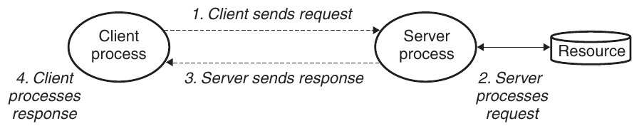

**Hình 11.1 Transaction client-server.**

### Thông tin thêm: Transaction Client-server và database transaction

Transaction Client-server không phải database transaction và không có các thuộc tính như atomicity của database transaction. Trong ngữ cảnh này, transaction chỉ là dãy bước do client và server thực hiện.

4. Client nhận response và xử lý nó. Ví dụ, sau khi Web browser nhận page từ server, nó hiển thị lên màn hình.

Cần nhận ra rằng client và server là process, không phải máy tính, hay host như thường gọi trong ngữ cảnh này. Một host duy nhất có thể chạy nhiều client và server khác nhau concurrently, và client cùng server trong một transaction có thể nằm trên cùng host hoặc trên các host khác nhau. Mô hình client-server vẫn giống nhau, bất kể cách ánh xạ client và server tới host.

## 11.2 Mạng

Client và server thường chạy trên host riêng và giao tiếp bằng tài nguyên phần cứng, phần mềm của mạng máy tính. Mạng là hệ thống tinh vi, ở đây chúng ta chỉ có thể giới thiệu sơ lược. Mục tiêu là cung cấp mô hình tư duy hữu dụng từ góc nhìn lập trình viên.

Với host, mạng chỉ là một thiết bị I/O khác đóng vai trò nguồn và đích dữ liệu như Hình 11.2.

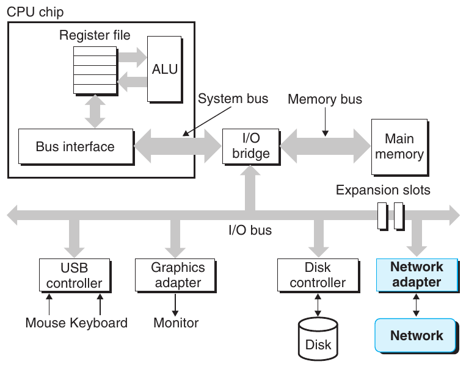

**Hình 11.2 Tổ chức phần cứng của network host.**

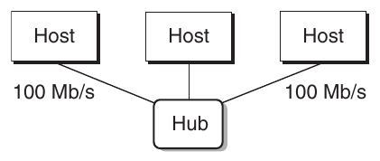

**Hình 11.3 Ethernet segment.**

Adapter cắm vào khe mở rộng trên I/O bus cung cấp physical interface tới mạng. Dữ liệu nhận từ mạng được sao chép từ adapter qua I/O bus và memory bus vào bộ nhớ, thường bằng DMA transfer. Tương tự, dữ liệu cũng có thể được sao chép từ bộ nhớ ra mạng.

Về vật lý, mạng là hệ thống phân cấp tổ chức theo sự gần gũi địa lý. Cấp thấp nhất là LAN (local area network) trải trên tòa nhà hoặc khuôn viên. Công nghệ LAN phổ biến nhất cho đến nay là Ethernet, được phát triển vào mid-1970s tại Xerox PARC. Ethernet chứng tỏ khả năng thích nghi đáng kể, phát triển từ 3 Mb/s tới 10 Gb/s.

Ethernet segment gồm dây dẫn (thường là cặp dây xoắn) và hộp nhỏ gọi là hub như Hình 11.3. Ethernet segment thường phủ vùng nhỏ như phòng hoặc tầng trong tòa nhà. Mỗi dây có cùng maximum bit bandwidth, thường 100 Mb/s hoặc 1 Gb/s. Một đầu gắn adapter trên host, đầu còn lại gắn port trên hub. Hub sao chép máy móc mọi bit nhận ở mỗi port sang mọi port khác. Vì vậy, mọi host thấy mọi bit.

Mỗi Ethernet adapter có địa chỉ 48-bit duy nhất toàn cầu lưu trong nonvolatile memory trên adapter. Host có thể gửi khối bit gọi là frame tới host khác trên segment. Mỗi frame gồm số header bit cố định nhận diện nguồn, đích và độ dài frame, theo sau bởi payload data bit. Mọi host adapter thấy frame nhưng chỉ destination host thực sự đọc.

Nhiều Ethernet segment có thể nối thành LAN lớn hơn gọi là bridged Ethernet bằng dây và hộp nhỏ gọi là bridge như Hình 11.4. Bridged Ethernet có thể phủ cả tòa nhà hoặc khuôn viên. Trong bridged Ethernet, một số dây nối bridge với bridge, số khác nối bridge với hub. Bandwidth dây có thể khác nhau. Trong ví dụ, dây bridge–bridge có bandwidth 1 Gb/s, còn bốn dây hub–bridge có bandwidth 100 Mb/s.

Bridge tận dụng bandwidth sẵn có trên dây tốt hơn hub. Bằng một distributed algorithm thông minh, chúng tự học theo thời gian những host nào có thể tới được từ những port nào, rồi chỉ sao chép frame có chọn lọc từ port này sang port khác khi cần. Ví dụ, nếu host A gửi frame tới host B nằm trên cùng segment, bridge X sẽ bỏ frame khi nó tới input port, nhờ đó tiết kiệm bandwidth trên các segment khác. Tuy nhiên, nếu host A gửi frame tới host C trên segment khác, bridge X chỉ sao chép frame tới port nối với bridge Y; Y chỉ sao chép frame tới port nối với segment của host C.

### Thông tin thêm: Internet và internet

Chúng ta luôn dùng internet viết thường để chỉ khái niệm tổng quát và Internet viết hoa để chỉ triển khai cụ thể—tức global IP Internet.

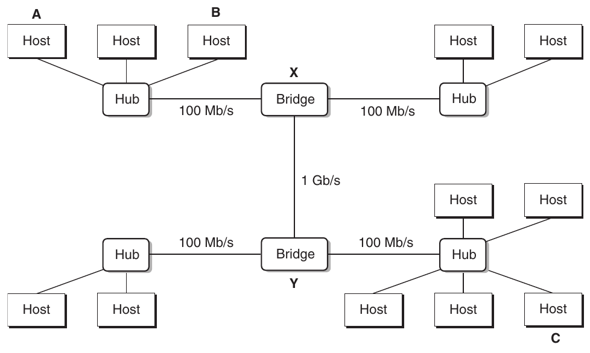

**Hình 11.4 Các Ethernet segment được bridge.**

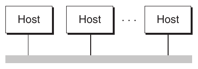

**Hình 11.5 Góc nhìn khái niệm về LAN.**

Để đơn giản hóa hình LAN, chúng ta vẽ hub, bridge và dây nối chúng thành một đường ngang duy nhất như Hình 11.5.

Ở cấp cao hơn, nhiều LAN không tương thích có thể được kết nối bằng máy tính chuyên dụng gọi là router để tạo internet (interconnected network). Mỗi router có adapter (port) cho mỗi mạng nó kết nối. Router cũng kết nối được đường điện thoại high-speed point-to-point, là ví dụ mạng WAN (wide area network), gọi như vậy vì phủ vùng địa lý lớn hơn LAN. Nhìn chung, router có thể xây dựng internet từ tập LAN và WAN tùy ý. Ví dụ, Hình 11.6 thể hiện internet với hai LAN và hai WAN nối bằng ba router.

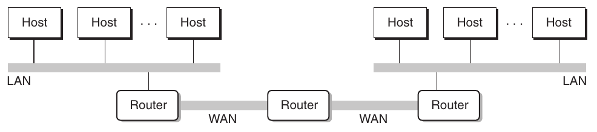

**Hình 11.6 Internet nhỏ. Hai LAN và hai WAN được nối bằng ba router.**

Thuộc tính quan trọng của internet là có thể gồm LAN và WAN khác nhau với công nghệ rất khác biệt, không tương thích. Mỗi host được kết nối vật lý tới mọi host khác, nhưng source host gửi data bit tới destination host qua tất cả mạng không tương thích bằng cách nào?

Giải pháp là lớp protocol software chạy trên mỗi host và router, làm phẳng khác biệt giữa các mạng. Phần mềm triển khai protocol chi phối cách host và router phối hợp truyền dữ liệu. Protocol phải cung cấp hai khả năng cơ bản:

Naming scheme. Các công nghệ LAN có cách gán địa chỉ host khác nhau, không tương thích. Internet protocol làm phẳng khác biệt bằng cách định nghĩa định dạng host address đồng nhất. Mỗi host được gán ít nhất một internet address nhận diện duy nhất nó.

Delivery mechanism. Công nghệ mạng có cách mã hóa bit trên dây và đóng gói thành frame khác nhau, không tương thích. Internet protocol làm phẳng khác biệt bằng cách định nghĩa cách đồng nhất gom data bit thành khối riêng gọi là packet. Packet gồm header chứa packet size, địa chỉ source host và destination host, cùng payload chứa data bit được source host gửi.

Hình 11.7 thể hiện ví dụ host và router dùng internet protocol truyền dữ liệu qua LAN không tương thích. Internet ví dụ gồm hai LAN nối bằng router. Client chạy trên host A gắn LAN1 gửi dãy data byte tới server chạy trên host B gắn LAN2. Có tám bước cơ bản:

1. Client trên host A gọi system call sao chép dữ liệu từ virtual address space của client vào kernel buffer.

2. Protocol software trên host A tạo LAN1 frame bằng cách thêm internet header và LAN1 frame header vào dữ liệu. Internet header hướng tới internet host B. LAN1 frame header hướng tới router. Sau đó nó chuyển frame tới adapter. Chú ý payload LAN1 frame là internet packet, có payload là dữ liệu người dùng thực tế. Kiểu encapsulation này là một ý tưởng nền tảng của internetworking.

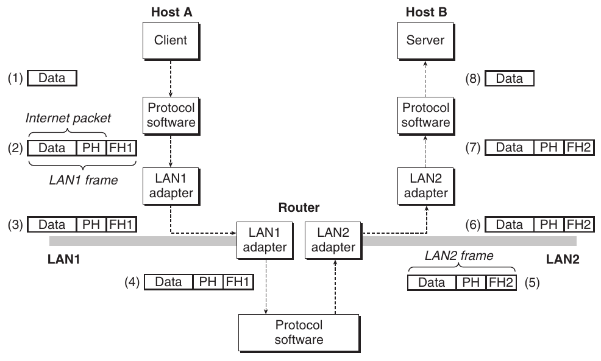

**Hình 11.7 Cách dữ liệu đi từ host này tới host khác trên internet. PH: internet packet header; FH1: frame header cho LAN1; FH2: frame header cho LAN2.**

3. LAN1 adapter sao chép frame ra mạng.

4. Khi frame tới router, LAN1 adapter của router đọc từ dây rồi chuyển tới protocol software.

5. Router lấy destination internet address từ internet packet header và dùng làm index vào routing table để xác định nơi chuyển tiếp packet, ở đây là LAN2. Sau đó router bỏ LAN1 frame header cũ, thêm LAN2 frame header mới hướng tới host B ở đầu, rồi chuyển frame thu được tới adapter.

6. LAN2 adapter của router sao chép frame ra mạng.

7. Khi frame tới host B, adapter đọc frame từ dây rồi chuyển tới protocol software.

8. Cuối cùng, protocol software trên host B bỏ packet header và frame header. Protocol software cuối cùng sao chép dữ liệu thu được vào virtual address space của server khi server gọi system call đọc dữ liệu.

Tất nhiên, ở đây chúng ta lướt qua nhiều vấn đề khó. Nếu các mạng có maximum frame size khác nhau thì sao? Router biết chuyển tiếp frame tới đâu bằng cách nào? Router được thông báo khi network topology thay đổi ra sao? Nếu packet mất thì sao? Tuy nhiên, ví dụ nắm bắt bản chất ý tưởng internet và encapsulation là chìa khóa.

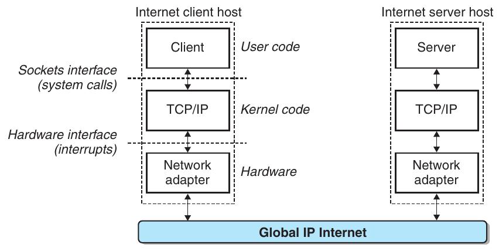

**Hình 11.8 Tổ chức phần cứng và phần mềm của ứng dụng Internet.**

## 11.3 Global IP Internet

Global IP Internet là triển khai internet nổi tiếng và thành công nhất. Nó tồn tại dưới dạng này hay dạng khác từ năm 1969. Mặc dù kiến trúc nội bộ Internet phức tạp và liên tục thay đổi, tổ chức ứng dụng client-server vẫn ổn định đáng kể từ đầu thập niên 1980. Hình 11.8 thể hiện tổ chức phần cứng, phần mềm cơ bản của ứng dụng Internet client-server.

Mỗi Internet host chạy phần mềm triển khai TCP/IP (Transmission Control Protocol/Internet Protocol), được hầu hết hệ thống máy tính hiện đại hỗ trợ. Internet client và server giao tiếp bằng kết hợp sockets interface function và Unix I/O function. (Chúng ta mô tả sockets interface trong Mục 11.4.) Sockets function thường được triển khai dưới dạng system call trap vào kernel và gọi các hàm kernel-mode trong TCP/IP.

TCP/IP thực ra là họ protocol, mỗi protocol đóng góp khả năng khác nhau. Ví dụ, IP cung cấp naming scheme cơ bản và delivery mechanism gửi packet, gọi là datagram, từ Internet host tới host bất kỳ khác. Cơ chế IP unreliable theo nghĩa không cố khôi phục nếu datagram mất hoặc trùng lặp trong mạng. UDP (Unreliable Datagram Protocol) mở rộng IP chút ít để datagram truyền giữa process thay vì giữa host. TCP là protocol phức tạp xây trên IP để cung cấp kết nối full duplex (hai chiều) tin cậy giữa process. Để đơn giản hóa, chúng ta xem TCP/IP như protocol nguyên khối duy nhất. Chúng ta không thảo luận hoạt động nội bộ, chỉ thảo luận một số khả năng cơ bản TCP và IP cung cấp cho chương trình ứng dụng. Chúng ta không thảo luận UDP.

Từ góc nhìn lập trình viên, có thể xem Internet là tập host toàn cầu với các thuộc tính sau:

- Tập host được ánh xạ tới tập IP address 32-bit.

### Thông tin thêm: IPv4 và IPv6

Internet protocol gốc với địa chỉ 32-bit được gọi là Internet Protocol Version 4 (IPv4). Năm 1996, Internet Engineering Task Force (IETF) đề xuất phiên bản IP mới gọi là Internet Protocol Version 6 (IPv6), dùng địa chỉ 128-bit và dự định kế nhiệm IPv4. Tuy nhiên, tính đến năm 2015, gần 20 năm sau, phần lớn lưu lượng Internet vẫn qua mạng IPv4. Ví dụ, chỉ 4 phần trăm người dùng truy cập dịch vụ Google bằng IPv6 [42]. Vì tỷ lệ áp dụng thấp, sách không thảo luận IPv6 chi tiết mà chỉ tập trung khái niệm IPv4. Khi nói Internet, chúng ta có ý nói Internet dựa trên IPv4. Dù vậy, kỹ thuật viết client và server học ở phần sau dựa trên interface hiện đại độc lập protocol cụ thể.

- Tập IP address được ánh xạ tới tập định danh gọi là Internet domain name.

- Process trên một Internet host có thể giao tiếp với process trên Internet host bất kỳ khác qua connection.

Các mục tiếp theo thảo luận chi tiết hơn những ý tưởng Internet nền tảng này.

### 11.3.1 IP Address

IP address là số nguyên unsigned 32-bit. Chương trình mạng lưu IP address trong IP address structure ở Hình 11.9.

Lưu scalar address trong structure là di sản không may từ triển khai sockets interface ban đầu. Định nghĩa scalar type cho IP address hợp lý hơn, nhưng nay quá muộn để thay đổi vì lượng ứng dụng đã triển khai khổng lồ.

Vì Internet host có thể có host byte order khác nhau, TCP/IP định nghĩa network byte order đồng nhất (byte order big-endian) cho mọi mục dữ liệu số nguyên như IP address được truyền qua mạng trong packet header. Địa chỉ trong IP address structure luôn lưu theo network byte order (big-endian), ngay cả khi host byte order little-endian. Unix cung cấp các hàm sau chuyển đổi giữa network và host byte order.

```
                                                               code/netp/netpfragments.c
/* IP address structure */
struct in_addr {
    uint32_t  s_addr; /* Address in network byte order (big-endian) */
};
                                                               code/netp/netpfragments.c
```

**Hình 11.9 IP address structure.**

```
#include <arpa/inet.h>

uint32_t htonl(uint32_t hostlong);
uint16_t htons(uint16_t hostshort);
```

Trả về: giá trị theo network byte order

```
uint32_t ntohl(uint32_t netlong);
uint16_t ntohs(unit16_t netshort);
```

Trả về: giá trị theo host byte order

Hàm htonl chuyển số nguyên unsigned 32-bit từ host byte order sang network byte order. Hàm ntohl chuyển số nguyên unsigned 32-bit từ network byte order sang host byte order. Hàm htons và ntohs chuyển đổi tương ứng cho số nguyên unsigned 16-bit. Chú ý không có hàm tương đương cho giá trị 64-bit.

IP address thường được trình bày cho con người dưới dạng dotted-decimal notation, mỗi byte biểu diễn bằng giá trị thập phân và ngăn với byte khác bằng dấu chấm. Ví dụ, 128.2.194.242 là biểu diễn dotted-decimal của địa chỉ 0x8002c2f2. Trên Linux, có thể dùng hostname để xác định địa chỉ dotted-decimal của host:

```
linux> hostname -i
128.2.210.175
```

Chương trình ứng dụng có thể chuyển qua lại giữa IP address và string dotted-decimal bằng inet_pton và inet_ntop.

```
#include <arpa/inet.h>

int inet_pton(AF_INET, const char *src, void *dst);
```

Trả về: 1 nếu thành công, 0 nếu src không phải dotted decimal hợp lệ, −1 nếu có lỗi

```
const char *inet_ntop(AF_INET, const void *src, char *dst,
                      socklen_t size);
```

Trả về: pointer tới string dotted-decimal nếu thành công, NULL nếu có lỗi

Trong tên hàm này, “n” viết tắt network, “p” viết tắt presentation. Chúng thao tác được địa chỉ IPv4 32-bit (AF_INET) như ở đây, hoặc địa chỉ IPv6 128-bit (AF_INET6) không được đề cập.

Hàm inet_pton chuyển string dotted-decimal (src) thành binary IP address theo network byte order (dst). Nếu src không trỏ tới string dotted-decimal hợp lệ, trả 0. Lỗi khác trả −1 và đặt errno. Tương tự, inet_ntop chuyển binary IP address theo network byte order (src) thành biểu diễn dotted-decimal tương ứng và sao chép tối đa size byte của string null-terminated thu được tới dst.

#### Bài tập thực hành 11.1 (lời giải trang 1002)

Hoàn thành bảng sau:

| Địa chỉ Dotted-decimal | Địa chỉ hex |
|---|---|
| 107.212.122.205 | ______ |
| 64.12.149.13 | ______ |
| 107.212.96.29 | ______ |
| ______ | 0x00000080 |
| ______ | 0xFFFFFF00 |
| ______ | 0x0A010140 |

#### Bài tập thực hành 11.2 (lời giải trang 1003)

Viết chương trình hex2dd.c chuyển đối số hex 16-bit thành network byte order 16-bit rồi in kết quả. Ví dụ

```
linux> ./hex2dd 0x400
1024
```

#### Bài tập thực hành 11.3 (lời giải trang 1003)

Viết chương trình dd2hex.c chuyển network byte order 16-bit thành số hex 16-bit rồi in kết quả. Ví dụ,

```
linux> ./dd2hex 1024
0x400
```

### 11.3.2 Internet Domain Name

Internet client và server dùng IP address khi giao tiếp. Tuy nhiên, số nguyên lớn khó nhớ, nên Internet còn định nghĩa tập domain name riêng human-friendly hơn và cơ chế ánh xạ domain name tới IP address. Domain name là dãy từ (chữ cái, số và dấu gạch ngang) phân cách bằng dấu chấm, như whaleshark.ics.cs.cmu.edu.

Tập domain name tạo thành hệ thống phân cấp, mỗi domain name mã hóa vị trí trong đó. Cách dễ hiểu nhất là ví dụ. Hình 11.10 thể hiện một phần hệ thống phân cấp domain name.

Hệ thống phân cấp được biểu diễn bằng cây. Node biểu diễn domain name hình thành từ đường về root. Subtree được gọi là subdomain. Cấp đầu là root node không tên. Cấp tiếp theo là tập domain name first-level do tổ chức phi lợi nhuận ICANN (Internet Corporation for Assigned Names and Numbers) định nghĩa. Domain first-level phổ biến gồm com, edu, gov, org và net.

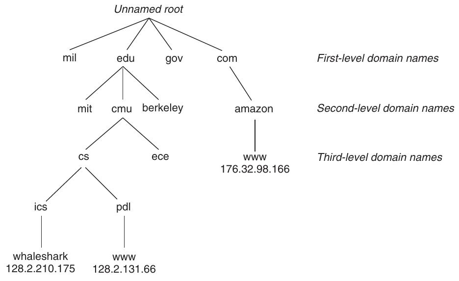

**Hình 11.10 Một phần hệ thống phân cấp Internet domain name.**

Cấp tiếp theo là domain name second-level như cmu.edu, được các đại lý ủy quyền của ICANN cấp theo nguyên tắc first-come first-serve. Khi tổ chức nhận domain name second-level, họ tự do tạo domain name mới trong subdomain như cs.cmu.edu.

Internet định nghĩa ánh xạ giữa domain name và IP address. Đến năm 1988, ánh xạ được duy trì thủ công trong text file duy nhất HOSTS.TXT. Từ đó, ánh xạ được duy trì trong database phân tán toàn cầu DNS (Domain Name System). Về khái niệm, DNS database gồm hàng triệu host entry, mỗi entry định nghĩa ánh xạ giữa tập domain name và tập IP address. Về toán học, xem mỗi host entry là lớp tương đương domain name và IP address. Có thể khám phá thuộc tính DNS mapping bằng chương trình Linux nslookup, hiển thị IP address gắn với domain name.[^1]

Mỗi Internet host có domain name định nghĩa cục bộ localhost, luôn ánh xạ tới loopback address 127.0.0.1:

```
linux> nslookup localhost
Address: 127.0.0.1
```

Tên localhost cung cấp cách thuận tiện và portable để tham chiếu client và server chạy trên cùng máy, đặc biệt hữu ích khi debug. Có thể dùng hostname xác định domain name thực của local host:

```
linux> hostname
whaleshark.ics.cs.cmu.edu
```

Trong trường hợp đơn giản nhất, có ánh xạ one-to-one giữa domain name và IP address:

```
linux> nslookup whaleshark.ics.cs.cmu.edu
Address: 128.2.210.175
```

Tuy nhiên, trong một số trường hợp nhiều domain name ánh xạ tới cùng IP address:

```
linux> nslookup cs.mit.edu
Address: 18.62.1.6

linux> nslookup eecs.mit.edu
Address: 18.62.1.6
```

Trong trường hợp tổng quát nhất, nhiều domain name ánh xạ tới cùng tập nhiều IP address:

```
linux> nslookup www.twitter.com
Address: 199.16.156.6
Address: 199.16.156.70
Address: 199.16.156.102
Address: 199.16.156.230

linux> nslookup twitter.com
Address: 199.16.156.102
Address: 199.16.156.230
Address: 199.16.156.6
Address: 199.16.156.70
```

Cuối cùng, một số domain name hợp lệ không ánh xạ tới IP address nào:

```
linux> nslookup edu
*** Can’t find edu: No answer
linux> nslookup ics.cs.cmu.edu
*** Can’t find ics.cs.cmu.edu: No answer
```

### 11.3.3 Internet Connection

Internet client và server giao tiếp bằng gửi, nhận stream byte qua connection. Connection là point-to-point theo nghĩa kết nối hai process. Nó full duplex theo nghĩa dữ liệu đi hai chiều đồng thời. Và nó reliable theo nghĩa—trừ sự cố thảm khốc như dây cáp bị người vận hành máy xúc bất cẩn cắt đứt—stream byte do source process gửi cuối cùng được destination process nhận đúng thứ tự gửi.

#### Thông tin thêm: Có bao nhiêu Internet host?

Hai lần mỗi năm từ 1987, Internet Systems Consortium thực hiện Internet Domain Survey. Khảo sát ước lượng số Internet host bằng cách đếm IP address đã được gán domain name, cho thấy xu hướng đáng kinh ngạc. Từ năm 1987, khi có khoảng 20,000 Internet host, số host tăng theo hàm mũ. Đến 2015, có hơn 1,000,000,000 Internet host!

Socket là endpoint của connection. Mỗi socket có socket address tương ứng gồm Internet address và port số nguyên 16-bit[^2], ký hiệu address:port.

Port trong socket address của client được kernel tự gán khi client yêu cầu connection và gọi là ephemeral port. Tuy nhiên, port trong socket address của server thường là port well-known gắn cố định với dịch vụ. Ví dụ, Web server thường dùng port 80, email server dùng port 25. Mỗi dịch vụ có port well-known gắn với service name well-known tương ứng. Ví dụ, tên well-known của Web service là http và tên well-known của email là smtp. Ánh xạ giữa tên well-known và port well-known nằm trong file /etc/services.

Connection được nhận diện duy nhất bằng socket address của hai endpoint. Cặp socket address này gọi là socket pair, ký hiệu bằng tuple

```
(cliaddr:cliport, servaddr:servport)
```

trong đó cliaddr là IP address client, cliport là port client, servaddr là IP address server và servport là port server. Ví dụ, Hình 11.11 thể hiện connection giữa Web client và Web server.

Trong ví dụ này, socket address của Web client là

```
128.2.194.242:51213
```

trong đó port 51213 là ephemeral port kernel gán. Socket address của Web server là

```
208.216.181.15:80
```

#### Thông tin thêm: Nguồn gốc Internet

Internet là một trong những ví dụ thành công nhất về hợp tác chính phủ, đại học và công nghiệp. Nhiều yếu tố đóng góp, nhưng chúng ta cho rằng hai yếu tố đặc biệt quan trọng: đầu tư 30-year liên tục của chính phủ Hoa Kỳ và cam kết của nhà nghiên cứu tâm huyết với điều Dave Clarke tại MIT gọi là “đồng thuận tương đối và code hoạt động được”.

Hạt giống Internet được gieo năm 1957, khi đỉnh điểm Chiến tranh Lạnh, Liên Xô khiến thế giới kinh ngạc bằng Sputnik, vệ tinh nhân tạo đầu tiên của Trái Đất. Đáp lại, chính phủ Hoa Kỳ tạo Advanced Research Projects Agency (ARPA), có nhiệm vụ khôi phục vị trí dẫn đầu khoa học và công nghệ Mỹ. Năm 1967, Lawrence Roberts tại ARPA công bố kế hoạch mạng mới ARPANET. Node ARPANET đầu tiên hoạt động năm 1969. Đến 1971 có 13 node ARPANET và email trở thành ứng dụng mạng quan trọng đầu tiên.

Năm 1972, Robert Kahn phác thảo nguyên lý internetworking tổng quát: tập mạng kết nối với nhau, giao tiếp giữa mạng được xử lý độc lập trên cơ sở “best-effort” bởi hộp đen gọi là “router”. Năm 1974, Kahn và Vinton Cerf công bố chi tiết TCP/IP đầu tiên; đến 1982 nó thành internetworking protocol chuẩn cho ARPANET. Ngày 1 tháng 1 năm 1983, mọi node ARPANET chuyển sang TCP/IP, đánh dấu global IP Internet ra đời. Năm 1985, Paul Mockapetris phát minh DNS và có hơn 1,000 Internet host. Năm sau, National Science Foundation (NSF) xây NSFNET backbone nối 13 địa điểm bằng đường điện thoại 56 Kb/s. Nó được nâng cấp lên liên kết T1 1.5 Mb/s năm 1988 và T3 45 Mb/s năm 1991. Đến 1988 có hơn 50,000 host. Năm 1989, ARPANET gốc chính thức ngừng hoạt động. Năm 1995, khi có gần 10,000,000 Internet host, NSF cho NSFNET ngừng hoạt động và thay bằng kiến trúc Internet hiện đại dựa trên commercial backbone tư nhân kết nối bằng public network access point.

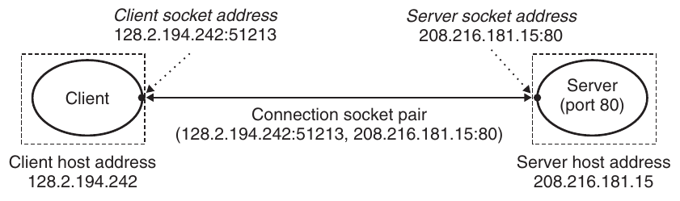

**Hình 11.11 Cấu trúc Internet connection.**

trong đó port 80 là port well-known gắn với Web service. Với socket address client và server này, connection được nhận diện duy nhất bằng socket pair

```
(128.2.194.242:51213, 208.216.181.15:80)
```

#### Thông tin thêm: Nguồn gốc sockets interface

Sockets interface ban đầu do nhà nghiên cứu tại University of California, Berkeley phát triển đầu thập niên 1980. Vì vậy, thường được gọi là Berkeley socket. Họ phát triển sockets interface để hoạt động với protocol bên dưới bất kỳ. Triển khai đầu cho TCP/IP, được đưa vào Unix 4.2BSD kernel và phân phối tới nhiều đại học, phòng thí nghiệm. Đây là sự kiện quan trọng trong lịch sử Internet. Gần như qua đêm, hàng nghìn người truy cập được TCP/IP và source code. Điều đó tạo phấn khích lớn và thúc đẩy hàng loạt nghiên cứu mới về networking, internetworking.

## 11.4 Sockets Interface

Sockets interface là tập hàm dùng cùng Unix I/O để xây ứng dụng mạng. Nó được triển khai trên phần lớn hệ thống hiện đại, gồm mọi biến thể Unix cùng Windows và Macintosh. Hình 11.12 tổng quan sockets interface trong transaction client-server điển hình. Bạn nên dùng hình này làm bản đồ khi thảo luận từng hàm.

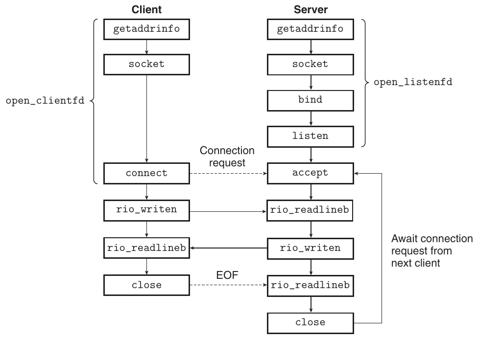

**Hình 11.12 Tổng quan ứng dụng mạng dựa trên sockets interface.**

### Thông tin thêm: Hậu tố _in nghĩa là gì?

Hậu tố _in viết tắt internet, không phải input.

```
                                                               code/netp/netpfragments.c
/* IP socket address structure */
struct sockaddr_in  {
    uint16_t        sin_family;  /* Protocol family (always AF_INET) */
    uint16_t        sin_port;    /* Port number in network byte order */
    struct in_addr  sin_addr;    /* IP address in network byte order */
    unsigned char   sin_zero[8]; /* Pad to sizeof(struct sockaddr) */
};

/* Generic socket address structure (for connect, bind, and accept) */
struct sockaddr {
    uint16_t  sa_family;    /* Protocol family */
    char      sa_data[14];  /* Address data  */
};
                                                               code/netp/netpfragments.c
```

**Hình 11.13 Socket address structure.**

### 11.4.1 Socket Address Structure

Từ góc nhìn Linux kernel, socket là endpoint giao tiếp. Từ góc nhìn chương trình Linux, socket là file đang mở với descriptor tương ứng.

Internet socket address được lưu trong cấu trúc 16-byte thuộc type sockaddr_in trong Hình 11.13. Với ứng dụng Internet, field sin_family là AF_INET, sin_port là port number 16-bit, còn sin_addr chứa IP address 32-bit. IP address và port number luôn lưu theo network byte order (big-endian).

Các hàm connect, bind và accept cần pointer tới socket address structure protocol-specific. Vấn đề với nhà thiết kế sockets interface là định nghĩa hàm nhận mọi loại socket address structure thế nào. Ngày nay, chúng ta dùng generic pointer void *, chưa tồn tại trong C khi đó. Giải pháp của họ là định nghĩa sockets function nhận pointer tới generic structure sockaddr (Hình 11.13), rồi yêu cầu ứng dụng cast pointer tới structure protocol-specific sang generic structure. Để đơn giản hóa code, chúng ta theo Stevens định nghĩa type sau:

```
typedef struct sockaddr SA;
```

Sau đó dùng type này mỗi khi cần cast sockaddr_in sang generic structure sockaddr.

### 11.4.2 Hàm socket

Client và server dùng socket để tạo socket descriptor.

```
#include <sys/types.h>
#include <sys/socket.h>

int socket(int domain, int type, int protocol);
```

Trả về: descriptor không âm nếu thành công, −1 nếu có lỗi

Nếu muốn socket là endpoint của connection, có thể gọi socket với đối số hardcoded sau:

```
clientfd = Socket(AF_INET, SOCK_STREAM, 0);
```

trong đó AF_INET biểu thị dùng IP address 32-bit và SOCK_STREAM biểu thị socket là endpoint của connection. Tuy nhiên, thực hành tốt nhất là dùng getaddrinfo (Mục 11.4.7) tạo tự động các tham số để code protocol-independent. Chúng ta chỉ cách dùng getaddrinfo với socket trong Mục 11.4.8.

Descriptor clientfd do socket trả về mới chỉ được mở một phần, chưa thể đọc và ghi. Cách hoàn tất mở socket phụ thuộc đang là client hay server. Mục tiếp theo mô tả cách hoàn tất nếu là client.

### 11.4.3 Hàm connect

Client thiết lập connection với server bằng connect.

```
#include <sys/socket.h>

int connect(int clientfd, const struct sockaddr *addr,
            socklen_t addrlen);
```

Trả về: 0 nếu thành công, −1 nếu có lỗi

Hàm connect thử thiết lập Internet connection với server tại socket address addr, trong đó addrlen là sizeof(sockaddr_in). connect block đến khi connection thành công hoặc có lỗi. Nếu thành công, descriptor clientfd sẵn sàng đọc, ghi và connection thu được được đặc trưng bằng socket pair

```
(x:y, addr.sin_addr:addr.sin_port)
```

trong đó x là IP address client và y là ephemeral port nhận diện duy nhất client process trên client host. Như socket, thực hành tốt nhất là dùng getaddrinfo cung cấp đối số connect (xem Mục 11.4.8).

### 11.4.4 Hàm bind

Các sockets function còn lại—bind, listen và accept—được server dùng thiết lập connection với client.

```
#include <sys/socket.h>

int bind(int sockfd, const struct sockaddr *addr,
         socklen_t addrlen);
```

Trả về: 0 nếu thành công, −1 nếu có lỗi

Hàm bind yêu cầu kernel gắn socket address server trong addr với socket descriptor sockfd. Đối số addrlen là sizeof(sockaddr_in). Như socket và connect, thực hành tốt nhất là dùng getaddrinfo cung cấp đối số bind (xem Mục 11.4.8).

### 11.4.5 Hàm listen

Client là thực thể chủ động khởi tạo connection request. Server là thực thể thụ động chờ connection request từ client. Theo mặc định, kernel giả định descriptor do socket tạo tương ứng active socket nằm ở đầu client của connection. Server gọi listen để báo kernel descriptor sẽ được server dùng thay client.

```
#include <sys/socket.h>

int listen(int sockfd, int backlog);
```

Trả về: 0 nếu thành công, −1 nếu có lỗi

Hàm listen chuyển sockfd từ active socket sang listening socket có thể nhận connection request từ client. Đối số backlog là gợi ý số connection request đang chờ mà kernel cần xếp hàng trước khi bắt đầu từ chối. Ý nghĩa chính xác backlog đòi hỏi hiểu TCP/IP ngoài phạm vi sách. Chúng ta thường đặt giá trị lớn như 1,024.

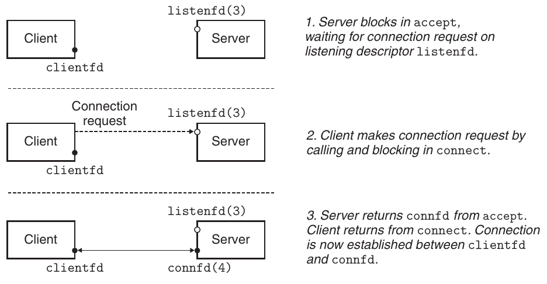

**Hình 11.14 Vai trò listening descriptor và connected descriptor.**

### 11.4.6 Hàm accept

Server chờ connection request từ client bằng accept.

```
#include <sys/socket.h>

int accept(int listenfd, struct sockaddr *addr, int *addrlen);
```

Trả về: connected descriptor không âm nếu thành công, −1 nếu có lỗi

Hàm accept chờ một connection request từ client tới listening descriptor listenfd, sau đó điền socket address của client vào addr và trả về một connected descriptor có thể được dùng để giao tiếp với client bằng các hàm Unix I/O.

Sự phân biệt listening descriptor và connected descriptor khiến nhiều sinh viên bối rối. Listening descriptor làm endpoint cho connection request của client. Nó thường được tạo một lần và tồn tại suốt vòng đời server. Connected descriptor là endpoint của connection thiết lập giữa client và server. Nó được tạo mỗi khi server chấp nhận connection request và chỉ tồn tại trong thời gian server phục vụ client.

Hình 11.14 phác họa vai trò listening và connected descriptor. Bước 1, server gọi accept chờ connection request tới listening descriptor, giả định cụ thể là descriptor 3. Nhớ descriptor 0–2 dành cho standard file.

Bước 2, client gọi connect gửi connection request tới listenfd. Bước 3, accept mở connected descriptor mới connfd (giả định descriptor 4), thiết lập connection giữa clientfd và connfd rồi trả connfd cho ứng dụng. Client cũng trả về từ connect; từ đây client và server truyền dữ liệu qua lại bằng cách lần lượt đọc, ghi clientfd và connfd.

#### Thông tin thêm: Tại sao phân biệt listening và connected descriptor?

Bạn có thể thắc mắc vì sao sockets interface phân biệt listening và connected descriptor. Thoạt nhìn có vẻ phức tạp không cần thiết. Tuy nhiên, phân biệt này hữu ích vì cho phép xây concurrent server xử lý nhiều client connection đồng thời. Ví dụ, mỗi khi connection request tới listening descriptor, có thể fork process mới giao tiếp client qua connected descriptor. Bạn sẽ học thêm concurrent server trong Chương 12.

### 11.4.7 Chuyển đổi host và service

Linux cung cấp các hàm mạnh mẽ getaddrinfo và getnameinfo để chuyển qua lại giữa binary socket address structure và biểu diễn string của hostname, host address, service name, port number. Khi dùng cùng sockets interface, chúng cho phép viết chương trình mạng độc lập phiên bản IP protocol cụ thể.

### Hàm getaddrinfo

Hàm getaddrinfo chuyển biểu diễn string của hostname, host address, service name và port number thành socket address structure. Nó thay thế hiện đại cho gethostbyname và getservbyname lỗi thời. Khác các hàm đó, nó reentrant (xem Mục 12.7.2) và hoạt động với mọi protocol.

```
#include <sys/types.h>
#include <sys/socket.h>
#include <netdb.h>

int getaddrinfo(const char *host, const char *service,
                const struct addrinfo *hints,
                struct addrinfo **result);
```

Trả về: 0 nếu thành công, error code khác không nếu có lỗi

```
void freeaddrinfo(struct addrinfo *result);
```

Trả về: không có gì

```
const char *gai_strerror(int errcode);
```

Trả về: thông báo lỗi

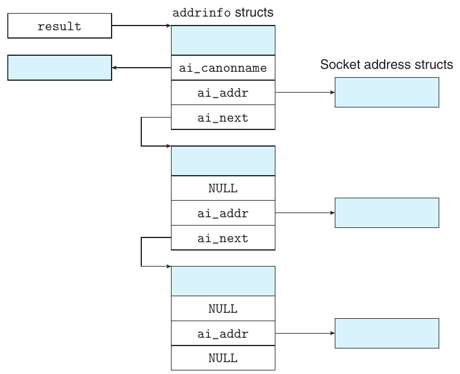

**Hình 11.15 Data structure do getaddrinfo trả về.**

Với host và service (hai thành phần socket address), getaddrinfo trả result trỏ tới danh sách liên kết addrinfo structure, mỗi structure trỏ tới socket address structure tương ứng host và service (Hình 11.15).

Sau khi client gọi getaddrinfo, nó duyệt list, thử lần lượt socket address đến khi socket và connect thành công, connection được thiết lập. Tương tự, server thử từng socket address đến khi socket và bind thành công, descriptor được bind với socket address hợp lệ. Để tránh memory leak, ứng dụng cuối cùng phải giải phóng list bằng freeaddrinfo. Nếu getaddrinfo trả error code khác không, ứng dụng gọi gai_strerror chuyển code thành message string.

Đối số host của getaddrinfo có thể là domain name hoặc địa chỉ số (ví dụ IP address dotted-decimal). Đối số service có thể là service name (ví dụ http) hoặc port number thập phân. Nếu không cần chuyển hostname thành địa chỉ, có thể đặt host NULL. Tương tự với service. Tuy nhiên, ít nhất một trong hai phải được chỉ định.

Đối số tùy chọn hints là addrinfo structure (Hình 11.16), cung cấp kiểm soát chi tiết hơn list socket address getaddrinfo trả về. Khi truyền làm hints, chỉ được đặt field ai_family, ai_socktype, ai_protocol và ai_flags. Field còn lại phải bằng không (hoặc NULL). Trong thực tế, dùng memset đặt toàn structure bằng không rồi đặt vài field được chọn:

- Theo mặc định, getaddrinfo có thể trả socket address IPv4 và IPv6. Đặt ai_family thành AF_INET giới hạn list ở IPv4. Đặt AF_INET6 giới hạn list ở IPv6.

```
                                                               code/netp/netpfragments.c
struct addrinfo {
    int              ai_flags;     /* Hints argument flags */
    int              ai_family;    /* First arg to socket function */
    int              ai_socktype;  /* Second arg to socket function */
    int              ai_protocol;  /* Third arg to socket function  */
    char            *ai_canonname; /* Canonical hostname */
    size_t           ai_addrlen;   /* Size of ai_addr struct */
    struct sockaddr *ai_addr;      /* Ptr to socket address structure */
    struct addrinfo *ai_next;      /* Ptr to next item in linked list */
};
                                                               code/netp/netpfragments.c
```

**Hình 11.16 Cấu trúc addrinfo dùng bởi getaddrinfo .**

- Theo mặc định, với mỗi địa chỉ duy nhất gắn với host, getaddrinfo có thể trả tối đa ba addrinfo structure có field ai_socktype khác nhau: một cho connection, một cho datagram (không đề cập), một cho raw socket (không đề cập). Đặt ai_socktype thành SOCK_STREAM giới hạn tối đa một addrinfo structure cho mỗi địa chỉ duy nhất, có socket address dùng làm endpoint connection. Đây là hành vi mong muốn cho mọi chương trình ví dụ.

- Field ai_flags là bit mask sửa thêm hành vi mặc định. Bạn tạo nó bằng OR tổ hợp các giá trị. Một số giá trị hữu ích: AI_ADDRCONFIG. Flag được khuyên dùng nếu dùng connection [34]. Nó yêu cầu getaddrinfo chỉ trả IPv4 nếu local host được cấu hình IPv4. Tương tự với IPv6. AI_CANONNAME. Theo mặc định ai_canonname là NULL. Nếu đặt flag, getaddrinfo trỏ ai_canonname trong addrinfo structure đầu list tới tên canonical (chính thức) của host (xem Hình 11.15). AI_NUMERICSERV. Theo mặc định service có thể là service name hoặc port number. Flag buộc service là port number. AI_PASSIVE. Theo mặc định getaddrinfo trả socket address client dùng làm active socket trong connect. Flag yêu cầu trả socket address server dùng làm listening socket. Khi đó host cần NULL. Address field trong socket address structure thu được là wildcard address, báo kernel server nhận request tới bất kỳ IP address nào của host này. Đây là hành vi mong muốn cho mọi server ví dụ.

Khi getaddrinfo tạo một addrinfo structure trong output list, nó điền mọi field ngoại trừ ai_flags. Field ai_addr trỏ tới một socket address structure, field ai_addrlen cho biết kích thước của structure này, còn field ai_next trỏ tới addrinfo structure tiếp theo trong list. Các field còn lại mô tả những thuộc tính khác nhau của socket address.

Điểm tinh tế của getaddrinfo là field trong addrinfo structure opaque, nghĩa là có thể truyền trực tiếp tới sockets interface function mà application code không cần thao tác thêm. Ví dụ, ai_family, ai_socktype và ai_protocol truyền trực tiếp tới socket. Tương tự, ai_addr và ai_addrlen truyền trực tiếp tới connect và bind. Thuộc tính mạnh mẽ này cho phép viết client, server độc lập phiên bản IP cụ thể.

### Hàm getnameinfo

Hàm getnameinfo là phép ngược của getaddrinfo. Nó chuyển socket address structure thành string host và service name tương ứng. Đây là thay thế hiện đại cho gethostbyaddr và getservbyport lỗi thời; khác các hàm đó, nó reentrant và protocol-independent.

```
#include <sys/socket.h>
#include <netdb.h>

int getnameinfo(const struct sockaddr *sa, socklen_t salen,
                char *host, size_t hostlen,
                char *service, size_t servlen, int flags);
```

Trả về: 0 nếu thành công, error code khác không nếu có lỗi

Đối số sa trỏ socket address structure size salen byte, host trỏ buffer size hostlen byte, service trỏ buffer size servlen byte. Hàm getnameinfo chuyển structure sa thành string host và service name tương ứng rồi sao chép tới buffer host và service. Nếu getnameinfo trả error code khác không, ứng dụng chuyển thành string bằng gai_strerror.

Nếu không muốn hostname, có thể đặt host NULL và hostlen bằng không. Tương tự với service field. Tuy nhiên, phải đặt ít nhất một trong hai.

Đối số flags là bit mask sửa hành vi mặc định. Tạo bằng OR tổ hợp các giá trị. Hai giá trị hữu ích:

NI_NUMERICHOST. Theo mặc định, getnameinfo thử trả domain name trong host. Đặt flag khiến trả numeric address string thay thế.

NI_NUMERICSERV. Theo mặc định, getnameinfo tra /etc/services và nếu được trả service name thay port number. Đặt flag buộc bỏ tra cứu và chỉ trả port number.

```
                                                                       code/netp/hostinfo.c
 1   #include "csapp.h"
 2
 3   int main(int argc, char **argv)
 4   {
 5       struct addrinfo *p, *listp, hints;
 6       char buf[MAXLINE];
 7       int rc, flags;
 8
 9       if (argc != 2) {
10           fprintf(stderr, "usage: %s <domain name>\n", argv[0]);
11           exit(0);
12       }
13
14       /* Get a list of addrinfo records */
15       memset(&hints, 0, sizeof(struct addrinfo));
16       hints.ai_family = AF_INET;       /* IPv4 only */
17       hints.ai_socktype = SOCK_STREAM; /* Connections only */
18       if ((rc = getaddrinfo(argv[1], NULL, &hints, &listp)) != 0) {
19           fprintf(stderr, "getaddrinfo error: %s\n", gai_strerror(rc));
20           exit(1);
21       }
22
23       /* Walk the list and display each IP address */
24       flags = NI_NUMERICHOST; /* Display address string instead of domain name */
25       for (p = listp; p; p = p->ai_next) {
26           Getnameinfo(p->ai_addr, p->ai_addrlen, buf, MAXLINE, NULL, 0, flags);
27           printf("%s\n", buf);
28       }
29
30       /* Clean up */
31       Freeaddrinfo(listp);
32
33       exit(0);
34   }
                                                                       code/netp/hostinfo.c
```

**Hình 11.17 Hostinfo hiển thị ánh xạ domain name tới IP address tương ứng.**

Hình 11.17 thể hiện chương trình đơn giản hostinfo dùng getaddrinfo và getnameinfo hiển thị ánh xạ domain name tới IP address tương ứng. Nó tương tự nslookup trong Mục 11.3.2.

Trước tiên, khởi tạo hints để getaddrinfo trả địa chỉ mong muốn. Trong trường hợp này cần IP address 32-bit (dòng 16) dùng làm endpoint connection (dòng 17). Vì chỉ yêu cầu getaddrinfo chuyển domain name, gọi với service NULL.

Sau getaddrinfo, duyệt list addrinfo structure, dùng getnameinfo chuyển mỗi socket address thành string địa chỉ dotted-decimal. Sau khi duyệt, cẩn thận giải phóng bằng freeaddrinfo (dù không thực sự cần với chương trình đơn giản này).

Khi chạy hostinfo, thấy twitter.com ánh xạ tới bốn IP address như khi dùng nslookup trong Mục 11.3.2.

```
linux> ./hostinfo twitter.com
199.16.156.102
199.16.156.230
199.16.156.6
199.16.156.70
```

#### Bài tập thực hành 11.4 (lời giải trang 1004)

getaddrinfo và getnameinfo lần lượt bao hàm chức năng inet_pton và inet_ntop, cung cấp mức abstraction higher-level độc lập định dạng địa chỉ cụ thể. Để tự thấy tiện lợi, viết phiên bản hostinfo (Hình 11.17) dùng inet_ntop thay getnameinfo chuyển mỗi socket address thành string địa chỉ dotted-decimal.

### 11.4.8 Helper function cho sockets interface

getaddrinfo và sockets interface có vẻ đáng ngại khi mới học. Chúng ta thấy thuận tiện khi bọc chúng bằng helper function higher-level tên open_clientfd và open_listenfd, để client và server dùng khi muốn giao tiếp.

### Hàm open_clientfd

Client thiết lập connection với server bằng open_clientfd.

```
#include "csapp.h"

int open_clientfd(char *hostname, char *port);
```

Trả về: descriptor nếu thành công, −1 nếu có lỗi

Hàm open_clientfd thiết lập connection với server chạy trên host hostname, lắng nghe connection request ở port number port. Nó trả open socket descriptor sẵn sàng input và output bằng Unix I/O. Hình 11.18 thể hiện code open_clientfd.

Chúng ta gọi getaddrinfo trả list addrinfo structure, mỗi structure trỏ socket address structure thích hợp để thiết lập connection với server trên hostname lắng nghe port. Sau đó duyệt list, lần lượt thử entry tới khi socket và connect thành công. Nếu connect thất bại, cẩn thận đóng socket descriptor trước khi thử entry tiếp theo. Nếu connect thành công, giải phóng list memory và trả socket descriptor cho client, có thể dùng ngay Unix I/O giao tiếp server.

```
                                                                          code/src/csapp.c
 1   int open_clientfd(char *hostname, char *port) {
 2       int clientfd;
 3       struct addrinfo hints, *listp, *p;
 4
 5       /* Get a list of potential server addresses */
 6       memset(&hints, 0, sizeof(struct addrinfo));
 7       hints.ai_socktype = SOCK_STREAM;  /* Open a connection */
 8       hints.ai_flags = AI_NUMERICSERV;  /* ... using a numeric port arg. */
 9       hints.ai_flags |= AI_ADDRCONFIG;  /* Recommended for connections */
10       Getaddrinfo(hostname, port, &hints, &listp);
11
12       /* Walk the list for one that we can successfully connect to */
13       for (p = listp; p; p = p->ai_next) {
14           /* Create a socket descriptor */
15           if ((clientfd = socket(p->ai_family, p->ai_socktype, p->ai_protocol)) < 0)
16               continue; /* Socket failed, try the next */
17
18           /* Connect to the server */
19           if (connect(clientfd, p->ai_addr, p->ai_addrlen) != -1)
20               break; /* Success */
21           Close(clientfd); /* Connect failed, try another */
22       }
23
24       /* Clean up */
25       Freeaddrinfo(listp);
26       if (!p) /* All connects failed */
27           return -1;
28       else    /* The last connect succeeded */
29           return clientfd;
30   }
                                                                          code/src/csapp.c
```

**Hình 11.18 open_clientfd : Helper function thiết lập connection với server. Nó reentrant và protocol-independent.**

Chú ý code không phụ thuộc phiên bản IP cụ thể ở bất kỳ đâu. Đối số socket và connect do getaddrinfo tự tạo, giúp code rõ ràng và portable.

### Hàm open_listenfd

Server tạo listening descriptor sẵn sàng nhận connection request bằng open_listenfd.

```
#include "csapp.h"

int open_listenfd(char *port);
```

Trả về: descriptor nếu thành công, −1 nếu có lỗi

Hàm open_listenfd trả listening descriptor sẵn sàng nhận connection request ở port port. Hình 11.19 thể hiện code open_listenfd.

Phong cách tương tự open_clientfd. Gọi getaddrinfo rồi duyệt list thu được tới khi socket và bind thành công. Chú ý dòng 20 dùng setsockopt (không mô tả ở đây) cấu hình server để có thể kết thúc, khởi động lại và nhận connection request ngay. Theo mặc định, server mới khởi động lại từ chối connection request khoảng 30 giây, cản trở debug nghiêm trọng.

Vì gọi getaddrinfo với AI_PASSIVE và host NULL, address field trong mỗi socket address structure được đặt wildcard address, báo kernel server chấp nhận request tới IP address bất kỳ của host này.

Cuối cùng, gọi listen chuyển listenfd thành listening descriptor rồi trả caller. Nếu listen thất bại, cẩn thận tránh memory leak bằng cách đóng descriptor trước khi trả về.

### 11.4.9 Ví dụ echo client và server

Cách tốt nhất để học sockets interface là nghiên cứu code ví dụ. Hình 11.20 thể hiện code của một echo client. Sau khi thiết lập connection với server, client vào vòng lặp liên tục đọc một dòng văn bản từ standard input, gửi dòng đó tới server, đọc dòng echo từ server rồi in kết quả lên standard output. Vòng lặp kết thúc khi fgets gặp EOF trên standard input, do người dùng gõ Ctrl+D trên bàn phím hoặc do đã đọc hết các dòng trong input file được redirect.

Sau khi vòng lặp kết thúc, client đóng descriptor. Điều này gửi thông báo EOF tới server, được phát hiện khi rio_readlineb trả zero. Sau khi đóng descriptor, client kết thúc. Vì kernel client tự đóng mọi descriptor mở khi process kết thúc, close ở dòng 24 không cần thiết. Tuy nhiên, đóng tường minh mọi descriptor đã mở là thực hành lập trình tốt.

Hình 11.21 thể hiện routine main của echo server. Sau khi mở listening descriptor, nó vào vòng lặp vô hạn. Mỗi lần lặp chờ connection request từ client, in domain name và port client kết nối rồi gọi echo phục vụ client. Sau echo trả về, main đóng connected descriptor. Khi client và server đóng descriptor tương ứng, connection kết thúc.

```
                                                                          code/src/csapp.c
 1   int open_listenfd(char *port)
 2   {
 3       struct addrinfo hints, *listp, *p;
 4       int listenfd, optval=1;
 5
 6       /* Get a list of potential server addresses */
 7       memset(&hints, 0, sizeof(struct addrinfo));
 8       hints.ai_socktype = SOCK_STREAM;             /* Accept connections */
 9       hints.ai_flags = AI_PASSIVE | AI_ADDRCONFIG; /* ... on any IP address */
10       hints.ai_flags |= AI_NUMERICSERV;            /* ... using port number */
11       Getaddrinfo(NULL, port, &hints, &listp);
12
13       /* Walk the list for one that we can bind to */
14       for (p = listp; p; p = p->ai_next) {
15           /* Create a socket descriptor */
16           if ((listenfd = socket(p->ai_family, p->ai_socktype, p->ai_protocol)) < 0)
17               continue;  /* Socket failed, try the next */
18
19           /* Eliminates "Address already in use" error from bind */
20           Setsockopt(listenfd, SOL_SOCKET, SO_REUSEADDR,
21                      (const void *)&optval , sizeof(int));
22
23           /* Bind the descriptor to the address */
24           if (bind(listenfd, p->ai_addr, p->ai_addrlen) == 0)
25               break; /* Success */
26           Close(listenfd); /* Bind failed, try the next */
27       }
28
29       /* Clean up */
30       Freeaddrinfo(listp);
31       if (!p) /* No address worked */
32           return -1;
33
34       /* Make it a listening socket ready to accept connection requests */
35       if (listen(listenfd, LISTENQ) < 0) {
36           Close(listenfd);
37           return -1;
38       }
39       return listenfd;
40   }
                                                                          code/src/csapp.c
```

**Hình 11.19 open_listenfd : Helper function mở và trả listening descriptor. Nó reentrant và protocol-independent.**

code/netp/echoclient.c

```
 1   #include "csapp.h"
 2
 3   int main(int argc, char **argv)
 4   {
 5       int clientfd;
 6       char *host, *port, buf[MAXLINE];
 7       rio_t rio;
 8
 9       if (argc != 3) {
10           fprintf(stderr, "usage: %s <host> <port>\n", argv[0]);
11           exit(0);
12       }
13       host = argv[1];
14       port = argv[2];
15
16       clientfd = Open_clientfd(host, port);
17       Rio_readinitb(&rio, clientfd);
18
19       while (Fgets(buf, MAXLINE, stdin) != NULL) {
20           Rio_writen(clientfd, buf, strlen(buf));
21           Rio_readlineb(&rio, buf, MAXLINE);
22           Fputs(buf, stdout);
23       }
24       Close(clientfd);
25       exit(0);
26   }
                                                         code/netp/echoclient.c
```

**Hình 11.20 Routine main của echo client.**

Variable clientaddr ở dòng 9 là socket address structure truyền cho accept. Trước khi accept trả về, nó điền clientaddr bằng socket address client ở đầu kia connection. Chú ý khai báo clientaddr thuộc type struct sockaddr_storage thay struct sockaddr_in. Theo định nghĩa, sockaddr_storage đủ lớn chứa mọi loại socket address, giữ code protocol-independent.

Chú ý echo server đơn giản chỉ xử lý một client mỗi lần. Server lần lượt phục vụ client như vậy gọi là iterative server. Trong Chương 12, chúng ta học xây concurrent server tinh vi hơn xử lý nhiều client đồng thời.

Cuối cùng, Hình 11.22 thể hiện code echo, lặp đọc và ghi dòng văn bản đến khi rio_readlineb gặp EOF tại dòng 10.

code/netp/echoserveri.c

```
 1   #include "csapp.h"
 2
 3   void echo(int connfd);
 4
 5   int main(int argc, char **argv)
 6   {
 7       int listenfd, connfd;
 8       socklen_t clientlen;
 9       struct sockaddr_storage clientaddr;  /* Enough space for any address */
10       char client_hostname[MAXLINE], client_port[MAXLINE];
11
12       if (argc != 2) {
13           fprintf(stderr, "usage: %s <port>\n", argv[0]);
14           exit(0);
15       }
16
17       listenfd = Open_listenfd(argv[1]);
18       while (1) {
19           clientlen = sizeof(struct sockaddr_storage);
20           connfd = Accept(listenfd, (SA *)&clientaddr, &clientlen);
21           Getnameinfo((SA *) &clientaddr, clientlen, client_hostname, MAXLINE,
22                       client_port, MAXLINE, 0);
23           printf("Connected to (%s, %s)\n", client_hostname, client_port);
24           echo(connfd);
25           Close(connfd);
26       }
27       exit(0);
28   }
                                                                           code/netp/echoserveri.c
```

**Hình 11.21 Routine main của iterative echo server.**

```
                                                              code/netp/echo.c
 1   #include "csapp.h"
 2
 3   void echo(int connfd)
 4   {
 5       size_t n;
 6       char buf[MAXLINE];
 7       rio_t rio;
 8
 9       Rio_readinitb(&rio, connfd);
10       while((n = Rio_readlineb(&rio, buf, MAXLINE)) != 0) {
11           printf("server received %d bytes\n", (int)n);
12           Rio_writen(connfd, buf, n);
13       }
14   }
                                                              code/netp/echo.c
```

**Hình 11.22 Hàm echo đọc và echo dòng văn bản.**

#### Thông tin thêm: EOF trên connection nghĩa là gì?

Ý tưởng EOF thường gây bối rối, nhất là trong Internet connection. Trước tiên cần hiểu không tồn tại ký tự EOF. Thay vào đó EOF là điều kiện do kernel phát hiện. Ứng dụng biết EOF khi nhận return code zero từ read. Với disk file, EOF xảy ra khi current file position vượt file length. Với Internet connection, EOF xảy ra khi process đóng đầu connection của mình. Process đầu kia phát hiện EOF khi thử đọc qua byte cuối trong stream.

## 11.5 Web Server

Đến đây chúng ta thảo luận network programming trong bối cảnh echo server đơn giản. Trong mục này, chúng ta chỉ cách dùng ý tưởng network programming cơ bản xây Web server nhỏ nhưng khá đầy đủ chức năng.

### 11.5.1 Cơ bản về Web

Web client và server tương tác bằng protocol application-level text-based tên HTTP (hypertext transfer protocol). HTTP đơn giản. Web client (browser) mở Internet connection tới server và yêu cầu nội dung. Server đáp ứng bằng nội dung yêu cầu rồi đóng connection. Browser đọc nội dung và hiển thị lên màn hình.

Điều gì phân biệt Web service với dịch vụ truy xuất file thông thường như FTP? Khác biệt chính là Web content có thể viết bằng HTML (hypertext markup language). Chương trình HTML (page) chứa instruction (tag) cho browser biết cách hiển thị object văn bản và đồ họa trong page. Ví dụ, code

```
<b> Make me bold! </b>
```

yêu cầu browser in văn bản giữa tag &lt;b&gt; và &lt;/b&gt; bằng chữ đậm. Tuy nhiên, sức mạnh thực sự của HTML là page có thể chứa pointer (hyperlink) tới nội dung trên Internet host bất kỳ. Ví dụ, dòng HTML có dạng

```
<a href="http://www.cmu.edu/index.html">Carnegie Mellon</a>
```

yêu cầu browser tô nổi object văn bản Carnegie Mellon và tạo hyperlink tới HTML file index.html lưu trên CMU Web server. Nếu người dùng nhấp object được tô nổi, browser yêu cầu HTML file tương ứng từ CMU server rồi hiển thị.

#### Thông tin thêm: Nguồn gốc World Wide Web

World Wide Web do Tim Berners-Lee, kỹ sư phần mềm làm tại CERN, phòng thí nghiệm vật lý Thụy Sĩ, phát minh. Năm 1989, Berners-Lee viết memo nội bộ đề xuất hệ thống hypertext phân tán kết nối “mạng ghi chú bằng link”. Mục đích là giúp nhà khoa học CERN chia sẻ và quản lý thông tin. Hai năm tiếp theo, sau khi Berners-Lee triển khai Web server và browser đầu tiên, Web có ít người theo dõi tại CERN và vài nơi khác. Bước ngoặt năm 1993 khi Marc Andreesen (sau lập Netscape và Andreessen Horowitz) cùng đồng nghiệp NCSA phát hành graphical browser mosaic cho ba nền tảng chính: Linux, Windows và Macintosh. Sau mosaic, quan tâm tới Web bùng nổ, số website tăng theo hàm mũ. Đến 2015 có hơn 975,000,000 website toàn cầu. (Nguồn: Netcraft Web Survey)

| MIME type | Mô tả |
|---|---|
| text/html | HTML page |
| text/plain | Văn bản không định dạng |
| application/postscript | Tài liệu Postscript |
| image/gif | Hình nhị phân mã hóa định dạng GIF |
| image/png | Hình nhị phân mã hóa định dạng PNG |
| image/jpeg | Hình nhị phân mã hóa định dạng JPEG |

**Hình 11.23 Ví dụ MIME type.**

### 11.5.2 Web Content

Với Web client và server, content là dãy byte gắn MIME (multipurpose internet mail extensions) type. Hình 11.23 thể hiện MIME type phổ biến.

Web server cung cấp content cho client theo hai cách:

- Lấy disk file và trả nội dung cho client. Disk file gọi là static content, và quá trình trả file gọi là phục vụ static content.

- Chạy executable file và trả output cho client. Output do executable tạo tại run time gọi là dynamic content, và quá trình chạy chương trình rồi trả output gọi là phục vụ dynamic content.

Mỗi nội dung Web server trả gắn với file nó quản lý. Mỗi file có tên duy nhất gọi là URL (universal resource locator). Ví dụ, URL

```
http://www.google.com:80/index.html
```

nhận diện HTML file /index.html trên Internet host www.google.com do Web server lắng nghe port 80 quản lý. Port number tùy chọn, mặc định port HTTP well-known 80. URL cho executable file có thể chứa program argument sau filename. Ký tự ‘?’ phân cách filename và argument, mỗi argument phân cách bằng ‘&’. Ví dụ, URL

```
http://bluefish.ics.cs.cmu.edu:8000/cgi-bin/adder?15000&213
```

nhận diện executable /cgi-bin/adder sẽ được gọi với hai argument string: 15000 và 213. Client và server dùng các phần URL khác nhau trong transaction. Chẳng hạn client dùng prefix

```
http://www.google.com:80
```

để xác định cần liên hệ loại server nào, ở đâu và lắng nghe port nào. Server dùng suffix

```
/index.html
```

để tìm file trên filesystem và xác định request cho static hay dynamic content.

Có một số điểm cần hiểu về cách server diễn giải suffix URL:

- Không có quy tắc chuẩn xác định URL tham chiếu static hay dynamic content. Mỗi server có quy tắc riêng cho file quản lý. Cách kinh điển (old-fashioned) là chỉ định tập directory như cgi-bin nơi mọi executable phải nằm.

- Dấu ‘/’ đầu suffix không biểu thị Linux root directory. Nó biểu thị home directory của loại nội dung yêu cầu. Ví dụ, server có thể được cấu hình lưu mọi static content trong /usr/httpd/html và mọi dynamic content trong /usr/httpd/cgi-bin.

- URL suffix tối thiểu là ký tự ‘/’, được mọi server mở rộng thành default home page như /index.html. Điều này giải thích vì sao có thể lấy home page chỉ bằng gõ domain name vào browser. Browser thêm ‘/’ còn thiếu vào URL và gửi server, server mở rộng ‘/’ thành default filename.

### 11.5.3 HTTP Transaction

Vì HTTP dựa trên dòng văn bản truyền qua Internet connection, có thể dùng Linux telnet thực hiện transaction với Web server bất kỳ trên Internet. telnet phần lớn đã được ssh thay thế làm remote login tool, nhưng rất hữu ích debug server giao tiếp client bằng dòng văn bản qua connection. Ví dụ, Hình 11.24 dùng telnet yêu cầu home page từ AOL Web server.

```
 1   linux> telnet www.aol.com 80       Client: open connection to server
 2   Trying 205.188.146.23...           Telnet prints 3 lines to the terminal
 3   Connected to aol.com.
 4   Escape character is ’^]’.
 5   GET / HTTP/1.1                     Client: request line
 6   Host: www.aol.com                  Client: required HTTP/1.1 header
 7                                      Client: empty line terminates headers
 8   HTTP/1.0 200 OK                    Server: response line
 9   MIME-Version: 1.0                  Server: followed by five response headers
10   Date: Mon, 8 Jan 2010 4:59:42 GMT
11   Server:  Apache-Coyote/1.1
12   Content-Type: text/html            Server: expect HTML in the response body
13   Content-Length: 42092              Server: expect 42,092 bytes in the response body
14                                      Server: empty line terminates response headers
15   <html>                             Server: first HTML line in response body
16   ...                                Server: 766 lines of HTML not shown
17   </html>                            Server: last HTML line in response body
18   Connection closed by foreign host. Server: closes connection
19   linux>                             Client: closes connection and terminates
```

**Hình 11.24 Ví dụ HTTP transaction phục vụ static content.**

Dòng 1 chạy telnet từ Linux shell, yêu cầu mở connection tới AOL Web server. Telnet in ba dòng output ra terminal, mở connection rồi chờ nhập văn bản (dòng 5). Mỗi khi nhập dòng và nhấn enter, telnet đọc dòng, thêm carriage return và line feed (‘\r\n’ trong C) rồi gửi server. Điều này phù hợp HTTP standard, yêu cầu mỗi dòng kết thúc bằng cặp carriage return, line feed. Để khởi tạo transaction, nhập HTTP request (dòng 5–7). Server đáp HTTP response (dòng 8–17) rồi đóng connection (dòng 18).

### HTTP Request

HTTP request gồm request line (dòng 5), theo sau bởi không hoặc nhiều request header (dòng 6), rồi dòng văn bản rỗng kết thúc list header (dòng 7). Request line có dạng

method URI version

HTTP hỗ trợ nhiều method như GET, POST, OPTIONS, HEAD, PUT, DELETE và TRACE. Chúng ta chỉ thảo luận GET chủ lực, chiếm phần lớn HTTP request. GET yêu cầu server tạo và trả content do URI (uniform resource identifier) nhận diện. URI là suffix URL tương ứng chứa filename và argument tùy chọn.[^3]

Field version trong request line chỉ HTTP version mà request tuân theo. HTTP version mới nhất là HTTP/1.1 [37]. HTTP/1.0 là phiên bản trước, đơn giản hơn nhiều, từ năm 1996 [6]. HTTP/1.1 định nghĩa thêm header hỗ trợ tính năng cao cấp như caching và security, cùng cơ chế cho client và server thực hiện nhiều transaction trên cùng persistent connection. Trong thực tế hai phiên bản tương thích vì client và server HTTP/1.0 bỏ qua header HTTP/1.1 không biết.

Tóm lại, request line ở dòng 5 yêu cầu server lấy và trả HTML file /index.html. Nó còn báo phần còn lại của request theo định dạng HTTP/1.1.

Request header cung cấp thông tin thêm cho server như thương hiệu browser hoặc MIME type browser hiểu. Request header có dạng

```
header-name: header-data
```

Trong phạm vi này, header duy nhất cần quan tâm là Host (dòng 6), bắt buộc trong HTTP/1.1 request nhưng không bắt buộc HTTP/1.0. Host header được proxy cache sử dụng, đôi khi làm trung gian giữa browser và origin server quản lý file yêu cầu. Có thể có nhiều proxy giữa client và origin server trong so-called proxy chain. Dữ liệu Host header nhận diện domain name origin server, cho phép proxy giữa chain xác định có bản sao content yêu cầu được cache cục bộ không.

Tiếp ví dụ Hình 11.24, dòng văn bản rỗng ở dòng 7 (tạo bằng nhấn enter) kết thúc header và yêu cầu server gửi HTML file được yêu cầu.

### HTTP Response

HTTP response tương tự HTTP request. Response gồm response line (dòng 8), không hoặc nhiều response header (dòng 9–13), dòng rỗng kết thúc header (dòng 14), rồi response body (dòng 15–17). Response line có dạng

version status-code status-message

Field version mô tả HTTP version response tuân theo. status-code là số nguyên dương three-digit chỉ kết quả xử lý request. status-message cho thông điệp tiếng Anh tương đương error code. Hình 11.25 liệt kê status code phổ biến và message tương ứng.

#### Thông tin thêm: Truyền argument trong HTTP POST request

Argument cho HTTP POST request được truyền trong request body thay vì URI.

| Status code | Status message | Mô tả |
|---|---|---|
| 200 | OK | Request được xử lý không lỗi. |
| 301 | Moved permanently | Content đã chuyển tới hostname trong Location header. |
| 400 | Bad request | Server không hiểu request. |
| 403 | Forbidden | Server không có quyền truy cập file yêu cầu. |
| 404 | Not found | Server không tìm thấy file yêu cầu. |
| 501 | Not implemented | Server không hỗ trợ request method. |
| 505 | HTTP version not supported | Server không hỗ trợ version trong request. |

**Hình 11.25 Một số HTTP status code.**

Response header dòng 9–13 cung cấp thông tin thêm. Hai header quan trọng nhất với chúng ta là Content-Type (dòng 12), cho client biết MIME type content trong response body, và Content-Length (dòng 13), cho biết size tính bằng byte.

Sau dòng văn bản rỗng ở dòng 14 kết thúc response header là response body chứa content được yêu cầu.

### 11.5.4 Phục vụ dynamic content

Nếu suy nghĩ cách server cung cấp dynamic content cho client, một số câu hỏi xuất hiện. Ví dụ, client truyền program argument cho server thế nào? Server truyền argument cho child process nó tạo thế nào? Server truyền thông tin khác child cần để tạo content ra sao? Child gửi output tới đâu? Chuẩn thực tế CGI (common gateway interface) giải đáp các câu hỏi này.

### Client truyền program argument cho server thế nào?

Argument cho GET request được truyền trong URI. Như đã thấy, ‘?’ phân cách filename và argument, mỗi argument phân cách bằng ‘&’. Không cho phép dấu cách trong argument, phải biểu diễn bằng string %20. Có mã hóa tương tự cho ký tự đặc biệt khác.

### Server truyền argument cho child thế nào?

Sau khi server nhận request như

```
GET /cgi-bin/adder?15000&213 HTTP/1.1
```

nó gọi fork tạo child process rồi gọi execve chạy /cgi-bin/adder trong context child. Chương trình như adder thường gọi là CGI program vì tuân theo quy tắc CGI standard. Trước execve, child process đặt CGI environment variable QUERY_STRING thành 15000&213 để adder tham chiếu tại run time bằng Linux getenv.

| Environment variable | Mô tả |
|---|---|
| QUERY_STRING | Program argument |
| SERVER_PORT | Port parent đang lắng nghe |
| REQUEST_METHOD | GET hoặc POST |
| REMOTE_HOST | Domain name client |
| REMOTE_ADDR | IP address Dotted-decimal của client |
| CONTENT_TYPE | Chỉ POST: MIME type request body |
| CONTENT_LENGTH | Chỉ POST: Kích thước request body bằng byte |

**Hình 11.26 Ví dụ CGI environment variable.**

### Server truyền thông tin khác cho child thế nào?

CGI định nghĩa một số environment variable khác mà CGI program có thể kỳ vọng được đặt khi chạy. Hình 11.26 thể hiện một phần.

### Child gửi output tới đâu?

CGI program gửi dynamic content tới standard output. Trước khi child process load và chạy CGI program, nó dùng Linux dup2 redirect standard output tới connected descriptor gắn với client. Vì vậy, mọi thứ CGI program ghi ra standard output đi trực tiếp tới client.

Chú ý vì parent không biết type hoặc size content child tạo, child chịu trách nhiệm tạo response header Content-type và Content-length, cùng dòng rỗng kết thúc header.

Hình 11.27 thể hiện CGI program đơn giản cộng hai argument và trả HTML file chứa kết quả cho client. Hình 11.28 thể hiện HTTP transaction phục vụ dynamic content từ adder.

#### Bài tập thực hành 11.5 (lời giải trang 1005)

Giả sử CGI program cần gửi dynamic content cho client. Điều này thường thực hiện bằng cách để CGI program gửi content tới standard output. Giải thích content được gửi tới client thế nào.

#### Thông tin thêm: Truyền argument trong HTTP POST request tới CGI program

Với POST request, child còn cần redirect standard input tới connected descriptor. CGI program sau đó đọc argument trong request body từ standard input.

```
                                                                code/netp/tiny/cgi-bin/adder.c
 1   #include "csapp.h"
 2
 3   int main(void) {
 4       char *buf, *p;
 5       char arg1[MAXLINE], arg2[MAXLINE], content[MAXLINE];
 6       int n1=0, n2=0;
 7
 8       /* Extract the two arguments */
 9       if ((buf = getenv("QUERY_STRING")) != NULL) {
10           p = strchr(buf, ’&’);
11           *p = ’\0’;
12           strcpy(arg1, buf);
13           strcpy(arg2, p+1);
14           n1 = atoi(arg1);
15           n2 = atoi(arg2);
16       }
17
18       /* Make the response body */
19       sprintf(content, "QUERY_STRING=%s", buf);
20       sprintf(content, "Welcome to add.com: ");
21       sprintf(content, "%sTHE Internet addition portal.\r\n<p>", content);
22       sprintf(content, "%sThe answer is: %d + %d = %d\r\n<p>",
23               content, n1, n2, n1 + n2);
24       sprintf(content, "%sThanks for visiting!\r\n", content);
25
26       /* Generate the HTTP response */
27       printf("Connection: close\r\n");
28       printf("Content-length: %d\r\n", (int)strlen(content));
29       printf("Content-type: text/html\r\n\r\n");
30       printf("%s", content);
31       fflush(stdout);
32
33       exit(0);
34   }
                                                                code/netp/tiny/cgi-bin/adder.c
```

**Hình 11.27 CGI program cộng hai số nguyên.**

```
 1   linux> telnet kittyhawk.cmcl.cs.cmu.edu 8000  Client: open connection
 2   Trying 128.2.194.242...
 3   Connected to kittyhawk.cmcl.cs.cmu.edu.
 4   Escape character is ’^]’.
 5   GET /cgi-bin/adder?15000&213 HTTP/1.0  Client: request line
 6                                          Client: empty line terminates headers
 7   HTTP/1.0 200 OK                        Server: response line
 8   Server: Tiny Web Server                Server: identify server
 9   Content-length: 115                    Adder: expect 115 bytes in response body
10   Content-type: text/html                Adder: expect HTML in response body
11                                          Adder: empty line terminates headers
12   Welcome to add.com: THE Internet addition portal. Adder: first HTML line
13   <p>The answer is: 15000 + 213 = 15213  Adder: second HTML line in response body
14   <p>Thanks for visiting!                Adder: third HTML line in response body
15   Connection closed by foreign host.     Server: closes connection
16   linux>                                 Client: closes connection and terminates
```

**Hình 11.28 HTTP transaction phục vụ dynamic HTML content.**

## 11.6 Tổng hợp: Tiny Web Server

Chúng ta kết thúc thảo luận network programming bằng cách phát triển Web server nhỏ nhưng hoạt động được tên Tiny. Tiny là chương trình thú vị. Nó kết hợp nhiều ý tưởng đã học như process control, Unix I/O, sockets interface và HTTP chỉ trong 250 dòng code. Mặc dù thiếu chức năng, độ tin cậy và bảo mật của server thực tế, nó đủ mạnh để phục vụ cả static và dynamic content cho Web browser thực. Chúng ta khuyến khích bạn nghiên cứu và tự triển khai. Trỏ browser thực tới server của mình và thấy Web page phức tạp có văn bản, đồ họa thật thú vị (kể cả với tác giả!).

### Routine main của Tiny

Hình 11.29 thể hiện routine main của Tiny. Tiny là iterative server lắng nghe connection request trên port truyền ở dòng lệnh. Sau khi mở listening socket bằng open_listenfd, Tiny thực thi vòng lặp server vô hạn điển hình, liên tục chấp nhận connection request (dòng 32), thực hiện transaction (dòng 36) và đóng đầu connection của mình (dòng 37).

### Hàm doit

Hàm doit trong Hình 11.30 xử lý một HTTP transaction. Đầu tiên, chúng ta đọc và phân tích request line (dòng 11–14). Chú ý rằng chúng ta sử dụng hàm rio_readlineb trong Hình 10.8 để đọc request line.

Tiny chỉ hỗ trợ GET. Nếu client yêu cầu method khác (như POST), gửi thông báo lỗi rồi trở về main (dòng 15–19), đóng connection và chờ request tiếp theo. Nếu không, đọc và (như sẽ thấy) bỏ qua request header (dòng 20).

```
                                                                       code/netp/tiny/tiny.c
 1   /*
 2    * tiny.c - A simple, iterative HTTP/1.0 Web server that uses the
 3    *     GET method to serve static and dynamic content
 4    */
 5   #include "csapp.h"
 6
 7   void doit(int fd);
 8   void read_requesthdrs(rio_t *rp);
 9   int parse_uri(char *uri, char *filename, char *cgiargs);
10   void serve_static(int fd, char *filename, int filesize);
11   void get_filetype(char *filename, char *filetype);
12   void serve_dynamic(int fd, char *filename, char *cgiargs);
13   void clienterror(int fd, char *cause, char *errnum,
14                    char *shortmsg, char *longmsg);
15
16   int main(int argc, char **argv)
17   {
18       int listenfd, connfd;
19       char hostname[MAXLINE], port[MAXLINE];
20       socklen_t clientlen;
21       struct sockaddr_storage clientaddr;
22
23       /* Check command-line args */
24       if (argc != 2) {
25           fprintf(stderr, "usage: %s <port>\n", argv[0]);
26           exit(1);
27       }
28
29       listenfd = Open_listenfd(argv[1]);
30       while (1) {
31           clientlen = sizeof(clientaddr);
32           connfd = Accept(listenfd, (SA *)&clientaddr, &clientlen);
33           Getnameinfo((SA *) &clientaddr, clientlen, hostname, MAXLINE,
34                       port, MAXLINE, 0);
35           printf("Accepted connection from (%s, %s)\n", hostname, port);
36           doit(connfd);
37           Close(connfd);
38       }
39   }
                                                                       code/netp/tiny/tiny.c
```

**Hình 11.29 Tiny Web server.**

code/netp/tiny/tiny.c

```
 1   void doit(int fd)
 2   {
 3       int is_static;
 4       struct stat sbuf;
 5       char buf[MAXLINE], method[MAXLINE], uri[MAXLINE], version[MAXLINE];
 6       char filename[MAXLINE], cgiargs[MAXLINE];
 7       rio_t rio;
 8
 9       /* Read request line and headers */
10       Rio_readinitb(&rio, fd);
11       Rio_readlineb(&rio, buf, MAXLINE);
12       printf("Request headers:\n");
13       printf("%s", buf);
14       sscanf(buf, "%s %s %s", method, uri, version);
15       if (strcasecmp(method, "GET")) {
16          clienterror(fd, method, "501", "Not implemented",
17                   "Tiny does not implement this method");
18           return;
19       }
20       read_requesthdrs(&rio);
21
22       /* Parse URI from GET request */
23       is_static = parse_uri(uri, filename, cgiargs);
24       if (stat(filename, &sbuf) < 0) {
25           clienterror(fd, filename, "404", "Not found",
26                       "Tiny couldn’t find this file");
27           return;
28       }
29
30       if (is_static) { /* Serve static content */
31           if (!(S_ISREG(sbuf.st_mode)) || !(S_IRUSR & sbuf.st_mode)) {
32               clienterror(fd, filename, "403", "Forbidden",
33                           "Tiny couldn’t read the file");
34               return;
35           }
36           serve_static(fd, filename, sbuf.st_size);
37       }
38       else { /* Serve dynamic content */
39           if (!(S_ISREG(sbuf.st_mode)) || !(S_IXUSR & sbuf.st_mode)) {
40               clienterror(fd, filename, "403", "Forbidden",
41                           "Tiny couldn’t run the CGI program");
42               return;
43           }
44           serve_dynamic(fd, filename, cgiargs);
45       }
46   }
                                                                             code/netp/tiny/tiny.c
```

**Hình 11.30 Tiny doit xử lý một HTTP transaction.**

Tiếp theo, chúng ta phân tích URI thành filename và một CGI argument string có thể rỗng, rồi đặt flag cho biết request dành cho static hay dynamic content (dòng 23). Nếu file không tồn tại trên đĩa, chúng ta gửi ngay thông báo lỗi tới client rồi trả về.

Cuối cùng, nếu request static content, kiểm tra file là regular file và có quyền đọc (dòng 31). Nếu có, phục vụ static content (dòng 36) cho client. Tương tự, nếu request dynamic content, kiểm tra file executable (dòng 39), nếu đúng thì phục vụ dynamic content (dòng 44).

### Hàm clienterror

Tiny thiếu nhiều tính năng error-handling của server thực. Tuy nhiên, nó kiểm tra một số lỗi rõ ràng và báo client. Hàm clienterror trong Hình 11.31 gửi HTTP response với status code và status message thích hợp trong response line, cùng HTML file trong response body giải thích lỗi cho người dùng browser.

```
                                                                       code/netp/tiny/tiny.c
 1   void clienterror(int fd, char *cause, char *errnum,
 2                    char *shortmsg, char *longmsg)
 3   {
 4       char buf[MAXLINE], body[MAXBUF];
 5
 6       /* Build the HTTP response body */
 7       sprintf(body, "<html><title>Tiny Error</title>");
 8       sprintf(body, "%s<body bgcolor=""ffffff"">\r\n", body);
 9       sprintf(body, "%s%s: %s\r\n", body, errnum, shortmsg);
10       sprintf(body, "%s<p>%s: %s\r\n", body, longmsg, cause);
11       sprintf(body, "%s<hr><em>The Tiny Web server</em>\r\n", body);
12
13       /* Print the HTTP response */
14       sprintf(buf, "HTTP/1.0 %s %s\r\n", errnum, shortmsg);
15       Rio_writen(fd, buf, strlen(buf));
16       sprintf(buf, "Content-type: text/html\r\n");
17       Rio_writen(fd, buf, strlen(buf));
18       sprintf(buf, "Content-length: %d\r\n\r\n", (int)strlen(body));
19       Rio_writen(fd, buf, strlen(buf));
20       Rio_writen(fd, body, strlen(body));
21   }
                                                                       code/netp/tiny/tiny.c
```

**Hình 11.31 Tiny clienterror gửi thông báo lỗi tới client.**

```
                                                      code/netp/tiny/tiny.c
 1   void read_requesthdrs(rio_t *rp)
 2   {
 3       char buf[MAXLINE];
 4
 5       Rio_readlineb(rp, buf, MAXLINE);
 6       while(strcmp(buf, "\r\n")) {
 7           Rio_readlineb(rp, buf, MAXLINE);
 8           printf("%s", buf);
 9       }
10       return;
11   }
                                                      code/netp/tiny/tiny.c
```

**Hình 11.32 Tiny read_requesthdrs đọc và bỏ qua request header.**

Nhớ rằng HTML response cần chỉ size và type content trong body. Vì vậy, chúng ta chọn tạo HTML content thành một string duy nhất để dễ xác định size. Chú ý còn dùng rio_writen robust từ Hình 10.4 cho mọi output.

### Hàm read_requesthdrs

Tiny không dùng thông tin nào trong request header. Nó chỉ đọc và bỏ qua bằng read_requesthdrs trong Hình 11.32. Chú ý dòng văn bản rỗng kết thúc request header gồm cặp carriage return, line feed, được kiểm tra ở dòng 6.

### Hàm parse_uri

Tiny giả định home directory cho static content là current directory, còn home directory cho executable là ./cgi-bin. URI chứa string cgi-bin được giả định là request dynamic content. Default filename là ./home.html.

Hàm parse_uri trong Hình 11.33 triển khai các policy này. Nó phân tích URI thành filename và CGI argument string tùy chọn. Nếu request static content (dòng 5), xóa CGI argument string (dòng 6) rồi chuyển URI thành relative Linux pathname như ./index.html (dòng 7–8). Nếu URI kết thúc bằng ‘/’ (dòng 9), thêm default filename (dòng 10). Ngược lại, nếu request dynamic content (dòng 13), trích CGI argument (dòng 14–20) và chuyển phần URI còn lại thành relative Linux filename (dòng 21–22).

```
                                                      code/netp/tiny/tiny.c
 1   int parse_uri(char *uri, char *filename, char *cgiargs)
 2   {
 3       char *ptr;
 4
 5       if (!strstr(uri, "cgi-bin")) {  /* Static content */
 6           strcpy(cgiargs, "");
 7           strcpy(filename, ".");
 8           strcat(filename, uri);
 9           if (uri[strlen(uri)-1] == ’/’)
10               strcat(filename, "home.html");
11           return 1;
12       }
13       else {  /* Dynamic content */
14           ptr = index(uri, ’?’);
15           if (ptr) {
16               strcpy(cgiargs, ptr+1);
17               *ptr = ’\0’;
18           }
19           else
20               strcpy(cgiargs, "");
21           strcpy(filename, ".");
22           strcat(filename, uri);
23           return 0;
24       }
25   }
                                                      code/netp/tiny/tiny.c
```

**Hình 11.33 Tiny parse_uri phân tích HTTP URI.**

### Hàm serve_static

Tiny phục vụ năm loại static content phổ biến: HTML file, text file không định dạng và hình mã hóa GIF, PNG, JPEG.

Hàm serve_static trong Hình 11.34 gửi HTTP response có body chứa nội dung local file. Đầu tiên xác định file type bằng suffix filename (dòng 7), rồi gửi response line và response header tới client (dòng 8–13). Chú ý dòng rỗng kết thúc header.

Tiếp theo, gửi response body bằng sao chép nội dung file được yêu cầu tới connected descriptor fd. Code khá tinh tế, cần nghiên cứu cẩn thận. Dòng 18 mở filename để đọc và lấy descriptor. Dòng 19, Linux mmap ánh xạ file yêu cầu tới virtual memory area. Nhớ từ thảo luận mmap trong Mục 9.8 rằng lời gọi mmap ánh xạ filesize byte đầu tiên của file srcfd tới virtual memory area private read-only bắt đầu tại srcp.

```
                                                      code/netp/tiny/tiny.c
 1   void serve_static(int fd, char *filename, int filesize)
 2   {
 3       int srcfd;
 4       char *srcp, filetype[MAXLINE], buf[MAXBUF];
 5
 6       /* Send response headers to client */
 7       get_filetype(filename, filetype);
 8       sprintf(buf, "HTTP/1.0 200 OK\r\n");
 9       sprintf(buf, "%sServer: Tiny Web Server\r\n", buf);
10       sprintf(buf, "%sConnection: close\r\n", buf);
11       sprintf(buf, "%sContent-length: %d\r\n", buf, filesize);
12       sprintf(buf, "%sContent-type: %s\r\n\r\n", buf, filetype);
13       Rio_writen(fd, buf, strlen(buf));
14       printf("Response headers:\n");
15       printf("%s", buf);
16
17       /* Send response body to client */
18       srcfd = Open(filename, O_RDONLY, 0);
19       srcp = Mmap(0, filesize, PROT_READ, MAP_PRIVATE, srcfd, 0);
20       Close(srcfd);
21       Rio_writen(fd, srcp, filesize);
22       Munmap(srcp, filesize);
23   }
24
25   /*
26    * get_filetype - Derive file type from filename
27    */
28   void get_filetype(char *filename, char *filetype)
29   {
30       if (strstr(filename, ".html"))
31           strcpy(filetype, "text/html");
32       else if (strstr(filename, ".gif"))
33           strcpy(filetype, "image/gif");
34       else if (strstr(filename, ".png"))
35           strcpy(filetype, "image/png");
36       else if (strstr(filename, ".jpg"))
37           strcpy(filetype, "image/jpeg");
38       else
39           strcpy(filetype, "text/plain");
40   }
                                                      code/netp/tiny/tiny.c
```

**Hình 11.34 Tiny serve_static phục vụ static content cho client.**

Sau khi ánh xạ file vào bộ nhớ, chúng ta không còn cần descriptor của nó, nên đóng file (dòng 20). Nếu không làm vậy, có thể tạo ra memory leak nghiêm trọng. Dòng 21 thực hiện việc truyền file thực sự tới client. Hàm rio_writen sao chép filesize byte bắt đầu tại srcp (tất nhiên được ánh xạ tới file yêu cầu) tới connected descriptor của client. Cuối cùng, dòng 22 giải phóng virtual memory area đã được ánh xạ. Điều này rất quan trọng để tránh memory leak nghiêm trọng.

### Hàm serve_dynamic

Tiny phục vụ mọi loại dynamic content bằng fork child process rồi chạy CGI program trong context child.

Hàm serve_dynamic trong Hình 11.35 bắt đầu bằng gửi response line báo thành công tới client, cùng Server header cung cấp thông tin. CGI program chịu trách nhiệm gửi phần response còn lại. Chú ý điều này chưa robust như mong muốn vì không xét khả năng CGI program gặp lỗi.

Sau khi gửi phần response đầu tiên, fork child process mới (dòng 11). Child khởi tạo environment variable QUERY_STRING bằng CGI argument từ request URI (dòng 13). Chú ý server thực tế còn đặt CGI environment variable khác ở đây. Để ngắn gọn, chúng ta bỏ bước này.

```
                                                                       code/netp/tiny/tiny.c
 1   void serve_dynamic(int fd, char *filename, char *cgiargs)
 2   {
 3       char buf[MAXLINE], *emptylist[] = { NULL };
 4
 5       /* Return first part of HTTP response */
 6       sprintf(buf, "HTTP/1.0 200 OK\r\n");
 7       Rio_writen(fd, buf, strlen(buf));
 8       sprintf(buf, "Server: Tiny Web Server\r\n");
 9       Rio_writen(fd, buf, strlen(buf));
10
11       if (Fork() == 0) { /* Child */
12           /* Real server would set all CGI vars here */
13           setenv("QUERY_STRING", cgiargs, 1);
14           Dup2(fd, STDOUT_FILENO);         /* Redirect stdout to client */
15           Execve(filename, emptylist, environ); /* Run CGI program */
16       }
17       Wait(NULL); /* Parent waits for and reaps child */
18   }
                                                                       code/netp/tiny/tiny.c
```

**Hình 11.35 Tiny serve_dynamic phục vụ dynamic content cho client.**

#### Thông tin thêm: Xử lý connection đóng sớm

Mặc dù chức năng cơ bản Web server khá đơn giản, chúng ta không muốn tạo ấn tượng sai rằng viết server thực tế là dễ. Xây Web server robust chạy lâu không crash là nhiệm vụ khó, cần hiểu Linux systems programming sâu hơn những gì đã học. Ví dụ, nếu server ghi vào connection client đã đóng (chẳng hạn vì nhấn “Stop” trên browser), lần write đầu trả bình thường nhưng lần thứ hai gây gửi SIGPIPE có hành vi mặc định là kết thúc process. Nếu catch hoặc bỏ qua SIGPIPE, write thứ hai trả −1 với errno bằng EPIPE. Hàm strerr và perror báo EPIPE là “Broken pipe”, thông điệp trái trực giác gây bối rối nhiều thế hệ sinh viên. Do đó server robust phải catch SIGPIPE và kiểm tra lời gọi write có lỗi EPIPE không.

Tiếp theo, child redirect standard output của mình tới connected file descriptor (dòng 14), rồi load và chạy CGI program (dòng 15). Vì CGI program chạy trong context của child, nó có quyền truy cập cùng các file đang mở và environment variable đã tồn tại trước lời gọi execve. Do đó, mọi thứ CGI program ghi ra standard output đều đi trực tiếp tới client process, không cần parent process can thiệp. Trong khi đó, parent block trong lời gọi wait, chờ reap child khi nó kết thúc (dòng 17).

## 11.7 Tổng kết

Mọi ứng dụng mạng dựa trên mô hình client-server. Ứng dụng gồm server và một hoặc nhiều client. Server quản lý tài nguyên, cung cấp dịch vụ bằng cách thao tác tài nguyên. Thao tác cơ bản trong mô hình client-server là transaction client-server, gồm request từ client rồi response từ server.

Client và server giao tiếp qua mạng toàn cầu Internet. Từ góc nhìn lập trình viên, xem Internet là tập host toàn cầu với thuộc tính: (1) Mỗi Internet host có tên 32-bit duy nhất là IP address. (2) Tập IP address ánh xạ tới tập Internet domain name. (3) Process trên Internet host khác nhau có thể giao tiếp qua connection.

Client và server thiết lập connection bằng sockets interface. Socket là endpoint connection được trình bày cho ứng dụng dưới dạng file descriptor. Sockets interface cung cấp hàm mở và đóng socket descriptor. Client và server giao tiếp bằng đọc, ghi những descriptor này.

Web server và client (như browser) giao tiếp bằng HTTP. Browser yêu cầu static hoặc dynamic content. Request static content được phục vụ bằng lấy file từ đĩa server và trả client. Request dynamic content được phục vụ bằng chạy chương trình trong child process trên server và trả output cho client. CGI standard cung cấp quy tắc về cách client truyền program argument tới server, cách server truyền argument và thông tin khác tới child process, cách child trả output tới client. Web server đơn giản nhưng hoạt động được, phục vụ cả static và dynamic content, có thể triển khai trong vài trăm dòng code C.

## Ghi chú tài liệu tham khảo

Nguồn thông tin chính thức cho Internet nằm trong tập tài liệu đánh số có sẵn miễn phí gọi là RFC (request for comment). Index RFC có thể tìm kiếm có trên Web tại

http://rfc-editor.org

RFC thường viết cho nhà phát triển hạ tầng Internet nên quá chi tiết với bạn đọc thông thường. Tuy nhiên, không có nguồn nào tốt hơn cho thông tin có thẩm quyền. HTTP/1.1 được mô tả trong RFC 2616. Danh sách MIME type chính thức được duy trì tại

http://www.iana.org/assignments/media-types

Kerrisk là tài liệu nền tảng cho mọi khía cạnh lập trình Linux, thảo luận chi tiết network programming hiện đại [62]. Có một số giáo trình tổng quát tốt về mạng máy tính [65, 84, 114]. Tác giả kỹ thuật xuất sắc W. Richard Stevens phát triển loạt giáo trình kinh điển về advanced Unix programming [111], Internet protocol [109, 120, 107] và Unix network programming [108, 110]. Sinh viên nghiêm túc với Unix systems programming nên học tất cả. Đáng tiếc, Stevens qua đời ngày 1 tháng 9 năm 1999. Những đóng góp của ông được vô cùng trân trọng và tiếc nhớ.

## Bài tập về nhà

11.6 ◆◆

A. Sửa Tiny để echo mọi request line và request header.

B. Dùng browser yêu thích gửi request static content tới Tiny. Lưu output Tiny vào file.

C. Kiểm tra output Tiny để xác định HTTP version browser dùng.

D. Tham khảo HTTP/1.1 standard trong RFC 2616 để xác định ý nghĩa từng header trong HTTP request từ browser. Có thể lấy RFC 2616 tại www.rfc-editor.org/rfc.html.

11.7 ◆◆ Mở rộng Tiny phục vụ MPG video file. Kiểm tra bằng browser thực.

11.8 ◆◆ Sửa Tiny để reap CGI child trong SIGCHLD handler thay vì chờ tường minh chúng kết thúc.

11.9 ◆◆ Sửa Tiny để khi phục vụ static content, sao chép file yêu cầu tới connected descriptor bằng malloc, rio_readn và rio_writen thay mmap và rio_writen.

11.10 ◆◆

A. Viết HTML form cho CGI adder trong Hình 11.27. Form cần hai text box để người dùng điền hai số cần cộng. Form cần yêu cầu content bằng GET.

B. Kiểm tra bằng browser thực: yêu cầu form từ Tiny, gửi form filled-in tới Tiny rồi hiển thị dynamic content do adder tạo.

11.11 ◆◆ Mở rộng Tiny hỗ trợ HTTP HEAD. Kiểm tra bằng telnet làm Web client.

11.12 ◆◆◆ Mở rộng Tiny phục vụ dynamic content được yêu cầu bằng HTTP POST. Kiểm tra bằng Web browser yêu thích.

11.13 ◆◆◆ Sửa Tiny để xử lý gọn gàng (không kết thúc) SIGPIPE và EPIPE xảy ra khi write thử ghi vào connection đóng sớm.

## Lời giải các bài tập thực hành

Lời giải Bài toán 11.1 (trang 963)

| Địa chỉ Dotted-decimal | Địa chỉ hex |
|---|---|
| 107.212.122.205 | 0x6BD47ACD |
| 64.12.149.13 | 0x400C950D |
| 107.212.96.29 | 0x6BD4601D |
| [0.0].[0.128] | 0x00000080 |

| Địa chỉ Dotted-decimal | Địa chỉ hex |
|---|---|
| [255.255].[255.0] | 0xFFFFFF00 |
| [10.1].[1.64] | 0x0A010140 |

Lời giải Bài toán 11.2 (trang 963)

```
                                                  code/netp/global-hex2dd.c
 1   #include "csapp.h"
 2
 3   int main(int argc, char **argv)
 4   {
 5       struct in_addr inaddr;  /* Address in network byte order */
 6       uint16_t addr;          /* Address in host byte order */
 7       char buf[MAXBUF];       /* Buffer for dotted-decimal string */
 8
 9       if (argc != 2) {
10           fprintf(stderr, "usage: %s <hex number>\n", argv[0]);
11           exit(0);
12       }
13       sscanf(argv[1], "%x", &addr);
14       inaddr.s_addr = htons(addr);
15
16       if (!inet_ntop(AF_INET, &inaddr, buf, MAXBUF))
17           unix_error("inet_ntop");
18       printf("%s\n", buf);
19
20       exit(0);
21   }
                                                   code/net/global-hex2dd.c
```

Lời giải Bài toán 11.3 (trang 963)

```
                                                  code/netp/global-dd2hex.c
 1   #include "csapp.h"
 2
 3   int main(int argc, char **argv)
 4   {
 5       struct in_addr inaddr;  /* Address in network byte order */
 6       int rc;
 7
 8       if (argc != 2) {
 9           fprintf(stderr, "usage: %s <network byte order>\n", argv[0]);
10           exit(0);
11       }
12
13       rc = inet_pton(AF_INET, argv[1], &inaddr);
14       if (rc == 0)
15           app_error("inet_pton error: invalid network byte order");
            16       else if (rc < 0)
            17           unix_error("inet_pton error");
            18
            19       printf("0x%x\n", ntohs(inaddr.s_addr));
            20       exit(0);
            21   }
                                                             code/netp/global-dd2hex.c
```

Lời giải Bài toán 11.4 (trang 978) Dưới đây là lời giải. Chú ý dùng inet_ntop khó hơn nhiều, cần casting rắc rối và tham chiếu cấu trúc sâu. getnameinfo đơn giản hơn nhiều vì làm mọi việc đó giúp chúng ta.

```
                                                     code/netp/hostinfo-ntop.c
 1   #include "csapp.h"
 2
 3   int main(int argc, char **argv)
 4   {
 5       struct addrinfo *p, *listp, hints;
 6       struct sockaddr_in *sockp;
 7       char buf[MAXLINE];
 8       int rc;
 9
10       if (argc != 2) {
11           fprintf(stderr, "usage: %s <domain name>\n", argv[0]);
12           exit(0);
13       }
14
15       /* Get a list of addrinfo records */
16       memset(&hints, 0, sizeof(struct addrinfo));
17       hints.ai_family = AF_INET;       /* IPv4 only */
18       hints.ai_socktype = SOCK_STREAM; /* Connections only */
19       if ((rc = getaddrinfo(argv[1], NULL, &hints, &listp)) != 0) {
20           fprintf(stderr, "getaddrinfo error: %s\n", gai_strerror(rc));
21           exit(1);
22       }
23
24       /* Walk the list and display each associated IP address */
25       for (p = listp; p; p = p->ai_next) {
26           sockp = (struct sockaddr_in *)p->ai_addr;
27           Inet_ntop(AF_INET, &(sockp->sin_addr), buf, MAXLINE);
28           printf("%s\n", buf);
29       }
30
31       /* Clean up */
32       Freeaddrinfo(listp);
33
34       exit(0);
35   }
                                         code/netp/hostinfo-ntop.c
```

Lời giải Bài toán 11.5 (trang 990) Trước khi process chạy CGI program được load, Linux dup2 được dùng redirect standard output tới connected descriptor gắn với client. Vì vậy, mọi thứ CGI program ghi ra standard output đi trực tiếp tới client.

---

[^1]: Chúng ta đã định dạng lại output nslookup để dễ đọc hơn.

[^2]: Software port này không liên quan hardware port trong network switch và router.

[^3]: Thực ra điều này chỉ đúng khi browser yêu cầu content. Nếu proxy server yêu cầu content, URI phải là URL đầy đủ.
