# 12 Concurrent Programming

Như đã học trong Chương 8, các logical control flow là concurrent nếu chồng lấn về thời gian. Hiện tượng tổng quát này, gọi là concurrency, xuất hiện ở nhiều cấp của hệ thống máy tính. Hardware exception handler, process và Linux signal handler đều là ví dụ quen thuộc.

Cho đến đây, chúng ta chủ yếu xem concurrency là cơ chế kernel của operating system dùng để chạy nhiều chương trình ứng dụng. Nhưng concurrency không chỉ giới hạn trong kernel. Nó còn đóng vai trò quan trọng trong ứng dụng. Ví dụ, chúng ta đã thấy Linux signal handler cho phép ứng dụng phản ứng với event bất đồng bộ như người dùng gõ Ctrl+C hoặc chương trình truy cập vùng virtual memory không xác định. Concurrency Application-level còn hữu ích theo những cách khác:

- Truy cập thiết bị I/O chậm. Khi ứng dụng chờ dữ liệu từ thiết bị I/O chậm như đĩa, kernel giữ CPU bận bằng cách chạy process khác. Ứng dụng riêng lẻ cũng có thể khai thác concurrency tương tự bằng cách chồng lấn công việc hữu ích với yêu cầu I/O.

- Tương tác với con người. Người dùng máy tính cần khả năng thực hiện nhiều tác vụ cùng lúc. Ví dụ, họ muốn đổi kích thước cửa sổ trong khi in tài liệu. Hệ thống cửa sổ hiện đại dùng concurrency để cung cấp khả năng này. Mỗi khi người dùng yêu cầu hành động (chẳng hạn nhấp chuột), một concurrent logical flow riêng được tạo để thực hiện.

- Giảm latency bằng trì hoãn công việc. Đôi khi ứng dụng dùng concurrency giảm latency của một số thao tác bằng cách trì hoãn thao tác khác và thực hiện concurrently. Ví dụ, dynamic storage allocator có thể giảm latency từng thao tác free bằng cách hoãn coalescing cho một flow “coalescing” concurrent chạy ở ưu tiên thấp hơn, tận dụng CPU cycle nhàn rỗi khi có.

- Phục vụ nhiều network client. Iterative network server trong Chương 11 thiếu thực tế vì chỉ phục vụ một client mỗi lần. Vì vậy, một client chậm có thể khiến mọi client khác không được phục vụ. Với server thực tế cần phục vụ hàng trăm hoặc hàng nghìn client mỗi giây, không thể để một client chậm ngăn phục vụ các client khác. Cách tốt hơn là xây concurrent server tạo logical flow riêng cho mỗi client. Server nhờ đó phục vụ nhiều client concurrently và ngăn client chậm độc chiếm server.

- Tính toán song song trên máy multi-core. Nhiều hệ thống hiện đại có processor multi-core chứa nhiều CPU. Ứng dụng chia thành concurrent flow thường chạy nhanh hơn trên máy multi-core so với máy uniprocessor vì flow thực thi song song thay vì xen kẽ.

Ứng dụng dùng concurrency application-level được gọi là concurrent program. Operating system hiện đại cung cấp ba cách cơ bản để xây concurrent program:

- Process. Mỗi logical control flow là process được kernel schedule và duy trì. Vì process có virtual address space riêng, flow muốn giao tiếp phải dùng cơ chế interprocess communication (IPC) tường minh nào đó.

- I/O multiplexing. Dạng concurrent programming này cho ứng dụng chủ động schedule logical flow trong context của một process. Logical flow được mô hình hóa thành state machine mà chương trình chính chuyển tường minh giữa các trạng thái khi dữ liệu tới file descriptor. Vì chương trình là một process, mọi flow dùng chung address space.

- Thread. Thread là logical flow chạy trong context một process và được kernel schedule. Có thể xem thread là kết hợp của hai cách trên: được kernel schedule như process flow và dùng chung virtual address space như flow I/O multiplexing.

Chương này nghiên cứu ba kỹ thuật concurrent programming. Để thảo luận cụ thể, chúng ta dùng cùng ứng dụng minh họa xuyên suốt—phiên bản concurrent của iterative echo server trong Mục 11.4.9.

## 12.1 Concurrent programming bằng process

Cách đơn giản nhất xây concurrent program là dùng process với hàm quen thuộc như fork, exec và waitpid. Ví dụ, cách tự nhiên xây concurrent server là chấp nhận client connection request trong parent rồi tạo child process mới phục vụ từng client mới.

Để xem cách hoạt động, giả sử có hai client và server lắng nghe connection request trên listening descriptor (chẳng hạn 3). Server chấp nhận request từ client 1 và trả connected descriptor (chẳng hạn 4) như Hình 12.1. Sau khi chấp nhận, server fork child nhận bản sao đầy đủ descriptor table của server. Child đóng bản sao listening descriptor 3, parent đóng bản sao connected descriptor 4 vì không cần nữa. Kết quả là Hình 12.2, child process đang phục vụ client.

Vì connected descriptor trong parent và child trỏ cùng file table entry, parent nhất thiết phải đóng bản sao connected descriptor của mình. Nếu không, file table entry cho descriptor 4 không bao giờ được giải phóng, memory leak cuối cùng tiêu thụ bộ nhớ sẵn có và làm hệ thống crash.

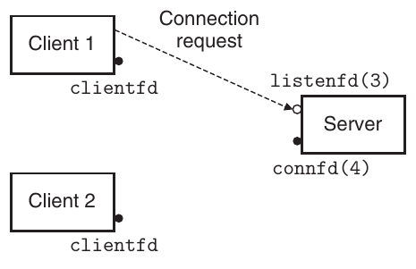

**Hình 12.1 Bước 1: Server chấp nhận connection request từ client.**

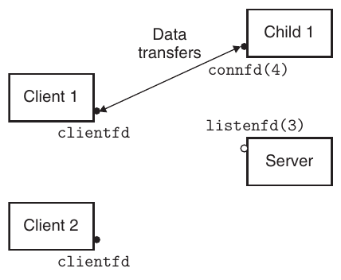

**Hình 12.2 Bước 2: Server fork child process để phục vụ client.**

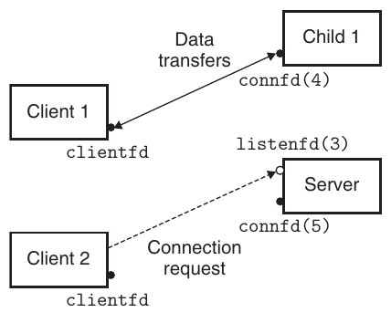

**Hình 12.3 Bước 3: Server chấp nhận connection request khác.**

Giả sử sau khi parent tạo child cho client 1, nó chấp nhận request mới từ client 2 và trả connected descriptor mới (chẳng hạn 5) như Hình 12.3. Parent fork child khác, bắt đầu phục vụ client bằng connected descriptor 5 như Hình 12.4. Lúc này parent chờ request tiếp theo, hai child phục vụ client tương ứng concurrently.

### 12.1.1 Concurrent server dựa trên process

Hình 12.5 thể hiện code concurrent echo server dựa trên process. Hàm echo gọi tại dòng 29 lấy từ Hình 11.22. Có một số điểm quan trọng:

- Thứ nhất, server thường chạy lâu nên phải có SIGCHLD handler reap zombie child (dòng 4–9). Vì SIGCHLD bị block khi handler thực thi và Linux signal không được xếp hàng, handler phải sẵn sàng reap nhiều zombie child.

- Thứ hai, parent và child phải đóng bản sao connfd tương ứng (lần lượt dòng 33 và 30). Như đã nói, điều này đặc biệt quan trọng với parent để tránh memory leak.

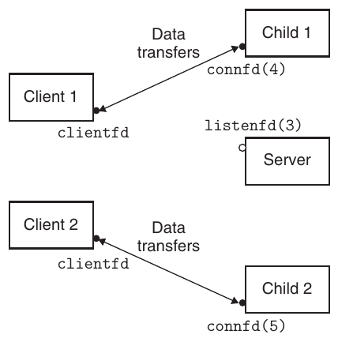

**Hình 12.4 Bước 4: Server fork child khác phục vụ client mới.**

- Cuối cùng, vì reference count trong file table entry của socket, connection tới client chỉ kết thúc sau khi cả bản sao connfd của parent và child đều đóng.

### 12.1.2 Ưu và nhược điểm của process

Process có mô hình chia sẻ trạng thái rõ ràng giữa parent và child: file table dùng chung, user address space thì không. Address space riêng vừa là ưu điểm vừa là nhược điểm. Process không thể vô tình ghi đè virtual memory process khác, loại bỏ nhiều lỗi khó hiểu—một ưu điểm rõ ràng.

Ngược lại, address space riêng khiến chia sẻ trạng thái khó hơn. Process phải dùng cơ chế IPC (interprocess communications) tường minh. (Xem phần thông tin thêm trang 1013.) Nhược điểm khác của thiết kế process-based là thường chậm hơn vì overhead process control và IPC cao.

#### Bài tập thực hành 12.1 (lời giải trang 1072)

Hình 12.5 minh họa concurrent server trong đó parent tạo child để xử lý từng connection request mới. Theo dõi giá trị reference counter cho file table tương ứng trong Hình 12.5.

#### Bài tập thực hành 12.2 (lời giải trang 1072)

Nếu xóa dòng 33 của Hình 12.5, đóng connected descriptor, code vẫn đúng theo nghĩa không có memory leak. Tại sao?

```
                                                                    code/conc/echoserverp.c
 1   #include "csapp.h"
 2   void echo(int connfd);
 3
 4   void sigchld_handler(int sig)
 5   {
 6       while (waitpid(-1, 0, WNOHANG) > 0)
 7           ;
 8       return;
 9   }
10
11   int main(int argc, char **argv)
12   {
13       int listenfd, connfd;
14       socklen_t clientlen;
15       struct sockaddr_storage clientaddr;
16
17       if (argc != 2) {
18           fprintf(stderr, "usage: %s <port>\n", argv[0]);
19           exit(0);
20       }
21
22       Signal(SIGCHLD, sigchld_handler);
23       listenfd = Open_listenfd(argv[1]);
24       while (1) {
25           clientlen = sizeof(struct sockaddr_storage);
26           connfd = Accept(listenfd, (SA *) &clientaddr, &clientlen);
27           if (Fork() == 0) {
28               Close(listenfd); /* Child closes its listening socket */
29               echo(connfd);    /* Child services client */
30               Close(connfd);   /* Child closes connection with client */
31               exit(0);         /* Child exits */
32           }
33           Close(connfd); /* Parent closes connected socket (important!) */
34       }
35   }
                                                                    code/conc/echoserverp.c
```

**Hình 12.5 Concurrent echo server dựa trên process. Parent fork child xử lý mỗi connection request mới.**

#### Thông tin thêm: Unix IPC

Bạn đã gặp vài ví dụ IPC trong sách. Hàm waitpid và signal từ Chương 8 là cơ chế IPC cơ bản cho phép process gửi thông điệp nhỏ tới process trên cùng host. Sockets interface từ Chương 11 là dạng IPC quan trọng cho phép process trên host khác nhau trao đổi byte stream tùy ý. Tuy nhiên, thuật ngữ Unix IPC thường dành cho nhóm kỹ thuật cho process giao tiếp với process khác trên cùng host. Ví dụ gồm pipe, FIFO, System V shared memory và System V semaphore. Các cơ chế này ngoài phạm vi sách. Sách Kerrisk [62] là tài liệu tham khảo xuất sắc.

## 12.2 Concurrent programming bằng I/O multiplexing

Giả sử được yêu cầu viết echo server còn phản hồi lệnh tương tác người dùng nhập vào standard input. Server phải phản hồi hai I/O event độc lập: (1) network client gửi connection request và (2) người dùng gõ dòng lệnh trên bàn phím. Chờ event nào trước? Cả hai lựa chọn đều không lý tưởng. Nếu chờ request trong accept, không thể phản hồi lệnh nhập. Tương tự, nếu chờ lệnh trong read, không thể phản hồi connection request.

Giải pháp là kỹ thuật I/O multiplexing. Ý tưởng cơ bản là dùng select yêu cầu kernel đình chỉ process, chỉ trả quyền điều khiển cho ứng dụng khi một hoặc nhiều I/O event xảy ra, như các ví dụ:

- Trả về khi descriptor bất kỳ trong tập {0, 4} sẵn sàng đọc.

- Trả về khi descriptor bất kỳ trong tập {1, 2, 7} sẵn sàng ghi.

- Timeout nếu đã chờ 152.13 giây để I/O event xảy ra.

Select là hàm phức tạp với nhiều tình huống sử dụng. Chúng ta chỉ thảo luận tình huống đầu: chờ tập descriptor sẵn sàng đọc. Xem [62, 110] để có thảo luận đầy đủ.

```
#include <sys/select.h>

int select(int n, fd_set *fdset, NULL, NULL, NULL);
```

Trả về: số descriptor sẵn sàng khác không, −1 nếu có lỗi

```
FD_ZERO(fd_set *fdset);           /* Clear all bits in fdset */
FD_CLR(int fd, fd_set *fdset);    /* Clear bit fd in fdset */
FD_SET(int fd, fd_set *fdset);    /* Turn on bit fd in fdset */
FD_ISSET(int fd, fd_set *fdset);  /* Is bit fd in fdset on? */
```

Macro thao tác descriptor set

Hàm select thao tác tập thuộc type fd_set, gọi là descriptor set. Về logic, xem descriptor set là bit vector (giới thiệu trong Mục 2.1) size n:

b<sub>n−1</sub>, . . . , b<sub>1</sub>, b<sub>0</sub>

Mỗi bit b<sub>k</sub> tương ứng descriptor k. Descriptor k thuộc descriptor set khi và chỉ khi b<sub>k</sub> = 1. Chỉ được làm ba việc với descriptor set: (1) cấp phát, (2) gán variable thuộc type này cho variable khác, (3) sửa và kiểm tra bằng macro FD_ZERO, FD_SET, FD_CLR, FD_ISSET.

Trong phạm vi này, select nhận hai đầu vào: descriptor set (fdset) gọi là read set, và lực lượng (n) của read set (thực ra là maximum cardinality của descriptor set bất kỳ). select block đến khi ít nhất một descriptor trong read set sẵn sàng đọc. Descriptor k sẵn sàng đọc khi và chỉ khi yêu cầu đọc 1 byte từ nó không block. Như side effect, select sửa fd_set mà fdset trỏ tới để biểu thị tập con của read set gọi là ready set, gồm descriptor sẵn sàng đọc. Giá trị trả về là số phần tử ready set. Chú ý do side effect, phải cập nhật read set mỗi lần gọi select.

Cách tốt nhất hiểu select là nghiên cứu ví dụ cụ thể. Hình 12.6 thể hiện cách dùng select triển khai iterative echo server còn nhận lệnh người dùng từ standard input. Bắt đầu dùng open_listenfd từ Hình 11.19 mở listening descriptor (dòng 16), rồi dùng FD_ZERO tạo read set rỗng (dòng 18): Tiếp theo, dòng 19 và 20 định nghĩa read set gồm descriptor 0 (standard input) và descriptor 3 (listening descriptor):

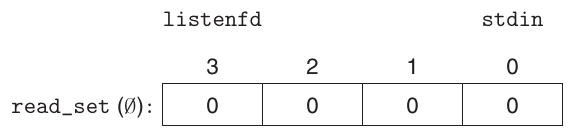

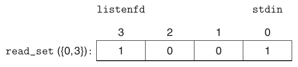

Lúc này bắt đầu vòng lặp server điển hình. Nhưng thay vì chờ connection request bằng accept, gọi select để block đến khi listening descriptor hoặc standard input sẵn sàng đọc (dòng 24). Ví dụ, đây là giá trị ready_set select trả nếu người dùng nhấn enter, khiến standard input descriptor sẵn sàng đọc:

code/conc/select.c

```
 1   #include "csapp.h"
 2   void echo(int connfd);
 3   void command(void);
 4
 5   int main(int argc, char **argv)
 6   {
 7       int listenfd, connfd;
 8       socklen_t clientlen;
 9       struct sockaddr_storage clientaddr;
10       fd_set read_set, ready_set;
11
12       if (argc != 2) {
13           fprintf(stderr, "usage: %s <port>\n", argv[0]);
14           exit(0);
15       }
16       listenfd = Open_listenfd(argv[1]);
17
18       FD_ZERO(&read_set);              /* Clear read set */
19       FD_SET(STDIN_FILENO, &read_set); /* Add stdin to read set */
20       FD_SET(listenfd, &read_set);     /* Add listenfd to read set */
21
22       while (1) {
23           ready_set = read_set;
24           Select(listenfd+1, &ready_set, NULL, NULL, NULL);
25           if (FD_ISSET(STDIN_FILENO, &ready_set))
26               command(); /* Read command line from stdin */
27           if (FD_ISSET(listenfd, &ready_set)) {
28               clientlen = sizeof(struct sockaddr_storage);
29               connfd = Accept(listenfd, (SA *)&clientaddr, &clientlen);
30               echo(connfd); /* Echo client input until EOF */
31               Close(connfd);
32           }
33       }
34   }
35
36   void command(void) {
37       char buf[MAXLINE];
38       if (!Fgets(buf, MAXLINE, stdin))
39           exit(0); /* EOF */
40       printf("%s", buf); /* Process the input command */
41   }
                                                             code/conc/select.c
```

**Hình 12.6 Iterative echo server dùng I/O multiplexing. Server dùng select chờ connection request trên listening descriptor và lệnh trên standard input.**

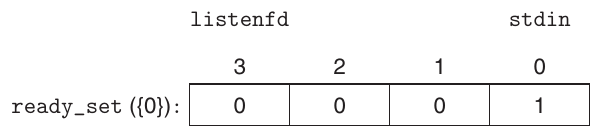

Khi select trả về, dùng FD_ISSET xác định descriptor nào sẵn sàng đọc. Nếu standard input sẵn sàng (dòng 25), gọi command để đọc, phân tích và phản hồi lệnh trước khi trở về main. Nếu listening descriptor sẵn sàng (dòng 27), gọi accept lấy connected descriptor rồi gọi echo từ Hình 11.22, echo từng dòng client cho đến khi client đóng đầu connection của nó.

Mặc dù là ví dụ tốt về select, chương trình vẫn chưa hoàn hảo. Vấn đề là sau khi nối client, nó tiếp tục echo dòng đầu vào cho đến khi client đóng đầu connection. Vì vậy, nếu gõ lệnh vào standard input, bạn không nhận phản hồi đến khi server phục vụ xong client. Cách tốt hơn là multiplex ở granularity nhỏ hơn, echo tối đa một dòng văn bản mỗi lần qua vòng lặp server.

### Bài tập thực hành 12.3 (lời giải trang 1072)

Trong Linux, gõ Ctrl+D biểu thị EOF trên standard input. Điều gì xảy ra nếu gõ Ctrl+D vào chương trình Hình 12.6 khi nó đang echo từng dòng client?

### 12.2.1 Concurrent server Event-Driven dựa trên I/O multiplexing

I/O multiplexing có thể làm nền tảng cho chương trình concurrent event-driven, trong đó flow tiến triển do event cụ thể. Ý tưởng chung là mô hình hóa logical flow thành state machine. Không chính thức, state machine là tập trạng thái, input event và transition ánh xạ trạng thái, input event sang trạng thái. Mỗi transition ánh xạ cặp (input state, input event) sang output state. self-loop là transition có input và output state giống nhau. State machine thường được vẽ bằng directed graph, node là state, cung có hướng là transition, nhãn cung là input event. State machine bắt đầu ở initial state. Mỗi input event kích hoạt transition từ current state tới next state.

Với mỗi client k mới, concurrent server I/O multiplexing tạo state machine s<sub>k</sub> mới và gắn với connected descriptor d<sub>k</sub>. Như Hình 12.7, mỗi s<sub>k</sub> có một state (“chờ descriptor d<sub>k</sub> sẵn sàng đọc”), một input event (“descriptor d<sub>k</sub> sẵn sàng đọc”) và một transition (“đọc dòng văn bản từ descriptor d<sub>k</sub>”).

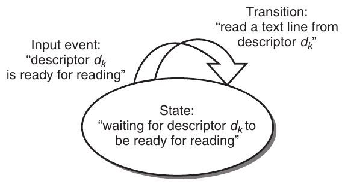

**Hình 12.7 State machine cho logical flow trong concurrent echo server event-driven.**

Server dùng I/O multiplexing qua select để phát hiện input event. Khi mỗi connected descriptor sẵn sàng đọc, server thực hiện transition cho state machine tương ứng—ở đây là đọc và echo dòng văn bản từ descriptor.

Hình 12.8 thể hiện code ví dụ đầy đủ cho concurrent server event-driven dựa trên I/O multiplexing. Tập active client được duy trì trong pool structure (dòng 3–11). Sau khi khởi tạo pool bằng init_pool (dòng 27), server vào vòng lặp vô hạn. Mỗi lần lặp gọi select phát hiện hai input event: (1) connection request từ client mới và (2) connected descriptor của client hiện có sẵn sàng đọc. Khi request tới (dòng 35), server mở connection (dòng 37), gọi add_client thêm client vào pool (dòng 38). Cuối cùng gọi check_clients echo một dòng từ mỗi ready connected descriptor (dòng 42).

Hàm init_pool (Hình 12.9) khởi tạo client pool. Array clientfd biểu diễn tập connected descriptor, số nguyên −1 chỉ slot còn trống. Ban đầu tập connected descriptor rỗng (dòng 5–7), listening descriptor là descriptor duy nhất trong select read set (dòng 10–12).

Hàm add_client (Hình 12.10) thêm client mới vào pool active client. Sau khi tìm slot trống trong clientfd, server thêm connected descriptor vào array và khởi tạo Rio read buffer tương ứng để gọi rio_readlineb trên descriptor (dòng 8–9). Sau đó thêm descriptor vào select read set (dòng 12), cập nhật thuộc tính global của pool. Variable maxfd (dòng 15–16) theo dõi file descriptor lớn nhất cho select. Variable maxi (dòng 17–18) theo dõi index lớn nhất vào clientfd để check_clients không phải tìm toàn array.

Hàm check_clients trong Hình 12.11 echo dòng văn bản từ mỗi ready connected descriptor. Nếu đọc thành công, echo lại client (dòng 15–18). Chú ý dòng 15 duy trì tổng tích lũy byte nhận từ mọi client. Nếu phát hiện EOF vì client đóng đầu connection, đóng đầu connection của mình (dòng 23) và loại descriptor khỏi pool (dòng 24–25).

code/conc/echoservers.c

```
 1   #include "csapp.h"
 2
 3   typedef struct { /* Represents a pool of connected descriptors */
 4       int maxfd;        /* Largest descriptor in read_set */
 5       fd_set read_set;  /* Set of all active descriptors */
 6       fd_set ready_set; /* Subset of descriptors ready for reading  */
 7       int nready;       /* Number of ready descriptors from select */
 8       int maxi;         /* High water index into client array */
 9       int clientfd[FD_SETSIZE];    /* Set of active descriptors */
10       rio_t clientrio[FD_SETSIZE]; /* Set of active read buffers */
11   } pool;
12
13   int byte_cnt = 0; /* Counts total bytes received by server */
14
15   int main(int argc, char **argv)
16   {
17       int listenfd, connfd;
18       socklen_t clientlen;
19       struct sockaddr_storage clientaddr;
20       static pool pool;
21
22       if (argc != 2) {
23           fprintf(stderr, "usage: %s <port>\n", argv[0]);
24           exit(0);
25       }
26       listenfd = Open_listenfd(argv[1]);
27       init_pool(listenfd, &pool);
28
29       while (1) {
30           /* Wait for listening/connected descriptor(s) to become ready */
31           pool.ready_set = pool.read_set;
32           pool.nready = Select(pool.maxfd+1, &pool.ready_set, NULL, NULL, NULL);
33
34           /* If listening descriptor ready, add new client to pool */
35           if (FD_ISSET(listenfd, &pool.ready_set)) {
36               clientlen = sizeof(struct sockaddr_storage);
37               connfd = Accept(listenfd, (SA *)&clientaddr, &clientlen);
38               add_client(connfd, &pool);
39           }
40
41           /* Echo a text line from each ready connected descriptor */
42           check_clients(&pool);
43       }
44   }
                                                                          code/conc/echoservers.c
```

**Hình 12.8 Concurrent echo server dựa trên I/O multiplexing. Mỗi lần lặp echo một dòng từ mỗi ready descriptor.**

```
                                                    code/conc/echoservers.c
 1   void init_pool(int listenfd, pool *p)
 2   {
 3       /* Initially, there are no connected descriptors */
 4       int i;
 5       p->maxi = -1;
 6       for (i=0; i< FD_SETSIZE; i++)
 7           p->clientfd[i] = -1;
 8
 9       /* Initially, listenfd is only member of select read set */
10       p->maxfd = listenfd;
11       FD_ZERO(&p->read_set);
12       FD_SET(listenfd, &p->read_set);
13   }
                                                    code/conc/echoservers.c
```

**Hình 12.9 init_pool khởi tạo pool active client.**

```
                                                    code/conc/echoservers.c
 1   void add_client(int connfd, pool *p)
 2   {
 3       int i;
 4       p->nready--;
 5       for (i = 0; i < FD_SETSIZE; i++) /* Find an available slot */
 6           if (p->clientfd[i] < 0) {
 7               /* Add connected descriptor to the pool */
 8               p->clientfd[i] = connfd;
 9               Rio_readinitb(&p->clientrio[i], connfd);
10
11               /* Add the descriptor to descriptor set */
12               FD_SET(connfd, &p->read_set);
13
14               /* Update max descriptor and pool high water mark */
15               if (connfd > p->maxfd)
16                   p->maxfd = connfd;
17               if (i > p->maxi)
18                   p->maxi = i;
19               break;
20           }
21       if (i == FD_SETSIZE) /* Couldn’t find an empty slot */
22           app_error("add_client error: Too many clients");
23   }
                                                    code/conc/echoservers.c
```

**Hình 12.10 add_client thêm client connection mới vào pool.**

```
                                                                    code/conc/echoservers.c
 1   void check_clients(pool *p)
 2   {
 3       int i, connfd, n;
 4       char buf[MAXLINE];
 5       rio_t rio;
 6
 7       for (i = 0; (i <= p->maxi) && (p->nready > 0); i++) {
 8           connfd = p->clientfd[i];
 9           rio = p->clientrio[i];
10
11           /* If the descriptor is ready, echo a text line from it */
12           if ((connfd > 0) && (FD_ISSET(connfd, &p->ready_set))) {
13               p->nready--;
14               if ((n = Rio_readlineb(&rio, buf, MAXLINE)) != 0) {
15                   byte_cnt += n;
16                   printf("Server received %d (%d total) bytes on fd %d\n",
17                          n, byte_cnt, connfd);
18                   Rio_writen(connfd, buf, n);
19               }
20
21               /* EOF detected, remove descriptor from pool */
22               else {
23                   Close(connfd);
24                   FD_CLR(connfd, &p->read_set);
25                   p->clientfd[i] = -1;
26               }
27           }
28       }
29   }
                                                                    code/conc/echoservers.c
```

**Hình 12.11 check_clients phục vụ client connection sẵn sàng.**

Theo finite state model Hình 12.7, select phát hiện input event, add_client tạo logical flow mới (state machine). check_clients thực hiện state transition bằng echo dòng đầu vào, đồng thời xóa state machine khi client gửi xong dòng văn bản.

#### Bài tập thực hành 12.4 (lời giải trang 1072)

Trong server Hình 12.8, pool.nready được khởi tạo lại bằng giá trị nhận từ select. Tại sao?

#### Thông tin thêm: Web server Event-driven

Dù có nhược điểm nêu trong Mục 12.2.2, server high-performance hiện đại như Node.js, nginx và Tornado dùng lập trình event-driven dựa trên I/O multiplexing, chủ yếu do lợi thế hiệu năng đáng kể so với process và thread.

### 12.2.2 Ưu và nhược điểm I/O multiplexing

Server Hình 12.8 minh họa rõ ưu, nhược điểm lập trình event-driven dựa trên I/O multiplexing. Một ưu điểm là thiết kế event-driven cho lập trình viên kiểm soát hành vi nhiều hơn thiết kế process-based. Ví dụ, có thể viết concurrent server event-driven ưu tiên phục vụ một số client, khó làm với concurrent server dựa trên process.

Ưu điểm khác là server event-driven I/O multiplexing chạy trong context một process, mọi logical flow truy cập toàn address space process. Điều này giúp dễ chia sẻ dữ liệu giữa flow. Lợi thế liên quan là có thể debug concurrent server như chương trình tuần tự bằng công cụ quen thuộc như gdb. Cuối cùng, thiết kế event-driven thường hiệu quả hơn đáng kể process-based vì không cần process context switch để schedule flow mới.

Nhược điểm đáng kể của thiết kế event-driven là độ phức tạp code. Concurrent echo server event-driven cần lượng code gấp ba server process-based. Đáng tiếc, độ phức tạp tăng khi granularity concurrency giảm. Granularity là số instruction mỗi logical flow thực thi trong một time slice. Ví dụ, server concurrent ở đây có granularity bằng số instruction cần đọc toàn dòng văn bản. Khi một flow bận đọc dòng, flow khác không thể tiến triển. Điều này ổn với ví dụ nhưng khiến server event-driven dễ bị client độc hại chỉ gửi một phần dòng rồi dừng. Sửa server event-driven để xử lý dòng không đầy đủ không đơn giản, trong khi thiết kế process-based xử lý rõ ràng và tự động. Nhược điểm đáng kể khác của thiết kế event-based là không tận dụng hết processor multi-core.

## 12.3 Concurrent programming bằng thread

Đến đây, chúng ta đã xem hai cách tạo concurrent logical flow. Cách đầu dùng process riêng cho mỗi flow. Kernel tự schedule process, mỗi process có private address space riêng nên khó chia sẻ dữ liệu. Cách thứ hai tự tạo logical flow và dùng I/O multiplexing schedule tường minh. Vì chỉ một process, flow chia sẻ toàn address space. Mục này giới thiệu cách thứ ba dựa trên thread, kết hợp hai cách trên.

Thread là logical flow chạy trong context process. Đến đây, chương trình trong sách gồm một thread mỗi process. Nhưng hệ thống hiện đại còn cho viết chương trình có nhiều thread chạy concurrently trong một process. Kernel tự schedule thread. Mỗi thread có thread context riêng, gồm thread ID (TID) số nguyên duy nhất, stack, stack pointer, program counter, general-purpose register và condition code. Mọi thread trong process dùng chung toàn virtual address space process.

Logical flow dựa trên thread kết hợp phẩm chất flow dựa trên process và I/O multiplexing. Như process, thread được kernel tự schedule và nhận diện bằng integer ID. Như flow I/O multiplexing, nhiều thread chạy trong context một process nên chia sẻ toàn virtual address space, gồm code, data, heap, shared library và file mở.

### 12.3.1 Mô hình thực thi thread

Mô hình thực thi nhiều thread tương tự nhiều process ở một số điểm. Xét Hình 12.12. Mỗi process bắt đầu là một thread gọi là main thread. Tại thời điểm nào đó, main thread tạo peer thread; từ đó hai thread chạy concurrently. Cuối cùng quyền điều khiển chuyển tới peer thread qua context switch, do main thread thực thi slow system call như read, sleep hoặc bị interval timer ngắt. Peer thread chạy một lúc trước khi quyền điều khiển về main thread, và cứ như vậy.

Thực thi thread khác process ở những điểm quan trọng. Vì thread context nhỏ hơn nhiều process context, thread context switch nhanh hơn process context switch. Khác biệt nữa là thread không tổ chức theo hệ thống parent-child cứng nhắc. Thread gắn với process tạo pool peer, độc lập với thread nào tạo thread nào. Main thread chỉ khác ở chỗ luôn là thread đầu tiên chạy trong process. Hệ quả chính của pool peer là thread có thể kill peer bất kỳ hoặc chờ peer bất kỳ kết thúc. Hơn nữa, mỗi peer có thể đọc và ghi cùng dữ liệu dùng chung.

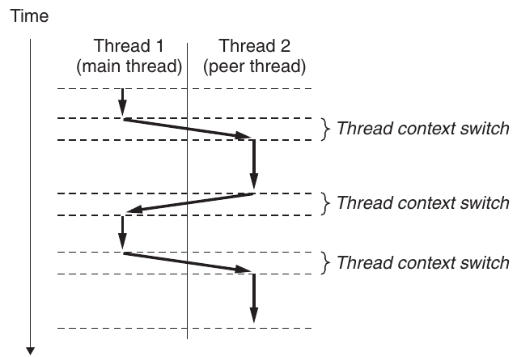

**Hình 12.12 Thực thi thread concurrent.**

### 12.3.2 Posix Threads

Posix threads (Pthreads) là interface chuẩn thao tác thread từ chương trình C. Nó được chấp nhận năm 1995 và có trên mọi hệ thống Linux. Pthreads định nghĩa khoảng 60 hàm cho phép tạo, kill, reap thread, chia sẻ dữ liệu an toàn với peer thread và thông báo peer về thay đổi trạng thái hệ thống.

Hình 12.13 thể hiện chương trình Pthreads đơn giản. Main thread tạo peer thread rồi chờ kết thúc. Peer thread in Hello, world!\n rồi kết thúc. Khi main thread phát hiện peer đã kết thúc, nó gọi exit kết thúc process. Đây là chương trình threaded đầu tiên nên cần phân tích kỹ. Code và local data của thread được đóng gói trong thread routine. Như prototype dòng 2, mỗi thread routine nhận một generic pointer và trả generic pointer. Muốn truyền nhiều argument, đặt chúng trong structure rồi truyền pointer tới structure. Tương tự, muốn thread routine trả nhiều argument, có thể trả pointer tới structure.

```
                                                         code/conc/hello.c
 1   #include "csapp.h"
 2   void *thread(void *vargp);
 3
 4   int main()
 5   {
 6       pthread_t tid;
 7       Pthread_create(&tid, NULL, thread, NULL);
 8       Pthread_join(tid, NULL);
 9       exit(0);
10   }
11
12   void *thread(void *vargp) /* Thread routine */
13   {
14       printf("Hello, world!\n");
15       return NULL;
16   }
                                                         code/conc/hello.c
```

**Hình 12.13 hello.c : Chương trình Pthreads “Hello, world!”.**

Dòng 4 bắt đầu code main thread. Main thread khai báo local variable tid dùng lưu thread ID của peer (dòng 6). Main tạo peer mới bằng pthread_create (dòng 7). Khi pthread_create trả về, main và peer mới chạy concurrently, tid chứa ID thread mới. Main chờ peer kết thúc bằng pthread_join dòng 8. Cuối cùng main gọi exit (dòng 9), kết thúc mọi thread hiện chạy trong process (ở đây chỉ main).

Dòng 12–16 định nghĩa thread routine của peer. Nó chỉ in string rồi kết thúc peer bằng return ở dòng 15.

### 12.3.3 Tạo thread

Thread tạo thread khác bằng pthread_create.

```
#include <pthread.h>
typedef void *(func)(void *);

int pthread_create(pthread_t *tid, pthread_attr_t *attr,
                   func *f, void *arg);
```

Trả về: 0 nếu thành công, khác không nếu có lỗi

Hàm pthread_create tạo thread mới và chạy thread routine f trong context thread mới với input argument arg. Đối số attr có thể thay đổi thuộc tính mặc định của thread mới. Việc đổi thuộc tính ngoài phạm vi sách; ví dụ luôn gọi pthread_create với attr NULL.

Khi pthread_create trả về, tid chứa ID thread mới. Thread mới có thể xác định thread ID của mình bằng pthread_self.

```
#include <pthread.h>

pthread_t pthread_self(void);
```

Trả về: thread ID của caller

### 12.3.4 Kết thúc thread

Thread kết thúc theo một trong các cách:

- Thread kết thúc ngầm khi thread routine top-level trả về.

- Thread kết thúc tường minh bằng pthread_exit. Nếu main thread gọi pthread_exit, nó chờ mọi peer khác kết thúc rồi kết thúc main thread và toàn process với giá trị trả về thread_return.

```
#include <pthread.h>

void pthread_exit(void *thread_return);
```

Không bao giờ trả về

- Một peer gọi Linux exit, kết thúc process và mọi thread gắn với process.

- Peer khác kết thúc thread hiện tại bằng pthread_cancel với ID thread hiện tại.

```
#include <pthread.h>

int pthread_cancel(pthread_t tid);
```

Trả về: 0 nếu thành công, khác không nếu có lỗi

### 12.3.5 Reap thread đã kết thúc

Thread chờ thread khác kết thúc bằng pthread_join.

```
#include <pthread.h>

int pthread_join(pthread_t tid, void **thread_return);
```

Trả về: 0 nếu thành công, khác không nếu có lỗi

Hàm pthread_join block đến khi thread tid kết thúc, gán generic pointer (void *) do thread routine trả về vào vị trí thread_return trỏ tới, rồi reap tài nguyên bộ nhớ thread đã kết thúc giữ.

Chú ý khác Linux wait, pthread_join chỉ chờ một thread cụ thể kết thúc. Không có cách yêu cầu pthread_join chờ thread bất kỳ kết thúc. Điều này có thể làm code phức tạp, buộc dùng cơ chế khác ít trực giác hơn để phát hiện process kết thúc. Thực tế, Stevens lập luận thuyết phục đây là bug trong đặc tả [110].

### 12.3.6 Detach thread

Tại bất kỳ thời điểm nào, thread là joinable hoặc detached. Joinable thread có thể được thread khác reap và kill. Tài nguyên bộ nhớ (như stack) không được giải phóng đến khi thread khác reap. Ngược lại, detached thread không thể được thread khác reap hoặc kill. Hệ thống tự giải phóng tài nguyên khi nó kết thúc.

Theo mặc định, thread được tạo joinable. Để tránh memory leak, mỗi joinable thread cần được thread khác reap tường minh hoặc detached bằng pthread_detach.

```
#include <pthread.h>

int pthread_detach(pthread_t tid);
```

Trả về: 0 nếu thành công, khác không nếu có lỗi

Hàm pthread_detach detach joinable thread tid. Thread có thể tự detach bằng pthread_detach với đối số pthread_self().

Mặc dù một số ví dụ dùng joinable thread, có lý do tốt để dùng detached thread trong chương trình thực. Ví dụ, Web server high-performance có thể tạo peer mới mỗi khi nhận connection request từ browser. Vì mỗi connection do thread riêng xử lý độc lập, server không cần—và thực ra không nên—chờ tường minh từng peer kết thúc. Khi đó mỗi peer cần tự detach trước khi xử lý request để tài nguyên bộ nhớ được thu hồi sau khi kết thúc.

### 12.3.7 Khởi tạo thread

Hàm pthread_once cho phép khởi tạo trạng thái gắn với thread routine.

```
#include <pthread.h>

pthread_once_t once_control = PTHREAD_ONCE_INIT;

int pthread_once(pthread_once_t *once_control,
                 void (*init_routine)(void));
```

Luôn trả về 0

Variable once_control là global hoặc static variable luôn được khởi tạo PTHREAD_ONCE_INIT. Lần đầu gọi pthread_once với once_control, nó gọi init_routine, hàm không có input argument và không trả gì. Các lời gọi tiếp theo với cùng once_control không làm gì. pthread_once hữu ích khi cần khởi tạo động global variable được nhiều thread dùng chung. Chúng ta xem ví dụ trong Mục 12.5.5.

### 12.3.8 Concurrent server dựa trên thread

Hình 12.14 thể hiện code concurrent echo server dựa trên thread. Cấu trúc tổng thể tương tự thiết kế process-based. Main thread liên tục chờ connection request rồi tạo peer xử lý. Mặc dù code có vẻ đơn giản, có hai vấn đề tổng quát khá tinh tế cần xem kỹ. Vấn đề đầu là truyền connected descriptor cho peer khi gọi pthread_create thế nào. Cách hiển nhiên là truyền pointer tới descriptor như sau:

```
                                                                          code/conc/echoservert.c
 1   #include "csapp.h"
 2
 3   void echo(int connfd);
 4   void *thread(void *vargp);
 5
 6   int main(int argc, char **argv)
 7   {
 8       int listenfd, *connfdp;
 9       socklen_t clientlen;
10       struct sockaddr_storage clientaddr;
11       pthread_t tid;
12
13       if (argc != 2) {
14           fprintf(stderr, "usage: %s <port>\n", argv[0]);
15           exit(0);
16       }
17       listenfd = Open_listenfd(argv[1]);
18
19       while (1) {
20           clientlen=sizeof(struct sockaddr_storage);
21           connfdp = Malloc(sizeof(int));
22           *connfdp = Accept(listenfd, (SA *) &clientaddr, &clientlen);
23           Pthread_create(&tid, NULL, thread, connfdp);
24       }
25   }
26
27   /* Thread routine */
28   void *thread(void *vargp)
29   {
30       int connfd = *((int *)vargp);
31       Pthread_detach(pthread_self());
32       Free(vargp);
33       echo(connfd);
34       Close(connfd);
35       return NULL;
36   }
                                                                          code/conc/echoservert.c
```

**Hình 12.14 Concurrent echo server dựa trên thread.**

```
connfd = Accept(listenfd, (SA *) &clientaddr, &clientlen);
Pthread_create(&tid, NULL, thread, &connfd);
```

Sau đó để peer dereference pointer và gán cho local variable như sau:

```
void *thread(void *vargp) {
    int connfd = *((int *)vargp);
    .
    .
    .
}
```

Tuy nhiên, cách này sai vì tạo race giữa câu lệnh gán trong peer và accept trong main. Nếu gán xong trước accept tiếp theo, local connfd trong peer nhận đúng descriptor. Nhưng nếu gán xong sau accept, local connfd nhận descriptor number của connection tiếp theo. Kết quả không mong muốn là hai thread cùng input và output trên một descriptor. Để tránh race có thể nghiêm trọng này, phải gán mỗi connected descriptor do accept trả vào memory block allocated động riêng như dòng 21–22. Chúng ta quay lại race trong Mục 12.7.4.

Vấn đề khác là tránh memory leak trong thread routine. Vì không reap thread tường minh, phải detach mỗi thread để tài nguyên được thu hồi khi kết thúc (dòng 31). Hơn nữa, phải cẩn thận free memory block do main cấp phát (dòng 32).

#### Bài tập thực hành 12.5 (lời giải trang 1072)

Trong server process-based Hình 12.5, chúng ta thấy không memory leak và code vẫn đúng dù xóa dòng 33. Trong server threads-based Hình 12.14, có nguy cơ memory leak nếu xóa dòng 31 hoặc 32 không? Tại sao?

## 12.4 Shared variable trong chương trình threaded

Từ góc nhìn lập trình viên, điểm hấp dẫn của thread là dễ để nhiều thread dùng chung variable chương trình. Tuy nhiên, việc chia sẻ có thể khó xử lý. Để viết chương trình threaded đúng, phải hiểu rõ chia sẻ nghĩa là gì và hoạt động thế nào.

Cần trả lời các câu hỏi cơ bản để hiểu variable C có shared không: (1) Memory model bên dưới của thread là gì? (2) Với mô hình này, instance variable được ánh xạ vào bộ nhớ thế nào? (3) Cuối cùng, bao nhiêu thread tham chiếu từng instance? Variable shared khi và chỉ khi nhiều thread tham chiếu một instance nào đó.

code/conc/sharing.c

```
 1   #include "csapp.h"
 2   #define N 2
 3   void *thread(void *vargp);
 4
 5   char **ptr;  /* Global variable */
 6
 7   int main()
 8   {
 9       int i;
10       pthread_t tid;
11       char *msgs[N] = {
12           "Hello from foo",
13           "Hello from bar"
14       };
15
16       ptr = msgs;
17       for (i = 0; i < N; i++)
18           Pthread_create(&tid, NULL, thread, (void *)i);
19       Pthread_exit(NULL);
20   }
21
22   void *thread(void *vargp)
23   {
24       int myid = (int)vargp;
25       static int cnt = 0;
26       printf("[%d]: %s (cnt=%d)\n", myid, ptr[myid], ++cnt);
27       return NULL;
28   }
                                                           code/conc/sharing.c
```

**Hình 12.15 Chương trình ví dụ minh họa các khía cạnh chia sẻ.**

Để cụ thể, chúng ta dùng chương trình Hình 12.15 làm ví dụ xuyên suốt. Dù hơi gượng ép, nó hữu ích vì minh họa nhiều điểm tinh tế. Chương trình gồm main thread tạo hai peer. Main truyền ID duy nhất tới mỗi peer, peer dùng ID in thông báo cá nhân hóa cùng tổng số lần thread routine đã được gọi.

### 12.4.1 Memory model của thread

Pool concurrent thread chạy trong context một process. Mỗi thread có thread context riêng gồm thread ID, stack, stack pointer, program counter, condition code và giá trị general-purpose register. Mỗi thread chia sẻ phần process context còn lại với thread khác. Nó gồm toàn user virtual address space: text (code) read-only, data đọc/ghi, heap và vùng code, data shared library. Thread còn dùng chung tập file mở.

Về hoạt động, thread không thể đọc hoặc ghi register value của thread khác. Ngược lại, mọi thread có thể truy cập vị trí bất kỳ trong shared virtual memory. Nếu thread sửa vị trí bộ nhớ, thread khác cuối cùng sẽ thấy thay đổi nếu đọc vị trí đó. Vì vậy register không bao giờ shared, còn virtual memory luôn shared.

Memory model cho thread stack riêng không rõ ràng như vậy. Stack nằm trong stack area của virtual address space và thường được thread tương ứng truy cập độc lập. Nói thường thay vì luôn vì stack không được bảo vệ khỏi thread khác. Nếu thread bằng cách nào đó có pointer tới stack thread khác, nó có thể đọc ghi phần bất kỳ của stack đó. Ví dụ thể hiện điều này ở dòng 26, peer gián tiếp tham chiếu nội dung stack main qua global variable ptr.

### 12.4.2 Ánh xạ variable vào bộ nhớ

Variable trong chương trình C threaded được ánh xạ tới virtual memory theo storage class:

Global variable. Global variable là variable khai báo ngoài function. Tại run time, vùng đọc/ghi virtual memory chứa đúng một instance của mỗi global variable có thể được thread bất kỳ tham chiếu. Ví dụ, global ptr khai báo dòng 5 có một instance run-time trong vùng đọc/ghi. Khi chỉ có một instance, ký hiệu bằng tên variable—ở đây ptr.

Local automatic variable. Variable khai báo trong function không có thuộc tính static. Tại run time, stack mỗi thread chứa instance riêng của local automatic variable, ngay cả khi nhiều thread thực thi cùng routine. Ví dụ, có một instance local tid trên stack main, ký hiệu tid.m. Ví dụ khác, có hai instance local myid: một trên stack peer 0 và một trên stack peer 1, lần lượt ký hiệu myid.p0 và myid.p1.

Local static variable. Variable khai báo trong function với thuộc tính static. Như global variable, vùng đọc/ghi virtual memory chứa đúng một instance của mỗi local static variable khai báo trong chương trình. Ví dụ, dù mỗi peer khai báo cnt ở dòng 25, tại run time chỉ một instance cnt nằm trong vùng đọc/ghi virtual memory. Mỗi peer đọc và ghi instance này.

### 12.4.3 Shared Variable

Variable v shared khi và chỉ khi một instance được nhiều hơn một thread tham chiếu. Ví dụ cnt shared vì chỉ một instance run-time được cả hai peer tham chiếu. Ngược lại myid không shared vì mỗi instance trong hai instance chỉ được đúng một thread tham chiếu. Tuy nhiên, cần nhận ra local automatic variable như msgs cũng có thể shared.

#### Bài tập thực hành 12.6 (lời giải trang 1072)

A. Dùng phân tích Mục 12.4 điền “Yes” hoặc “No” vào bảng cho chương trình Hình 12.15. Cột đầu ký hiệu v.t là instance variable v trên local stack thread t, trong đó t là m (main), p0 (peer 0) hoặc p1 (peer 1).

| Variable |  | Được tham chiếu bởi |  |
|---|---|---|---|
| instance | main thread? | peer thread 0? | peer thread 1? |
| ptr | ______ | ______ | ______ |
| cnt | ______ | ______ | ______ |
| i.m | ______ | ______ | ______ |
| msgs.m | ______ | ______ | ______ |
| myid.p0 | ______ | ______ | ______ |
| myid.p1 | ______ | ______ | ______ |

B. Với phân tích phần A, variable nào trong ptr, cnt, i, msgs và myid là shared?

## 12.5 Đồng bộ thread bằng semaphore

Shared variable thuận tiện nhưng tạo khả năng lỗi đồng bộ khó chịu. Xét badcnt.c Hình 12.16, tạo hai thread, mỗi thread tăng global shared counter variable cnt.

Vì mỗi thread tăng counter niters lần, kỳ vọng giá trị cuối là 2 × niters. Điều này có vẻ đơn giản, dễ hiểu. Tuy nhiên, khi chạy badcnt.c trên Linux, không chỉ kết quả sai mà mỗi lần còn khác nhau!

code/conc/badcnt.c

```
 1   /* WARNING: This code is buggy! */
 2   #include "csapp.h"
 3
 4   void *thread(void *vargp);  /* Thread routine prototype */
 5
 6   /* Global shared variable */
 7   volatile long cnt = 0; /* Counter */
 8
 9   int main(int argc, char **argv)
10   {
11       long niters;
12       pthread_t tid1, tid2;
13
14       /* Check input argument */
15       if (argc != 2) {
16           printf("usage: %s <niters>\n", argv[0]);
17           exit(0);
18       }
19       niters = atoi(argv[1]);
20
21       /* Create threads and wait for them to finish */
22       Pthread_create(&tid1, NULL, thread, &niters);
23       Pthread_create(&tid2, NULL, thread, &niters);
24       Pthread_join(tid1, NULL);
25       Pthread_join(tid2, NULL);
26
27       /* Check result */
28       if (cnt != (2 * niters))
29           printf("BOOM! cnt=%ld\n", cnt);
30       else
31           printf("OK cnt=%ld\n", cnt);
32       exit(0);
33   }
34
35   /* Thread routine */
36   void *thread(void *vargp)
37   {
38       long i, niters = *((long *)vargp);
39
40       for (i = 0; i < niters; i++)
41           cnt++;
42
43       return NULL;
44   }
                                                            code/conc/badcnt.c
```

**Hình 12.16 badcnt.c : Chương trình counter đồng bộ không đúng.**

```
linux>  ./badcnt 1000000
BOOM! cnt=1445085

linux>  ./badcnt 1000000
BOOM! cnt=1915220

linux>  ./badcnt 1000000
BOOM! cnt=1404746
```

Vậy sai ở đâu? Để hiểu rõ, cần nghiên cứu assembly code của counter loop (dòng 40–41), như Hình 12.17. Chia code vòng lặp thread i thành năm phần sẽ hữu ích:

H<sub>i</sub>: Block instruction đầu vòng lặp

L<sub>i</sub>: Instruction load shared variable cnt vào accumulator register %rdx<sub>i</sub>, trong đó %rdx<sub>i</sub> là giá trị register %rdx trong thread i

U<sub>i</sub>: Instruction cập nhật (tăng) %rdx<sub>i</sub>

S<sub>i</sub> : Instruction lưu giá trị %rdx<sub>i</sub> đã cập nhật trở lại shared variable cnt

T<sub>i</sub> : Block instruction cuối vòng lặp

Chú ý phần đầu và cuối chỉ thao tác local stack variable, còn L<sub>i</sub>, U<sub>i</sub> và S<sub>i</sub> thao tác nội dung shared counter variable.

Khi hai peer trong badcnt.c chạy concurrently trên uniprocessor, machine instruction hoàn tất lần lượt theo thứ tự nào đó. Vì vậy mỗi concurrent execution định nghĩa một thứ tự toàn phần (hay interleaving) instruction của hai thread. Đáng tiếc, một số thứ tự cho kết quả đúng, số khác thì không.

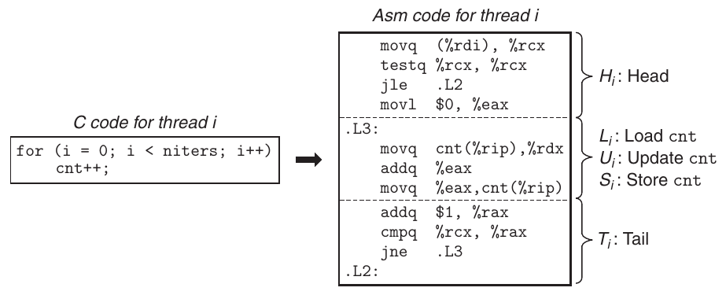

**Hình 12.17 Assembly code cho counter loop (dòng 40–41) trong badcnt.c .**

|  |  | (a) Thứ tự đúng |  |  |  |  |  | (b) Thứ tự sai |  |  |  |
|---|---|---|---|---|---|---|---|---|---|---|---|
| Bước | Thread | Instr. | %rdx<sub>1</sub> | %rdx<sub>2</sub> | cnt | Bước | Thread | Instr. | %rdx<sub>1</sub> | %rdx<sub>2</sub> | cnt |
| 1 | 1 | H<sub>1</sub> | — | — | 0 | 1 | 1 | H<sub>1</sub> | — | — | 0 |
| 2 | 1 | L<sub>1</sub> | 0 | — | 0 | 2 | 1 | L<sub>1</sub> | 0 | — | 0 |
| 3 | 1 | U<sub>1</sub> | 1 | — | 0 | 3 | 1 | U<sub>1</sub> | 1 | — | 0 |
| 4 | 1 | S<sub>1</sub> | 1 | — | 1 | 4 | 2 | H<sub>2</sub> | — | — | 0 |
| 5 | 2 | H<sub>2</sub> | — | — | 1 | 5 | 2 | L<sub>2</sub> | — | 0 | 0 |
| 6 | 2 | L<sub>2</sub> | — | 1 | 1 | 6 | 1 | S<sub>1</sub> | 1 | — | 1 |
| 7 | 2 | U<sub>2</sub> | — | 2 | 1 | 7 | 1 | T<sub>1</sub> | 1 | — | 1 |
| 8 | 2 | S<sub>2</sub> | — | 2 | 2 | 8 | 2 | U<sub>2</sub> | — | 1 | 1 |
| 9 | 2 | T<sub>2</sub> | — | 2 | 2 | 9 | 2 | S<sub>2</sub> | — | 1 | 1 |
| 10 | 1 | T<sub>1</sub> | 1 | — | 2 | 10 | 2 | T<sub>2</sub> | — | 1 | 1 |

**Hình 12.18 Thứ tự instruction cho lần lặp đầu trong badcnt.c.**

Điểm quan trọng là nhìn chung không thể dự đoán operating system có chọn thứ tự đúng cho thread hay không. Ví dụ Hình 12.18(a) thể hiện hoạt động step-by-step của thứ tự đúng. Sau khi mỗi thread cập nhật cnt, giá trị trong bộ nhớ là 2, đúng kỳ vọng.

Ngược lại, thứ tự Hình 12.18(b) tạo cnt sai. Vấn đề là thread 2 load cnt ở bước 5, sau khi thread 1 load ở bước 2 nhưng trước khi thread 1 lưu giá trị cập nhật ở bước 6. Vì vậy, mỗi thread cuối cùng lưu counter value 1. Chúng ta làm rõ thứ tự đúng và sai bằng công cụ progress graph giới thiệu trong mục tiếp theo.

### Bài tập thực hành 12.7 (lời giải trang 1073)

Hoàn thành bảng cho thứ tự instruction sau của badcnt.c:

| Bước | Thread | Instr. | %rdx<sub>1</sub> | %rdx<sub>2</sub> | cnt |
|---|---|---|---|---|---|
| 1 | 1 | H<sub>1</sub> | — | — | 0 |
| 2 | 1 | L<sub>1</sub> | ______ | ______ | ______ |
| 3 | 2 | H<sub>2</sub> | ______ | ______ | ______ |
| 4 | 2 | L<sub>2</sub> | ______ | ______ | ______ |
| 5 | 2 | U<sub>2</sub> | ______ | ______ | ______ |
| 6 | 2 | S<sub>2</sub> | ______ | ______ | ______ |
| 7 | 1 | U<sub>1</sub> | ______ | ______ | ______ |
| Bước | Thread | Instr. | %rdx<sub>1</sub> | %rdx<sub>2</sub> | cnt |
| 8 | 1 | S<sub>1</sub> | ______ | ______ | ______ |
| 9 | 1 | T<sub>1</sub> | ______ | ______ | ______ |
| 10 | 2 | T<sub>2</sub> | ______ | ______ | ______ |

Thứ tự này có cho cnt đúng không?

### 12.5.1 Progress Graph

Progress graph mô hình hóa thực thi n concurrent thread thành quỹ đạo trong không gian Cartesian n-dimensional. Mỗi trục k tương ứng tiến triển thread k. Mỗi điểm (I<sub>1</sub>, I<sub>2</sub>, . . . , I<sub>n</sub>) biểu diễn trạng thái thread k (k = 1, . . . , n) đã hoàn tất instruction I<sub>k</sub>. Gốc graph tương ứng trạng thái ban đầu chưa thread nào hoàn tất instruction.

Hình 12.19 thể hiện progress graph two-dimensional cho lần lặp đầu badcnt.c. Trục ngang tương ứng thread 1, trục dọc thread 2. Điểm (L<sub>1</sub>, S<sub>2</sub>) là trạng thái thread 1 hoàn tất L<sub>1</sub>, thread 2 hoàn tất S<sub>2</sub>.

Progress graph mô hình hóa thực thi instruction thành transition giữa trạng thái. Transition là cạnh có hướng từ điểm tới điểm liền kề. Transition hợp lệ đi sang phải (instruction thread 1 hoàn tất) hoặc lên trên (thread 2 hoàn tất). Hai instruction không thể hoàn tất cùng lúc—không cho phép đường chéo. Chương trình không chạy lùi nên transition xuống hoặc sang trái cũng không hợp lệ.

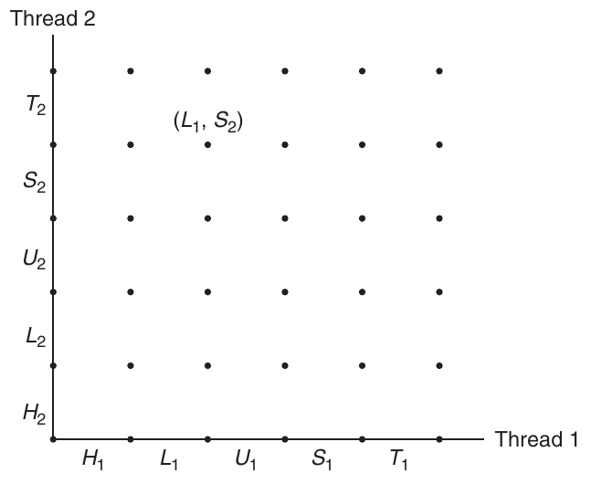

**Hình 12.19 Progress graph cho lần lặp đầu badcnt.c .**

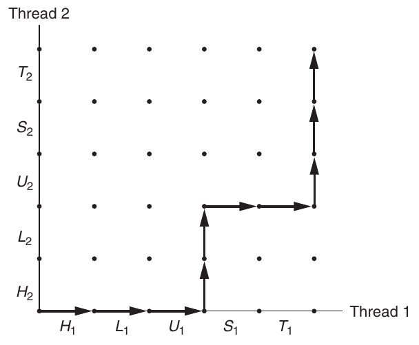

**Hình 12.20 Quỹ đạo ví dụ.**

Lịch sử thực thi chương trình được mô hình hóa bằng quỹ đạo trong state space. Hình 12.20 thể hiện quỹ đạo tương ứng thứ tự instruction:

H<sub>1</sub>, L<sub>1</sub>, U<sub>1</sub>, H<sub>2</sub>, L<sub>2</sub>, S<sub>1</sub>, T<sub>1</sub>, U<sub>2</sub>, S<sub>2</sub>, T<sub>2</sub>

Với thread i, các instruction (L<sub>i</sub>, U<sub>i</sub> , S<sub>i</sub> ) thao tác shared variable cnt tạo critical section (đối với cnt), không nên xen kẽ critical section thread khác. Nói cách khác, cần bảo đảm mỗi thread có truy cập loại trừ lẫn nhau tới shared variable khi thực thi instruction trong critical section. Hiện tượng tổng quát gọi là mutual exclusion.

Trên progress graph, giao của hai critical section định nghĩa vùng state space gọi là unsafe region. Hình 12.21 thể hiện unsafe region cho cnt. Chú ý vùng này tiếp giáp nhưng không gồm trạng thái trên biên. Ví dụ (H<sub>1</sub>, H<sub>2</sub>) và (S<sub>1</sub>, U<sub>2</sub>) tiếp giáp nhưng không thuộc unsafe region. Quỹ đạo tránh unsafe region gọi là safe trajectory. Ngược lại, quỹ đạo chạm phần bất kỳ unsafe region là unsafe trajectory. Hình 12.21 cho ví dụ trong state space badcnt.c. Quỹ đạo trên tránh unsafe region dọc cạnh trái và trên nên safe. Quỹ đạo dưới xuyên unsafe region nên unsafe.

Mọi safe trajectory cập nhật shared counter đúng. Để bảo đảm thực thi đúng chương trình threaded ví dụ—và mọi concurrent program dùng chung global data structure—phải đồng bộ thread để luôn có safe trajectory. Cách kinh điển dựa trên semaphore, giới thiệu tiếp theo.

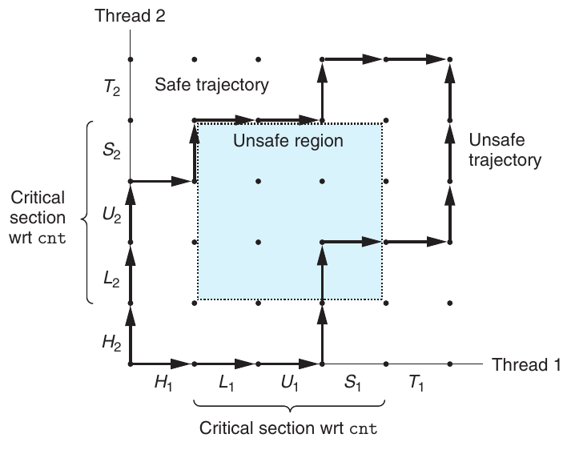

**Hình 12.21 Safe và unsafe trajectory. Giao critical region tạo unsafe region. Quỹ đạo tránh unsafe region cập nhật counter variable đúng.**

#### Bài tập thực hành 12.8 (lời giải trang 1074)

Dùng progress graph Hình 12.21 phân loại các quỹ đạo sau safe hoặc unsafe.

A. H<sub>1</sub>, L<sub>1</sub>, U<sub>1</sub>, S<sub>1</sub>, H<sub>2</sub>, L<sub>2</sub>, U<sub>2</sub>, S<sub>2</sub>, T<sub>2</sub>, T<sub>1</sub>

B. H<sub>2</sub>, L<sub>2</sub>, H<sub>1</sub>, L<sub>1</sub>, U<sub>1</sub>, S<sub>1</sub>, T<sub>1</sub>, U<sub>2</sub>, S<sub>2</sub>, T<sub>2</sub>

C. H<sub>1</sub>, H<sub>2</sub>, L<sub>2</sub>, U<sub>2</sub>, S<sub>2</sub>, L<sub>1</sub>, U<sub>1</sub>, S<sub>1</sub>, T<sub>1</sub>, T<sub>2</sub>

### 12.5.2 Semaphore

Edsger Dijkstra, người tiên phong concurrent programming, đề xuất giải pháp kinh điển đồng bộ các execution thread dựa trên variable đặc biệt semaphore. Semaphore s là global variable có giá trị số nguyên không âm, chỉ được thao tác bằng hai operation đặc biệt P và V :

P (s): Nếu s khác không, P giảm s rồi trả về ngay. Nếu s bằng không, đình chỉ thread đến khi s khác không và thread được operation V khởi động lại. Sau khi khởi động lại, P giảm s và trả quyền điều khiển cho caller.

V (s): Operation V tăng s thêm 1. Nếu có thread block tại P chờ s khác không, V khởi động lại đúng một thread, thread này hoàn tất P bằng cách giảm s.

#### Thông tin thêm: Nguồn gốc tên P và V

Edsger Dijkstra (1930–2002) quê Hà Lan. P và V xuất phát từ từ tiếng Hà Lan proberen (kiểm tra) và verhogen (tăng).

Kiểm tra và giảm trong P diễn ra không thể chia cắt, nghĩa là khi semaphore s khác không, giảm s xảy ra không bị ngắt. Tăng trong V cũng không thể chia cắt: load, tăng và store semaphore không bị ngắt. Chú ý định nghĩa V không quy định thứ tự khởi động lại thread đang chờ. Yêu cầu duy nhất là V khởi động đúng một thread chờ. Vì vậy, khi nhiều thread chờ semaphore, không thể dự đoán thread nào được V khởi động lại.

Định nghĩa P và V bảo đảm chương trình đang chạy không bao giờ vào trạng thái semaphore được khởi tạo đúng có giá trị âm. Thuộc tính này, semaphore invariant, là công cụ mạnh kiểm soát quỹ đạo concurrent program như sẽ thấy tiếp theo.

Chuẩn Posix định nghĩa nhiều hàm thao tác semaphore.

```
#include <semaphore.h>

int sem_init(sem_t *sem, 0, unsigned int value);
int sem_wait(sem_t *s);   /* P(s) */
int sem_post(sem_t *s);   /* V(s) */
```

Trả về: 0 nếu thành công, −1 nếu có lỗi

Hàm sem_init khởi tạo semaphore sem bằng value. Mỗi semaphore phải được khởi tạo trước khi dùng. Trong phạm vi này, đối số giữa luôn 0. Chương trình thực hiện P và V bằng sem_wait và sem_post tương ứng. Để ngắn gọn, chúng ta ưu tiên dùng wrapper P, V tương đương sau:

```
#include "csapp.h"

void P(sem_t *s);   /* Wrapper function for sem_wait */
void V(sem_t *s);   /* Wrapper function for sem_post */
```

Trả về: không có gì

### 12.5.3 Dùng semaphore cho mutual exclusion

Semaphore cung cấp cách thuận tiện bảo đảm truy cập loại trừ lẫn nhau tới shared variable. Ý tưởng là gắn semaphore s ban đầu 1 với mỗi shared variable (hoặc tập shared variable liên quan), rồi bao critical section tương ứng bằng P (s) và V (s).

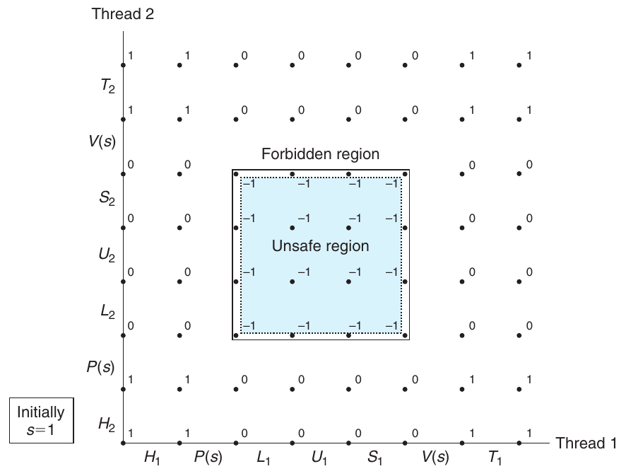

**Hình 12.22 Dùng semaphore cho mutual exclusion. Các trạng thái bất khả thi s < 0 định nghĩa forbidden region bao quanh unsafe region, ngăn quỹ đạo khả thi chạm unsafe region.**

Semaphore dùng để bảo vệ shared variable như vậy gọi là binary semaphore vì luôn có giá trị 0 hoặc 1. Binary semaphore cung cấp mutual exclusion thường gọi là mutex. Thực hiện P trên mutex gọi là locking mutex. Tương tự, V gọi là unlocking mutex. Thread đã lock nhưng chưa unlock được nói là giữ mutex. Semaphore dùng làm counter cho tập tài nguyên sẵn có gọi là counting semaphore.

Progress graph Hình 12.22 thể hiện cách dùng binary semaphore đồng bộ đúng chương trình counter ví dụ.

Mỗi trạng thái được gắn nhãn giá trị semaphore s ở đó. Ý tưởng quan trọng là tổ hợp P và V tạo tập trạng thái gọi là forbidden region, nơi s < 0. Do semaphore invariant, không quỹ đạo khả thi nào chứa trạng thái trong forbidden region. Vì forbidden region bao hoàn toàn unsafe region, không quỹ đạo khả thi nào chạm unsafe region. Vì vậy, mọi quỹ đạo khả thi safe, bất kể thứ tự instruction tại run time, chương trình tăng counter đúng.

#### Thông tin thêm: Hạn chế progress graph

Progress graph giúp trực quan hóa concurrent execution trên uniprocessor và hiểu vì sao cần synchronization. Tuy nhiên, có hạn chế, đặc biệt với multiprocessor, nơi tập CPU/cache pair dùng chung main memory. Multiprocessor có hành vi progress graph không giải thích được. Đặc biệt, hệ thống bộ nhớ multiprocessor có thể ở trạng thái không tương ứng quỹ đạo nào trong progress graph. Dù vậy, thông điệp không đổi: luôn đồng bộ truy cập shared variable dù chạy trên uniprocessor hay multiprocessor.

Về hoạt động, forbidden region do P và V tạo khiến nhiều thread không thể đồng thời thực thi instruction trong critical region được bao. Nói cách khác, semaphore operation bảo đảm truy cập loại trừ lẫn nhau tới critical region.

Kết hợp lại, để đồng bộ đúng counter program Hình 12.16 bằng semaphore, trước tiên khai báo semaphore mutex:

```
volatile long cnt = 0; /* Counter */
sem_t mutex;           /* Semaphore that protects counter */
```

rồi khởi tạo semaphore bằng giá trị một trong main routine:

```
Sem_init(&mutex, 0, 1);  /* mutex = 1 */
```

Cuối cùng, bảo vệ cập nhật shared cnt trong thread routine bằng cách bao quanh bằng P và V:

```
for (i = 0; i < niters; i++) {
    P(&mutex);
    cnt++;
    V(&mutex);
}
```

Khi chạy chương trình đồng bộ đúng, mỗi lần đều cho kết quả đúng.

```
linux>  ./goodcnt 1000000
OK cnt=2000000

linux>  ./goodcnt 1000000
OK cnt=2000000
```

### 12.5.4 Dùng semaphore schedule shared resource

Ngoài mutual exclusion, công dụng quan trọng khác của semaphore là schedule truy cập tài nguyên chung. Thread dùng semaphore operation thông báo thread khác rằng điều kiện nào đó trong trạng thái chương trình đã đúng. Hai ví dụ kinh điển hữu ích là bài toán producer-consumer và readers-writers.

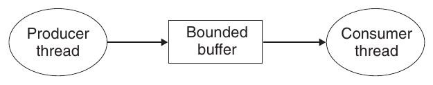

**Hình 12.23 Bài toán Producer-consumer. Producer tạo item và chèn vào bounded buffer. Consumer lấy item khỏi buffer rồi tiêu thụ.**

### Bài toán Producer-Consumer

Bài toán producer-consumer trong Hình 12.23. Producer thread và consumer thread dùng chung bounded buffer n slot. Producer liên tục tạo item mới và chèn vào buffer. Consumer liên tục lấy item khỏi buffer rồi tiêu thụ (sử dụng). Cũng có biến thể nhiều producer và consumer.

Vì chèn và lấy item cập nhật shared variable, phải bảo đảm truy cập loại trừ lẫn nhau tới buffer. Nhưng mutual exclusion chưa đủ. Còn cần schedule truy cập. Nếu buffer đầy (không slot trống), producer chờ tới khi có slot. Tương tự, nếu buffer rỗng (không item), consumer chờ tới khi có item.

Tương tác Producer-consumer thường xảy ra trong hệ thống thực. Ví dụ, hệ thống multimedia có producer encode video frame, consumer decode và render lên màn hình. Buffer giảm jitter trong video stream do khác biệt data-dependent về thời gian encode, decode từng frame. Buffer cung cấp kho slot cho producer và kho encoded frame cho consumer. Ví dụ khác là graphical user interface. Producer phát hiện event chuột và bàn phím, chèn vào buffer. Consumer lấy event theo cách priority-based rồi vẽ màn hình.

Trong mục này, chúng ta phát triển gói đơn giản Sbuf để xây chương trình producer-consumer. Mục tiếp theo dùng nó xây concurrent server thú vị dựa trên prethreading. Sbuf thao tác bounded buffer type sbuf_t (Hình 12.24). Item được lưu trong integer array allocated động (buf) n item. Index front và rear theo dõi item đầu, cuối trong array. Ba semaphore đồng bộ truy cập buffer. Semaphore mutex bảo đảm truy cập loại trừ lẫn nhau. Semaphore slots và items là counting semaphore lần lượt đếm slot trống và item sẵn có.

```
1   typedef struct {
2       int *buf;
3       int n;
4       int front;
5       int rear;
6       sem_t mutex;
7       sem_t slots;
8       sem_t items;
9   } sbuf_t;
```

code/conc/sbuf.h

```
/* Buffer array */
/* Maximum number of slots */
/* buf[(front+1)%n] is first item */
/* buf[rear%n] is last item */
/* Protects accesses to buf */
/* Counts available slots */
/* Counts available items */
```

code/conc/sbuf.h

**Hình 12.24 sbuf_t : Bounded buffer dùng bởi Sbuf.**

Hình 12.25 cho thấy cách triển khai package Sbuf. Hàm sbuf_init cấp phát heap memory cho buffer, đặt front và rear để biểu thị buffer rỗng và gán giá trị ban đầu cho ba semaphore. Hàm này được gọi một lần, trước mọi lần gọi bất kỳ hàm nào trong ba hàm còn lại. Hàm sbuf_deinit giải phóng vùng lưu trữ buffer khi ứng dụng dùng xong. Hàm sbuf_insert chờ một slot trống, lock mutex, thêm item, unlock mutex rồi thông báo có item mới. Hàm sbuf_remove hoạt động đối xứng. Sau khi chờ một buffer item sẵn có, nó lock mutex, lấy item ở đầu buffer, unlock mutex rồi báo hiệu có slot trống mới.

#### Bài tập thực hành 12.9 (lời giải trang 1074)

Gọi p là số producer, c là số consumer và n là buffer size tính theo item. Với mỗi tình huống sau, cho biết semaphore mutex trong sbuf_insert, sbuf_remove có cần thiết không.

A. p = 1, c = 1, n > 1

B. p = 1, c = 1, n = 1

C. p > 1, c > 1, n = 1

### Bài toán Readers-Writers

Bài toán readers-writers khái quát bài toán mutual exclusion. Tập concurrent thread truy cập shared object như data structure trong main memory hoặc database trên đĩa. Một số thread chỉ đọc, số khác sửa. Thread sửa gọi là writer, thread chỉ đọc gọi là reader. Writer phải độc quyền truy cập object, còn reader có thể dùng chung với số reader không giới hạn. Nhìn chung, số concurrent reader và writer không bị chặn trên.

```
                                                                                code/conc/sbuf.c
 1   #include "csapp.h"
 2   #include "sbuf.h"
 3
 4   /* Create an empty, bounded, shared FIFO buffer with n slots */
 5   void sbuf_init(sbuf_t *sp, int n)
 6   {
 7       sp->buf = Calloc(n, sizeof(int));
 8       sp->n = n;                       /* Buffer holds max of n items */
 9       sp->front = sp->rear = 0;        /* Empty buffer iff front == rear */
10       Sem_init(&sp->mutex, 0, 1);      /* Binary semaphore for locking */
11       Sem_init(&sp->slots, 0, n);      /* Initially, buf has n empty slots */
12       Sem_init(&sp->items, 0, 0);      /* Initially, buf has zero data items */
13   }
14
15   /* Clean up buffer sp */
16   void sbuf_deinit(sbuf_t *sp)
17   {
18       Free(sp->buf);
19   }
20
21   /* Insert item onto the rear of shared buffer sp */
22   void sbuf_insert(sbuf_t *sp, int item)
23   {
24       P(&sp->slots);                          /* Wait for available slot */
25       P(&sp->mutex);                          /* Lock the buffer */
26       sp->buf[(++sp->rear)%(sp->n)] = item;   /* Insert the item */
27       V(&sp->mutex);                          /* Unlock the buffer */
28       V(&sp->items);                          /* Announce available item */
29   }
30
31   /* Remove and return the first item from buffer sp */
32   int sbuf_remove(sbuf_t *sp)
33   {
34       int item;
35       P(&sp->items);                          /* Wait for available item */
36       P(&sp->mutex);                          /* Lock the buffer */
37       item = sp->buf[(++sp->front)%(sp->n)];  /* Remove the item */
38       V(&sp->mutex);                          /* Unlock the buffer */
39       V(&sp->slots);                          /* Announce available slot */
40       return item;
41   }
                                                                                code/conc/sbuf.c
```

**Hình 12.25 Sbuf: Gói đồng bộ truy cập concurrent tới bounded buffer.**

Tương tác Readers-writers thường xảy ra trong hệ thống thực. Ví dụ, hệ thống đặt vé máy bay trực tuyến cho số khách không giới hạn xem chỗ ngồi concurrently, nhưng khách đang đặt chỗ phải độc quyền truy cập database. Ví dụ khác, Web proxy caching multi-threaded cho số thread không giới hạn lấy page hiện có từ shared page cache, nhưng thread ghi page mới phải độc quyền truy cập.

Bài toán readers-writers có biến thể dựa trên ưu tiên reader và writer. Bài toán readers-writers thứ nhất ưu tiên reader, yêu cầu không reader nào phải chờ trừ khi writer đã được cấp quyền dùng object. Nghĩa là reader không phải chờ chỉ vì writer đang chờ. Bài toán readers-writers thứ hai ưu tiên writer, yêu cầu khi writer sẵn sàng phải ghi sớm nhất có thể. Khác bài đầu, reader tới sau writer phải chờ ngay cả khi writer cũng đang chờ.

Hình 12.26 cho lời giải bài toán readers-writers thứ nhất. Như nhiều bài synchronization, nó tinh tế dù có vẻ đơn giản. Semaphore w kiểm soát critical section truy cập shared object. Semaphore mutex bảo vệ shared readcnt, đếm reader hiện trong critical section. Writer lock w mỗi khi vào và unlock mỗi khi ra, bảo đảm tối đa một writer trong critical section tại mọi thời điểm. Ngược lại, chỉ reader đầu vào lock w, chỉ reader cuối ra unlock. Reader vào ra khi có reader khác bỏ qua w. Nghĩa là miễn một reader giữ w, số reader không giới hạn có thể vào critical section không cản trở.

Lời giải đúng cho cả hai bài toán readers-writers có thể gây starvation: thread block vô hạn và không tiến triển. Ví dụ, lời giải Hình 12.26 có thể khiến writer chờ vô hạn khi reader liên tục tới.

#### Bài tập thực hành 12.10 (lời giải trang 1074)

Lời giải bài toán readers-writers thứ nhất trong Hình 12.26 ưu tiên reader, nhưng ưu tiên yếu theo nghĩa writer rời critical section có thể khởi động lại writer chờ thay reader chờ. Mô tả tình huống ưu tiên yếu cho phép nhóm writer làm reader starvation.

### 12.5.5 Tổng hợp: Concurrent server dựa trên prethreading

Chúng ta đã thấy semaphore dùng truy cập shared variable và schedule shared resource thế nào. Để hiểu rõ hơn, hãy áp dụng vào concurrent server dựa trên prethreading.

```
/* Global variables */
int readcnt;    /* Initially = 0 */
sem_t mutex, w; /* Both initially = 1 */

void reader(void)
{
    while (1) {
        P(&mutex);
        readcnt++;
        if (readcnt == 1) /* First in */
            P(&w);
        V(&mutex);

        /* Critical section */
        /* Reading happens  */

        P(&mutex);
        readcnt--;
        if (readcnt == 0) /* Last out */
            V(&w);
        V(&mutex);
    }
}
void writer(void)
{
    while (1) {
        P(&w);

        /* Critical section */
        /* Writing happens  */

        V(&w);
    }
}
```

**Hình 12.26 Lời giải bài toán readers-writers thứ nhất. Ưu tiên reader hơn writer.**

Trong server Hình 12.14, tạo thread mới cho mỗi client mới. Nhược điểm là trả chi phí đáng kể tạo thread cho từng client. Server prethreading giảm overhead bằng mô hình producer-consumer Hình 12.27. Server gồm main thread và tập worker thread. Main liên tục nhận connection request, đặt connected descriptor vào bounded buffer. Mỗi worker liên tục lấy descriptor từ buffer, phục vụ client rồi chờ descriptor tiếp theo.

#### Thông tin thêm: Cơ chế synchronization khác

Chúng ta đồng bộ thread bằng semaphore chủ yếu vì đơn giản, kinh điển và có mô hình ngữ nghĩa rõ ràng. Nhưng cũng có kỹ thuật khác. Ví dụ, Java thread đồng bộ bằng Java monitor [48], cung cấp abstraction higher-level của khả năng mutual exclusion và scheduling của semaphore; thực tế monitor có thể triển khai bằng semaphore. Ví dụ khác, Pthreads định nghĩa synchronization operation trên mutex và condition variable. Pthreads mutex dùng mutual exclusion, condition variable schedule truy cập shared resource như bounded buffer trong chương trình producer-consumer.

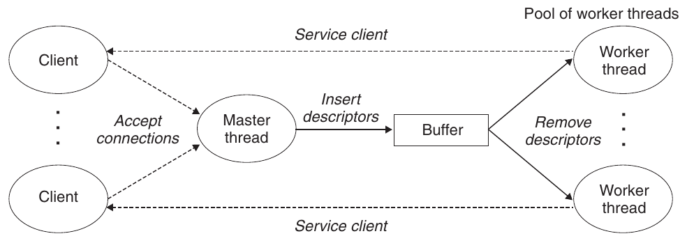

**Hình 12.27 Tổ chức prethreaded concurrent server. Tập thread có sẵn liên tục lấy và xử lý connected descriptor từ bounded buffer.**

Hình 12.28 thể hiện dùng Sbuf triển khai prethreaded concurrent echo server. Sau khi khởi tạo buffer sbuf (dòng 24), main tạo worker thread (dòng 25–26). Sau đó vào vòng lặp server vô hạn, nhận request và chèn connected descriptor vào sbuf. Mỗi worker có hành vi đơn giản: chờ đến khi lấy được connected descriptor từ buffer (dòng 39), rồi gọi echo_cnt echo input client.

Hàm echo_cnt trong Hình 12.29 là phiên bản echo Hình 11.22 ghi tổng tích lũy byte nhận từ mọi client vào global variable byte_cnt. Code thú vị vì thể hiện kỹ thuật chung khởi tạo gói được gọi từ thread routine. Ở đây cần khởi tạo byte_cnt và semaphore mutex. Một cách, dùng trong Sbuf và Rio, yêu cầu main gọi tường minh initialization function. Cách khác ở đây dùng pthread_once (dòng 19) gọi initialization function lần đầu một thread gọi echo_cnt. Ưu điểm là gói dễ dùng hơn. Nhược điểm là mỗi echo_cnt gọi pthread_once, phần lớn thời gian không làm gì hữu ích.

code/conc/echoservert-pre.c

```
 1   #include "csapp.h"
 2   #include "sbuf.h"
 3   #define NTHREADS  4
 4   #define SBUFSIZE  16
 5
 6   void echo_cnt(int connfd);
 7   void *thread(void *vargp);
 8
 9   sbuf_t sbuf; /* Shared buffer of connected descriptors */
10
11   int main(int argc, char **argv)
12   {
13       int i, listenfd, connfd;
14       socklen_t clientlen;
15       struct sockaddr_storage clientaddr;
16       pthread_t tid;
17
18       if (argc != 2) {
19           fprintf(stderr, "usage: %s <port>\n", argv[0]);
20           exit(0);
21       }
22       listenfd = Open_listenfd(argv[1]);
23
24       sbuf_init(&sbuf, SBUFSIZE);
25       for (i = 0; i < NTHREADS; i++)  /* Create worker threads */
26           Pthread_create(&tid, NULL, thread, NULL);
27
28       while (1) {
29           clientlen = sizeof(struct sockaddr_storage);
30           connfd = Accept(listenfd, (SA *) &clientaddr, &clientlen);
31           sbuf_insert(&sbuf, connfd); /* Insert connfd in buffer */
32       }
33   }
34
35   void *thread(void *vargp)
36   {
37       Pthread_detach(pthread_self());
38       while (1) {
39           int connfd = sbuf_remove(&sbuf); /* Remove connfd from buffer */
40           echo_cnt(connfd);                /* Service client */
41           Close(connfd);
42       }
43   }
```

code/conc/echoservert-pre.c

**Hình 12.28 Prethreaded concurrent echo server. Server dùng mô hình producer-consumer với một producer và nhiều consumer.**

```
                                                      code/conc/echo-cnt.c
 1   #include "csapp.h"
 2
 3   static int byte_cnt;  /* Byte counter */
 4   static sem_t mutex;   /* and the mutex that protects it */
 5
 6   static void init_echo_cnt(void)
 7   {
 8       Sem_init(&mutex, 0, 1);
 9       byte_cnt = 0;
10   }
11
12   void echo_cnt(int connfd)
13   {
14       int n;
15       char buf[MAXLINE];
16       rio_t rio;
17       static pthread_once_t once = PTHREAD_ONCE_INIT;
18
19       Pthread_once(&once, init_echo_cnt);
20       Rio_readinitb(&rio, connfd);
21       while((n = Rio_readlineb(&rio, buf, MAXLINE)) != 0) {
22           P(&mutex);
23           byte_cnt += n;
24           printf("server received %d (%d total) bytes on fd %d\n",
25                  n, byte_cnt, connfd);
26           V(&mutex);
27           Rio_writen(connfd, buf, n);
28       }
29   }
                                                      code/conc/echo-cnt.c
```

**Hình 12.29 echo_cnt : Phiên bản echo đếm mọi byte nhận từ client.**

Sau khi gói được khởi tạo, echo_cnt khởi tạo gói Rio buffered I/O (dòng 20), rồi echo từng dòng nhận từ client. Chú ý truy cập shared byte_cnt dòng 23–25 được P và V bảo vệ.

#### Thông tin thêm: Chương trình Event-driven dựa trên thread

I/O multiplexing không phải cách duy nhất viết chương trình event-driven. Ví dụ, có thể thấy prethreaded server vừa phát triển thực sự là server event-driven với state machine đơn giản cho main và worker. Main có hai state (“chờ connection request”, “chờ slot buffer trống”), hai I/O event (“connection request tới”, “slot buffer trở nên sẵn có”), hai transition (“chấp nhận connection request”, “chèn buffer item”). Tương tự, mỗi worker có một state (“chờ buffer item”), một I/O event (“buffer item trở nên sẵn có”), một transition (“lấy buffer item”).

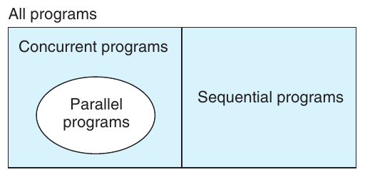

**Hình 12.30 Quan hệ giữa tập chương trình sequential, concurrent và parallel.**

## 12.6 Dùng thread cho parallelism

Đến đây khi nghiên cứu concurrency, chúng ta giả định concurrent thread thực thi trên uniprocessor. Tuy nhiên phần lớn máy hiện đại có processor multi-core. Concurrent program thường chạy nhanh hơn vì kernel schedule thread song song trên nhiều core thay vì tuần tự trên một core. Khai thác parallelism cực kỳ quan trọng trong ứng dụng như Web server bận rộn, database server và code khoa học lớn, ngày càng hữu ích trong ứng dụng phổ thông như browser, bảng tính, trình xử lý tài liệu.

Hình 12.30 thể hiện quan hệ tập hợp giữa chương trình sequential, concurrent và parallel. Tập mọi chương trình chia thành hai tập rời: sequential và concurrent. Sequential program viết thành một logical flow. Concurrent program viết thành nhiều concurrent flow. Parallel program là concurrent program chạy trên nhiều processor. Vì vậy parallel program là tập con thực sự của concurrent program.

Việc trình bày chi tiết parallel program nằm ngoài phạm vi của chúng ta, nhưng nghiên cứu một vài chương trình ví dụ đơn giản sẽ giúp bạn hiểu một số khía cạnh quan trọng của parallel programming. Ví dụ, hãy xét cách tính tổng dãy số nguyên 0, . . . , n − 1 một cách song song. Tất nhiên, bài toán cụ thể này có lời giải closed-form, nhưng đây vẫn là một ví dụ ngắn gọn và easy-to-understand cho phép ta nêu một số điểm thú vị về parallel program.

Cách đơn giản nhất phân công việc là chia dãy thành t vùng rời và gán t thread khác nhau làm việc trên vùng riêng. Để đơn giản, giả sử n là bội t, mỗi vùng có n/t phần tử. Hãy xem các cách nhiều thread xử lý vùng được gán song song.

Lựa chọn đơn giản nhất là thread cộng vào shared global variable có mutex bảo vệ. Hình 12.31 thể hiện triển khai. Dòng 28–33, main tạo peer rồi chờ kết thúc. Chú ý main truyền số nguyên nhỏ cho mỗi peer làm thread ID duy nhất. Mỗi peer dùng ID xác định phần dãy cần xử lý. Truyền ID nhỏ duy nhất là kỹ thuật tổng quát dùng trong nhiều parallel application. Sau peer kết thúc, global gsum chứa tổng cuối. Main dùng lời giải closed-form kiểm tra kết quả (dòng 36–37).

Hình 12.32 thể hiện hàm mỗi peer thực thi. Dòng 4 trích thread ID từ argument, dùng ID xác định vùng dãy (dòng 5–6). Dòng 9–13 lặp qua phần dãy, cập nhật shared global gsum mỗi lần. Chú ý cẩn thận bảo vệ mỗi cập nhật bằng P và V mutex operation.

Khi chạy psum-mutex trên hệ thống bốn core với dãy size n = 2<sup>31</sup>, đo thời gian chạy (giây) theo số thread, có bất ngờ khó chịu:

Số thread

| Phiên bản | 1 | 2 | 4 | 8 | 16 |
|---|---|---|---|---|---|
| psum-mutex | 68 | 432 | 719 | 552 | 599 |

Chương trình không chỉ cực kỳ chậm khi chạy sequential dưới dạng một thread duy nhất, mà còn chậm hơn gần một bậc độ lớn khi chạy parallel dưới dạng nhiều thread. Hiệu năng càng tệ khi thêm core. Nguyên nhân là các thao tác đồng bộ hóa (P và V ) rất tốn kém so với chi phí của một lần cập nhật memory. Điều này nhấn mạnh một bài học quan trọng về parallel programming: synchronization overhead rất tốn kém và nên tránh nếu có thể. Nếu không thể tránh, cần phân bổ overhead đó trên càng nhiều phép tính hữu ích càng tốt.

Cách tránh synchronization ở đây là để mỗi peer tính partial sum trong private variable không shared như Hình 12.33. Main (không thể hiện) định nghĩa global array psum, mỗi peer i tích lũy partial sum trong psum[i]. Vì mỗi peer được cấp vị trí bộ nhớ duy nhất để cập nhật, không cần mutex bảo vệ. Synchronization duy nhất là main phải chờ mọi child hoàn tất. Sau peer kết thúc, main cộng các phần tử vector psum để có kết quả cuối.

```
                                                   code/conc/psum-mutex.c
 1   #include "csapp.h"
 2   #define MAXTHREADS 32
 3
 4   void *sum_mutex(void *vargp); /* Thread routine */
 5
 6   /* Global shared variables */
 7   long gsum = 0;           /* Global sum */
 8   long nelems_per_thread;  /* Number of elements to sum */
 9   sem_t mutex;             /* Mutex to protect global sum */
10
11   int main(int argc, char **argv)
12   {
13       long i, nelems, log_nelems, nthreads, myid[MAXTHREADS];
14       pthread_t tid[MAXTHREADS];
15
16       /* Get input arguments */
17       if (argc != 3) {
18           printf("Usage: %s <nthreads> <log_nelems>\n", argv[0]);
19           exit(0);
20       }
21       nthreads = atoi(argv[1]);
22       log_nelems = atoi(argv[2]);
23       nelems = (1L << log_nelems);
24       nelems_per_thread = nelems / nthreads;
25       sem_init(&mutex, 0, 1);
26
27       /* Create peer threads and wait for them to finish */
28       for (i = 0; i < nthreads; i++) {
29           myid[i] = i;
30           Pthread_create(&tid[i], NULL, sum_mutex, &myid[i]);
31       }
32       for (i = 0; i < nthreads; i++)
33           Pthread_join(tid[i], NULL);
34
35       /* Check final answer */
36       if (gsum != (nelems * (nelems-1))/2)
37           printf("Error: result=%ld\n", gsum);
38
39       exit(0);
40   }
                                                   code/conc/psum-mutex.c
```

**Hình 12.31 Routine main psum-mutex . Dùng nhiều thread cộng dãy vào shared global variable có mutex bảo vệ.**

```
                                                                    code/conc/psum-mutex.c
 1   /* Thread routine for psum-mutex.c */
 2   void *sum_mutex(void *vargp)
 3   {
 4       long myid = *((long *)vargp);          /* Extract the thread ID */
 5       long start = myid * nelems_per_thread; /* Start element index */
 6       long end = start + nelems_per_thread;  /* End element index */
 7       long i;
 8
 9       for (i = start; i < end; i++) {
10           P(&mutex);
11           gsum += i;
12           V(&mutex);
13       }
14       return NULL;
15   }
                                                                    code/conc/psum-mutex.c
```

**Hình 12.32 Thread routine psum-mutex . Mỗi peer cộng vào shared global variable có mutex bảo vệ.**

```
                                                                     code/conc/psum-array.c
 1   /* Thread routine for psum-array.c */
 2   void *sum_array(void *vargp)
 3   {
 4       long myid = *((long *)vargp);          /* Extract the thread ID */
 5       long start = myid * nelems_per_thread; /* Start element index */
 6       long end = start + nelems_per_thread;  /* End element index */
 7       long i;
 8
 9       for (i = start; i < end; i++) {
10           psum[myid] += i;
11       }
12       return NULL;
13   }
                                                                     code/conc/psum-array.c
```

**Hình 12.33 Thread routine psum-array . Mỗi peer tích lũy partial sum trong private array element không shared với peer khác.**

Khi chạy psum-array trên hệ thống four-core, thấy nhanh hơn psum-mutex nhiều bậc độ lớn:

Số thread

| Phiên bản | 1 | 2 | 4 | 8 | 16 |
|---|---|---|---|---|---|
| psum-mutex | 68.00 | 432.00 | 719.00 | 552.00 | 599.00 |
| psum-array | 7.26 | 3.64 | 1.91 | 1.85 | 1.84 |

Trong Chương 5 đã học dùng local variable loại memory reference không cần thiết. Hình 12.34 áp dụng bằng cách để mỗi peer tích lũy partial sum vào local variable thay global. Chạy psum-local trên máy four-core, thời gian lại giảm order-of-magnitude:

Số thread

| Phiên bản | 1 | 2 | 4 | 8 | 16 |
|---|---|---|---|---|---|
| psum-mutex | 68.00 | 432.00 | 719.00 | 552.00 | 599.00 |
| psum-array | 7.26 | 3.64 | 1.91 | 1.85 | 1.84 |
| psum-local | 1.06 | 0.54 | 0.28 | 0.29 | 0.30 |

```
                                                                           code/conc/psum-local.c
 1   /* Thread routine for psum-local.c */
 2   void *sum_local(void *vargp)
 3   {
 4       long myid = *((long *)vargp);          /* Extract the thread ID */
 5       long start = myid * nelems_per_thread; /* Start element index */
 6       long end = start + nelems_per_thread;  /* End element index */
 7       long i, sum = 0;
 8
 9       for (i = start; i < end; i++) {
10           sum += i;
11       }
12       psum[myid] = sum;
13       return NULL;
14   }
                                                                           code/conc/psum-local.c
```

**Hình 12.34 Thread routine psum-local . Mỗi peer tích lũy partial sum trong local variable.**

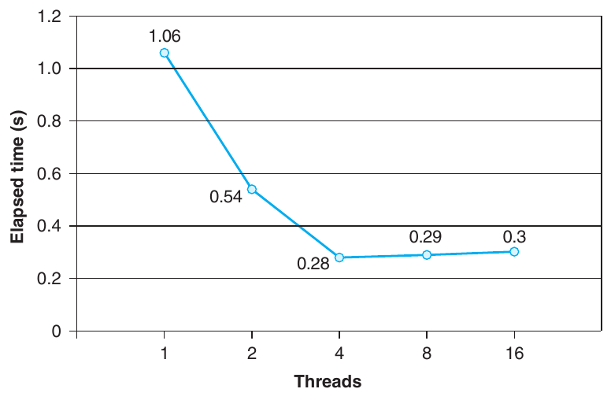

**Hình 12.35 Hiệu năng psum-local (Hình 12.34). Tính tổng dãy 2<sup>31</sup> phần tử bằng bốn processor core.**

Một bài học quan trọng rút ra từ bài thực hành này là viết parallel program không đơn giản. Những thay đổi code tưởng như nhỏ có thể ảnh hưởng đáng kể đến hiệu năng.

### Đặc trưng hóa hiệu năng của parallel program

Hình 12.35 biểu diễn tổng thời gian thực thi đã trôi qua của chương trình psum-local trong Hình 12.34 theo số thread. Trong mỗi trường hợp, chương trình chạy trên hệ thống có bốn processor core và tính tổng một dãy gồm n = 2<sup>31</sup> phần tử. Ta thấy thời gian thực thi giảm khi tăng số thread cho đến bốn thread, tại đó thời gian chững lại và thậm chí bắt đầu tăng nhẹ.

Trong trường hợp lý tưởng, ta kỳ vọng thời gian thực thi giảm tuyến tính theo số core. Nghĩa là ta kỳ vọng thời gian thực thi giảm một nửa mỗi khi tăng gấp đôi số thread. Điều này thực sự đúng cho đến khi đạt tới điểm (t > 4) mà mỗi core trong bốn core đều bận chạy ít nhất một thread. Thời gian thực thi thực tế tăng nhẹ khi tăng số thread do overhead của việc context switching giữa nhiều thread trên cùng một core. Vì lý do này, parallel program thường được viết sao cho mỗi core chạy đúng một thread.

Mặc dù thời gian thực thi tuyệt đối là thước đo cuối cùng cho hiệu năng của mọi chương trình, vẫn có một số thước đo tương đối hữu ích giúp hiểu một parallel program khai thác khả năng parallelism sẵn có tốt đến đâu. Speedup của một parallel program thường được định nghĩa là

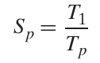

trong đó p là số processor core và T<sub>k</sub> là thời gian thực thi trên k core. Cách biểu diễn này đôi khi được gọi là strong scaling. Khi T<sub>1</sub> là thời gian thực thi của phiên bản sequential của chương trình, S<sub>p</sub> được gọi là absolute speedup. Khi T<sub>1</sub> là thời gian thực thi của phiên bản parallel của chương trình chạy trên một core, S<sub>p</sub> được gọi là relative speedup. Absolute speedup phản ánh lợi ích của parallelism chính xác hơn relative speedup. Parallel program thường chịu overhead đồng bộ hóa ngay cả khi chạy trên một processor, và overhead này có thể làm các giá trị relative speedup tăng giả tạo vì nó làm tăng tử số. Mặt khác, absolute speedup khó đo hơn relative speedup vì việc đo absolute speedup đòi hỏi hai phiên bản khác nhau của chương trình. Với những code parallel phức tạp, việc tạo một phiên bản sequential riêng có thể không khả thi, do code quá phức tạp hoặc do không có source code.

| Threads (t) | 1 | 2 | 4 | 8 | 16 |
|---|---|---|---|---|---|
| Cores (p) | 1 | 2 | 4 | 4 | 4 |
| Thời gian thực thi (T<sub>p</sub>) | 1.06 | 0.54 | 0.28 | 0.29 | 0.30 |
| Speedup (S<sub>p</sub>) | 1 | 1.9 | 3.8 | 3.7 | 3.5 |
| Efficiency (E<sub>p</sub>) | 100% | 98% | 95% | 91% | 88% |

**Hình 12.36 Speedup và parallel efficiency ứng với các thời gian thực thi trong Hình 12.35.**

Một thước đo liên quan, được gọi là efficiency, được định nghĩa là

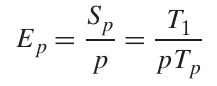

và thường được báo cáo dưới dạng phần trăm trong khoảng (0, 100]. Efficiency là thước đo overhead do parallelization gây ra. Chương trình có efficiency cao dành nhiều thời gian hơn cho công việc hữu ích và ít thời gian hơn cho đồng bộ hóa và giao tiếp so với chương trình có efficiency thấp.

Hình 12.36 cho thấy các thước đo speedup và efficiency khác nhau của chương trình tính tổng parallel trong ví dụ. Efficiency trên 90 phần trăm như vậy là rất tốt, nhưng đừng để điều đó đánh lừa. Ta đạt được efficiency cao vì bài toán này cực kỳ dễ parallelize. Trong thực tế, điều này thường không đúng. Parallel programming đã là một lĩnh vực nghiên cứu tích cực trong nhiều thập kỷ. Với sự xuất hiện của những máy multi-core phổ thông có số core tăng gấp đôi sau mỗi vài năm, parallel programming tiếp tục là một lĩnh vực nghiên cứu sâu rộng, khó khăn và sôi động.

Có một cách nhìn khác về speedup, được gọi là weak scaling, trong đó kích thước bài toán tăng cùng số processor, sao cho lượng công việc thực hiện trên mỗi processor được giữ không đổi khi số processor tăng. Với cách biểu diễn này, speedup và efficiency được diễn đạt theo tổng lượng công việc hoàn thành trong một đơn vị thời gian. Ví dụ, nếu ta có thể tăng gấp đôi số processor và thực hiện gấp đôi lượng công việc mỗi giờ, ta đạt được linear speedup và efficiency 100 phần trăm.

Weak scaling thường là thước đo sát thực hơn strong scaling vì phản ánh chính xác hơn mong muốn dùng máy lớn hơn để làm nhiều việc hơn. Điều này đặc biệt đúng với code khoa học, nơi có thể dễ dàng tăng kích thước bài toán và kích thước bài toán lớn hơn trực tiếp đem lại các dự đoán tốt hơn về tự nhiên. Tuy nhiên, có những ứng dụng mà kích thước không dễ tăng như vậy, và strong scaling phù hợp hơn với các ứng dụng đó. Ví dụ, lượng công việc mà các ứng dụng real-time signal-processing thực hiện thường được quyết định bởi đặc tính của các cảm biến vật lý tạo ra tín hiệu. Thay đổi tổng lượng công việc đòi hỏi dùng cảm biến vật lý khác, điều có thể không khả thi hoặc không cần thiết. Với các ứng dụng này, ta thường muốn dùng parallelism để hoàn thành một lượng công việc cố định nhanh nhất có thể.

#### Bài tập thực hành 12.11 (lời giải trang 1074)

Điền vào các chỗ trống cho parallel program trong bảng sau. Giả sử sử dụng strong scaling.

| Threads (t) | 1 | 4 | 8 |
|---|---|---|---|
| Cores (p) | 1 | 4 | 8 |
| Thời gian thực thi (T<sub>p</sub>) | 16 | 8 | 4 |
| Speedup (S<sub>p</sub>) | 1 | ______ | ______ |
| Efficiency (E<sub>p</sub>) | 100% | ______ | ______ |

## 12.7 Những vấn đề khác về concurrency

Có lẽ bạn đã nhận thấy mọi thứ trở nên phức tạp hơn nhiều khi ta phải đồng bộ hóa các truy cập đến dữ liệu dùng chung. Đến đây, ta đã xem xét các kỹ thuật mutual exclusion và đồng bộ hóa producer-consumer, nhưng đó mới chỉ là phần nổi của tảng băng. Đồng bộ hóa về bản chất là một bài toán khó, đặt ra những vấn đề hoàn toàn không xuất hiện trong các sequential program thông thường. Phần này khảo sát một số vấn đề bạn cần biết khi viết concurrent program (hoàn toàn chưa phải danh sách đầy đủ). Để thảo luận cụ thể, ta sẽ diễn đạt theo thread. Tuy nhiên, hãy nhớ rằng đây là những vấn đề điển hình xuất hiện khi các concurrent flow thuộc bất kỳ loại nào thao tác trên tài nguyên dùng chung.

### 12.7.1 Thread Safety

Khi lập trình với thread, ta phải cẩn thận viết các hàm có thuộc tính gọi là thread safety. Một hàm được gọi là thread-safe khi và chỉ khi nó luôn tạo ra kết quả đúng khi được gọi lặp lại từ nhiều concurrent thread. Nếu một hàm không thread-safe, ta nói nó là thread-unsafe.

Ta có thể xác định bốn nhóm hàm thread-unsafe (các nhóm không rời nhau):

Nhóm 1: Những hàm không bảo vệ shared variable. Ta đã gặp vấn đề này với hàm thread trong Hình 12.16, tăng một global counter variable không được bảo vệ. Nhóm hàm thread-unsafe này tương đối dễ chuyển thành thread-safe: bảo vệ shared variable bằng các thao tác đồng bộ hóa như P và V. Một ưu điểm là không cần thay đổi chương trình gọi hàm. Một nhược điểm là các thao tác đồng bộ hóa làm chậm hàm.

```
                                                         code/conc/rand.c
 1   unsigned next_seed = 1;
 2
 3   /* rand - return pseudorandom integer in the range 0..32767 */
 4   unsigned rand(void)
 5   {
 6       next_seed = next_seed*1103515245 + 12543;
 7       return (unsigned)(next_seed>>16) % 32768;
 8   }
 9
10   /* srand - set the initial seed for rand() */
11   void srand(unsigned new_seed)
12   {
13       next_seed = new_seed;
14   }
                                                         code/conc/rand.c
```

**Hình 12.37 Một pseudorandom number generator thread-unsafe. (Dựa trên [61])**

Nhóm 2: Những hàm giữ trạng thái qua nhiều lần gọi. Pseudorandom number generator là một ví dụ đơn giản về nhóm hàm thread-unsafe này. Xét package pseudorandom number generator trong Hình 12.37.

Hàm rand là thread-unsafe vì kết quả của lần gọi hiện tại phụ thuộc vào kết quả trung gian từ lần lặp trước. Khi gọi rand lặp lại từ một thread duy nhất sau khi khởi tạo seed bằng một lần gọi srand, ta có thể kỳ vọng một dãy số có thể tái tạo. Tuy nhiên, giả định này không còn đúng nếu nhiều thread cùng gọi rand.

Cách duy nhất để làm một hàm như rand trở thành thread-safe là viết lại để nó không dùng bất kỳ static data nào, thay vào đó dựa vào bên gọi để truyền thông tin trạng thái qua các argument. Nhược điểm là lập trình viên lúc này buộc phải thay đổi cả code trong routine gọi hàm. Trong một chương trình lớn có thể có hàng trăm vị trí gọi khác nhau, việc sửa đổi như vậy có thể không đơn giản và dễ gây lỗi.

Nhóm 3: Những hàm trả về pointer đến một static variable. Một số hàm như ctime và gethostbyname tính toán kết quả trong một static variable rồi trả về pointer đến variable đó. Nếu gọi các hàm như vậy từ các concurrent thread, rất dễ xảy ra sự cố nghiêm trọng vì kết quả mà một thread đang dùng bị thread khác âm thầm ghi đè.

```
                                                                        code/conc/ctime-ts.c
 1   char *ctime_ts(const time_t *timep, char *privatep)
 2   {
 3       char *sharedp;
 4
 5       P(&mutex);
 6       sharedp = ctime(timep);
 7       strcpy(privatep, sharedp); /* Copy string from shared to private */
 8       V(&mutex);
 9       return privatep;
10   }
                                                                        code/conc/ctime-ts.c
```

**Hình 12.38 Wrapper function Thread-safe cho hàm ctime của thư viện chuẩn C. Ví dụ này dùng kỹ thuật lock-and-copy để gọi một hàm thread-unsafe thuộc nhóm 3.**

Có hai cách xử lý nhóm hàm thread-unsafe này. Một lựa chọn là viết lại hàm để bên gọi truyền địa chỉ của variable dùng để lưu kết quả. Cách này loại bỏ toàn bộ dữ liệu dùng chung nhưng đòi hỏi lập trình viên phải có quyền truy cập source code của hàm.

Nếu hàm thread-unsafe khó hoặc không thể sửa đổi (ví dụ code rất phức tạp hoặc không có source code), lựa chọn khác là dùng kỹ thuật lock-and-copy. Ý tưởng cơ bản là gắn một mutex với hàm thread-unsafe. Tại mỗi vị trí gọi, lock mutex, gọi hàm thread-unsafe, sao chép kết quả hàm trả về sang một vị trí memory riêng, rồi unlock mutex. Để giảm thiểu thay đổi ở bên gọi, bạn nên định nghĩa một wrapper function thread-safe thực hiện lock-and-copy, rồi thay mọi lần gọi hàm thread-unsafe bằng lần gọi wrapper. Ví dụ, Hình 12.38 cho thấy một wrapper thread-safe cho ctime dùng kỹ thuật lock-and-copy.

Nhóm 4: Những hàm gọi hàm thread-unsafe. Nếu hàm f gọi một hàm thread-unsafe g, liệu f có thread-unsafe không? Còn tùy trường hợp. Nếu g là hàm nhóm 2 dựa vào trạng thái qua nhiều lần gọi, f cũng thread-unsafe và không có cách nào khác ngoài viết lại g. Tuy nhiên, nếu g là hàm nhóm 1 hoặc nhóm 3, f vẫn có thể thread-safe nếu bạn bảo vệ vị trí gọi và mọi dữ liệu dùng chung phát sinh bằng một mutex. Ta thấy một ví dụ rõ ràng trong Hình 12.38, nơi dùng lock-and-copy để viết một hàm thread-safe gọi một hàm thread-unsafe.

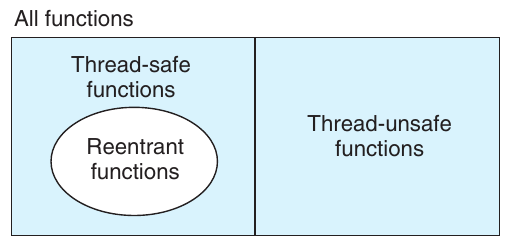

**Hình 12.39 Quan hệ giữa các tập hợp hàm reentrant, thread-safe và thread-unsafe.**

```
                                                       code/conc/rand-r.c
1   /* rand_r - return a pseudorandom integer on 0..32767 */
2   int rand_r(unsigned int *nextp)
3   {
4       *nextp = *nextp * 1103515245 + 12345;
5       return (unsigned int)(*nextp / 65536) % 32768;
6   }
                                                       code/conc/rand-r.c
```

**Hình 12.40 rand_r : Phiên bản reentrant của hàm rand trong Hình 12.37.**

### 12.7.2 Reentrancy

Có một nhóm hàm thread-safe quan trọng, được gọi là reentrant function, có đặc trưng là không tham chiếu đến bất kỳ dữ liệu dùng chung nào khi được nhiều thread gọi. Mặc dù các thuật ngữ thread-safe và reentrant đôi khi bị dùng (không đúng) như từ đồng nghĩa, vẫn có sự khác biệt kỹ thuật rõ ràng cần được giữ nguyên. Hình 12.39 cho thấy quan hệ giữa các tập hợp hàm reentrant, thread-safe và thread-unsafe. Tập hợp mọi hàm được chia thành hai tập hợp rời nhau là thread-safe và thread-unsafe. Tập hợp hàm reentrant là tập con thực sự của các hàm thread-safe.

Reentrant function thường hiệu quả hơn hàm thread-safe non-reentrant vì không cần thao tác đồng bộ hóa. Hơn nữa, cách duy nhất để chuyển một hàm thread-unsafe nhóm 2 thành thread-safe là viết lại để nó trở thành reentrant. Ví dụ, Hình 12.40 cho thấy phiên bản reentrant của hàm rand trong Hình 12.37. Ý tưởng then chốt là thay static variable next bằng một pointer do bên gọi truyền vào.

Liệu có thể xem code của một hàm nào đó rồi khẳng định trước rằng nó reentrant không? Đáng tiếc là còn tùy. Nếu mọi argument của hàm đều được truyền theo giá trị (nghĩa là không có pointer) và mọi tham chiếu dữ liệu đều đến các local automatic stack variable (nghĩa là không tham chiếu static variable hoặc global variable), hàm đó là explicitly reentrant, theo nghĩa ta có thể khẳng định reentrancy của nó bất kể cách nó được gọi.

Tuy nhiên, nếu nới lỏng giả định một chút và cho phép một số parameter trong hàm vốn explicitly reentrant được truyền theo tham chiếu (nghĩa là cho phép truyền pointer), ta có một hàm implicitly reentrant, theo nghĩa nó chỉ reentrant nếu các thread gọi hàm cẩn thận truyền pointer đến dữ liệu không dùng chung. Ví dụ, hàm rand_r trong Hình 12.40 là implicitly reentrant.

Ta luôn dùng thuật ngữ reentrant để bao gồm cả hàm explicitly reentrant và implicitly reentrant. Tuy nhiên, cần nhận ra rằng reentrancy đôi khi là thuộc tính của cả bên gọi lẫn bên được gọi, chứ không chỉ riêng bên được gọi.

#### Bài tập thực hành 12.12 (lời giải trang 1074)

Hàm rand_r trong Hình 12.40 là implicitly reentrant. Hãy giải thích.

### 12.7.3 Dùng các hàm thư viện hiện có trong chương trình dùng thread

Phần lớn hàm Linux, bao gồm các hàm được định nghĩa trong thư viện chuẩn C (như malloc, free, realloc, printf và scanf), đều thread-safe, chỉ có một vài ngoại lệ. Hình 12.41 liệt kê một số ngoại lệ phổ biến. (Xem [110] để có danh sách đầy đủ.) Hàm strtok là một hàm deprecated (không được khuyến khích sử dụng) để phân tích chuỗi. Các hàm asctime, ctime và localtime thường được dùng để chuyển đổi qua lại giữa các định dạng ngày và giờ khác nhau. Các hàm gethostbyaddr, gethostbyname và inet_ntoa là những hàm lập trình network đã lỗi thời, lần lượt được thay bằng các hàm reentrant getaddrinfo, getnameinfo và inet_ntop (xem Chương 11). Trừ rand và strtok, chúng đều thuộc nhóm 3, trả về pointer đến một static variable. Nếu cần gọi một trong các hàm này trong chương trình dùng thread, cách ít gây thay đổi nhất cho bên gọi là lock và sao chép. Tuy nhiên, phương pháp lock-and-copy có một số nhược điểm. Thứ nhất, đồng bộ hóa bổ sung làm chương trình chậm lại. Thứ hai, các hàm trả về pointer đến những cấu trúc phức tạp gồm nhiều structure đòi hỏi deep copy để sao chép toàn bộ hệ thống phân cấp structure. Thứ ba, phương pháp lock-and-copy không dùng được cho hàm thread-unsafe nhóm 2 như rand, vốn dựa vào static state qua các lần gọi.

| Hàm Thread-unsafe | Nhóm Thread-unsafe | Phiên bản thread-safe của Linux |
|---|---|---|
| rand | 2 | rand_r |
| strtok | 2 | strtok_r |
| asctime | 3 | asctime_r |
| ctime | 3 | ctime_r |
| gethostbyaddr | 3 | gethostbyaddr_r |
| gethostbyname | 3 | gethostbyname_r |
| inet_ntoa | 3 | (không có) |
| localtime | 3 | localtime_r |

**Hình 12.41 Các hàm thư viện thread-unsafe phổ biến.**

Vì vậy, hệ thống Linux cung cấp phiên bản reentrant của phần lớn hàm thread-unsafe. Tên các phiên bản reentrant luôn kết thúc bằng hậu tố _r. Ví dụ, phiên bản reentrant của asctime được gọi là asctime_r. Chúng tôi khuyến nghị dùng các hàm này bất cứ khi nào có thể.

### 12.7.4 Race

Race xảy ra khi tính đúng đắn của chương trình phụ thuộc vào việc một thread đến điểm x trong control flow của nó trước khi thread khác đến điểm y. Race thường xảy ra vì lập trình viên giả định thread sẽ đi theo một trajectory cụ thể nào đó qua execution state space, quên mất nguyên tắc vàng rằng chương trình dùng thread phải hoạt động đúng với mọi trajectory khả thi.

Một ví dụ là cách dễ nhất để hiểu bản chất của race. Xét chương trình đơn giản trong Hình 12.42. Main thread tạo bốn peer thread và truyền cho mỗi thread một pointer đến một integer ID duy nhất. Mỗi peer thread sao chép ID được truyền trong argument sang một local variable (dòng 22), rồi in thông báo chứa ID đó. Trông có vẻ đơn giản, nhưng khi chạy chương trình trên hệ thống của mình, ta nhận được kết quả sai sau đây:

```
                                                         code/conc/race.c
 1   /* WARNING: This code is buggy! */
 2   #include "csapp.h"
 3   #define N 4
 4
 5   void *thread(void *vargp);
 6
 7   int main()
 8   {
 9       pthread_t tid[N];
10       int i;
11
12       for (i = 0; i < N; i++)
13           Pthread_create(&tid[i], NULL, thread, &i);
14       for (i = 0; i < N; i++)
15           Pthread_join(tid[i], NULL);
16       exit(0);
17   }
18
19   /* Thread routine */
20   void *thread(void *vargp)
21   {
22       int myid = *((int *)vargp);
23       printf("Hello from thread %d\n", myid);
24       return NULL;
25   }
                                                         code/conc/race.c
```

**Hình 12.42 Một chương trình có race.**

```
linux> ./race
Hello from thread 1
Hello from thread 3
Hello from thread 2
Hello from thread 3
```

Vấn đề xuất phát từ race giữa mỗi peer thread và main thread. Bạn có nhận ra race không? Đây là những gì xảy ra. Khi main thread tạo một peer thread ở dòng 13, nó truyền pointer đến local stack variable i. Lúc này, race diễn ra giữa lần tăng i tiếp theo ở dòng 12 và việc dereference rồi gán argument ở dòng 22. Nếu peer thread thực thi dòng 22 trước khi main thread tăng i ở dòng 12, variable myid nhận được ID đúng. Ngược lại, nó sẽ chứa ID của một thread khác. Điều đáng ngại là việc có nhận được kết quả đúng hay không phụ thuộc vào cách kernel lập lịch thực thi các thread. Trên hệ thống của chúng tôi, chương trình thất bại, nhưng trên hệ thống khác nó có thể hoạt động đúng, khiến lập trình viên vẫn vô tư không biết đến một bug nghiêm trọng.

Để loại bỏ race, ta có thể cấp phát động một block riêng cho mỗi integer ID và truyền cho thread routine một pointer đến block đó, như trong Hình 12.43 (dòng 12–14). Lưu ý rằng thread routine phải free block để tránh memory leak.

Khi chạy chương trình này trên hệ thống của mình, giờ đây ta nhận được kết quả đúng:

```
linux> ./norace
Hello from thread 0
Hello from thread 1
Hello from thread 2
Hello from thread 3
```

#### Bài tập thực hành 12.13 (lời giải trang 1075)

Trong Hình 12.43, ta có thể muốn free memory block đã cấp phát ngay sau dòng 14 trong main thread, thay vì free trong peer thread. Nhưng đó là một ý tưởng tồi. Vì sao?

#### Bài tập thực hành 12.14 (lời giải trang 1075)

A. Trong Hình 12.43, ta loại bỏ race bằng cách cấp phát một block riêng cho mỗi integer ID. Hãy phác thảo một phương pháp khác không gọi hàm malloc hoặc free.

B. Phương pháp này có những ưu điểm và nhược điểm gì?

```
                                                       code/conc/norace.c
 1   #include "csapp.h"
 2   #define N 4
 3
 4   void *thread(void *vargp);
 5
 6   int main()
 7   {
 8       pthread_t tid[N];
 9       int i, *ptr;
10
11       for (i = 0; i < N; i++) {
12           ptr = Malloc(sizeof(int));
13           *ptr = i;
14           Pthread_create(&tid[i], NULL, thread, ptr);
15       }
16       for (i = 0; i < N; i++)
17           Pthread_join(tid[i], NULL);
18       exit(0);
19   }
20
21   /* Thread routine */
22   void *thread(void *vargp)
23   {
24       int myid = *((int *)vargp);
25       Free(vargp);
26       printf("Hello from thread %d\n", myid);
27       return NULL;
28   }
                                                       code/conc/norace.c
```

**Hình 12.43 Phiên bản đúng của chương trình trong Hình 12.42, không có race.**

### 12.7.5 Deadlock

Semaphore tạo ra nguy cơ xảy ra một loại lỗi run-time khó chịu, gọi là deadlock, trong đó một nhóm thread bị block và chờ một điều kiện sẽ không bao giờ đúng. Progress graph là công cụ vô giá để hiểu deadlock. Ví dụ, Hình 12.44 cho thấy progress graph của một cặp thread dùng hai semaphore cho mutual exclusion. Từ graph này, ta có thể rút ra một số hiểu biết quan trọng về deadlock:

- Lập trình viên đã sắp xếp sai thứ tự các thao tác P và V, khiến các forbidden region của hai semaphore chồng lấn nhau. Nếu một execution trajectory đi đến deadlock state d, không thể tiến triển thêm vì các forbidden region chồng lấn chặn mọi hướng tiến triển hợp lệ. Nói cách khác, chương trình bị deadlock vì mỗi thread đang chờ thread kia thực hiện một thao tác V sẽ không bao giờ xảy ra.

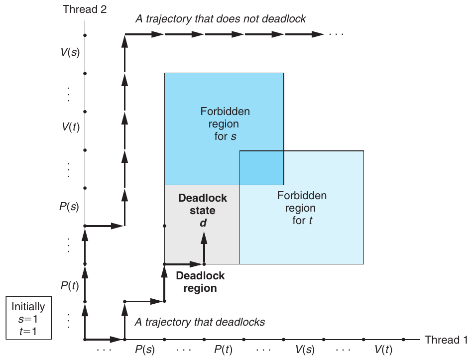

**Hình 12.44 Progress graph của một chương trình có thể deadlock.**

- Các forbidden region chồng lấn tạo ra một tập hợp trạng thái gọi là deadlock region. Nếu một trajectory chạm đến trạng thái trong deadlock region, deadlock là không thể tránh khỏi. Trajectory có thể đi vào deadlock region nhưng không bao giờ thoát ra được.

- Deadlock là một vấn đề đặc biệt khó vì không phải lúc nào cũng dự đoán được. Một số execution trajectory may mắn sẽ đi vòng tránh deadlock region, trong khi những trajectory khác bị mắc kẹt trong đó. Hình 12.44 cho thấy ví dụ của mỗi trường hợp. Hệ quả đối với lập trình viên thật đáng ngại. Bạn có thể chạy cùng một chương trình hàng nghìn lần không gặp vấn đề, nhưng lần tiếp theo nó lại deadlock. Hoặc chương trình chạy tốt trên máy này nhưng deadlock trên máy khác. Tệ nhất là lỗi thường không thể tái hiện vì các lần thực thi khác nhau có trajectory khác nhau.

Chương trình deadlock vì nhiều nguyên nhân và nhìn chung việc ngăn chặn là một bài toán khó. Tuy nhiên, khi dùng binary semaphore cho mutual exclusion như trong Hình 12.44, bạn có thể áp dụng quy tắc đơn giản và hiệu quả sau để ngăn deadlock:

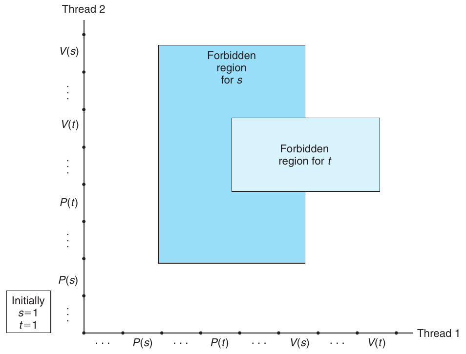

**Hình 12.45 Progress graph của một chương trình deadlock-free.**

Quy tắc thứ tự mutex lock: Với một thứ tự toàn phần của tất cả mutex, chương trình sẽ deadlock-free nếu mỗi thread acquire các mutex theo thứ tự đó và release theo thứ tự ngược lại.

Ví dụ, ta có thể sửa deadlock trong Hình 12.44 bằng cách lock s trước rồi đến t trong mỗi thread. Hình 12.45 cho thấy progress graph thu được.

#### Bài tập thực hành 12.15 (lời giải trang 1075)

Xét chương trình sau, cố gắng dùng một cặp semaphore cho mutual exclusion.

```
Initially: s = 1, t = 0.

Thread 1:       Thread 2:
   P(s);           P(s);
   V(s);           V(s);
   P(t);           P(t);
   V(t);           V(t);
```

A. Vẽ progress graph của chương trình này.

B. Nó có luôn deadlock không?

C. Nếu có, thay đổi đơn giản nào đối với các giá trị semaphore ban đầu sẽ loại bỏ nguy cơ deadlock?

D. Vẽ progress graph cho chương trình deadlock-free thu được.

## 12.8 Tóm tắt

Một concurrent program gồm một tập hợp logical flow chồng lấn về thời gian. Trong chương này, ta đã nghiên cứu ba cơ chế khác nhau để xây dựng concurrent program: process, I/O multiplexing và thread. Ta dùng một concurrent network server làm ứng dụng minh họa xuyên suốt.

Process được kernel tự động lập lịch và do có các virtual address space riêng biệt, chúng cần cơ chế IPC tường minh để chia sẻ dữ liệu. Chương trình Event-driven tự tạo các concurrent logical flow, mô hình hóa chúng dưới dạng state machine và dùng I/O multiplexing để lập lịch flow một cách tường minh. Vì chương trình chạy trong một process duy nhất, việc chia sẻ dữ liệu giữa các flow nhanh và dễ dàng. Thread kết hợp hai phương pháp này. Giống flow dựa trên process, thread được kernel tự động lập lịch. Giống flow dựa trên I/O multiplexing, thread chạy trong context của một process duy nhất, do đó có thể chia sẻ dữ liệu nhanh và dễ dàng.

Bất kể cơ chế concurrency nào, đồng bộ hóa các truy cập concurrent đến dữ liệu dùng chung là một bài toán khó. Các thao tác P và V trên semaphore được phát triển để giúp xử lý vấn đề này. Có thể dùng các thao tác semaphore để cung cấp truy cập mutual exclusion đến dữ liệu dùng chung, cũng như lập lịch truy cập tài nguyên như bounded buffer trong hệ thống producer-consumer và shared object trong hệ thống readers-writers. Một concurrent prethreaded echo server là ví dụ thuyết phục về các tình huống sử dụng semaphore này.

Concurrency cũng đưa đến những vấn đề khó khác. Hàm được thread gọi phải có thuộc tính gọi là thread safety. Ta đã xác định bốn nhóm hàm thread-unsafe cùng các gợi ý để làm chúng trở thành thread-safe. Reentrant function là tập con thực sự của các hàm thread-safe không truy cập dữ liệu dùng chung nào. Reentrant function thường hiệu quả hơn hàm non-reentrant vì không cần synchronization primitive. Một số vấn đề khó khác xuất hiện trong concurrent program là race và deadlock. Race xảy ra khi lập trình viên giả định sai về cách lập lịch logical flow. Deadlock xảy ra khi một flow chờ một sự kiện sẽ không bao giờ xảy ra.

## Ghi chú tài liệu tham khảo

Các thao tác semaphore được Dijkstra giới thiệu [31]. Khái niệm progress graph được Coffman giới thiệu [23], sau đó được Carson và Reynolds hình thức hóa [16]. Bài toán readers-writers được Courtois và cộng sự giới thiệu [25]. Các giáo trình operating system mô tả chi tiết hơn những bài toán đồng bộ hóa kinh điển như dining philosophers, sleeping barber và cigarette smokers [102, 106, 113]. Sách của Butenhof [15] mô tả toàn diện interface Posix threads. Bài báo của Birrell [7] là phần giới thiệu xuất sắc về lập trình thread và những cạm bẫy. Sách của Reinders [90] mô tả một thư viện C/C++ giúp đơn giản hóa thiết kế và triển khai chương trình dùng thread. Một số giáo trình trình bày nền tảng parallel programming trên hệ thống multi-core [47, 71]. Pugh chỉ ra các điểm yếu trong cách Java thread tương tác qua memory và đề xuất các memory model thay thế [88]. Gustafson đề xuất mô hình speedup weak-scaling [43] làm phương án thay thế cho strong scaling.

## Bài tập về nhà

12.16 ◆ Viết một phiên bản hello.c (Hình 12.13) tạo và reap n joinable peer thread, trong đó n là argument command-line.

12.17 ◆

A. Chương trình trong Hình 12.46 có một bug. Thread lẽ ra phải sleep trong 1 giây rồi in một chuỗi. Tuy nhiên, khi chạy trên hệ thống của mình, không có gì được in ra. Vì sao?

B. Bạn có thể sửa bug này bằng cách thay hàm exit ở dòng 10 bằng một trong hai lời gọi hàm Pthreads khác nhau. Đó là những hàm nào?

code/conc/hellobug.c

```
 1   /* WARNING: This code is buggy! */
 2   #include "csapp.h"
 3   void *thread(void *vargp);
 4
 5   int main()
 6   {
 7       pthread_t tid;
 8
 9       Pthread_create(&tid, NULL, thread, NULL);
10       exit(0);
11   }
12
13   /* Thread routine */
14   void *thread(void *vargp)
15   {
16       Sleep(1);
17       printf("Hello, world!\n");
18       return NULL;
19   }
                                                          code/conc/hellobug.c
```

**Hình 12.46 Chương trình có bug cho Bài tập 12.17.**

12.18 ◆ Dùng progress graph trong Hình 12.21, phân loại các trajectory sau thành safe hoặc unsafe.

A. H<sub>2</sub>, L<sub>2</sub>, U<sub>2</sub>, H<sub>1</sub>, L<sub>1</sub>, S<sub>2</sub>, U<sub>1</sub>, S<sub>1</sub>, T<sub>1</sub>, T<sub>2</sub>

B. H<sub>2</sub>, H<sub>1</sub>, L<sub>1</sub>, U<sub>1</sub>, S<sub>1</sub>, L<sub>2</sub>, T<sub>1</sub>, U<sub>2</sub>, S<sub>2</sub>, T<sub>2</sub>

C. H<sub>1</sub>, L<sub>1</sub>, H<sub>2</sub>, L<sub>2</sub>, U<sub>2</sub>, S<sub>2</sub>, U<sub>1</sub>, S<sub>1</sub>, T<sub>1</sub>, T<sub>2</sub>

12.19 ◆◆ Lời giải cho bài toán readers-writers thứ nhất trong Hình 12.26 dành mức ưu tiên tương đối yếu cho reader vì một writer rời critical section có thể khởi động lại một writer đang chờ thay vì một reader đang chờ. Hãy xây dựng lời giải dành mức ưu tiên mạnh hơn cho reader, trong đó writer rời critical section luôn khởi động lại một reader đang chờ nếu có.

12.20 ◆◆◆ Xét một biến thể đơn giản hơn của bài toán readers-writers, trong đó có nhiều nhất N reader. Hãy xây dựng lời giải dành mức ưu tiên ngang nhau cho reader và writer, theo nghĩa reader và writer đang chờ có cơ hội ngang nhau được cấp quyền truy cập tài nguyên. Gợi ý: Bạn có thể giải bài toán bằng một counting semaphore duy nhất và một mutex duy nhất.

12.21 ◆◆◆◆ Xây dựng lời giải cho bài toán readers-writers thứ hai, ưu tiên writer thay vì reader.

12.22 ◆◆ Kiểm tra mức độ hiểu hàm select của bạn bằng cách sửa server trong Hình 12.6 để nó echo nhiều nhất một dòng văn bản trong mỗi lần lặp main server loop.

12.23 ◆◆ Concurrent echo server event-driven trong Hình 12.8 có khiếm khuyết vì một client độc hại có thể từ chối dịch vụ đối với client khác bằng cách gửi một dòng văn bản chưa đầy đủ. Viết phiên bản server cải tiến có thể xử lý các dòng văn bản chưa đầy đủ này mà không block.

12.24 ◆ Các hàm trong package Rio I/O (Mục 10.5) là thread-safe. Chúng có reentrant nữa không?

12.25 ◆ Trong concurrent prethreaded echo server ở Hình 12.28, mỗi thread gọi hàm echo_cnt (Hình 12.29). echo_cnt có thread-safe không? Có reentrant không? Vì sao có hoặc vì sao không?

12.26 ◆◆◆ Dùng kỹ thuật lock-and-copy để triển khai một phiên bản thread-safe non-reentrant của gethostbyname có tên gethostbyname_ts. Lời giải đúng sẽ dùng deep copy của structure hostent được bảo vệ bằng một mutex.

12.27 ◆◆ Một số giáo trình lập trình network đề xuất phương pháp đọc và ghi socket sau: Trước khi tương tác với client, mở hai standard I/O stream trên cùng một open connected socket descriptor, một để đọc và một để ghi:

```
FILE *fpin, *fpout;

fpin = fdopen(sockfd, "r");
fpout = fdopen(sockfd, "w");
```

Khi server kết thúc tương tác với client, đóng cả hai stream như sau:

```
fclose(fpin);
fclose(fpout);
```

Tuy nhiên, nếu thử phương pháp này trong concurrent server dựa trên thread, bạn sẽ tạo ra một race condition nguy hiểm. Hãy giải thích.

12.28 ◆ Trong Hình 12.45, việc hoán đổi thứ tự hai thao tác V có ảnh hưởng đến việc chương trình deadlock hay không không? Giải thích câu trả lời bằng cách vẽ progress graph cho bốn trường hợp có thể xảy ra:

|  | Trường hợp 1 |  | Trường hợp 2 | Trường hợp 3 |  | Trường hợp 4 |  |
|---|---|---|---|---|---|---|---|
| Thread 1 | Thread 2 | Thread 1 | Thread 2 | Thread 1 | Thread 2 | Thread 1 | Thread 2 |
| P(s) | P(s) | P(s) | P(s) | P(s) | P(s) | P(s) | P(s) |
| P(t) | P(t) | P(t) | P(t) | P(t) | P(t) | P(t) | P(t) |
| V(s) | V(s) | V(s) | V(t) | V(t) | V(s) | V(t) | V(t) |
| V(t) | V(t) | V(t) | V(s) | V(s) | V(t) | V(s) | V(s) |

12.29 ◆ Chương trình sau có thể deadlock không? Vì sao có hoặc vì sao không?

```
Initially: a = 1, b = 1, c = 1.

Thread 1:       Thread 2:
   P(a);           P(c);
   P(b);           P(b);
   V(b);           V(b);
   P(c);           V(c);
   V(c);
   V(a);
```

12.30 ◆ Xét chương trình sau bị deadlock.

```
Initially: a = 1, b = 1, c = 1.

Thread 1:       Thread 2:       Thread 3:
   P(a);           P(c);           P(c);
   P(b);           P(b);           V(c);
   V(b);           V(b);           P(b);
   P(c);           V(c);           P(a);
   V(c);           P(a);           V(a);
   V(a);           V(a);           V(b);
```

A. Với mỗi thread, liệt kê các cặp mutex mà nó giữ đồng thời.

B. Nếu a < b < c, những thread nào vi phạm quy tắc thứ tự mutex lock?

C. Với những thread này, hãy chỉ ra một thứ tự lock mới bảo đảm không có deadlock.

12.31 ◆◆◆ Triển khai một phiên bản của hàm standard I/O fgets, có tên tfgets, hết thời gian chờ và trả về NULL nếu không nhận được một dòng đầu vào trên standard input trong vòng 5 giây. Hàm của bạn phải được triển khai trong package tfgets-proc.c, sử dụng process, signal và nonlocal jump. Không được dùng hàm alarm của Linux. Kiểm tra lời giải bằng driver program trong Hình 12.47.

```
                                                    code/conc/tfgets-main.c
 1   #include "csapp.h"
 2
 3   char *tfgets(char *s, int size, FILE *stream);
 4
 5   int main()
 6   {
 7       char buf[MAXLINE];
 8
 9       if (tfgets(buf, MAXLINE, stdin) == NULL)
10           printf("BOOM!\n");
11       else
12           printf("%s", buf);
13
14       exit(0);
15   }
                                                    code/conc/tfgets-main.c
```

**Hình 12.47 Driver program cho Bài tập 12.31–12.33.**

12.32 ◆◆◆ Triển khai một phiên bản của hàm tfgets từ Bài tập 12.31 dùng hàm select. Hàm của bạn phải được triển khai trong package tfgets-select.c. Kiểm tra lời giải bằng driver program từ Bài tập 12.31. Bạn có thể giả sử standard input được gán cho descriptor 0.

12.33 ◆◆◆ Triển khai một phiên bản dùng thread của hàm tfgets từ Bài tập 12.31. Hàm của bạn phải được triển khai trong package tfgets-thread.c. Kiểm tra lời giải bằng driver program từ Bài tập 12.31.

12.34 ◆◆◆ Viết một phiên bản parallel dùng thread của kernel nhân ma trận N × M. So sánh hiệu năng với trường hợp sequential.

12.35 ◆◆◆ Triển khai một phiên bản concurrent của Tiny Web server dựa trên process. Lời giải phải tạo một child process mới cho mỗi yêu cầu kết nối mới. Kiểm tra lời giải bằng một Web browser thực tế.

12.36 ◆◆◆ Triển khai một phiên bản concurrent của Tiny Web server dựa trên I/O multiplexing. Kiểm tra lời giải bằng một Web browser thực tế.

12.37 ◆◆◆ Triển khai một phiên bản concurrent của Tiny Web server dựa trên thread. Lời giải phải tạo một thread mới cho mỗi yêu cầu kết nối mới. Kiểm tra lời giải bằng một Web browser thực tế.

12.38 ◆◆◆◆ Triển khai một phiên bản concurrent prethreaded của Tiny Web server. Lời giải phải tăng hoặc giảm động số thread để đáp ứng tải hiện tại. Một chiến lược là tăng gấp đôi số thread khi buffer đầy và giảm một nửa số thread khi buffer rỗng. Kiểm tra lời giải bằng một Web browser thực tế.

12.39 ◆◆◆◆ Web proxy là chương trình đóng vai trò trung gian giữa Web server và browser. Thay vì liên hệ trực tiếp server để lấy một Web page, browser liên hệ proxy, rồi proxy chuyển tiếp yêu cầu đến server. Khi server trả lời proxy, proxy gửi câu trả lời đến browser. Trong bài thực hành này, bạn sẽ viết một Web proxy đơn giản để lọc và ghi log yêu cầu:

A. Trong phần đầu của bài thực hành, bạn sẽ thiết lập proxy để nhận yêu cầu, phân tích HTTP, chuyển tiếp yêu cầu đến server và trả kết quả về browser. Proxy phải ghi URL của mọi yêu cầu vào một log file trên đĩa, đồng thời block các yêu cầu đến mọi URL có trong một filter file trên đĩa.

B. Trong phần thứ hai của bài thực hành, bạn sẽ nâng cấp proxy để xử lý nhiều kết nối mở cùng lúc bằng cách tạo một thread riêng xử lý mỗi yêu cầu. Trong khi proxy đang chờ một remote server trả lời yêu cầu để có thể phục vụ một browser, nó phải xử lý một yêu cầu đang chờ từ browser khác.

Kiểm tra lời giải proxy của bạn bằng một Web browser thực tế.

## Lời giải bài tập thực hành

Lời giải Bài tập 12.1 (trang 1011) Khi parent process trên concurrent server bắt đầu thực thi, reference counter tăng từ 0 lên 1 cho file table tương ứng. Khi parent process này fork child process, reference counter tăng từ 1 lên 2. Khi parent đóng bản sao descriptor của nó, reference count giảm từ 2 xuống 1. Tương tự, khi đầu kết nối phía child đóng lại, reference counter giảm từ 1 xuống 0.

Lời giải Bài tập 12.2 (trang 1011) Khi một process kết thúc vì bất kỳ lý do nào, kernel đóng tất cả descriptor đang mở. Do đó, bản sao connected file descriptor của parent sẽ tự động được đóng khi parent thoát.

Lời giải Bài tập 12.3 (trang 1016) Nhớ rằng hàm echo trong Hình 11.22 echo từng dòng từ client cho đến khi client mất đầu kết nối của nó. Nếu gõ Ctrl+D trong khi hàm echo đang thực thi, server sẽ coi đó là EOF và có thể giả định client đã đóng đầu kết nối của mình, do đó có thể ngừng echo trở lại client.

Lời giải Bài tập 12.4 (trang 1020) pool.nready là một integer variable. Ta khởi tạo lại variable pool.nready bằng giá trị thu được từ lần gọi select để lưu tổng số descriptor sẵn sàng mà select trả về.

Lời giải Bài tập 12.5 (trang 1028) Có, có khả năng memory leak nếu xóa dòng 31 hoặc 32 khỏi Hình 12.14. Vì các thread không được reap một cách tường minh, mỗi thread phải được detach để tài nguyên memory của nó được thu hồi khi kết thúc. Tương tự, cần free memory block do main thread cấp phát.

Lời giải Bài tập 12.6 (trang 1031) Ý chính ở đây là stack variable là riêng, trong khi global variable và static variable được dùng chung. Static variable như cnt hơi khó xử lý vì phạm vi chia sẻ giới hạn ở các hàm trong scope của nó—trong trường hợp này là thread routine.

A. Đây là bảng:

| Variable |  | Được tham chiếu bởi |  |
|---|---|---|---|
| instance | main thread? | peer thread 0? | peer thread 1? |
| ptr | có | có | có |
| cnt | không | có | có |
| i.m | có | không | không |
| msgs.m | có | có | có |
| myid.p0 | không | có | không |
| myid.p1 | không | không | có |

Ghi chú: ptr Một global variable được main thread ghi và peer thread đọc. cnt Một static variable chỉ có một instance trong memory, được hai peer thread đọc và ghi. i.m Một local automatic variable lưu trên stack của main thread. Mặc dù giá trị của nó được truyền cho peer thread, peer thread không bao giờ tham chiếu nó trên stack, do đó nó không được dùng chung. msgs.m Một local automatic variable lưu trên stack của main thread và được cả hai peer thread tham chiếu gián tiếp qua ptr. myid.p0 và myid.p1 Các instance của một local automatic variable lần lượt nằm trên stack của peer thread 0 và 1.

B. Các variable ptr, cnt và msgs được nhiều hơn một thread tham chiếu, do đó được dùng chung.

Lời giải Bài tập 12.7 (trang 1034) Ý quan trọng ở đây là bạn không thể đưa ra bất kỳ giả định nào về thứ tự mà kernel chọn khi lập lịch các thread của bạn.

| Bước | Thread | Instr. | %rdx<sub>1</sub> | %rdx<sub>2</sub> | cnt |
|---|---|---|---|---|---|
| 1 | 1 | H<sub>1</sub> | — | — | 0 |
| 2 | 1 | L<sub>1</sub> | 0 | — | 0 |
| 3 | 2 | H<sub>2</sub> | — | — | 0 |
| 4 | 2 | L<sub>2</sub> | — | 0 | 0 |
| 5 | 2 | U<sub>2</sub> | — | 1 | 0 |
| 6 | 2 | S<sub>2</sub> | — | 1 | 1 |
| 7 | 1 | U<sub>1</sub> | 1 | — | 1 |
| 8 | 1 | S<sub>1</sub> | 1 | — | 1 |
| 9 | 1 | T<sub>1</sub> | 1 | — | 1 |
| 10 | 2 | T<sub>2</sub> | — | 1 | 1 |

Variable cnt có giá trị cuối cùng sai là 1.

Lời giải Bài tập 12.8 (trang 1037) Bài tập này kiểm tra đơn giản mức độ hiểu của bạn về safe trajectory và unsafe trajectory trong progress graph. Các trajectory như A và C đi vòng tránh critical region là safe và sẽ cho kết quả đúng.

A. H<sub>1</sub>, L<sub>1</sub>, U<sub>1</sub>, S<sub>1</sub>, H<sub>2</sub>, L<sub>2</sub>, U<sub>2</sub>, S<sub>2</sub>, T<sub>2</sub>, T<sub>1</sub>: safe

B. H<sub>2</sub>, L<sub>2</sub>, H<sub>1</sub>, L<sub>1</sub>, U<sub>1</sub>, S<sub>1</sub>, T<sub>1</sub>, U<sub>2</sub>, S<sub>2</sub>, T<sub>2</sub>: unsafe

C. H<sub>1</sub>, H<sub>2</sub>, L<sub>2</sub>, U<sub>2</sub>, S<sub>2</sub>, L<sub>1</sub>, U<sub>1</sub>, S<sub>1</sub>, T<sub>1</sub>, T<sub>2</sub>: safe

Lời giải Bài tập 12.9 (trang 1042)

A. p = 1, c = 1, n > 1: Có, mutex semaphore là cần thiết vì producer và consumer có thể truy cập buffer đồng thời.

B. p = 1, c = 1, n = 1: Không, mutex semaphore không cần thiết trong trường hợp này vì buffer không rỗng tương đương với buffer đầy. Khi buffer chứa một item, producer bị block. Khi buffer rỗng, consumer bị block. Vì vậy, tại bất kỳ thời điểm nào, chỉ một thread duy nhất có thể truy cập buffer, do đó mutual exclusion được bảo đảm mà không cần mutex.

C. p > 1, c > 1, n = 1: Không, mutex semaphore cũng không cần thiết trong trường hợp này, theo cùng lập luận như trường hợp trước.

Lời giải Bài tập 12.10 (trang 1044) Giả sử một cách triển khai semaphore cụ thể dùng LIFO stack chứa các thread cho mỗi semaphore. Khi một thread block trên semaphore trong một thao tác P, ID của nó được push lên stack. Tương tự, thao tác V pop thread ID ở đỉnh stack và khởi động lại thread đó. Với cách triển khai stack này, một writer có chủ ý gây bất lợi đang ở trong critical section chỉ cần chờ cho đến khi một writer khác block trên semaphore trước khi release semaphore. Trong tình huống này, một reader đang chờ có thể phải chờ mãi khi hai writer chuyển quyền điều khiển qua lại.

Lưu ý rằng mặc dù dùng FIFO queue thay cho LIFO stack có vẻ trực quan hơn, dùng stack như vậy không sai và không vi phạm ngữ nghĩa của các thao tác P và V.

Lời giải Bài tập 12.11 (trang 1056) Bài tập này kiểm tra đơn giản mức độ hiểu của bạn về speedup và parallel efficiency:

| Threads (t) | 1 | 4 | 8 |
|---|---|---|---|
| Cores (p) | 1 | 4 | 8 |
| Thời gian thực thi (T<sub>p</sub>) | 16 | 8 | 4 |
| Speedup (S<sub>p</sub>) | 1 | 2 | 4 |
| Efficiency (E<sub>p</sub>) | 100% | 50% | 25% |

Lời giải Bài tập 12.12 (trang 1060) Hàm rand_r là một hàm implicitly reentrant vì truyền parameter theo tham chiếu; nghĩa là parameter *nextp chứ không theo giá trị. Hàm explicitly reentrant chỉ truyền argument theo giá trị và mọi tham chiếu dữ liệu đều đến local automatic stack variable.

Lời giải Bài tập 12.13 (trang 1062) Nếu free block ngay sau lần gọi pthread_create ở dòng 14, ta sẽ tạo ra một race mới, lần này giữa lời gọi free trong main thread và câu lệnh gán ở dòng 24 của thread routine.

Lời giải Bài tập 12.14 (trang 1062)

A. Một phương pháp khác là truyền trực tiếp integer i thay vì truyền pointer đến i:

```
for (i = 0; i < N; i++)
    Pthread_create(&tid[i], NULL, thread, (void *)i);
```

Trong thread routine, ta cast argument trở lại thành int rồi gán cho myid:

```
int myid = (int) vargp;
```

B. Ưu điểm là giảm overhead bằng cách loại bỏ các lời gọi malloc và free. Một nhược điểm đáng kể là giả định pointer có kích thước ít nhất bằng int. Mặc dù giả định này đúng với mọi hệ thống hiện đại, nó có thể không đúng với hệ thống cũ hoặc tương lai.

Lời giải Bài tập 12.15 (trang 1065)

A. Progress graph của chương trình ban đầu được thể hiện trong Hình 12.48 ở trang tiếp theo.

B. Chương trình luôn deadlock vì mọi trajectory khả thi cuối cùng đều bị mắc kẹt ở một deadlock state.

C. Để loại bỏ nguy cơ deadlock, khởi tạo binary semaphore t bằng 1 thay vì 0.

D. Progress graph của chương trình đã sửa được thể hiện trong Hình 12.49.

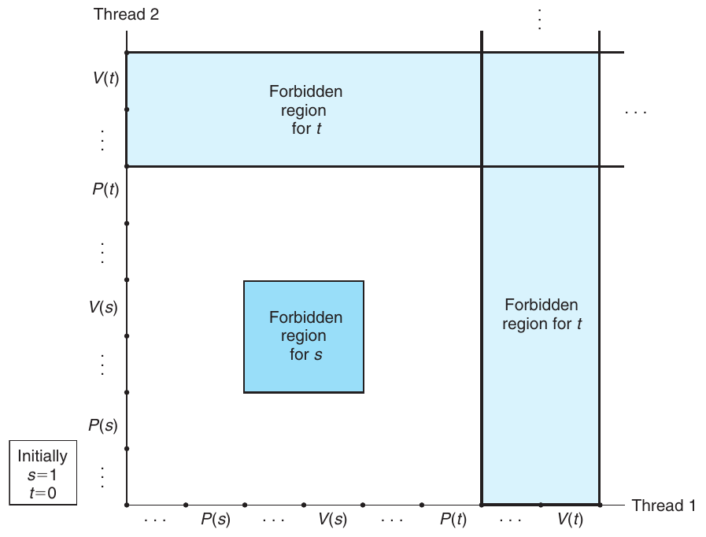

**Hình 12.48 Progress graph của một chương trình bị deadlock.**

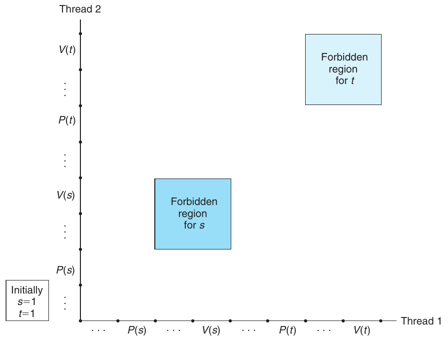

**Hình 12.49 Progress graph của chương trình deadlock-free đã sửa.**
