# 1 Từ zero đến one

- 1.1 Kế hoạch hành động
- 1.2 Nghệ thuật quản lý độ phức tạp
- 1.3 Digital abstraction
- 1.4 Hệ đếm
- 1.5 Logic gate
- 1.6 Bên dưới digital abstraction
- 1.7 CMOS transistor\*
- 1.8 Công suất tiêu thụ\*
- 1.9 Tóm tắt và nhìn về phía trước
- Bài tập
- Câu hỏi phỏng vấn

## 1.1 KẾ HOẠCH HÀNH ĐỘNG

Microprocessor đã cách mạng hóa thế giới của chúng ta trong ba thập kỷ qua. Laptop ngày nay có năng lực vượt xa một mainframe room-sized của những năm trước. Một ô tô hạng sang chứa khoảng 100 microprocessor. Các tiến bộ về microprocessor đã giúp điện thoại di động và Internet trở thành hiện thực, cải thiện y học vượt bậc và thay đổi cách tiến hành chiến tranh. Doanh số ngành semiconductor toàn cầu tăng từ 21 tỷ USD năm 1985 lên 400 tỷ USD năm 2020, và microprocessor chiếm một phần lớn trong doanh số đó. Chúng tôi tin rằng microprocessor không chỉ quan trọng về kỹ thuật, kinh tế và xã hội, mà bản thân nó còn là một phát minh hấp dẫn của con người. Khi đọc hết sách, bạn sẽ biết cách thiết kế và xây dựng microprocessor của riêng mình. Những kỹ năng học được trong quá trình đó sẽ chuẩn bị cho bạn thiết kế nhiều digital system khác.

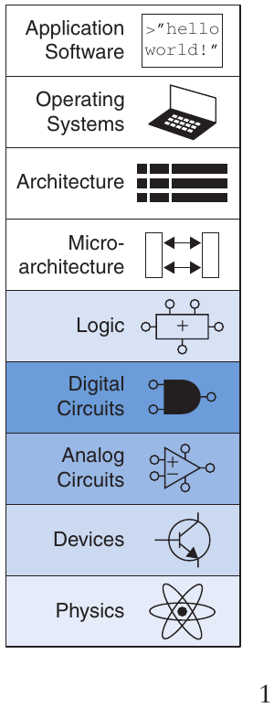

Chúng tôi giả định bạn có hiểu biết cơ bản về điện, một chút kinh nghiệm lập trình và sự quan tâm thực sự đến những gì diễn ra bên trong máy tính. Sách tập trung thiết kế digital system, hoạt động trên 1 và 0. Bắt đầu với digital logic gate nhận 1 và 0 làm input, tạo 1 và 0 làm output. Tiếp đó tìm hiểu kết hợp logic gate thành module phức tạp hơn như adder và memory. Rồi chuyển sang lập trình assembly language, ngôn ngữ bản địa của microprocessor. Cuối cùng kết hợp gate thành microprocessor chạy các chương trình assembly này.

Ưu điểm lớn của digital system là các khối cấu thành khá đơn giản: chỉ 1 và 0. Chúng không đòi hỏi toán học rắc rối hay kiến thức vật lý sâu sắc. Thách thức của designer là kết hợp những khối đơn giản thành hệ thống phức tạp. Microprocessor có thể là hệ thống đầu tiên bạn xây dựng phức tạp đến mức không thể nắm toàn bộ trong đầu cùng lúc. Một chủ đề lớn xuyên suốt sách là cách quản lý độ phức tạp.

## 1.2 NGHỆ THUẬT QUẢN LÝ ĐỘ PHỨC TẠP

Một đặc điểm phân biệt engineer hoặc nhà khoa học máy tính với người ngoài ngành là cách tiếp cận có hệ thống để quản lý độ phức tạp. Digital system hiện đại được xây từ hàng triệu hoặc hàng tỷ transistor. Không ai có thể hiểu bằng cách viết phương trình mô tả chuyển động electron trong từng transistor rồi giải đồng thời tất cả. Bạn cần học quản lý độ phức tạp để hiểu cách xây microprocessor mà không sa lầy trong chi tiết.

### 1.2.1 Abstraction

Kỹ thuật then chốt để quản lý độ phức tạp là abstraction: giấu chi tiết khi không quan trọng. Có thể nhìn hệ thống ở nhiều mức abstraction. Ví dụ chính trị gia Mỹ chia thế giới thành thành phố, hạt, bang và quốc gia. Một hạt gồm nhiều thành phố; một bang gồm nhiều hạt. Khi tranh cử tổng thống, chính trị gia chủ yếu quan tâm cả bang bỏ phiếu thế nào hơn là từng hạt, nên bang là mức abstraction hữu ích nhất. Ngược lại, Census Bureau đo dân số từng thành phố, nên phải xét chi tiết ở mức abstraction thấp hơn.

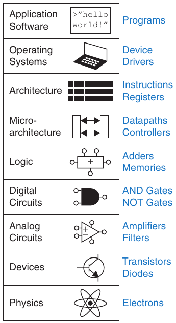

Hình 1.1 Các mức abstraction của hệ thống tính toán điện tử

Hình 1.1 minh họa các mức abstraction của hệ thống máy tính điện tử cùng khối cấu thành điển hình ở mỗi mức. Thấp nhất là vật lý, chuyển động electron. Hành vi electron được mô tả bằng cơ học lượng tử và phương trình Maxwell. Hệ thống được xây bằng thiết bị điện tử như transistor (hay ngày xưa là vacuum tube). Chúng có điểm nối well-defined gọi terminal, có thể mô hình hóa bằng quan hệ điện áp và dòng điện đo tại từng terminal. Abstraction lên mức device cho phép bỏ qua từng electron. Mức tiếp theo là analog circuit, ghép device thành component như amplifier. Analog circuit nhận và xuất dải điện áp liên tục. Digital circuit như logic gate giới hạn điện áp vào các dải rời rạc dùng biểu diễn 0 và 1. Trong logic design, từ digital circuit xây cấu trúc phức tạp hơn như adder hay memory.

Microarchitecture nối mức logic với mức architecture. Mức architecture mô tả máy tính từ góc nhìn programmer. Ví dụ architecture Intel x86 trong microprocessor của phần lớn personal computer (PC) được định nghĩa bằng tập instruction và register (memory tạm lưu variable) programmer được phép dùng. Microarchitecture kết hợp logic element để thực thi instruction do architecture định nghĩa. Một architecture có thể được triển khai bằng nhiều microarchitecture với trade-offs khác nhau về giá, performance và công suất. Ví dụ Intel Core i7, Intel 80486 và AMD Athlon đều triển khai x86 bằng microarchitecture khác nhau.

Sang software, operating system xử lý chi tiết low-level như truy cập ổ cứng hoặc quản lý memory. Cuối cùng application software dùng các tiện ích operating system cung cấp để giải bài toán người dùng. Nhờ abstraction, bà của bạn có thể lướt Web mà không bận tâm dao động lượng tử electron hay tổ chức memory trong máy.

Cuốn sách này tập trung vào các mức abstraction từ digital circuit đến computer architecture. Khi làm việc ở một mức abstraction, bạn nên hiểu đôi chút về các mức abstraction ngay phía trên và phía dưới mức đó. Ví dụ, một nhà khoa học máy tính không thể tối ưu hóa hoàn toàn code nếu không hiểu architecture mà chương trình đang được viết cho nó. Một kỹ sư thiết bị không thể đưa ra các lựa chọn trade-offs sáng suốt khi thiết kế transistor nếu không hiểu các circuit sẽ sử dụng những transistor đó. Chúng tôi hy vọng rằng sau khi đọc xong cuốn sách này, bạn có thể chọn mức abstraction phù hợp để giải quyết bài toán của mình và đánh giá ảnh hưởng của các lựa chọn thiết kế đến những mức abstraction khác.

> Mỗi chương trong cuốn sách này bắt đầu bằng một biểu tượng abstraction, trong đó trọng tâm của chương được thể hiện bằng màu xanh đậm, còn các chủ đề phụ được thể hiện bằng những sắc xanh nhạt hơn.

> Ford giới thiệu Model T với tuyên ngôn táo bạo:
>
> Tôi sẽ xây ô tô cho số đông. Nó đủ lớn cho gia đình nhưng đủ nhỏ để cá nhân vận hành và chăm sóc. Nó sẽ làm bằng vật liệu tốt nhất, bởi những người giỏi nhất có thể thuê, theo thiết kế đơn giản nhất mà kỹ thuật hiện đại nghĩ ra. Nhưng giá sẽ thấp đến mức không người có lương khá nào không thể sở hữu—và cùng gia đình tận hưởng những giờ vui thú trong không gian rộng lớn của Chúa. [My Life and Work, Samuel Crowther và Henry Ford, 1922]

### 1.2.2 Discipline

Discipline là chủ ý giới hạn lựa chọn thiết kế để làm việc năng suất hơn ở mức abstraction cao hơn. Dùng bộ phận có thể thay thế lẫn nhau là ứng dụng quen thuộc. Ví dụ nổi tiếng ban đầu là sản xuất ô tô. Dù ô tô gas-powered hiện đại bắt nguồn từ Benz Patent-Motorwagen của Đức năm 1886, xe đời đầu được thợ lành nghề làm thủ công, quá trình time-consuming và đắt đỏ. Henry Ford tạo bước tiến then chốt năm 1908 bằng cách tập trung sản xuất hàng loạt với bộ phận thay thế lẫn nhau và dây chuyền lắp ráp chuyển động.

Discipline dùng bộ phận thay thế lẫn nhau cách mạng hóa ngành. Giới hạn component ở một tập chuẩn hóa với dung sai well-defined cho phép lắp ráp, sửa xe nhanh hơn nhiều, ít đòi hỏi kỹ năng hơn. Người chế tạo không còn bận tâm mức abstraction thấp như lắp cửa vào lỗ mở chưa chuẩn hóa. Model T Ford trở thành xe most-produced thời đó, bán hơn 15 triệu chiếc. Ví dụ discipline khác là câu nói nổi tiếng của Ford: “Khách hàng muốn xe sơn màu nào cũng được, miễn là màu đen.”

> 
>
> Model T Ford Ảnh từ https://commons.wikimedia.org/wiki/File: TModel_launch_Geelong.jpg.

Trong sách, digital discipline rất quan trọng. Digital circuit dùng điện áp rời rạc, analog circuit dùng điện áp liên tục. Vì vậy digital circuit là tập con của analog circuit, theo nghĩa nào đó khả năng phải hạn chế hơn lớp analog rộng hơn. Tuy nhiên digital circuit dễ thiết kế hơn nhiều. Giới hạn ở digital circuit giúp dễ kết hợp component thành hệ thống tinh vi, cuối cùng vượt hệ thống analog trong nhiều application. Ví dụ TV số, compact disk (CD) và điện thoại di động đang thay thế tiền thân analog.

### 1.2.3 Ba chữ -Y

Ngoài abstraction và discipline, designer dùng ba “-y” quản lý độ phức tạp: hierarchy, modularity, regularity. Các nguyên tắc áp dụng cho cả software và hardware.

- Hierarchy chia hệ thống thành module, tiếp tục chia từng module đến khi các phần dễ hiểu.

- Modularity yêu cầu module có function và interface well-defined để dễ nối mà không có side effect ngoài dự kiến.

- Regularity tìm sự đồng nhất giữa module. Module chung được tái sử dụng nhiều lần, giảm số module riêng phải thiết kế.

Để minh họa ba “-y”, quay lại sản xuất ô tô. Ô tô là một trong những vật dụng phổ biến phức tạp nhất đầu thế kỷ 20. Theo hierarchy, có thể chia Model T Ford thành chassis, động cơ, ghế. Động cơ gồm bốn cylinder, carburetor, magneto và hệ làm mát. Carburetor gồm cửa nhiên liệu/không khí, choke, throttle, needle valve, v.v., như Hình 1.2. Cửa nhiên liệu làm từ khuỷu nối ren và coupling nut. Như vậy hệ thống phức tạp được chia đệ quy thành component đơn giản thay thế lẫn nhau, có thể sản xuất hàng loạt.

Modularity chỉ ra rằng mỗi component nên có chức năng và interface được xác định rõ ràng (well-defined). Ví dụ, đai ốc nối có chức năng giữ đường cấp nhiên liệu vào khuỷu nạp sao cho không bị rò rỉ, nhưng vẫn có thể dễ dàng tháo ra khi cần thay đường cấp. Đai ốc có đường kính và bước ren theo tiêu chuẩn, được siết đến torque tiêu chuẩn bằng một cờ lê tiêu chuẩn. Nhà sản xuất ô tô có thể mua đai ốc từ nhiều nhà cung cấp khác nhau, miễn là chỉ định đúng kích thước. Modularity đòi hỏi không có side effect: đai ốc nối không được làm biến dạng khuỷu nạp và tốt nhất nên được đặt ở nơi có thể siết hoặc tháo nó mà không cần tháo các thiết bị khác trong động cơ.

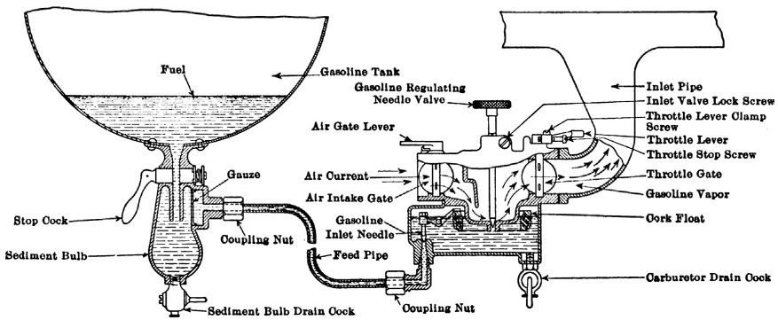

Hình 1.2 Mặt cắt hệ nhiên liệu Model T, bên trái là nguồn nhiên liệu, bên phải là carburetor. (https://en.wikipedia.org/wiki/Ford_Model_T_engine#/media/File:Pagé\_1917_Model_T\_ Ford_Car_Figure_14.png)

Regularity dạy rằng bộ phận thay thế lẫn nhau là ý tưởng tốt. Carburetor rò có thể thay bằng bộ phận giống hệt. Carburetor được chế tạo hiệu quả trên dây chuyền thay vì làm thủ công tỉ mỉ.

> 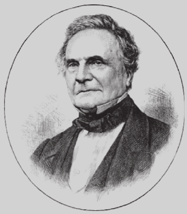
>
> Charles Babbage, 1791–1871
>
> Học Cambridge University, kết hôn Georgiana Whitmore năm 1814. Phát minh Analytical Engine, máy tính cơ học đầu tiên thế giới. Cũng phát minh cowcatcher và cước bưu chính thống nhất. Thích mở khóa nhưng ghét nhạc công đường phố (ảnh do Fourmilab Switzerland cung cấp, www.fourmilab.ch).

Chúng ta sẽ quay lại hierarchy, modularity và regularity xuyên suốt sách.

## 1.3 DIGITAL ABSTRACTION

Phần lớn các biến vật lý là liên tục. Ví dụ, điện áp trên dây, tần số của dao động hoặc vị trí của một khối vật đều là những đại lượng liên tục. Ngược lại, digital system biểu diễn thông tin bằng các biến discrete-valued, tức là những biến có hữu hạn giá trị phân biệt.

Digital system đời đầu dùng variable mười giá trị rời rạc là Analytical Engine của Charles Babbage. Từ 1834 đến 1871, ông thiết kế và cố xây máy tính cơ học này. Nó dùng bánh răng mười vị trí đánh 0 đến 9, giống đồng hồ quãng đường cơ học ô tô. Hình 1.3 là prototype, mỗi row xử lý một digit. Ông chọn 25 row bánh răng, nên máy có độ chính xác 25-digit.

Khác với cỗ máy của Babbage, phần lớn máy tính điện tử sử dụng cách biểu diễn binary (two-valued), trong đó điện áp cao biểu thị “1” và điện áp thấp biểu thị “0”, vì phân biệt hai mức điện áp dễ hơn phân biệt mười mức điện áp.

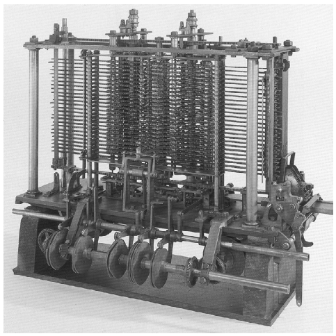

Hình 1.3 Analytical Engine của Babbage, còn xây dở khi ông mất năm 1871 (ảnh do Science Museum/Science and Society Picture Library cung cấp)

Lượng thông tin D trong variable rời rạc có N trạng thái phân biệt được đo bằng bit như sau

> 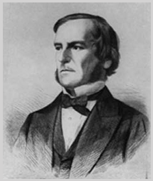
>
> George Boole, 1815–1864
>
> Sinh trong gia đình working-class, không đủ tiền học chính quy, Boole tự học toán rồi gia nhập giảng viên Queen’s College ở Ireland. Ông viết An Investigation of the Laws of Thought (1854), giới thiệu binary variable và ba logic operation cơ bản: AND, OR, NOT (ảnh do American Institute of Physics cung cấp).

D = log2N bits (1.1)

Một biến binary mang log22 = 1 bit thông tin. Thực tế, từ bit là dạng viết tắt của binary digit. Mỗi bánh răng của Babbage mang log210 = 3.322 bit thông tin vì nó có thể ở một trong 23.322 = 10 vị trí khác nhau. Một signal liên tục về lý thuyết chứa lượng thông tin vô hạn vì nó có thể nhận vô hạn giá trị. Trong thực tế, noise và sai số đo giới hạn lượng thông tin ở mức chỉ từ 10 đến 16 bit đối với phần lớn signal liên tục. Nếu phép đo phải được thực hiện nhanh, lượng thông tin sẽ thấp hơn (ví dụ, 8 bit).

Sách tập trung digital circuit dùng binary variable: 1 và 0. George Boole phát triển hệ logic thao tác binary variable, nay gọi Boolean logic. Mỗi variable là TRUE hoặc FALSE. Máy tính điện tử thường dùng điện áp dương biểu diễn “1”, zero volt biểu diễn “0”. Sách dùng “1”, “TRUE”, “HIGH” đồng nghĩa; tương tự “0”, “FALSE”, “LOW” thay nhau.

Ưu điểm của digital abstraction là người thiết kế digital có thể tập trung vào các giá trị 1 và 0 mà không cần quan tâm các biến Boolean được biểu diễn vật lý bằng những mức điện áp cụ thể, các bánh răng quay hay thậm chí các mức chất lỏng thủy lực. Lập trình viên máy tính có thể làm việc mà không cần biết những chi tiết bên trong hardware của máy tính. Mặt khác, việc hiểu các chi tiết của hardware cho phép lập trình viên tối ưu hóa software tốt hơn cho máy tính cụ thể đó.

Một bit riêng lẻ không mang nhiều thông tin. Trong mục tiếp theo, chúng ta sẽ xem xét cách sử dụng các nhóm bit để biểu diễn số. Trong những chương sau, chúng ta cũng sẽ sử dụng các nhóm bit để biểu diễn chữ cái và chương trình.

## 1.4 HỆ ĐẾM

Bạn đã quen làm việc với các số decimal. Trong digital system gồm các giá trị 1 và 0, số binary hoặc hexadecimal thường thuận tiện hơn. Mục này giới thiệu các hệ biểu diễn số sẽ được sử dụng trong suốt phần còn lại của cuốn sách.

### 1.4.1 Số decimal

Ở trường tiểu học, bạn đã học đếm và thực hiện phép tính ở hệ decimal. Cũng như bạn (có lẽ) có mười ngón tay, có mười digit decimal: 0, 1, 2, …, 9. Các digit decimal được ghép lại để tạo thành những số decimal dài hơn. Mỗi cột của một số decimal có trọng số gấp mười lần cột trước đó. Từ phải sang trái, trọng số các cột là 1, 10, 100, 1000, v.v. Số decimal được gọi là số cơ số 10. Cơ số được ghi bằng chỉ số dưới sau số để tránh nhầm lẫn khi làm việc với nhiều cơ số. Ví dụ, Hình 1.4 minh họa cách viết số decimal 974210 thành tổng của từng digit nhân với trọng số của cột tương ứng.

Số decimal N-digit biểu diễn một trong 10N khả năng: 0, 1, 2, 3, …, 10N− 1. Đây là range. Ví dụ số decimal three-digit biểu diễn một trong 1000 khả năng từ 0 đến 999.

### 1.4.2 Số binary

Mỗi bit biểu diễn một trong hai giá trị, 0 hoặc 1, và các bit được ghép lại để tạo thành số binary. Mỗi cột của một số binary có trọng số gấp đôi cột trước đó, nên số binary có cơ số 2. Trong hệ binary, trọng số các cột (một lần nữa, từ phải sang trái) là 1, 2, 4, 8, 16, 32, 64, 128, 256, 512, 1024, 2048, 4096, 8192, 16384, 32768, 65536, v.v. Nếu thường xuyên làm việc với số binary, bạn sẽ tiết kiệm thời gian bằng cách ghi nhớ các lũy thừa này của hai cho đến 216.

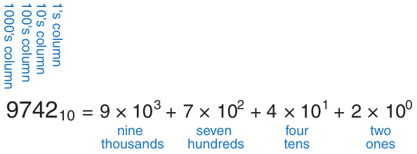

Hình 1.4 Biểu diễn số decimal

Số binary N-bit biểu diễn một trong 2N khả năng: 0, 1, 2, 3, …, 2N − 1. Bảng 1.1 cho số binary 1-, 2-, 3-, 4-bit và decimal tương đương.

#### Ví dụ 1.1 CHUYỂN BINARY SANG DECIMAL

Chuyển số binary 101102 sang decimal.

Lời giải Hình 1.5 trình bày chuyển đổi.

Bảng 1.1 Số binary và decimal tương đương

| Số binary 1-Bit | Số binary 2-Bit | Số binary 3-Bit | Số binary 4-Bit | Decimal tương đương |
|---|---|---|---|---|
| 0 | 00 | 000 | 0000 | 0 |
| 1 | 01 | 001 | 0001 | 1 |
|  | 10 | 010 | 0010 | 2 |
|  | 11 | 011 | 0011 | 3 |
|  |  | 100 | 0100 | 4 |
|  |  | 101 | 0101 | 5 |
|  |  | 110 | 0110 | 6 |
|  |  | 111 | 0111 | 7 |
|  |  |  | 1000 | 8 |
|  |  |  | 1001 | 9 |
|  |  |  | 1010 | 10 |
|  |  |  | 1011 | 11 |
|  |  |  | 1100 | 12 |
|  |  |  | 1101 | 13 |
|  |  |  | 1110 | 14 |
|  |  |  | 1111 | 15 |

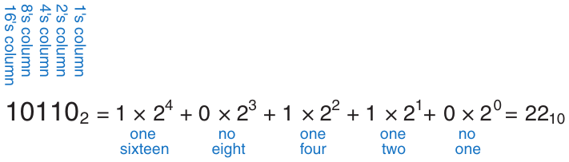

Hình 1.5 Chuyển số binary sang decimal

#### Ví dụ 1.2 CHUYỂN DECIMAL SANG BINARY

Chuyển số decimal 8410 sang binary.

Lời giải Xác định mỗi cột kết quả binary là 1 hay 0. Có thể bắt đầu từ cột trái hoặc phải.

Bắt đầu từ bên trái, chọn lũy thừa lớn nhất của 2 nhỏ hơn hoặc bằng số cần chuyển đổi (trong trường hợp này là 64). 84 ≥ 64, nên cột hàng 64 có bit 1, và phần còn lại là 84 − 64 = 20. 20 < 32, nên cột hàng 32 có bit 0. 20 ≥ 16, nên cột hàng 16 có bit 1, và phần còn lại là 20 − 16 = 4. 4 < 8, nên cột hàng 8 có bit 0. 4 ≥ 4, nên cột hàng 4 có bit 1, và phần còn lại là 4 − 4 = 0. Vì vậy, cột hàng 2 và hàng đơn vị đều phải có bit 0. Ghép tất cả lại, ta được 8410 = 10101002.

Bắt đầu từ bên phải, liên tiếp chia số đó cho 2. Số dư được ghi vào từng cột tương ứng. 84/2 = 42, nên ghi 0 vào cột hàng đơn vị. 42/2 = 21, nên ghi 0 vào cột hàng 2. 21/2 = 10 với số dư 1 được ghi vào cột hàng 4. 10/2 = 5, nên ghi 0 vào cột hàng 8. 5/2 = 2 với số dư 1 được ghi vào cột hàng 16. 2/2 = 1, nên ghi 0 vào cột hàng 32. Cuối cùng, 1/2 = 0 với số dư 1 được ghi vào cột hàng 64. Một lần nữa, 8410 = 10101002.

### 1.4.3 Số hexadecimal

> Hexadecimal do IBM đặt năm 1963, từ hexi tiếng Hy Lạp (sáu) và decem Latin (mười). Từ chuẩn hơn dùng sexa Latin (sáu), nhưng sexadecimal nghe quá gợi tình.

Viết các số binary dài trở nên tẻ nhạt và dễ mắc lỗi. Một nhóm bốn bit biểu diễn một trong 24 = 16 khả năng. Vì vậy, đôi khi làm việc với cơ số 16, gọi là hexadecimal, thuận tiện hơn. Số hexadecimal dùng các digit từ 0 đến 9 cùng các chữ A đến F, như Bảng 1.2. Các cột trong cơ số 16 có trọng số 1, 16, 162 (hay 256), 163 (hay 4096), v.v.

#### Ví dụ 1.3 CHUYỂN HEXADECIMAL SANG BINARY VÀ DECIMAL

Chuyển số hexadecimal 2ED16 sang binary và decimal.

Lời giải Chuyển giữa hexadecimal và binary dễ vì mỗi hexadecimal digit tương ứng trực tiếp bốn binary digit. 216 = 00102, E16 = 11102 và D16 = 11012, nên 2ED16 = 0010111011012. Chuyển sang decimal cần phép tính Hình 1.6.

Bảng 1.2 Hệ đếm hexadecimal

| Hexadecimal digit | Decimal tương đương | Binary tương đương |
|---|---|---|
| 0 | 0 | 0000 |
| 1 | 1 | 0001 |
| 2 | 2 | 0010 |
| 3 | 3 | 0011 |
| 4 | 4 | 0100 |
| 5 | 5 | 0101 |
| 6 | 6 | 0110 |
| 7 | 7 | 0111 |
| 8 | 8 | 1000 |
| 9 | 9 | 1001 |
| A | 10 | 1010 |
| B | 11 | 1011 |
| C | 12 | 1100 |
| D | 13 | 1101 |
| E | 14 | 1110 |
| F | 15 | 1111 |

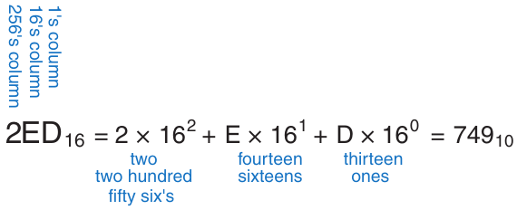

Hình 1.6 Chuyển hexadecimal sang decimal

#### Ví dụ 1.4 CHUYỂN BINARY SANG HEXADECIMAL

Chuyển số binary 11110102 sang hexadecimal.

Lời giải Chuyển đổi vẫn dễ. Đọc từ phải. Bốn least significant bit là 10102 = A16. Các bit tiếp là 1112 = 716. Vậy 11110102 = 7A16.

#### Ví dụ 1.5 CHUYỂN DECIMAL SANG HEXADECIMAL VÀ BINARY

Chuyển số decimal 33310 sang hexadecimal và binary.

Lời giải Như chuyển decimal sang binary, chuyển decimal sang hexadecimal có thể từ trái hoặc phải.

Bắt đầu từ bên trái, chọn lũy thừa lớn nhất của 16 nhỏ hơn hoặc bằng số cần chuyển đổi (trong trường hợp này là 256). 333 chia cho 256 được một lần, nên cột hàng 256 có digit 1, và phần còn lại là 333 − 256 = 77. 77 chia cho 16 được bốn lần, nên cột hàng 16 có digit 4, và phần còn lại là 77 − 16 × 4 = 13. 1310 = D16, nên cột hàng đơn vị có digit D. Tóm lại, 33310 = 14D16. Bây giờ có thể dễ dàng chuyển từ hexadecimal sang binary, như trong Ví dụ 1.3: 14D16 = 1010011012.

Bắt đầu từ bên phải, liên tiếp chia số đó cho 16. Số dư được ghi vào từng cột tương ứng. 333/16 = 20, với số dư 1310 = D16 được ghi vào cột hàng đơn vị. 20/16 = 1, với số dư 4 được ghi vào cột hàng 16. 1/16 = 0, với số dư 1 được ghi vào cột hàng 256. Một lần nữa, kết quả là 14D16.

### 1.4.4 Byte, nibble và những thứ liên quan

Nhóm tám bit gọi byte, biểu diễn một trong 28 = 256 khả năng. Kích thước object lưu trong computer memory thường đo bằng byte thay vì bit.

Nhóm bốn bit, nửa byte, gọi nibble; biểu diễn một trong 24 = 16 khả năng. Một hexadecimal digit lưu một nibble, hai digit lưu trọn byte. Nibble không còn là đơn vị phổ biến nhưng tên khá dễ thương.

> Microprocessor là processor xây trên một chip. Trước thập niên 1970, processor quá phức tạp để vừa một chip, nên mainframe processor làm từ board nhiều chip. Intel giới thiệu microprocessor 4-bit đầu tiên, 4004, năm 1971. Nay cả supercomputer tinh vi nhất cũng xây bằng microprocessor. Sách dùng microprocessor và processor thay nhau.

Microprocessor xử lý data theo từng nhóm được gọi là word. Kích thước của word phụ thuộc vào architecture của microprocessor. Khi chương này được viết vào năm 2021, phần lớn máy tính sử dụng processor 64-bit, nghĩa là chúng thao tác trên các word 64-bit. Vào thời điểm đó, các máy tính cũ xử lý word 32-bit cũng vẫn được sử dụng rộng rãi. Những microprocessor đơn giản hơn, đặc biệt là loại dùng trong các thiết bị như máy nướng bánh mì, sử dụng word 8- hoặc 16-bit.

Trong một nhóm bit, bit ở cột hàng đơn vị được gọi là least significant bit (lsb), còn bit ở đầu đối diện được gọi là most significant bit (msb), như minh họa trong Hình 1.7(a) đối với một số binary 6-bit. Tương tự, trong một word, các byte được xác định từ least significant byte (LSB) đến most significant byte (MSB), như minh họa trong Hình 1.7(b) đối với một số 4-byte được viết bằng tám digit hexadecimal.

Trùng hợp tiện lợi: 210 = 1024 ≈ 103. Vì vậy kilo (tiếng Hy Lạp là nghìn) chỉ 210. Ví dụ 210 byte là một kilobyte (1 KB). Tương tự mega (triệu) chỉ 220 ≈ 106, giga (tỷ) chỉ 230 ≈ 109. Biết 210 ≈ 1 nghìn, 220 ≈ 1 triệu, 230 ≈ 1 tỷ và nhớ lũy thừa hai đến 29, bạn dễ nhẩm mọi lũy thừa hai.

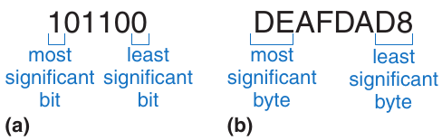

Hình 1.7 Bit và byte có trọng số thấp nhất, cao nhất

> Để phân biệt lũy thừa mười và hai, có naming convention riêng cho lũy thừa hai: 210 gọi kibi (Ki), 220 mebi (Mi), 230 gibi (Gi), 240 tebi (Ti), 250 pebi (Pi), 260 exbi (Ei), v.v. Ví dụ 230 byte là gibibyte (GiB).

#### Ví dụ 1.6 ƯỚC LƯỢNG LŨY THỪA HAI

Tìm giá trị gần đúng 224 không dùng máy tính.

Lời giải Tách số mũ thành bội mười và phần dư.

224 = 220 × 24. 220 ≈ 1 triệu. 24 = 16. Vậy 224 ≈ 16 triệu. Chính xác là 224 = 16,777,216, nhưng 16 triệu đủ gần cho marketing.

> Memory On-chip và RAM được đo theo các lũy thừa của hai, nhưng ổ cứng được đo theo các lũy thừa của mười. Ví dụ, RAM 32 GB (GiB) thực tế có 34,359,738,368 byte bộ nhớ, trong khi 32 GB trên ổ cứng là 32,000,000 byte bộ nhớ.

1024 byte gọi kilobyte (KB) hoặc kibibyte (KiB). 1024 bit gọi kilobit (Kb hay Kbit) hoặc kibibit (Kib hay Kibit). Tương tự MB / MiB, Mb/Mib, GB/GiB và Gb/Gib dùng cho hàng triệu, tỷ byte và bit. Memory capacity thường đo bằng byte. Tốc độ giao tiếp thường đo theo lũy thừa mười bit/giây. Ví dụ modem dial-up tối đa thường 56 kbit/giây, tức 56,000 bit/giây.

### 1.4.5 Phép cộng binary

Phép cộng binary rất giống phép cộng decimal nhưng dễ hơn, như Hình 1.8. Cũng như decimal, nếu tổng hai số lớn hơn khả năng chứa của một digit, ta nhớ 1 sang cột tiếp theo. Hình 1.8 so sánh phép cộng decimal và binary. Ở cột ngoài cùng bên phải Hình 1.8(a), 7 + 9 = 16 không vừa một digit vì lớn hơn 9. Vì vậy ghi digit cột 1 là 6, rồi nhớ digit cột 10 là 1 sang cột tiếp. Tương tự, trong binary, nếu tổng hai số lớn hơn 1 thì nhớ digit cột 2 sang cột tiếp. Ví dụ cột ngoài cùng bên phải Hình 1.8(b), tổng 1 + 1 = 210 = 102 không vừa một binary digit. Vì vậy ghi digit cột 1 (0), nhớ digit cột 2 (1) của kết quả sang cột kế. Ở cột thứ hai, tổng 1 + 1 + 1 = 310 = 112. Một lần nữa, ghi digit cột 1 (1), nhớ digit cột 2 (1) sang cột tiếp. Vì lý do hiển nhiên, bit được nhớ sang cột bên cạnh gọi là carry bit.

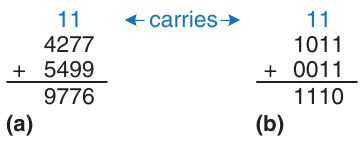

Hình 1.8 Ví dụ cộng có carry: (a) decimal (b) binary

#### Ví dụ 1.7 PHÉP CỘNG BINARY

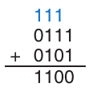

Hình 1.9 Ví dụ cộng binary

Tính 01112 + 01012.

Lời giải Hình 1.9 cho tổng 11002, carry màu xanh. Có thể kiểm tra bằng decimal: 01112 = 710, 01012 = 510. Tổng 1210 = 11002.

Digital system thường hoạt động với một số lượng digit cố định. Phép cộng được gọi là overflow nếu kết quả quá lớn, không thể biểu diễn bằng số digit hiện có. Ví dụ, một số 4-bit có range [0, 15]. Phép cộng binary 4-bit bị overflow nếu kết quả vượt quá 15. Bit thứ năm của tổng bị loại bỏ, khiến bốn bit còn lại biểu diễn một kết quả không chính xác. Có thể phát hiện overflow bằng cách kiểm tra xem có carry ra khỏi cột most significant hay không.

#### Ví dụ 1.8 PHÉP CỘNG CÓ OVERFLOW

Tính 11012 + 01012. Có overflow không?

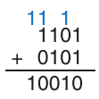

Hình 1.10 Ví dụ cộng binary có overflow

Lời giải Hình 1.10 cho thấy tổng bằng 100102. Kết quả này vượt quá range của một số binary 4-bit. Nếu phải lưu dưới dạng bốn bit, most significant bit bị loại bỏ, để lại kết quả không chính xác là 00102. Nếu phép tính được thực hiện bằng các số có năm bit trở lên, kết quả 100102 sẽ chính xác.

### 1.4.6 Số binary có dấu

Cho đến đây, chúng ta chỉ xem xét các số unsigned binary biểu diễn những đại lượng dương. Chúng ta thường muốn biểu diễn cả số dương lẫn số âm, nên cần một hệ biểu diễn số binary khác. Có nhiều cách biểu diễn số signed binary. Hai cách được sử dụng rộng rãi nhất được gọi là sign/magnitude và two’s complement.

Số Sign/Magnitude

Các số sign/magnitude có tính trực quan vì chúng phù hợp với cách chúng ta thường viết số âm bằng một dấu trừ theo sau bởi độ lớn. Một số sign/magnitude N-bit sử dụng most significant bit làm dấu và N − 1 bit còn lại làm độ lớn (giá trị tuyệt đối). Sign bit bằng 0 biểu thị số dương và sign bit bằng 1 biểu thị số âm.

> Tên lửa Ariane 5 trị giá \$7 tỷ, được phóng vào ngày 4 tháng 6 năm 1996, đã lệch khỏi quỹ đạo 40 giây sau khi phóng, vỡ ra và phát nổ. Sự cố xảy ra khi máy tính điều khiển tên lửa vượt quá phạm vi 16-bit và bị crash.
>
> Code đã được kiểm thử kỹ trên Ariane 4. Nhưng Ariane 5 có động cơ nhanh hơn, tạo giá trị lớn hơn cho máy tính điều khiển, gây overflow.
>
> 
>
> Ảnh do ESA/CNES/ARIANESPACE-Service Optique CS6 cung cấp.

#### Ví dụ 1.9 SỐ SIGN/MAGNITUDE

Viết 5 và −5 dưới dạng số sign/magnitude 4-bit.

Lời giải Cả hai có độ lớn 510 = 1012. Vì vậy 510 = 01012, −510 = 11012.

Đáng tiếc cộng binary thường không đúng cho sign/magnitude. Ví dụ cộng thường −510 + 510 cho 11012 + 01012 = 100102, vô nghĩa.

Một số sign/magnitude N-bit có range [−2N−1 + 1, 2N−1 − 1]. Các số sign/magnitude hơi khác thường vì tồn tại cả +0 lẫn −0. Cả hai đều biểu thị số không. Như bạn có thể hình dung, việc có hai cách biểu diễn khác nhau cho cùng một số có thể gây phiền phức.

Số Two’s Complement

Các số two’s complement giống các số unsigned binary, ngoại trừ vị trí most significant bit có trọng số −2N−1 thay vì 2N−1. Chúng khắc phục các hạn chế của số sign/magnitude: số không chỉ có một cách biểu diễn, và phép cộng thông thường hoạt động chính xác.

Trong two’s complement, zero viết toàn zero: 00…0002. Số dương lớn nhất có 0 ở most significant và 1 nơi khác: 01…1112 = 2N−1 − 1. Số âm nhỏ nhất có 1 ở most significant, 0 nơi khác: 10…0002 = −2N−1. −1 viết toàn một: 11…1112.

Lưu ý rằng các số dương có bit 0 ở vị trí most significant, còn các số âm có bit 1 ở vị trí này, nên có thể xem most significant bit là sign bit. Tuy nhiên, toàn bộ số được diễn giải khác nhau đối với số two’s complement và số sign/magnitude.

> Kết quả của việc đảo các bit trong một số được gọi là one’s complement của số đó. Ví dụ, one’s complement của 0110111 là 1001000. Cách gọi one’s complement xuất phát từ việc khi cộng hai số này với nhau, kết quả gồm toàn các bit 1. Ví dụ, 0110111 + 1001000 = 1111111.

Dấu của một số two’s complement được đảo (ví dụ, từ +5 thành −5 hoặc từ −17 thành +17) bằng cách đảo các bit trong số đó rồi cộng 1 vào vị trí least significant bit. Quy trình này được gọi là phương pháp đảo dấu. Nó hữu ích khi tìm cách biểu diễn một số âm hoặc xác định độ lớn của một số âm.

#### Ví dụ 1.10 BIỂU DIỄN TWO’S COMPLEMENT CỦA SỐ ÂM

Tìm biểu diễn −210 dưới dạng two’s complement 4-bit.

Lời giải Bắt đầu biểu diễn độ lớn: +210 = 00102. Để có −210, đổi dấu bằng đảo bit rồi cộng 1. Đảo 00102 cho 11012. 11012 + 1 = 11102. Vậy −210 là 11102.

> Trước đây, quy trình đảo dấu thường được gọi là “lấy two’s complement”. Tuy nhiên, chúng tôi nhận thấy thuật ngữ này đôi khi khiến mọi người nghĩ rằng họ luôn phải “lấy two’s complement” khi làm việc với các số two’s complement, nhưng điều đó không đúng! Quy trình đảo dấu này chỉ đôi khi được sử dụng khi làm việc với các số two’s complement âm.

#### Ví dụ 1.11 GIÁ TRỊ SỐ ÂM TWO’S COMPLEMENT

Tìm giá trị decimal của số two’s complement 4-bit 0x9 (tức 10012).

Lời giải 10012 bắt đầu bằng 1 nên phải âm. Tìm độ lớn bằng đổi dấu: đảo bit rồi cộng 1. Đảo 10012 = 01102. 01102 + 1 = 01112 = 710. Vậy 10012 = −710.

Các số two’s complement có ưu điểm nổi bật là phép cộng hoạt động chính xác cho cả số dương lẫn số âm. Hãy nhớ rằng khi cộng các số N-bit, carry ra khỏi bit thứ N (tức bit kết quả thứ N + 1th) bị loại bỏ.

#### Ví dụ 1.12 CỘNG SỐ TWO’S COMPLEMENT

Tính (a) −210 + 110 và (b) −710 + 710 bằng two’s complement.

Lời giải (a) −210 + 110 = 11102 + 00012 = 11112 = −110. (b) −710 + 710 = 10012 + 01112 = 100002. Bỏ bit thứ năm, còn kết quả 4-bit đúng 00002.

Phép trừ được thực hiện bằng lấy two’s complement của số thứ hai rồi cộng.

> Tên two’s complement xuất phát từ việc complement (số âm) được tìm bằng lấy 2N trừ số đó (gọi theo cơ số: two’s). Ví dụ để tạo complement 4-bit của 7 (tức −7), tính: 24 − 7 = 10000 − 0111 = (1111 + 1) − 0111 = (1111 − 0111) + 1 = 1000 + 1 = 1001. Đây là biểu diễn two’s complement 4-bit
>
> của −7. Chú ý bước cuối giống đổi dấu: đảo bit 0111 (thành 1000) rồi cộng 1.

#### Ví dụ 1.13 TRỪ SỐ TWO’S COMPLEMENT

Tính (a) 510 − 310 và (b) 310 − 510 bằng two’s complement 4-bit.

Lời giải (a) 310 = 00112. Lấy two’s complement được −310 = 11012. Cộng 510 + (−310) = 01012 + 11012 = 00102 = 210. Bỏ carry khỏi vị trí most significant vì lưu bốn bit. (b) Lấy two’s complement của 510 được −510 = 1011. Cộng 310 + (−510) = 00112 + 10112 = 11102 = −210.

Two’s complement của 0 được tìm bằng cách đảo tất cả các bit (thu được 11…1112) rồi cộng 1, cho kết quả gồm toàn bit 0 nếu bỏ qua carry ra khỏi vị trí most significant bit. Vì vậy, số không luôn được biểu diễn bằng toàn bit 0. Khác với hệ sign/magnitude, hệ two’s complement không có cách biểu diễn −0 riêng. Số không được xem là dương vì sign bit của nó bằng 0.

Giống như các số unsigned, số two’s complement N-bit biểu diễn một trong 2N giá trị có thể có. Tuy nhiên, các giá trị được chia thành số dương và số âm. Ví dụ, một số unsigned 4-bit biểu diễn 16 giá trị từ 0 đến 15. Một số two’s complement 4-bit cũng biểu diễn 16 giá trị, nhưng từ −8 đến 7. Tổng quát, range của một số two’s complement N-bit là [−2N−1, 2N−1 − 1]. Việc có nhiều hơn một số âm so với số dương là hợp lý vì không có −0. Số âm nhỏ nhất 10…0002 = −2N−1 đôi khi được gọi là weird number. Để tìm two’s complement của nó, ta đảo các bit (thu được 01…1112) rồi cộng 1, và lại thu được 10…0002, chính là weird number. Vì vậy, số âm này không có số dương tương ứng.

Cộng hai số dương hoặc hai số âm N-bit có thể overflow nếu kết quả lớn hơn 2N−1 − 1 hoặc nhỏ hơn −2N−1. Cộng một dương với một âm không bao giờ overflow. Khác unsigned, carry khỏi cột most significant không báo overflow. Thay vào đó overflow khi hai số có cùng sign bit nhưng kết quả có sign bit ngược lại.

#### Ví dụ 1.14 CỘNG SỐ TWO’S COMPLEMENT CÓ OVERFLOW

Tính 410 + 510 bằng two’s complement 4-bit. Kết quả có overflow không?

Lời giải 410 + 510 = 01002 + 01012 = 10012 = −710. Kết quả vượt quá phạm vi biểu diễn số dương two’s complement 4-bit, tạo ra một kết quả âm không chính xác. Nếu phép tính được thực hiện bằng năm bit trở lên, kết quả 010012 = 910 sẽ chính xác.

Khi mở rộng một số two’s complement thành nhiều bit hơn, sign bit phải được sao chép vào các vị trí most significant bit. Quy trình này được gọi là sign extension. Ví dụ, các số 3 và −3 được viết thành các số two’s complement 4-bit lần lượt là 0011 và 1101. Chúng được sign-extended thành bảy bit bằng cách sao chép sign bit vào ba bit mới ở phía trên để tạo thành 0000011 và 1111101, tương ứng là các cách biểu diễn 7-bit của 3 và –3.

So sánh hệ đếm

Ba hệ biểu diễn số binary được sử dụng phổ biến nhất là unsigned, two’s complement và sign/magnitude. Bảng 1.3 so sánh range của các số N-bit trong từng hệ này. Các số two’s complement thuận tiện vì chúng biểu diễn được cả số nguyên dương lẫn số nguyên âm, và phép cộng thông thường có thể áp dụng cho mọi số. Phép trừ được thực hiện bằng cách lấy số đối của số thứ hai (tức là đảo dấu), rồi thực hiện phép cộng. Trừ khi có chỉ dẫn khác, hãy giả định rằng tất cả các số signed binary đều sử dụng cách biểu diễn two’s complement.

Bảng 1.3 Range số N-bit

| Hệ | Range |
|---|---|
| Unsigned | [0, 2N – 1] |
| Two’s Complement | [–2N–1, 2N–1 – 1] |
| Sign/Magnitude | [–2N–1 + 1, 2N–1 – 1] |

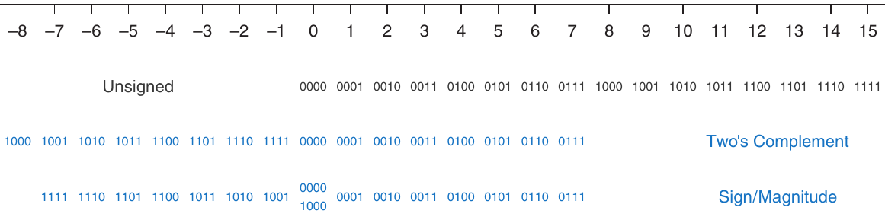

Hình 1.11 Trục số và encoding binary 4-bit

Hình 1.11 minh họa một trục số biểu thị giá trị của các số 4-bit trong từng hệ. Các số unsigned có range [0, 15] theo thứ tự binary thông thường. Các số two’s complement có range [−8, 7]. Các số không âm [0, 7] có cùng encoding với số unsigned. Các số âm [−8, −1] được encode sao cho giá trị unsigned binary lớn hơn biểu diễn một số gần 0 hơn. Lưu ý rằng weird number 1000 biểu diễn −8 và không có số dương tương ứng. Các số sign/magnitude có range [−7, 7]. Most significant bit là sign bit. Các số dương [1, 7] có cùng encoding với số unsigned. Các số âm đối xứng nhưng có sign bit được đặt bằng 1. Số 0 được biểu diễn bằng cả 0000 lẫn 1000. Vì vậy, các số sign/magnitude N-bit chỉ biểu diễn được 2N − 1 số nguyên vì có hai cách biểu diễn cho 0. Các số unsigned binary hoặc two's complement N-bit biểu diễn được 2N số nguyên.

## 1.5 LOGIC GATE

Bây giờ, khi đã biết cách sử dụng biến binary để biểu diễn thông tin, chúng ta sẽ tìm hiểu các digital system thực hiện phép toán trên những biến binary này. Logic gate là các digital circuit đơn giản nhận một hoặc nhiều input binary và tạo ra một output binary. Logic gate được vẽ bằng ký hiệu thể hiện input (hoặc các input) và output. Input thường được vẽ bên trái (hoặc phía trên), còn output bên phải (hoặc phía dưới). Người thiết kế digital thường sử dụng các chữ cái gần đầu bảng chữ cái cho input của gate và chữ Y cho output của gate. Quan hệ giữa các input và output có thể được mô tả bằng truth table hoặc phương trình Boolean. Truth table liệt kê các input ở bên trái và output tương ứng ở bên phải. Nó có một hàng cho mỗi tổ hợp input có thể có. Phương trình Boolean là một biểu thức toán học sử dụng các biến binary.

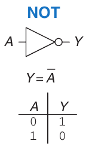

Hình 1.12 NOT gate

### 1.5.1 NOT gate

Gate NOT có một input A và một output Y, như trong Hình 1.12. Output của gate NOT là giá trị đảo của input. Nếu A là FALSE thì Y là TRUE. Nếu A là TRUE thì Y là FALSE. Quan hệ này được tóm tắt bằng truth table và phương trình Boolean trong hình. Dấu gạch trên A trong phương trình Boolean được đọc là NOT, nên Y = $\overline{A}$ được đọc là “Y bằng NOT A”. Gate NOT cũng được gọi là inverter.

Sách khác dùng các notation NOT như Y = A′, Y = ¬A, Y = !A hoặc Y = \~A. Chúng ta chỉ dùng Y = $\overline{A}$, nhưng đừng bối rối nếu gặp notation khác.

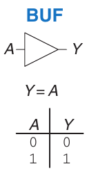

Hình 1.13 Buffer

### 1.5.2 Buffer

Logic gate one-input khác gọi buffer, như Hình 1.13. Nó chỉ copy input sang output.

Xét về mặt logic, buffer không khác một dây nối, nên nó có vẻ vô dụng. Tuy nhiên, xét về mặt analog, buffer có thể có những đặc tính mong muốn, chẳng hạn khả năng cung cấp dòng điện lớn cho motor hoặc khả năng nhanh chóng truyền output của nó đến nhiều gate. Đây là một ví dụ cho thấy vì sao chúng ta cần xem xét nhiều mức abstraction để hiểu đầy đủ một hệ thống; digital abstraction che giấu mục đích thực sự của buffer.

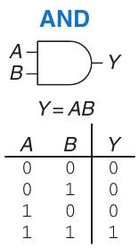

Hình 1.14 AND gate

Symbol tam giác chỉ buffer. Vòng tròn ở output gọi bubble, chỉ inversion như symbol NOT Hình 1.12.

### 1.5.3 AND gate

Các logic gate Two-input thú vị hơn. Gate AND trong Hình 1.14 tạo ra output Y bằng TRUE khi và chỉ khi cả A lẫn B đều là TRUE. Nếu không, output là FALSE. Theo quy ước, các input được liệt kê theo thứ tự 00, 01, 10, 11, như khi bạn đếm ở hệ binary. Phương trình Boolean cho gate AND có thể được viết theo một số cách: Y = A • B, Y = AB hoặc Y = A ∩ B. Ký hiệu ∩ được đọc là “intersection” và được các nhà logic học ưa dùng. Chúng tôi thích Y = AB, đọc là “Y bằng A AND B”, vì chúng tôi lười.

> Theo Larry Wall, người phát minh Perl, “ba đức tính chính của programmer là Lười biếng, Nóng ruột và Kiêu ngạo.”

### 1.5.4 OR gate

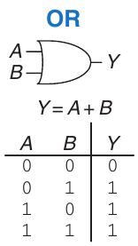

Hình 1.15 OR gate

Gate OR trong Hình 1.15 tạo ra output Y bằng TRUE nếu A hoặc B (hoặc cả hai) là TRUE. Phương trình Boolean cho gate OR được viết là Y = A + B hoặc Y = A ∪ B. Ký hiệu ∪ được đọc là union và được các nhà logic học ưa dùng. Người thiết kế digital thường sử dụng ký hiệu +; Y = A + B được đọc là “Y bằng A OR B”.

### 1.5.5 Các gate Two-Input khác

Hình 1.16 trình bày các logic gate two-input phổ biến khác. XOR (exclusive OR, đọc là “ex-OR”) có output TRUE nếu A hoặc B là TRUE, nhưng không phải cả hai cùng TRUE. Phép toán XOR được ký hiệu bằng ⊕, một dấu cộng có vòng tròn bao quanh. Có thể thêm bubble sau bất kỳ gate nào để đảo hoạt động của nó. NAND gate thực hiện NOT AND. Output của nó là TRUE trừ khi cả hai input đều TRUE. NOR gate thực hiện NOT OR. Output của nó là TRUE nếu cả A lẫn B đều không phải TRUE. XOR gate N-input đôi khi được gọi là parity gate và tạo output TRUE nếu số lượng input có giá trị TRUE là số lẻ. Tương tự các gate two-input, các tổ hợp input trong truth table được liệt kê theo thứ tự đếm.

> Cách ngớ ngẩn để nhớ symbol OR: bên input cong như miệng Pacman, nên gate đói và sẵn sàng ăn bất kỳ input TRUE nào tìm được!

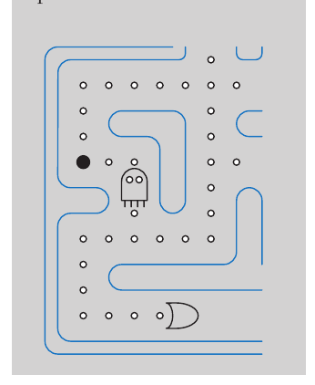

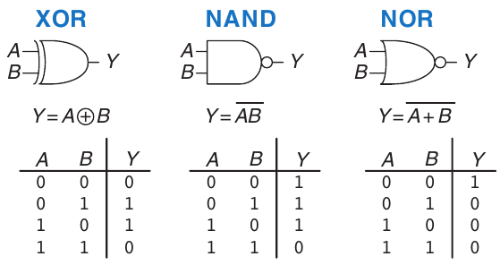

Hình 1.16 Các logic gate two-input khác

#### Ví dụ 1.15 XNOR GATE

Hình 1.17 cho symbol và Boolean equation của XNOR two-input (đọc ex-NOR), đảo XOR. Hoàn thành truth table.

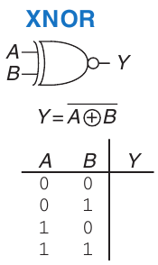

Hình 1.17 XNOR gate

Lời giải Hình 1.18 minh họa truth table. Output của XNOR là TRUE nếu cả hai input đều là FALSE hoặc cả hai input đều là TRUE. Gate XNOR two-input đôi khi được gọi là equality gate vì output của nó là TRUE khi các input bằng nhau.

### 1.5.6 Gate Multiple-Input

Có nhiều hàm Boolean với ba input trở lên. Các hàm phổ biến nhất là AND, OR, XOR, NAND, NOR và XNOR. Một gate AND N-input tạo ra output TRUE khi tất cả N input đều là TRUE. Một gate OR N-input tạo ra output TRUE khi ít nhất một input là TRUE.

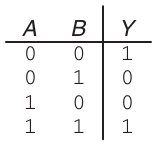

Hình 1.18 Truth table XNOR

#### Ví dụ 1.16 NOR GATE THREE-INPUT

Hình 1.19 cho symbol và Boolean equation NOR three-input. Hoàn thành truth table.

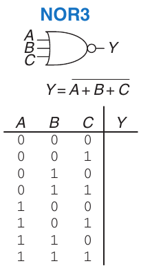

Hình 1.19 NOR gate Three-input

Lời giải Hình 1.20 cho truth table. Output chỉ TRUE nếu không input nào TRUE.

#### Ví dụ 1.17 AND GATE FOUR-INPUT

Hình 1.21 cho symbol và Boolean equation AND four-input. Tạo truth table.

Lời giải Hình 1.22 cho truth table. Output chỉ TRUE nếu mọi input TRUE.

## 1.6 BÊN DƯỚI DIGITAL ABSTRACTION

Digital system dùng variable discrete-valued. Nhưng variable được biểu diễn bằng đại lượng vật lý liên tục như điện áp dây, vị trí bánh răng, mức chất lỏng trong cylinder. Vì vậy designer phải chọn cách liên hệ giá trị liên tục với rời rạc.

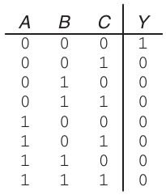

Hình 1.20 Truth table NOR Three-input

Ví dụ, hãy xét việc biểu diễn một signal binary A bằng điện áp trên dây. Quy ước 0 volt (V) biểu thị A = 0 và 5 V biểu thị A = 1. Mọi hệ thống thực tế đều phải chịu được một lượng noise, nên có lẽ 4.97 V cũng cần được diễn giải là A = 1. Nhưng còn 4.3 V thì sao? Hay 2.8 V? Hay 2.500000 V?

### 1.6.1 Supply voltage

Giả sử điện áp thấp nhất là 0 V, gọi ground hoặc GND. Cao nhất từ power supply thường gọi VDD. Công nghệ thập niên 1970, 1980 thường VDD = 5 V. Khi transistor nhỏ hơn, VDD giảm còn 3.3 V, 2.5 V, 1.8 V, 1.5 V, 1.2 V hoặc thấp hơn để tiết kiệm công suất và tránh quá tải transistor.

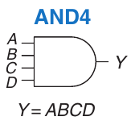

Hình 1.21 AND gate Four-input

### 1.6.2 Logic level

Việc ánh xạ một biến liên tục sang một biến binary rời rạc được thực hiện bằng cách định nghĩa các logic level, như trong Hình 1.23. Gate thứ nhất được gọi là driver và gate thứ hai được gọi là receiver. Output của driver được nối với input của receiver. Driver tạo output LOW (0) trong khoảng từ 0 đến VOL hoặc output HIGH (1) trong khoảng từ VOH đến VDD. Nếu receiver nhận input trong khoảng từ 0 đến VIL, nó sẽ xem input là LOW. Nếu receiver nhận input trong khoảng từ VIH đến VDD, nó sẽ xem input là HIGH. Nếu vì một lý do nào đó, chẳng hạn noise hoặc component bị lỗi, input của receiver rơi vào forbidden zone giữa VIL và VIH, hành vi của gate sẽ không thể dự đoán được. VOH, VOL, VIH và VIL được gọi là các logic level high và low của output và input.

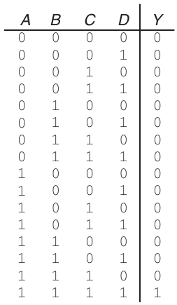

Hình 1.22 Truth table AND Four-input

### 1.6.3 Noise margin

Để output của driver được diễn giải chính xác tại input của receiver, chúng ta phải chọn VOL < VIL và VOH > VIH. Nhờ đó, ngay cả khi output của driver bị nhiễm một lượng noise, input của receiver vẫn phát hiện đúng logic level. Noise margin (NM) là lượng noise có thể thêm vào output trong trường hợp worst-case mà signal vẫn có thể được diễn giải là một input hợp lệ. Như có thể thấy trong Hình 1.23, các noise margin low và high lần lượt là

NML = VIL − VOL (1.2)

NMH = VOH − VIH (1.3)

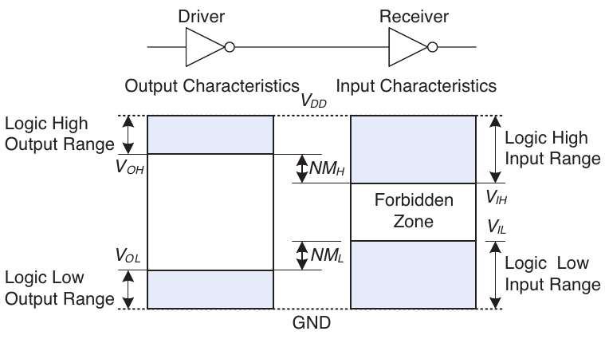

Hình 1.23 Logic level và noise margin

> VDD là điện áp tại drain của transistor metal-oxide-semiconductor, dùng xây phần lớn chip hiện đại. Supply voltage đôi khi gọi VCC, điện áp collector của bipolar junction transistor dùng trong công nghệ chip cũ. Ground đôi khi gọi VSS vì là điện áp source transistor metal-oxide-semiconductor. Xem Mục 1.7 để biết thêm.

#### Ví dụ 1.18 TÍNH NOISE MARGIN

Xét inverter circuit Hình 1.24. VO1 là output voltage inverter I1, VI2 là input voltage inverter I2. Cả hai có: VDD = 5 V, VIL = 1.35 V, VIH = 3.15 V, VOL = 0.33 V, VOH = 3.84 V. Noise margin low/high là bao nhiêu? Circuit chịu được noise 1 V giữa VO1 và VI2 không?

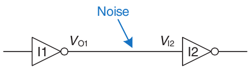

Hình 1.24 Inverter circuit

Lời giải Noise margin inverter: NML = VIL – VOL = (1.35 V − 0.33 V) = 1.02 V, NMH = VOH − VIH = (3.84 V − 3.15 V) = 0.69 V. Chịu noise 1 V khi output LOW (NML = 1.02 V), không khi HIGH (NMH = 0.69 V). Ví dụ driver I1 xuất HIGH worst-case VO1 = VOH = 3.84 V. Nếu noise làm giảm 1 V trước receiver thì VI2 = (3.84 V − 1 V) = 2.84 V, thấp hơn input HIGH chấp nhận VIH = 3.15 V, nên receiver có thể không nhận đúng HIGH.

### 1.6.4 DC transfer characteristic

> DC biểu thị hành vi khi điện áp input được giữ không đổi hoặc thay đổi đủ chậm để phần còn lại của hệ thống theo kịp. Nguồn gốc lịch sử của thuật ngữ này là direct current, một phương pháp truyền tải điện trên đường dây với điện áp không đổi. Ngược lại, transient response của một circuit là hành vi khi điện áp input thay đổi nhanh. Mục 2.9 sẽ tìm hiểu thêm về transient response.

Để hiểu các giới hạn của digital abstraction, chúng ta phải tìm hiểu kỹ hành vi analog của gate. Các DC transfer characteristic của gate mô tả điện áp output như một hàm của điện áp input khi input thay đổi đủ chậm để output có thể theo kịp. Chúng được gọi là transfer characteristic vì mô tả quan hệ giữa điện áp input và output.

Inverter lý tưởng chuyển đột ngột tại VDD/2 như Hình 1.25(a). Với V(A) < VDD/2, V(Y) = VDD. Với V(A) > VDD/2, V(Y) = 0. Khi đó VIH = VIL = VDD/2. VOH = VDD, VOL = 0.

Một inverter thực tế thay đổi dần dần hơn giữa hai cực trị, như trong Hình 1.25(b). Khi điện áp input V(A) bằng 0, điện áp output V(Y) = VDD. Khi V(A) = VDD, V(Y) = 0. Tuy nhiên, sự chuyển tiếp giữa hai điểm đầu cuối này diễn ra liên tục và có thể không có tâm chính xác tại VDD/2. Điều này đặt ra câu hỏi nên định nghĩa các logic level như thế nào.

Một vị trí hợp lý để chọn các logic level là nơi độ dốc của transfer characteristic dV(Y)/dV(A) bằng −1. Hai điểm này được gọi là unity gain point. Việc chọn logic level tại các unity gain point thường tối đa hóa noise margin. Nếu giảm VIL, VOH chỉ tăng một lượng nhỏ. Nhưng nếu tăng VIL, VOH sẽ giảm mạnh.

### 1.6.5 Static discipline

Để tránh các input rơi vào forbidden zone, các digital logic gate được thiết kế tuân theo static discipline. Static discipline đòi hỏi rằng khi được cung cấp input hợp lệ về mặt logic, mọi phần tử circuit đều phải tạo ra output hợp lệ về mặt logic.

Bằng cách tuân theo static discipline, người thiết kế digital hy sinh quyền tự do sử dụng tùy ý các phần tử analog circuit để đổi lấy sự đơn giản và độ vững chắc của digital circuit. Họ nâng mức abstraction từ analog lên digital, tăng năng suất thiết kế bằng cách che giấu những chi tiết không cần thiết.

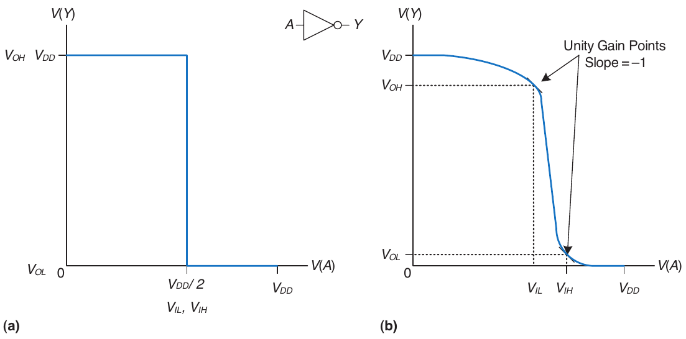

Hình 1.25 DC transfer characteristic và logic level

Việc lựa chọn VDD và các logic level là tùy ý, nhưng tất cả các gate giao tiếp với nhau phải có logic level tương thích. Vì vậy, các gate được chia thành những logic family sao cho mọi gate trong một logic family đều tuân theo static discipline khi được sử dụng với những gate khác trong cùng family. Các logic gate trong cùng một logic family có thể ghép với nhau như Lego vì chúng sử dụng điện áp nguồn và logic level nhất quán.

Bốn logic family chính chiếm ưu thế từ thập niên 1970 đến thập niên 1990 là Transistor-Transistor Logic (TTL), Complementary Metal-Oxide-Semiconductor Logic (CMOS, đọc là sea-moss), Low Voltage TTL Logic (LVTTL) và Low Voltage CMOS Logic (LVCMOS). Bảng 1.4 so sánh các logic level của chúng. Kể từ đó, các logic family đã phân thành nhiều nhóm với sự xuất hiện ngày càng nhiều mức điện áp nguồn thấp hơn nữa. Phụ lục A.6 sẽ trình bày lại các logic family phổ biến một cách chi tiết hơn.

Bảng 1.4 Logic level của family 5 V và 3.3 V

| Logic family | VDD | VIL | VIH | VOL | VOH |
|---|---|---|---|---|---|
| TTL | 5 (4.75−5.25) | 0.8 | 2.0 | 0.4 | 2.4 |
| CMOS | 5 (4.5−6) | 1.35 | 3.15 | 0.33 | 3.84 |
| LVTTL | 3.3 (3−3.6) | 0.8 | 2.0 | 0.4 | 2.4 |
| LVCMOS | 3.3 (3−3.6) | 0.9 | 1.8 | 0.36 | 2.7 |

Bảng 1.5 Compatibility của logic family

|  |  | Receiver |  |  |
|---|---|---|---|---|
| Driver | TTL | CMOS | LVTTL | LVCMOS |
| TTL | OK | KHÔNG: VOH < VIH | CÓ THỂa | CÓ THỂa |
| CMOS | OK | OK | CÓ THỂa | CÓ THỂa |
| LVTTL | OK | KHÔNG: VOH < VIH | OK | OK |
| LVCMOS | OK | KHÔNG: VOH < VIH | OK | OK |

aMiễn là mức HIGH 5 V không làm hỏng receiver input

#### Ví dụ 1.19 COMPATIBILITY CỦA LOGIC FAMILY

Logic family nào trong Bảng 1.4 giao tiếp đáng tin cậy với nhau?

> 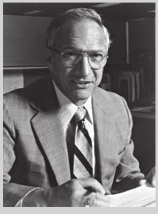
>
> Robert Noyce, 1927–1990
>
> Sinh ở Burlington, Iowa. Nhận bằng B.A. vật lý Grinnell College và Ph.D. vật lý MIT. Biệt danh “Thị trưởng Silicon Valley” vì ảnh hưởng sâu rộng đến ngành.
>
> Đồng sáng lập Fairchild Semiconductor năm 1957, Intel năm 1968. Đồng phát minh integrated circuit. Nhiều engineer trong nhóm ông về sau lập công ty semiconductor quan trọng khác (ảnh © 2006, Intel Corporation. Được phép tái bản).

Lời giải Bảng 1.5 liệt kê những logic family có logic level tương thích. Lưu ý logic family 5 V như TTL hoặc CMOS có thể tạo output voltage HIGH tới 5 V. Nếu signal 5 V này lái input của logic family 3.3 V như LVTTL hoặc LVCMOS, nó có thể làm hỏng receiver, trừ khi receiver được thiết kế đặc biệt để “tương thích 5-volt”.

## 1.7 CMOS TRANSISTOR\*

Mục này và các mục khác đánh dấu \* là tùy chọn, không cần thiết để hiểu mạch trình bày chính của sách.

Analytical Engine làm từ bánh răng; máy tính điện đời đầu dùng relay hoặc vacuum tube. Máy hiện đại dùng transistor vì rẻ, nhỏ, đáng tin. Transistor là switch điều khiển điện, ON/OFF khi đặt điện áp hoặc dòng vào control terminal. Hai loại chính là bipolar junction transistor và metal-oxide-semiconductor field effect transistor (MOSFET hay MOS transistor, lần lượt đọc “mossfets”, “M-O-S”).

Năm 1958 Jack Kilby ở Texas Instruments xây integrated circuit đầu tiên chứa hai transistor. Năm 1959 Robert Noyce ở Fairchild Semiconductor đăng ký phương pháp nối nhiều transistor trên một silicon chip. Khi đó mỗi transistor khoảng 10 USD.

Nhờ hơn ba thập kỷ tiến bộ chưa từng có trong công nghệ chế tạo, các kỹ sư hiện có thể đặt khoảng một tỷ MOSFET lên một silicon chip 1-cm2, và mỗi transistor này có giá dưới 10 microcent. Khả năng tích hợp và chi phí tiếp tục cải thiện khoảng một bậc mười sau mỗi 8 năm. MOSFET hiện là thành phần cấu tạo của gần như tất cả các digital system. Trong phần này, chúng ta sẽ tìm hiểu bên dưới digital abstraction để xem logic gate được xây dựng từ MOSFET như thế nào.

### 1.7.1 Semiconductor

Transistor MOS được chế tạo từ silicon, nguyên tử chiếm phần lớn trong đá và cát. Silicon (Si) là nguyên tử thuộc nhóm IV, nên có bốn electron ở lớp vỏ hóa trị và tạo liên kết với bốn nguyên tử lân cận, hình thành một mạng tinh thể. Hình 1.26(a) minh họa mạng tinh thể theo hai chiều để dễ vẽ, nhưng hãy nhớ rằng mạng này thực sự tạo thành một tinh thể lập phương. Trong hình, mỗi đường biểu diễn một liên kết cộng hóa trị. Bản thân silicon dẫn điện kém vì tất cả các electron đều bị giữ trong các liên kết cộng hóa trị. Tuy nhiên, nó dẫn điện tốt hơn khi được bổ sung cẩn thận một lượng nhỏ tạp chất, được gọi là các nguyên tử dopant. Nếu bổ sung dopant nhóm V như arsenic (As), các nguyên tử dopant có một electron dư không tham gia liên kết. Electron đó có thể dễ dàng di chuyển trong mạng tinh thể, để lại nguyên tử dopant đã bị ion hóa (As+), như trong Hình 1.26(b). Electron mang điện tích âm, nên chúng ta gọi arsenic là dopant n-type. Ngược lại, nếu bổ sung dopant nhóm III như boron (B), các nguyên tử dopant thiếu một electron, như trong Hình 1.26(c). Electron bị thiếu này được gọi là hole. Một electron từ nguyên tử silicon lân cận có thể di chuyển đến để lấp liên kết còn thiếu, tạo thành nguyên tử dopant đã bị ion hóa (B−) và để lại một hole tại nguyên tử silicon lân cận. Tương tự, hole có thể di chuyển trong mạng tinh thể. Hole là sự thiếu hụt điện tích âm, nên nó hoạt động như một hạt mang điện tích dương. Do đó, chúng ta gọi boron là dopant p-type. Vì độ dẫn điện của silicon thay đổi qua nhiều bậc độ lớn tùy theo nồng độ dopant, silicon được gọi là semiconductor.

### 1.7.2 Diode

Tiếp giáp giữa silicon p-type và n-type được gọi là diode. Vùng p-type được gọi là anode, còn vùng n-type được gọi là cathode, như minh họa trong Hình 1.27. Khi điện áp tại anode cao hơn điện áp tại cathode, diode được phân cực thuận (forward biased), và dòng điện chạy qua diode từ anode đến cathode. Nhưng khi điện áp tại anode thấp hơn điện áp tại cathode, diode được phân cực ngược (reverse biased) và không có dòng điện chạy qua. Ký hiệu diode thể hiện trực quan rằng dòng điện chỉ chạy theo một hướng.

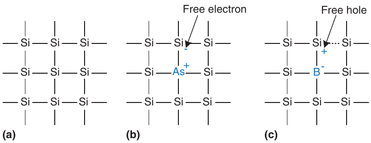

Hình 1.26 Silicon lattice và dopant atom

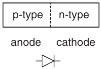

Hình 1.27 Cấu trúc và symbol diode p-n junction

### 1.7.3 Capacitor

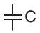

Hình 1.28 Symbol capacitor

Capacitor gồm hai conductor được ngăn cách bởi một insulator. Khi đặt điện áp V lên một conductor, conductor đó tích lũy điện tích Q và conductor còn lại tích lũy điện tích trái dấu −Q. Capacitance C của capacitor là tỷ số giữa điện tích và điện áp: C = Q/V. Capacitance tỷ lệ thuận với kích thước của các conductor và tỷ lệ nghịch với khoảng cách giữa chúng. Ký hiệu capacitor được minh họa trong Hình 1.28.

> 
>
> Kỹ thuật viên trong phòng sạch Intel mặc bộ đồ Gore-Tex để hạt từ tóc, da, quần áo không làm nhiễm transistor cực nhỏ trên silicon wafer (ảnh © 2006, Intel Corporation. Được phép tái bản).

Capacitance quan trọng vì nạp/xả conductor cần thời gian và năng lượng. Capacitance lớn làm circuit chậm và tốn năng lượng hơn. Tốc độ và năng lượng sẽ được bàn suốt sách.

### 1.7.4 Transistor nMOS và pMOS

MOSFET có cấu trúc gồm nhiều lớp vật liệu dẫn điện và cách điện xếp chồng lên nhau. MOSFET được chế tạo trên các wafer silicon mỏng, phẳng, có đường kính khoảng 15 đến 30 cm. Quy trình sản xuất bắt đầu với một wafer trần. Quy trình gồm một chuỗi bước cấy dopant vào silicon, phát triển các lớp màng mỏng silicon dioxide và silicon, và lắng đọng kim loại. Giữa các bước, wafer được tạo pattern để vật liệu chỉ xuất hiện tại những vị trí mong muốn. Vì transistor có chiều dài chỉ bằng một phần micron[^1] và toàn bộ wafer được xử lý cùng lúc, việc sản xuất hàng tỷ transistor mỗi lần có chi phí thấp. Sau khi xử lý xong, wafer được cắt thành các hình chữ nhật gọi là chip hoặc die, chứa hàng nghìn, hàng triệu hoặc thậm chí hàng tỷ transistor. Chip được kiểm thử rồi đặt trong package bằng nhựa hoặc gốm có các chân kim loại để nối với circuit board.

> 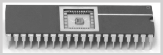
>
> Package dual-inline (DIP) 40-pin chứa chip nhỏ gần như khó thấy ở giữa, nối 40 chân kim loại, mỗi bên 20, bằng dây vàng mảnh hơn tóc (ảnh Kevin Mapp. © Harvey Mudd College).

Cấu trúc nhiều lớp của MOSFET gồm một lớp dẫn điện gọi là gate nằm trên lớp cách điện silicon dioxide (SiO2), lớp này nằm trên wafer silicon được gọi là substrate. Trước đây, gate được làm bằng kim loại, nên có tên gọi metal-oxide-semiconductor. Các quy trình sản xuất hiện đại sử dụng polycrystalline silicon cho gate vì nó không nóng chảy trong các bước xử lý high-temperature tiếp theo. Silicon dioxide được biết đến nhiều hơn với tên gọi thủy tinh và thường được gọi đơn giản là oxide trong ngành công nghiệp bán dẫn. Cấu trúc metal-oxide-semiconductor này tạo thành một capacitor, trong đó một lớp oxide cách điện mỏng gọi là dielectric ngăn cách các bản kim loại và semiconductor.

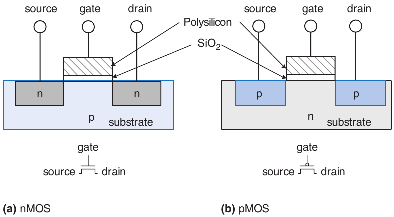

Hình 1.29 Transistor nMOS và pMOS

> Các terminal source và drain đối xứng nhau về mặt vật lý. Tuy nhiên, chúng ta quy ước rằng điện tích di chuyển từ source đến drain. Trong transistor nMOS, điện tích được mang bởi các electron, di chuyển từ điện áp âm đến điện áp dương. Trong transistor pMOS, điện tích được mang bởi các hole, di chuyển từ điện áp dương đến điện áp âm. Nếu chúng ta vẽ schematic với điện áp dương nhất ở phía trên và điện áp âm nhất ở phía dưới, terminal phía dưới là nguồn cung cấp điện tích âm trong transistor nMOS, còn terminal phía trên là nguồn cung cấp điện tích dương trong transistor pMOS.

Có hai loại MOSFET: nMOS và pMOS (đọc là “n-moss” và “p-moss”). Hình 1.29 minh họa cross-sections của từng loại, thu được bằng cách cưa xuyên qua wafer rồi quan sát từ bên cạnh. Các transistor n-type, được gọi là nMOS, có những vùng pha tạp n-type nằm cạnh gate, được gọi là source và drain, và được xây dựng trên substrate bán dẫn p-type. Transistor pMOS có cấu trúc ngược lại, gồm các vùng source và drain p-type trong substrate n-type.

MOSFET hoạt động như một switch voltage-controlled, trong đó điện áp gate tạo ra điện trường làm ON hoặc OFF kết nối giữa source và drain. Thuật ngữ field effect transistor bắt nguồn từ nguyên lý hoạt động này. Hãy bắt đầu bằng việc tìm hiểu hoạt động của một transistor nMOS.

> 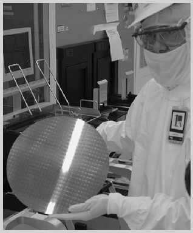
>
> Kỹ thuật viên cầm wafer 12-inch chứa hàng trăm microprocessor chip (ảnh © 2006, Intel Corporation. Được phép tái bản).

Substrate của transistor nMOS thường được nối với GND, là điện áp thấp nhất trong hệ thống. Trước tiên, xét trường hợp gate cũng ở 0 V, như trong Hình 1.30(a). Các diode giữa source hoặc drain và substrate đều được phân cực ngược vì điện áp source hoặc drain không âm. Vì vậy, không có đường cho dòng điện chạy giữa source và drain, nên transistor ở trạng thái OFF. Bây giờ, xét trường hợp điện áp gate được nâng lên VDD, như trong Hình 1.30(b). Khi đặt điện áp dương lên bản trên của một capacitor, nó tạo ra điện trường thu hút điện tích dương về bản trên và điện tích âm về bản dưới. Nếu điện áp đủ lớn, lượng điện tích âm bị thu hút đến mặt dưới của gate lớn đến mức vùng này đảo từ p-type và thực chất trở thành n-type. Vùng bị đảo này được gọi là channel. Lúc này, transistor có một đường liên tục từ source n-type, qua channel n-type đến drain n-type, nên electron có thể di chuyển từ source đến drain. Transistor ở trạng thái ON. Điện áp gate cần thiết để bật transistor được gọi là threshold voltage, Vt, và thường nằm trong khoảng 0.3 đến 0.7 V.

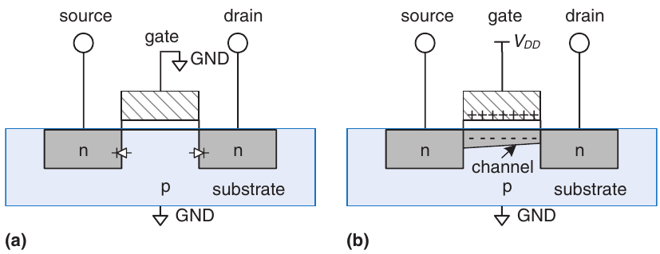

Hình 1.30 Hoạt động transistor nMOS

> 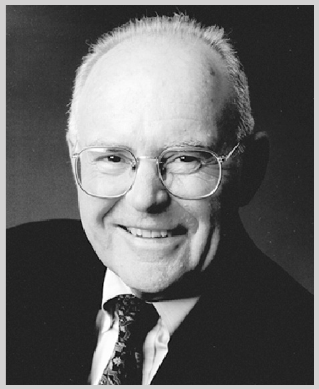
>
> Gordon Moore, 1929–
>
> Sinh tại San Francisco. Nhận bằng B.S. về hóa học tại UC Berkeley và bằng Ph.D. về hóa học và vật lý tại Caltech. Đồng sáng lập Intel vào năm 1968 cùng Robert Noyce. Năm 1965, ông quan sát thấy số lượng transistor trên một chip máy tính tăng gấp đôi mỗi năm. Xu hướng này được biết đến với tên gọi Moore’s Law. Từ năm 1975, số lượng transistor tăng gấp đôi sau mỗi hai năm.
>
> Hệ quả Moore’s Law là performance microprocessor gấp đôi mỗi 18 đến 24 tháng. Doanh số semiconductor cũng tăng hàm mũ; tiếc rằng công suất tiêu thụ cũng vậy.
>
> Moore’s Law đã thúc đẩy những tiến bộ đáng kinh ngạc của ngành công nghiệp bán dẫn trong 50 năm khi feature size của transistor giảm từ hơn 10 μm xuống chỉ còn 5 nm. Tuy nhiên, tiến trình này đã chậm lại vì việc chế tạo transistor nhỏ hơn nhiều so với bước sóng ánh sáng rất tốn kém. (Ảnh © 2006, Intel Corporation. Được tái bản với sự cho phép.)

Transistor pMOS hoạt động theo cách hoàn toàn ngược lại, như có thể suy ra từ vòng tròn nhỏ trên ký hiệu của nó trong Hình 1.31. Substrate được nối với VDD. Khi gate cũng ở VDD, transistor pMOS ở trạng thái OFF. Khi gate ở GND, channel đảo thành p-type và transistor pMOS ở trạng thái ON.

Đáng tiếc là MOSFET không phải các switch hoàn hảo. Cụ thể, transistor nMOS truyền giá trị 0 tốt nhưng truyền giá trị 1 kém. Khi gate của một transistor nMOS ở VDD, source chỉ thay đổi trong khoảng từ 0 đến VDD − Vt khi drain thay đổi từ 0 đến VDD. Tương tự, transistor pMOS truyền giá trị 1 tốt nhưng truyền giá trị 0 kém. Tuy nhiên, chúng ta sẽ thấy rằng có thể xây dựng các logic gate chỉ sử dụng transistor trong chế độ hoạt động tốt của chúng.

Transistor nMOS cần substrate p-type, còn transistor pMOS cần substrate n-type. Để chế tạo cả hai loại transistor trên cùng một chip, quy trình sản xuất thường bắt đầu với wafer p-type, sau đó cấy các vùng n-type được gọi là well tại những vị trí sẽ đặt transistor pMOS. Những quy trình cung cấp cả hai loại transistor này được gọi là Complementary MOS, hay CMOS. Các quy trình CMOS được sử dụng để chế tạo phần lớn transistor được sản xuất ngày nay.

Tóm lại, các quy trình CMOS cung cấp hai loại switch được điều khiển bằng điện, như trong Hình 1.31. Điện áp tại gate (g) điều chỉnh dòng điện chạy giữa source (s) và drain (d). Transistor nMOS ở trạng thái OFF khi gate bằng 0 và ON khi gate bằng 1. Transistor pMOS hoạt động ngược lại: ON khi gate bằng 0 và OFF khi gate bằng 1.

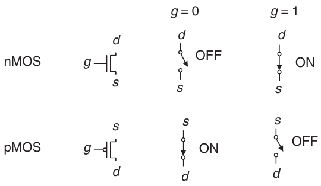

Hình 1.31 Switch model của MOSFET

### 1.7.5 CMOS NOT gate

Hình 1.32 minh họa schematic của một gate NOT được xây dựng bằng các transistor CMOS. Hình tam giác biểu thị GND, còn thanh ngang biểu thị VDD; các nhãn này sẽ được lược bỏ trong những schematic tiếp theo. Transistor nMOS N1 được nối giữa GND và output Y. Transistor pMOS P1 được nối giữa VDD và output Y. Gate của cả hai transistor đều được điều khiển bởi input A.

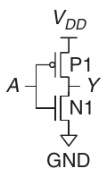

Hình 1.32 Schematic NOT gate

Nếu A = 0, N1 OFF và P1 ON. Do đó, Y được nối với VDD nhưng không được nối với GND, và được kéo lên logic 1. P1 truyền giá trị 1 tốt. Nếu A = 1, N1 ON và P1 OFF, và Y được kéo xuống logic 0. N1 truyền giá trị 0 tốt. Đối chiếu với truth table trong Hình 1.12, chúng ta thấy circuit này thực sự là một gate NOT.

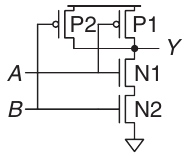

Hình 1.33 Schematic NAND gate Two-input

### 1.7.6 Các CMOS logic gate khác

Hình 1.33 minh họa schematic của một gate NAND two-input. Trong schematic, các dây luôn được nối với nhau tại junction three-way. Tại junction four-way, chúng chỉ được nối với nhau nếu có dấu chấm. Các transistor nMOS N1 và N2 mắc nối tiếp; cả hai phải ON để kéo output xuống GND. Các transistor pMOS P1 và P2 mắc song song; chỉ cần một transistor pMOS ON để kéo output lên VDD. Bảng 1.6 liệt kê hoạt động của các mạng pull-down và pull-up cùng với trạng thái của output, chứng minh rằng gate thực sự thực hiện chức năng NAND. Ví dụ, khi A = 1 và B = 0, N1 ON nhưng N2 OFF, chặn đường từ Y đến GND. P1 OFF nhưng P2 ON, tạo ra đường từ VDD đến Y. Vì vậy, Y được kéo lên 1.

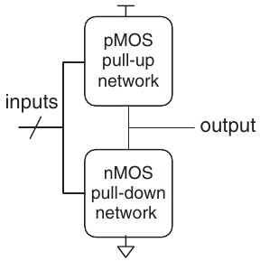

Hình 1.34 Dạng tổng quát của inverting logic gate

Hình 1.34 minh họa cấu trúc tổng quát để xây dựng bất kỳ inverting logic gate nào, chẳng hạn NOT, NAND hoặc NOR. Transistor nMOS truyền giá trị 0 tốt, vì vậy một mạng pull-down gồm các transistor nMOS được đặt giữa output và GND để kéo output xuống 0. Transistor pMOS truyền giá trị 1 tốt, vì vậy một mạng pull-up gồm các transistor pMOS được đặt giữa output và VDD để kéo output lên 1. Các mạng này có thể gồm những transistor mắc nối tiếp hoặc song song. Khi các transistor mắc song song, mạng ON nếu một trong hai transistor ON. Khi các transistor mắc nối tiếp, mạng chỉ ON nếu cả hai transistor đều ON. Dấu gạch chéo trên dây input biểu thị rằng gate có thể nhận nhiều input.

Bảng 1.6 Hoạt động NAND gate

| A | B | Pull-Down Network | Pull-Up Network | Y |
|---|---|---|---|---|
| 0 | 0 | OFF | ON | 1 |
| 0 | 1 | OFF | ON | 1 |
| 1 | 0 | OFF | ON | 1 |
| 1 | 1 | ON | OFF | 0 |

> Những người thiết kế giàu kinh nghiệm cho rằng thiết bị điện tử hoạt động được vì chúng chứa khói ma thuật. Họ xác nhận lý thuyết này bằng quan sát rằng nếu khói ma thuật thoát ra khỏi thiết bị, thiết bị sẽ ngừng hoạt động.

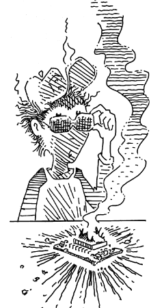

Nếu cả hai mạng pull-up và pull-down cùng ON, sẽ xuất hiện ngắn mạch giữa VDD và GND. Output của gate có thể nằm trong forbidden zone và các transistor sẽ tiêu thụ công suất lớn, có thể đủ để làm chúng cháy hỏng. Ngược lại, nếu cả hai mạng pull-up và pull-down cùng OFF, output sẽ không được nối với VDD lẫn GND. Chúng ta gọi output này là floating. Giá trị của nó một lần nữa không xác định. Floating output thường không được mong muốn, nhưng trong Mục 2.6, chúng ta sẽ thấy đôi khi có thể tận dụng chúng như thế nào trong thiết kế.

Trong một logic gate hoạt động chính xác, tại mọi thời điểm, một mạng phải ON và mạng còn lại phải OFF để output được kéo lên HIGH hoặc xuống LOW mà không bị ngắn mạch hoặc floating. Chúng ta có thể bảo đảm điều này bằng quy tắc conduction complements. Khi các transistor nMOS mắc nối tiếp, các transistor pMOS phải mắc song song. Khi các transistor nMOS mắc song song, các transistor pMOS phải mắc nối tiếp.

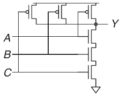

Hình 1.35 Schematic NAND gate Three-input

#### Ví dụ 1.20 SCHEMATIC NAND THREE-INPUT

Vẽ schematic NAND gate three-input bằng CMOS transistor.

Lời giải Gate NAND chỉ được tạo ra output bằng 0 khi cả ba input đều bằng 1. Do đó, mạng pull-down phải gồm ba transistor nMOS mắc nối tiếp. Theo quy tắc conduction complements, các transistor pMOS phải mắc song song. Hình 1.35 minh họa gate như vậy; bạn có thể xác minh chức năng của nó bằng cách kiểm tra xem truth table có đúng hay không.

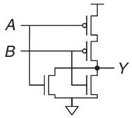

Hình 1.36 Schematic NOR gate Two-input

#### Ví dụ 1.21 SCHEMATIC NOR TWO-INPUT

Vẽ schematic NOR gate two-input bằng CMOS transistor.

Lời giải Gate NOR phải tạo ra output bằng 0 nếu một trong hai input bằng 1. Vì vậy, mạng pull-down phải gồm hai transistor nMOS mắc song song. Theo quy tắc conduction complements, các transistor pMOS phải mắc nối tiếp. Hình 1.36 minh họa gate như vậy.

#### Ví dụ 1.22 SCHEMATIC AND TWO-INPUT

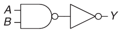

Hình 1.37 Schematic AND gate Two-input

Vẽ schematic cho AND gate two-input.

Lời giải Không thể xây dựng một gate AND bằng một gate CMOS duy nhất. Tuy nhiên, việc xây dựng các gate NAND và NOT lại đơn giản. Vì vậy, cách tốt nhất để xây dựng gate AND bằng các transistor CMOS là sử dụng một NAND theo sau bởi một NOT, như trong Hình 1.37.

### 1.7.7 Transmission gate

Đôi khi, người thiết kế thấy thuận tiện khi sử dụng một switch lý tưởng có thể truyền tốt cả giá trị 0 lẫn 1. Hãy nhớ rằng transistor nMOS truyền giá trị 0 tốt và transistor pMOS truyền giá trị 1 tốt, nên việc ghép song song hai loại sẽ truyền tốt cả hai giá trị. Hình 1.38 minh họa một circuit như vậy, được gọi là transmission gate hoặc pass gate. Hai phía của switch được gọi là A và B vì switch hoạt động hai chiều và không có phía input hoặc output ưu tiên. Các control signal được gọi là enable, EN và $\overline{EN}$. Khi EN = 0 và $\overline{EN}$ = 1, cả hai transistor đều OFF. Vì vậy, transmission gate OFF hay bị disable, nên A và B không được nối với nhau. Khi EN = 1 và $\overline{EN}$ = 0, transmission gate ON hay được enable, và mọi giá trị logic đều có thể truyền giữa A và B.

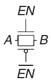

Hình 1.38 Transmission gate

### 1.7.8 Logic Pseudo-nMOS

Một gate CMOS NOR N-input sử dụng N transistor nMOS mắc song song và N transistor pMOS mắc nối tiếp. Các transistor mắc nối tiếp chậm hơn các transistor mắc song song, cũng giống như các resistor mắc nối tiếp có resistance lớn hơn các resistor mắc song song. Hơn nữa, transistor pMOS chậm hơn transistor nMOS vì hole không thể di chuyển trong mạng tinh thể silicon nhanh bằng electron. Vì vậy, các transistor nMOS mắc song song hoạt động nhanh, còn các transistor pMOS mắc nối tiếp hoạt động chậm, đặc biệt khi có nhiều transistor mắc nối tiếp.

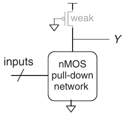

Hình 1.39 Gate pseudo-nMOS tổng quát

Logic Pseudo-nMOS thay thế chuỗi transistor pMOS chậm bằng một transistor pMOS yếu luôn ở trạng thái ON, như trong Hình 1.39. Transistor pMOS này thường được gọi là weak pull-up. Kích thước vật lý của transistor pMOS được chọn sao cho nó chỉ kéo output Y lên HIGH một cách yếu, tức là chỉ khi không có transistor nMOS nào ON. Nhưng nếu bất kỳ transistor nMOS nào ON, nó sẽ thắng weak pull-up và kéo Y xuống đủ gần GND để tạo ra logic 0.

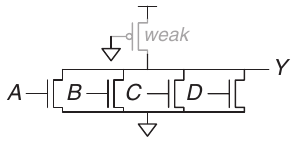

Hình 1.40 NOR gate Pseudo-nMOS four-input

Ưu điểm của pseudo-nMOS logic là có thể dùng nó để xây dựng các NOR gate tốc độ cao với nhiều input. Ví dụ, Hình 1.40 trình bày một NOR gate pseudo-nMOS four-input. Các gate Pseudo-nMOS hữu ích cho một số memory array và logic array được thảo luận trong Chương 5. Nhược điểm là có một short circuit giữa VDD và GND khi output là LOW; cả transistor pMOS yếu lẫn transistor nMOS đều ON. Short circuit này tiêu thụ công suất liên tục, vì vậy cần hạn chế sử dụng pseudo-nMOS logic.

Các gate Pseudo-nMOS có tên gọi bắt nguồn từ thập niên 1970, khi các quy trình sản xuất chỉ có transistor nMOS. Một transistor nMOS yếu được sử dụng để kéo output lên HIGH vì chưa có transistor pMOS.

## 1.8 CÔNG SUẤT TIÊU THỤ\*

Công suất tiêu thụ là lượng năng lượng được sử dụng trong một đơn vị thời gian. Công suất tiêu thụ có vai trò rất quan trọng trong digital system. Thời lượng pin của các hệ thống di động như điện thoại và máy tính xách tay bị giới hạn bởi công suất tiêu thụ. Ví dụ, pin điện thoại chứa khoảng 10 watt-hours (W-hr) năng lượng, nghĩa là nó có thể cung cấp 1 watt (W) trong 10 giờ hoặc 2 W trong 5 giờ, v.v. Để pin điện thoại dùng được trọn một ngày, công suất tiêu thụ trung bình cần dưới 1 W. Máy tính xách tay thường có pin từ 50 đến 100 W-hr và tiêu thụ dưới 10 W khi hoạt động bình thường, trong đó màn hình chiếm một phần lớn. Công suất cũng quan trọng đối với các hệ thống được cắm điện vì việc sử dụng điện tốn tiền và gây phát thải, đồng thời hệ thống sẽ quá nóng nếu tiêu thụ quá nhiều công suất. Một máy tính để bàn tiêu thụ 200 W trong 8 giờ mỗi ngày sẽ sử dụng khoảng 600 kilowatt-hours (kW-hr) điện mỗi năm. Với chi phí trung bình 12 cent và mức phát thải một pound CO2 trên mỗi kW-hr, mức sử dụng này tương đương \$72 tiền điện mỗi năm cùng 600 pound CO2 phát thải.

> Bạn giúp hành tinh bằng cách bảo đảm máy tính sleep khi không dùng.

Digital system dùng cả dynamic power và static power. Dynamic power nạp capacitance khi signal đổi giữa 0, 1. Static power tiêu thụ ngay cả khi signal không đổi, hệ idle.

Các logic gate và dây nối giữa chúng đều có capacitance. Năng lượng lấy từ nguồn điện để nạp một capacitance C đến điện áp VDD là CVDD2. Nếu hệ thống hoạt động ở tần số f và tỷ lệ các chu kỳ mà capacitor nạp và xả là α (được gọi là activity factor), công suất tiêu thụ động là

Pdynamic = αCVDD2f (1.4)

Hình 1.41 minh họa các activity factor. Hình 1.41(a) biểu diễn một clock signal tăng và giảm một lần trong mỗi chu kỳ, nên có activity factor bằng 1. Clock period từ một rising edge đến rising edge tiếp theo được gọi là Tc (cycle time), và là nghịch đảo của clock frequency f. Hình 1.41(b) biểu diễn một data signal chuyển trạng thái một lần trong mỗi clock cycle. Các đường song song trên timing diagram biểu thị rằng signal có thể là high hoặc low; chúng ta không quan tâm đến giá trị của nó. Chỗ giao nhau biểu thị rằng signal thay đổi một lần vào đầu mỗi clock cycle. Do đó, activity factor bằng 0.5 (tăng trong một nửa số chu kỳ và giảm trong nửa số chu kỳ còn lại). Hình 1.41(c) biểu diễn một data signal ngẫu nhiên chuyển trạng thái trong một nửa số chu kỳ và giữ nguyên trong nửa số chu kỳ còn lại. Vì vậy, nó có activity factor bằng 0.25. Digital system thực tế thường có những component không hoạt động và không chuyển trạng thái, nên activity factor bằng 0.1 là điển hình hơn.

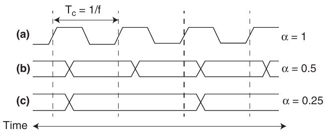

Hình 1.41 Minh họa activity factor

Các hệ thống điện vẫn tiêu thụ một lượng dòng điện ngay cả khi không hoạt động. Khi transistor OFF, chúng làm rò một lượng dòng điện nhỏ. Một số circuit, chẳng hạn gate pseudo-nMOS được thảo luận trong Mục 1.7.8, có một đường từ VDD đến GND mà dòng điện liên tục chạy qua. Tổng static current, IDD, còn được gọi là leakage current hoặc quiescent supply current chạy giữa VDD và GND. Công suất tiêu thụ tĩnh tỷ lệ thuận với static current này:

Pstatic = IDDVDD (1.5)

### Ví dụ 1.23 CÔNG SUẤT TIÊU THỤ

Một điện thoại di động có pin 8 W-hr và hoạt động ở điện áp 0.707 V. Giả sử khi được sử dụng, điện thoại hoạt động ở tần số 2 GHz. Tổng capacitance của circuit là 10 nF (10−8 Farad) và activity factor là 0.05. Khi truyền thoại hoặc data (10% thời gian sử dụng), nó còn phát công suất 3 W qua antenna. Khi điện thoại không được sử dụng, dynamic power giảm xuống gần bằng 0 vì chức năng xử lý signal được tắt. Nhưng điện thoại vẫn tiêu thụ quiescent current 100 mA bất kể có được sử dụng hay không. Hãy xác định thời lượng pin của điện thoại (a) khi không được sử dụng và (b) khi được sử dụng liên tục.

Lời giải Static power Pstatic = (0.100 A)(0.707 V) = 71 milliwatt (mW).

(a) Không dùng thì đây là công suất duy nhất, thời lượng (8 W-hr)/(0.071 W) = 113 giờ (khoảng 5 ngày). (b) Khi dùng, dynamic power Pdynamic = (0.05)(10−8 F)(0.707 V)2(2 × 109 Hz) = 0.5 W. Công suất phát trung bình (3 W)(0.1) = 0.3 W.

Cộng thêm công suất static và công suất phát, tổng công suất khi hoạt động là 0.5 W + 0.071 W + 0.3 W = 0.871 W, nên thời lượng pin là 8 W-hr/0.0871 W = 9.2 giờ. Ví dụ này đơn giản hóa phần nào hoạt động thực tế của điện thoại di động, nhưng minh họa những ý chính về mức tiêu thụ công suất.

## 1.9 TÓM TẮT VÀ NHÌN VỀ PHÍA TRƯỚC

Có 10 loại người trên đời: người biết đếm binary và người không biết.

Chương này đã giới thiệu các nguyên tắc để hiểu và thiết kế những hệ thống phức tạp. Mặc dù thế giới thực là analog, các nhà thiết kế digital tự giới hạn việc sử dụng signal trong một tập con rời rạc của các signal có thể có. Cụ thể, binary variable chỉ có hai trạng thái: 0 và 1, còn được gọi là FALSE và TRUE hoặc LOW và HIGH. Logic gate tính một binary output từ một hoặc nhiều binary input. Một số logic gate phổ biến gồm:

- NOT: Output TRUE khi input FALSE

- AND: Output TRUE khi mọi input TRUE

- OR: Output TRUE khi bất kỳ input TRUE

- XOR: Output TRUE khi số input TRUE là lẻ

Logic gate thường được xây dựng từ các transistor CMOS, hoạt động như những switch được điều khiển bằng điện. Transistor nMOS chuyển sang ON khi gate bằng 1. Transistor pMOS chuyển sang ON khi gate bằng 0.

Trong Chương 2 đến Chương 5, chúng ta tiếp tục nghiên cứu digital logic. Chương 2 trình bày combinational logic, trong đó các output chỉ phụ thuộc vào input hiện tại. Các logic gate đã được giới thiệu là những ví dụ về combinational logic. Bạn sẽ học cách thiết kế các circuit gồm nhiều gate để triển khai quan hệ giữa input và output được chỉ định bằng truth table hoặc phương trình Boolean. Chương 3 trình bày sequential logic, trong đó các output phụ thuộc vào cả input hiện tại lẫn input trong quá khứ. Register là các sequential element phổ biến ghi nhớ input trước đó. Finite state machine, được xây dựng từ register và combinational logic, là một phương pháp mạnh mẽ để xây dựng các hệ thống phức tạp một cách có hệ thống. Chúng ta cũng nghiên cứu timing của digital system để phân tích tốc độ mà một hệ thống có thể hoạt động. Chương 4 mô tả hardware description language (HDL). HDL có liên hệ với các ngôn ngữ lập trình thông thường nhưng được sử dụng để mô phỏng và xây dựng hardware thay vì software. Phần lớn digital system ngày nay được thiết kế bằng HDL. SystemVerilog và VHDL là hai ngôn ngữ phổ biến; chúng được trình bày side-by-side trong cuốn sách này. Chương 5 nghiên cứu những building block combinational và sequential khác, chẳng hạn adder, multiplier và memory.

Chương 6 chuyển computer architecture, mô tả processor RISC-V, microprocessor open-source mới phát triển, bắt đầu được phát triển rộng trong công nghiệp và học thuật. Architecture RISC-V định nghĩa bằng register và assembly language instruction set. Bạn học viết assembly cho RISC-V để giao tiếp bằng ngôn ngữ bản địa của processor.

Chương 7 và 8 kết nối digital logic với computer architecture. Chương 7 tìm hiểu microarchitecture, tức cách sắp xếp các digital building block như adder và register cần thiết để xây dựng một processor. Trong chương đó, bạn sẽ học cách xây dựng processor RISC-V của riêng mình. Thực tế, bạn sẽ học ba microarchitecture minh họa những trade-offs khác nhau giữa hiệu năng và chi phí. Hiệu năng processor đã tăng theo hàm mũ, đòi hỏi các memory system ngày càng tinh vi để đáp ứng nhu cầu data không ngừng tăng. Chương 8 tìm hiểu sâu về memory system architecture. Chương 9 (có dưới dạng web supplement—xem Lời nói đầu) mô tả cách máy tính giao tiếp với các thiết bị peripheral, chẳng hạn màn hình, bộ thu phát Bluetooth và motor.

## Bài tập

Bài tập 1.1 Trong một đoạn văn, giải thích ít nhất ba mức abstraction được dùng bởi

(a) nhà sinh học nghiên cứu hoạt động tế bào.

(b) nhà hóa học nghiên cứu thành phần vật chất.

Bài tập 1.2 Trong một đoạn văn, giải thích cách dùng hierarchy, modularity, regularity bởi

(a) người thiết kế ô tô.

(b) doanh nghiệp quản lý hoạt động.

Bài tập 1.3 Ben Bitdiddle xây nhà. Giải thích cách dùng hierarchy, modularity, regularity tiết kiệm thời gian và tiền trong xây dựng.

Bài tập 1.4 Điện áp analog từ 0–5 V. Nếu đo chính xác ±50 mV, tối đa mang bao nhiêu bit thông tin?

Bài tập 1.5 Lớp học có đồng hồ treo tường cũ bị gãy kim phút.

(a) Nếu đọc kim giờ chính xác tới 15 phút gần nhất, đồng hồ cho bao nhiêu bit thông tin về giờ?

(b) Nếu biết trước hay sau trưa, bạn biết thêm bao nhiêu bit thông tin về giờ?

Bài tập 1.6 Người Babylon phát triển hệ sexagesimal (cơ số 60) khoảng 4000 năm trước. Một sexagesimal digit mang bao nhiêu bit? Viết 400010 theo sexagesimal thế nào?

Bài tập 1.7 Có thể biểu diễn bao nhiêu số khác nhau bằng 16 bit?

Bài tập 1.8 Số binary unsigned 32-bit lớn nhất là gì?

Bài tập 1.9 Số binary 16-bit lớn nhất biểu diễn được bằng

(a) unsigned?

(b) two’s complement?

(c) sign/magnitude?

Bài tập 1.10 Số binary 32-bit lớn nhất biểu diễn được bằng

(a) unsigned?

(b) two’s complement?

(c) sign/magnitude?

Bài tập 1.11 Số binary 16-bit nhỏ nhất (âm nhất) biểu diễn được bằng

(a) unsigned?

(b) two’s complement?

(c) sign/magnitude?

Bài tập 1.12 Số binary 32-bit nhỏ nhất (âm nhất) biểu diễn được bằng

(a) unsigned?

(b) two’s complement?

(c) sign/magnitude?

Bài tập 1.13 Chuyển các unsigned binary sau sang decimal. Trình bày cách tính.

(a) 10102

(b) 1101102

(c) 111100002

(d) 0001000101001112

Bài tập 1.14 Chuyển các unsigned binary sau sang decimal. Trình bày cách tính.

(a) 11102

(b) 1001002

(c) 110101112

(d) 0111010101001002

Bài tập 1.15 Làm lại Bài tập 1.13 nhưng chuyển hexadecimal.

Bài tập 1.16 Làm lại Bài tập 1.14 nhưng chuyển hexadecimal.

Bài tập 1.17 Chuyển các hexadecimal sau sang decimal. Trình bày cách tính.

(a) A516

(b) 3B16

(c) FFFF16

(d) D000000016

Bài tập 1.18 Chuyển các hexadecimal sau sang decimal. Trình bày cách tính.

(a) 4E16

(b) 7C16

(c) ED3A16

(d) 403FB00116

Bài tập 1.19 Làm lại Bài tập 1.17 nhưng chuyển unsigned binary.

Bài tập 1.20 Làm lại Bài tập 1.18 nhưng chuyển unsigned binary.

Bài tập 1.21 Chuyển các binary two’s complement sau sang decimal.

(a) 10102

(b) 1101102

(c) 011100002

(d) 100111112

Bài tập 1.22 Chuyển các binary two’s complement sau sang decimal.

(a) 11102

(b) 1000112

(c) 010011102

(d) 101101012

Bài tập 1.23 Làm lại Bài tập 1.21, giả định binary ở dạng sign/magnitude thay two’s complement.

Bài tập 1.24 Làm lại Bài tập 1.22, giả định binary ở dạng sign/magnitude thay two’s complement.

Bài tập 1.25 Chuyển các decimal sau sang unsigned binary.

(a) 4210

(b) 6310

(c) 22910

(d) 84510

Bài tập 1.26 Chuyển các decimal sau sang unsigned binary.

(a) 1410

(b) 5210

(c) 33910

(d) 71110

Bài tập 1.27 Làm lại Bài tập 1.25 nhưng chuyển hexadecimal.

Bài tập 1.28 Làm lại Bài tập 1.26 nhưng chuyển hexadecimal.

Bài tập 1.29 Chuyển các decimal sau sang two’s complement 8-bit hoặc chỉ ra số decimal overflow range.

(a) 4210

(b) −6310

(c) 12410

(d) −12810

(e) 13310

Bài tập 1.30 Chuyển các decimal sau sang two’s complement 8-bit hoặc chỉ ra số decimal overflow range.

(a) 2410

(b) −5910

(c) 12810

(d) −15010

(e) 12710

Bài tập 1.31 Làm lại Bài tập 1.29 nhưng chuyển sign/magnitude 8-bit.

Bài tập 1.32 Làm lại Bài tập 1.30 nhưng chuyển sign/magnitude 8-bit.

Bài tập 1.33 Chuyển các two’s complement 4-bit sau sang two’s complement 8-bit.

(a) 01012

(b) 10102

Bài tập 1.34 Chuyển các two’s complement 4-bit sau sang two’s complement 8-bit.

(a) 01112

(b) 10012

Bài tập 1.35 Làm lại Bài tập 1.33 nếu số unsigned thay two’s complement.

Bài tập 1.36 Làm lại Bài tập 1.34 nếu số unsigned thay two’s complement.

Bài tập 1.37 Cơ số 8 gọi octal. Chuyển từng số Bài tập 1.25 sang octal.

Bài tập 1.38 Cơ số 8 gọi octal. Chuyển từng số Bài tập 1.26 sang octal.

Bài tập 1.39 Chuyển từng octal sau sang binary, hexadecimal và decimal.

(a) 428

(b) 638

(c) 2558

(d) 30478

Bài tập 1.40 Chuyển từng octal sau sang binary, hexadecimal và decimal.

(a) 238

(b) 458

(c) 3718

(d) 25608

Bài tập 1.41 Có bao nhiêu two’s complement 5-bit lớn hơn 0? Bao nhiêu nhỏ hơn 0? Đáp án khác thế nào với sign/magnitude?

Bài tập 1.42 Có bao nhiêu two’s complement 7-bit lớn hơn 0? Bao nhiêu nhỏ hơn 0? Đáp án khác thế nào với sign/magnitude?

Bài tập 1.43 Word 32-bit có bao nhiêu byte? Word 32-bit có bao nhiêu nibble?

Bài tập 1.44 Word 64-bit có bao nhiêu byte?

Bài tập 1.45 DSL modem chạy 768 kbit/giây. Nhận bao nhiêu byte trong 1 phút?

Bài tập 1.46 USB 3.0 gửi 5 Gbit/giây. Gửi bao nhiêu byte trong 1 phút?

Bài tập 1.47 Nhà sản xuất ổ cứng dùng “megabyte” là 106 byte, “gigabyte” là 109 byte. Lưu được bao nhiêu GB thực (GiB) nhạc trên ổ 50 GB?

Bài tập 1.48 Ước lượng 231 không dùng máy tính.

Bài tập 1.49 Một memory trên microprocessor Pentium II được tổ chức thành một array bit hình chữ nhật với 28 hàng và 29 cột. Hãy ước lượng số bit mà nó chứa mà không sử dụng máy tính.

Bài tập 1.50 Vẽ trục số như Hình 1.11 cho unsigned, two’s complement, sign/magnitude 3-bit.

Bài tập 1.51 Vẽ trục số như Hình 1.11 cho unsigned, two’s complement, sign/magnitude 2-bit.

Bài tập 1.52 Cộng unsigned binary sau. Cho biết tổng overflow kết quả 4-bit không.

(a) 10012 + 01002

(b) 11012 + 10112

Bài tập 1.53 Cộng unsigned binary sau. Cho biết tổng overflow kết quả 8-bit không.

(a) 100110012 + 010001002

(b) 110100102 + 101101102

Bài tập 1.54 Làm lại Bài tập 1.52 với binary two’s complement.

Bài tập 1.55 Làm lại Bài tập 1.53 với binary two’s complement.

Bài tập 1.56 Chuyển các số decimal sau sang binary two’s complement 6-bit rồi cộng chúng. Cho biết tổng có overflow kết quả 6-bit hay không.

(a) 1610 + 910

(b) 2710 + 3110

(c) −410 + 1910

(d) 310 + −3210

(e) −1610 + −910

(f) −2710 + −3110

Bài tập 1.57 Làm lại Bài tập 1.56 với các số sau.

(a) 710 + 1310

(b) 1710 + 2510

(c) −2610 + 810

(d) 3110 + −1410

(e) −1910 + −2210

(f) −210 + −2910

Bài tập 1.58 Cộng unsigned hexadecimal sau. Cho biết tổng overflow kết quả 8-bit (hai hex digit) không.

(a) 716 + 916

(b) 1316 + 2816

(c) AB16 + 3E16

(d) 8F16 + AD16

Bài tập 1.59 Cộng unsigned hexadecimal sau. Cho biết tổng overflow kết quả 8-bit (hai hex digit) không.

(a) 2216 + 816

(b) 7316 + 2C16

(c) 7F16 + 7F16

(d) C216 + A416

Bài tập 1.60 Chuyển decimal sau sang binary two’s complement 5-bit rồi trừ. Cho biết hiệu overflow kết quả 5-bit không.

(a) 910 − 710

(b) 1210 − 1510

(c) −610 − 1110

(d) 410 − −810

Bài tập 1.61 Chuyển decimal sau sang binary two’s complement 6-bit rồi trừ. Cho biết hiệu overflow kết quả 6-bit không.

(a) 1810 − 1210

(b) 3010 − 910

(c) −2810 − 310

(d) −1610 −2110

Bài tập 1.62 Trong một hệ biểu diễn số biased binary N-bit có bias B, các số dương và âm được biểu diễn bằng giá trị của chúng cộng với bias B. Ví dụ, với số 5-bit có bias bằng 15, số 0 được biểu diễn là 01111, số 1 là 10000, v.v. Các hệ biểu diễn số biased đôi khi được sử dụng trong phép tính floating-point, sẽ được thảo luận trong Chương 5. Hãy xét một hệ biểu diễn số biased binary 8-bit có bias bằng 12710.

(a) Binary 100000102 biểu diễn decimal nào?

(b) Binary nào biểu diễn 0?

(c) Biểu diễn và giá trị của số âm nhất?

(d) Biểu diễn và giá trị của số dương lớn nhất?

Bài tập 1.63 Vẽ trục số như Hình 1.11 cho biased 3-bit bias 3 (xem định nghĩa Bài tập 1.62).

Bài tập 1.64 Trong binary coded decimal (BCD), bốn bit biểu diễn một decimal digit 0 đến 9. Ví dụ 3710 viết 00110111BCD.

(a) Viết 28910 bằng BCD.

(b) Chuyển 100101010001BCD sang decimal.

(c) Chuyển 01101001BCD sang binary.

(d) Giải thích vì sao BCD có thể hữu ích để biểu diễn số.

Bài tập 1.65 Trả lời câu sau về BCD (định nghĩa Bài tập 1.64).

(a) Viết 37110 bằng BCD.

(b) Chuyển 000110000111BCD sang decimal.

(c) Chuyển 10010101BCD sang binary.

(d) Giải thích nhược điểm BCD so với binary.

Bài tập 1.66 Đĩa bay rơi trên đồng ngô Nebraska. FBI điều tra xác tìm thấy engineering manual có phương trình theo hệ đếm sao Hỏa: 325 + 42 = 411. Nếu đúng, bạn dự đoán người sao Hỏa có bao nhiêu ngón tay?

Bài tập 1.67 Ben Bitdiddle và Alyssa P. Hacker đang tranh luận. Ben nói: “Mọi số nguyên lớn hơn không và chia hết cho sáu đều có đúng hai bit 1 trong cách biểu diễn binary của chúng.” Alyssa không đồng ý. Cô nói: “Không, nhưng tất cả những số như vậy đều có số lượng bit 1 chẵn trong cách biểu diễn.” Bạn đồng ý với Ben, Alyssa, cả hai hay không đồng ý với ai? Hãy giải thích.

Bài tập 1.68 Ben Bitdiddle và Alyssa P. Hacker lại tranh luận. Ben nói: “Tôi có thể lấy two’s complement của một số bằng cách trừ 1 rồi đảo mọi bit của kết quả.” Alyssa nói: “Không, tôi có thể làm bằng cách xét từng bit của số, bắt đầu từ least significant bit. Khi tìm thấy bit 1 đầu tiên, đảo mọi bit tiếp sau.” Bạn đồng ý với Ben, Alyssa, cả hai hay không ai? Giải thích.

Bài tập 1.69 Viết chương trình bằng ngôn ngữ ưa thích (C, Java, Perl) chuyển binary sang decimal. Người dùng nhập unsigned binary, chương trình in decimal tương đương.

Bài tập 1.70 Làm lại Bài tập 1.69 nhưng chuyển từ một cơ số tùy ý b1 sang cơ số khác b2, do người dùng chỉ định. Hỗ trợ các cơ số đến 16, sử dụng các chữ cái trong bảng chữ cái cho những digit lớn hơn 9. Người dùng cần nhập b1, b2, rồi số cần chuyển đổi ở cơ số b1. Chương trình cần in số tương đương ở cơ số b2.

Bài tập 1.71 Vẽ symbol, Boolean equation và truth table cho

(a) OR gate three-input

(b) exclusive OR (XOR) gate three-input

(c) XNOR gate four-input

Bài tập 1.72 Vẽ symbol, Boolean equation và truth table cho

(a) OR gate four-input

(b) XNOR gate three-input

(c) NAND gate five-input

Bài tập 1.73 Majority gate cho TRUE khi và chỉ khi hơn nửa input TRUE. Hoàn thành truth table cho majority gate three-input Hình 1.42.

Hình 1.42 Majority gate Three-input

Bài tập 1.74 Gate AND-OR (AO) three-input trong Hình 1.43 tạo ra output TRUE nếu cả A lẫn B đều là TRUE hoặc nếu C là TRUE. Hãy hoàn thành truth table cho gate này.

Hình 1.43 AND-OR gate Three-input

Bài tập 1.75 Gate OR-AND-INVERT (OAI) three-input trong Hình 1.44 tạo ra output FALSE nếu C là TRUE và A hoặc B là TRUE. Trong các trường hợp khác, nó tạo ra output TRUE. Hãy hoàn thành truth table cho gate này.

Hình 1.44 OR-AND-INVERT gate Three-input

Bài tập 1.76 Có 16 truth table khác nhau cho các Boolean function của hai variable. Hãy liệt kê từng truth table. Đặt cho mỗi bảng một tên mô tả ngắn gọn (chẳng hạn OR, NAND, v.v.).

Bài tập 1.77 Có bao nhiêu truth table khác nhau cho Boolean function N variable?

Bài tập 1.78 Có thể gán logic level để device có transfer characteristic Hình 1.45 làm inverter không? Nếu có, input/output low/high (VIL, VOL, VIH, VOH) và noise margin (NML, NH) là gì? Nếu không, giải thích.

Hình 1.45 DC transfer characteristic

Bài tập 1.79 Làm lại Bài tập 1.78 cho transfer characteristic Hình 1.46.

Hình 1.46 DC transfer characteristic

Bài tập 1.80 Có thể gán logic level để device có transfer characteristic Hình 1.47 làm buffer không? Nếu có, input/output low/high (VIL, VOL, VIH, VOH) và noise margin (NML, NMH) là gì? Nếu không, giải thích.

Hình 1.47 DC transfer characteristic

Bài tập 1.81 Ben Bitdiddle phát minh một circuit có transfer characteristic như Hình 1.48 và muốn dùng nó làm buffer. Nó có hoạt động không? Vì sao có hoặc vì sao không? Anh muốn quảng cáo nó tương thích với logic LVCMOS và LVTTL. Buffer của Ben có nhận đúng input từ những logic family này không? Output của nó có lái đúng những logic family này không? Giải thích.

Hình 1.48 DC transfer characteristic buffer của Ben

Bài tập 1.82 Khi đi bộ trong một con ngõ tối, Ben Bitdiddle gặp một gate two-input có transfer function như trong Hình 1.49. Các input là A và B, còn output là Y.

Hình 1.49 DC transfer characteristic Two-input

(a) Anh tìm thấy logic gate loại gì?

(b) Logic level high/low xấp xỉ là gì?

Bài tập 1.83 Làm lại Bài tập 1.82 cho Hình 1.50.

Hình 1.50 DC transfer characteristic Two-input

Bài tập 1.84 Phác thảo circuit transistor-level cho CMOS gate sau. Dùng ít transistor nhất.

(a) NAND gate four-input

(b) OR-AND-INVERT gate three-input (Bài tập 1.75)

(c) AND-OR gate three-input (Bài tập 1.74)

Bài tập 1.85 Phác thảo circuit transistor-level cho CMOS gate sau. Dùng ít transistor nhất.

(a) NOR gate three-input

(b) AND gate three-input

(c) OR gate two-input

Bài tập 1.86 Minority gate tạo ra output TRUE khi và chỉ khi ít hơn một nửa số input của nó là TRUE. Trong các trường hợp khác, nó tạo ra output FALSE. Hãy phác thảo một circuit transistor-level cho gate CMOS minority three-input. Sử dụng số lượng transistor ít nhất.

Bài tập 1.87 Viết truth table cho chức năng được thực hiện bởi gate trong Hình 1.51. Truth table phải có hai input là A và B. Chức năng này được gọi là gì?

Hình 1.51 Schematic bí ẩn

Bài tập 1.88 Viết truth table cho function gate Hình 1.52, ba input A, B, C.

Hình 1.52 Schematic bí ẩn

Bài tập 1.89 Triển khai các gate three-input sau chỉ bằng các logic gate pseudo-nMOS. Các gate của bạn nhận ba input là A, B và C. Sử dụng số lượng transistor ít nhất.

(a) NOR gate three-input

(b) NAND gate three-input

(c) AND gate three-input

Bài tập 1.90 Resistor-Transistor Logic (RTL) sử dụng các transistor nMOS để kéo output của gate xuống LOW và một resistor yếu để kéo output lên HIGH khi không có đường nào xuống ground hoạt động. Một gate NOT được xây dựng bằng RTL được minh họa trong Hình 1.53. Hãy phác thảo một gate RTL NOR three-input. Sử dụng số lượng transistor ít nhất.

Hình 1.53 RTL NOT gate

## Câu hỏi phỏng vấn

Các câu này từng xuất hiện khi phỏng vấn việc digital design.

Câu hỏi 1.1 Phác thảo circuit transistor-level cho CMOS NOR four-input.

Câu hỏi 1.2 Nhà vua nhận được 64 đồng tiền vàng từ thuế, nhưng có lý do để tin rằng một đồng là tiền giả. Ông triệu bạn đến để xác định đồng tiền giả. Bạn có một chiếc cân thăng bằng có thể đặt các đồng tiền ở mỗi bên. Bạn cần sử dụng cân bao nhiêu lần để tìm ra đồng tiền giả nhẹ hơn?

Câu hỏi 1.3 Giáo sư, trợ giảng, sinh viên digital design và tân sinh viên ngôi sao điền kinh cần băng qua một cây cầu ọp ẹp trong đêm tối. Cây cầu yếu đến mức mỗi lần chỉ có hai người có thể đi qua. Họ chỉ có một chiếc đèn pin, và cầu quá dài để ném đèn pin sang bên kia, nên phải có người mang đèn trở lại cho những người còn lại. Tân sinh viên ngôi sao điền kinh có thể qua cầu trong 1 phút. Sinh viên digital design có thể qua cầu trong 2 phút. Trợ giảng có thể qua cầu trong 5 phút. Giáo sư luôn bị phân tâm và mất 10 phút để qua cầu. Thời gian ngắn nhất để đưa tất cả mọi người qua cầu là bao lâu?

[^1]: 1 μm = 1 micron = 10−6 m.
