# 2 Thiết kế Combinational Logic

- 2.1 Giới thiệu
- 2.2 Phương trình Boolean
- 2.3 Đại số Boolean
- 2.4 Từ Logic đến Gate
- 2.5 Multilevel Combinational Logic
- 2.6 X và Z, ôi chao
- 2.7 Karnaugh Map
- 2.8 Combinational Building Block
- 2.9 Timing
- 2.10 Tổng kết
- Bài tập
- Câu hỏi phỏng vấn

## 2.1 GIỚI THIỆU

Trong điện tử số, một circuit là một mạng xử lý các biến discrete-valued. Có thể xem circuit như một hộp đen, như trong Hình 2.1, có

- một hoặc nhiều input terminal discrete-valued

- một hoặc nhiều output terminal discrete-valued

- một functional specification mô tả quan hệ giữa input và output

- một timing specification mô tả độ trễ từ khi input thay đổi đến khi output phản hồi.

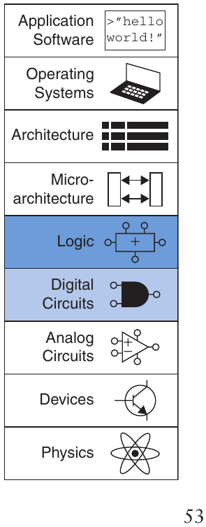

Nhìn vào bên trong hộp đen, circuit được tạo thành từ node và element. Bản thân một element cũng là circuit có input, output và specification. Node là một dây dẫn có điện áp biểu diễn một biến discrete-valued. Node được phân loại thành input, output hoặc internal. Input nhận giá trị từ thế giới bên ngoài. Output đưa giá trị ra thế giới bên ngoài. Những dây dẫn không phải input hay output được gọi là internal node. Hình 2.2 minh họa một circuit có ba element, E1, E2 và E3, cùng sáu node. Các node A, B và C là input. Y và Z là output. n1 là internal node giữa E1 và E3.

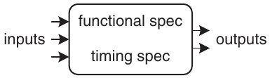

Hình 2.1 Circuit như một hộp đen có input, output và specification

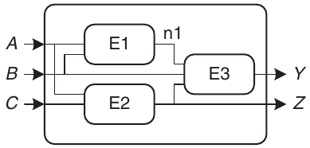

Hình 2.2 Element và node

Digital circuit được phân loại thành combinational hoặc sequential. Output của một combinational circuit chỉ phụ thuộc vào giá trị hiện tại của input; nói cách khác, nó kết hợp các giá trị input hiện tại để tính output. Ví dụ, logic gate là một combinational circuit. Output của một sequential circuit phụ thuộc vào cả giá trị hiện tại lẫn giá trị trước đó của input; nói cách khác, nó phụ thuộc vào chuỗi input. Combinational circuit không có memory, nhưng sequential circuit có memory. Chương này tập trung vào combinational circuit, còn Chương 3 nghiên cứu sequential circuit.

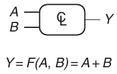

Hình 2.3 Combinational logic circuit

Functional specification của một combinational circuit biểu diễn giá trị output theo giá trị input hiện tại. Timing specification của combinational circuit gồm giới hạn dưới và giới hạn trên của độ trễ từ input đến output. Trước hết chúng ta tập trung vào functional specification, rồi quay lại timing specification ở phần sau của chương.

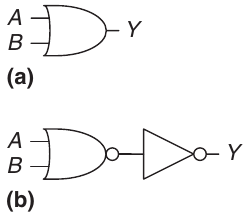

Hình 2.4 Hai cách triển khai OR

Hình 2.3 trình bày một combinational circuit có hai input và một output. Bên trái hình là các input A và B, bên phải là output Y. Ký hiệu 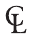 bên trong hộp cho biết nó chỉ được triển khai bằng combinational logic. Trong ví dụ này, hàm F được quy định là OR: Y = F(A, B) = A + B. Diễn đạt bằng lời, output Y là một hàm của hai input A và B—cụ thể, Y = A OR B.

Hình 2.4 trình bày hai cách có thể triển khai combinational logic circuit trong Hình 2.3. Như chúng ta sẽ liên tục thấy trong suốt cuốn sách, thường có nhiều cách triển khai cho cùng một hàm. Bạn chọn cách sử dụng dựa trên các building block sẵn có và những ràng buộc thiết kế. Các ràng buộc này thường gồm diện tích, tốc độ, công suất và thời gian thiết kế.

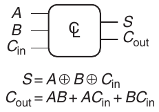

Hình 2.5 Combinational circuit có Multiple-output

Hình 2.5 trình bày một combinational circuit có nhiều output. Combinational circuit cụ thể này được gọi là full adder, chúng ta sẽ quay lại ở Mục 5.2.1. Hai phương trình quy định hàm của các output S và C<sub>out</sub> theo các input A, B và C<sub>in</sub>.

Để đơn giản hóa hình vẽ, chúng ta thường dùng một đường thẳng có một nét gạch chéo và một con số bên cạnh để biểu thị bus, một bó gồm nhiều signal. Con số cho biết có bao nhiêu signal trong bus. Ví dụ, Hình 2.6(a) biểu diễn một khối combinational logic có ba input và hai output. Nếu số bit không quan trọng hoặc đã rõ từ ngữ cảnh, nét gạch chéo có thể không kèm số. Hình 2.6(b) biểu thị hai khối combinational logic, với một số lượng output bất kỳ từ khối thứ nhất đóng vai trò input cho khối thứ hai.

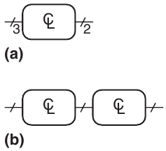

Hình 2.6 Ký pháp gạch chéo cho nhiều signal

Các quy tắc combinational composition cho biết cách xây dựng một combinational circuit lớn từ những combinational circuit element nhỏ hơn. Một circuit là combinational nếu nó gồm các circuit element kết nối với nhau sao cho

> Các quy tắc combinational composition là điều kiện đủ nhưng không hoàn toàn cần thiết. Một số circuit vi phạm các quy tắc này vẫn là combinational, miễn là output chỉ phụ thuộc vào giá trị input hiện tại. Tuy nhiên, xác định những circuit khác thường có phải combinational hay không khó hơn, vì vậy chúng ta thường giới hạn ở combinational composition để xây dựng combinational circuit.

- Bản thân mỗi circuit element đều là combinational.

- Mỗi node của circuit hoặc được chỉ định là input của circuit, hoặc kết nối với đúng một output terminal của một circuit element.

- Circuit không có cyclic path: mỗi đường đi qua circuit đi qua từng circuit node nhiều nhất một lần.

### Ví dụ 2.1 COMBINATIONAL CIRCUIT

Những circuit nào trong Hình 2.7 là combinational circuit theo các quy tắc combinational composition?

Lời giải Circuit (a) là combinational. Nó được tạo từ hai combinational circuit element (inverter I1 và I2). Nó có ba node: n1, n2 và n3. n1 là input của circuit và của I1; n2 là internal node, là output của I1 và input của I2; n3 là output của circuit và của I2. (b) không phải combinational, vì có cyclic path: output của XOR hồi tiếp về một input của chính nó. Do đó, một cyclic path bắt đầu tại n4 đi qua XOR đến n5, rồi quay lại n4. (c) là combinational. (d) không phải combinational, vì node n6 nối với output terminal của cả I3 lẫn I4. (e) là combinational, minh họa hai combinational circuit nối với nhau để tạo thành một combinational circuit lớn hơn. (f) không tuân theo quy tắc combinational composition vì có cyclic path qua hai element. Tùy vào hàm của các element, nó có thể là hoặc không phải là combinational circuit.

Những circuit lớn như microprocessor có thể rất phức tạp, vì vậy chúng ta dùng các nguyên lý từ Chương 1 để quản lý sự phức tạp. Xem circuit như một hộp đen với interface và hàm well-defined là ứng dụng của abstraction và modularity. Xây dựng circuit từ các circuit element nhỏ hơn là ứng dụng của hierarchy. Các quy tắc combinational composition là ứng dụng của discipline.

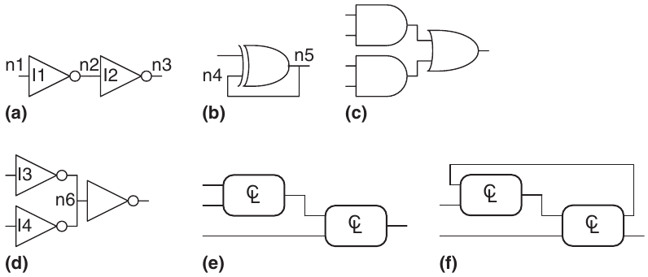

Hình 2.7 Các circuit ví dụ

Functional specification của combinational circuit thường được biểu diễn bằng truth table hoặc phương trình Boolean. Trong các mục tiếp theo, chúng ta mô tả cách suy ra phương trình Boolean từ một truth table bất kỳ và cách dùng đại số Boolean cùng Karnaugh map để đơn giản hóa phương trình. Chúng ta trình bày cách triển khai các phương trình này bằng logic gate và cách phân tích tốc độ của những circuit đó.

## 2.2 PHƯƠNG TRÌNH BOOLEAN

Phương trình Boolean làm việc với các biến có giá trị TRUE hoặc FALSE, vì vậy chúng rất thích hợp để mô tả digital logic. Mục này định nghĩa một số thuật ngữ thường dùng trong phương trình Boolean, sau đó trình bày cách viết phương trình Boolean cho bất kỳ logic function nào khi biết truth table của nó.

### 2.2.1 Thuật ngữ

Complement của biến A là giá trị đảo $\overline{A}$ của nó. Biến hoặc complement của biến được gọi là literal. Ví dụ, A, $\overline{A}$, B và $\overline{B}$ đều là literal. Chúng ta gọi A là true form của biến và $\overline{A}$ là complementary form; “true form” không có nghĩa A là TRUE, mà chỉ có nghĩa phía trên A không có gạch ngang.

Phép AND của một hoặc nhiều literal được gọi là product hoặc implicant. $\overline{A}$B, A$\overline{B}\overline{C}$ và B đều là implicant của một hàm ba biến. Minterm là product có tất cả input của hàm. A$\overline{B}\overline{C}$ là minterm của hàm ba biến A, B và C, nhưng $\overline{A}$B thì không vì không có C. Tương tự, phép OR của một hoặc nhiều literal được gọi là sum. Maxterm là sum có tất cả input của hàm. A + $\overline{B}$ + C là maxterm của hàm ba biến A, B và C.

Thứ tự phép toán rất quan trọng khi diễn giải phương trình Boolean. Y = A + BC có nghĩa là Y = (A OR B) AND C hay Y = A OR (B AND C)? Trong phương trình Boolean, NOT có độ ưu tiên cao nhất, tiếp theo là AND rồi OR. Giống như phương trình thông thường, product được thực hiện trước sum. Vì vậy, phương trình được đọc là Y = A OR (B AND C). Phương trình 2.1 đưa ra một ví dụ khác về thứ tự phép toán.

$\overline{A}$B + BC$\overline{D}$ = (($\overline{A}$)B) + (BC($\overline{D}$)) (2.1)

### 2.2.2 Dạng Sum-of-Products

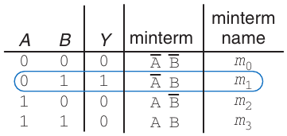

Hình 2.8 Truth table và minterm

Truth table có N input chứa 2<sup>N</sup> hàng, mỗi hàng cho một giá trị input có thể có. Mỗi hàng của truth table tương ứng với một minterm mang giá trị TRUE ở hàng đó. Hình 2.8 trình bày truth table có hai input A và B. Mỗi hàng hiển thị minterm tương ứng. Ví dụ, minterm của hàng đầu tiên là $\overline{A}\overline{B}$ vì $\overline{A}\overline{B}$ là TRUE khi A = 0, B = 0. Các minterm được đánh số từ 0; hàng trên cùng tương ứng minterm 0, m<sub>0</sub>, hàng tiếp theo tương ứng minterm 1, m<sub>1</sub>, v.v.

Chúng ta có thể viết phương trình Boolean cho một truth table bất kỳ bằng cách cộng tất cả minterm có output Y là TRUE. Ví dụ, trong Hình 2.8, chỉ có một hàng (hay minterm) mà output Y là TRUE, được khoanh màu xanh. Do đó, Y = $\overline{A}$B. Hình 2.9 trình bày truth table có nhiều hơn một hàng mà output là TRUE. Lấy sum của từng minterm được khoanh cho kết quả Y = $\overline{A}$B + AB.

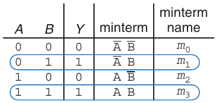

Hình 2.9 Truth table có nhiều minterm TRUE

Đây được gọi là canonical form sum-of-products (SOP) của một hàm vì nó là sum (OR) của các product (AND tạo thành minterm). Dù có nhiều cách viết cùng một hàm, chẳng hạn Y = B$\overline{A}$ + BA, chúng ta sẽ sắp xếp minterm theo đúng thứ tự xuất hiện trong truth table để luôn viết cùng một biểu thức Boolean cho cùng một truth table.

> Canonical form chỉ là cách gọi cầu kỳ của dạng chuẩn. Bạn có thể dùng thuật ngữ này để gây ấn tượng với bạn bè và khiến kẻ thù khiếp sợ.

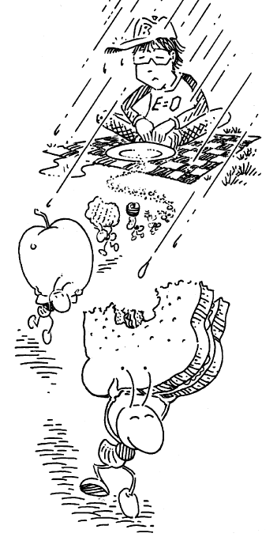

Canonical form sum-of-products cũng có thể viết bằng ký pháp sigma với ký hiệu tổng Σ. Với ký pháp này, hàm trong Hình 2.9 được viết là:

F(A,B) = Σ(m<sub>1</sub>,m<sub>3</sub>)

hoặc (2.2)

F(A,B) = Σ(1,3)

#### Ví dụ 2.2 DẠNG SUM-OF-PRODUCTS (SOP)

Ben Bitdiddle đang đi dã ngoại. Cậu sẽ không thích chuyến đi nếu trời mưa hoặc có kiến. Hãy thiết kế một circuit chỉ xuất TRUE khi Ben thích chuyến dã ngoại.

Lời giải Trước tiên, định nghĩa input và output. Các input là A và R, cho biết có kiến và có mưa hay không. A là TRUE khi có kiến và FALSE khi không có kiến. Tương tự, R là TRUE khi trời mưa và FALSE khi mặt trời mỉm cười với Ben. Output là E, niềm vui của Ben trong chuyến dã ngoại. E là TRUE nếu Ben thích chuyến đi và FALSE nếu cậu khổ sở. Hình 2.10 trình bày truth table cho trải nghiệm dã ngoại của Ben.

Dùng dạng sum-of-products, chúng ta viết phương trình là: E = $\overline{A}\overline{R}$ hoặc E = Σ(0). Chúng ta có thể xây dựng phương trình bằng hai inverter và một AND gate two-input, như trong Hình 2.11(a). Bạn có thể nhận ra truth table này là hàm NOR ở Mục 1.5.5: E = A NOR R = $\overline{A+ R}$. Hình 2.11(b) trình bày cách triển khai NOR. Ở Mục 2.3, chúng ta chứng minh hai phương trình $\overline{A}\overline{R}$ và $\overline{A+ R}$ tương đương.

Dạng sum-of-products cung cấp phương trình Boolean cho mọi truth table với số lượng biến bất kỳ. Hình 2.12 trình bày một truth table three-input ngẫu nhiên. Dạng sum-of-products của logic function là

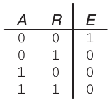

Hình 2.10 Truth table của Ben

Y = $\overline{A}\overline{B}\overline{C}$ + A$\overline{B}\overline{C}$ + A$\overline{B}$C

hoặc (2.3)

Y = Σ(0,4,5)

Đáng tiếc, canonical form sum-of-products không nhất thiết tạo ra phương trình đơn giản nhất. Ở Mục 2.3, chúng ta trình bày cách viết cùng một hàm bằng ít hạng hơn.

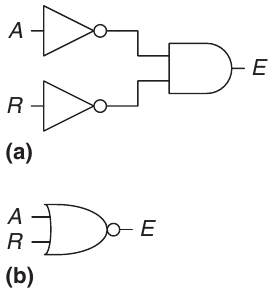

Hình 2.11 Circuit của Ben

### 2.2.3 Dạng Product-of-Sums

Một cách khác để biểu diễn hàm Boolean là canonical form product-of-sums (POS). Mỗi hàng của truth table tương ứng với một maxterm mang giá trị FALSE ở hàng đó. Ví dụ, maxterm của hàng đầu tiên trong truth table two-input là (A + B), vì (A + B) là FALSE khi A = 0, B = 0. Chúng ta có thể viết phương trình Boolean cho bất kỳ circuit nào trực tiếp từ truth table bằng cách AND tất cả maxterm có output là FALSE. Canonical form product-of-sums cũng có thể viết bằng ký pháp pi sử dụng ký hiệu tích Π.

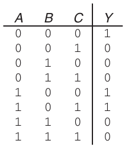

Hình 2.12 Truth table three-input ngẫu nhiên

#### Ví dụ 2.3 DẠNG PRODUCT-OF-SUMS (POS)

Hãy viết phương trình dưới dạng product-of-sums cho truth table trong Hình 2.13.

Lời giải Truth table có hai hàng mà output là FALSE. Do đó, có thể viết hàm dưới dạng product-of-sums là Y = (A+ B)($\overline{A}$+ B) hoặc, dùng ký pháp pi, Y = Π(M<sub>0</sub>, M<sub>2</sub>) hoặc Y = Π(0,2). Maxterm đầu tiên, (A + B), đảm bảo Y = 0 khi A = 0, B = 0, vì bất kỳ giá trị nào AND với 0 đều là 0. Tương tự, maxterm thứ hai, ($\overline{A}$+ B), đảm bảo Y = 0 khi A = 1, B = 0. Hình 2.13 là cùng truth table với Hình 2.9, cho thấy một hàm có thể được viết theo nhiều cách.

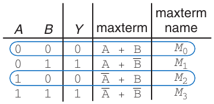

Hình 2.13 Truth table có nhiều maxterm FALSE

Tương tự, phương trình Boolean cho chuyến dã ngoại của Ben trong Hình 2.10 có thể viết dưới dạng product-of-sums bằng cách khoanh ba hàng có giá trị 0 để thu được E = (A + $\overline{R}$)($\overline{A}$ + R)($\overline{A}$ + $\overline{R}$) hoặc E = Π(1,2,3). Dạng này kém đẹp hơn phương trình sum-of-products E = $\overline{A}\overline{R}$, nhưng hai phương trình tương đương về logic.

Sum-of-products cho phương trình ngắn hơn khi output chỉ là TRUE ở một vài hàng của truth table; product-of-sums đơn giản hơn khi output chỉ là FALSE ở một vài hàng của truth table.

## 2.3 ĐẠI SỐ BOOLEAN

Trong mục trước, chúng ta đã học cách viết biểu thức Boolean khi biết truth table. Tuy nhiên, biểu thức đó không nhất thiết dẫn đến tập logic gate đơn giản nhất. Giống như dùng đại số để đơn giản hóa phương trình toán học, bạn có thể dùng đại số Boolean để đơn giản hóa phương trình Boolean. Các quy tắc đại số Boolean rất giống đại số thông thường nhưng trong một số trường hợp đơn giản hơn vì biến chỉ có hai giá trị có thể có: 0 hoặc 1.

Đại số Boolean dựa trên một tập tiên đề mà chúng ta giả định là đúng. Không thể chứng minh tiên đề, theo nghĩa không thể chứng minh một định nghĩa. Từ các tiên đề này, chúng ta chứng minh mọi định lý của đại số Boolean. Các định lý có ý nghĩa thực tiễn lớn vì chúng chỉ cách đơn giản hóa logic để tạo ra circuit nhỏ hơn và ít tốn kém hơn.

Bảng 2.1 Các tiên đề của đại số Boolean

|  | Tiên đề |  | Đối ngẫu | Tên |
|---|---|---|---|---|
| A1 | B = 0 nếu B ≠ 1 | A1′ | B = 1 nếu B ≠ 0 | Binary field |
| A2 | $\overline{0}$ = 1 | A2′ | $\overline{1}$ = 0 | NOT |
| A3 | 0 • 0 = 0 | A3′ | 1 + 1 = 1 | AND/OR |
| A4 | 1 • 1 = 1 | A4′ | 0 + 0 = 0 | AND/OR |
| A5 | 0 • 1 = 1 • 0 = 0 | A5′ | 1 + 0 = 0 + 1 = 1 | AND/OR |

Các tiên đề và định lý của đại số Boolean tuân theo nguyên lý duality. Nếu hoán đổi các ký hiệu 0 và 1 cùng các toán tử • (AND) và + (OR), phát biểu vẫn đúng. Chúng ta dùng dấu prime (′) để biểu thị dual của một phát biểu.

### 2.3.1 Các tiên đề

Bảng 2.1 trình bày các tiên đề của đại số Boolean. Năm tiên đề này cùng các dual của chúng định nghĩa biến Boolean và ý nghĩa của NOT, AND và OR. Tiên đề A1 phát biểu rằng biến Boolean B là 0 nếu nó không phải 1. Dual A1′ của tiên đề phát biểu rằng biến là 1 nếu nó không phải 0. A1 và A1′ cùng cho biết chúng ta làm việc trong Boolean field hay binary field gồm 0 và 1. Các tiên đề A2 và A2′ định nghĩa phép NOT. Các tiên đề A3 đến A5 định nghĩa AND; các dual A3′ đến A5′ định nghĩa OR.

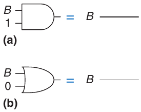

Hình 2.14 Định lý identity trong hardware: (a) T1, (b) T1′

### 2.3.2 Các định lý một biến

Các định lý T1 đến T5 trong Bảng 2.2 mô tả cách đơn giản hóa phương trình có một biến.

Định lý identity T1 phát biểu rằng với mọi biến Boolean B, B AND 1 = B. Dual của nó phát biểu B OR 0 = B. Trong hardware, như Hình 2.14, T1 có nghĩa nếu một input của AND gate two-input luôn là 1, chúng ta có thể bỏ AND gate và thay bằng dây nối với input biến thiên (B). Tương tự, T1′ có nghĩa nếu một input của OR gate two-input luôn là 0, có thể thay OR gate bằng dây nối với B. Nhìn chung, gate tiêu tốn tiền, công suất và độ trễ, nên thay gate bằng dây dẫn là có lợi.

> Định lý null element dẫn đến những phát biểu kỳ quặc nhưng thực ra đúng! Nó đặc biệt nguy hiểm trong tay người quảng cáo: BẠN SẼ NHẬN MỘT TRIỆU ĐÔ LA hoặc chúng tôi sẽ gửi cho bạn một bàn chải đánh răng qua bưu điện. (Khả năng cao bạn sẽ nhận được bàn chải đánh răng qua bưu điện.)

Định lý null element T2 nói rằng B AND 0 luôn bằng 0. Vì vậy, 0 được gọi là null element của phép AND, vì nó vô hiệu hóa ảnh hưởng của mọi input khác. Dual phát biểu B OR 1 luôn bằng 1. Do đó, 1 là null element của phép OR. Trong hardware, như Hình 2.15, nếu một input của AND gate là 0, có thể thay AND gate bằng dây được nối cố định LOW (về 0). Tương tự, nếu một input của OR gate là 1, có thể thay OR gate bằng dây được nối cố định HIGH (về 1).

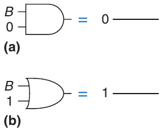

Hình 2.15 Định lý null element trong hardware: (a) T2, (b) T2′

Bảng 2.2 Các định lý Boolean một biến

|  | Định lý |  | Đối ngẫu | Tên |
|---|---|---|---|---|
| T1 | B • 1 = B | T1′ | B + 0 = B | Identity |
| T2 | B • 0 = 0 | T2′ | B + 1 = 1 | Null Element |
| T3 | B • B = B | T3′ | B + B = B | Idempotency |
| T4 | $\overline{\overline{B}}$ = B |  |  | Involution |
| T5 | B • $\overline{B}$ = 0 | T5′ | B + $\overline{B}$ = 1 | Complements |

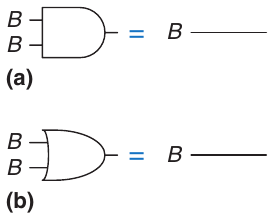

Hình 2.16 Định lý idempotency trong hardware: (a) T3, (b) T3′

Idempotency T3 nói rằng một biến AND với chính nó bằng chính nó. Tương tự, biến OR với chính nó bằng chính nó. Tên định lý xuất phát từ các gốc Latin: idem (giống nhau) và potent (sức mạnh). Các phép toán trả về chính thứ bạn đưa vào. Hình 2.16 cho thấy idempotency một lần nữa cho phép thay gate bằng dây dẫn.

Involution T4 là cách nói cầu kỳ rằng lấy complement của một biến hai lần sẽ cho lại biến ban đầu. Trong điện tử số, hai cái sai tạo thành cái đúng. Hai inverter mắc nối tiếp triệt tiêu nhau về logic và tương đương logic với một dây dẫn, như Hình 2.17. Dual của T4 là chính nó.

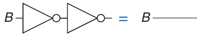

Hình 2.17 Định lý involution trong hardware: T4

Định lý complement T5 (Hình 2.18) phát biểu một biến AND với complement của nó bằng 0 (vì một trong hai nhất định là 0). Theo duality, biến OR với complement của nó bằng 1 (vì một trong hai nhất định là 1).

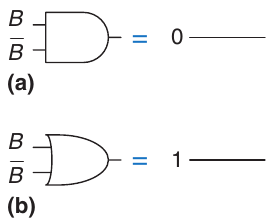

Hình 2.18 Định lý complement trong hardware: (a) T5, (b) T5′

### 2.3.3 Các định lý nhiều biến

Các định lý T6 đến T12 trong Bảng 2.3 mô tả cách đơn giản hóa phương trình có nhiều hơn một biến Boolean.

Commutativity và associativity, T6 và T7, hoạt động giống đại số truyền thống. Theo commutativity, thứ tự input của hàm AND hoặc OR không ảnh hưởng giá trị output. Theo associativity, cách nhóm cụ thể các input trong phép AND hoặc OR không ảnh hưởng giá trị output.

Định lý distributivity T8 giống đại số truyền thống, nhưng dual T8′ thì không. Theo T8, AND phân phối trên OR; theo T8′, OR phân phối trên AND. Trong đại số truyền thống, phép nhân phân phối trên phép cộng nhưng phép cộng không phân phối trên phép nhân, nên (B + C) × (B + D) ≠ B + (C × D).

Các định lý covering, combining và consensus, T9 đến T11, cho phép loại bỏ biến dư thừa. Sau khi suy nghĩ một chút, bạn sẽ

Bảng 2.3 Các định lý Boolean nhiều biến

|  | Định lý |  | Đối ngẫu | Tên |
|---|---|---|---|---|
| T6 | B • C = C • B | T6′ | B + C = C + B | Commutativity |
| T7 | (B • C) • D = B • (C • D) | T7′ | (B + C) + D = B + (C + D) | Associativity |
| T8 | (B • C) + (B • D) = B • (C + D) | T8′ | (B + C) • (B + D) = B + (C • D) | Distributivity |
| T9 | B • (B + C) = B | T9′ | B + (B • C) = B | Covering |
| T10 | (B • C) + (B • $\overline{C}$) = B | T10′ | (B + C) • (B + $\overline{C}$) = B | Combining |
| T11 | (B • C) + ($\overline{B}$ • D) + (C • D) = (B • C) + ($\overline{B}$ • D) | T11′ | (B + C) • ($\overline{B}$ + D) • (C + D) = (B + C) • ($\overline{B}$ + D) | Consensus |
| T12 | B<sub>0</sub> • B<sub>1</sub> • B<sub>2</sub>… = ($\overline{B}$<sub>0</sub> + $\overline{B}$<sub>1</sub> + $\overline{B}$<sub>2</sub>…) | T12′ | B<sub>0</sub> + B<sub>1</sub> + B<sub>2</sub>… = ($\overline{B}$<sub>0</sub> • $\overline{B}$<sub>1</sub> • $\overline{B}$<sub>2</sub>…) | De Morgan’s Theorem |

> 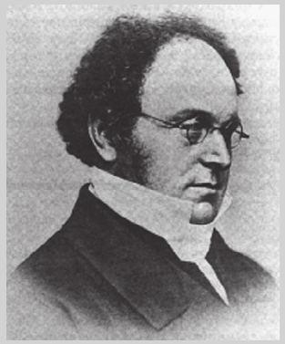
>
> Augustus De Morgan, mất năm 1871
>
> Nhà toán học người Anh, sinh tại Ấn Độ. Bị mù một mắt. Cha ông mất khi ông 10 tuổi. Theo học Trinity College, Cambridge lúc 16 tuổi, và được bổ nhiệm làm Giáo sư Toán học tại London University mới thành lập lúc 22 tuổi. Ông viết nhiều về nhiều lĩnh vực toán học, gồm logic, đại số và nghịch lý. Miệng núi lửa De Morgan trên Mặt Trăng được đặt theo tên ông. Ông đưa ra câu đố về năm sinh của mình: “Tôi x tuổi vào năm x<sup>2</sup>.”

Định lý De Morgan T12 là công cụ đặc biệt mạnh trong thiết kế số. Định lý cho biết complement của product của tất cả các hạng bằng sum của complement từng hạng. Tương tự, complement của sum tất cả các hạng bằng product của complement từng hạng.

Theo định lý De Morgan, NAND gate tương đương OR gate với các input đảo. Tương tự, NOR gate tương đương AND gate với các input đảo. Hình 2.19 trình bày các gate tương đương De Morgan này cho NAND và NOR gate. Hai ký hiệu của mỗi hàm được gọi là dual. Chúng tương đương logic và có thể dùng thay nhau.

Vòng tròn đảo được gọi là bubble. Một cách trực quan, bạn có thể tưởng tượng “đẩy” bubble qua gate khiến nó xuất hiện ở phía bên kia, đồng thời đổi phần thân gate từ AND sang OR hoặc ngược lại. Ví dụ, NAND gate trong Hình 2.19 gồm phần thân AND với một bubble tại output. Đẩy bubble sang trái cho phần thân OR với bubble tại các input. Các quy tắc nền tảng của bubble pushing là

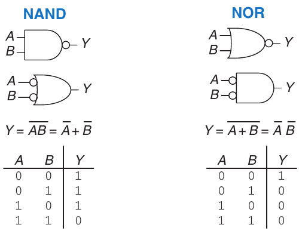

Hình 2.19 Các gate tương đương De Morgan

> Chú ý rằng $\overline{AB}$ không bằng $\overline{A}\overline{B}$.

- Đẩy bubble ngược lại (từ output) hoặc về phía trước (từ input) làm đổi phần thân gate từ AND sang OR hoặc ngược lại.

- Đẩy bubble từ output ngược về input sẽ đặt bubble trên tất cả input của gate.

- Đẩy các bubble trên tất cả input của gate về phía output sẽ đặt một bubble trên output.

Mục 2.5.2 dùng bubble pushing để hỗ trợ phân tích circuit.

#### Ví dụ 2.4 SUY RA DẠNG PRODUCT-OF-SUMS

Hình 2.20 trình bày truth table của hàm Boolean Y và complement $\overline{Y}$ của nó. Dùng định lý De Morgan, suy ra canonical form product-of-sums của Y từ dạng sum-of-products của $\overline{Y}$.

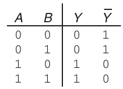

Hình 2.20 Truth table biểu diễn Y và $\overline{Y}$

Lời giải Hình 2.21 trình bày các minterm (được khoanh) có trong $\overline{Y}$. Canonical form sum-of-products của $\overline{Y}$ là

$\overline{Y}$ = $\overline{A}\overline{B}$ + $\overline{A}$B (2.4)

Lấy complement hai vế và áp dụng định lý De Morgan hai lần, chúng ta được

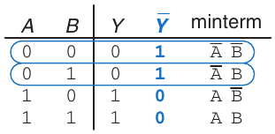

Hình 2.21 Truth table biểu diễn các minterm của $\overline{Y}$

$\overline{\overline{Y}}$ = Y = $\overline{\overline{A}\overline{B} + \overline{A}B}$ = ($\overline{\overline{A}\overline{B}}$)($\overline{\overline{A}B}$) = (A + B)(A + $\overline{B}$) (2.5)

### 2.3.4 Sự thật đằng sau tất cả

Độc giả tò mò có thể tự hỏi làm sao chứng minh một định lý là đúng. Trong đại số Boolean, chứng minh định lý với số lượng biến hữu hạn rất dễ: chỉ cần cho thấy định lý đúng với mọi giá trị có thể có của các biến. Phương pháp này gọi là perfect induction và có thể thực hiện bằng truth table.

#### Ví dụ 2.5 CHỨNG MINH ĐỊNH LÝ CONSENSUS BẰNG PERFECT INDUCTION

Chứng minh định lý consensus T11 trong Bảng 2.3.

Lời giải Kiểm tra hai vế của phương trình với cả tám tổ hợp B, C và D. Truth table trong Hình 2.22 minh họa các tổ hợp này. Vì BC + $\overline{B}$D + CD = BC + $\overline{B}$D trong mọi trường hợp, định lý được chứng minh.

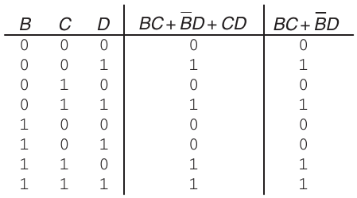

Hình 2.22 Truth table chứng minh T11

### 2.3.5 Đơn giản hóa phương trình

Các định lý đại số Boolean giúp đơn giản hóa phương trình Boolean. Ví dụ, xét biểu thức sum-of-products từ truth table trong Hình 2.9: Y = $\overline{A}$B + AB. Theo định lý combining (T10), phương trình rút gọn thành Y = B. Điều này có thể đã rõ khi nhìn truth table. Nhìn chung, có thể cần nhiều bước để đơn giản hóa phương trình phức tạp hơn.

> Bảng 2.2 và 2.3 liệt kê các tiên đề và định lý Boolean dưới dạng cơ bản. Tuy nhiên, chúng cũng áp dụng cho những hạng phức tạp hơn. Ví dụ, áp dụng định lý combining cho biểu thức (A + $\overline{B}$C)D+(A + $\overline{B}$C)$\overline{D}$ để thu được (A + $\overline{B}$C).

Nguyên tắc cơ bản để đơn giản hóa phương trình sum-of-products là kết hợp các hạng bằng quan hệ PA + P$\overline{A}$ = P, trong đó P có thể là hạng bất kỳ. Có thể đơn giản hóa phương trình đến mức nào? Chúng ta định nghĩa một phương trình dạng sum-of-products là đã được tối giản nếu nó dùng ít implicant nhất có thể. Nếu có nhiều phương trình cùng số implicant, phương trình tối giản là phương trình có ít literal nhất.

Một implicant được gọi là prime implicant nếu không thể kết hợp với bất kỳ implicant nào khác trong phương trình để tạo thành implicant mới có ít literal hơn. Các implicant trong phương trình tối giản phải đều là prime implicant. Nếu không, có thể kết hợp chúng để giảm số literal.

#### Ví dụ 2.6 TỐI GIẢN PHƯƠNG TRÌNH

Tối giản Phương trình 2.3: $\overline{A}\overline{B}\overline{C}$ + A$\overline{B}\overline{C}$ + A$\overline{B}$C.

Lời giải Chúng ta bắt đầu từ phương trình ban đầu và áp dụng từng bước các định lý Boolean, như Bảng 2.4.

Đến đây chúng ta đã đơn giản hóa hoàn toàn phương trình chưa? Hãy xem kỹ hơn. Trong phương trình ban đầu, các minterm $\overline{A}\overline{B}\overline{C}$ và A$\overline{B}\overline{C}$ chỉ khác ở biến A. Vì thế chúng ta kết hợp chúng thành $\overline{B}\overline{C}$. Tuy nhiên, nhìn lại phương trình ban đầu, hai minterm cuối A$\overline{B}\overline{C}$ và A$\overline{B}$C cũng chỉ khác một literal (C và $\overline{C}$). Do đó, bằng cùng phương pháp, có thể kết hợp hai minterm này thành minterm A$\overline{B}$. Chúng ta nói các implicant $\overline{B}\overline{C}$ và A$\overline{B}$ dùng chung minterm A$\overline{B}\overline{C}$.

Vậy chúng ta chỉ được đơn giản hóa một cặp minterm, hay có thể đơn giản hóa cả hai? Dùng định lý idempotency, có thể nhân bản các hạng bao nhiêu lần tùy ý: B = B + B + B + B … . Áp dụng nguyên tắc này, chúng ta đơn giản hóa hoàn toàn phương trình về hai prime implicant, B$\overline{C}$ + A$\overline{B}$ *(ghi chú: sách in thiếu gạch trên ở B đầu; đúng là $\overline{B}\overline{C}$ + A$\overline{B}$, như Bảng 2.5)*, như Bảng 2.5.

Bảng 2.4 Tối giản phương trình

| Bước | Phương trình | Cơ sở |
|---|---|---|
|  | $\overline{A}\overline{B}\overline{C}$ + A$\overline{B}\overline{C}$ + A$\overline{B}$C |  |
| 1 | $\overline{B}\overline{C}$($\overline{A}$ + A) + A$\overline{B}$C | T8: Distributivity |
| 2 | $\overline{B}\overline{C}$(1) + A$\overline{B}$C | T5: Complements |
| 3 | $\overline{B}\overline{C}$ + A$\overline{B}$C | T1: Identity |

Bảng 2.5 Cách tối giản phương trình cải tiến

| Bước | Phương trình | Cơ sở |
|---|---|---|
|  | $\overline{A}\overline{B}\overline{C}$ + A$\overline{B}\overline{C}$ + A$\overline{B}$C |  |
| 1 | $\overline{A}\overline{B}\overline{C}$ + A$\overline{B}\overline{C}$ + A$\overline{B}\overline{C}$ + A$\overline{B}$C | T3: Idempotency |
| 2 | $\overline{B}\overline{C}$($\overline{A}$ + A) + A$\overline{B}$($\overline{C}$ + C) | T8: Distributivity |
| 3 | $\overline{B}\overline{C}$(1) + A$\overline{B}$(1) | T5: Complements |
| 4 | $\overline{B}\overline{C}$ + A$\overline{B}$ | T1: Identity |

Dù hơi trái trực giác, khai triển implicant (ví dụ, biến AB thành ABC + AB$\overline{C}$) đôi khi hữu ích khi tối giản phương trình. Bằng cách này, bạn có thể lặp lại một minterm đã khai triển để kết hợp (dùng chung) với minterm khác.

Bạn có thể nhận thấy đơn giản hóa hoàn toàn phương trình Boolean bằng các định lý đại số Boolean có thể cần thử và sai. Mục 2.7 mô tả một kỹ thuật có hệ thống gọi là Karnaugh map giúp quá trình này dễ hơn.

Tại sao phải đơn giản hóa phương trình Boolean nếu nó vẫn tương đương logic? Đơn giản hóa làm giảm số gate dùng để triển khai hàm về mặt vật lý, nhờ đó circuit nhỏ hơn, rẻ hơn và có thể nhanh hơn. Mục tiếp theo mô tả cách triển khai phương trình Boolean bằng logic gate.

## 2.4 TỪ LOGIC ĐẾN GATE

> Các bài thực hành kèm giáo trình này (xem Lời nói đầu) trình bày cách dùng công cụ computer-aided design (CAD) để thiết kế, mô phỏng và kiểm thử digital circuit.

Schematic là sơ đồ digital circuit biểu diễn các element và dây nối giữa chúng. Ví dụ, schematic trong Hình 2.23 trình bày một cách triển khai hardware có thể có cho logic function yêu thích của chúng ta, Phương trình 2.3:

Y = $\overline{A}\overline{B}\overline{C}$ + A$\overline{B}\overline{C}$ + A$\overline{B}$C (2.3)

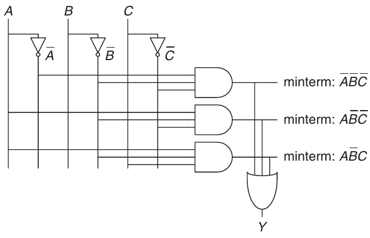

Hình 2.23 Schematic của Y = $\overline{A}\overline{B}\overline{C}$ + A$\overline{B}\overline{C}$ + A$\overline{B}$C

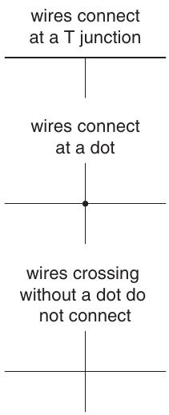

Hình 2.24 Các kết nối dây dẫn

Vẽ schematic theo cách nhất quán giúp chúng dễ đọc và debug hơn. Nhìn chung chúng ta sẽ tuân theo các hướng dẫn sau:

- Input ở phía trái (hoặc trên) schematic.

- Output ở phía phải (hoặc dưới) schematic.

- Khi có thể, gate nên chạy theo chiều từ trái sang phải.

- Nên dùng dây thẳng hơn là dây có nhiều góc gấp (dây ngoằn ngoèo khiến người đọc tốn công lần theo dây thay vì suy nghĩ circuit làm gì).

- Dây dẫn luôn nối với nhau tại chỗ giao hình chữ T.

- Dấu chấm tại nơi dây giao nhau biểu thị kết nối giữa các dây.

- Dây giao nhau không có dấu chấm thì không nối với nhau.

Ba hướng dẫn cuối được minh họa trong Hình 2.24.

Mọi phương trình Boolean dạng sum-of-products đều có thể vẽ thành schematic một cách có hệ thống tương tự Hình 2.23. Trước hết, vẽ các cột input. Đặt inverter ở những cột liền kề để cung cấp input complement nếu cần. Vẽ các hàng AND gate cho từng minterm. Sau đó, với mỗi output, vẽ một OR gate nối đến các minterm liên quan đến output đó. Kiểu này gọi là programmable logic array (PLA) vì inverter, AND gate và OR gate được bố trí thành array một cách có hệ thống. PLA sẽ được bàn kỹ hơn ở Mục 5.6.

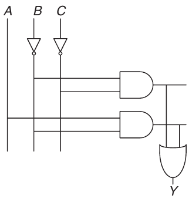

Hình 2.25 Schematic của Y = $\overline{B}\overline{C}$ + A$\overline{B}$

Hình 2.25 trình bày cách triển khai phương trình đã đơn giản hóa bằng đại số Boolean trong Ví dụ 2.6. Chú ý circuit đã đơn giản hóa có ít hardware hơn đáng kể so với Hình 2.23. Nó cũng có thể nhanh hơn vì dùng các gate có ít input hơn.

Chúng ta có thể giảm số lượng gate hơn nữa (dù chỉ bớt được một inverter) bằng cách tận dụng các inverting gate. Quan sát thấy $\overline{B}\overline{C}$ là một phép AND với các input bị đảo. Hình 2.26 minh họa schematic sử dụng cách tối ưu hóa này để loại bỏ inverter trên C. Hãy nhớ rằng theo định lý De Morgan, AND với các input bị đảo tương đương với một gate NOR. Tùy theo công nghệ triển khai, việc sử dụng số gate ít nhất hoặc ưu tiên một số loại gate nhất định có thể ít tốn kém hơn. Ví dụ, NAND và NOR được ưu tiên hơn AND và OR trong các cách triển khai CMOS.

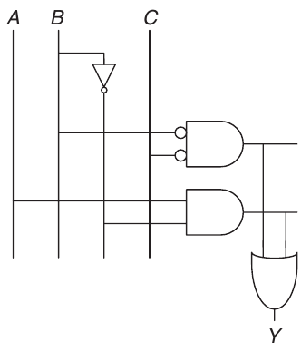

Hình 2.26 Schematic dùng ít gate hơn

Nhiều circuit có nhiều output, mỗi output tính một hàm Boolean riêng của input. Chúng ta có thể viết truth table riêng cho từng output, nhưng thường tiện hơn khi viết tất cả output trong cùng một truth table và phác thảo một schematic chứa mọi output.

### Ví dụ 2.7 CIRCUIT MULTIPLE-OUTPUT

Trưởng khoa, trưởng bộ môn, trợ giảng và người phụ trách sinh hoạt ký túc xá đều thỉnh thoảng dùng hội trường. Đáng tiếc, đôi khi lịch của họ trùng nhau, dẫn đến thảm họa như lần cuộc gặp gây quỹ của trưởng khoa với những ủy viên quản trị khó tính diễn ra cùng lúc với tiệc BTB[^1] của ký túc xá. Alyssa P. Hacker được mời thiết kế hệ thống đặt phòng.

Hệ thống có bốn input, A<sub>3</sub>, …, A<sub>0</sub>, và bốn output, Y<sub>3</sub>, …, Y<sub>0</sub>. Các signal này cũng có thể viết A<sub>3:0</sub> và Y<sub>3:0</sub>. Mỗi người assert input của mình khi yêu cầu hội trường cho ngày hôm sau. Hệ thống assert nhiều nhất một output, cấp hội trường cho người có độ ưu tiên cao nhất. Trưởng khoa, người trả tiền cho hệ thống, đòi hỏi độ ưu tiên cao nhất (3). Trưởng bộ môn, trợ giảng và người phụ trách sinh hoạt ký túc xá có độ ưu tiên giảm dần.

Viết truth table và phương trình Boolean cho hệ thống. Phác thảo circuit thực hiện hàm này.

Lời giải Hàm này gọi là priority circuit four-input. Ký hiệu và truth table của nó được trình bày trong Hình 2.27.

Có thể viết mỗi output dưới dạng sum-of-products rồi rút gọn phương trình bằng đại số Boolean. Tuy nhiên, có thể thấy ngay các phương trình đơn giản hóa từ mô tả chức năng (và truth table): Y<sub>3</sub> là TRUE mỗi khi A<sub>3</sub> được assert, nên Y<sub>3</sub> = A<sub>3</sub>. Y<sub>2</sub> là TRUE nếu A<sub>2</sub> được assert và A<sub>3</sub> không được assert, nên Y<sub>2</sub> = $\overline{A}$<sub>3</sub>A<sub>2</sub>. Y<sub>1</sub> là TRUE nếu A<sub>1</sub> được assert và không input higher-priority nào được assert: Y<sub>1</sub> = $\overline{A}$<sub>3</sub> $\overline{A}$<sub>2</sub>A<sub>1</sub>. Và Y<sub>0</sub> là TRUE mỗi khi A<sub>0</sub> được assert và không input nào khác được assert: Y<sub>0</sub> = $\overline{A}$<sub>3</sub> $\overline{A}$<sub>2</sub> $\overline{A}$<sub>1</sub>A<sub>0</sub>. Schematic được trình bày trong Hình 2.28. Người thiết kế có kinh nghiệm thường có thể triển khai logic circuit chỉ bằng quan sát. Khi có specification rõ ràng, chỉ cần biến lời mô tả thành phương trình rồi biến phương trình thành gate.

Chú ý nếu A<sub>3</sub> được assert trong priority circuit, output không quan tâm các input khác là gì. Chúng ta dùng ký hiệu X để mô tả input mà output không quan tâm. Hình 2.29 cho thấy truth table của priority circuit four-input nhỏ đi nhiều khi dùng don’t care. Từ truth table này, có thể dễ dàng đọc phương trình Boolean dạng sum-of-products bằng cách bỏ qua input có X. Don’t care cũng có thể xuất hiện ở output trong truth table, như chúng ta sẽ thấy ở Mục 2.7.3.

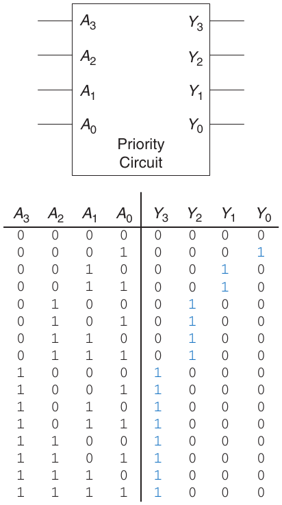

Hình 2.27 Priority circuit

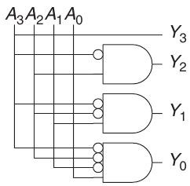

Hình 2.28 Schematic của priority circuit

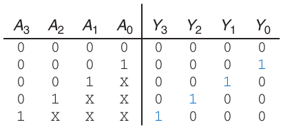

Hình 2.29 Truth table của priority circuit với don’t care (X)

> X là ký hiệu có nhiều nghĩa: “don’t care” trong truth table và “contention” trong mô phỏng logic (xem Mục 2.6.1). Hãy xét ngữ cảnh để không nhầm các nghĩa. Một số tác giả dùng D hoặc ? cho “don’t care” để tránh sự nhập nhằng này.

## 2.5 MULTILEVEL COMBINATIONAL LOGIC

Logic dạng sum-of-products gọi là two-level logic vì gồm các literal nối đến một tầng AND gate, rồi nối đến một tầng OR gate. Người thiết kế thường xây dựng circuit có hơn hai tầng logic gate. Những multilevel combinational circuit này có thể dùng ít hardware hơn các circuit two-level tương ứng. Bubble pushing đặc biệt hữu ích khi phân tích và thiết kế multilevel circuit.

### 2.5.1 Giảm hardware

Một số logic function cần lượng hardware khổng lồ khi xây dựng bằng two-level logic. Ví dụ đáng chú ý là hàm XOR nhiều biến. Chẳng hạn, xét việc xây dựng XOR three-input bằng những kỹ thuật two-level đã học đến đây.

Nhớ rằng XOR N-input tạo output TRUE khi số input TRUE là số lẻ. Hình 2.30 trình bày truth table của XOR three-input, với những hàng tạo output TRUE được khoanh lại. Từ truth table, chúng ta đọc được phương trình Boolean dạng sum-of-products trong Phương trình 2.6. Đáng tiếc, không có cách rút gọn phương trình này thành ít implicant hơn.

Y = $\overline{A}\overline{B}$C + $\overline{A}$B$\overline{C}$ + A$\overline{B}\overline{C}$ + ABC (2.6)

Mặt khác, A ⊕ B ⊕ C = (A ⊕ B) ⊕ C (hãy tự chứng minh bằng perfect induction nếu còn nghi ngờ). Vì vậy, XOR three-input có thể xây dựng bằng cách mắc nối tiếp các XOR two-input, như Hình 2.31.

Tương tự, XOR eight-input sẽ cần 128 AND gate eight-input và một OR gate 128-input nếu triển khai sum-of-products two-level. Phương án tốt hơn nhiều là dùng cây XOR gate two-input, như Hình 2.32.

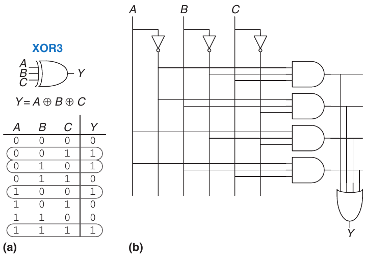

Hình 2.30 XOR Three-input: (a) functional specification và (b) triển khai logic two-level

Chọn cách triển khai multilevel tốt nhất cho một logic function cụ thể không đơn giản. Hơn nữa, “tốt nhất” có nhiều nghĩa: ít gate nhất, nhanh nhất, thời gian thiết kế ngắn nhất, chi phí thấp nhất, tiêu thụ ít công suất nhất. Trong Chương 5, bạn sẽ thấy circuit “tốt nhất” ở công nghệ này không nhất thiết tốt nhất ở công nghệ khác. Ví dụ, chúng ta đang dùng AND và OR, nhưng trong CMOS, NAND và NOR hiệu quả hơn. Có kinh nghiệm, bạn sẽ thấy mình có thể tạo thiết kế multilevel tốt bằng quan sát cho phần lớn circuit. Bạn sẽ tích lũy một phần kinh nghiệm này khi nghiên cứu các ví dụ circuit trong phần còn lại của sách. Khi học, hãy khám phá các phương án thiết kế và suy nghĩ về trade-offs. Công cụ Computer-aided design (CAD) cũng có thể tìm trong không gian rộng lớn các thiết kế multilevel có thể có để tìm thiết kế phù hợp ràng buộc nhất, dựa trên những building block sẵn có.

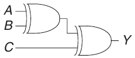

Hình 2.31 XOR Three-input dùng các XOR two-input

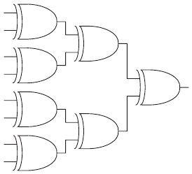

Hình 2.32 XOR Eight-input dùng bảy XOR two-input

### 2.5.2 Bubble Pushing

Bạn có thể nhớ từ Mục 1.7.6 rằng circuit CMOS ưu tiên NAND và NOR hơn AND và OR. Nhưng đọc phương trình bằng quan sát từ multilevel circuit có NAND và NOR có thể khá rắc rối. Hình 2.33 trình bày một multilevel circuit có chức năng không rõ ngay khi quan sát. Bubble pushing là cách hữu ích để vẽ lại circuit sao cho bubble triệt tiêu nhau và xác định hàm dễ hơn. Dựa trên các nguyên tắc ở Mục 2.3.3, hướng dẫn bubble pushing như sau:

- Bắt đầu ở output của circuit và tiến dần về input.

- Đẩy mọi bubble trên output cuối cùng ngược về input để có thể đọc phương trình theo output (ví dụ Y) thay vì complement của output ($\overline{Y}$).

- Đi ngược lại, vẽ mỗi gate dưới dạng sao cho bubble triệt tiêu. Nếu gate hiện tại có input bubble, vẽ gate trước đó với output bubble. Nếu gate hiện tại không có input bubble, vẽ gate trước đó không có output bubble.

Hình 2.34 trình bày cách vẽ lại Hình 2.33 theo hướng dẫn bubble pushing. Bắt đầu tại output Y, NAND gate có bubble trên output cần loại bỏ. Đẩy output bubble ngược lại để tạo OR với input đảo, như Hình 2.34(a). Đi sang trái, gate ngoài cùng bên phải có input bubble triệt tiêu với output bubble của NAND gate ở giữa, nên không cần thay đổi, như Hình 2.34(b). Gate giữa không có input bubble, vì vậy biến đổi gate ngoài cùng bên trái để không có output bubble, như Hình 2.34(c). Bây giờ, mọi bubble trong circuit đều triệt tiêu trừ các bubble ở input, nên có thể đọc hàm bằng quan sát theo AND và OR của input true hoặc complement: Y = $\overline{A}\overline{B}$C + $\overline{D}$.

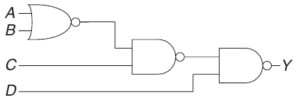

Hình 2.33 Multilevel circuit dùng NAND và NOR

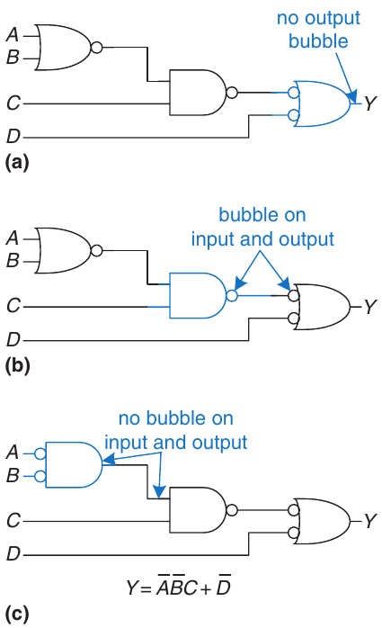

Hình 2.34 Circuit đã Bubble-pushed

Để nhấn mạnh điểm cuối này, Hình 2.35 trình bày circuit tương đương logic với circuit trong Hình 2.34. Hàm của internal node được ghi màu xanh. Vì các bubble nối tiếp triệt tiêu, có thể bỏ qua bubble trên output của gate giữa và trên một input của gate ngoài cùng bên phải, tạo thành circuit tương đương logic trong Hình 2.35.

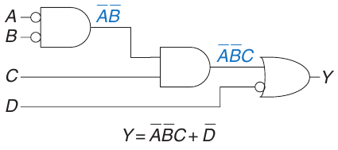

Hình 2.35 Circuit bubble-pushed tương đương logic

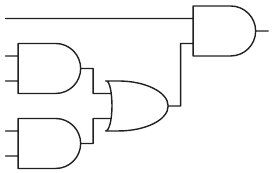

Hình 2.36 Circuit dùng AND và OR

#### Ví dụ 2.8 BUBBLE PUSHING CHO CMOS LOGIC

Phần lớn người thiết kế suy nghĩ theo AND và OR gate, nhưng giả sử bạn muốn triển khai circuit trong Hình 2.36 bằng CMOS logic, vốn ưu tiên NAND và NOR gate. Dùng bubble pushing để chuyển circuit thành NAND, NOR và inverter.

Lời giải Cách giải trực tiếp là thay mỗi AND gate bằng một NAND và một inverter, mỗi OR gate bằng một NOR và một inverter, như Hình 2.37. Cách này cần tám gate. Chú ý inverter được vẽ với bubble phía trước thay vì phía sau để nhấn mạnh cách bubble triệt tiêu với inverting gate đứng trước.

Để có lời giải tốt hơn, quan sát rằng có thể thêm bubble vào output của một gate và input của gate kế tiếp mà không đổi hàm, như Hình 2.38(a). AND cuối được chuyển thành một NAND và một inverter, như Hình 2.38(b). Lời giải này chỉ cần năm gate.

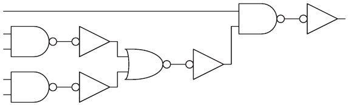

Hình 2.37 Circuit kém hiệu quả dùng NAND và NOR

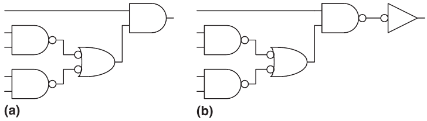

Hình 2.38 Circuit tốt hơn dùng NAND và NOR

## 2.6 X VÀ Z, ÔI CHAO

Đại số Boolean chỉ giới hạn ở 0 và 1. Tuy nhiên, circuit thực còn có thể có giá trị illegal và floating, được biểu diễn bằng ký hiệu X và Z.

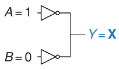

Hình 2.39 Circuit có contention

### 2.6.1 Giá trị illegal: X

Ký hiệu X cho biết circuit node có giá trị unknown hoặc illegal. Điều này thường xảy ra khi node đồng thời bị drive về cả 0 và 1. Hình 2.39 trình bày trường hợp node Y bị drive cả HIGH lẫn LOW. Tình huống này gọi là contention, được coi là lỗi và phải tránh. Điện áp thực trên node có contention có thể nằm đâu đó giữa 0 và V<sub>DD</sub>, tùy độ mạnh tương đối của các gate đang drive HIGH và LOW. Điện áp thường, nhưng không phải luôn, nằm trong forbidden zone. Contention cũng có thể khiến lượng công suất lớn chạy giữa các gate đối kháng, làm circuit nóng lên và có thể hư hỏng.

Giá trị X đôi khi cũng được circuit simulator dùng để biểu thị giá trị chưa khởi tạo. Ví dụ, nếu quên chỉ định giá trị input, simulator có thể coi nó là X để cảnh báo bạn về vấn đề.

Như đã nói ở Mục 2.4, người thiết kế số cũng dùng X để chỉ giá trị “don’t care” trong truth table. Hãy chắc chắn không nhầm hai nghĩa. Khi X xuất hiện trong truth table, nó cho biết giá trị biến trong truth table không quan trọng (có thể là 0 hoặc 1). Khi X xuất hiện trong circuit, nó có nghĩa circuit node có giá trị unknown hoặc illegal.

### 2.6.2 Giá trị floating: Z

Ký hiệu Z cho biết node không được drive HIGH cũng không được drive LOW. Node được gọi là floating, high impedance hoặc high Z. Quan niệm sai thường gặp là node floating hoặc không được drive giống logic 0. Trong thực tế, node floating có thể là 0, là 1 hoặc ở điện áp nào đó giữa hai mức, tùy lịch sử của hệ thống. Node floating không phải lúc nào cũng có nghĩa circuit bị lỗi, miễn là có circuit element khác drive node đến logic level hợp lệ khi giá trị node có liên quan đến hoạt động của circuit.

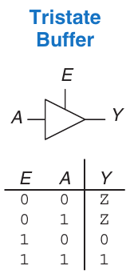

Hình 2.40 Tristate buffer

Một cách thường gặp để tạo node floating là quên nối điện áp đến input của circuit hoặc cho rằng input không nối giống input có giá trị 0. Lỗi này có thể làm circuit hoạt động thất thường khi input floating ngẫu nhiên đổi từ 0 sang 1. Thật vậy, chỉ cần chạm circuit có thể đủ kích hoạt thay đổi do tĩnh điện từ cơ thể. Chúng tôi đã thấy circuit chỉ hoạt động đúng khi sinh viên giữ ngón tay đè lên chip.

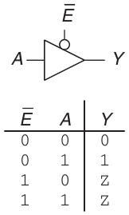

Hình 2.41 Tristate buffer có enable active low

Tristate buffer trong Hình 2.40 có ba trạng thái output: HIGH (1), LOW (0) và floating (Z). Tristate buffer có input A, output Y và enable E. Khi enable là TRUE, tristate buffer hoạt động như buffer đơn giản, truyền giá trị input đến output. Khi enable là FALSE, output được phép floating (Z).

Tristate buffer trong Hình 2.40 có enable active high. Nghĩa là khi enable là HIGH (1), buffer được kích hoạt. Hình 2.41 trình bày tristate buffer có enable active low. Khi enable là LOW (0), buffer được kích hoạt. Chúng ta biểu thị signal active low bằng cách đặt bubble trên dây input. Chúng ta thường biểu thị input active low bằng gạch ngang trên tên, $\overline{E}$, hoặc thêm chữ “b” hay “bar” sau tên, Eb hoặc Ebar.

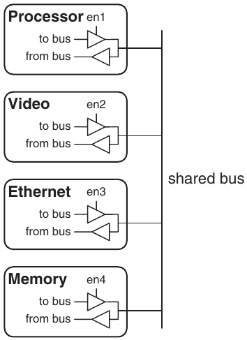

Hình 2.42 Tristate bus kết nối nhiều chip

Tristate buffer thường dùng trên bus nối nhiều chip. Ví dụ, microprocessor, video controller và Ethernet controller đều có thể cần giao tiếp với memory system trong máy tính cá nhân. Mỗi chip có thể nối vào memory bus dùng chung bằng tristate buffer, như Hình 2.42. Mỗi lúc chỉ một chip được phép assert enable signal để drive giá trị lên bus. Các chip khác phải tạo output floating để không gây contention với chip đang nói chuyện với memory. Mọi chip đều có thể đọc thông tin từ bus dùng chung bất kỳ lúc nào. Những tristate bus như vậy từng rất phổ biến. Tuy nhiên, trong máy tính hiện đại, các liên kết point-to-point cho phép tốc độ cao hơn, trong đó chip nối trực tiếp với nhau thay vì qua bus dùng chung.

> Maurice Karnaugh, 1924–
>
> Tốt nghiệp cử nhân vật lý tại City College of New York năm 1948 và nhận bằng tiến sĩ vật lý tại Yale năm 1952.
>
> Làm việc tại Bell Labs và IBM từ 1952 đến 1993, và là giáo sư khoa học máy tính tại Polytechnic University of New York từ 1980 đến 1999.

## 2.7 KARNAUGH MAP

Sau khi thực hiện một số lần tối giản phương trình Boolean bằng đại số Boolean, bạn sẽ nhận ra rằng nếu không cẩn thận, đôi khi bạn thu được phương trình hoàn toàn khác thay vì phương trình đơn giản hơn. Karnaugh map (K-maps) là phương pháp đồ họa để đơn giản hóa phương trình Boolean. Chúng được Maurice Karnaugh, kỹ sư viễn thông tại Bell Labs, phát minh năm 1953. K-maps hoạt động tốt với bài toán có tối đa bốn biến. Quan trọng hơn, chúng giúp hiểu sâu cách biến đổi phương trình Boolean.

> Gray code được Frank Gray, nhà nghiên cứu tại Bell Labs, đăng ký bằng sáng chế (U.S. Patent 2,632,058) năm 1953. Chúng đặc biệt hữu ích trong mechanical encoder vì sai lệch nhỏ chỉ gây lỗi một bit.
>
> Gray code có thể mở rộng cho số bit bất kỳ. Ví dụ, một chuỗi Gray code 3-bit là:
>
> ```
> 000, 001, 011, 010,
> 110, 111, 101, 100
> ```
>
> Lewis Carroll đưa ra một câu đố liên quan trên Vanity Fair năm 1879.
>
> “Quy tắc của câu đố
>
> khá đơn giản. Cho hai từ
>
> có cùng độ dài;
>
> câu đố yêu cầu
>
> nối chúng lại với nhau bằng cách
>
> xen vào những từ khác,
>
> mỗi từ trong đó chỉ khác
>
> từ tiếp theo
>
> đúng một chữ cái. Nghĩa là, một chữ cái
>
> trong một từ đã cho có thể thay đổi
>
> rồi thay một chữ cái trong
>
> từ vừa thu được, và cứ
>
> tiếp tục cho đến khi đạt tới
>
> từ còn lại đã cho.”
>
> Ví dụ, từ SHIP đến DOCK:
>
> ```
> SHIP, SLIP, SLOP,
> SLOT, SOOT, LOOT,
> LOOK, LOCK, DOCK.
> ```
>
> Bạn có thể tìm chuỗi ngắn hơn không?

Nhớ rằng tối giản logic bao gồm kết hợp các hạng. Hai hạng chứa implicant P và dạng true cùng complement của một biến A được kết hợp để loại A: PA + P$\overline{A}$ = P. Karnaugh map giúp dễ nhận ra các hạng có thể kết hợp bằng cách đặt chúng cạnh nhau trên một lưới.

Hình 2.43 trình bày truth table và K-map cho hàm three-input. Hàng trên cùng của K-map cho bốn giá trị có thể có của các input A và B. Cột trái cho hai giá trị có thể có của input C. Mỗi ô trong K-map tương ứng một hàng truth table và chứa giá trị output Y của hàng đó. Ví dụ, ô trên cùng bên trái tương ứng hàng đầu của truth table và cho biết giá trị output Y = 1 khi ABC = 000. Giống mỗi hàng truth table, mỗi ô K-map biểu diễn một minterm. Để giải thích, Hình 2.43(c) trình bày minterm tương ứng từng ô K-map.

Mỗi ô, hay minterm, khác một ô kề ở sự thay đổi của đúng một biến. Điều này có nghĩa các ô kề có chung tất cả literal trừ một literal, xuất hiện dạng true trong ô này và dạng complement trong ô kia. Ví dụ, các ô biểu diễn minterm $\overline{A}\overline{B}\overline{C}$ và $\overline{A}\overline{B}$C nằm kề nhau và chỉ khác ở biến C. Bạn có thể đã nhận thấy các tổ hợp A và B trên hàng đầu có thứ tự lạ: 00, 01, 11, 10. Thứ tự này gọi là Gray code. Nó khác thứ tự nhị phân thông thường (00, 01, 10, 11) ở chỗ các mục kề nhau chỉ khác một biến. Ví dụ, 01:11 chỉ đổi A từ 0 thành 1, trong khi 01:10 đổi A từ 0 thành 1 và B từ 1 thành 0. Vì vậy, viết các tổ hợp theo thứ tự nhị phân sẽ không cho tính chất mong muốn là các ô kề chỉ khác một biến.

K-map còn có tính chất “quấn vòng”. Các ô ngoài cùng bên phải thực chất kề với các ô ngoài cùng bên trái vì chúng chỉ khác nhau ở một biến A. Nói cách khác, bạn có thể cuộn bản đồ thành một hình trụ, rồi nối hai đầu hình trụ để tạo thành torus (tức hình bánh vòng), mà vẫn bảo đảm các ô kề nhau chỉ khác nhau ở một biến.

### 2.7.1 Tư duy khoanh vòng

Trong K-map ở Hình 2.43, chỉ hai minterm xuất hiện trong phương trình, $\overline{A}\overline{B}\overline{C}$ và $\overline{A}\overline{B}$C, như các giá trị 1 ở cột trái thể hiện. Đọc minterm từ K-map hoàn toàn tương đương với đọc phương trình dạng sum-of-products trực tiếp từ truth table. Như trước, có thể dùng đại số Boolean để tối giản phương trình dạng sum-of-products.

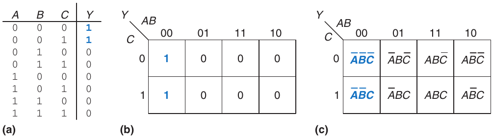

Hình 2.43 Hàm Three-input: (a) truth table, (b) K-map, (c) K-map có hiển thị minterm

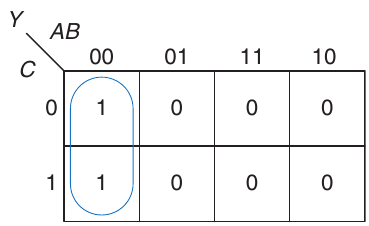

Hình 2.44 Tối giản bằng K-map

Y = $\overline{A}\overline{B}\overline{C}$ + $\overline{A}\overline{B}$C = $\overline{A}\overline{B}$($\overline{C}$ + C) = $\overline{A}\overline{B}$ (2.7)

K-maps giúp thực hiện đơn giản hóa này bằng đồ họa, qua việc khoanh các giá trị 1 trong những ô kề nhau, như Hình 2.44. Với mỗi vòng khoanh, viết implicant tương ứng. Nhớ từ Mục 2.2 rằng implicant là product của một hoặc nhiều literal. Những biến có cả dạng true lẫn complement trong vòng khoanh được loại khỏi implicant. Trong trường hợp này, biến C có cả dạng true (1) và dạng complement (0) trong vòng khoanh, nên không đưa nó vào implicant. Nói cách khác, Y là TRUE khi A = B = 0, không phụ thuộc C. Vì vậy, implicant là $\overline{A}\overline{B}$. K-map cho cùng kết quả đã tìm bằng đại số Boolean.

### 2.7.2 Tối giản logic bằng K-Maps

K-maps cung cấp cách trực quan dễ dàng để tối giản logic. Chỉ cần khoanh mọi khối chữ nhật gồm các giá trị 1 trên bản đồ, dùng ít vòng khoanh nhất có thể. Mỗi vòng phải lớn nhất có thể. Sau đó đọc các implicant đã khoanh.

Chính xác hơn, nhớ rằng phương trình Boolean được tối giản khi viết thành sum của số prime implicant ít nhất. Mỗi vòng khoanh trên K-map biểu diễn một implicant. Các vòng lớn nhất có thể là prime implicant.

Ví dụ, trong K-map của Hình 2.44, $\overline{A}\overline{B}\overline{C}$ và $\overline{A}\overline{B}$C là implicant nhưng không phải prime implicant. Chỉ $\overline{A}\overline{B}$ là prime implicant trong K-map đó. Quy tắc tìm phương trình tối giản từ K-map như sau:

- Dùng ít vòng khoanh nhất cần thiết để phủ tất cả giá trị 1.

- Mọi ô trong mỗi vòng khoanh phải chứa 1.

- Mỗi vòng khoanh phải bao một khối chữ nhật có số ô theo mỗi chiều là lũy thừa của 2 (tức 1, 2 hoặc 4).

- Mỗi vòng khoanh nên lớn nhất có thể.

- Một vòng khoanh có thể quấn qua các mép K-map.

- Một giá trị 1 trong K-map có thể được khoanh nhiều lần nếu nhờ vậy dùng ít vòng hơn.

#### Ví dụ 2.9 TỐI GIẢN HÀM THREE-VARIABLE BẰNG K-MAP

Giả sử có hàm Y = F(A, B, C) với K-map trong Hình 2.45. Tối giản phương trình bằng K-map.

Lời giải Khoanh các giá trị 1 trong K-map bằng ít vòng nhất có thể, như Hình 2.46. Mỗi vòng khoanh trong K-map biểu diễn một prime implicant, và kích thước mỗi vòng là lũy thừa của hai (2 × 1 và 2 × 2). Tạo prime implicant cho từng vòng bằng cách viết những biến chỉ xuất hiện trong vòng ở dạng true hoặc chỉ ở dạng complement.

Ví dụ, trong vòng 2 × 1, cả dạng true và complement của B đều có trong vòng, nên không đưa B vào prime implicant. Tuy nhiên, chỉ dạng true của A (A) và dạng complement của C($\overline{C}$) có trong vòng này, nên đưa các biến đó vào prime implicant A$\overline{C}$. Tương tự, vòng 2 × 2 phủ mọi ô có B = 0, nên prime implicant là $\overline{B}$.

Chú ý ô top-right (minterm) được phủ hai lần để các vòng prime implicant lớn nhất có thể. Như đã thấy với kỹ thuật đại số Boolean, điều này tương đương dùng chung minterm để giảm kích thước implicant. Cũng chú ý vòng phủ bốn ô quấn qua hai cạnh K-map.

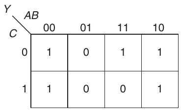

Hình 2.45 K-map cho Ví dụ 2.9

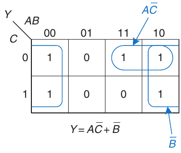

Hình 2.46 Lời giải Ví dụ 2.9


Hình 2.47 Biểu tượng decoder cho màn hình Seven-segment

#### Ví dụ 2.10 DECODER CHO MÀN HÌNH SEVEN-SEGMENT

Decoder cho màn hình seven-segment nhận data input 4-bit D<sub>3:0</sub> và tạo bảy output để điều khiển các diode light-emitting hiển thị chữ số từ 0 đến 9. Bảy output thường được gọi là segment a đến g, hoặc S<sub>a</sub>–S<sub>g</sub>, như định nghĩa trong Hình 2.47. Các chữ số được trình bày ở Hình 2.48. Viết truth table cho các output và dùng K-maps tìm phương trình Boolean cho output S<sub>a</sub> và S<sub>b</sub>. Giả sử giá trị input illegal (10–15) tạo màn hình trống.

Lời giải Truth table được cho trong Bảng 2.6. Ví dụ, input 0000 phải bật mọi segment trừ S<sub>g</sub>.

Mỗi trong bảy output là một hàm độc lập của bốn biến. K-maps cho output S<sub>a</sub> và S<sub>b</sub> được trình bày ở Hình 2.49. Nhớ rằng các ô kề chỉ được khác một biến, nên chúng ta ghi nhãn hàng và cột theo thứ tự Gray code: 00, 01, 11, 10. Cũng cần nhớ thứ tự này khi điền giá trị output vào các ô.

Tiếp theo, khoanh các prime implicant. Dùng số vòng ít nhất cần thiết để phủ mọi giá trị 1. Vòng khoanh có thể quấn qua các mép (dọc và ngang), và một giá trị 1 có thể được khoanh nhiều lần. Hình 2.50 trình bày các prime implicant và phương trình Boolean đã đơn giản hóa.

Chú ý tập prime implicant tối thiểu không duy nhất. Ví dụ, mục 0000 trong K-map S<sub>a</sub> được khoanh cùng mục 1000 để tạo minterm $\overline{D}$<sub>2</sub>$\overline{D}$<sub>1</sub>$\overline{D}$<sub>0</sub>. Thay vào đó, vòng khoanh có thể chứa mục 0010, tạo minterm $\overline{D}$<sub>3</sub>$\overline{D}$<sub>2</sub>$\overline{D}$<sub>0</sub>, như nét đứt trong Hình 2.51.

Hình 2.52 (xem trang 80) minh họa lỗi thường gặp khi chọn nonprime implicant để phủ giá trị 1 ở góc trên bên trái. Minterm $\overline{D}$<sub>3</sub>$\overline{D}$<sub>2</sub>$\overline{D}$<sub>1</sub>$\overline{D}$<sub>0</sub> này cho phương trình sum-of-products chưa tối giản. Có thể kết hợp minterm với một trong các giá trị 1 kề nó để tạo vòng lớn hơn, như trong hai hình trước.


Hình 2.48 Các chữ số của màn hình Seven-segment

Bảng 2.6 Truth table của decoder màn hình Seven-segment

| D<sub>3:0</sub> | S<sub>a</sub> | S<sub>b</sub> | S<sub>c</sub> | S<sub>d</sub> | S<sub>e</sub> | S<sub>f</sub> | S<sub>g</sub> |
|---|---|---|---|---|---|---|---|
| 0000 | 1 | 1 | 1 | 1 | 1 | 1 | 0 |
| 0001 | 0 | 1 | 1 | 0 | 0 | 0 | 0 |
| 0010 | 1 | 1 | 0 | 1 | 1 | 0 | 1 |
| 0011 | 1 | 1 | 1 | 1 | 0 | 0 | 1 |
| 0100 | 0 | 1 | 1 | 0 | 0 | 1 | 1 |
| 0101 | 1 | 0 | 1 | 1 | 0 | 1 | 1 |
| 0110 | 1 | 0 | 1 | 1 | 1 | 1 | 1 |
| 0111 | 1 | 1 | 1 | 0 | 0 | 0 | 0 |
| 1000 | 1 | 1 | 1 | 1 | 1 | 1 | 1 |
| 1001 | 1 | 1 | 1 | 0 | 0 | 1 | 1 |
| giá trị khác | 0 | 0 | 0 | 0 | 0 | 0 | 0 |


Hình 2.49 Karnaugh map cho S<sub>a</sub> và S<sub>b</sub>


Hình 2.50 Lời giải K-map cho Ví dụ 2.10


Hình 2.51 K-map khác cho S<sub>a</sub> với tập prime implicant khác

### 2.7.3 Don’t Cares

Nhớ rằng các mục input “don’t care” trong truth table đã được giới thiệu ở Mục 2.4 để giảm số hàng khi một số biến không ảnh hưởng output. Chúng được biểu thị bằng X, có nghĩa mục đó có thể là 0 hoặc 1.

Don’t care cũng xuất hiện ở output truth table khi giá trị output không quan trọng hoặc tổ hợp input tương ứng không bao giờ xảy ra. Người thiết kế có thể tùy ý coi các output đó là 0 hoặc 1.


Hình 2.52 K-map khác cho S<sub>a</sub> với nonprime implicant được chọn sai

Trong K-map, X cho phép tối giản logic hơn nữa. Có thể khoanh X nếu chúng giúp phủ các giá trị 1 bằng ít vòng hơn hoặc vòng lớn hơn, nhưng không phải khoanh nếu không hữu ích.

#### Ví dụ 2.11 DECODER CHO MÀN HÌNH SEVEN-SEGMENT VỚI DON’T CARE

Làm lại Ví dụ 2.10 nếu không quan tâm giá trị output cho input illegal từ 10 đến 15.

Lời giải K-map được trình bày trong Hình 2.53, với các mục X biểu diễn don’t care. Vì don’t care có thể là 0 hoặc 1, chúng ta khoanh don’t care nếu nó cho phép phủ các giá trị 1 bằng ít vòng hơn hoặc vòng lớn hơn. Don’t care được khoanh được coi là 1, còn don’t care không khoanh là 0. Quan sát cách khoanh một hình vuông 2 × 2 quấn qua cả bốn góc cho segment S<sub>a</sub>. Dùng don’t care đơn giản hóa logic đáng kể.

### 2.7.4 Bức tranh tổng thể

Đại số Boolean và Karnaugh map là hai phương pháp đơn giản hóa logic. Mục tiêu cuối cùng là tìm phương pháp low-cost để triển khai một logic function cụ thể.

Trong thực hành kỹ thuật hiện đại, các chương trình máy tính gọi là logic synthesizer tạo circuit đơn giản hóa từ mô tả logic function, như chúng ta sẽ thấy ở Chương 4. Với bài toán lớn, logic synthesizer hiệu quả hơn con người nhiều. Với bài toán nhỏ, người có chút kinh nghiệm có thể tìm lời giải tốt bằng quan sát. Chưa tác giả nào từng dùng Karnaugh map trong đời thực để giải một bài toán thực tiễn. Nhưng hiểu biết thu được từ các nguyên lý nền tảng của Karnaugh map rất có giá trị. Và Karnaugh map thường xuất hiện trong phỏng vấn xin việc!


Hình 2.53 Lời giải K-map có don’t care

## 2.8 COMBINATIONAL BUILDING BLOCK


Hình 2.54 Ký hiệu và truth table của multiplexer 2:1

Combinational logic thường được nhóm thành building block lớn hơn để xây dựng hệ thống phức tạp hơn. Đây là ứng dụng của nguyên lý abstraction, che giấu chi tiết gate-level không cần thiết để nhấn mạnh chức năng building block. Chúng ta đã nghiên cứu ba building block như vậy: full adder (Mục 2.1), priority circuit (Mục 2.4) và decoder cho màn hình seven-segment (Mục 2.7). Mục này giới thiệu thêm hai building block thường dùng: multiplexer và decoder. Chương 5 trình bày các combinational building block khác.

### 2.8.1 Multiplexers

Multiplexer là một trong các combinational circuit thường dùng nhất. Chúng chọn output từ nhiều input có thể có, dựa vào giá trị select signal. Multiplexer đôi khi được gọi thân mật là mux.

2:1 Multiplexer

Hình 2.54 trình bày schematic và truth table của multiplexer 2:1 với hai data input D<sub>0</sub> và D<sub>1</sub>, một select input S và một output Y. Multiplexer chọn giữa hai data input dựa vào select: nếu S = 0, Y = D<sub>0</sub>, và nếu S = 1, Y = D<sub>1</sub>. S còn gọi là control signal vì nó điều khiển multiplexer làm gì.

Multiplexer 2:1 có thể được xây dựng từ logic sum-of-products như Hình 2.55. Phương trình Boolean cho multiplexer có thể suy ra bằng Karnaugh map hoặc đọc qua quan sát (Y là 1 nếu S = 0 AND D<sub>0</sub> là 1 OR nếu S = 1 AND D<sub>1</sub> là 1).


Hình 2.55 Triển khai multiplexer 2:1 bằng logic two-level


Hình 2.56 Multiplexer dùng tristate buffer

Một cách khác, multiplexer có thể xây dựng từ tristate buffer như Hình 2.56. Các tristate enable được sắp xếp sao cho luôn có đúng một tristate buffer hoạt động. Khi S = 0, tristate T0 được kích hoạt, cho phép D<sub>0</sub> truyền đến Y. Khi S = 1, tristate T1 được kích hoạt, cho phép D<sub>1</sub> truyền đến Y.

Multiplexer rộng hơn

Multiplexer 4:1 có bốn data input và một output, như Hình 2.57. Cần hai select signal để chọn giữa bốn data input. Multiplexer 4:1 có thể xây dựng bằng logic sum-of-products, tristate hoặc nhiều multiplexer 2:1, như Hình 2.58.

> Nối chập output của nhiều gate về mặt kỹ thuật vi phạm quy tắc combinational circuit trong Mục 2.1. Nhưng vì mỗi lúc chỉ đúng một output được drive, ngoại lệ này được cho phép.

Các product term kích hoạt tristate có thể tạo bằng AND gate và inverter. Cũng có thể tạo chúng bằng decoder, sẽ được giới thiệu ở Mục 2.8.2.

Multiplexer rộng hơn, như 8:1 và 16:1, có thể xây dựng bằng cách mở rộng các phương pháp trong Hình 2.58. Nhìn chung, multiplexer N:1 cần log<sub>2</sub>N select line. Một lần nữa, lựa chọn triển khai tốt nhất phụ thuộc công nghệ đích.


Hình 2.57 Multiplexer 4:1

Logic bằng multiplexer

Multiplexer có thể dùng như lookup table để thực hiện logic function. Hình 2.59 trình bày multiplexer 4:1 dùng để triển khai AND gate two-input. Các input A và B đóng vai trò select line. Data input của multiplexer được nối 0 hoặc 1 theo hàng tương ứng trong truth table. Nhìn chung, multiplexer 2<sup>N</sup>-input có thể được lập trình để thực hiện logic function N-input bất kỳ bằng cách đưa 0 và 1 vào data input thích hợp. Thật vậy, thay đổi data input có thể lập trình lại multiplexer để thực hiện hàm khác.


Hình 2.58 Các cách triển khai multiplexer 4:1: (a) logic two-level, (b) tristate, (c) phân cấp


Hình 2.59 Triển khai hàm AND two-input bằng multiplexer 4:1

Khéo léo một chút, có thể giảm một nửa kích thước multiplexer, chỉ dùng multiplexer 2<sup>N–1</sup>-input để thực hiện logic function N-input bất kỳ. Chiến lược là cung cấp một literal, cùng với 0 và 1, cho data input của multiplexer.

Để minh họa nguyên tắc này, Hình 2.60 trình bày các hàm AND và XOR two-input được triển khai bằng multiplexer 2:1. Bắt đầu từ truth table thông thường rồi kết hợp từng cặp hàng để loại biến input ngoài cùng bên phải, bằng cách biểu diễn output theo biến này. Ví dụ, với AND, khi A = 0, Y = 0 bất kể B. Khi A = 1, Y = 0 nếu B = 0 và Y = 1 nếu B = 1, nên Y = B. Sau đó dùng multiplexer như lookup table theo truth table mới nhỏ hơn.

#### Ví dụ 2.12 LOGIC BẰNG MULTIPLEXER

Alyssa P. Hacker cần triển khai hàm Y = A$\overline{B}$ + $\overline{B}\overline{C}$ + $\overline{A}$BC để hoàn thành đồ án tốt nghiệp, nhưng khi tìm bộ dụng cụ thực hành, linh kiện duy nhất còn lại là multiplexer 8:1. Cô triển khai hàm thế nào?

Lời giải Hình 2.61 trình bày cách triển khai của Alyssa bằng một multiplexer 8:1 duy nhất. Multiplexer đóng vai trò lookup table, mỗi hàng truth table tương ứng một input multiplexer.


Hình 2.60 Logic bằng multiplexer với input biến thiên


Hình 2.61 Circuit của Alyssa: (a) truth table, (b) triển khai bằng multiplexer 8:1

#### Ví dụ 2.13 LOGIC BẰNG MULTIPLEXER, LÀM LẠI

Alyssa bật circuit lần nữa trước buổi thuyết trình cuối cùng và làm cháy multiplexer 8:1. (Cô vô tình cấp 20 V thay vì 5 V sau một đêm không ngủ.) Cô năn nỉ bạn bè cho linh kiện dư và được cho một multiplexer 4:1 cùng một inverter. Cô có thể xây dựng circuit chỉ bằng các linh kiện này không?

Lời giải Alyssa giảm truth table xuống bốn hàng bằng cách cho output phụ thuộc C. (Cô cũng có thể sắp xếp lại các cột truth table để output phụ thuộc A hoặc B.) Hình 2.62 trình bày thiết kế mới.

### 2.8.2 Decoders

Decoder có N input và 2<sup>N</sup> output. Nó assert đúng một output tùy tổ hợp input. Hình 2.63 trình bày decoder 2:4. Khi A<sub>1:0</sub> = 00, Y<sub>0</sub> là 1. Khi A<sub>1:0</sub> = 01, Y<sub>1</sub> là 1. Và cứ như vậy. Các output được gọi là one-hot, vì mỗi lúc có đúng một output “hot” (HIGH).


Hình 2.62 Circuit mới của Alyssa


Hình 2.63 Decoder 2:4

#### Ví dụ 2.14 TRIỂN KHAI DECODER

Triển khai decoder 2:4 bằng AND và NOT gate.

Lời giải Hình 2.64 trình bày cách triển khai decoder 2:4 bằng bốn AND gate. Mỗi gate phụ thuộc dạng true hoặc complement của từng input. Nhìn chung, decoder N:2<sup>N</sup> có thể xây dựng từ 2<sup>N</sup> AND gate N-input nhận các tổ hợp input true hoặc complement khác nhau. Mỗi output decoder biểu diễn một minterm. Ví dụ, Y<sub>0</sub> biểu diễn minterm $\overline{A}$<sub>1</sub>$\overline{A}$<sub>0</sub>. Điều này hữu ích khi dùng decoder với các digital building block khác.


Hình 2.64 Triển khai decoder 2:4


Hình 2.65 Logic function dùng decoder

Logic bằng decoder

Decoder có thể kết hợp với OR gate để xây dựng logic function. Hình 2.65 trình bày hàm XNOR two-input bằng decoder 2:4 và một OR gate duy nhất. Vì mỗi output decoder biểu diễn một minterm, hàm được xây dựng bằng OR mọi minterm trong hàm. Trong Hình 2.65, Y = $\overline{A}\overline{B}$ + AB = $\overline{A {\oplus} B}$.

Khi dùng decoder để xây dựng logic, dễ nhất là biểu diễn hàm bằng truth table hoặc canonical form sum-of-products. Hàm N-input có M giá trị 1 trong truth table có thể được xây dựng bằng decoder N:2<sup>N</sup> và OR gate M-input nối đến tất cả minterm chứa 1 trong truth table. Khái niệm này sẽ được áp dụng để xây dựng memory read-only (ROM) ở Mục 5.5.6.

## 2.9 TIMING

Trong các mục trước, chúng ta chủ yếu quan tâm circuit có hoạt động hay không—lý tưởng là dùng ít gate nhất. Tuy nhiên, như mọi người thiết kế circuit dày dạn kinh nghiệm đều xác nhận, một trong những vấn đề khó nhất trong thiết kế circuit là timing: làm circuit chạy nhanh.

Output cần thời gian để thay đổi nhằm phản hồi thay đổi input. Hình 2.66 trình bày độ trễ giữa thay đổi input và thay đổi output tiếp theo của buffer. Hình này gọi là timing diagram; nó biểu diễn transient response của buffer circuit khi input thay đổi. Chuyển từ LOW lên HIGH gọi là rising edge. Tương tự, chuyển từ HIGH xuống LOW (không vẽ trong hình) gọi là falling edge. Mũi tên xanh cho biết rising edge của Y do rising edge của A gây ra. Chúng ta đo độ trễ từ điểm 50% của input signal A đến điểm 50% của output signal Y. Điểm 50% là điểm signal nằm giữa (50%) các giá trị LOW và HIGH trong lúc chuyển mức.

> Khi người thiết kế nói tính độ trễ của circuit, họ thường chỉ giá trị worst-case (propagation delay), trừ khi ngữ cảnh cho thấy rõ điều khác.

### 2.9.1 Propagation Delay và Contamination Delay

Combinational logic được đặc trưng bởi propagation delay và contamination delay. Propagation delay t<sub>pd</sub> là thời gian tối đa từ khi input bất kỳ thay đổi đến khi output hoặc các output đạt giá trị cuối cùng. Contamination delay t<sub>cd</sub> là thời gian tối thiểu từ khi input bất kỳ thay đổi đến khi bất kỳ output nào bắt đầu đổi giá trị.


Hình 2.66 Độ trễ circuit


Hình 2.67 Propagation delay và contamination delay

Hình 2.67 minh họa propagation delay và contamination delay của buffer lần lượt bằng màu xanh và xám. Hình cho thấy A ban đầu là HIGH hoặc LOW và chuyển sang trạng thái kia tại một thời điểm cụ thể; chúng ta chỉ quan tâm nó thay đổi, không quan tâm giá trị cụ thể. Để phản hồi, Y thay đổi sau đó một khoảng thời gian. Các cung chỉ rằng Y có thể bắt đầu thay đổi sau khi A chuyển mức t<sub>cd</sub>, và chắc chắn ổn định ở giá trị mới trong t<sub>pd</sub>.

Nguyên nhân nền tảng gây độ trễ circuit gồm thời gian cần để nạp capacitance trong circuit và tốc độ ánh sáng. t<sub>pd</sub> và t<sub>cd</sub> có thể khác nhau vì nhiều lý do, gồm

> Độ trễ circuit thường ở cỡ picosecond (1 ps = 10<sup>−12</sup> giây) đến nanosecond (1 ns = 10<sup>−9</sup> giây). Hàng nghìn tỷ picosecond đã trôi qua trong thời gian bạn đọc ô ghi chú này.

- độ trễ rising và falling khác nhau

- nhiều input và output, trong đó một số nhanh hơn những cái khác

- circuit chậm đi khi nóng và nhanh lên khi lạnh

Tính t<sub>pd</sub> và t<sub>cd</sub> đòi hỏi nghiên cứu những mức abstraction thấp hơn, vượt phạm vi sách. Tuy nhiên, nhà sản xuất thường cung cấp data sheet chỉ rõ các độ trễ này cho mỗi gate.

Cùng các yếu tố đã liệt kê, propagation delay và contamination delay còn được quyết định bởi đường đi của signal từ input đến output. Hình 2.68 trình bày logic circuit four-input. Critical path, màu xanh, là đường từ input A hoặc B đến output Y. Đó là đường dài nhất—và do đó chậm nhất—vì input đi qua ba gate đến output. Đường này có tính quyết định vì nó giới hạn tốc độ circuit hoạt động. Short path qua circuit, màu xám, đi từ input D đến output Y. Đây là đường ngắn nhất—và do đó nhanh nhất—qua circuit, vì input chỉ đi qua một gate đến output.


Hình 2.68 Short path và critical path


Hình 2.69 Waveform của critical path và short path

Propagation delay của combinational circuit bằng tổng propagation delay qua từng element trên critical path. Contamination delay bằng tổng contamination delay qua từng element trên short path. Các độ trễ này được minh họa trong Hình 2.69 và mô tả bằng các phương trình sau:

t<sub>pd</sub> = 2t<sub>pd–AND</sub> + t<sub>pd–OR</sub> (2.8)

t<sub>cd</sub> = t<sub>cd–AND</sub> (2.9)

> Dù chúng ta bỏ qua độ trễ dây dẫn trong phân tích này, digital circuit hiện nhanh đến mức độ trễ của dây dài có thể quan trọng ngang độ trễ gate. Độ trễ do tốc độ ánh sáng trong dây dẫn được bàn ở Phụ lục A.

#### Ví dụ 2.15 TÌM ĐỘ TRỄ

Ben Bitdiddle cần tìm propagation delay và contamination delay của circuit trong Hình 2.70. Theo sách dữ liệu của cậu, mỗi gate có propagation delay 100 picosecond (ps) và contamination delay 60 ps.

Lời giải Ben bắt đầu bằng cách tìm critical path và đường ngắn nhất qua circuit. Critical path, tô xanh trong Hình 2.71, đi từ input A hoặc B qua ba gate đến output Y. Vì vậy, t<sub>pd</sub> bằng ba lần propagation delay của một gate, hay 300 ps.

Đường ngắn nhất, màu xám trong Hình 2.72, đi từ input C, D hoặc E qua hai gate đến output Y. Chỉ có hai gate trên đường ngắn nhất, nên t<sub>cd</sub> bằng 120 ps.


Hình 2.70 Circuit của Ben


Hình 2.71 Critical path của Ben


Hình 2.72 Đường ngắn nhất của Ben

#### Ví dụ 2.16 TIMING CỦA MULTIPLEXER: CONTROL-CRITICAL SO VỚI DATA-CRITICAL

So sánh timing worst-case của ba thiết kế multiplexer four-input trong Hình 2.58 trang 83. Bảng 2.7 liệt kê propagation delay của các thành phần. Critical path của từng thiết kế là gì? Từ phân tích timing, vì sao bạn có thể chọn thiết kế này thay thiết kế kia?

Lời giải Một critical path của mỗi trong ba phương án thiết kế được tô xanh ở Hình 2.73 và 2.74. t<sub>pd_sy</sub> biểu thị propagation delay từ input S đến output Y; t<sub>pd_dy</sub> biểu thị propagation delay từ input D đến output Y; t<sub>pd</sub> của circuit là độ trễ lớn hơn trong hai giá trị: max(t<sub>pd_sy</sub>, t<sub>pd_dy</sub>).

Với cả cách triển khai logic two-level và tristate trong Hình 2.73, critical path đi từ một control signal S đến output Y: t<sub>pd</sub> = t<sub>pd_sy</sub>. Các circuit này là control critical vì critical path đi từ control signal đến output. Bất kỳ độ trễ bổ sung nào trong control signal đều cộng trực tiếp vào độ trễ worst-case. Độ trễ từ D đến Y trong Hình 2.73(b) chỉ 50 ps, so với độ trễ từ S đến Y là 125 ps. Hình 2.74 trình bày cách triển khai phân cấp multiplexer 4:1 bằng hai tầng multiplexer 2:1. Critical path đi từ bất kỳ input D nào đến output. Circuit này là data critical vì critical path đi từ data input đến output: t<sub>pd</sub> = t<sub>pd_dy</sub>.

Nếu data input đến sớm hơn control input nhiều, chúng ta ưu tiên thiết kế có độ trễ control-to-output ngắn nhất (thiết kế phân cấp ở Hình 2.74). Tương tự, nếu control input đến sớm hơn data input nhiều, chúng ta ưu tiên thiết kế có độ trễ data-to-output ngắn nhất (thiết kế tristate ở Hình 2.73(b)).

Lựa chọn tốt nhất không chỉ phụ thuộc critical path qua circuit và thời điểm input đến, mà còn phụ thuộc công suất, chi phí và mức sẵn có của linh kiện.

Bảng 2.7 Timing specification của các element trong multiplexer circuit

| Gate | t<sub>pd</sub> (ps) |
|---|---|
| NOT | 30 |
| 2-input AND | 60 |
| 3-input AND | 80 |
| 4-input OR | 90 |
| tristate (A đến Y) | 50 |
| tristate (enable đến Y) | 35 |

### 2.9.2 Glitches

Đến đây, chúng ta đã bàn trường hợp một input transition gây một output transition. Tuy nhiên, một input transition có thể gây nhiều output transition. Chúng gọi là glitch hoặc hazard. Dù glitch thường không gây vấn đề, cần nhận thức sự tồn tại và nhận ra chúng khi xem timing diagram. Hình 2.75 trình bày circuit có glitch và Karnaugh map của circuit.

> Hazard có một nghĩa khác liên quan microarchitecture ở Chương 7, nên chúng ta dùng thuật ngữ glitch cho nhiều output transition để tránh nhầm lẫn.

Phương trình Boolean được tối giản đúng, nhưng hãy xem điều gì xảy ra khi A = 0, C = 1 và B chuyển từ 1 xuống 0. Hình 2.76 (xem trang 92) minh họa tình huống này. Short path (màu xám) đi qua hai gate, AND và OR. Critical path (màu xanh) đi qua một inverter và hai gate AND, OR.


Hình 2.73 Propagation delay của multiplexer 4:1: (a) logic two-level, (b) tristate


Hình 2.74 Propagation delay của multiplexer 4:1: phân cấp bằng multiplexer 2:1


Hình 2.75 Circuit có glitch

Khi B chuyển từ 1 xuống 0, n2 (trên short path) giảm trước khi n1 (trên critical path) kịp tăng. Cho đến khi n1 tăng, cả hai input OR gate là 0, và output Y giảm xuống 0. Khi n1 cuối cùng tăng, Y trở lại 1. Như timing diagram trong Hình 2.76, Y bắt đầu ở 1 và kết thúc ở 1 nhưng thoáng glitch xuống 0.


Hình 2.76 Timing của glitch

Miễn là chờ propagation delay trôi qua trước khi dựa vào output, glitch không gây vấn đề, vì output cuối cùng ổn định ở kết quả đúng.

Nếu muốn, có thể tránh glitch này bằng cách thêm một gate vào cách triển khai. Điều này dễ hiểu nhất qua K-map. Hình 2.77 cho thấy input transition trên B từ ABC = 011 đến ABC = 001 đi từ vòng prime implicant này sang vòng khác. Chuyển qua ranh giới hai prime implicant trong K-map cho biết có thể xuất hiện glitch.

Như đã thấy từ timing diagram ở Hình 2.76, nếu phần circuit triển khai một prime implicant tắt trước khi phần circuit của prime implicant kia bật, sẽ có glitch. Để khắc phục, thêm một vòng khoanh phủ ranh giới prime implicant đó, như Hình 2.78. Bạn có thể nhận ra đây là định lý consensus, với hạng bổ sung $\overline{A}$C là consensus term hay redundant term.


Hình 2.77 Thay đổi input đi qua ranh giới implicant


Hình 2.78 K-map không có glitch


Hình 2.79 Circuit không có glitch

Hình 2.79 trình bày circuit glitch-proof. AND gate bổ sung được tô xanh. Giờ đây, transition trên B khi A = 0 và C = 1 không gây glitch trên output vì AND gate màu xanh xuất 1 trong suốt transition.

Nhìn chung, glitch có thể xảy ra khi thay đổi của một biến đi qua ranh giới giữa hai prime implicant trong K-map. Có thể loại glitch bằng cách thêm redundant implicant vào K-map để phủ các ranh giới này. Dĩ nhiên, điều này phải trả giá bằng hardware bổ sung.

Tuy nhiên, transition đồng thời trên nhiều input cũng có thể gây glitch. Không thể khắc phục các glitch này bằng cách thêm hardware. Vì phần lớn hệ thống đáng quan tâm đều có transition đồng thời (hoặc gần đồng thời) trên nhiều input, glitch là thực tế trong phần lớn circuit. Dù đã trình bày cách loại một loại glitch, mục đích bàn về glitch là nhận thức chúng tồn tại, chứ không phải loại bỏ chúng. Điều này đặc biệt quan trọng khi xem timing diagram trên simulator hoặc oscilloscope.

## 2.10 TỔNG KẾT

Digital circuit là module có input và output discrete-valued cùng specification mô tả hàm và timing của module. Chương này tập trung vào combinational circuit, có output chỉ phụ thuộc giá trị input hiện tại.

Hàm của combinational circuit có thể cho bằng truth table hoặc phương trình Boolean. Có thể tìm phương trình Boolean cho mọi truth table một cách có hệ thống bằng dạng sum-of-products (SOP) hoặc product-of-sums (POS). Trong dạng sum-of-products, hàm được viết thành sum (OR) của một hoặc nhiều implicant. Implicant là product (AND) của literal. Literal là dạng true hoặc complement của biến input.

Có thể đơn giản hóa phương trình Boolean bằng các quy tắc đại số Boolean. Cụ thể, có thể đơn giản hóa về dạng sum-of-products tối thiểu bằng cách kết hợp implicant chỉ khác dạng true và complement của một literal: PA + P$\overline{A}$ = P. Karnaugh map là công cụ trực quan để tối giản hàm có tối đa bốn biến. Khi có luyện tập, người thiết kế thường có thể đơn giản hóa hàm vài biến bằng quan sát. Công cụ Computer-aided design được dùng cho hàm phức tạp hơn; các phương pháp và công cụ đó được bàn ở Chương 4.

Logic gate được kết nối để tạo combinational circuit thực hiện hàm mong muốn. Mọi hàm dạng sum-of-products đều có thể xây dựng bằng logic two-level: NOT gate tạo complement của input, AND gate tạo product và OR gate tạo sum. Tùy hàm và building block sẵn có, cách triển khai multilevel logic bằng các loại gate khác nhau có thể hiệu quả hơn. Ví dụ, circuit CMOS ưu tiên NAND và NOR gate vì chúng có thể xây dựng trực tiếp từ transistor CMOS mà không cần thêm NOT gate. Khi dùng NAND và NOR gate, bubble pushing hữu ích để theo dõi các phép đảo.

Logic gate được kết hợp để tạo circuit lớn hơn như multiplexer, decoder và priority circuit. Multiplexer chọn một data input dựa vào select input. Decoder đặt một output HIGH theo input. Priority circuit tạo output biểu thị input có độ ưu tiên cao nhất. Các circuit này đều là ví dụ về combinational building block. Chương 5 sẽ giới thiệu thêm building block, gồm các arithmetic circuit khác. Các building block này sẽ được dùng rộng rãi để xây dựng microprocessor trong Chương 7.

Timing specification của combinational circuit gồm propagation delay và contamination delay qua circuit. Chúng biểu thị thời gian dài nhất và ngắn nhất giữa thay đổi input và thay đổi output do nó gây ra. Tính propagation delay của circuit bao gồm xác định critical path qua circuit, rồi cộng propagation delay của từng element trên đường đó. Có nhiều cách triển khai combinational circuit phức tạp; các cách này đem lại trade-offs giữa tốc độ và chi phí.

Chương tiếp theo chuyển sang sequential circuit, có output phụ thuộc cả giá trị hiện tại lẫn giá trị trước đó của input. Nói cách khác, sequential circuit có memory về quá khứ.

## Bài tập

Bài tập 2.1 Viết phương trình Boolean dạng canonical form sum-of-products cho từng truth table trong Hình 2.80.


Hình 2.80 Truth table cho Bài tập 2.1, 2.3 và 2.41

Bài tập 2.2 Viết phương trình Boolean dạng canonical form sum-of-products cho từng truth table trong Hình 2.81.


Hình 2.81 Truth table cho Bài tập 2.2 và 2.4

Bài tập 2.3 Viết phương trình Boolean dạng canonical form product-of-sums cho các truth table trong Hình 2.80.

Bài tập 2.4 Viết phương trình Boolean dạng canonical form product-of-sums cho các truth table trong Hình 2.81.

Bài tập 2.5 Tối giản từng phương trình Boolean trong Bài tập 2.1.

Bài tập 2.6 Tối giản từng phương trình Boolean trong Bài tập 2.2.

Bài tập 2.7 Phác thảo combinational circuit đơn giản hợp lý để triển khai từng hàm ở Bài tập 2.5. Đơn giản hợp lý có nghĩa không lãng phí gate, nhưng cũng không tốn quá nhiều thời gian kiểm tra mọi cách triển khai circuit có thể có.

Bài tập 2.8 Phác thảo combinational circuit đơn giản hợp lý để triển khai từng hàm ở Bài tập 2.6.

Bài tập 2.9 Làm lại Bài tập 2.7, chỉ dùng NOT gate cùng AND và OR gate.

Bài tập 2.10 Làm lại Bài tập 2.8, chỉ dùng NOT gate cùng AND và OR gate.

Bài tập 2.11 Làm lại Bài tập 2.7, chỉ dùng NOT gate cùng NAND và NOR gate.

Bài tập 2.12 Làm lại Bài tập 2.8, chỉ dùng NOT gate cùng NAND và NOR gate.

Bài tập 2.13 Đơn giản hóa các phương trình Boolean sau bằng định lý Boolean. Kiểm tra tính đúng đắn bằng truth table hoặc K-map.

(a) Y = AC + $\overline{A}\overline{B}$C

(b) Y = $\overline{A}\overline{B}$ + $\overline{A}$B$\overline{C}$ + (A + $\overline{C}$)

(c) Y = $\overline{A}\overline{B}\overline{C}\overline{D}$ + A$\overline{B}\overline{C}$ + A$\overline{B}$C$\overline{D}$ + ABD + $\overline{A}\overline{B}$C$\overline{D}$ + B$\overline{C}$D + $\overline{A}$

Bài tập 2.14 Đơn giản hóa các phương trình Boolean sau bằng định lý Boolean. Kiểm tra tính đúng đắn bằng truth table hoặc K-map.

(a) Y = $\overline{A}$BC + $\overline{A}$B$\overline{C}$

(b) Y = $\overline{ABC}$ + A$\overline{B}$

(c) Y = ABC$\overline{D}$ + A$\overline{BCD}$ + ($\overline{A + B + C + D}$)

Bài tập 2.15 Phác thảo combinational circuit đơn giản hợp lý triển khai từng hàm ở Bài tập 2.13.

Bài tập 2.16 Phác thảo combinational circuit đơn giản hợp lý triển khai từng hàm ở Bài tập 2.14.

Bài tập 2.17 Đơn giản hóa từng phương trình Boolean sau. Phác thảo combinational circuit đơn giản hợp lý triển khai phương trình đã đơn giản hóa.

(a) Y = BC + $\overline{A}\overline{B}\overline{C}$ + B$\overline{C}$

(b) Y = $\overline{A + \overline{A}B + \overline{A}\overline{B}}$ + A + $\overline{B}$

(c) Y = ABC + ABD + ABE + ACD + ACE + ($\overline{A + D + E}$) + $\overline{B}\overline{C}$D

\+ $\overline{B}\overline{C}$E + $\overline{B}\overline{D}\overline{E}$ + $\overline{C}\overline{D}\overline{E}$

Bài tập 2.18 Đơn giản hóa từng phương trình Boolean sau. Phác thảo combinational circuit đơn giản hợp lý triển khai phương trình đã đơn giản hóa.

(a) Y = $\overline{A}$BC + $\overline{B\overline{C}}$ + BC

(b) Y = ($\overline{A + B + C}$)D + AD + B

(c) Y = ABCD + $\overline{A}$B$\overline{C}$D + ($\overline{\overline{B} + D}$)E

Bài tập 2.19 Cho ví dụ truth table cần từ 3 tỷ đến 5 tỷ hàng nhưng có thể xây dựng bằng ít hơn 40 (nhưng ít nhất 1) gate two-input.

Bài tập 2.20 Cho ví dụ circuit có cyclic path nhưng vẫn là combinational.

Bài tập 2.21 Alyssa P. Hacker nói mọi hàm Boolean đều có thể viết dạng sum-of-products tối thiểu bằng sum của mọi prime implicant của hàm. Ben Bitdiddle nói có một số hàm mà phương trình tối thiểu không có tất cả prime implicant. Giải thích vì sao Alyssa đúng hoặc đưa phản ví dụ chứng minh ý Ben.

Bài tập 2.22 Chứng minh các định lý sau đúng bằng perfect induction. Không cần chứng minh dual của chúng.

(a) Định lý idempotency (T3)

(b) Định lý distributivity (T8)

(c) Định lý combining (T10)

Bài tập 2.23 Chứng minh định lý De Morgan (T12) cho ba biến A, B và C bằng perfect induction.

Bài tập 2.24 Viết phương trình Boolean cho circuit trong Hình 2.82. Không cần tối giản phương trình.


Hình 2.82 Schematic của circuit cho Bài tập 2.24

Bài tập 2.25 Tối giản phương trình Boolean ở Bài tập 2.24 và phác thảo circuit cải tiến có cùng chức năng.

Bài tập 2.26 Dùng các gate tương đương De Morgan và phương pháp bubble pushing, vẽ lại circuit ở Hình 2.83 sao cho có thể tìm phương trình Boolean bằng quan sát. Viết phương trình Boolean.


Hình 2.83 Schematic của circuit cho Bài tập 2.26 và 2.43

Bài tập 2.27 Làm lại Bài tập 2.26 cho circuit trong Hình 2.84.


Hình 2.84 Schematic của circuit cho Bài tập 2.27 và 2.44

Bài tập 2.28 Tìm phương trình Boolean tối thiểu cho hàm trong Hình 2.85. Nhớ tận dụng các mục don’t care.


Hình 2.85 Truth table cho Bài tập 2.28

Bài tập 2.29 Phác thảo circuit cho hàm ở Bài tập 2.28.

Bài tập 2.30 Circuit của bạn ở Bài tập 2.29 có khả năng xảy ra glitch khi một input thay đổi không? Nếu không, giải thích vì sao. Nếu có, trình bày cách sửa circuit để loại glitch.

Bài tập 2.31 Tìm phương trình Boolean tối thiểu cho hàm trong Hình 2.86. Nhớ tận dụng các mục don’t care.


Hình 2.86 Truth table cho Bài tập 2.31

Bài tập 2.32 Phác thảo circuit cho hàm ở Bài tập 2.31.

Bài tập 2.33 Ben Bitdiddle thích chuyến dã ngoại vào ngày nắng không có kiến. Cậu cũng thích chuyến dã ngoại vào bất kỳ ngày nào thấy chim ruồi, cũng như những ngày có kiến và bọ rùa. Viết phương trình Boolean cho niềm vui (E) của cậu theo nắng (S), kiến (A), chim ruồi (H) và bọ rùa (L).

Bài tập 2.34 Hoàn thành thiết kế các segment S<sub>c</sub> đến S<sub>g</sub> của decoder seven-segment (xem Ví dụ 2.10):

(a) Suy ra phương trình Boolean cho output S<sub>c</sub> đến S<sub>g</sub>, giả sử input lớn hơn 9 phải tạo output trống (0).

(b) Suy ra phương trình Boolean cho output S<sub>c</sub> đến S<sub>g</sub>, giả sử input lớn hơn 9 là don’t care.

(c) Phác thảo cách triển khai gate-level đơn giản hợp lý của phần (b). Nhiều output có thể dùng chung gate khi thích hợp.

Bài tập 2.35 Một circuit có bốn input và hai output. Các input A<sub>3:0</sub> biểu diễn số từ 0 đến 15. Output P phải là TRUE nếu số là số nguyên tố (0 và 1 không phải số nguyên tố, nhưng 2, 3, 5, v.v. là số nguyên tố). Output D phải là TRUE nếu số chia hết cho 3. Cho phương trình Boolean đơn giản hóa của mỗi output và phác thảo circuit.

Bài tập 2.36 Priority encoder có 2<sup>N</sup> input. Nó tạo output nhị phân N-bit chỉ bit có trọng số lớn nhất của input mang giá trị TRUE, hoặc 0 nếu không input nào TRUE. Nó còn tạo output NONE là TRUE nếu không input nào TRUE. Thiết kế priority encoder eight-input với input A<sub>7:0</sub> và output Y<sub>2.0</sub>, NONE. Ví dụ, nếu input là 00100000, output Y phải là 101 và NONE là 0. Cho phương trình Boolean đơn giản hóa của từng output và phác thảo schematic.

Bài tập 2.37 Thiết kế priority encoder đã sửa đổi (xem Bài tập 2.36), nhận input 8-bit A<sub>7:0</sub> và tạo hai output 3-bit Y<sub>2:0</sub>, Z<sub>2:0</sub>. Y chỉ bit có trọng số lớn nhất của input là TRUE. Z chỉ bit có trọng số lớn thứ hai của input là TRUE. Y phải là 0 nếu không input nào TRUE. Z phải là 0 nếu không quá một input TRUE. Cho phương trình Boolean đơn giản hóa của từng output và phác thảo schematic.

Bài tập 2.38 Thermometer code M-bit cho số k gồm k giá trị 1 ở các vị trí bit có trọng số thấp nhất và M – k giá trị 0 ở mọi vị trí bit trọng số cao hơn. Bộ chuyển đổi code binary-to-thermometer có N input và 2<sup>N</sup>–1 output. Nó tạo thermometer code 2<sup>N</sup>–1 bit cho số được chỉ định bởi input. Ví dụ, nếu input là 110, output phải là 0111111. Thiết kế bộ chuyển đổi code binary-to-thermometer 3:7. Cho phương trình Boolean đơn giản hóa của từng output và phác thảo schematic.

Bài tập 2.39 Viết phương trình Boolean tối giản cho hàm được thực hiện bởi circuit trong Hình 2.87.


Hình 2.87 Multiplexer circuit cho Bài tập 2.39

Bài tập 2.40 Viết phương trình Boolean tối giản cho hàm được thực hiện bởi circuit trong Hình 2.88.


Hình 2.88 Multiplexer circuit cho Bài tập 2.40

Bài tập 2.41 Triển khai hàm trong Hình 2.80(b) bằng

(a) một multiplexer 8:1

(b) một multiplexer 4:1 và một inverter

(c) một multiplexer 2:1 và hai logic gate khác

Bài tập 2.42 Triển khai hàm ở Bài tập 2.17(a) bằng

(a) một multiplexer 8:1

(b) một multiplexer 4:1 và không gate nào khác

(c) một multiplexer 2:1, một OR gate và một inverter

Bài tập 2.43 Xác định propagation delay và contamination delay của circuit trong Hình 2.83. Dùng độ trễ gate trong Bảng 2.8.

Bài tập 2.44 Xác định propagation delay và contamination delay của circuit trong Hình 2.84. Dùng độ trễ gate trong Bảng 2.8.

Bảng 2.8 Độ trễ gate cho Bài tập 2.43–2.45 và 2.47–2.48

| Gate | t<sub>pd</sub> (ps) | t<sub>cd</sub> (ps) |
|---|---|---|
| NOT | 15 | 10 |
| 2-input NAND | 20 | 15 |
| 3-input NAND | 30 | 25 |
| 2-input NOR | 30 | 25 |
| 3-input NOR | 45 | 35 |
| 2-input AND | 30 | 25 |
| 3-input AND | 40 | 30 |
| 2-input OR | 40 | 30 |
| 3-input OR | 55 | 45 |
| 2-input XOR | 60 | 40 |

Bài tập 2.45 Phác thảo schematic cho decoder 3:8 nhanh. Giả sử độ trễ gate được cho trong Bảng 2.8 (và chỉ có các gate trong bảng đó). Thiết kế decoder có critical path ngắn nhất có thể và chỉ rõ đường đó. Propagation delay và contamination delay của nó là bao nhiêu?

Bài tập 2.46 Thiết kế multiplexer 8:1 có độ trễ từ data input đến output ngắn nhất có thể. Bạn có thể dùng gate bất kỳ trong Bảng 2.7 trang 90. Phác thảo schematic. Dùng độ trễ gate trong bảng để xác định độ trễ này.

Bài tập 2.47 Thiết kế lại circuit ở Bài tập 2.35 sao cho nhanh nhất có thể. Chỉ dùng gate trong Bảng 2.8. Phác thảo circuit mới và chỉ rõ critical path. Propagation delay và contamination delay của nó là bao nhiêu?

Bài tập 2.48 Thiết kế lại priority encoder ở Bài tập 2.36 sao cho nhanh nhất có thể. Bạn có thể dùng gate bất kỳ trong Bảng 2.8. Phác thảo circuit mới và chỉ rõ critical path. Propagation delay và contamination delay của nó là bao nhiêu?

Bài tập 2.49 Một cách khác để suy nghĩ về thiết kế transistor-level (xem Mục 1.7) là dùng định lý De Morgan để xét các mạng pull-up và pull-down. Thiết kế mạng pull-down của gate transistor-level trực tiếp từ các phương trình dưới đây. Sau đó áp dụng định lý De Morgan cho phương trình và vẽ mạng pull-up bằng phương trình đã viết lại. Cũng nêu số transistor dùng. Đừng quên vẽ (và đếm) các inverter cần để lấy complement của input, nếu cần.

(a) W = $\overline{A + BC + \overline{C}D}$

(b) X = $\overline{\overline{A}(B + C + D) + A\overline{D}}$

(c) Y = $\overline{\overline{A}(BC + \overline{B}\overline{C}) + A\overline{B}C}$

Bài tập 2.50 Làm lại Bài tập 2.49 cho các phương trình dưới đây.

(a) W = $\overline{(A + B)(C + D)}$

(b) X = $\overline{\overline{A}B(C + D) + A\overline{D}}$

(c) Y = $\overline{\overline{A}(B + \overline{C}D) + A\overline{B}CD}$

## Câu hỏi phỏng vấn

Các bài tập sau trình bày những câu hỏi từng được hỏi trong phỏng vấn việc làm thiết kế số.

Câu hỏi 2.1 Phác thảo schematic cho hàm XOR two-input, chỉ dùng NAND gate. Bạn có thể dùng ít nhất bao nhiêu gate?

Câu hỏi 2.2 Thiết kế một circuit cho biết một tháng nhất định có 31 ngày hay không. Tháng được chỉ định bằng input 4-bit A<sub>3:0</sub>. Ví dụ, nếu các input là 0001 thì đó là tháng Một, còn nếu các input là 1100 thì đó là tháng Mười Hai. Output Y của circuit chỉ được HIGH khi tháng do các input chỉ định có 31 ngày. Viết phương trình đã đơn giản hóa và vẽ sơ đồ circuit sử dụng số lượng gate ít nhất. (Gợi ý: Hãy nhớ tận dụng don’t care.)

Câu hỏi 2.3 Tristate buffer là gì? Nó được dùng như thế nào và vì sao?

Câu hỏi 2.4 Một gate hoặc tập gate là universal nếu có thể dùng để xây dựng mọi hàm Boolean. Ví dụ, tập {AND, OR, NOT} là universal.

(a) Một AND gate đơn độc có universal không? Vì sao có hoặc không?

(b) Tập {OR, NOT} có universal không? Vì sao có hoặc không?

(c) Một NAND gate đơn độc có universal không? Vì sao có hoặc không?

Câu hỏi 2.5 Giải thích vì sao contamination delay của circuit có thể nhỏ hơn (thay vì bằng) propagation delay.

[^1]: Đèn cực tím, bánh Twinkies và bia.
