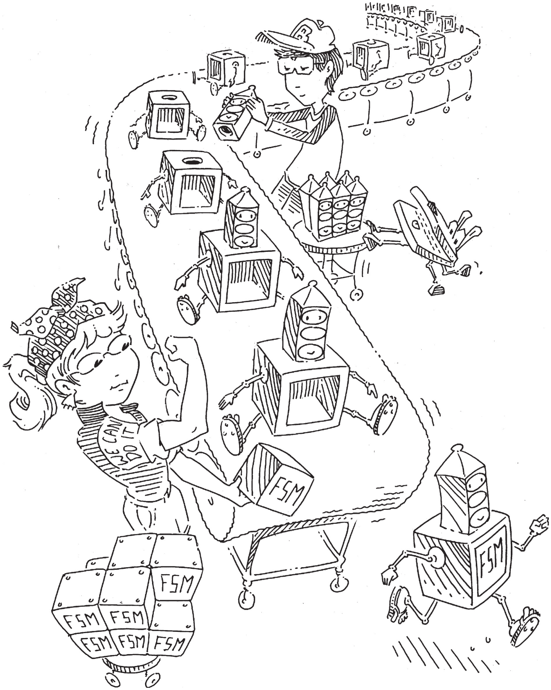

# 3 Thiết kế Sequential Logic

- 3.1 Giới thiệu
- 3.2 Latch và Flip-Flops
- 3.3 Thiết kế Synchronous Logic
- 3.4 Finite State Machine
- 3.5 Timing của Sequential Logic
- 3.6 Parallelism
- 3.7 Tổng kết
- Bài tập
- Câu hỏi phỏng vấn

## 3.1 GIỚI THIỆU

Trong chương trước, chúng ta đã trình bày cách phân tích và thiết kế combinational logic. Output của combinational logic chỉ phụ thuộc giá trị input hiện tại. Với specification dưới dạng truth table hoặc phương trình Boolean, có thể tạo circuit tối ưu đáp ứng specification.

Trong chương này, chúng ta sẽ phân tích và thiết kế sequential logic. Output của sequential logic phụ thuộc cả giá trị input hiện tại lẫn trước đó. Do vậy, sequential logic có memory. Sequential logic có thể nhớ tường minh một số input trước đó hoặc chắt lọc input trước đó thành lượng thông tin nhỏ hơn, gọi là state của hệ thống. State của digital sequential circuit là tập bit gọi là state variable, chứa tất cả thông tin quá khứ cần thiết để giải thích hành vi tương lai của circuit.

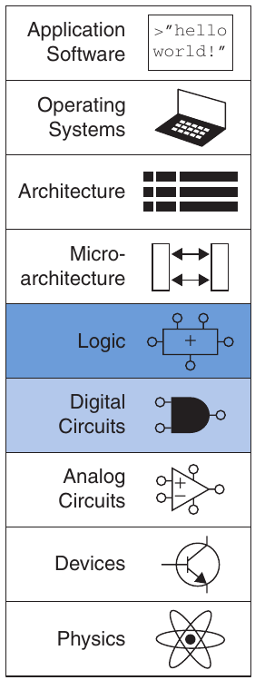

Chương bắt đầu bằng nghiên cứu latch và flip-flops, những sequential circuit đơn giản lưu một bit state. Nhìn chung, sequential circuit phức tạp khi phân tích. Để đơn giản hóa thiết kế, chúng ta tự tuân thủ kỷ luật chỉ xây dựng synchronous sequential circuit gồm combinational logic và các bank flip-flops chứa state của circuit. Chương mô tả finite state machine, cách dễ dàng để thiết kế sequential circuit. Cuối cùng, chúng ta phân tích tốc độ sequential circuit và bàn về parallelism như cách tăng tốc độ.

## 3.2 LATCH VÀ FLIP-FLOPS

Building block cơ bản của memory là bistable element, một element có hai trạng thái ổn định. Hình 3.1(a) trình bày bistable element đơn giản gồm cặp inverter nối thành vòng. Hình 3.1(b) vẽ lại cùng circuit để nhấn mạnh tính đối xứng. Các inverter được nối cross-coupled, nghĩa là input I1 là output I2 và ngược lại. Circuit không có input nhưng có hai output Q và $\overline{Q}$. Phân tích circuit này khác phân tích combinational circuit vì nó có vòng: Q phụ thuộc $\overline{Q}$, và $\overline{Q}$ phụ thuộc Q.

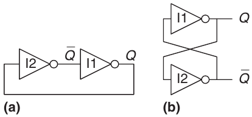

Hình 3.1 Cặp inverter Cross-coupled

> Giống như Y thường được dùng cho output combinational logic, Q thường được dùng cho output sequential logic.

Xét hai trường hợp Q là 0 hoặc Q là 1. Xét hệ quả từng trường hợp, chúng ta có:

- Trường hợp I: Q = 0 Như Hình 3.2(a), I2 nhận input FALSE, Q, nên tạo output TRUE trên $\overline{Q}$. I1 nhận input TRUE, $\overline{Q}$, nên tạo output FALSE trên Q. Điều này nhất quán với giả định ban đầu rằng Q = 0, nên trường hợp này được gọi là ổn định.

- Trường hợp II: Q = 1 Như Hình 3.2(b), I2 nhận input TRUE và tạo output FALSE trên $\overline{Q}$. I1 nhận input FALSE và tạo output TRUE trên Q. Trường hợp này cũng ổn định.

Vì các inverter cross-coupled có hai trạng thái ổn định Q = 0 và Q = 1, circuit được gọi là bistable. Điểm tinh tế là circuit có trạng thái thứ ba có thể xảy ra, với cả hai output xấp xỉ ở giữa 0 và 1. Đây gọi là metastable state, sẽ được bàn ở Mục 3.5.4.

Element có N trạng thái ổn định truyền tải log2N bit thông tin, nên bistable element lưu một bit. State của các inverter cross-coupled chứa trong một state variable nhị phân Q. Giá trị Q cho biết mọi thông tin quá khứ cần để giải thích hành vi tương lai của circuit. Cụ thể, nếu Q = 0, nó giữ 0 mãi mãi; nếu Q = 1, nó giữ 1 mãi mãi. Circuit còn node $\overline{Q}$, nhưng $\overline{Q}$ không chứa thông tin bổ sung vì biết Q thì cũng biết $\overline{Q}$. Mặt khác, $\overline{Q}$ cũng là lựa chọn chấp nhận được cho state variable.

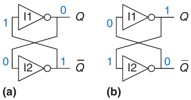

Hình 3.2 Hoạt động bistable của các inverter cross-coupled

Khi sequential circuit mới được cấp nguồn, state ban đầu không xác định và thường không thể dự đoán. Nó có thể khác ở mỗi lần bật circuit.

Dù inverter cross-coupled có thể lưu một bit thông tin, chúng không thực tiễn vì người dùng không có input để điều khiển state. Tuy nhiên, những bistable element khác như latch và flip-flops cung cấp input để điều khiển giá trị state variable. Phần còn lại của mục xét các circuit này.

### 3.2.1 SR Latch

Một trong các sequential circuit đơn giản nhất là SR latch, gồm hai NOR gate cross-coupled, như Hình 3.3. Latch có hai input S, R và hai output Q, $\overline{Q}$. SR latch tương tự các inverter cross-coupled, nhưng state có thể được điều khiển qua input S và R, dùng để set và reset output Q.

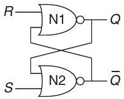

Hình 3.3 Schematic của SR latch

Cách tốt để hiểu circuit chưa quen là tìm truth table, nên chúng ta bắt đầu từ đó. Nhớ rằng NOR gate tạo output FALSE khi bất kỳ input nào TRUE. Xét bốn tổ hợp có thể có của R và S.

- Trường hợp I: R = 1, S = 0 N1 thấy ít nhất một input TRUE, R, nên tạo output FALSE trên Q. N2 thấy cả Q và S đều FALSE, nên tạo output TRUE trên $\overline{Q}$.

- Trường hợp II: R = 0, S = 1 N1 nhận input 0 và $\overline{Q}$. Vì chưa biết $\overline{Q}$ nên chưa xác định được output Q. N2 nhận ít nhất một input TRUE, S, nên tạo output FALSE trên $\overline{Q}$. Giờ có thể xét lại N1, biết cả hai input FALSE nên output Q là TRUE.

- Trường hợp III: R = 1, S = 1 N1 và N2 đều thấy ít nhất một input TRUE (R hoặc S), nên mỗi gate tạo output FALSE. Do đó, cả Q và $\overline{Q}$ đều FALSE.

- Trường hợp IV: R = 0, S = 0 N1 nhận input 0 và $\overline{Q}$. Vì chưa biết $\overline{Q}$ nên chưa xác định được output. N2 nhận input 0 và Q. Vì chưa biết Q nên chưa xác định được output. Giờ chúng ta bị mắc kẹt. Điều này gợi nhớ đến các inverter cross-coupled. Nhưng chúng ta biết Q phải là 0 hoặc 1, nên có thể giải quyết bằng cách kiểm tra điều gì xảy ra trong từng trường hợp con.

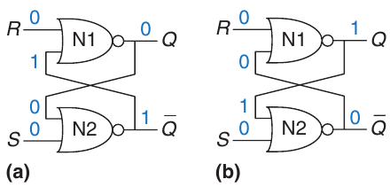

Hình 3.4 Các state bistable của SR latch

- Trường hợp IVa: Q = 0 Vì S và Q đều FALSE, N2 tạo output TRUE trên $\overline{Q}$, như Hình 3.4(a). Giờ N1 nhận một input TRUE, $\overline{Q}$, nên output Q của nó là FALSE, đúng như giả định.

- Trường hợp IVb: Q = 1 Vì Q là TRUE, N2 tạo output FALSE trên $\overline{Q}$, như Hình 3.4(b). Giờ N1 nhận hai input FALSE, R và $\overline{Q}$, nên output Q của nó là TRUE, đúng như giả định.

Kết hợp tất cả, giả sử Q có một giá trị trước đó đã biết, gọi là Qprev, trước khi vào Trường hợp IV. Qprev là 0 hoặc 1 và biểu diễn state của hệ thống. Khi R và S là 0, Q sẽ nhớ giá trị cũ Qprev này, và $\overline{Q}$ sẽ là complement của nó, $\overline{Q}$prev . Circuit này có memory.

Truth table trong Hình 3.5 tổng kết bốn trường hợp. Input S và R viết tắt cho Set và Reset. Set bit nghĩa là đặt nó TRUE. Reset bit nghĩa là đặt nó FALSE. Các output Q và $\overline{Q}$ thông thường là complement của nhau. Khi R được assert, Q được reset về 0 và $\overline{Q}$ làm ngược lại. Khi S được assert, Q được set lên 1 và $\overline{Q}$ làm ngược lại. Khi không input nào được assert, Q nhớ giá trị cũ Qprev. Assert đồng thời S và R không có nhiều ý nghĩa vì yêu cầu latch vừa set vừa reset cùng lúc, điều không thể xảy ra. Circuit tội nghiệp bối rối phản hồi bằng cách đặt cả hai output về 0.

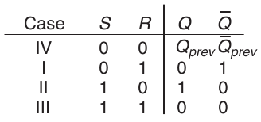

Hình 3.5 Truth table của SR latch

SR latch được biểu diễn bằng ký hiệu trong Hình 3.6. Dùng ký hiệu là ứng dụng abstraction và modularity. Có nhiều cách xây dựng SR latch, chẳng hạn dùng các logic gate hoặc transistor khác nhau. Tuy vậy, mọi circuit element có quan hệ được quy định bằng truth table Hình 3.5 và ký hiệu Hình 3.6 đều gọi là SR latch.

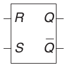

Hình 3.6 Ký hiệu SR latch

Giống các inverter cross-coupled, SR latch là bistable element có một bit state lưu trong Q. Tuy nhiên, có thể điều khiển state qua input S và R. Khi R được assert, state reset về 0. Khi S được assert, state set lên 1. Khi không cái nào được assert, state giữ giá trị cũ. Chú ý toàn bộ lịch sử input có thể được thể hiện bằng một state variable Q. Bất kể mẫu set và reset đã xảy ra trong quá khứ là gì, điều duy nhất cần biết để dự đoán hành vi tương lai SR latch là lần gần nhất nó được set hay reset.

### 3.2.2 D Latch

SR latch bất tiện vì hành xử kỳ lạ khi S và R đồng thời được assert. Hơn nữa, input S và R gộp lẫn vấn đề giá trị gì và khi nào. Assert một input không chỉ quyết định state nên là gì mà còn quyết định khi nào nó thay đổi. Thiết kế circuit dễ hơn khi tách hai vấn đề này. D latch trong Hình 3.7(a) giải quyết chúng. Nó có hai input. Data input D điều khiển state tiếp theo là gì. Clock input CLK điều khiển khi nào state thay đổi.

Một lần nữa, phân tích latch bằng cách viết truth table ở Hình 3.7(b). Để thuận tiện, trước tiên xét internal node $\overline{D}$, S và R. Nếu CLK = 0, cả S lẫn R đều FALSE bất kể giá trị D. Nếu CLK = 1, một AND gate tạo TRUE, gate kia tạo FALSE tùy D. Khi biết S và R, Q và $\overline{Q}$ được xác định bằng Hình 3.5. Quan sát khi CLK = 0, Q nhớ giá trị cũ Qprev. Khi CLK = 1, Q = D. Trong mọi trường hợp, $\overline{Q}$ là complement của Q, như logic thông thường. D latch tránh trường hợp kỳ lạ khi input R và S đồng thời được assert.

Kết hợp lại, clock điều khiển khi nào data đi qua latch. Khi CLK = 1, latch transparent. Data tại D truyền đến Q như thể latch chỉ là buffer. Khi CLK = 0, latch opaque. Nó ngăn data mới truyền đến Q, và Q giữ giá trị cũ. Vì vậy, D latch đôi khi gọi là transparent latch hoặc level-sensitive latch. Ký hiệu D latch được cho trong Hình 3.7(c).

> Một số người gọi latch là mở hoặc đóng thay vì transparent hoặc opaque. Tuy nhiên, chúng tôi cho rằng các từ đó nhập nhằng—mở có nghĩa transparent như cánh cửa mở, hay opaque như circuit hở?

D latch cập nhật state liên tục khi CLK = 1. Phần sau chương sẽ cho thấy cập nhật state chỉ tại một thời điểm cụ thể là hữu ích. D flip-flop trong mục tiếp theo thực hiện đúng điều đó.

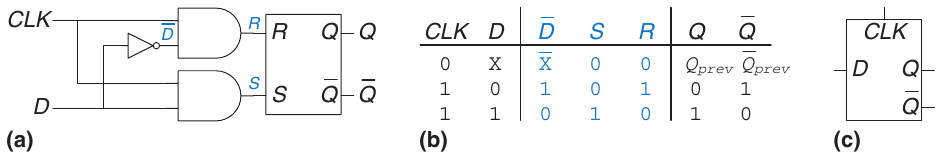

Hình 3.7 D latch: (a) schematic, (b) truth table, (c) ký hiệu

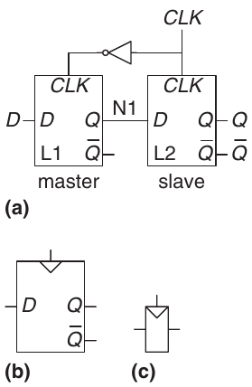

Hình 3.8 D flip-flop: (a) schematic, (b) ký hiệu, (c) ký hiệu rút gọn

### 3.2.3 D FIip-Flop

D flip-flop có thể xây dựng từ hai D latch back-to-back được điều khiển bằng clock complement, như Hình 3.8(a). Latch đầu L1 gọi là leader. Latch thứ hai L2 gọi là follower, vì nó làm theo mọi thứ L1 làm.

Node giữa chúng tên N1. Ký hiệu D flip-flop được cho trong Hình 3.8(b). Khi không cần output $\overline{Q}$, ký hiệu thường được rút gọn như Hình 3.8(c).

Khi CLK = 0, leader (latch L1) transparent còn follower (L2) opaque. Vì vậy, mọi giá trị tại D truyền đến N1. Khi CLK = 1, leader (L1) chuyển opaque còn follower (L2) trở nên transparent. Giá trị tại N1 truyền đến Q, nhưng N1 bị ngắt khỏi D. Do đó, giá trị ở D ngay trước khi clock tăng từ 0 lên 1 được sao chép đến Q ngay sau khi clock tăng. Mọi lúc khác, Q giữ giá trị cũ vì luôn có latch opaque chặn đường giữa D và Q.

Nói cách khác, D flip-flop sao chép D đến Q trên rising edge của clock và nhớ state của nó ở mọi lúc khác. Hãy đọc lại định nghĩa cho đến khi thuộc; một trong những vấn đề phổ biến nhất của người mới thiết kế số là quên flip-flop làm gì. Rising edge của clock thường được gọi ngắn gọn là clock edge. Input D quy định state mới là gì. Clock edge cho biết khi nào phải cập nhật state.

> Ranh giới chính xác giữa flip-flops và latch hơi lẫn lộn và đã phát triển theo thời gian. Trong cách dùng phổ biến của công nghiệp, flip-flop là edge-triggered. Nói cách khác, nó là bistable element có clock input. State của flip-flop chỉ thay đổi để phản hồi clock edge, chẳng hạn khi clock tăng từ 0 lên 1. Bistable element không có clock edge-triggered thường gọi là latch.
>
> Thuật ngữ flip-flop hoặc latch đứng riêng thường lần lượt chỉ D flip-flop hoặc D latch, vì đây là loại dùng phổ biến nhất trong thực tế.

D flip-flop còn được gọi là flip-flop edge-triggered hoặc flip-flop positive edge-triggered. Tam giác trong ký hiệu biểu thị clock input edge-triggered. Output $\overline{Q}$ thường được bỏ khi không cần.

#### Ví dụ 3.1 SỐ TRANSISTOR CỦA FLIP-FLOP

Cần bao nhiêu transistor để xây dựng D flip-flop được mô tả trong mục này?

Lời giải NAND hoặc NOR gate dùng bốn transistor. NOT gate dùng hai transistor. AND gate được xây dựng từ NAND và NOT nên dùng sáu transistor. SR latch dùng hai NOR gate, tức tám transistor. D latch dùng một SR latch, hai AND gate và một NOT gate, tức 22 transistor. D flip-flop dùng hai D latch và một NOT gate, tức 46 transistor. Mục 3.2.7 mô tả cách triển khai CMOS hiệu quả hơn bằng transmission gate.

### 3.2.4 Register

Register N-bit là bank gồm N flip-flops dùng chung input CLK để mọi bit của register được cập nhật cùng lúc. Register là building block chủ chốt của phần lớn sequential circuit. Hình 3.9 trình bày schematic và ký hiệu register four-bit có input D3:0, output Q3:0. D3:0 và Q3:0 đều là bus 4-bit.

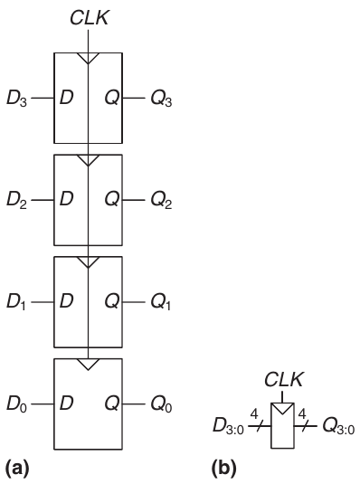

Hình 3.9 Register 4-bit: (a) schematic và (b) ký hiệu

### 3.2.5 Enabled Flip-Flop

Enabled flip-flop thêm input EN hoặc ENABLE để quyết định có nạp data tại clock edge hay không. Khi EN là TRUE, enabled flip-flop hoạt động như D flip-flop thông thường. Khi EN là FALSE, enabled flip-flop bỏ qua clock và giữ state. Enabled flip-flops hữu ích khi chỉ muốn nạp giá trị mới vào flip-flop ở một số lúc, thay vì mỗi clock edge.

Hình 3.10 trình bày hai cách xây dựng enabled flip-flop từ D flip-flop và một gate bổ sung. Trong Hình 3.10(a), input multiplexer truyền giá trị D nếu EN là TRUE hoặc đưa state cũ từ Q quay lại nếu EN là FALSE. Trong Hình 3.10(b), clock được gate. Nếu EN là TRUE, input CLK của flip-flop chuyển mức bình thường. Nếu EN là FALSE, input CLK cũng FALSE và flip-flop giữ giá trị cũ. Chú ý EN không được thay đổi khi CLK = 1, nếu không flip-flop sẽ thấy clock glitch (chuyển mức sai thời điểm). Nhìn chung, thực hiện logic trên clock là ý tưởng không tốt. Clock gating làm trễ clock và có thể gây lỗi timing, như sẽ thấy ở Mục 3.5.3, nên chỉ làm khi chắc chắn biết mình đang làm gì. Ký hiệu enabled flip-flop được cho trong Hình 3.10(c).

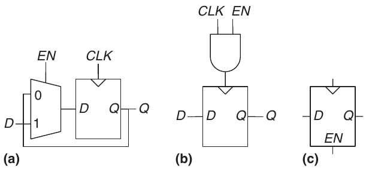

Hình 3.10 Enabled flip-flop: (a, b) schematic, (c) ký hiệu

### 3.2.6 Resettable Flip-Flop

Resettable flip-flop thêm một input gọi là RESET. Khi RESET là FALSE, resettable flip-flop hoạt động như D flip-flop thông thường. Khi RESET là TRUE, resettable flip-flop bỏ qua D và reset output về 0. Resettable flip-flops hữu ích khi muốn ép state đã biết (tức 0) vào mọi flip-flops trong hệ thống khi mới bật nó.

Các flip-flops như vậy có thể reset đồng bộ hoặc bất đồng bộ. flip-flops reset đồng bộ chỉ tự reset trên rising edge của CLK. flip-flops reset bất đồng bộ tự reset ngay khi RESET trở thành TRUE, không phụ thuộc CLK.

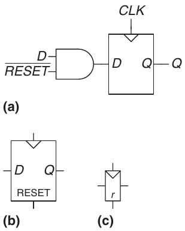

Hình 3.11 flip-flop reset đồng bộ: (a) schematic, (b, c) ký hiệu

Hình 3.11(a) trình bày cách xây dựng flip-flop reset đồng bộ từ D flip-flop thông thường và AND gate. Khi signal $\overline{RESET}$ là FALSE, AND gate ép 0 vào input flip-flop. Khi $\overline{RESET}$ là TRUE, AND gate truyền D đến flip-flop. Trong ví dụ này, $\overline{RESET}$ là signal active low, nghĩa là reset signal thực hiện chức năng—ở đây là reset flip-flop—khi bằng 0, không phải 1. Thêm inverter cho phép circuit nhận reset signal active high thay thế. Hình 3.11(b) và 3.11(c) trình bày ký hiệu resettable flip-flop có reset active high.

flip-flops reset bất đồng bộ cần sửa cấu trúc bên trong flip-flop và được dành cho bạn thiết kế ở Bài tập 3.13. Cả flip-flops reset đồng bộ lẫn bất đồng bộ đều thường có sẵn cho người thiết kế dưới dạng thành phần tiêu chuẩn.

Như bạn có thể hình dung, đôi khi cũng dùng settable flip-flops. Chúng nạp 1 vào flip-flop khi SET được assert, và cũng có các loại synchronous và asynchronous. Resettable và settable flip-flops cũng có thể có enable input và được nhóm thành register N-bit.

### 3.2.7 Thiết kế Latch và Flip-Flop ở Transistor-Level\*

Ví dụ 3.1 cho thấy latch và flip-flops cần nhiều transistor khi xây dựng từ logic gate. Nhưng vai trò cơ bản của latch là transparent hoặc opaque, rất giống switch. Nhớ từ Mục 1.7.7 rằng transmission gate là cách hiệu quả để xây dựng switch CMOS, nên có thể kỳ vọng tận dụng transmission gate để giảm số transistor.

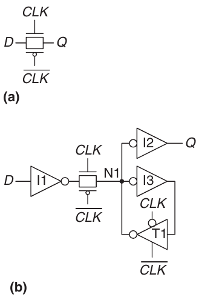

Hình 3.12 Schematic của D latch

Có thể xây dựng D latch gọn từ một transmission gate duy nhất, như Hình 3.12(a). Khi CLK = 1 và $\overline{CLK}$ = 0, transmission gate ON, nên D truyền đến Q và latch transparent. Khi CLK = 0 và $\overline{CLK}$ = 1, transmission gate OFF, nên Q cách ly khỏi D và latch opaque. Latch này có hai hạn chế lớn:

- Output node floating: Khi latch opaque, không gate nào giữ Q tại giá trị của nó. Vì vậy, Q gọi là node floating hoặc dynamic. Sau một thời gian, nhiễu và rò điện tích có thể làm thay đổi giá trị Q.

- Không có buffer: Thiếu buffer đã gây lỗi ở một số chip thương mại. Xung nhiễu kéo D xuống điện áp âm có thể bật transistor nMOS, làm latch transparent ngay cả khi CLK = 0. Tương tự, xung trên D vượt VDD có thể bật transistor pMOS ngay cả khi CLK = 0. Và transmission gate đối xứng nên có thể bị drive ngược bởi nhiễu trên Q, ảnh hưởng input D. Quy tắc chung là không bao giờ để input transmission gate hay state node của sequential circuit tiếp xúc trực tiếp thế giới bên ngoài, nơi dễ có nhiễu.

Hình 3.12(b) trình bày D latch 12-transistor bền vững hơn được dùng trên chip thương mại hiện đại. Nó vẫn xây dựng quanh transmission gate có clock, nhưng thêm inverter I1 và I2 để buffer input và output. State latch được giữ trên node N1. Inverter I3 và tristate buffer T1 cung cấp feedback để biến N1 thành static node. Nếu có lượng nhiễu nhỏ trên N1 khi CLK = 0, T1 sẽ drive N1 trở lại logic value hợp lệ.

> Circuit này giả sử cả CLK và $\overline{CLK}$ đều sẵn có. Nếu không, cần thêm hai transistor để đảo clock signal.

Hình 3.13 trình bày D flip-flop xây dựng từ hai static latch được điều khiển bằng $\overline{CLK}$ và CLK. Một số internal inverter dư thừa đã được bỏ, nên flip-flop chỉ cần 20 transistor.

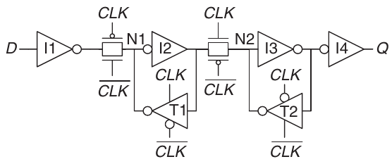

Hình 3.13 Schematic của D flip-flop

### 3.2.8 Kết hợp tất cả

Latch và flip-flops là building block cơ bản của sequential circuit. Nhớ rằng D latch là level-sensitive, còn D flip-flop là edge-triggered. D latch transparent khi CLK = 1, cho input D truyền đến output Q. D flip-flop sao chép D đến Q trên rising edge của CLK. Ở mọi lúc khác, latch và flip-flops giữ state cũ. Register là bank gồm nhiều D flip-flops dùng chung signal CLK.

#### Ví dụ 3.2 SO SÁNH FLIP-FLOP VÀ LATCH

Ben Bitdiddle đưa các input D và CLK trong Hình 3.14 vào D latch và D flip-flop. Giúp cậu xác định output Q của từng thiết bị.

Lời giải Hình 3.15 trình bày output waveform, giả sử Q phản hồi thay đổi input sau độ trễ nhỏ. Các mũi tên cho biết nguyên nhân thay đổi output. Giá trị Q ban đầu không xác định, có thể 0 hoặc 1 như cặp đường ngang biểu thị. Trước hết xét latch. Tại rising edge đầu của CLK, D = 0, nên Q chắc chắn trở thành 0. Mỗi lần D đổi khi CLK = 1, Q cũng đổi theo. Khi D đổi lúc CLK = 0, D bị bỏ qua. Giờ xét flip-flop. Trên mỗi rising edge của CLK, D được sao chép đến Q. Ở mọi lúc khác, Q giữ state.

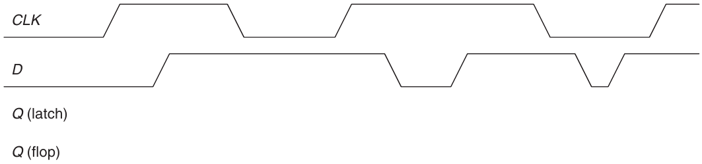

Hình 3.14 Waveform ví dụ

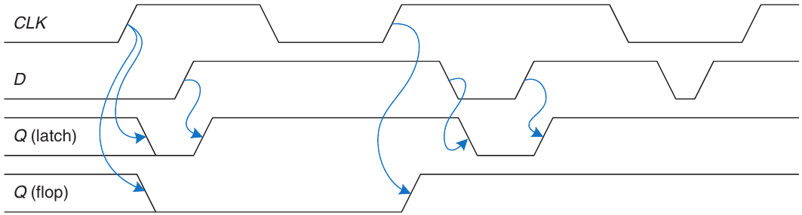

Hình 3.15 Waveform lời giải

## 3.3 THIẾT KẾ SYNCHRONOUS LOGIC

Nhìn chung, sequential circuit bao gồm mọi circuit không phải combinational—tức output không thể xác định chỉ bằng input hiện tại. Một số sequential circuit thật sự rất kỳ quặc. Mục này bắt đầu bằng xem xét một số circuit lạ đó. Sau đó giới thiệu synchronous sequential circuit và dynamic discipline. Bằng cách tuân thủ synchronous sequential circuit, chúng ta có thể phát triển phương pháp dễ dàng, có hệ thống để phân tích và thiết kế sequential system.

### 3.3.1 Một số circuit có vấn đề

#### Ví dụ 3.3 ASTABLE CIRCUIT

Alyssa P. Hacker gặp ba inverter tréo ngoe tự nối thành vòng như Hình 3.16. Output inverter thứ ba hồi tiếp đến inverter đầu tiên. Mỗi inverter có propagation delay 1 ns. Giúp Alyssa xác định circuit làm gì.

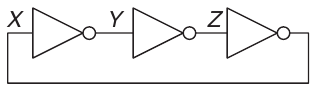

Hình 3.16 Vòng Three-inverter

Lời giải Giả sử node X ban đầu là 0. Khi đó Y = 1, Z = 0, và do đó X = 1, không nhất quán với giả định ban đầu. Circuit không có trạng thái ổn định và được gọi là unstable hoặc astable. Hình 3.17 trình bày hành vi circuit. Nếu X tăng tại thời điểm 0, Y giảm ở 1 ns, Z tăng ở 2 ns và X lại giảm ở 3 ns. Tiếp đó, Y tăng ở 4 ns, Z giảm ở 5 ns và X lại tăng ở 6 ns; rồi mẫu lặp lại. Mỗi node dao động giữa 0 và 1 với chu kỳ (thời gian lặp) 6 ns. Circuit này gọi là ring oscillator.

Chu kỳ ring oscillator phụ thuộc propagation delay từng inverter. Độ trễ này phụ thuộc cách chế tạo inverter, điện áp nguồn và cả nhiệt độ. Vì vậy, khó dự đoán chính xác chu kỳ ring oscillator. Tóm lại, ring oscillator là sequential circuit không có input và có một output thay đổi tuần hoàn.

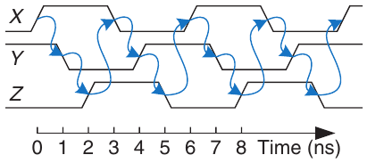

Hình 3.17 Waveform của ring oscillator

#### Ví dụ 3.4 RACE CONDITION

Ben Bitdiddle thiết kế D latch mới mà cậu khẳng định tốt hơn Hình 3.7 vì dùng ít gate hơn. Cậu viết truth table để tìm output Q theo hai input D, CLK và state cũ của latch Qprev. Dựa vào truth table, cậu suy ra phương trình Boolean. Cậu lấy Qprev bằng cách hồi tiếp output Q. Thiết kế được trình bày ở Hình 3.18. Latch của cậu có hoạt động đúng, không phụ thuộc độ trễ từng gate không?

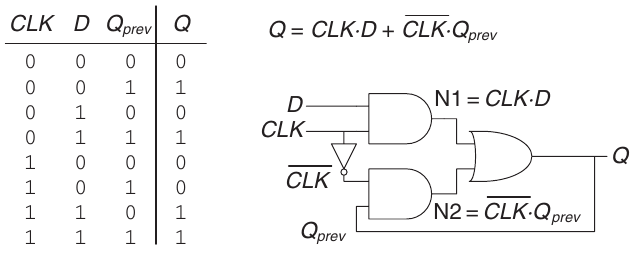

Hình 3.18 D latch được cải tiến (?)

Lời giải Hình 3.19 cho thấy circuit có race condition khiến nó hỏng khi một số gate chậm hơn gate khác. Giả sử CLK = D = 1. Latch transparent và truyền D để Q = 1. Giờ CLK giảm. Latch phải nhớ giá trị cũ, giữ Q = 1. Tuy nhiên, giả sử độ trễ qua inverter từ CLK đến $\overline{CLK}$ khá dài so với độ trễ AND và OR gate. Khi đó, cả node N1 lẫn Q có thể giảm trước khi $\overline{CLK}$ tăng. Trong trường hợp đó, N2 không bao giờ tăng và Q mắc kẹt ở 0.

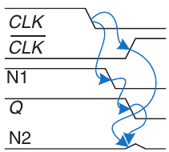

Hình 3.19 Waveform của latch minh họa race condition

Đây là ví dụ thiết kế asynchronous circuit, trong đó output hồi tiếp trực tiếp đến input. Asynchronous circuit nổi tiếng có race condition, nơi hành vi circuit phụ thuộc đường nào trong hai đường qua logic gate nhanh hơn. Một circuit có thể hoạt động, trong khi circuit trông giống hệt nhưng xây dựng từ gate có độ trễ hơi khác lại không hoạt động. Hoặc circuit chỉ hoạt động ở một số nhiệt độ hay điện áp mà các độ trễ vừa đúng. Những lỗi này cực kỳ khó truy tìm.

### 3.3.2 Synchronous Sequential Circuit

Hai ví dụ trước có vòng gọi là cyclic path, trong đó output hồi tiếp trực tiếp đến input. Chúng là sequential circuit thay vì combinational circuit. Combinational logic không có cyclic path và không có race. Nếu đưa input vào combinational logic, output luôn ổn định ở giá trị đúng trong một propagation delay. Tuy nhiên, sequential circuit có cyclic path có thể có race không mong muốn hoặc hành vi không ổn định. Phân tích các circuit này để tìm vấn đề rất time-consuming, và nhiều người thông minh đã mắc lỗi.

Để tránh các vấn đề, người thiết kế ngắt cyclic path bằng cách chèn register ở đâu đó trên đường. Điều này biến circuit thành tập combinational logic và register. Register chứa state của hệ thống, chỉ thay đổi ở clock edge, nên nói state được đồng bộ theo clock. Nếu clock đủ chậm để input mọi register ổn định trước clock edge tiếp theo, mọi race được loại bỏ. Áp dụng kỷ luật luôn dùng register trên feedback path dẫn đến định nghĩa chính thức synchronous sequential circuit.

Nhớ circuit được định nghĩa bởi input và output terminal cùng functional và timing specification. Sequential circuit có tập hữu hạn state rời rạc {S0, S1, S2,…}. Synchronous sequential circuit có clock input với rising edge chỉ ra chuỗi thời điểm xảy ra state transition. Chúng ta thường dùng current state và next state để phân biệt state hệ thống hiện tại với state nó sẽ vào tại clock edge tiếp theo. Functional specification nêu chi tiết next state và giá trị từng output cho mỗi tổ hợp current state và giá trị input có thể có. Timing specification gồm giới hạn trên tpcq và giới hạn dưới tccq của thời gian từ rising edge clock đến khi output thay đổi, cùng setup time và hold time tsetup, thold, chỉ khi nào input phải ổn định so với rising edge clock.

> tpcq viết tắt thời gian propagation từ clock đến Q, trong đó Q biểu thị output synchronous sequential circuit. tccq viết tắt thời gian contamination từ clock đến Q. Chúng tương tự tpd và tcd trong combinational logic.

> Định nghĩa synchronous sequential circuit này là điều kiện đủ nhưng chặt hơn cần thiết. Ví dụ, trong microprocessor high-performance, một số register có thể nhận clock bị làm trễ hoặc được gate để tận dụng phần hiệu năng hoặc công suất cuối cùng. Tương tự, một số microprocessor dùng latch thay register. Tuy nhiên, định nghĩa đủ cho mọi synchronous sequential circuit trong sách và phần lớn digital system thương mại.

Các quy tắc kết hợp synchronous sequential circuit cho biết một circuit là synchronous sequential circuit nếu gồm các circuit element nối với nhau sao cho

- Mỗi circuit element là register hoặc combinational circuit

- Ít nhất một circuit element là register

- Mọi register nhận cùng clock signal

- Mỗi cyclic path chứa ít nhất một register

Sequential circuit không synchronous được gọi là asynchronous.

flip-flop là synchronous sequential circuit đơn giản nhất. Nó có một input D, một clock CLK, một output Q và hai state {0, 1}. Functional specification của flip-flop là next state bằng D và output Q là current state, như Hình 3.20.

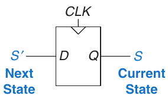

Hình 3.20 Current state và next state của Flip-flop

Chúng ta thường gọi current state variable là S và next state variable là S′. Trong trường hợp này, dấu prime sau S biểu thị next state, không phải đảo. Timing sequential circuit sẽ được phân tích ở Mục 3.5.

Hai loại synchronous sequential circuit phổ biến khác gọi là finite state machine và pipeline. Chúng sẽ được trình bày ở phần sau chương.

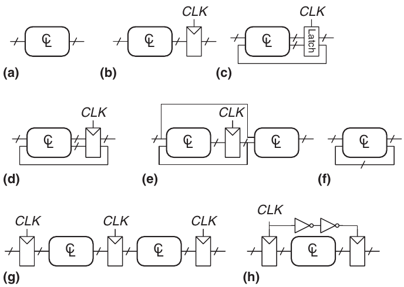

Hình 3.21 Các circuit ví dụ

#### Ví dụ 3.5 SYNCHRONOUS SEQUENTIAL CIRCUIT

Những circuit nào trong Hình 3.21 là synchronous sequential circuit?

Lời giải Circuit (a) là combinational, không phải sequential, vì không có register.

(b) là sequential circuit đơn giản không có feedback. (c) không phải combinational circuit cũng không phải synchronous sequential circuit vì có latch không phải register hay combinational circuit. (d) và (e) là synchronous sequential logic; chúng là hai dạng finite state machine được bàn ở Mục 3.4.

(f) không phải combinational hay synchronous sequential vì có cyclic path từ output combinational logic về input chính logic đó nhưng không có register trên đường. (g) là synchronous sequential logic dạng pipeline, sẽ học ở Mục 3.6. (h) nói chính xác không phải synchronous sequential circuit vì register thứ hai nhận clock signal khác register thứ nhất, bị trễ bằng hai độ trễ inverter.

### 3.3.3 Synchronous Circuit và Asynchronous Circuit

Về lý thuyết, asynchronous design tổng quát hơn synchronous design vì timing hệ thống không bị giới hạn bởi register có clock. Giống analog circuit tổng quát hơn digital circuit vì có thể dùng điện áp bất kỳ, asynchronous circuit tổng quát hơn synchronous circuit vì có thể dùng mọi loại feedback. Tuy nhiên, synchronous circuit đã chứng tỏ dễ thiết kế và sử dụng hơn asynchronous circuit, giống digital dễ hơn analog circuit. Dù có hàng thập kỷ nghiên cứu asynchronous circuit, hầu như mọi digital system về cơ bản đều synchronous.

Dĩ nhiên, asynchronous circuit đôi khi cần thiết khi giao tiếp giữa các hệ thống có clock khác nhau hoặc khi nhận input ở thời điểm bất kỳ, giống analog circuit cần để giao tiếp với thế giới thực có điện áp liên tục. Hơn nữa, nghiên cứu asynchronous circuit tiếp tục tạo những hiểu biết thú vị, một số cũng có thể cải thiện synchronous circuit.

> Moore machine và Mealy machine được đặt tên theo những người đề xướng, các nhà nghiên cứu phát triển automata theory, nền tảng toán học của state machine, tại Bell Labs.
>
> Edward F. Moore (1925–2003), không nên nhầm với nhà sáng lập Intel Gordon Moore, công bố bài báo nền tảng “Gedankenexperiments on Sequential Machines” năm 1956. Sau đó ông trở thành giáo sư toán học và khoa học máy tính tại University of Wisconsin.
>
> George H. Mealy (1927– 2010) công bố bài “A Method of Synthesizing Sequential Circuits” năm 1955. Sau đó ông viết operating system đầu tiên của Bell Labs cho máy tính IBM 704. Về sau ông gia nhập Harvard University.

## 3.4 FINITE STATE MACHINES

Synchronous sequential circuit có thể vẽ dưới các dạng ở Hình 3.22. Các dạng này gọi là finite state machine (FSM). Tên gọi xuất phát từ việc circuit có k register có thể ở một trong số hữu hạn (2k) state riêng biệt. FSM có M input, N output và k bit state. Nó còn nhận clock và tùy chọn reset signal. FSM gồm hai khối combinational logic, next state logic và output logic, cùng register lưu state. Trên mỗi clock edge, FSM tiến đến next state đã tính dựa trên current state và input. Có hai lớp finite state machine tổng quát, đặc trưng bởi functional specification. Với Moore machine, output chỉ phụ thuộc current state của machine. Với Mealy machine, output phụ thuộc cả current state lẫn input hiện tại. Finite state machine cung cấp cách có hệ thống để thiết kế synchronous sequential circuit khi biết functional specification. Phương pháp được giải thích trong phần còn lại của mục, bắt đầu bằng ví dụ.

### 3.4.1 Ví dụ thiết kế FSM

Để minh họa thiết kế FSM, xét bài toán tạo controller đèn giao thông tại giao lộ đông đúc trong trường. Sinh viên kỹ thuật đi thong thả giữa ký túc xá và phòng thí nghiệm trên Academic Avenue. Họ mải đọc FSM trong giáo trình yêu thích và không nhìn đường. Cầu thủ bóng bầu dục vội vã giữa sân thể thao và nhà ăn trên Bravado Boulevard. Họ chuyền bóng qua lại và cũng không nhìn đường. Một số chấn thương nghiêm trọng đã xảy ra tại giao lộ hai đường này, và Trưởng ban Sinh viên yêu cầu Ben Bitdiddle lắp đèn giao thông trước khi có người tử vong.

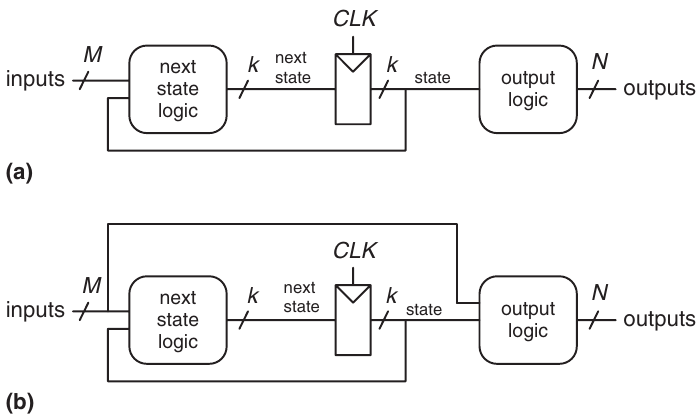

Hình 3.22 Finite state machine: (a) Moore machine, (b) Mealy machine

Ben quyết định giải bằng FSM. Cậu lắp hai traffic sensor TA, TB lần lượt trên Academic Ave. và Bravado Blvd. Mỗi sensor cho TRUE nếu có sinh viên và FALSE nếu đường trống. Cậu còn lắp hai đèn giao thông LA, LB để điều khiển lưu thông. Mỗi đèn nhận digital input quy định xanh, vàng hay đỏ. Do đó, FSM có hai input TA, TB và hai output LA, LB. Giao lộ với đèn và sensor được trình bày ở Hình 3.23. Ben cung cấp clock có chu kỳ 5-second. Trên mỗi nhịp clock (rising edge), đèn có thể đổi dựa trên traffic sensor. Cậu còn cung cấp nút reset để kỹ thuật viên cơ sở vật chất đưa controller về state ban đầu đã biết khi bật. Hình 3.24 trình bày góc nhìn hộp đen của state machine.

Bước tiếp theo của Ben là phác thảo state transition diagram ở Hình 3.25, chỉ ra mọi state có thể có của hệ thống và transition giữa chúng. Khi hệ thống reset, đèn xanh trên Academic Ave. và đỏ trên Bravado Blvd. Cứ mỗi 5 giây, controller kiểm tra tình hình lưu thông và quyết định bước tiếp. Miễn còn lưu thông trên Academic Ave., đèn không đổi. Khi không còn lưu thông trên Academic Ave., đèn đường này chuyển vàng trong 5 giây rồi chuyển đỏ và đèn Bravado Blvd. chuyển xanh. Tương tự, đèn Bravado Blvd. giữ xanh khi còn lưu thông trên đại lộ, rồi chuyển vàng và cuối cùng đỏ.

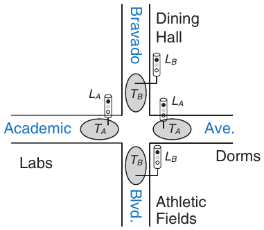

Hình 3.23 Bản đồ khuôn viên

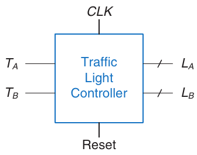

Hình 3.24 Góc nhìn hộp đen của finite state machine

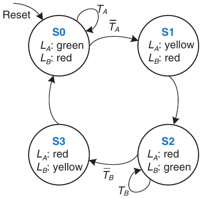

Hình 3.25 State transition diagram

Trong state transition diagram, vòng tròn biểu diễn state và cung biểu diễn transition giữa các state. Transition diễn ra trên rising edge clock; không cần vẽ clock vì nó luôn có trong synchronous sequential circuit. Hơn nữa, clock chỉ điều khiển khi nào transition xảy ra, trong khi sơ đồ chỉ transition nào xảy ra. Cung có nhãn Reset, chỉ từ bên ngoài vào state S0, cho biết hệ thống phải vào state đó khi reset bất kể state trước. Nếu một state có nhiều cung đi ra, các cung được ghi nhãn cho biết input nào kích hoạt từng transition. Ví dụ, ở state S0, hệ thống giữ nguyên nếu TA TRUE và chuyển S1 nếu TA FALSE. Nếu state chỉ có một cung đi ra, transition đó luôn xảy ra bất kể input. Ví dụ, ở S1, hệ thống luôn chuyển S2 tại clock edge. Giá trị output trong một state cụ thể được ghi trong state đó. Ví dụ, trong S2, LA đỏ và LB xanh.

Ben viết lại state transition diagram thành state transition table (Bảng 3.1), chỉ ra next state S′ ứng với mỗi state và input. Chú ý bảng dùng ký hiệu don’t care (X) mỗi khi next state không phụ thuộc input cụ thể. Cũng chú ý Reset được bỏ khỏi bảng. Thay vào đó dùng resettable flip-flops luôn về S0 khi reset, không phụ thuộc input.

> Current state thường được gọi ngắn gọn là state của hệ thống.

State transition diagram mang tính trừu tượng vì dùng state có nhãn {S0, S1, S2, S3} và output có nhãn {đỏ, vàng, xanh}. Để xây dựng circuit thực, state và output phải được gán binary encoding. Ben chọn encoding đơn giản trong Bảng 3.2 và 3.3. Mỗi state và output được encode bằng hai bit: S1:0, LA1:0 và LB1:0.

> Chú ý state được ký hiệu S0, S1, v.v. Dạng có chỉ số dưới S0, S1, v.v. chỉ các state bit.

Bảng 3.1 State transition table

| Hiện tại |  | Input | Next State |
|---|---|---|---|
| State S | TA | TB | S′ |
| S0 | 0 | X | S1 |
| S0 | 1 | X | S0 |
| S1 | X | X | S2 |
| S2 | X | 0 | S3 |
| S2 | X | 1 | S2 |
| S3 | X | X | S0 |

Bảng 3.2 State encoding

| State | Encoding S1:0 |
|---|---|
| S0 | 00 |
| S1 | 01 |
| S2 | 10 |
| S3 | 11 |

Bảng 3.3 Output encoding

| Output | Encoding L1:0 |
|---|---|
| xanh | 00 |
| vàng | 01 |
| đỏ | 10 |

Ben cập nhật state transition table để dùng binary encoding này, như Bảng 3.4. State transition table sửa đổi là truth table quy định next state logic. Nó định nghĩa next state S′ là hàm của current state S và input.

Từ bảng này, dễ dàng đọc các phương trình Boolean cho next state dưới dạng sum-of-products.

S′1 = $\overline{S}$1S0 + S1$\overline{S}$0$\overline{T}$B + S1$\overline{S}$0TB (3.1) S′0 = $\overline{S}$1$\overline{S}$0$\overline{T}$A + S1$\overline{S}$0$\overline{T}$B

Có thể đơn giản hóa phương trình bằng Karnaugh map. Tuy nhiên, làm bằng quan sát thường dễ hơn. Ví dụ, các hạng TB và $\overline{T}$B trong phương trình S′1 rõ ràng dư thừa. Vì vậy, S′1 rút gọn thành phép XOR. Phương trình 3.2 cho các phương trình next state đã đơn giản hóa.

Bảng 3.4 State transition table với binary encoding

| Hiện tại | State |  | Input | Tiếp theo | State |
|---|---|---|---|---|---|
| S1 | S0 | TA | TB | S′1 | S′0 |
| 0 | 0 | 0 | X | 0 | 1 |
| 0 | 0 | 1 | X | 0 | 0 |
| 0 | 1 | X | X | 1 | 0 |
| 1 | 0 | X | 0 | 1 | 1 |
| 1 | 0 | X | 1 | 1 | 0 |
| 1 | 1 | X | X | 0 | 0 |

Bảng 3.5 Bảng output

| Hiện tại | State |  |  | Output |  |
|---|---|---|---|---|---|
| S1 | S0 | LA1 | LA0 | LB1 | LB0 |
| 0 | 0 | 0 | 0 | 1 | 0 |
| 0 | 1 | 0 | 1 | 1 | 0 |
| 1 | 0 | 1 | 0 | 0 | 0 |
| 1 | 1 | 1 | 0 | 0 | 1 |

S′1 = S1 ⊕ S0 S′0 = $\overline{S}$1$\overline{S}$0$\overline{T}$A + S1$\overline{S}$0$\overline{T}$B (3.2)

Tương tự, Ben viết output table (Bảng 3.5), chỉ với mỗi state, output trong state đó là gì. Một lần nữa, dễ đọc và đơn giản hóa phương trình Boolean cho output. Ví dụ, quan sát LA1 chỉ TRUE ở các hàng S1 TRUE.

LA1 = S1 LA0 = $\overline{S}$1S0 LB1 = $\overline{S}$1 (3.3) LB0 = S1S0

Cuối cùng, Ben phác thảo Moore FSM theo dạng Hình 3.22(a). Trước hết cậu vẽ state register 2-bit như Hình 3.26(a). Trên mỗi clock edge, state register sao chép next state S′1:0 để trở thành state S1:0. State register nhận reset synchronous hoặc asynchronous để khởi tạo FSM lúc khởi động. Tiếp đó cậu vẽ next state logic dựa trên Phương trình 3.2, tính next state từ current state và input, như Hình 3.26(b). Cuối cùng, cậu vẽ output logic dựa trên Phương trình 3.3, tính output từ current state, như Hình 3.26(c).

Hình 3.27 trình bày timing diagram minh họa controller đèn giao thông đi qua chuỗi state. Sơ đồ thể hiện CLK, Reset, input TA, TB, next state S′, state S và output LA, LB. Mũi tên chỉ quan hệ nhân quả; ví dụ, thay state làm output đổi, và thay input làm next state đổi. Nét đứt biểu thị rising edge của CLK khi state thay đổi.

Clock có chu kỳ 5-second, nên đèn giao thông đổi nhiều nhất một lần mỗi 5 giây. Khi finite state machine mới bật, state chưa xác định, như các dấu hỏi biểu thị. Vì vậy, hệ thống phải reset để về state đã biết. Trong timing diagram này, S lập tức reset về S0, cho biết dùng flip-flops reset bất đồng bộ. Trong S0, đèn LA xanh và đèn LB đỏ.

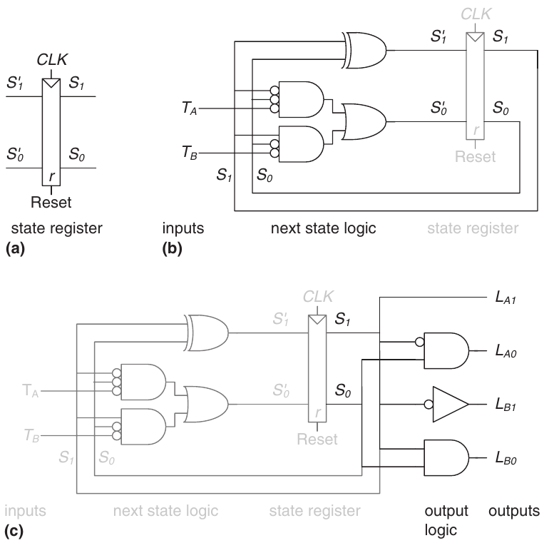

Hình 3.26 State machine circuit cho controller đèn giao thông

> Schematic này dùng một số AND gate có bubble tại input. Chúng có thể xây dựng bằng AND gate và input inverter, bằng NOR gate cùng inverter cho các input không có bubble, hoặc bằng tổ hợp gate khác. Lựa chọn tốt nhất phụ thuộc công nghệ triển khai cụ thể.

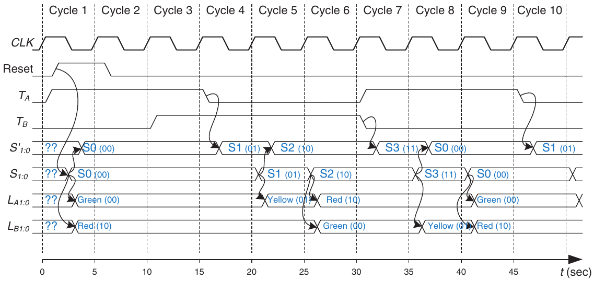

Hình 3.27 Timing diagram cho controller đèn giao thông

> Dù Ben cố gắng hết sức, sinh viên không chú ý đèn giao thông và va chạm vẫn tiếp diễn. Tiếp đó Trưởng ban Sinh viên yêu cầu cậu và Alyssa thiết kế máy bắn đá ném sinh viên kỹ thuật thẳng từ mái ký túc xá qua cửa sổ mở của phòng thí nghiệm, tránh hoàn toàn giao lộ phiền toái. Nhưng đó là chủ đề của giáo trình khác.

Trong ví dụ này, lưu thông lập tức xuất hiện trên Academic Ave. Vì vậy, controller giữ S0, giữ LA xanh dù lưu thông xuất hiện trên Bravado Blvd. và bắt đầu chờ. Sau 15 giây, mọi lưu thông trên Academic Ave. đã đi qua và TA giảm. Tại clock edge tiếp theo, controller chuyển S1, làm LA vàng. Sau 5 giây nữa, controller tiến đến S2, nơi LA chuyển đỏ và LB chuyển xanh. Controller chờ ở S2 đến khi mọi lưu thông trên Bravado Blvd. đi qua. Sau đó tiến đến S3, làm LB vàng. Năm giây sau, controller vào S0, làm LB đỏ và LA xanh. Quá trình lặp lại.

### 3.4.2 State Encoding

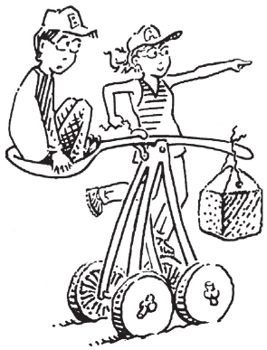

Trong ví dụ trước, state encoding và output encoding được chọn tùy ý. Lựa chọn khác sẽ cho circuit khác. Câu hỏi tự nhiên là làm sao xác định encoding tạo circuit có ít logic gate nhất hoặc propagation delay ngắn nhất. Đáng tiếc, không có cách đơn giản tìm encoding tốt nhất ngoài thử mọi khả năng, điều không khả thi khi số state lớn. Tuy nhiên, thường có thể chọn encoding tốt bằng quan sát để state hoặc output liên quan có chung bit. Công cụ Computer-aided design (CAD) cũng giỏi tìm trong tập encoding có thể có và chọn encoding hợp lý.

Một quyết định quan trọng trong state encoding là chọn giữa binary encoding và one-hot encoding. Với binary encoding, như trong ví dụ controller đèn giao thông, mỗi state được biểu diễn bằng số nhị phân. Vì K số nhị phân có thể biểu diễn bằng log2K bit, hệ thống K state chỉ cần log2K bit state.

Trong one-hot encoding, dùng một bit state riêng cho mỗi state. Nó gọi là one-hot vì mỗi lúc chỉ một bit “hot” hay TRUE. Ví dụ, FSM one-hot có ba state sẽ có state encoding 001, 010 và 100. Mỗi bit state lưu trong flip-flop, nên one-hot encoding cần nhiều flip-flops hơn binary encoding. Tuy nhiên, với one-hot encoding, next state logic và output logic thường đơn giản hơn nên cần ít gate hơn. Lựa chọn encoding tốt nhất phụ thuộc FSM cụ thể.

#### Ví dụ 3.6 STATE ENCODING CỦA FSM

Counter divide-by-N có một output và không input. Output Y HIGH trong một clock cycle trên mỗi N cycle. Nói cách khác, output chia tần số clock cho N. Waveform và state transition diagram của counter divide-by-3 được trình bày trong Hình 3.28. Phác thảo thiết kế circuit cho counter như vậy bằng state encoding binary và one-hot.

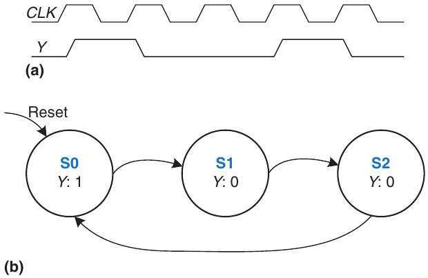

Hình 3.28 Counter Divide-by-3 (a) waveform và (b) state transition diagram

Lời giải Bảng 3.6 và 3.7 lần lượt trình bày state transition table và output table trừu tượng trước encoding.

Bảng 3.8 so sánh encoding binary và one-hot cho ba state.

Bảng 3.6 State transition table của counter Divide-by-3

| Current State | Next State |
|---|---|
| S0 | S1 |
| S1 | S2 |
| S2 | S0 |

Binary encoding dùng hai bit state. Với encoding này, state transition table được cho ở Bảng 3.9. Chú ý không có input; next state chỉ phụ thuộc current state. Output table được dành làm bài tập cho độc giả. Các phương trình next state và output là:

S′1 = $\overline{S}$1S0 S′0 = $\overline{S}$1$\overline{S}$0 (3.4)

Y = $\overline{S}$1$\overline{S}$0 (3.5)

one-hot encoding dùng ba bit state. State transition table của encoding này được trình bày ở Bảng 3.10, và output table một lần nữa dành làm bài tập cho độc giả. Các phương trình next state và output như sau:

Bảng 3.7 Output table của counter Divide-by-3

| Current State | Output |
|---|---|
| S0 | 1 |
| S1 | 0 |
| S2 | 0 |

S′2 = S1 S′1 = S0 (3.6) S′0 = S2

Y = S0 (3.7)

Hình 3.29 trình bày schematic cho từng thiết kế. Chú ý hardware của thiết kế binary encoded có thể tối ưu để dùng chung gate cho Y và S′0. Cũng quan sát rằng one-hot encoding cần cả flip-flops settable (s) và resettable (r) để khởi tạo machine về S0 khi reset. Lựa chọn triển khai tốt nhất phụ thuộc chi phí tương đối của gate và flip-flops, nhưng thiết kế one-hot thường được ưu tiên trong ví dụ cụ thể này.

Encoding liên quan là one-cold encoding, trong đó K state được biểu diễn bằng K bit với đúng một bit FALSE.

Bảng 3.8 Encoding One-hot và binary cho counter divide-by-3

|  | One-Hot | Encoding |  | Binary | Encoding |
|---|---|---|---|---|---|
| State | S2 | S1 | S0 | S1 | S0 |
| S0 | 0 | 0 | 1 | 0 | 0 |
| S1 | 0 | 1 | 0 | 0 | 1 |
| S2 | 1 | 0 | 0 | 1 | 0 |

Bảng 3.9 State transition table với binary encoding

| Hiện tại | State | Tiếp theo | State |
|---|---|---|---|
| S1 | S0 | S′1 | S′0 |
| 0 | 0 | 0 | 1 |
| 0 | 1 | 1 | 0 |
| 1 | 0 | 0 | 0 |

Bảng 3.10 State transition table với one-hot encoding

|  | Current State |  |  | Next State |  |
|---|---|---|---|---|---|
| S2 | S1 | S0 | S′2 | S′1 | S′0 |
| 0 | 0 | 1 | 0 | 1 | 0 |
| 0 | 1 | 0 | 1 | 0 | 0 |
| 1 | 0 | 0 | 0 | 0 | 1 |

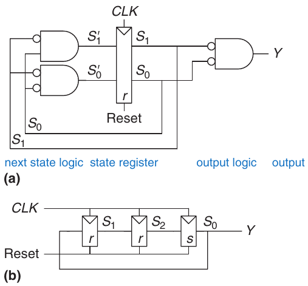

Hình 3.29 Circuit Divide-by-3 cho encoding (a) binary và (b) one-hot

### 3.4.3 Moore Machine và Mealy Machine

Đến đây, chúng ta đã trình bày ví dụ Moore machine, trong đó output chỉ phụ thuộc state hệ thống. Do đó, trong state transition diagram của Moore machine, output được ghi trong vòng tròn. Nhớ rằng Mealy machine giống Moore machine, nhưng output có thể phụ thuộc input lẫn current state. Vì vậy, trong state transition diagram của Mealy machine, output được ghi trên cung thay vì trong vòng tròn. Khối combinational logic tính output dùng current state và input, như Hình 3.22(b).

> Cách dễ nhớ sự khác biệt giữa hai loại finite state machine là Moore machine thường có nhiều state hơn Mealy machine cho cùng bài toán.

#### Ví dụ 3.7 MOORE MACHINE SO VỚI MEALY MACHINE

Alyssa P. Hacker sở hữu ốc sên robot thú cưng có bộ não FSM. Ốc bò từ trái sang phải trên băng giấy chứa chuỗi 1 và 0. Mỗi clock cycle, ốc bò đến bit tiếp theo. Ốc mỉm cười khi hai bit gần nhất nó bò qua là 01. Thiết kế FSM để tính khi nào ốc phải mỉm cười. Input A là bit dưới râu ốc. Output Y TRUE khi ốc cười. So sánh thiết kế state machine Moore và Mealy. Phác thảo timing diagram cho mỗi machine, thể hiện input, state và output khi ốc của Alyssa bò qua chuỗi 0100110111.

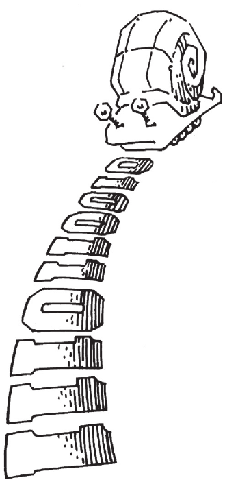

Lời giải Moore machine cần ba state, như Hình 3.30(a). Hãy tự thuyết phục rằng state transition diagram đúng. Cụ thể, vì sao có cung từ S2 về S1 khi input là 0?

Trong khi đó, Mealy machine chỉ cần hai state, như minh họa trong Hình 3.30(b). Mỗi cung được gắn nhãn A/Y. A là giá trị input gây ra transition đó, còn Y là output tương ứng.

Bảng 3.11 và 3.12 lần lượt trình bày state transition table và output table của Moore machine. Moore machine cần ít nhất hai bit state. Xét dùng binary state encoding: S0 = 00, S1 = 01 và S2 = 10. Bảng 3.13 và 3.14 lần lượt viết lại state transition table và output table với encoding này.

Từ các bảng này, tìm phương trình next state và output bằng quan sát. Chú ý các phương trình được đơn giản hóa dựa trên việc state 11 không tồn tại. Do đó, next state và output tương ứng với state không tồn tại là don’t care (không vẽ trong bảng). Dùng don’t care để tối giản phương trình.

S′1 = S0A S′0 = $\overline{A}$ (3.8)

Y = S1 (3.9)

Bảng 3.15 trình bày bảng kết hợp state transition và output của Mealy machine. Mealy machine chỉ cần một bit state. Xét binary state encoding: S0 = 0 và S1 = 1. Bảng 3.16 viết lại state transition table và output table với encoding này.

Từ các bảng này, tìm phương trình next state và output bằng quan sát.

S′0 = $\overline{A}$ (3.10)

Y = S0A (3.11)

Schematic của Moore machine và Mealy machine được trình bày trong Hình 3.31. Timing diagram của mỗi machine ở Hình 3.32 (xem trang 133). Hai machine đi theo chuỗi state khác nhau. Hơn nữa, output Mealy tăng sớm hơn một cycle vì phản hồi input thay vì chờ state đổi. Nếu output Mealy được làm trễ qua flip-flop, nó sẽ trùng output Moore. Khi chọn kiểu thiết kế FSM, hãy cân nhắc khi nào bạn muốn output phản hồi.

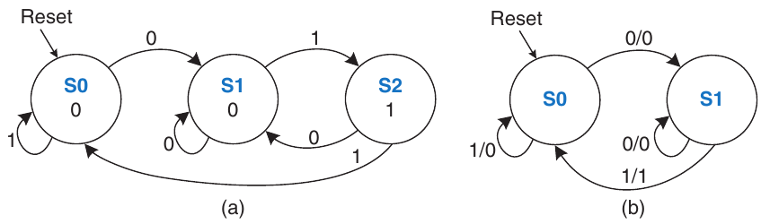

Hình 3.30 State transition diagram của FSM: (a) Moore machine, (b) Mealy machine

Bảng 3.11 State transition table của Moore

| Current State S | Input A | Next State S′ |
|---|---|---|
| S0 | 0 | S1 |
| S0 | 1 | S0 |
| S1 | 0 | S1 |
| S1 | 1 | S2 |
| S2 | 0 | S1 |
| S2 | 1 | S0 |

Bảng 3.12 Output table của Moore

| Current State S | Output Y |
|---|---|
| S0 | 0 |
| S1 | 0 |
| S2 | 1 |

Bảng 3.13 State transition table của Moore với state encoding

| Hiện tại | State | Input | Tiếp theo | State |
|---|---|---|---|---|
| S1 | S0 | A | S′1 | S′0 |
| 0 | 0 | 0 | 0 | 1 |
| 0 | 0 | 1 | 0 | 0 |
| 0 | 1 | 0 | 0 | 1 |
| 0 | 1 | 1 | 1 | 0 |
| 1 | 0 | 0 | 0 | 1 |
| 1 | 0 | 1 | 0 | 0 |

Bảng 3.14 Output table của Moore với state encoding

| Hiện tại | State | Output |
|---|---|---|
| S1 | S0 | Y |
| 0 | 0 | 0 |
| 0 | 1 | 0 |
| 1 | 0 | 1 |

Bảng 3.15 State transition table và output table của Mealy

| Current State S | Input A | Next State S′ | Output Y |
|---|---|---|---|
| S0 | 0 | S1 | 0 |
| S0 | 1 | S0 | 0 |
| S1 | 0 | S1 | 0 |
| S1 | 1 | S0 | 1 |

Bảng 3.16 State transition table và output table của Mealy với state encoding

| Current State S0 | Input A | Next State S′0 | Output Y |
|---|---|---|---|
| 0 | 0 | 1 | 0 |
| 0 | 1 | 0 | 0 |
| 1 | 0 | 1 | 0 |
| 1 | 1 | 0 | 1 |

### 3.4.4 Phân tách State Machine

Thiết kế FSM phức tạp thường dễ hơn nếu có thể chia thành nhiều state machine đơn giản tương tác, sao cho output của một số machine là input của machine khác. Ứng dụng hierarchy và modularity này gọi là factoring state machine.

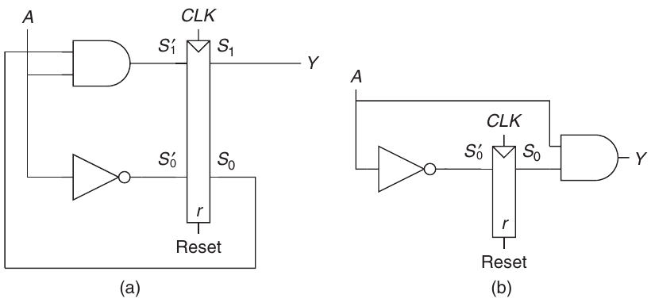

Hình 3.31 Schematic FSM cho machine (a) Moore và (b) Mealy

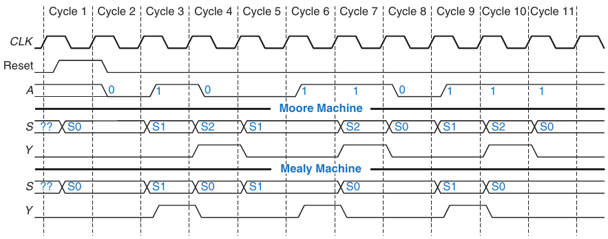

Hình 3.32 Timing diagram cho Moore machine và Mealy machine

#### Ví dụ 3.8 STATE MACHINE CHƯA PHÂN TÁCH VÀ ĐÃ PHÂN TÁCH

Sửa controller đèn giao thông ở Mục 3.4.1 để có parade mode, giữ đèn Bravado Boulevard xanh khi khán giả và ban nhạc đi thành các nhóm rải rác đến trận bóng bầu dục. Controller nhận thêm hai input P và R. Assert P ít nhất một cycle để vào parade mode. Assert R ít nhất một cycle để rời parade mode. Trong parade mode, controller tiến qua chuỗi thông thường cho đến khi LB xanh, rồi giữ state đó với LB xanh cho đến khi parade mode kết thúc.

Trước hết, phác thảo state transition diagram cho một FSM duy nhất, như Hình 3.33(a). Sau đó, phác thảo state transition diagram cho hai FSM tương tác, như Hình 3.33(b). Mode FSM assert output M khi ở parade mode. Lights FSM điều khiển đèn dựa trên M và traffic sensor TA, TB.

Lời giải Hình 3.34(a) trình bày thiết kế FSM duy nhất. State S0 đến S3 xử lý normal mode. State S4 đến S7 xử lý parade mode. Hai nửa sơ đồ gần giống hệt, nhưng trong parade mode, FSM giữ S6 với đèn xanh trên Bravado Blvd. Các input P và R điều khiển di chuyển giữa hai nửa. FSM này rối rắm và thiết kế tẻ nhạt. Hình 3.34(b) trình bày thiết kế FSM đã phân tách. Mode FSM có hai state để theo dõi đèn ở normal mode hay parade mode. Lights FSM được sửa để giữ S2 khi M TRUE.

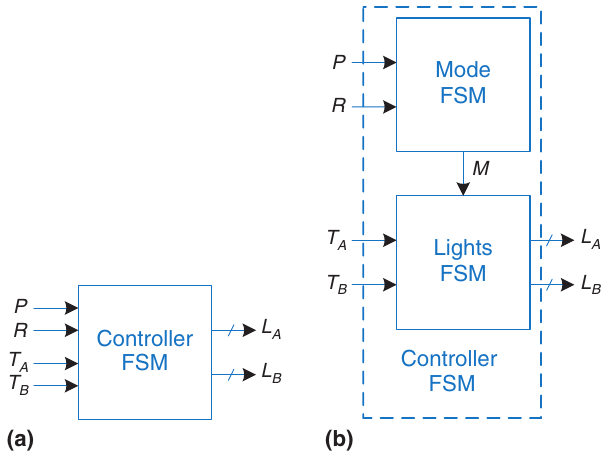

Hình 3.33 Thiết kế (a) duy nhất và (b) phân tách cho FSM controller đèn giao thông sửa đổi

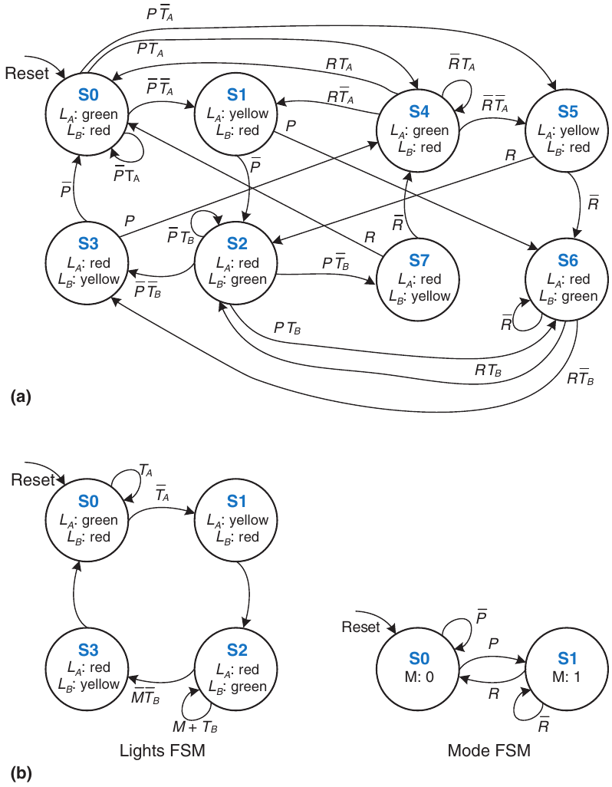

Hình 3.34 State transition diagram: (a) chưa phân tách, (b) đã phân tách

### 3.4.5 Suy ra FSM từ Schematic

Suy ra state transition diagram từ schematic gần như theo quy trình ngược thiết kế FSM. Quy trình này có thể cần, ví dụ, khi tiếp nhận dự án có tài liệu chưa đầy đủ hoặc reverse engineering hệ thống người khác.

- Xem xét circuit, nêu input, output và state bit.

- Viết phương trình next state và output.

- Tạo next state table và output table.

- Rút gọn next state table để loại state không thể đạt tới.

- Gán tên cho mỗi tổ hợp state bit hợp lệ.

- Viết lại next state table và output table bằng tên state.

- Vẽ state transition diagram.

- Mô tả bằng lời FSM làm gì. Ở bước cuối, cẩn thận mô tả súc tích mục đích tổng thể và chức năng FSM—đừng chỉ nhắc lại từng transition trong state transition diagram.

#### Ví dụ 3.9 SUY RA FSM TỪ CIRCUIT CỦA NÓ

Alyssa P. Hacker về nhà nhưng khóa bàn phím bị đấu dây lại và code cũ không còn dùng được. Tờ giấy dán trên khóa trình bày sơ đồ circuit ở Hình 3.35. Alyssa nghĩ circuit có thể là finite state machine và quyết định suy ra state transition diagram để xem có giúp cô mở cửa không.

Lời giải Alyssa bắt đầu bằng xem xét circuit. Input là A1:0, output là Unlock. State bit đã được ghi nhãn ở Hình 3.35. Đây là Moore machine vì output chỉ phụ thuộc state bit. Từ circuit, cô viết trực tiếp phương trình next state và output:

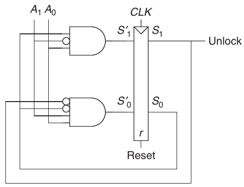

Hình 3.35 Circuit của FSM tìm được cho Ví dụ 3.9

S′1 = S0$\overline{A_{1}}$A0

S′0 = $\overline{S_{1}}$ $\overline{S_{0}}$A1A0 (3.12) Unlock = S1

Tiếp theo, cô viết next state table và output table từ phương trình, lần lượt như Bảng 3.17 và 3.18, trước hết điền 1 vào bảng theo Phương trình 3.12. Cô điền 0 ở mọi chỗ khác.

Alyssa rút gọn bảng bằng cách bỏ state không dùng và kết hợp các hàng bằng don’t care. State S1:0 = 11 không bao giờ được liệt kê là next state có thể có trong Bảng 3.17, nên các hàng có current state này bị bỏ. Với current state S1:0 = 10, next state luôn là S1:0 = 00 bất kể input, nên chèn don’t care cho input. Các bảng rút gọn được cho trong Bảng 3.19 và 3.20.

Bảng 3.17 Next state table suy ra từ circuit trong Hình 3.35

| Hiện tại | State | Input |  | Tiếp theo | State |
|---|---|---|---|---|---|
| S1 | S0 | A1 | A0 | S′1 | S′0 |
| 0 | 0 | 0 | 0 | 0 | 0 |
| 0 | 0 | 0 | 1 | 0 | 0 |
| 0 | 0 | 1 | 0 | 0 | 0 |
| 0 | 0 | 1 | 1 | 0 | 1 |
| 0 | 1 | 0 | 0 | 0 | 0 |
| 0 | 1 | 0 | 1 | 1 | 0 |
| 0 | 1 | 1 | 0 | 0 | 0 |
| 0 | 1 | 1 | 1 | 0 | 0 |
| 1 | 0 | 0 | 0 | 0 | 0 |
| 1 | 0 | 0 | 1 | 0 | 0 |
| 1 | 0 | 1 | 0 | 0 | 0 |
| 1 | 0 | 1 | 1 | 0 | 0 |
| 1 | 1 | 0 | 0 | 0 | 0 |
| 1 | 1 | 0 | 1 | 1 | 0 |
| 1 | 1 | 1 | 0 | 0 | 0 |
| 1 | 1 | 1 | 1 | 0 | 0 |

Bảng 3.18 Output table suy ra từ circuit trong Hình 3.35

| Hiện tại | State | Output |
|---|---|---|
| S1 | S0 | Unlock |
| 0 | 0 | 0 |
| 0 | 1 | 0 |
| 1 | 0 | 1 |
| 1 | 1 | 1 |

Bảng 3.19 Next state table đã rút gọn

| Hiện tại | State |  | Input | Tiếp theo | State |
|---|---|---|---|---|---|
| S1 | S0 | A1 | A0 | S′1 | S′0 |
| 0 | 0 | 0 | 0 | 0 | 0 |
| 0 | 0 | 0 | 1 | 0 | 0 |
| 0 | 0 | 1 | 0 | 0 | 0 |
| 0 | 0 | 1 | 1 | 0 | 1 |
| 0 | 1 | 0 | 0 | 0 | 0 |
| 0 | 1 | 0 | 1 | 1 | 0 |
| 0 | 1 | 1 | 0 | 0 | 0 |
| 0 | 1 | 1 | 1 | 0 | 0 |
| 1 | 0 | X | X | 0 | 0 |

Bảng 3.20 Output table đã rút gọn

| Hiện tại | State | Output |
|---|---|---|
| S1 | S0 | Unlock |
| 0 | 0 | 0 |
| 0 | 1 | 0 |
| 1 | 0 | 1 |

Bảng 3.21 Next state table bằng ký hiệu

| Current State S | Input A | Next State S′ |
|---|---|---|
| S0 | 0 | S0 |
| S0 | 1 | S0 |
| S0 | 2 | S0 |
| S0 | 3 | S1 |
| S1 | 0 | S0 |
| S1 | 1 | S2 |
| S1 | 2 | S0 |
| S1 | 3 | S0 |
| S2 | X | S0 |

Bảng 3.22 Output table bằng ký hiệu

| Current State S | Output Unlock |
|---|---|
| S0 | 0 |
| S1 | 0 |
| S2 | 1 |

Cô gán tên cho từng tổ hợp state bit: S0 là S1:0 = 00, S1 là S1:0 = 01 và S2 là S1:0 = 10. Bảng 3.21 và 3.22 lần lượt trình bày next state table và output table với tên state. Alyssa viết state transition diagram ở Hình 3.36 bằng Bảng 3.21 và 3.22. Qua quan sát, cô thấy finite state machine chỉ mở khóa sau khi phát hiện giá trị input A1:0 bằng ba, tiếp theo là input bằng một. Sau đó cửa lại khóa. Alyssa thử code này trên bàn phím cửa và cửa mở!

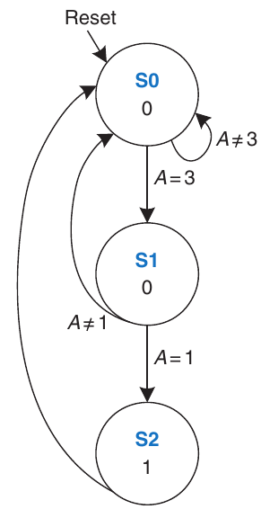

Hình 3.36 State transition diagram của FSM tìm được trong Ví dụ 3.9

### 3.4.6 Ôn lại FSM

Finite state machine là cách mạnh mẽ để thiết kế sequential circuit có hệ thống từ specification viết bằng lời. Dùng quy trình sau để thiết kế FSM:

- Xác định input và output.

- Phác thảo state transition diagram.

- Với Moore machine:

– Viết state transition table.

– Viết output table.

- Với Mealy machine:

– Viết bảng kết hợp state transition và output.

- Chọn state encoding—lựa chọn ảnh hưởng thiết kế hardware.

- Viết phương trình Boolean cho next state logic và output logic.

- Phác thảo schematic của circuit.

Chúng ta sẽ liên tục dùng FSM để thiết kế digital system phức tạp trong suốt sách.

## 3.5 TIMING CỦA SEQUENTIAL LOGIC

Nhớ flip-flop sao chép input D đến output Q trên rising edge clock. Quá trình gọi là sampling D tại clock edge. Nếu D ổn định ở 0 hoặc 1 khi clock tăng, hành vi này được định nghĩa rõ. Nhưng điều gì xảy ra nếu D thay đổi cùng lúc clock tăng?

Vấn đề này tương tự điều mà máy ảnh gặp phải khi chụp hình. Hãy tưởng tượng bạn chụp một con ếch đang nhảy từ lá súng xuống hồ. Nếu chụp trước cú nhảy, bạn sẽ thấy con ếch trên lá súng. Nếu chụp sau cú nhảy, bạn sẽ thấy những gợn sóng trên mặt nước. Nhưng nếu chụp đúng lúc con ếch nhảy, bạn có thể thấy hình ảnh nhòe của con ếch kéo dài từ lá súng xuống nước. Máy ảnh được đặc trưng bởi aperture time, là khoảng thời gian mà vật thể phải đứng yên để thu được hình ảnh sắc nét. Tương tự, sequential element có một aperture time quanh clock edge, trong đó input phải ổn định để flip-flop tạo ra output được xác định rõ ràng (well-defined).

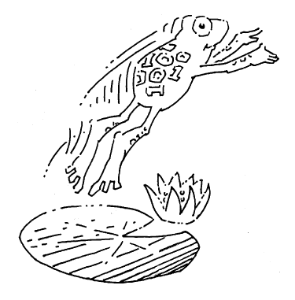

Aperture của sequential element được định nghĩa bởi setup time và hold time, lần lượt trước và sau clock edge. Giống static discipline giới hạn dùng logic level ngoài forbidden zone, dynamic discipline giới hạn dùng signal thay đổi ngoài aperture time. Tận dụng dynamic discipline, có thể nghĩ thời gian theo đơn vị rời rạc gọi là clock cycle, giống nghĩ signal level là các giá trị rời rạc 1 và 0. Signal có thể glitch và dao động mạnh trong khoảng thời gian có giới hạn. Theo dynamic discipline, chúng ta chỉ quan tâm giá trị cuối ở cuối clock cycle, sau khi signal ổn định. Vì vậy, có thể viết đơn giản A[n], giá trị signal A cuối clock cycle thứ n, với n là số nguyên, thay vì A(t), giá trị A tại thời điểm t bất kỳ, với t là số thực bất kỳ.

Clock period phải đủ dài để mọi signal ổn định. Điều này đặt giới hạn tốc độ hệ thống. Trong hệ thống thực, clock không đến mọi flip-flops chính xác cùng lúc. Sai lệch thời gian này gọi là clock skew, làm tăng thêm clock period cần thiết.

Đôi khi không thể thỏa dynamic discipline, nhất là khi giao tiếp thế giới thực. Ví dụ, xét circuit có input từ nút bấm. Một con khỉ có thể bấm đúng lúc clock tăng. Điều này có thể gây hiện tượng metastability, khi flip-flop bắt giá trị nằm giữa 0 và 1, có thể mất thời gian không giới hạn để phân giải thành logic value hợp lệ. Giải pháp cho asynchronous input như vậy là dùng synchronizer, có xác suất rất nhỏ (nhưng khác 0) tạo logic value illegal.

Chúng ta mở rộng tất cả ý tưởng này trong phần còn lại của mục.

### 3.5.1 Dynamic Discipline

Đến đây, chúng ta tập trung functional specification của sequential circuit. Nhớ synchronous sequential circuit như flip-flop hay FSM còn có timing specification, minh họa trong Hình 3.37. Khi clock tăng, output (hoặc các output) có thể bắt đầu đổi sau contamination delay clock-to-Q, tccq, và chắc chắn phải ổn định ở giá trị cuối trong propagation delay clock-to-Q, tpcq. Chúng lần lượt biểu diễn độ trễ nhanh nhất và chậm nhất qua circuit. Để circuit sample input đúng, input (hoặc các input) phải ổn định ít nhất một setup time tsetup trước rising edge clock và tiếp tục ổn định ít nhất một hold time thold sau rising edge clock. Tổng setup time và hold time gọi là aperture time của circuit vì là tổng thời gian input phải giữ ổn định.

Dynamic discipline phát biểu input của synchronous sequential circuit phải ổn định trong aperture time gồm setup và hold quanh clock edge. Áp đặt yêu cầu này bảo đảm flip-flops sample signal khi chúng không đổi. Vì chỉ quan tâm giá trị input cuối tại lúc sample, có thể coi signal rời rạc cả về thời gian lẫn logic level.

### 3.5.2 Timing của hệ thống

Clock period hay cycle time Tc là thời gian giữa rising edge của clock signal lặp lại. Nghịch đảo fc = 1/Tc là clock frequency. Khi các yếu tố khác như nhau, tăng clock frequency làm tăng công việc digital system có thể hoàn thành trên một đơn vị thời gian. Tần số được đo bằng Hertz (Hz), hay cycle mỗi giây: 1 megahertz (MHz) = 106 Hz, và 1 gigahertz (GHz) = 109 Hz.

> Trong ba thập kỷ từ khi gia đình một tác giả mua máy tính Apple II+ đến lúc viết sách, clock frequency microprocessor tăng từ 1 MHz lên vài GHz, tức hơn 1000 lần. Sự tăng tốc này giải thích phần nào những thay đổi mang tính cách mạng mà máy tính đem lại cho xã hội.

Hình 3.38(a) minh họa đường đi tổng quát trong synchronous sequential circuit cần tính clock period. Trên rising edge clock, register R1 tạo output (hoặc các output) Q1. Signal này vào khối combinational logic, tạo D2, input (hoặc các input) của register R2. Timing diagram Hình 3.38(b) cho thấy mỗi output signal có thể bắt đầu đổi sau một contamination delay kể từ khi input đổi, và ổn định ở giá trị cuối trong một propagation delay sau khi input ổn định. Mũi tên xám biểu thị contamination delay qua R1 và combinational logic, mũi tên xanh biểu thị propagation delay qua R1 và combinational logic. Chúng ta phân tích timing constraint theo setup time và hold time của register thứ hai R2.

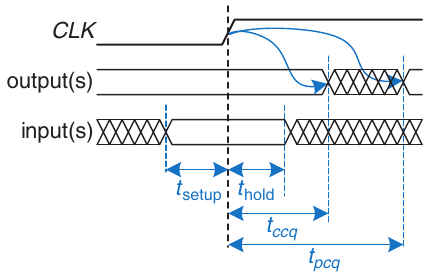

Hình 3.37 Timing specification cho synchronous sequential circuit

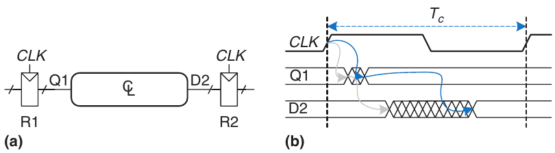

Hình 3.38 Đường giữa các register và timing diagram

Ràng buộc Setup Time

Hình 3.39 là timing diagram chỉ thể hiện độ trễ tối đa qua đường, biểu thị bằng mũi tên xanh. Để thỏa setup time của R2, D2 phải ổn định chậm nhất một setup time trước clock edge tiếp theo. Vì vậy, tìm được phương trình clock period tối thiểu:

Tc ≥ tpcq + tpd + tsetup (3.13)

Trong thiết kế thương mại, clock period thường do Giám đốc Kỹ thuật hoặc bộ phận marketing quy định (để bảo đảm sản phẩm cạnh tranh). Hơn nữa, propagation delay clock-to-Q và setup time của flip-flop, tpcq và tsetup, được nhà sản xuất chỉ định. Do đó, sắp xếp lại Phương trình 3.13 để tìm propagation delay tối đa qua combinational logic, thường là biến duy nhất dưới quyền kiểm soát của từng người thiết kế.

tpd ≤ Tc − (tpcq + tsetup) (3.14)

Hạng trong ngoặc tpcq + tsetup gọi là sequencing overhead. Lý tưởng, toàn bộ cycle time Tc được dành cho tính toán hữu ích trong combinational logic, tpd. Tuy nhiên, sequencing overhead của flip-flop chiếm bớt thời gian này. Phương trình 3.14 gọi là setup time constraint hoặc max-delay constraint vì phụ thuộc setup time và giới hạn độ trễ tối đa qua combinational logic.

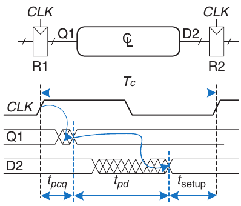

Hình 3.39 Độ trễ tối đa cho setup time constraint

Nếu propagation delay qua combinational logic quá lớn, D2 có thể chưa ổn định ở giá trị cuối khi R2 cần nó ổn định và sample nó. Do đó, R2 có thể sample kết quả sai hoặc thậm chí logic level illegal trong forbidden region. Trong trường hợp đó, circuit hoạt động sai. Có thể giải quyết bằng tăng clock period hoặc thiết kế lại combinational logic để propagation delay ngắn hơn.

Ràng buộc Hold Time

Register R2 trong Hình 3.38(a) còn có hold time constraint. Input D2 không được thay đổi cho đến thời điểm thold sau rising edge clock. Theo Hình 3.40, D2 có thể đổi sớm nhất tccq + tcd sau rising edge clock. Vì vậy có

tccq + tcd ≥ thold (3.15)

Một lần nữa, tccq và thold là đặc tính flip-flop thường ngoài quyền kiểm soát người thiết kế. Sắp xếp lại để tìm contamination delay tối thiểu qua combinational logic:

tcd ≥ thold − tccq (3.16)

Phương trình 3.16 gọi là hold time constraint hoặc min-delay constraint vì giới hạn độ trễ tối thiểu qua combinational logic.

Chúng ta đã giả định mọi logic element có thể nối với nhau mà không gây vấn đề timing. Đặc biệt, kỳ vọng hai flip-flops có thể nối tiếp trực tiếp như Hình 3.41 mà không gây vấn đề hold time.

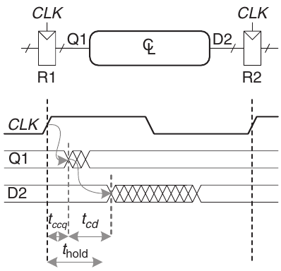

Hình 3.40 Độ trễ tối thiểu cho hold time constraint

Trong trường hợp đó, tcd = 0 vì không có combinational logic giữa các flip-flops. Thay vào Phương trình 3.16 cho yêu cầu

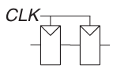

Hình 3.41 Các flip-flops Back-to-back

thold ≤ tccq (3.17)

Nói cách khác, flip-flop đáng tin cậy phải có hold time ngắn hơn contamination delay. Thường flip-flops được thiết kế thold = 0 để Phương trình 3.17 luôn thỏa. Trừ khi ghi khác, chúng ta thường dùng giả định đó và bỏ qua hold time constraint trong sách này.

Tuy nhiên, hold time constraint cực kỳ quan trọng. Nếu vi phạm, giải pháp duy nhất là tăng contamination delay qua logic, cần thiết kế lại circuit. Khác setup time constraint, không thể sửa bằng điều chỉnh clock period. Thiết kế lại integrated circuit và sản xuất thiết kế sửa đổi mất hàng tháng và hàng triệu đô la với công nghệ tiên tiến hiện nay, nên phải hết sức nghiêm túc với hold time violation.

Kết hợp tất cả

Sequential circuit có setup time constraint và hold time constraint quy định độ trễ tối đa và tối thiểu của combinational logic giữa flip-flops. Các flip-flops hiện đại thường được thiết kế để độ trễ tối thiểu qua combinational logic có thể bằng 0—tức flip-flops có thể đặt back-to-back. Max delay constraint giới hạn số gate liên tiếp trên critical path của circuit high-speed vì clock frequency cao nghĩa là clock period ngắn.

#### Ví dụ 3.10 PHÂN TÍCH TIMING

Ben Bitdiddle thiết kế circuit ở Hình 3.42. Theo data sheet của các thành phần đang dùng, flip-flops có contamination delay clock-to-Q 30 ps và propagation delay 80 ps. Chúng có setup time 50 ps và hold time 60 ps. Mỗi logic gate có propagation delay 40 ps và contamination delay 25 ps. Giúp Ben xác định clock frequency tối đa và liệu có thể xảy ra hold time violation không. Quá trình này gọi là timing analysis.

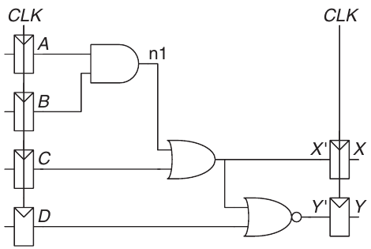

Hình 3.42 Circuit mẫu cho timing analysis

Lời giải Hình 3.43(a) trình bày waveform minh họa khi nào signal có thể thay đổi. Các input A đến D được đưa qua register, nên chỉ thay đổi ngay sau khi CLK tăng.

Critical path xảy ra khi B = 1, C = 0, D = 0 và A tăng từ 0 lên 1, khiến n1 tăng, X′ tăng và Y′ giảm, như Hình 3.43(b). Đường này có ba độ trễ gate. Với critical path, giả sử mỗi gate cần toàn bộ propagation delay. Y′ phải setup trước rising edge tiếp theo của CLK. Do đó, cycle time tối thiểu là

Tc ≥ tpcq + 3tpd + tsetup = 80 + 3 × 40 + 50 = 250ps (3.18)

Clock frequency tối đa là fc = 1/Tc = 4 GHz.

Short path xảy ra khi A = 0 và C tăng, khiến X′ tăng, như Hình 3.43(c). Với short path, giả sử mỗi gate chuyển mức chỉ sau một contamination delay. Đường này chỉ có một độ trễ gate, nên có thể xảy ra sau tccq + tcd = 30 + 25 = 55 ps. Nhưng nhớ flip-flop có hold time 60 ps, nghĩa là X′ phải ổn định trong 60 ps sau rising edge CLK để flip-flop sample giá trị đáng tin cậy. Trong trường hợp này, X′ = 0 tại rising edge đầu của CLK, nên muốn flip-flop bắt X = 0. Vì X′ không giữ ổn định đủ lâu, giá trị thực X không thể dự đoán. Circuit có hold time violation và có thể hoạt động thất thường ở bất kỳ clock frequency nào.

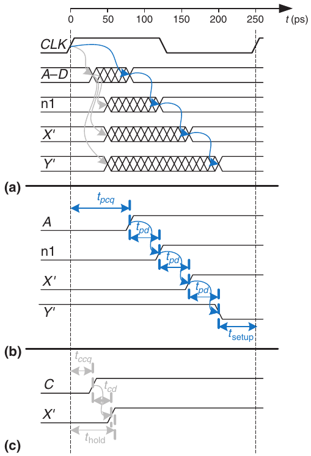

Hình 3.43 Timing diagram: (a) trường hợp tổng quát, (b) critical path, (c) short path

#### Ví dụ 3.11 KHẮC PHỤC HOLD TIME VIOLATION

Alyssa P. Hacker đề xuất sửa circuit của Ben bằng thêm buffer để làm chậm short path, như Hình 3.44. Buffer có cùng độ trễ với gate khác. Giúp cô xác định clock frequency tối đa và liệu có vấn đề hold time nào có thể xảy ra không.

Lời giải Hình 3.45 trình bày waveform minh họa khi nào signal có thể thay đổi. Critical path từ A đến Y không bị ảnh hưởng vì không qua buffer nào. Do đó clock frequency tối đa vẫn 4 GHz. Tuy nhiên, short path bị chậm thêm bởi contamination delay buffer. Giờ X′ không đổi cho đến tccq + 2tcd = 30 + 2 × 25 = 80 ps. Đây là sau khi hold time 60 ps đã qua, nên circuit hiện hoạt động đúng.

Ví dụ này có hold time dài bất thường để minh họa vấn đề hold time. Phần lớn flip-flops được thiết kế thold < tccq để tránh vấn đề đó. Tuy nhiên, một số microprocessor high-performance, gồm Pentium 4, dùng element gọi là pulsed latch thay flip-flop. Pulsed latch hoạt động như flip-flop nhưng có độ trễ clock-to-Q ngắn và hold time dài. Nhìn chung, thêm buffer thường, nhưng không phải luôn, giải quyết hold time mà không làm chậm critical path.

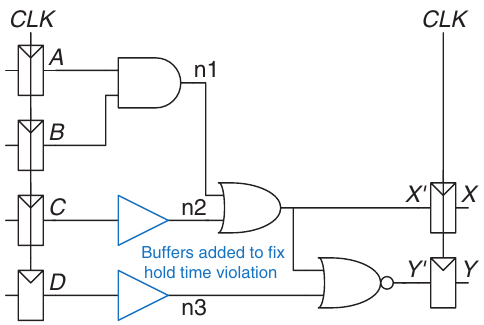

Hình 3.44 Circuit sửa đổi để khắc phục vấn đề hold time

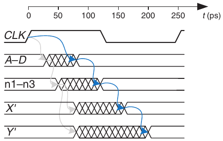

Hình 3.45 Timing diagram có buffer để khắc phục vấn đề hold time

### 3.5.3 Clock Skew\*

Trong phân tích trước, giả sử clock đến mọi register chính xác cùng lúc. Thực tế, thời gian này có sai lệch. Sai lệch clock edge gọi là clock skew. Ví dụ, dây từ nguồn clock đến các register khác nhau có thể dài khác nhau, tạo độ trễ hơi khác như Hình 3.46. Nhiễu cũng gây độ trễ khác nhau. Clock gating ở Mục 3.2.5 làm trễ clock thêm. Nếu một số clock được gate và số khác không, sẽ có skew đáng kể giữa clock được gate và không được gate. Trong Hình 3.46, CLK2 sớm hơn CLK1 vì dây clock giữa hai register đi đường vòng. Nếu clock được đi dây khác, có thể CLK1 lại sớm hơn. Khi timing analysis, xét tình huống worst-case để bảo đảm circuit hoạt động trong mọi hoàn cảnh.

Hình 3.47 thêm skew vào timing diagram Hình 3.38. Đường clock đậm chỉ thời điểm muộn nhất clock signal có thể đến register bất kỳ; các nét gạch cho thấy clock có thể đến sớm hơn tối đa tskew.

Trước hết, xét setup time constraint ở Hình 3.48. Trường hợp xấu nhất, R1 nhận clock lệch muộn nhất, R2 nhận clock lệch sớm nhất, để lại ít thời gian nhất có thể cho data truyền giữa register.

Hình 3.46 Clock skew do độ trễ dây dẫn

Hình 3.47 Timing diagram có clock skew

Hình 3.48 Setup time constraint có clock skew

Data truyền qua register và combinational logic, phải setup trước khi R2 sample. Vì vậy kết luận

Tc ≥ tpcq + tpd + tsetup + tskew (3.19)

tpd ≤ Tc − (tpcq + tsetup + tskew) (3.20)

Tiếp theo, xét hold time constraint ở Hình 3.49. Trường hợp xấu nhất, R1 nhận clock lệch sớm CLK1 và R2 nhận clock lệch muộn CLK2. Data lao qua register và combinational logic, nhưng không được đến trước một hold time sau clock muộn. Do đó có

tccq + tcd ≥ thold + tskew (3.21)

tcd ≥ thold + tskew − tccq (3.22)

Tóm lại, clock skew thực chất làm tăng cả setup time lẫn hold time. Nó cộng vào sequencing overhead, giảm thời gian dành cho công việc hữu ích trong combinational logic. Nó cũng tăng độ trễ tối thiểu cần có qua combinational logic. Ngay cả khi thold = 0, cặp flip-flops back-to-back vẫn vi phạm Phương trình 3.22 nếu tskew > tccq. Để tránh lỗi hold time nghiêm trọng, người thiết kế không được cho phép clock skew quá lớn. Đôi khi flip-flops cố ý được thiết kế đặc biệt chậm (tức tccq lớn) để tránh vấn đề hold time ngay cả khi clock skew đáng kể.

Hình 3.49 Hold time constraint có clock skew

#### Ví dụ 3.12 PHÂN TÍCH TIMING CÓ CLOCK SKEW

Xem lại Ví dụ 3.10 và giả sử hệ thống có clock skew 50 ps.

Lời giải Critical path giữ nguyên, nhưng setup time thực chất tăng thêm skew. Vì vậy cycle time tối thiểu là

Tc ≥ tpcq + 3tpd + tsetup + tskew (3.23) = 80 + 3 × 40 + 50 + 50 = 300ps

Clock frequency tối đa là fc = 1/Tc = 3.33 GHz.

Short path cũng giữ nguyên ở 55 ps. Hold time thực chất tăng thêm skew thành 60 + 50 = 110 ps, lớn hơn nhiều so với 55 ps. Vì vậy circuit vi phạm hold time và hoạt động sai ở mọi tần số. Circuit đã vi phạm hold time constraint ngay cả khi không có skew. Skew trong hệ thống chỉ làm vi phạm nặng hơn.

#### Ví dụ 3.13 KHẮC PHỤC HOLD TIME VIOLATION

Xem lại Ví dụ 3.11 và giả sử hệ thống có clock skew 50 ps.

Lời giải Critical path không bị ảnh hưởng nên clock frequency tối đa vẫn 3.33 GHz. Short path tăng lên 80 ps. Giá trị này vẫn nhỏ hơn thold + tskew = 110 ps, nên circuit vẫn vi phạm hold time constraint.

Hình 3.50 Input thay đổi trước, sau hoặc trong aperture

Để khắc phục, có thể chèn thêm buffer nữa. Cũng phải thêm buffer trên critical path, làm giảm clock frequency. Thay vào đó, có thể dùng flip-flop tốt hơn với hold time ngắn hơn.

### 3.5.4 Metastability

Như đã lưu ý, không phải lúc nào cũng bảo đảm input sequential circuit ổn định trong aperture time, nhất là khi input đến từ thế giới bên ngoài. Xét nút bấm nối vào input flip-flop như Hình 3.50. Khi không bấm nút, D = 0. Khi bấm, D = 1. Một con khỉ bấm vào thời điểm ngẫu nhiên so với rising edge CLK. Chúng ta muốn biết output Q sau rising edge CLK. Trong Trường hợp I, nút bấm rất lâu trước CLK, Q = 1. Trong Trường hợp II, nút chỉ được bấm rất lâu sau CLK, Q = 0. Nhưng ở Trường hợp III, nút được bấm lúc nào đó giữa tsetup trước CLK và thold sau CLK, input vi phạm dynamic discipline và output không xác định.

Metastable State

Khi flip-flop sample input đang thay đổi trong aperture, output Q có thể thoáng mang điện áp giữa 0 và VDD trong forbidden zone. Đây gọi là metastable state. Cuối cùng, flip-flop phân giải output về state ổn định 0 hoặc 1. Tuy nhiên, resolution time cần để đạt state ổn định không có giới hạn.

Hình 3.51 Stable state và metastable state

Metastable state của flip-flop tương tự quả bóng trên đỉnh đồi giữa hai thung lũng, như Hình 3.51. Hai thung lũng là stable state vì bóng trong thung lũng sẽ ở đó nếu không bị tác động. Đỉnh đồi gọi là metastable vì bóng sẽ ở đó nếu cân bằng hoàn hảo. Nhưng vì không gì hoàn hảo, cuối cùng bóng sẽ lăn về bên này hoặc bên kia. Thời gian để thay đổi xảy ra phụ thuộc ban đầu bóng gần cân bằng hoàn hảo đến mức nào. Mọi bistable device có metastable state giữa hai stable state.

Resolution Time

Nếu input flip-flop thay đổi tại thời điểm ngẫu nhiên trong clock cycle, resolution time tres cần để phân giải về stable state cũng là biến ngẫu nhiên. Nếu input đổi ngoài aperture, tres = tpcq. Nhưng nếu input tình cờ đổi trong aperture, tres có thể dài hơn đáng kể. Phân tích lý thuyết và thực nghiệm (xem Mục 3.5.6) cho thấy xác suất resolution time tres vượt thời gian t bất kỳ giảm theo hàm mũ của t:

 (3.24)

trong đó Tc là clock period, T0 và τ là đặc tính flip-flop. Phương trình chỉ đúng với t dài hơn đáng kể tpcq.

Trực quan, T0/Tc mô tả xác suất input đổi vào thời điểm xấu (tức trong aperture time); xác suất giảm theo cycle time Tc. τ là hằng số thời gian chỉ flip-flop rời metastable state nhanh thế nào; nó liên quan độ trễ qua các gate cross-coupled trong flip-flop.

Tóm lại, nếu input của bistable device như flip-flop đổi trong aperture time, output có thể mang giá trị metastable một thời gian trước khi phân giải thành 0 hoặc 1 ổn định. Thời gian cần để phân giải không có giới hạn vì với mọi thời gian hữu hạn t, xác suất flip-flop vẫn metastable khác 0. Tuy nhiên, xác suất giảm theo hàm mũ khi t tăng. Vì vậy, nếu chờ đủ lâu, dài hơn nhiều tpcq, có thể kỳ vọng với xác suất cực cao rằng flip-flop đạt logic level hợp lệ.

### 3.5.5 Synchronizers

Asynchronous input từ thế giới thực vào digital system là không tránh khỏi. Ví dụ input từ con người là asynchronous. Nếu xử lý thiếu cẩn thận, chúng có thể dẫn đến điện áp metastable trong hệ thống, gây lỗi thất thường cực kỳ khó tìm và sửa. Mục tiêu của người thiết kế digital system là bảo đảm với asynchronous input, xác suất gặp điện áp metastable đủ nhỏ. “Đủ” tùy ngữ cảnh. Với điện thoại di động, có lẽ một lỗi trong 10 năm là chấp nhận được vì người dùng luôn có thể tắt bật lại khi máy treo. Với thiết bị y tế, một lỗi trong tuổi thọ dự kiến của vũ trụ (1010 năm) là mục tiêu tốt hơn. Để bảo đảm logic level hợp lệ, mọi asynchronous input nên đi qua synchronizer.

Synchronizer ở Hình 3.52 là thiết bị nhận asynchronous input D và clock CLK. Nó tạo output Q trong khoảng thời gian có giới hạn; output có logic level hợp lệ với xác suất cực cao. Nếu D ổn định trong aperture, Q phải mang cùng giá trị D. Nếu D đổi trong aperture, Q có thể mang HIGH hoặc LOW nhưng không được metastable.

Hình 3.52 Ký hiệu synchronizer

Hình 3.53 trình bày cách đơn giản xây dựng synchronizer từ hai flip-flops. F1 sample D trên rising edge CLK. Nếu D đang đổi lúc đó, output D2 có thể thoáng metastable. Nếu clock period đủ dài, D2 với xác suất cao sẽ phân giải về logic level hợp lệ trước cuối period. F2 sau đó sample D2 hiện đã ổn định, tạo output Q hợp lệ.

Hình 3.53 Synchronizer đơn giản

Nói synchronizer lỗi nếu Q, output synchronizer, trở thành metastable. Điều này có thể xảy ra nếu D2 chưa phân giải về mức hợp lệ khi phải setup tại F2—tức tres > Tc − tsetup. Theo Phương trình 3.24, xác suất lỗi cho một lần input thay đổi tại thời điểm ngẫu nhiên là

 (3.25)

Xác suất lỗi P(failure) là xác suất output Q ở trạng thái metastable khi D thay đổi một lần. Nếu D thay đổi một lần mỗi giây, xác suất lỗi mỗi giây chính là P(failure). Tuy nhiên, nếu D thay đổi N lần mỗi giây, xác suất lỗi mỗi giây sẽ lớn gấp N lần:

 (3.26)

Độ tin cậy hệ thống thường đo bằng mean time between failures (MTBF). Như tên gọi, MTBF là thời gian trung bình giữa các lỗi hệ thống. Nó là nghịch đảo xác suất hệ thống lỗi trong một giây bất kỳ

 (3.27)

Phương trình 3.27 cho thấy MTBF cải thiện theo hàm mũ khi synchronizer chờ thời gian Tc dài hơn. Với phần lớn hệ thống, synchronizer chờ một clock cycle cho MTBF an toàn. Trong hệ thống high-speed đặc biệt, có thể cần chờ nhiều cycle hơn.

#### Ví dụ 3.14 SYNCHRONIZER CHO INPUT FSM

FSM controller đèn giao thông ở Mục 3.4.1 nhận asynchronous input từ traffic sensor. Giả sử dùng synchronizer để bảo đảm input ổn định cho controller. Lưu thông đến trung bình 0.2 lần mỗi giây. flip-flops trong synchronizer có đặc tính: τ = 200 ps, T0 = 150 ps và tsetup = 500 ps. Clock period của synchronizer phải dài bao nhiêu để MTBF vượt 1 năm?

Lời giải 1 năm ≈ π × 107 giây. Giải Phương trình 3.27.

 (3.28)

Phương trình không có nghiệm dạng đóng. Tuy nhiên, khá dễ giải bằng đoán và kiểm tra. Trong bảng tính, thử vài giá trị Tc và tính MTBF đến khi tìm ra Tc cho MTBF 1 năm: Tc = 3.036 ns.

### 3.5.6 Suy ra Resolution Time\*

Có thể suy ra Phương trình 3.24 bằng kiến thức cơ bản về lý thuyết circuit, phương trình vi phân và xác suất. Có thể bỏ mục này nếu không quan tâm phép suy ra hoặc không quen toán học liên quan.

Output flip-flop sẽ metastable sau thời gian t nếu flip-flop sample input đang đổi (gây điều kiện metastable) và output không phân giải về mức hợp lệ trong thời gian đó sau clock edge. Dùng ký hiệu, có thể biểu diễn là

P(tres > t) = P(samples changing input) × P(unresolved) (3.29)

Xét riêng từng hạng xác suất. Asynchronous input signal chuyển giữa 0 và 1 trong thời gian tswitch, như Hình 3.54. Xác suất input đổi trong aperture quanh clock edge là

 (3.30)

Nếu flip-flop thực sự vào metastability—tức với xác suất P(samples changing input)—thời gian phân giải khỏi metastability phụ thuộc hoạt động bên trong circuit. Resolution time này quyết định P(unresolved), xác suất flip-flop chưa phân giải về logic level hợp lệ sau thời gian t. Phần còn lại phân tích mô hình đơn giản của bistable device để ước lượng xác suất này.

Hình 3.54 Input timing

Hình 3.55 Mô hình circuit của bistable device

Bistable device dùng bộ lưu trữ có positive feedback. Hình 3.55(a) trình bày feedback này triển khai bằng cặp inverter; hành vi circuit đại diện cho phần lớn bistable element. Cặp inverter hoạt động như buffer. Mô hình buffer có DC transfer characteristic đối xứng như Hình 3.55(b), với độ dốc G. Buffer chỉ cung cấp lượng output current hữu hạn; có thể mô hình hóa bằng output resistance R. Mọi circuit thực cũng có capacitance C cần nạp. Nạp capacitor qua resistor gây RC delay, ngăn buffer chuyển tức thời. Vì vậy mô hình circuit đầy đủ như Hình 3.55(c), trong đó vout(t) là điện áp quan tâm truyền tải state bistable device.

Metastable point của circuit là vout(t) = vin(t) = VDD/2; nếu circuit bắt đầu chính xác ở điểm đó, nó giữ ở đó vô hạn khi không có nhiễu. Vì điện áp là biến liên tục, khả năng circuit bắt đầu đúng metastable point cực kỳ nhỏ. Tuy nhiên, circuit có thể bắt đầu tại thời điểm 0 gần metastability, vout(0) = VDD/2 + ΔV với offset ΔV nhỏ. Khi đó, positive feedback cuối cùng drive vout(t) đến VDD nếu ΔV > 0 và đến 0 nếu ΔV < 0. Thời gian cần đạt VDD hoặc 0 là resolution time của bistable device.

DC transfer characteristic phi tuyến nhưng gần metastable point, vùng chúng ta quan tâm, nó trông tuyến tính. Cụ thể, nếu vin(t) = VDD/2 + ΔV/G, thì vout(t) = VDD/2 + ΔV với ΔV nhỏ. Dòng qua resistor là i(t) = (vout(t) − vin(t))/R. Capacitor nạp với tốc độ dvin(t)/dt = i(t)/C. Kết hợp các điều này, tìm được phương trình chi phối output voltage.

 (3.31)

Đây là phương trình vi phân tuyến tính first-order. Giải với điều kiện đầu vout(0) = VDD/2 + ΔV cho

 (3.32)

Hình 3.56 vẽ các quỹ đạo vout(t) với các điểm bắt đầu khác nhau. vout(t) rời metastable point VDD/2 theo hàm mũ đến khi bão hòa tại VDD hoặc 0. Output cuối cùng phân giải thành 1 hoặc 0. Thời gian cần phụ thuộc offset điện áp ban đầu (ΔV) so với metastable point (VDD/2).

Giải Phương trình 3.32 cho resolution time tres, sao cho

 (3.33)

 (3.34)

Tóm lại, resolution time tăng nếu bistable device có resistance hoặc capacitance cao khiến output đổi chậm. Nó giảm nếu bistable device có gain G cao. Resolution time cũng tăng theo logarithm khi circuit bắt đầu gần metastable point hơn (ΔV → 0).

Định nghĩa τ là . Giải Phương trình 3.34 cho ΔV tìm được offset ban đầu ΔVres cho resolution time tres cụ thể:

 (3.35)

Giả sử bistable device sample input trong lúc nó đổi. Nó đo điện áp vin(0), giả sử phân bố đều giữa 0 và VDD. Xác suất output chưa phân giải về giá trị hợp lệ sau thời gian tres phụ thuộc xác suất offset ban đầu đủ nhỏ. Cụ thể, offset ban đầu trên vout phải nhỏ hơn ΔVres, nên offset ban đầu trên vin phải nhỏ hơn ΔVres/G. Khi đó, xác suất bistable device sample input vào thời điểm thu được offset ban đầu đủ nhỏ là

Hình 3.56 Các quỹ đạo phân giải

 (3.36)

Kết hợp tất cả, xác suất resolution time vượt thời gian t được cho bằng phương trình sau:

 (3.37)

Quan sát Phương trình 3.37 có dạng Phương trình 3.24, với T0 = (tswitch + tsetup + thold)/G và τ = RC/(G − 1). Tóm lại, đã suy ra Phương trình 3.24 và chỉ cách T0, τ phụ thuộc thuộc tính vật lý của bistable device.

## 3.6 PARALLELISM

Tốc độ hệ thống được đặc trưng bằng latency và throughput của thông tin di chuyển qua nó. Định nghĩa token là nhóm input được xử lý để tạo nhóm output. Thuật ngữ gợi hình ảnh đặt những thẻ đi tàu điện lên sơ đồ circuit và di chuyển chúng để hình dung data truyền qua circuit. Latency hệ thống là thời gian cần cho một token đi qua hệ thống từ đầu đến cuối. Throughput là số token có thể tạo trên một đơn vị thời gian.

### Ví dụ 3.15 THROUGHPUT VÀ LATENCY CỦA BÁNH QUY

Ben Bitdiddle tổ chức tiệc sữa và bánh quy để mừng lắp đặt controller đèn giao thông. Cậu mất 5 phút cán bánh và đặt lên khay. Sau đó mất 15 phút nướng bánh trong lò. Khi bánh chín, cậu bắt đầu khay khác. Throughput và latency của Ben cho một khay bánh là bao nhiêu?

Lời giải Trong ví dụ này, khay bánh là token. Latency là 1/3 giờ mỗi khay. Throughput là 3 khay/giờ.

Như có thể hình dung, throughput có thể cải thiện bằng xử lý nhiều token cùng lúc. Đây gọi là parallelism, có hai dạng: spatial và temporal. Với spatial parallelism, cung cấp nhiều bản hardware để nhiều task được thực hiện đồng thời. Với temporal parallelism, task chia thành stage như dây chuyền lắp ráp. Nhiều task có thể trải trên các stage. Dù mỗi task phải qua mọi stage, tại một thời điểm mỗi stage chứa task khác nhau, nên nhiều task chồng lấp. Temporal parallelism thường gọi là pipelining. Spatial parallelism đôi khi gọi ngắn là parallelism, nhưng chúng ta tránh quy ước này vì nhập nhằng.

### Ví dụ 3.16 PARALLELISM TRONG LÀM BÁNH QUY

Ben Bitdiddle có hàng trăm bạn đến tiệc và cần nướng bánh nhanh hơn. Cậu cân nhắc dùng spatial và/hoặc temporal parallelism.

Spatial Parallelism: Ben nhờ Alyssa P. Hacker giúp. Cô có khay bánh và lò riêng.

Temporal Parallelism: Ben lấy khay bánh thứ hai. Khi đặt một khay vào lò, cậu bắt đầu cán bánh trên khay kia thay vì chờ khay đầu nướng xong.

Throughput và latency khi dùng spatial parallelism là bao nhiêu? Khi dùng temporal parallelism? Khi dùng cả hai?

Lời giải Latency là thời gian cần hoàn thành một task từ đầu đến cuối. Mọi trường hợp, latency là 1/3 giờ. Nếu Ben bắt đầu không có bánh, latency là thời gian phải chờ đến khi được ăn chiếc bánh đầu tiên.

Throughput là số khay bánh mỗi giờ. Với spatial parallelism, Ben và Alyssa mỗi người hoàn thành một khay mỗi 20 phút. Do đó throughput tăng gấp đôi lên 6 khay/giờ. Với temporal parallelism, Ben đặt khay mới vào lò mỗi 15 phút, cho throughput 4 khay/giờ. Các cách này được minh họa trong Hình 3.57.

Nếu Ben và Alyssa dùng cả hai kỹ thuật, có thể nướng 8 khay/giờ.

Xét task có latency L. Trong hệ thống không parallelism, throughput là 1/L. Trong hệ thống spatially parallel có N bản hardware, throughput là N/L. Trong hệ thống temporally parallel, lý tưởng task chia thành N bước hay stage có độ dài bằng nhau. Khi đó throughput cũng N/L và chỉ cần một bản hardware. Tuy nhiên, như ví dụ bánh quy, tìm N bước dài bằng nhau thường không thực tiễn. Nếu bước dài nhất có latency L1, pipelined throughput là 1/L1.

Pipelining (temporal parallelism) đặc biệt hấp dẫn vì tăng tốc circuit mà không nhân bản hardware. Thay vào đó, đặt register giữa các khối combinational logic để chia logic thành stage ngắn hơn, chạy được với clock nhanh hơn. Register ngăn token trong một pipeline stage bắt kịp và làm hỏng token ở stage tiếp theo.

Hình 3.57 Spatial parallelism và temporal parallelism trong bếp bánh quy

Hình 3.58 trình bày ví dụ circuit không pipelining. Nó chứa bốn khối logic giữa các register. Critical path đi qua khối 2, 3 và 4. Giả sử register có propagation delay clock-to-Q 0.3 ns và setup time 0.2 ns. Khi đó cycle time Tc = 0.3 + 3 + 2 + 4 + 0.2 = 9.5 ns. Circuit có latency 9.5 ns và throughput 1/9.5 ns = 105 MHz.

Hình 3.59 trình bày cùng circuit chia thành pipeline two-stage bằng thêm register giữa khối 3 và 4. Stage đầu có clock period tối thiểu 0.3 + 3 + 2 + 0.2 = 5.5 ns. Stage thứ hai có clock period tối thiểu 0.3 + 4 + 0.2 = 4.5 ns. Clock phải đủ chậm để mọi stage hoạt động. Vì vậy Tc = 5.5 ns. Latency là hai clock cycle, tức 11 ns. Throughput là 1/5.5 ns = 182 MHz. Ví dụ cho thấy trong circuit thực, pipelining hai stage gần gấp đôi throughput và tăng nhẹ latency. Trong khi đó, pipelining lý tưởng tăng đúng gấp đôi throughput mà không chịu phạt latency. Khác biệt do không thể chia circuit thành hai nửa bằng nhau hoàn toàn và register thêm sequencing overhead.

Hình 3.58 Circuit không có pipelining

Hình 3.59 Circuit có pipeline two-stage

Hình 3.60 Circuit có pipeline three-stage

Hình 3.60 trình bày cùng circuit chia thành pipeline three-stage. Chú ý cần thêm hai register để lưu kết quả khối 1 và 2 cuối pipeline stage đầu. Cycle time giờ bị stage thứ ba giới hạn ở 4.5 ns. Latency là ba cycle, tức 13.5 ns. Throughput là 1/4.5 ns = 222 MHz. Một lần nữa, thêm pipeline stage cải thiện throughput và đánh đổi một phần latency.

Dù mạnh mẽ, các kỹ thuật không áp dụng mọi tình huống. Trở ngại của parallelism là dependency. Nếu task hiện tại phụ thuộc kết quả task trước, thay vì chỉ các bước trước trong chính task hiện tại, task không thể bắt đầu cho đến khi task trước hoàn thành. Ví dụ, nếu Ben muốn kiểm tra khay bánh đầu có ngon không trước khi chuẩn bị khay thứ hai, cậu có dependency ngăn pipelining hoặc hoạt động song song. Parallelism là một trong những kỹ thuật quan trọng nhất để thiết kế digital system high-performance. Chương 7 bàn pipelining kỹ hơn và trình bày ví dụ xử lý dependency.

## 3.7 TỔNG KẾT

Chương này mô tả phân tích và thiết kế sequential logic. Khác combinational logic có output chỉ phụ thuộc input hiện tại, output sequential logic phụ thuộc cả input hiện tại lẫn trước đó. Nói cách khác, sequential logic nhớ thông tin về input trước. Memory này gọi là state của logic.

> Ai phát minh được logic có output phụ thuộc input tương lai sẽ giàu có phi thường!

Sequential circuit có thể khó phân tích và dễ thiết kế sai, nên chúng ta giới hạn ở tập nhỏ building block được thiết kế cẩn thận. Element quan trọng nhất cho mục đích chúng ta là flip-flop, nhận clock và input D, tạo output Q. flip-flop sao chép D đến Q trên rising edge clock, còn lúc khác nhớ state cũ của Q. Nhóm flip-flops dùng chung clock gọi là register. Flip-flops cũng có thể nhận control signal reset hoặc enable.

Dù có nhiều dạng sequential logic, chúng ta tuân thủ dùng synchronous sequential circuit vì dễ thiết kế. Synchronous sequential circuit gồm các khối combinational logic phân cách bằng register có clock. State circuit lưu trong register và chỉ cập nhật trên clock edge.

Finite state machine là kỹ thuật mạnh để thiết kế sequential circuit. Để thiết kế FSM, trước hết xác định input và output của machine rồi phác thảo state transition diagram, chỉ state và transition giữa chúng. Chọn encoding cho state rồi viết lại sơ đồ thành state transition table và output table, chỉ next state và output theo current state và input. Từ các bảng này, thiết kế combinational logic tính next state và output, rồi phác thảo circuit.

Synchronous sequential circuit có timing specification, gồm propagation delay và contamination delay clock-to-Q, tpcq, tccq, cùng setup time và hold time, tsetup, thold. Để hoạt động đúng, input phải ổn định trong aperture time bắt đầu một setup time trước rising edge clock và kết thúc một hold time sau rising edge clock. Cycle time tối thiểu Tc bằng propagation delay tpd qua combinational logic cộng tpcq + tsetup của register. Để hoạt động đúng, contamination delay qua register và combinational logic phải lớn hơn thold. Trái với quan niệm sai phổ biến, hold time không ảnh hưởng cycle time.

Hiệu năng tổng thể hệ thống đo bằng latency và throughput. Latency là thời gian token đi từ đầu đến cuối. Throughput là số token hệ thống xử lý trên đơn vị thời gian. Parallelism cải thiện throughput hệ thống.

## Bài tập

Bài tập 3.1 Với input waveform trong Hình 3.61, phác thảo output Q của SR latch.

Hình 3.61 Input waveform của SR latch cho Bài tập 3.1

Bài tập 3.2 Với input waveform trong Hình 3.62, phác thảo output Q của SR latch.

Hình 3.62 Input waveform của SR latch cho Bài tập 3.2

Bài tập 3.3 Với input waveform trong Hình 3.63, phác thảo output Q của D latch.

Hình 3.63 Input waveform của D latch hoặc flip-flop cho Bài tập 3.3 và 3.5

Bài tập 3.4 Với input waveform trong Hình 3.64, phác thảo output Q của D latch.

Hình 3.64 Input waveform của D latch hoặc flip-flop cho Bài tập 3.4 và 3.6

Bài tập 3.5 Với input waveform trong Hình 3.63, phác thảo output Q của D flip-flop.

Bài tập 3.6 Với input waveform trong Hình 3.64, phác thảo output Q của D flip-flop.

Bài tập 3.7 Circuit trong Hình 3.65 là combinational logic hay sequential logic? Giải thích đơn giản quan hệ giữa input và output. Bạn sẽ gọi circuit này là gì?

Hình 3.65 Circuit bí ẩn

Bài tập 3.8 Circuit trong Hình 3.66 là combinational logic hay sequential logic? Giải thích đơn giản quan hệ giữa input và output. Bạn sẽ gọi circuit này là gì?

Hình 3.66 Circuit bí ẩn

Bài tập 3.9 Toggle (T) flip-flop có một input CLK và một output Q. Trên mỗi rising edge CLK, Q chuyển thành complement của giá trị trước. Vẽ schematic cho T flip-flop bằng D flip-flop và inverter.

Bài tập 3.10 JK flip-flop nhận clock và hai input J, K. Trên rising edge clock, nó cập nhật output Q. Nếu J và K đều 0, Q giữ giá trị cũ. Nếu chỉ J là 1, Q trở thành 1. Nếu chỉ K là 1, Q trở thành 0. Nếu cả J và K là 1, Q trở thành đảo của state hiện tại.

(a) Xây dựng JK flip-flop bằng D flip-flop và một ít combinational logic.

(b) Xây dựng D flip-flop bằng JK flip-flop và một ít combinational logic.

(c) Xây dựng T flip-flop (xem Bài tập 3.9) bằng JK flip-flop.

Bài tập 3.11 Circuit trong Hình 3.67 gọi là Muller C-element. Giải thích đơn giản quan hệ giữa input và output.

Hình 3.67 Muller C-element

Bài tập 3.12 Thiết kế D latch reset bất đồng bộ bằng logic gate.

Bài tập 3.13 Thiết kế D flip-flop reset bất đồng bộ bằng logic gate.

Bài tập 3.14 Thiết kế D flip-flop set đồng bộ bằng logic gate.

Bài tập 3.15 Thiết kế D flip-flop set bất đồng bộ bằng logic gate.

Bài tập 3.16 Giả sử ring oscillator xây dựng từ N inverter nối thành vòng. Mỗi inverter có độ trễ tối thiểu tcd và tối đa tpd. Nếu N lẻ, xác định khoảng tần số oscillator có thể hoạt động.

Bài tập 3.17 Vì sao N phải lẻ trong Bài tập 3.16?

Bài tập 3.18 Những circuit nào trong Hình 3.68 là synchronous sequential circuit? Giải thích.

Hình 3.68 Các circuit

Bài tập 3.19 Bạn thiết kế elevator controller cho tòa nhà 25 tầng. Controller có hai input UP và DOWN. Nó tạo output cho biết thang máy ở tầng nào. Không có tầng 13. Số bit state tối thiểu trong controller là bao nhiêu?

Bài tập 3.20 Bạn thiết kế FSM theo dõi tâm trạng bốn sinh viên làm việc trong phòng thực hành thiết kế số. Tâm trạng mỗi người là HAPPY (circuit chạy), SAD (circuit cháy), BUSY (đang làm circuit), CLUELESS (bối rối về circuit) hoặc ASLEEP (úp mặt trên circuit board). FSM có bao nhiêu state? Số bit tối thiểu cần để biểu diễn chúng là bao nhiêu?

Bài tập 3.21 Bạn phân tách FSM ở Bài tập 3.20 thành nhiều machine đơn giản hơn thế nào? Mỗi machine đơn giản có bao nhiêu state? Tổng số bit tối thiểu cần trong thiết kế phân tách là bao nhiêu?

Bài tập 3.22 Mô tả bằng lời state machine trong Hình 3.69 làm gì. Dùng binary state encoding, hoàn thành state transition table và output table cho FSM. Viết phương trình Boolean next state và output, phác thảo schematic của FSM.

Hình 3.69 State transition diagram cho Bài tập 3.22

Bài tập 3.23 Mô tả bằng lời state machine trong Hình 3.70 làm gì. Dùng binary state encoding, hoàn thành state transition table và output table cho FSM. Viết phương trình Boolean next state và output, phác thảo schematic của FSM.

Hình 3.70 State transition diagram cho Bài tập 3.23

Bài tập 3.24 Tai nạn vẫn xảy ra ở giao lộ Academic Avenue và Bravado Boulevard. Đội bóng bầu dục lao vào giao lộ ngay khi đèn B xanh. Họ va phải sinh viên khoa học máy tính sleep-deprived lảo đảo vào giao lộ ngay trước khi đèn A đỏ. Mở rộng controller đèn giao thông ở Mục 3.4.1 để cả hai đèn đỏ trong 5 giây trước khi một đèn xanh trở lại. Phác thảo state transition diagram của Moore machine cải tiến, state encoding, state transition table, output table, phương trình next state và output cùng schematic FSM.

Bài tập 3.25 Ốc sên của Alyssa P. Hacker ở Mục 3.4.3 có con gái với bộ não FSM Mealy machine. Ốc con mỉm cười mỗi khi trượt qua mẫu 1101 hoặc 1110. Phác thảo state transition diagram cho ốc vui vẻ này dùng ít state nhất có thể. Chọn state encoding và viết bảng kết hợp state transition và output bằng encoding đó. Viết phương trình next state và output, phác thảo schematic FSM.

Bài tập 3.26 Bạn được giao thiết kế máy bán nước ngọt cho phòng sinh hoạt khoa. Nước ngọt được chi hội sinh viên IEEE trợ giá một phần nên chỉ giá 25 cent. Máy nhận đồng nickel, dime và quarter. Khi đủ tiền, máy xuất nước và trả tiền thừa cần thiết. Thiết kế FSM controller cho máy. Input FSM là Nickel, Dime, Quarter, chỉ đồng xu vừa bỏ vào. Giả sử mỗi cycle bỏ đúng một đồng. Output là Dispense, ReturnNickel, ReturnDime và ReturnTwoDimes. Khi FSM đạt 25 cent, nó assert Dispense và các output Return cần thiết để trả đúng tiền thừa. Sau đó phải sẵn sàng nhận xu cho chai nước khác.

Bài tập 3.27 Gray code có tính chất hữu ích là các số liên tiếp chỉ khác một vị trí bit. Bảng 3.23 liệt kê Gray code 3-bit biểu diễn số 0 đến 7. Thiết kế FSM counter Gray code 3-bit modulo 8 không input và có ba output. (Counter modulo N đếm từ 0 đến N − 1 rồi lặp. Ví dụ đồng hồ dùng counter modulo 60 cho phút và giây, đếm 0 đến 59.) Khi reset, output phải là 000. Trên mỗi clock edge, output tiến đến Gray code tiếp theo. Sau khi đạt 100, lặp lại với 000.

Bảng 3.23 Gray code 3-bit

| Số |  | Gray code |  |
|---|---|---|---|
| 0 | 0 | 0 | 0 |
| 1 | 0 | 0 | 1 |
| 2 | 0 | 1 | 1 |
| 3 | 0 | 1 | 0 |
| 4 | 1 | 1 | 0 |
| 5 | 1 | 1 | 1 |
| 6 | 1 | 0 | 1 |
| 7 | 1 | 0 | 0 |

Bài tập 3.28 Mở rộng counter Gray code modulo 8 ở Bài tập 3.27 thành counter UP/DOWN bằng thêm input UP. Nếu UP = 1, counter tiến đến số tiếp theo. Nếu UP = 0, counter lùi về số trước.

Bài tập 3.29 Công ty Detect-o-rama của bạn muốn thiết kế FSM nhận hai input A, B và tạo một output Z. Output ở cycle n, Zn, là Boolean AND hoặc OR của input tương ứng An và input trước An-1, tùy input kia Bn:

Zn = An An−1 nếu Bn = 0 Zn = An + An−1 nếu Bn = 1

(a) Phác thảo waveform của Z với các input ở Hình 3.71.

(b) FSM này là Moore machine hay Mealy machine?

(c) Thiết kế FSM. Trình bày state transition diagram, state transition table đã encode, phương trình next state và output cùng schematic.

Hình 3.71 Input waveform của FSM cho Bài tập 3.29

Bài tập 3.30 Thiết kế FSM có một input A và hai output X, Y. X phải bằng 1 nếu A đã là 1 tổng cộng ít nhất ba cycle (không nhất thiết liên tiếp). Y phải bằng 1 nếu A đã là 1 trong ít nhất hai cycle liên tiếp. Trình bày state transition diagram, state transition table đã encode, phương trình next state và output cùng schematic.

Bài tập 3.31 Phân tích FSM ở Hình 3.72. Viết state transition table và output table, phác thảo state transition diagram.

Hình 3.72 Schematic FSM cho Bài tập 3.31

Bài tập 3.32 Làm lại Bài tập 3.31 cho FSM ở Hình 3.73. Nhớ input register s và r lần lượt chỉ set và reset.

Hình 3.73 Schematic FSM cho Bài tập 3.32

Bài tập 3.33 Ben Bitdiddle thiết kế circuit Hình 3.74 để tính hàm XOR four-input có register. Mỗi XOR gate two-input có propagation delay 100 ps và contamination delay 55 ps. Mỗi flip-flop có setup time 60 ps, hold time 20 ps, độ trễ clock-to-Q tối đa 70 ps và độ trễ clock-to-Q tối thiểu 50 ps.

(a) Nếu không có clock skew, tần số hoạt động tối đa circuit là bao nhiêu?

(b) Circuit chịu được bao nhiêu clock skew nếu phải hoạt động ở 2 GHz?

(c) Circuit chịu được bao nhiêu clock skew trước khi có thể gặp hold time violation?

(d) Alyssa P. Hacker chỉ ra cô có thể thiết kế lại combinational logic giữa register để nhanh hơn và chịu clock skew lớn hơn. Circuit cải tiến cũng dùng ba XOR two-input nhưng sắp xếp khác. Circuit của cô là gì? Tần số tối đa khi không có clock skew là bao nhiêu? Circuit chịu được bao nhiêu clock skew trước khi có thể gặp hold time violation?

Hình 3.74 Circuit XOR four-input có register cho Bài tập 3.33

Bài tập 3.34 Bạn thiết kế adder cho RePentium Processor 2-bit nhanh chói mắt. Adder gồm hai full adder, sao cho carry out của adder đầu là carry in của adder thứ hai, như Hình 3.75. Adder có input register và output register, phải hoàn thành phép cộng trong một clock cycle. Mỗi full adder có propagation delay: 20 ps từ Cin đến Cout hoặc Sum (S), 25 ps từ A hoặc B đến Cout, và 30 ps từ A hoặc B đến S. Adder có contamination delay 15 ps từ Cin đến mỗi output và 22 ps từ A hoặc B đến mỗi output. Mỗi flip-flop có setup time 30 ps, hold time 10 ps, propagation delay clock-to-Q 35 ps và contamination delay clock-to-Q 21 ps.

(a) Nếu không có clock skew, tần số hoạt động tối đa circuit là bao nhiêu?

(b) Circuit chịu được bao nhiêu clock skew nếu phải hoạt động ở 8 GHz?

(c) Circuit chịu được bao nhiêu clock skew trước khi có thể gặp hold time violation?

Hình 3.75 Schematic adder 2-bit cho Bài tập 3.34

Bài tập 3.35 Field programmable gate array (FPGA) dùng configurable logic block (CLB) thay logic gate để triển khai combinational logic. Xilinx Spartan 3 FPGA có propagation delay và contamination delay lần lượt 0.61 và 0.30 ns cho mỗi CLB. Nó cũng có flip-flops với propagation delay và contamination delay 0.72 và 0.50 ns, cùng setup time và hold time lần lượt 0.53 và 0 ns.

(a) Nếu xây hệ thống cần chạy 40 MHz, có thể dùng bao nhiêu CLB liên tiếp giữa hai flip-flops? Giả sử không có clock skew và không có độ trễ dây giữa CLB.

(b) Giả sử mọi đường giữa flip-flops đều qua ít nhất một CLB. FPGA có thể có bao nhiêu clock skew mà không vi phạm hold time?

Bài tập 3.36 Synchronizer xây dựng từ cặp flip-flops có tsetup = 50 ps, T0 = 20 ps và τ = 30 ps. Nó sample asynchronous input thay đổi 108 lần mỗi giây. Clock period tối thiểu của synchronizer để đạt mean time between failures (MTBF) 100 năm là bao nhiêu?

Bài tập 3.37 Bạn muốn xây synchronizer nhận asynchronous input với MTBF 50 năm. Hệ thống chạy 1 GHz, dùng sampling flip-flops có τ = 100 ps, T0 = 110 ps và tsetup = 70 ps. Synchronizer nhận asynchronous input mới trung bình 0.5 lần mỗi giây (tức một lần mỗi 2 giây). Xác suất lỗi cần có để thỏa MTBF này là bao nhiêu? Phải chờ bao nhiêu clock cycle trước khi đọc input signal đã sample để có xác suất lỗi đó?

Bài tập 3.38 Bạn đi trong hành lang và gặp bạn cùng nhóm thực hành đi ngược chiều. Hai người cùng bước sang một bên và vẫn chắn nhau. Sau đó cả hai bước sang bên kia và vẫn chắn nhau. Rồi cả hai chờ một chút, hy vọng người kia tránh sang bên. Có thể mô hình tình huống thành metastable point và áp dụng cùng lý thuyết dùng cho synchronizer và flip-flops. Giả sử tạo mô hình toán cho bạn và bạn cùng nhóm. Cuộc gặp không may bắt đầu ở metastable state. Xác suất bạn vẫn ở state đó sau t giây là e−t/τ. τ chỉ tốc độ phản hồi; hôm nay não bạn mụ mị vì thiếu ngủ và có τ = 20 giây.

(a) Sau bao lâu bạn chắc chắn 99% đã phân giải khỏi metastability (tức tìm được cách đi qua nhau)?

(b) Bạn không chỉ buồn ngủ mà còn đói cồn cào. Thực ra bạn sẽ chết đói nếu không đi đến căn tin trong 3 phút. Xác suất bạn cùng nhóm phải kéo bạn đến nhà xác là bao nhiêu?

Bài tập 3.39 Bạn đã xây dựng một synchronizer bằng các flip-flops có T0 = 20 ps và τ = 30 ps. Cấp trên yêu cầu bạn tăng MTBF lên 10 lần. Bạn cần tăng clock period thêm bao nhiêu?

Bài tập 3.40 Ben Bitdiddle phát minh synchronizer mới cải tiến ở Hình 3.76 mà cậu khẳng định loại metastability trong một cycle. Cậu giải thích circuit trong hộp M là “metastability detector” analog, tạo output HIGH nếu input voltage trong forbidden zone giữa VIL và VIH. Detector kiểm tra flip-flop đầu có tạo output metastable trên D2 không. Nếu có, nó reset bất đồng bộ flip-flop để tạo 0 hợp lệ tại D2. flip-flop thứ hai sau đó sample D2, luôn tạo logic level hợp lệ trên Q. Alyssa P. Hacker nói với Ben circuit nhất định có bug, vì loại metastability bất khả thi như xây máy chuyển động vĩnh cửu. Ai đúng? Giải thích, chỉ lỗi Ben hoặc vì sao Alyssa sai.

Hình 3.76 Synchronizer “mới cải tiến” cho Bài tập 3.40

## Câu hỏi phỏng vấn

Các bài tập sau trình bày những câu hỏi từng được hỏi trong phỏng vấn việc làm thiết kế số.

Câu hỏi 3.1 Vẽ state machine phát hiện khi nhận chuỗi serial input 01010.

Câu hỏi 3.2 Thiết kế FSM two’s complementer serial (mỗi lần một bit), có hai input Start, A và một output Q. Số nhị phân dài tùy ý được đưa vào input A, bắt đầu từ bit trọng số thấp nhất. Bit output tương ứng xuất hiện ở Q trong cùng cycle. Start được assert một cycle để khởi tạo FSM trước khi cung cấp bit trọng số thấp nhất.

Câu hỏi 3.3 Latch và flip-flop khác nhau thế nào? Trong hoàn cảnh nào nên ưu tiên từng loại?

Câu hỏi 3.4 Thiết kế finite state machine counter 5-bit.

Câu hỏi 3.5 Thiết kế edge detector circuit. Output phải lên HIGH trong một cycle sau khi input có transition 0 → 1.

Câu hỏi 3.6 Mô tả khái niệm pipelining và vì sao dùng nó.

Câu hỏi 3.7 Mô tả hold time âm của flip-flop có nghĩa gì.

Câu hỏi 3.8 Với signal A ở Hình 3.77, thiết kế circuit tạo signal B.

Hình 3.77 Signal waveform cho Câu hỏi 3.8

Câu hỏi 3.9 Xét khối logic giữa hai register. Giải thích timing constraint. Nếu thêm buffer trên clock input của receiver (flip-flop thứ hai), setup time constraint tốt hơn hay xấu hơn?
