# 4 Hardware description language

- 4.1 Giới thiệu
- 4.2 Combinational logic
- 4.3 Structural modeling
- 4.4 Sequential logic
- 4.5 Thêm về combinational logic
- 4.6 Finite state machine
- 4.7 Data type\*
- 4.8 Parameterized module\*
- 4.9 Testbenches
- 4.10 Tóm tắt
- Bài tập
- Câu hỏi phỏng vấn

## 4.1 GIỚI THIỆU

Đến đây, chúng ta đã tập trung thiết kế combinational và sequential digital circuit ở mức schematic. Quá trình tìm một tập logic gate hiệu quả để thực hiện function cho trước tốn nhiều công sức và dễ mắc lỗi: phải đơn giản hóa thủ công truth table hoặc Boolean equation, rồi chuyển finite state machine (FSM) thành gate bằng tay. Trong thập niên 1990, designer nhận thấy năng suất cao hơn nhiều nếu làm việc ở mức abstraction cao hơn, chỉ xác định logical function và để công cụ computer-aided design (CAD) tạo các gate đã tối ưu. Specification thường được viết bằng hardware description language (HDL). Hai HDL hàng đầu là SystemVerilog và VHDL.

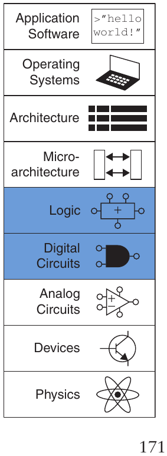

SystemVerilog và VHDL được xây dựng trên các nguyên tắc tương tự nhưng có syntax khác nhau. Phần trình bày hai ngôn ngữ trong chương này được chia thành hai cột để so sánh side-by-side theo nghĩa đen, SystemVerilog bên trái và VHDL bên phải. Lần đọc đầu, hãy tập trung vào một trong hai ngôn ngữ. Khi đã biết một, bạn sẽ nhanh chóng làm chủ ngôn ngữ còn lại nếu cần.

Các chương tiếp theo trình bày hardware dưới cả dạng schematic và HDL. Nếu bỏ qua chương này và không học một HDL, bạn vẫn có thể nắm vững nguyên tắc computer organization từ schematic. Tuy nhiên, đại đa số hệ thống thương mại hiện được xây bằng HDL thay vì schematic. Nếu dự định làm digital design vào bất cứ lúc nào trong sự nghiệp, chúng tôi khuyến khích bạn học một trong hai HDL.

### 4.1.1 Module

Khối hardware có input và output gọi module. AND gate, multiplexer, priority circuit đều là ví dụ. Hai phong cách mô tả function chính là behavioral và structural. Behavioral model mô tả module làm gì. Structural model mô tả cách xây từ phần đơn giản hơn, ứng dụng hierarchy. Code SystemVerilog và VHDL trong Ví dụ HDL 4.1 minh họa behavioral description tính Boolean function Ví dụ 2.6, `y` = $\overline{\texttt{a}}$ $\overline{\texttt{b}}$ $\overline{\texttt{c}}$ + `a`$\overline{\texttt{b}}$ $\overline{\texttt{c}}$ + `a`$\overline{\texttt{b}}$`c`. Cả hai đặt tên module `sillyfunction`, ba input `a`, `b`, `c`, một output `y`.

> Một số người vẫn dùng Verilog, phiên bản ban đầu của SystemVerilog. Vì vậy website đi kèm có phiên bản chương mô tả Verilog (xem Lời nói đầu).

Như bạn có thể dự đoán, module là một ứng dụng tốt của modularity. Nó có interface well-defined gồm input và output, đồng thời thực hiện một function cụ thể. Cách viết code bên trong không quan trọng đối với người khác có thể sử dụng module, miễn là nó thực hiện đúng function.

### 4.1.2 Nguồn gốc ngôn ngữ

Các trường đại học gần như chia đều giữa hai lựa chọn ngôn ngữ cho môn học đầu tiên. Công nghiệp đang hướng tới SystemVerilog, nhưng nhiều công ty vẫn dùng VHDL, nên nhiều designer cần thông thạo cả hai. So với SystemVerilog, VHDL dài dòng và cồng kềnh hơn, như bạn có thể chờ đợi ở một ngôn ngữ được phát triển bởi hội đồng.

#### Ví dụ HDL 4.1 COMBINATIONAL LOGIC

SystemVerilog

```
module sillyfunction(input  logic a, b, c,
                     output  logic  y);

  assign y = ~a & ~b & ~c |
             a & ~b & ~c |
             a & ~b &   c;

endmodule
```

Một module SystemVerilog bắt đầu bằng tên module cùng danh sách các input và output. Câu lệnh `assign` mô tả combinational logic. `~` biểu thị NOT, `&` biểu thị AND và `|` biểu thị OR.

Signal `logic` như input/output là Boolean variable (0 hoặc 1). Chúng cũng có thể floating và undefined như Mục 4.2.8.

Kiểu `logic` được giới thiệu trong SystemVerilog. Nó thay thế kiểu `reg`, vốn là nguồn gây nhầm lẫn dai dẳng trong Verilog. Nên sử dụng `logic` ở mọi nơi, ngoại trừ các signal có nhiều driver. Các signal có nhiều driver được gọi là net và sẽ được giải thích trong Mục 4.7.

VHDL

```
library IEEE; use IEEE.STD_LOGIC_1164.all;
entity sillyfunction is
  port(a, b, c: in    STD_LOGIC;
       y:           out STD_LOGIC);
end;
architecture synth of sillyfunction is
begin
  y <= (not a and not b and not c) or
      (a and not b and not c) or
      (a and not b and c);
end;
```

Code VHDL có ba phần: mệnh đề dùng `library`, declaration `entity` và phần thân `architecture`. Mệnh đề `library` `use` sẽ bàn Mục 4.7.2. Declaration `entity` liệt kê tên module, input/output. Thân `architecture` định nghĩa module làm gì.

Các signal VHDL, chẳng hạn input và output, phải có khai báo kiểu. Các digital signal nên được khai báo là kiểu `STD_LOGIC`. Các signal `STD_LOGIC` có thể nhận giá trị `'0'` hoặc `'1'`, cũng như các giá trị floating và chưa xác định sẽ được mô tả trong Mục 4.2.8. Kiểu `STD_LOGIC` được định nghĩa trong thư viện `IEEE.STD_LOGIC_1164`, vì vậy thư viện này phải được sử dụng.

VHDL thiếu một thứ tự operation mặc định hợp lý giữa AND và OR, nên cần đặt ngoặc trong Boolean equation.

Cả hai ngôn ngữ đều hoàn toàn có khả năng mô tả mọi hardware system, và cả hai đều có những nét khác thường. Ngôn ngữ tốt nhất là ngôn ngữ đang được dùng tại nơi bạn làm việc hoặc ngôn ngữ khách hàng yêu cầu. Phần lớn CAD tool hiện cho phép trộn hai ngôn ngữ để các module khác nhau có thể được mô tả bằng ngôn ngữ khác nhau.

> Từ “bug” có trước máy tính. Năm 1878 Thomas Edison gọi “lỗi nhỏ và khó khăn” trong phát minh là “bug”.
>
> Computer bug thực đầu tiên là bướm đêm mắc giữa relay máy tính cơ điện Harvard Mark II năm 1947. Grace Hopper tìm thấy và ghi sự cố cùng con bướm, nhận xét “trường hợp thực tế đầu tiên tìm thấy bug”.
>
> 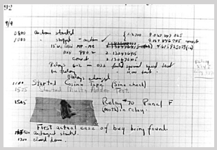
>
> Nguồn: Mục sổ tay do Naval Historical Center, US Navy cung cấp; ảnh số NII 96566-KN

### 4.1.3 Simulation và synthesis

Hai mục đích chính của HDL là logic simulation và synthesis. Trong simulation, input được áp vào module và output được kiểm tra để xác nhận module hoạt động đúng. Trong synthesis, mô tả module dạng văn bản được biến thành logic gate.

Simulation

Con người thường xuyên mắc lỗi. Những lỗi trong thiết kế hardware được gọi là bug. Loại bỏ bug khỏi digital system hiển nhiên quan trọng, đặc biệt khi khách hàng đang trả tiền và sinh mạng phụ thuộc hoạt động đúng. Kiểm thử hệ thống trong phòng thí nghiệm tốn thời gian. Tìm nguyên nhân lỗi có thể cực kỳ khó vì chỉ quan sát được signal đưa tới chân chip; không có cách quan sát trực tiếp bên trong chip. Sửa lỗi sau khi xây hệ thống có thể đắt đến mức tai hại. Ví dụ, sửa một integrated circuit cutting-edge tốn hơn một triệu USD và vài tháng. Bug FDIV (floating point division) tai tiếng trên Pentium buộc Intel thu hồi chip đã giao, tổng chi phí 475 triệu USD năm 1984. Logic simulation thiết yếu để kiểm thử hệ thống trước khi xây.

SystemVerilog

Gateway Design Automation phát triển Verilog làm ngôn ngữ riêng cho logic simulation năm 1984. Cadence mua Gateway năm 1989; Verilog thành open standard năm 1990 dưới Open Verilog International. Nó thành IEEE standard[^1] năm 1995. Năm 2005 mở rộng để sửa nét bất thường và hỗ trợ modeling/verification tốt hơn. Extension được gộp thành một chuẩn duy nhất, nay gọi SystemVerilog (IEEE STD 1800-2009). Tên file thường kết thúc `.sv`.

VHDL

VHDL viết tắt VHSIC Hardware Description Language. VHSIC lại viết tắt chương trình Very High Speed Integrated Circuits của Bộ Quốc phòng Mỹ.

VHDL ban đầu được Bộ Quốc phòng phát triển vào năm 1981 để mô tả cấu trúc và chức năng của hardware. Ngôn ngữ này bắt nguồn từ ngôn ngữ lập trình Ada. Ban đầu, VHDL được hình dung là công cụ để lập tài liệu, nhưng nhanh chóng được sử dụng cho simulation và synthesis. IEEE đã chuẩn hóa VHDL vào năm 1987 và cập nhật tiêu chuẩn nhiều lần kể từ đó. Chương này dựa trên bản sửa đổi năm 2008 của tiêu chuẩn VHDL (IEEE STD 1076-2008), giúp đơn giản hóa ngôn ngữ theo nhiều cách. Để sử dụng VHDL 2008 trong ModelSim, bạn có thể cần đặt VHDL93 = 2008 trong file cấu hình modelsim.ini. Tên file VHDL thường kết thúc bằng `.vhd`.

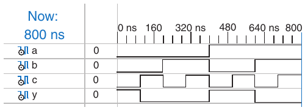

Hình 4.1 Waveform simulation

Hình 4.1 trình bày các waveform từ simulation[^2] của module `sillyfunction` ở trên, cho thấy module hoạt động chính xác. `y` là TRUE khi `a`, `b` và `c` có giá trị 000, 100 hoặc 101, đúng như Boolean equation quy định.

Synthesis

Logic synthesis chuyển code HDL thành một netlist mô tả hardware (ví dụ, các logic gate và dây nối giữa chúng). Logic synthesizer có thể thực hiện tối ưu hóa để giảm lượng hardware cần thiết. Netlist có thể là một file văn bản hoặc được vẽ dưới dạng schematic để giúp hình dung circuit. Hình 4.2 minh họa kết quả synthesis của module `sillyfunction`.[^3] Lưu ý cách ba gate AND three-input được đơn giản hóa thành hai gate AND two-input, như chúng ta đã tìm ra trong Ví dụ 2.6 bằng Boolean algebra.

> Synthesis tool gắn nhãn từng gate. Hình 4.2 là un5_y, un8_y và y.

Mô tả circuit bằng HDL trông giống code trong một ngôn ngữ lập trình. Tuy nhiên, bạn phải nhớ rằng code này dùng để biểu diễn hardware. SystemVerilog và VHDL là những ngôn ngữ phong phú với nhiều câu lệnh. Không phải tất cả các câu lệnh này đều có thể được synthesize thành hardware. Ví dụ, câu lệnh in kết quả lên màn hình trong quá trình simulation không chuyển thành hardware. Vì mục tiêu chính của chúng ta là xây dựng hardware, chúng ta sẽ tập trung vào phần ngôn ngữ có thể synthesize được. Cụ thể, chúng ta sẽ chia code HDL thành các module có thể synthesize được và một testbench. Các module có thể synthesize được mô tả hardware. Testbench chứa code để đưa input vào một module, kiểm tra xem kết quả output có chính xác hay không và in ra những khác biệt giữa output mong đợi và output thực tế. Code của testbench chỉ dùng cho simulation và không thể được synthesize.

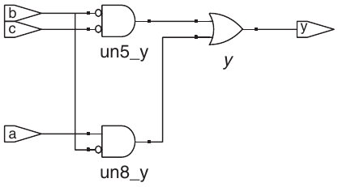

Hình 4.2 Circuit đã synthesize

Một trong những lỗi phổ biến nhất của người mới là coi HDL như chương trình máy tính thay vì cách viết gọn để mô tả digital hardware. Nếu không biết gần đúng HDL của mình phải synthesize thành hardware nào, có lẽ bạn sẽ không thích kết quả nhận được. Bạn có thể tạo hardware nhiều hơn cần thiết rất nhiều, hoặc viết code simulation đúng nhưng không triển khai thành hardware được. Thay vào đó, hãy suy nghĩ về hệ thống theo các khối combinational logic, register và finite state machine. Phác thảo các khối trên giấy và chỉ cách nối trước khi bắt đầu viết code.

Theo kinh nghiệm chúng tôi, cách tốt nhất học HDL là qua ví dụ. HDL có các cách cụ thể mô tả từng lớp logic, gọi là idiom. Chương này dạy viết idiom đúng cho mỗi loại khối, rồi ghép chúng thành hệ thống hoạt động. Khi cần mô tả loại hardware cụ thể, tìm ví dụ tương tự và điều chỉnh theo mục đích. Chúng tôi không cố định nghĩa chặt chẽ toàn bộ syntax vì điều đó cực kỳ nhàm chán và thường khiến người học coi HDL là ngôn ngữ lập trình thay vì cách viết gọn hardware. Specification IEEE SystemVerilog/VHDL cùng nhiều sách khô khan nhưng toàn diện có đầy đủ chi tiết nếu bạn cần thêm về một chủ đề. (Xem phần Đọc thêm cuối sách.)

## 4.2 COMBINATIONAL LOGIC

Hãy nhớ rằng chúng ta tự giới hạn thiết kế ở các synchronous sequential circuit, gồm combinational logic và register. Các output của combinational logic chỉ phụ thuộc vào input hiện tại. Mục này mô tả cách viết behavioral model của combinational logic bằng HDL.

### 4.2.1 Bitwise operator

Bitwise operator tác động signal single-bit hoặc bus nhiều bit. Ví dụ module `inv` trong Ví dụ HDL 4.2 mô tả bốn inverter nối bus 4-bit.

Endianness của một bus hoàn toàn do người thiết kế lựa chọn. (Xem hộp thông tin bên lề trong Mục 6.6.1 để biết nguồn gốc của thuật ngữ này.) Thực tế, endianness cũng không liên quan đến ví dụ này vì một dãy inverter không phụ thuộc vào thứ tự của các bit. Endianness chỉ quan trọng đối với các phép toán như phép cộng, trong đó tổng ở một cột có thể tạo carry sang cột tiếp theo. Cả hai thứ tự đều chấp nhận được, miễn là được sử dụng nhất quán. Chúng ta sẽ nhất quán sử dụng thứ tự little-endian, `[N − 1:0]` trong SystemVerilog và `(N − 1 downto 0)` trong VHDL, cho bus N-bit.

Sau mỗi ví dụ code trong chương này là một schematic được công cụ synthesis Synplify Premier tạo ra từ code SystemVerilog. Hình 4.3 cho thấy module `inv` được synthesize thành một dãy bốn inverter, được biểu thị bằng ký hiệu inverter mang nhãn `y[3:0]`. Dãy inverter kết nối với các bus input và output 4-bit. Code VHDL sau khi được synthesize cũng tạo ra hardware tương tự.

Module `gates` trong Ví dụ HDL 4.3 minh họa bitwise operation trên bus 4-bit cho logic function cơ bản khác.

#### Ví dụ HDL 4.2 INVERTER

SystemVerilog

```
module  inv(input  logic [3:0] a,
            output logic [3:0] y);

  assign y = ~a;
endmodule
```

`a[3:0]` biểu diễn một bus 4-bit. Các bit, từ most significant đến least significant, là `a[3]`, `a[2]`, `a[1]` và `a[0]`. Đây được gọi là thứ tự little-endian, vì least significant bit có chỉ số bit nhỏ nhất. Chúng ta có thể đặt tên bus là `a[4:1],` khi đó `a[4]` sẽ là most significant bit. Hoặc có thể sử dụng `a[0:3]`, khi đó các bit, từ most significant đến least significant, sẽ là `a[0]`, `a[1]`, `a[2]` và `a[3]`. Đây được gọi là thứ tự big-endian.

VHDL

```
library IEEE; use IEEE.STD_LOGIC_1164.all;
entity inv is
  port(a: in   STD_LOGIC_VECTOR(3 downto 0);
       y: out STD_LOGIC_VECTOR(3 downto 0));
end;
architecture synth of inv is
begin
  y <= not a;
end;
```

VHDL sử dụng `STD_LOGIC_VECTOR` để biểu thị các bus gồm các bit `STD_LOGIC`. `STD_LOGIC_VECTOR(3 downto 0)` biểu diễn một bus 4-bit. Các bit, từ most significant đến least significant, là `a(3)`, `a(2)`, `a(1)` và `a(0)`. Đây được gọi là thứ tự little-endian, vì least significant bit có chỉ số bit nhỏ nhất. Chúng ta có thể khai báo bus là `STD_LOGIC_VECTOR(4 downto 1)`, khi đó bit 4 sẽ là most significant bit. Hoặc chúng ta có thể viết `STD_LOGIC_VECTOR(0 to 3)`, khi đó các bit, từ most significant đến least significant, sẽ là `a(0), a(1), a(2), and a(3)`. Đây được gọi là thứ tự big-endian.

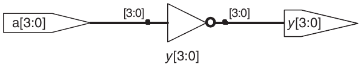

Hình 4.3 Circuit synthesize từ `inv`

#### Ví dụ HDL 4.3 LOGIC GATE

SystemVerilog

```
module gates(input  logic [3:0] a, b,
             output logic [3:0] y1, y2,
                                y3, y4, y5);

  /* five different two-input logic
     gates acting on 4-bit busses */
  assign y1 = a & b;         // AND
  assign y2 = a | b;         // OR
  assign y3 = a ^ b;         // XOR
  assign y4 = ~(a & b);      // NAND
  assign y5 = ~(a | b);      // NOR
endmodule
```

`~`, `^` và `|` là các ví dụ về toán tử SystemVerilog, còn `a`, `b` và `y1` là các toán hạng. Một tổ hợp toán tử và toán hạng, chẳng hạn `a & b` hoặc `~(a | b)`, được gọi là một biểu thức. Một câu lệnh hoàn chỉnh như `assign y4 = ~(a & b);` được gọi là statement.

`assign out = in1 op in2;` được gọi là continuous assignment statement. Các continuous assignment statement kết thúc bằng dấu chấm phẩy. Mỗi khi các input ở bên phải dấu `=` trong một continuous assignment statement thay đổi, output ở bên trái được tính lại. Vì vậy, các continuous assignment statement mô tả combinational logic.

VHDL

```
library IEEE; use IEEE.STD_LOGIC_1164.all;
entity gates is
port(a, b:   in    STD_LOGIC_VECTOR(3 downto 0);
     y1, y2, y3, y4,
     y5:     out STD_LOGIC_VECTOR(3 downto 0));
end;
architecture synth of gates is
begin
 –– five different two-input logic gates
 –– acting on 4-bit busses
 y1 <= a and b;
 y2 <= a or b;
 y3 <= a xor b;
 y4 <= a nand b;
 y5 <= a nor b;
end;
```

`not`, `xor` và `or` là các ví dụ về toán tử VHDL, còn `a`, `b` và `y1` là các toán hạng. Một tổ hợp toán tử và toán hạng, chẳng hạn `a and b` hoặc `a nor b`, được gọi là một biểu thức. Một câu lệnh hoàn chỉnh như `y4 <= a nand b;` được gọi là statement.

`out <= in1 op in2;` được gọi là concurrent signal assignment statement. Các câu lệnh gán VHDL kết thúc bằng dấu chấm phẩy. Mỗi khi các input ở bên phải dấu `<=` trong một concurrent signal assignment statement thay đổi, output ở bên trái được tính lại. Vì vậy, các concurrent signal assignment statement mô tả combinational logic.

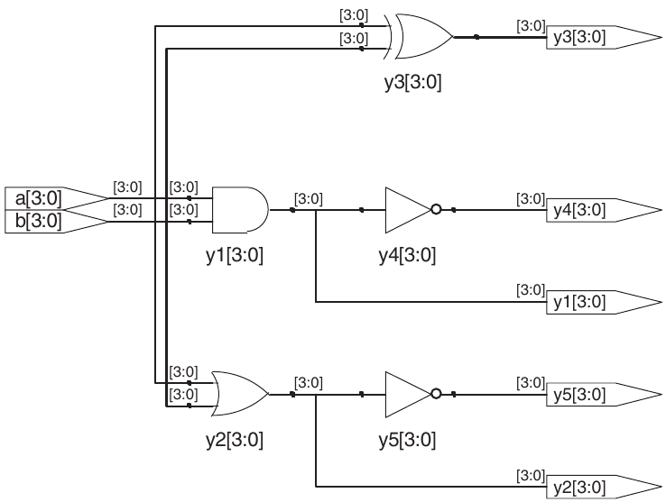

Hình 4.4 Circuit synthesize từ `gates`

### 4.2.2 Comment và khoảng trắng

Ví dụ `gates` đã cho cách định dạng comment. SystemVerilog và VHDL không khắt khe việc dùng khoảng trắng, tức space, tab và xuống dòng. Tuy nhiên, thụt lề đúng và dùng dòng trống giúp thiết kế không đơn giản trở nên dễ đọc. Hãy nhất quán cách dùng chữ hoa/thường và underscore trong tên signal, module. Sách này dùng toàn chữ thường. Tên module và signal không được bắt đầu bằng digit.

### 4.2.3 Reduction operator

Reduction operator mô tả một gate multiple-input hoạt động trên một bus duy nhất. Ví dụ HDL 4.4 mô tả một AND gate eight-input với các input `a`<sub>`7`</sub>`, a`<sub>`6`</sub>`,...,a`<sub>`0`</sub>. Các reduction operator tương tự cũng có cho OR, XOR, NAND, NOR và XNOR gate. Hãy nhớ rằng XOR multiple-input thực hiện phép kiểm tra parity, trả về TRUE nếu số lượng input có giá trị TRUE là số lẻ.

SystemVerilog

Comment trong SystemVerilog giống như trong C hoặc Java. Comment bắt đầu bằng `/*` kéo dài, có thể qua nhiều dòng, đến `*/` tiếp theo. Comment bắt đầu bằng `//` kéo dài đến cuối dòng.

SystemVerilog là ngôn ngữ case-sensitive. `y1` và `Y1` là các signal khác nhau trong SystemVerilog. Tuy nhiên, việc sử dụng nhiều signal chỉ khác nhau ở chữ hoa và chữ thường sẽ gây nhầm lẫn.

VHDL

Comment bắt đầu `/*` tiếp tục, có thể nhiều dòng, tới `*/`. Bắt đầu `––` tiếp tục đến cuối dòng.

VHDL không có tính case-sensitive. `y1` và `Y1` là cùng một signal trong VHDL. Tuy nhiên, các tool khác có thể đọc file của bạn lại có thể có tính case-sensitive, dẫn đến những bug khó chịu nếu bạn tùy tiện dùng lẫn chữ hoa và chữ thường.

### 4.2.4 Conditional assignment

Conditional assignment chọn output trong các khả năng dựa input gọi condition. Ví dụ HDL 4.5 minh họa multiplexer 2:1 bằng conditional assignment.

#### Ví dụ HDL 4.4 AND EIGHT-INPUT

SystemVerilog

```
module  and8(input     logic  [7:0]  a,
             output  logic           y);

  assign y = &a;

  // &a is much easier to write than
  // assign y  =  a[7] & a[6] & a[5] & a[4] &
  //                  a[3] & a[2] & a[1] & a[0];
endmodule
```

VHDL

```
library IEEE; use IEEE.STD_LOGIC_1164.all;
entity and8 is
  port(a: in   STD_LOGIC_VECTOR(7 downto 0);
       y: out STD_LOGIC);
end;
architecture synth of and8 is
begin
  y <= and a;
  –– and a is much easier to write than
  –– y <= a(7) and a(6) and a(5) and a(4) and
  ––         a(3) and a(2) and a(1) and a(0);
end;
```

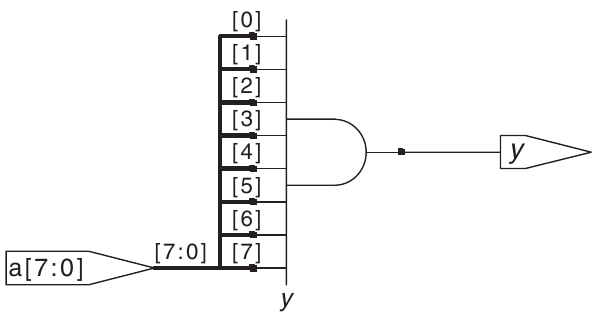

Hình 4.5 Circuit synthesize từ `and8`

#### Ví dụ HDL 4.5 MULTIPLEXER 2:1

SystemVerilog

Toán tử điều kiện `?:` lựa chọn giữa biểu thức thứ hai và biểu thức thứ ba dựa trên biểu thức thứ nhất. Biểu thức thứ nhất được gọi là điều kiện. Nếu điều kiện bằng 1, toán tử chọn biểu thức thứ hai. Nếu điều kiện bằng 0, toán tử chọn biểu thức thứ ba.

`?:` đặc biệt hữu ích để mô tả multiplexer vì dựa trên input thứ nhất, nó lựa chọn một trong hai input còn lại. Code sau minh họa idiom cho một multiplexer 2:1 có input và output 4-bit, sử dụng toán tử điều kiện.

```
module mux2(input   logic [3:0] d0, d1,
            input     logic     s,
            output logic [3:0] y);

  assign y  =  s ? d1 : d0;
endmodule
```

Nếu `s` bằng 1 thì `y = d1`. Nếu `s` bằng 0 thì `y = d0`.

`?:` còn gọi ternary operator vì nhận ba input. C và Java dùng cùng mục đích.

VHDL

Conditional signal assignment thực hiện các phép toán khác nhau tùy theo một điều kiện nào đó. Chúng đặc biệt hữu ích để mô tả multiplexer. Ví dụ, một multiplexer 2:1 có thể sử dụng conditional signal assignment để lựa chọn một trong hai input 4-bit.

```
library IEEE; use IEEE.STD_LOGIC_1164.all;
entity mux2 is
   port(d0, d1: in   STD_LOGIC_VECTOR(3 downto 0);
        s:         in   STD_LOGIC;
        y:          out STD_LOGIC_VECTOR(3 downto 0));
end;
architecture synth of mux2 is
begin
  y <= d1 when s else d0;
end;
```

Conditional signal assignment đặt `y` bằng `d1` nếu `s` bằng 1; nếu không đặt `y` bằng `d0`. Trước VHDL 2008 phải viết `when s = '1'` thay `when s`.

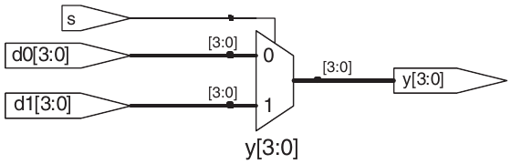

Hình 4.6 Circuit synthesize từ `mux2`

Ví dụ HDL 4.6 minh họa một multiplexer 4:1 dựa trên cùng nguyên lý với multiplexer 2:1 trong Ví dụ HDL 4.5. Hình 4.7 minh họa schematic của multiplexer 4:1 do công cụ synthesis tạo ra. Software sử dụng một ký hiệu multiplexer khác với ký hiệu được sử dụng trong sách cho đến lúc này. Multiplexer có nhiều input data `(d)` và input enable one-hot `(e)`. Khi một trong các enable được assert, data tương ứng được truyền đến output. Ví dụ, khi `s[1] = s[0] = 0`, gate AND ở dưới cùng, `un1_s_5`, tạo ra giá trị 1, enable input dưới cùng của multiplexer và khiến nó lựa chọn `d0[3:0]`.

### 4.2.5 Internal variable

Việc chia một chức năng phức tạp thành các bước trung gian thường rất thuận tiện. Ví dụ, full adder, sẽ được mô tả trong Mục 5.2.1, là một circuit có ba input và hai output được định nghĩa bởi các phương trình sau:

#### Ví dụ HDL 4.6 MULTIPLEXER 4:1

SystemVerilog

Multiplexer 4:1 chọn một trong bốn input bằng conditional operator lồng nhau.

```
module mux4(input    logic [3:0] d0, d1, d2, d3,
            input      logic [1:0] s,
            output  logic [3:0] y);

  assign y  =  s[1]  ? (s[0] ? d3 : d2)
                     : (s[0] ? d1 : d0);
endmodule
```

Nếu `s[1]` bằng 1, multiplexer chọn biểu thức thứ nhất, `(s[0] ? d3 : d2)`. Đến lượt mình, biểu thức này chọn `d3` hoặc `d2` dựa trên `s[0]` (`y = d3` nếu `s[0]` bằng 1 và chọn `d2` nếu `s[0]` bằng 0). Nếu `s[1]` bằng 0, tương tự, multiplexer chọn biểu thức thứ hai, cho kết quả là `d1` hoặc `d0` dựa trên `s[0]`.

VHDL

Multiplexer 4:1 chọn một trong bốn input bằng nhiều mệnh đề `else` trong conditional signal assignment.

```
library IEEE; use IEEE.STD_LOGIC_1164.all;
entity mux4 is
  port(d0, d1,
       d2, d3:  in   STD_LOGIC_VECTOR(3 downto 0);
       s:          in   STD_LOGIC_VECTOR(1 downto 0);
       y:            out STD_LOGIC_VECTOR(3 downto 0));
end;
architecture synth1 of mux4 is
begin
  y <= d0 when s = "00" else
      d1 when s = "01" else
      d2 when s = "10" else
      d3;
end;
```

VHDL cũng hỗ trợ các câu lệnh selected signal assignment để viết ngắn gọn việc lựa chọn một trong nhiều khả năng. Điều này tương tự như sử dụng câu lệnh `switch/case` thay cho nhiều câu lệnh `if/else` trong một số ngôn ngữ lập trình. Có thể viết lại multiplexer 4:1 bằng selected signal assignment như sau:

```
architecture synth2 of mux4 is
begin
  with s select y <=
    d0  when "00",
    d1  when "01",
    d2  when "10",
    d3  when others;
end;
```

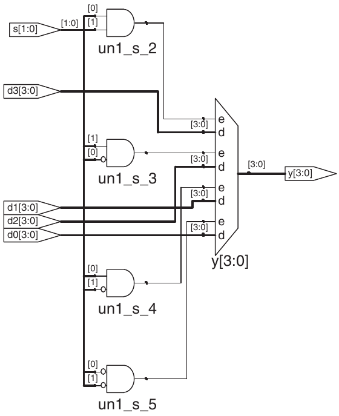

Hình 4.7 Circuit synthesize từ `mux4`

S = A ⊕ B ⊕ C<sub>in</sub>

C<sub>out</sub> = AB + AC<sub>in</sub> + BC<sub>in</sub> (4.1)

Nếu định nghĩa signal trung gian P và G,

P = A ⊕ B (4.2) G = AB

có thể viết lại full adder như sau:

> Hãy kiểm tra điều này bằng cách điền đầy đủ truth table để tự xác nhận rằng nó chính xác.

S = P ⊕ C<sub>in</sub> (4.3)

C<sub>out</sub> = G + PC<sub>in</sub>

P và G được gọi là các biến nội bộ vì chúng không phải input hoặc output; thay vào đó, chúng chỉ được sử dụng bên trong module. Chúng tương tự các biến cục bộ trong ngôn ngữ lập trình. Ví dụ HDL 4.7 minh họa cách sử dụng chúng trong HDL.

Các câu lệnh gán HDL (`assign` trong SystemVerilog và `<=` trong VHDL) diễn ra đồng thời. Điều này khác với các ngôn ngữ lập trình thông thường như C hoặc Java, trong đó các câu lệnh được thực hiện theo thứ tự được viết. Trong một ngôn ngữ thông thường, S = P⊕ C<sub>in</sub> phải nằm sau P = A⊕B vì các câu lệnh được thực thi tuần tự. Trong HDL, thứ tự không quan trọng. Giống như hardware, các câu lệnh gán HDL được thực hiện mỗi khi input, tức các signal ở phía right-hand side, thay đổi giá trị, bất kể thứ tự xuất hiện của các câu lệnh gán trong module.

### 4.2.6 Độ ưu tiên

Lưu ý rằng chúng ta đã đặt dấu ngoặc đơn trong phép tính `cout` ở Ví dụ HDL 4.7 để xác định thứ tự phép toán là C<sub>out</sub> = G + (P · C<sub>in</sub>) thay vì C<sub>out</sub> = (G + P) · C<sub>in</sub>. Nếu không sử dụng dấu ngoặc đơn, thứ tự phép toán mặc định sẽ do ngôn ngữ quy định. Ví dụ HDL 4.8 chỉ rõ thứ tự ưu tiên của toán tử từ cao xuống thấp cho từng ngôn ngữ. Các bảng bao gồm các toán tử arithmetic, shift và comparison sẽ được định nghĩa trong Chương 5.

#### Ví dụ HDL 4.7 FULL ADDER

SystemVerilog

Trong SystemVerilog internal signal thường khai báo `logic`.

```
module fulladder(input   logic a, b, cin,
                 output logic s, cout);

  logic p, g;

  assign p = a ^ b;
  assign g = a & b;

  assign s = p ^ cin;
  assign cout = g | (p & cin);
endmodule
```

VHDL

Trong VHDL, signal biểu diễn internal variable có giá trị định nghĩa bằng concurrent signal assignment như `p <= a xor b;`

```
library IEEE; use IEEE.STD_LOGIC_1164.all;
entity fulladder is
  port(a, b, cin: in    STD_LOGIC;
       s, cout:     out STD_LOGIC);
end;
architecture synth of fulladder is
  signal p, g: STD_LOGIC;
begin
  p <= a xor b;
  g <= a and b;
  s <= p xor cin;
  cout <= g or (p and cin);
end;
```

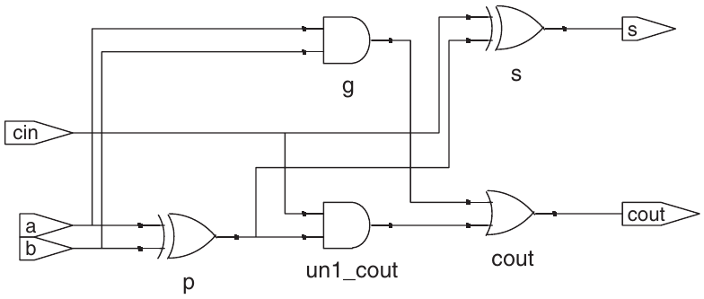

Hình 4.8 Circuit synthesize từ `fulladder`

Bảng 4.1 Độ ưu tiên operator SystemVerilog

|  | Operator | Ý nghĩa |
|---|---|---|
| Cao nhất | `~` | NOT |
|  | `*, /, %` | MUL, DIV, MOD |
|  | `+, –` | PLUS, MINUS |
|  | `<<, >>` | Logical shift trái/phải |
|  | `<<<, >>>` | Arithmetic shift trái/phải |
|  | `<, <=, >, >=` | So sánh thứ tự |
|  | `= =, !=` | So sánh bằng nhau |
| Thấp nhất | `&, ~&` | AND, NAND |
|  | `^, ~^` | XOR, XNOR |
|  | `\|, ~\|` | OR, NOR |
|  | `?:` | Có điều kiện |

Bảng 4.2 Độ ưu tiên operator VHDL

|  | Operator | Ý nghĩa |
|---|---|---|
| Cao nhất | `not` | NOT |
|  | `*, /, mod,` `rem` | MUL, DIV, MOD, REM |
|  | `+, –` | PLUS, MINUS |
|  | `rol, ror,` `srl, sll` | Rotate, logical shift |
| Thấp nhất | `<, <=, >, >=` | So sánh thứ tự |
|  | `=, /=` | So sánh bằng nhau |
|  | `and, or,` `nand, nor,` `xor, xnor` | Logical operation |

### 4.2.7 Số

Có thể chỉ định số ở dạng binary, octal, decimal hoặc hexadecimal (tương ứng với cơ số 2, 8, 10 và 16). Kích thước, tức số bit, là tùy chọn; các bit 0 được thêm vào đầu để đạt kích thước này. Dấu gạch dưới trong số được bỏ qua và có thể giúp chia các số dài thành những nhóm dễ đọc hơn. Ví dụ HDL 4.9 giải thích cách viết số trong từng ngôn ngữ.

#### Ví dụ HDL 4.8 ĐỘ ƯU TIÊN OPERATOR

SystemVerilog

Thứ tự ưu tiên của các toán tử trong SystemVerilog phần lớn giống như bạn thường thấy trong các ngôn ngữ lập trình khác. Cụ thể, AND có độ ưu tiên cao hơn OR. Chúng ta có thể tận dụng thứ tự ưu tiên này để loại bỏ các dấu ngoặc đơn:

```
assign cout = g | p & cin;
```

VHDL

VHDL ưu tiên nhân hơn cộng như mong đợi. Nhưng khác SystemVerilog, mọi logical operation (`and`, `or`, v.v.) ngang ưu tiên, khác Boolean algebra thường nghĩ. Vì vậy cần ngoặc. Nếu không, `cout <= g or p and cin` diễn giải trái sang phải thành `cout <= (g or p) and cin`.

Bảng 4.3 Số SystemVerilog

| Số | Bit | Cơ số | Giá trị | Được lưu |
|---|---|---|---|---|
| `3'b101` | 3 | 2 | 5 | 101 |
| `'b11` | ? | 2 | 3 | 000 … 0011 |
| `8'b11` | 8 | 2 | 3 | 00000011 |
| `8'b1010_1011` | 8 | 2 | 171 | 10101011 |
| `3'd6` | 3 | 10 | 6 | 110 |
| `6'o42` | 6 | 8 | 34 | 100010 |
| `8'hAB` | 8 | 16 | 171 | 10101011 |
| `42` | ? | 10 | 42 | 00 … 0101010 |

Bảng 4.4 Số VHDL

| Số | Bit | Cơ số | Giá trị | Được lưu |
|---|---|---|---|---|
| `3B"101"` | 3 | 2 | 5 | 101 |
| `B"11"` | 2 | 2 | 3 | 11 |
| `8B"11"` | 8 | 2 | 3 | 00000011 |
| `8B"1010_1011"` | 8 | 2 | 171 | 10101011 |
| `3D"6"` | 3 | 10 | 6 | 110 |
| `6O"42"` | 6 | 8 | 34 | 100010 |
| `8X"AB"` | 8 | 16 | 171 | 10101011 |
| `"101"` | 3 | 2 | 5 | 101 |
| `B"101"` | 3 | 2 | 5 | 101 |
| `X"AB"` | 8 | 16 | 171 | 10101011 |

### 4.2.8 Z và X

HDL sử dụng `z` để biểu thị một giá trị floating. `z` đặc biệt hữu ích khi mô tả tristate buffer, có output ở trạng thái floating khi enable bằng 0. Hãy nhớ lại từ Mục 2.6.2 rằng một bus có thể được điều khiển bởi nhiều tristate buffer, trong đó chỉ đúng một buffer được enable. Ví dụ HDL 4.10 minh họa idiom cho tristate buffer. Nếu buffer được enable, output giống input. Nếu buffer bị disable, output được gán một giá trị floating (`z`).

Tương tự HDL dùng `x` chỉ logic level không hợp lệ. Nếu hai tristate buffer enable (hoặc gate khác) cùng lái bus về 0 và 1, kết quả `x`, chỉ contention. Nếu mọi tristate buffer

#### Ví dụ HDL 4.9 SỐ

SystemVerilog

Định dạng khai báo hằng số là `N'Bvalue`, trong đó `N` là kích thước tính bằng bit, `B` là chữ cái biểu thị cơ số và `value` cung cấp giá trị. Ví dụ, `9'h25` biểu thị một số 9-bit có giá trị 25<sub>16</sub> = 37<sub>10</sub> = 000100101<sub>2</sub>. SystemVerilog hỗ trợ `'b` cho binary, `'o` cho octal, `'d` cho decimal và `'h` cho hexadecimal.

Nếu bỏ qua cơ số, cơ số mặc định là decimal. Nếu không chỉ định kích thước, số đó được giả định có số bit bằng số bit của biểu thức đang sử dụng nó. Các bit 0 được tự động thêm vào phía trước để số đó có đủ kích thước. Ví dụ, nếu `w` là bus 6-bit, `assign w = 'b11` sẽ gán cho `w` giá trị 000011. Cách thực hành tốt hơn là chỉ định kích thước một cách tường minh. Một ngoại lệ là `'0` và `'1` là các idiom của SystemVerilog dùng để điền tất cả các bit lần lượt bằng 0 và 1.

VHDL

Trong VHDL, các số STD_LOGIC được viết ở dạng binary và đặt trong dấu nháy đơn: `'0'` và `'1'` biểu thị logic 0 và 1. Định dạng khai báo hằng số STD_LOGIC_VECTOR là `NB"value"`, trong đó `N` là kích thước tính bằng bit, `B` là chữ cái biểu thị cơ số và `value` cung cấp giá trị. Ví dụ, `9X"25"` biểu thị một số 9-bit có giá trị 25<sub>16</sub> =37<sub>10</sub> =000100101<sub>2</sub>. VHDL 2008 hỗ trợ `B` cho binary, `O` cho octal, `D` cho decimal và `X` cho hexadecimal.

Nếu bỏ qua cơ số, cơ số mặc định là binary. Nếu không chỉ định kích thước, số đó được giả định có kích thước bằng số bit được chỉ định trong giá trị. Ví dụ, `y <= X"7B"` đòi hỏi `y` phải là một signal 8-bit. Nếu `y` có nhiều bit hơn, VHDL không thêm các bit 0 vào bên trái số đó. Thay vào đó, một lỗi sẽ xảy ra trong quá trình biên dịch. `others => '0'` và `others => '1'` là các idiom của VHDL dùng để điền tất cả các bit lần lượt bằng 0 và 1.

Khi simulation bắt đầu, các state node như output của flip-flop được khởi tạo ở trạng thái chưa biết (`x` trong SystemVerilog và `u` trong VHDL). Điều này hữu ích để tìm các lỗi do quên reset flip-flop trước khi sử dụng output của nó.

Nếu một gate nhận floating input, nó có thể tạo ra output `x` khi không xác định được giá trị output chính xác. Tương tự, nếu nhận input không hợp lệ hoặc chưa được khởi tạo, nó có thể tạo ra output `x`. Ví dụ HDL 4.11 minh họa cách SystemVerilog và VHDL kết hợp những giá trị signal khác nhau này trong các logic gate.

#### Ví dụ HDL 4.10 TRISTATE BUFFER

SystemVerilog

```
module  tristate(input    logic  [3:0]  a,
                input   logic         en,
                output tri     [3:0] y);

  assign y  =  en ? a : 4'bz;
endmodule
```

Lưu ý rằng `y` được khai báo là `tri` thay vì `logic`. Các signal `logic` chỉ có thể có một driver. Tristate bus có thể có nhiều driver, nên chúng cần được khai báo là net. Hai loại net trong SystemVerilog được gọi là `tri` và `trireg`. Thông thường, tại mỗi thời điểm chỉ có đúng một driver trên net hoạt động, và net nhận giá trị đó. Nếu không có driver nào hoạt động, `tri` ở trạng thái floating (`z`), còn `trireg` giữ giá trị trước đó. Nếu không chỉ định kiểu cho một input hoặc output, kiểu `tri` được giả định. Cũng lưu ý rằng output `tri` từ một module có thể được sử dụng làm input `logic` cho module khác. Mục 4.7 sẽ thảo luận thêm về các net có nhiều driver.

VHDL

```
library IEEE; use IEEE.STD_LOGIC_1164.all;
entity tristate is
  port(a:    in   STD_LOGIC_VECTOR(3 downto 0);
       en: in   STD_LOGIC;
       y:    out  STD_LOGIC_VECTOR(3 downto 0));
end;
architecture synth of tristate is
begin
  y  <=  a when en else "ZZZZ";
end;
```

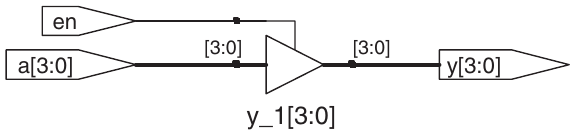

Hình 4.9 Circuit synthesize từ `tristate`

Bảng 4.5 Truth table AND SystemVerilog với `z` và `x`

| \& |  |  | A |  |  |
|---|---|---|---|---|---|
|  |  | `0` | `1` | `z` | `x` |
|  | `0` | `0` | `0` | `0` | `0` |
|  | `1` | `0` | `1` | `x` | `x` |
| B | `z` | `0` | `x` | `x` | `x` |
|  | `x` | `0` | `x` | `x` | `x` |

Bảng 4.6 Truth table AND VHDL với `z`, `x`, `u`

| AND |  |  |  | A |  |  |
|---|---|---|---|---|---|---|
|  |  | `0` | `1` | `z` | `x` | `u` |
|  | `0` | `0` | `0` | `0` | `0` | `0` |
|  | `1` | `0` | `1` | `x` | `x` | `u` |
| B | `z` | `0` | `x` | `x` | `x` | `u` |
|  | `x` | `0` | `x` | `x` | `x` | `u` |
|  | `u` | `0` | `u` | `u` | `u` | `u` |

#### Ví dụ HDL 4.11 TRUTH TABLE VỚI INPUT UNDEFINED VÀ FLOATING

SystemVerilog

Các giá trị signal của SystemVerilog là `0`, `1`, `z` và `x`. Khi cần thiết, các hằng số SystemVerilog bắt đầu bằng `z` hoặc `x` được thêm các giá trị `z` hoặc `x` vào phía trước (thay vì các bit 0) để đạt đủ độ dài.

Bảng 4.5 minh họa truth table cho một gate AND sử dụng tất cả bốn giá trị signal có thể có. Lưu ý rằng đôi khi gate vẫn xác định được output dù một số input chưa biết. Ví dụ, `0 & z` trả về `0` vì output của gate AND luôn bằng `0` nếu một trong hai input bằng `0`. Trong các trường hợp khác, input floating hoặc không hợp lệ dẫn đến output không hợp lệ, được hiển thị là `x` trong SystemVerilog.

VHDL

Signal STD_LOGIC VHDL là `'0'`, `'1'`, `'z', 'x'` và `'u'`.

Bảng 4.6 minh họa truth table cho một gate AND sử dụng tất cả năm giá trị signal có thể có. Lưu ý rằng đôi khi gate vẫn xác định được output dù một số input chưa biết. Ví dụ, `'0' and 'z'` trả về `'0'` vì output của gate AND luôn bằng `'0'` nếu một trong hai input bằng `'0'`. Trong các trường hợp khác, input floating hoặc không hợp lệ dẫn đến output không hợp lệ, được hiển thị là `'x'` trong VHDL. Các input chưa được khởi tạo dẫn đến output chưa được khởi tạo, được hiển thị là `'u'` trong VHDL.

Thấy `x` hoặc `u` trong simulation gần như luôn báo bug hoặc code chưa tốt. Trong circuit synthesize, tương ứng floating gate input, state chưa khởi tạo hoặc contention. Circuit có thể diễn giải `x` hoặc `u` ngẫu nhiên thành 0 hay 1, gây hành vi khó đoán.

### 4.2.9 Bit swizzling

Thường cần thao tác tập con bus hoặc concatenate signal thành bus. Các operation gọi chung bit swizzling. Ví dụ HDL 4.12 gán `y` giá trị 9-bit `c`<sub>`2`</sub>`c`<sub>`1`</sub>`d`<sub>`0`</sub>`d`<sub>`0`</sub>`d`<sub>`0`</sub>`c`<sub>`0`</sub>`101` bằng bit swizzling.

### 4.2.10 Delay

Có thể gắn các câu HDL với delay chỉ định theo đơn vị tùy ý. Chúng hữu ích trong simulation để dự đoán tốc độ circuit nếu delay có ý nghĩa, và trong debugging để hiểu quan hệ nhân quả: suy ra nguồn của output sai rất khó nếu mọi signal đổi đồng thời trong kết quả. Synthesis bỏ qua delay này; delay gate do synthesizer tạo phụ thuộc specification t<sub>pd</sub> và t<sub>cd</sub>, không phụ thuộc con số trong HDL code.

#### Ví dụ HDL 4.12 BIT SWIZZLING

SystemVerilog

```
assign y = {c[2:1], {3{d[0]}}, c[0], 3'b101};
```

Operator {} nối bus. `{3{d[0]}}` chỉ ba bản sao `d[0]`.

Đừng nhầm hằng số binary 3-bit `3'b101` với một bus có tên `b`. Lưu ý rằng việc chỉ định độ dài 3 bit cho hằng số này là rất quan trọng. Nếu không, nó sẽ có một số lượng bit 0 ở đầu chưa xác định, và những bit đó có thể xuất hiện ở giữa `y`.

Nếu `y` rộng hơn 9 bit, zero được đặt ở most significant bit.

VHDL

```
y <= (c(2 downto 1), d(0), d(0), d(0), c(0), 3B"101");
```

Aggregate operator `()` nối bus. `y` phải là `STD_LOGIC_VECTOR` 9-bit.

Ví dụ khác cho sức mạnh aggregation VHDL. Giả sử `z` là `STD_LOGIC_VECTOR,` 8-bit, `z` được gán 10010110 bằng command aggregation sau.

```
z <= ("10", 4 => '1', 2 downto 1 =>'1', others =>'0')
```

`"10"` vào cặp bit đầu. 1 cũng đặt ở bit 4, 2, 1. Bit còn lại 0.

Ví dụ HDL 4.13 thêm delay vào function gốc Ví dụ 4.1, `y` = $\overline{\texttt{a}}$ $\overline{\texttt{b}}$ $\overline{\texttt{c}}$ + `a`$\overline{\texttt{b}}$ $\overline{\texttt{c}}$ + `a`$\overline{\texttt{b}}$`c`. Giả định inverter delay 1 ns, AND three-input 2 ns, OR three-input 4 ns. Hình 4.10 cho waveform, `y` chậm input 7 ns. Chú ý `y` unknown khi simulation bắt đầu.

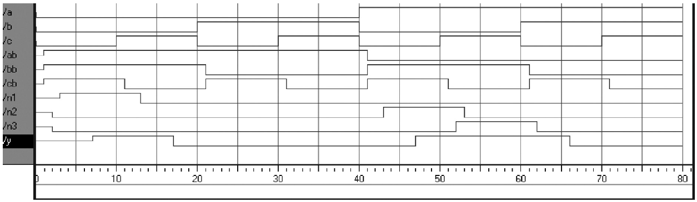

Hình 4.10 Waveform simulation có delay (ModelSim simulator)

#### Ví dụ HDL 4.13 LOGIC GATE CÓ DELAY

SystemVerilog

```
'timescale 1ns/1ps
module example(input  logic a, b, c,
               output logic y);
  logic ab, bb, cb, n1, n2, n3;
  assign #1 {ab, bb, cb}  =   ~{a, b, c};
  assign #2  n1 = ab & bb & cb;
  assign #2  n2 = a & bb & cb;
  assign #2  n3 = a & bb & c;
  assign #4     y = n1 | n2 | n3;
endmodule
```

File SystemVerilog có thể chứa timescale directive chỉ định giá trị của mỗi đơn vị thời gian. Câu lệnh có dạng `'timescale unit/precision`. Trong file này, mỗi đơn vị là 1 ns và simulation có độ chính xác 1 ps. Nếu file không có timescale directive, đơn vị và độ chính xác mặc định (thường đều là 1 ns) sẽ được sử dụng. Trong SystemVerilog, ký hiệu `#` được sử dụng để chỉ số đơn vị delay. Nó có thể được đặt trong câu lệnh `assign`, cũng như trong nonblocking assignment (`<=`) và blocking assignment (`=`), sẽ được thảo luận trong Mục 4.5.4.

VHDL

```
library IEEE; use IEEE.STD_LOGIC_1164.all;
entity example is
  port(a, b, c: in    STD_LOGIC;
       y:           out STD_LOGIC);
end;
architecture synth of example is
  signal ab, bb, cb, n1, n2, n3: STD_LOGIC;
begin
  ab <= not a after 1 ns;
  bb <= not b after 1 ns;
  cb <= not c after 1 ns;
  n1 <= ab and bb and cb after 2 ns;
  n2 <= a and bb and cb after 2 ns;
  n3 <= a and bb and c after 2 ns;
  y     <= n1 or n2 or n3 after 4 ns;
end;
```

Trong VHDL, mệnh đề `after` chỉ delay, ở đây đơn vị nanosecond.

## 4.3 STRUCTURAL MODELING

Phần trước trình bày behavioral modeling, mô tả module theo quan hệ input/output. Phần này xem structural modeling, mô tả module theo cách nó được cấu thành từ những module đơn giản hơn.

Ví dụ HDL 4.14 minh họa cách ghép một multiplexer 4:1 từ ba multiplexer 2:1. Mỗi bản sao của multiplexer 2:1 được gọi là một instance. Nhiều instance của cùng một module được phân biệt bằng các tên riêng, trong trường hợp này là `lowmux, highmux` và `finalmux`. Đây là một ví dụ về regularity, trong đó multiplexer 2:1 được tái sử dụng nhiều lần.

Ví dụ HDL 4.15 dùng structural modeling xây multiplexer 2:1 từ cặp tristate buffer. Tuy nhiên không khuyến nghị xây logic bằng tristate.

### Ví dụ HDL 4.14 STRUCTURAL MODEL CỦA MULTIPLEXER 4:1

SystemVerilog

```
module mux4(input   logic [3:0] d0, d1, d2, d3,
            input    logic [1:0] s,
            output  logic [3:0] y);

  logic [3:0] low, high;

  mux2 lowmux(d0, d1, s[0], low);
  mux2 highmux(d2, d3, s[0], high);
  mux2 finalmux(low, high, s[1], y);
endmodule
```

Ba instance `mux2` tên `lowmux`, `highmux`, `finalmux`. Module `mux2` phải định nghĩa nơi khác trong code—Ví dụ HDL 4.5, 4.15 hoặc 4.34.

VHDL

```
library IEEE; use IEEE.STD_LOGIC_1164.all;
entity mux4 is
  port(d0, d1,
       d2, d3: in   STD_LOGIC_VECTOR(3 downto 0);
       s:         in   STD_LOGIC_VECTOR(1 downto 0);
       y:         out STD_LOGIC_VECTOR(3 downto 0));
end;
architecture struct of mux4 is
  component mux2
    port(d0,
         d1: in   STD_LOGIC_VECTOR(3 downto 0);
         s:  in   STD_LOGIC;
         y:   out STD_LOGIC_VECTOR(3 downto 0));
  end component;
  signal low, high: STD_LOGIC_VECTOR(3 downto 0);
begin
  lowmux:      mux2  port  map(d0, d1, s(0), low);
  highmux:   mux2  port     map(d2, d3, s(0), high);
  finalmux:  mux2  port   map(low, high, s(1), y);
end;
```

Architecture trước tiên phải khai báo các port của `mux2` bằng câu lệnh component declaration. Điều này cho phép các công cụ VHDL kiểm tra xem component mà bạn muốn sử dụng có cùng các port với entity đã được khai báo ở nơi khác bằng một câu lệnh entity khác hay không. Nhờ đó, có thể tránh các lỗi do thay đổi entity nhưng không thay đổi instance. Tuy nhiên, component declaration khiến code VHDL khá cồng kềnh.

Lưu ý rằng architecture này của `mux4` được đặt tên là `struct`, trong khi các architecture của những module có mô tả hành vi trong Mục 4.2 được đặt tên là `synth`. VHDL cho phép có nhiều architecture (cách triển khai) cho cùng một entity; các architecture được phân biệt bằng tên. Bản thân các tên không có ý nghĩa đối với các công cụ CAD, nhưng `struct` và `synth` là những tên thường dùng. Code VHDL có thể synthesize thường chỉ chứa một architecture cho mỗi entity, nên chúng ta sẽ không thảo luận cú pháp VHDL để cấu hình architecture nào được sử dụng khi nhiều architecture được định nghĩa.

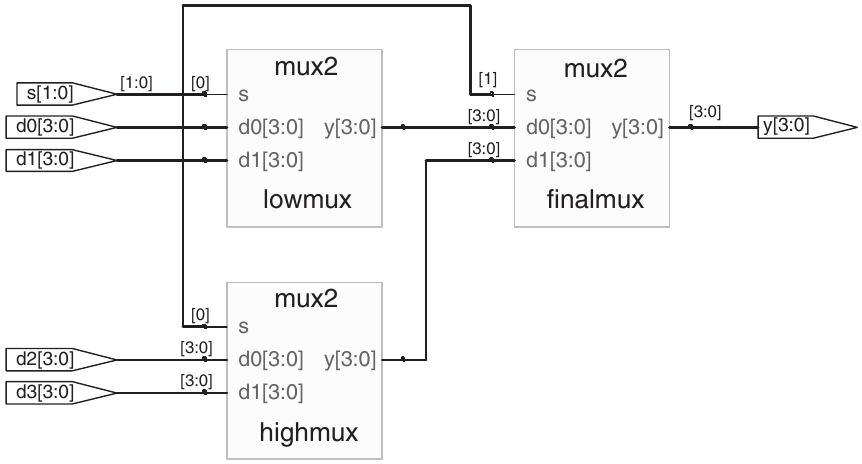

Hình 4.11 Circuit synthesize từ `mux4`

Ví dụ HDL 4.16 cho module truy cập phần bus. Multiplexer 2:1 rộng 8-bit-wide xây từ hai multiplexer 2:1 4-bit đã định nghĩa, thao tác nibble thấp/cao của byte.

Nói chung, hệ thống phức tạp được thiết kế theo hierarchy. Hệ thống tổng thể được mô tả structural bằng instantiate các component chính. Mỗi component lại được mô tả structural từ building block của nó, tiếp tục đệ quy đến khi các phần đủ đơn giản để mô tả behavioral. Phong cách tốt là tránh, hoặc ít nhất giảm tối đa, trộn mô tả structural và behavioral trong cùng module.

### Ví dụ HDL 4.15 STRUCTURAL MODEL CỦA MULTIPLEXER 2:1

SystemVerilog

```
module mux2(input   logic [3:0] d0, d1,
            input   logic             s,
            output tri      [3:0]  y);

  tristate t0(d0, ~s, y);
  tristate t1(d1, s, y);
endmodule
```

Trong SystemVerilog, các biểu thức như `~s` được phép xuất hiện trong port list của một instance. Các biểu thức phức tạp tùy ý đều hợp lệ nhưng không được khuyến khích vì chúng khiến code khó đọc.

VHDL

```
library IEEE; use IEEE.STD_LOGIC_1164.all;
entity mux2 is
  port(d0, d1: in   STD_LOGIC_VECTOR(3 downto 0);
      s:         in    STD_LOGIC;
      y:          out  STD_LOGIC_VECTOR(3 downto 0));
end;
architecture struct of mux2 is
   component tristate
     port(a:   in    STD_LOGIC_VECTOR(3 downto 0);
         en: in    STD_LOGIC;
         y:   out STD_LOGIC_VECTOR(3 downto 0));
   end component;
   signal sbar: STD_LOGIC;
begin
   sbar <= not s;
   t0:  tristate  port  map(d0, sbar, y);
   t1:  tristate  port  map(d1, s, y);
end;
```

VHDL không cho expression như `not s` trong port map instance. Vì vậy phải định nghĩa `sbar` thành signal riêng.

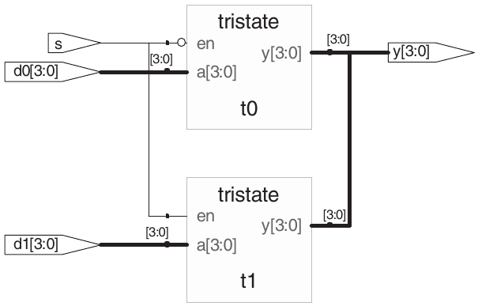

Hình 4.12 Circuit synthesize từ `mux2`

## 4.4 SEQUENTIAL LOGIC

HDL synthesizer nhận ra một số idiom và chuyển chúng thành sequential circuit cụ thể. Phong cách code khác có thể simulation đúng nhưng synthesize thành circuit có lỗi rõ ràng hoặc tinh vi. Phần này trình bày idiom đúng để mô tả register và latch.

### 4.4.1 Register

Phần lớn các hệ thống thương mại hiện đại được xây dựng với các register sử dụng D flip-flops positive edge-triggered. Ví dụ HDL 4.17 minh họa idiom cho những flip-flops như vậy.

Trong các câu lệnh `always` của SystemVerilog và `process` của VHDL, các signal giữ giá trị cũ cho đến khi một sự kiện trong sensitivity list xảy ra và chỉ định rõ việc thay đổi giá trị của chúng. Vì vậy, code như vậy, với sensitivity list phù hợp, có thể được sử dụng để mô tả sequential circuit có memory. Ví dụ, flip-flop chỉ đưa `clk` vào sensitivity list. Nó ghi nhớ giá trị cũ của `q` cho đến rising edge tiếp theo của `clk`, ngay cả khi `d` thay đổi trong khoảng thời gian đó.

Ngược lại, các continuous assignment statement của SystemVerilog (`assign`) và concurrent assignment statement của VHDL (`<=`) được thực hiện lại mỗi khi bất kỳ input nào ở right-hand side thay đổi. Vì vậy, code như vậy nhất thiết mô tả combinational logic.

#### Ví dụ HDL 4.16 TRUY CẬP PHẦN BUS

SystemVerilog

```
module mux2_8(input   logic [7:0] d0, d1,
              input    logic           s,
               output logic [7:0] y);

  mux2 lsbmux (d0[3:0], d1[3:0], s, y[3:0]);
  mux2 msbmux(d0[7:4], d1[7:4], s, y[7:4]);
endmodule
```

VHDL

```
library IEEE; use IEEE.STD_LOGIC_1164.all;
entity mux2_8 is
  port(d0, d1:  in   STD_LOGIC_VECTOR(7 downto 0);
       s:       in    STD_LOGIC;
       y:       out STD_LOGIC_VECTOR(7 downto 0));
end;
architecture struct of mux2_8 is
  component mux2
    port(d0, d1:  in   STD_LOGIC_VECTOR(3 downto 0);
         s:          in    STD_LOGIC;
         y:          out STD_LOGIC_VECTOR(3 downto 0));
  end component;
begin
  lsbmux: mux2
     port map(d0(3 downto 0), d1(3 downto 0),
             s, y(3 downto 0));
  msbmux: mux2
     port map(d0(7 downto 4), d1(7 downto 4),
             s, y(7 downto 4));
end;
```

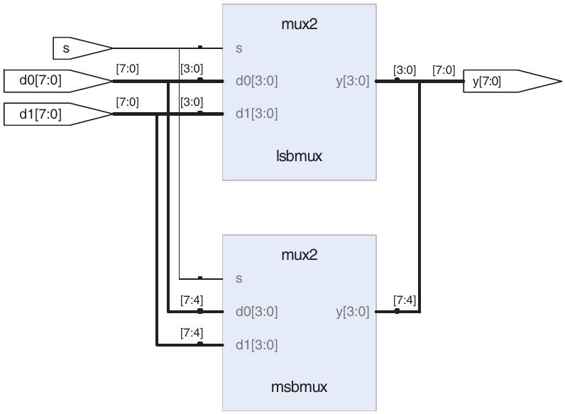

Hình 4.13 Circuit synthesize từ `mux2_8`

### 4.4.2 Resettable register

Khi simulation bắt đầu hoặc circuit vừa được cấp nguồn lần đầu, output của flop hoặc register là chưa xác định. Trạng thái này được biểu thị bằng `x` trong SystemVerilog và `u` trong VHDL. Nhìn chung, nên sử dụng các resettable register để có thể đưa hệ thống về một trạng thái đã biết khi cấp nguồn. Reset có thể là asynchronous hoặc synchronous. Hãy nhớ rằng asynchronous reset cạnh lên tiếp theo của clock. Ví dụ HDL 4.18 minh họa các idiom cho flip-flops với reset asynchronous và synchronous. Lưu ý rằng việc phân biệt reset synchronous và asynchronous trên schematic có thể khó khăn.

#### Ví dụ HDL 4.17 REGISTER

SystemVerilog

```
module  flop(input   logic       clk,
            input    logic [3:0] d,
            output  logic [3:0] q);

  always_ff @(posedge clk)
    q <= d;
endmodule
```

Nói chung câu `always` SystemVerilog có dạng

```
always @(sensitivity list)
  statement;
```

`statement` chỉ được thực thi khi sự kiện được chỉ định trong `sensitivity list` xảy ra. Trong ví dụ này, câu lệnh là `q <= d` (đọc là “`q` nhận `d`”). Vì vậy, flip-flop sao chép `d` sang `q` tại positive edge của clock; ở những thời điểm khác, nó ghi nhớ state cũ của `q`. Lưu ý rằng sensitivity list cũng được gọi là stimulus list.

`<=` được gọi là nonblocking assignment. Tạm thời, hãy xem nó như một dấu `=` thông thường; chúng ta sẽ trở lại những điểm tinh tế hơn trong Mục 4.5.4. Lưu ý rằng `<=` được sử dụng thay cho `assign` bên trong một câu lệnh `always`.

Như sẽ thấy trong các mục tiếp theo, câu lệnh `always` có thể suy ra flip-flops, latch hoặc combinational logic, tùy theo sensitivity list và câu lệnh. Vì tính linh hoạt này, người viết dễ vô tình tạo ra hardware không đúng. SystemVerilog giới thiệu `always_ff,` `always_latch` và `always_comb` để giảm nguy cơ mắc các lỗi phổ biến. `always_ff` hoạt động giống `always` nhưng chỉ được sử dụng để suy ra flip-flops, cho phép các công cụ đưa ra cảnh báo nếu suy ra bất kỳ loại hardware nào khác.

VHDL

```
library IEEE; use IEEE.STD_LOGIC_1164.all;
entity flop is
  port(clk:  in   STD_LOGIC;
       d:     in   STD_LOGIC_VECTOR(3 downto 0);
       q:     out STD_LOGIC_VECTOR(3 downto 0));
end;
architecture synth of flop is
begin
  process(clk) begin
    if rising_edge(clk) then
      q <= d;
    end if;
  end process;
end;
```

VHDL `process` có dạng

```
process(sensitivity list) begin
  statement;
end process;
```

`statement` được thực thi khi bất kỳ biến nào trong `sensitivity list` thay đổi. Trong ví dụ này, câu lệnh `if` kiểm tra xem sự thay đổi đó có phải là rising edge trên `clk` hay không. Nếu đúng, câu lệnh `q <= d` được thực thi (đọc là “`q` nhận `d`”). Vì vậy, flip-flop sao chép `d` sang `q` tại positive edge của clock; ở những thời điểm khác, nó ghi nhớ state cũ của `q`.

Idiom VHDL khác cho flip-flop là

```
process(clk) begin
  if clk'event and clk = '1' then
    q <= d;
  end if;
end process;
```

`rising_edge(clk)` đồng nghĩa `clk'event and`

```
clk = '1'.
```

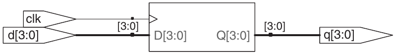

Hình 4.14 Circuit synthesize từ `flop`

### 4.4.3 Enabled register

Enabled register chỉ đáp ứng clock khi enable assert. Ví dụ HDL 4.19 là enabled register reset asynchronous, giữ giá trị cũ nếu cả `reset`, `en` FALSE.

#### Ví dụ HDL 4.18 RESETTABLE REGISTER

SystemVerilog

```
module flopr(input  logic          clk,
             input   logic         reset,
             input   logic  [3:0]  d,
             output logic [3:0] q);

 // asynchronous reset
 always_ff @(posedge clk, posedge reset)
    if (reset) q <= 4'b0;
    else       q  <=  d;
endmodule

module flopr(input   logic           clk,
             input   logic          reset,
             input   logic [3:0] d,
             output logic [3:0] q);

 // synchronous reset
 always_ff @(posedge clk)
   if (reset)   q <= 4'b0;
   else         q <= d;
endmodule
```

Nhiều signal trong sensitivity list của câu lệnh `always` được phân cách bằng dấu phẩy hoặc từ `or`. Lưu ý rằng `posedge` `reset` nằm trong sensitivity list của flop có asynchronous reset, nhưng không nằm trong sensitivity list của flop có synchronous reset. Do đó, flop có asynchronous reset phản hồi ngay khi có rising edge trên `reset`, còn flop có synchronous reset chỉ phản hồi với `reset` tại rising edge của clock.

Vì các module có cùng tên là `flopr`, bạn chỉ có thể đưa một trong hai vào thiết kế. Nếu muốn sử dụng cả hai, bạn cần đổi tên một trong các module.

VHDL

```
library IEEE; use IEEE.STD_LOGIC_1164.all;
entity flopr is
  port(clk, reset: in    STD_LOGIC;
       d:                in   STD_LOGIC_VECTOR(3 downto 0);
       q:                out STD_LOGIC_VECTOR(3 downto 0));
end;
architecture asynchronous of flopr is
begin
  process(clk, reset) begin
    if reset then
      q <= "0000";
    elsif rising_edge(clk) then
      q <= d;
    end if;
  end process;
end;
library IEEE; use IEEE.STD_LOGIC_1164.all;
entity flopr is
  port(clk, reset: in    STD_LOGIC;
       d:                in    STD_LOGIC_VECTOR(3 downto 0);
       q:                out STD_LOGIC_VECTOR(3 downto 0));
end;
architecture synchronous of flopr is
begin
  process(clk) begin
    if rising_edge(clk) then
      if reset then q <= "0000";
      else q <= d;
      end if;
    end if;
  end process;
end;
```

Nhiều signal trong sensitivity list của `process` được phân cách bằng dấu phẩy. Lưu ý rằng `reset` nằm trong sensitivity list của flop có asynchronous reset, nhưng không nằm trong sensitivity list của flop có synchronous reset. Do đó, flop có asynchronous reset phản hồi ngay khi có rising edge trên `reset`, còn flop có synchronous reset chỉ phản hồi với `reset` tại rising edge của clock.

Như đã đề cập trước đó, các công cụ VHDL bỏ qua tên của architecture (`asynchronous` hoặc `synchronous` trong ví dụ này), nhưng tên đó có thể hữu ích cho người đọc code. Vì cả hai architecture đều mô tả entity `flopr`, bạn chỉ có thể đưa một trong hai vào thiết kế. Nếu muốn sử dụng cả hai, bạn cần đổi tên một trong các module.

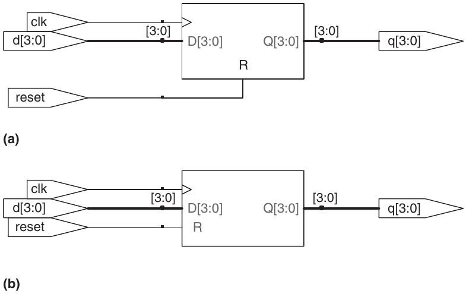

Hình 4.15 Circuit synthesize từ `flopr`: (a) asynchronous reset, (b) synchronous reset

### 4.4.4 Nhiều register

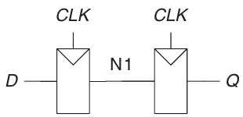

Hình 4.17 Synchronizer circuit

Có thể sử dụng một câu lệnh `always/process` duy nhất để mô tả nhiều phần hardware. Ví dụ, hãy xét synchronizer trong Mục 3.5.5 được tạo từ hai flip-flops mắc back-to-back, như trong Hình 4.17. Ví dụ HDL 4.20 mô tả synchronizer này. Tại rising edge của `clk`, `d` được sao chép sang `n1`. Đồng thời, `n1` được sao chép sang `q`.

#### Ví dụ HDL 4.19 RESETTABLE ENABLED REGISTER

SystemVerilog

```
module flopenr(input logic       clk,
               input  logic           reset,
               input  logic           en,
               input  logic [3:0] d,
               output logic [3:0] q);

 // asynchronous reset
 always_ff @(posedge clk, posedge reset)
   if          (reset) q <= 4'b0;
   else if  (en)       q <= d;
endmodule
```

VHDL

```
library IEEE; use IEEE.STD_LOGIC_1164.all;
entity flopenr is
  port(clk,
       reset,
       en: in    STD_LOGIC;
       d:   in   STD_LOGIC_VECTOR(3 downto 0);
       q:   out STD_LOGIC_VECTOR(3 downto 0));
end;
architecture asynchronous of flopenr is
–– asynchronous reset
begin
  process(clk, reset) begin
    if reset then
      q <= "0000";
    elsif rising_edge(clk) then
      if en then
        q <= d;
      end if;
    end if;
  end process;
end;
```

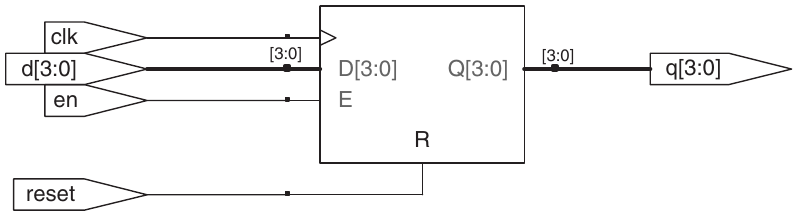

Hình 4.16 Circuit synthesize từ `flopenr`

#### Ví dụ HDL 4.20 SYNCHRONIZER

SystemVerilog

```
module sync(input  logic  clk,
            input    logic    d,
            output  logic    q);

 logic n1;

 always_ff @(posedge clk)
   begin
    n1 <= d; // nonblocking
    q <= n1; // nonblocking
   end
endmodule
```

Lưu ý rằng cấu trúc `begin/end` là cần thiết vì có nhiều statement xuất hiện trong statement `always`. Cấu trúc này tương tự `{}` trong C hoặc Java. Không cần `begin/end` trong ví dụ `flopr` vì `if/else` được tính là một statement duy nhất.

VHDL

```
library IEEE; use IEEE.STD_LOGIC_1164.all;
entity sync is
  port(clk: in   STD_LOGIC;
       d:    in   STD_LOGIC;
       q:    out STD_LOGIC);
end;
architecture good of sync is
  signal n1: STD_LOGIC;
begin
  process(clk)  begin
   if rising_edge(clk) then
       n1 <= d;
       q <= n1;
   end  if;
  end  process;
end;
```

`n1` phải khai báo `signal` vì là internal signal dùng trong module.

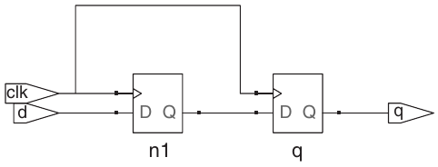

Hình 4.18 Circuit synthesize từ `sync`

### 4.4.5 Latch

Hãy nhớ lại từ Mục 3.2.2 rằng D latch ở trạng thái transparent khi clock là HIGH, cho phép data truyền từ input đến output. Latch trở thành opaque khi clock là LOW và giữ lại state cũ. Ví dụ HDL 4.21 minh họa idiom cho D latch.

Không phải synthesis tool nào cũng hỗ trợ latch tốt. Trừ khi biết tool hỗ trợ và có lý do chính đáng để dùng, hãy tránh latch, dùng flip-flops edge-triggered thay thế. Cũng cần bảo đảm HDL không ngụ ý latch ngoài ý muốn, điều rất dễ xảy ra khi bất cẩn. Nhiều tool cảnh báo khi tạo latch; nếu bạn không chờ đợi nó, hãy tìm bug trong HDL. Nếu không biết mình có định dùng latch hay không, có lẽ bạn đang tiếp cận HDL như ngôn ngữ lập trình và còn những vấn đề lớn hơn đang ẩn phía sau.

## 4.5 THÊM VỀ COMBINATIONAL LOGIC

Trong Mục 4.2, chúng ta đã sử dụng các câu lệnh gán để mô tả hành vi của combinational logic. Các câu lệnh `always` của SystemVerilog và `process` của VHDL được sử dụng để mô tả sequential circuit vì chúng ghi nhớ state cũ khi không có state mới được chỉ định. Tuy nhiên, cũng có thể sử dụng các câu lệnh `always/process` để mô tả hành vi của combinational logic nếu sensitivity list được viết để phản hồi với thay đổi ở tất cả các input và phần thân chỉ định giá trị output cho mọi tổ hợp input có thể có. Ví dụ HDL 4.22 sử dụng các câu lệnh `always/process` để mô tả một dãy bốn inverter (xem circuit sau synthesis trong Hình 4.3).

### Ví dụ HDL 4.21 D LATCH

SystemVerilog

```
module latch(input  logic          clk,
             input   logic [3:0] d,
             output logic [3:0] q);

 always_latch
  if (clk) q <= d;
endmodule
```

`always_latch` tương đương với `always @(clk, d)` và là idiom được ưu tiên dùng để mô tả latch trong SystemVerilog. Nó được đánh giá mỗi khi `clk` hoặc `d` thay đổi. Nếu `clk` là HIGH, `d` được truyền qua tới `q`, nên đoạn code này mô tả một positive level-sensitive latch. Nếu không, `q` giữ nguyên giá trị cũ. SystemVerilog có thể đưa ra cảnh báo nếu khối `always_latch` không mô tả một latch.

VHDL

```
library IEEE; use IEEE.STD_LOGIC_1164.all;
entity latch is
   port(clk: in   STD_LOGIC;
       d:    in   STD_LOGIC_VECTOR(3 downto 0);
       q:     out STD_LOGIC_VECTOR(3 downto 0));
end;
architecture synth of latch is
begin
  process(clk, d) begin
    if clk = '1' then
     q <= d;
    end if;
  end  process;
end;
```

Sensitivity list gồm `clk` và `d` nên `process` evaluate khi `clk` hoặc `d` đổi. Nếu `clk` HIGH, `d` đi tới `q`.

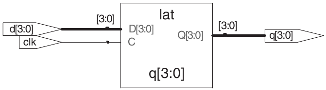

Hình 4.19 Circuit synthesize từ `latch`

HDL hỗ trợ blocking assignment và nonblocking assignment trong một câu lệnh `always/process`. Một nhóm blocking assignment được thực hiện theo thứ tự xuất hiện trong code, đúng như trong một ngôn ngữ lập trình thông thường. Một nhóm nonblocking assignment được thực hiện đồng thời; tất cả các câu lệnh đều được tính toán trước khi bất kỳ signal nào ở left-hand side được cập nhật.

Ví dụ HDL 4.23 định nghĩa một full adder sử dụng các signal trung gian `p` và `g` để tính `s` và `cout`. Ví dụ này tạo ra cùng circuit như trong Hình 4.8, nhưng sử dụng các statement `always/process` thay cho các assignment statement.

Ví dụ HDL 4.22 và 4.23 là những cách áp dụng chưa tốt các câu lệnh `always/` `process` để mô hình hóa combinational logic, vì chúng cần nhiều dòng code hơn cách tương đương sử dụng các câu lệnh gán trong Ví dụ HDL 4.2 và 4.7. Tuy nhiên, các câu lệnh `case` và `if` thuận tiện cho việc mô hình hóa combinational logic phức tạp hơn. Các câu lệnh `case` và `if` phải nằm bên trong câu lệnh `always/process` và sẽ được xem xét trong những mục tiếp theo.

### Ví dụ HDL 4.22 INVERTER DÙNG `always/process`

SystemVerilog

```
module  inv(input   logic   [3:0]  a,
            output  logic  [3:0]  y);

 always_comb
   y = ~a;
endmodule
```

`always_comb` thực hiện lại các câu lệnh bên trong câu lệnh `always` mỗi khi bất kỳ signal nào ở right-hand side của `<=` hoặc `=` trong câu lệnh `always` thay đổi. Trong trường hợp này, nó tương đương với `always @(a)` nhưng tốt hơn vì tránh được lỗi khi đổi tên hoặc thêm signal trong câu lệnh `always`. Nếu code bên trong khối `always` không phải combinational logic, SystemVerilog sẽ đưa ra cảnh báo. `always_comb` tương đương với `always @(*)` nhưng được ưu tiên trong SystemVerilog.

Dấu `=` trong câu lệnh `always` được gọi là blocking assignment, khác với nonblocking assignment `<=`. Trong SystemVerilog, cách thực hành tốt là sử dụng blocking assignment cho combinational logic và nonblocking assignment cho sequential logic. Chúng ta sẽ thảo luận thêm về điều này trong Mục 4.5.4.

VHDL

```
library IEEE; use IEEE.STD_LOGIC_1164.all;
entity inv is
  port(a: in    STD_LOGIC_VECTOR(3 downto 0);
       y:  out STD_LOGIC_VECTOR(3 downto 0));
end;
architecture proc of inv is
begin
  process(all)  begin
    y <= not a;
  end  process;
end;
```

`process(all)` evaluate lại các câu trong `process` khi bất kỳ signal trong `process` đổi. Tương đương `process(a)` nhưng tốt hơn vì tránh lỗi khi đổi tên/thêm signal trong `process`.

VHDL bắt buộc `begin`, `end process` dù `process` chỉ một assignment.

SystemVerilog

Trong `always` SystemVerilog, `=` chỉ blocking, `<=` nonblocking (còn gọi concurrent assignment).

Đừng nhầm lẫn một trong hai loại này với continuous assignment, tức câu lệnh `assign`. Các câu lệnh `assign` phải được sử dụng bên ngoài các câu lệnh `always` và cũng được thực hiện đồng thời.

VHDL

Trong câu lệnh `process` của VHDL, `:=` biểu thị blocking assignment, còn `<=` biểu thị nonblocking assignment (cũng được gọi là concurrent assignment). Đây là mục đầu tiên giới thiệu `:=`.

Nonblocking assignment được thực hiện đối với output và signal. Blocking assignment được thực hiện đối với các biến được khai báo trong câu lệnh `process` (xem Ví dụ HDL 4.23). `<=` cũng có thể xuất hiện bên ngoài câu lệnh `process`, và khi đó nó cũng được thực hiện đồng thời.

### Ví dụ HDL 4.23 FULL ADDER DÙNG `always/process`

SystemVerilog

```
module fulladder(input   logic a, b, cin,
                 output logic  s, cout);
  logic p, g;

  always_comb
    begin
     p = a ^ b;                     // blocking
     g = a & b;                     // blocking
     s = p ^ cin;                   // blocking
     cout = g | (p & cin);          // blocking
    end
endmodule
```

Trong trường hợp này, `always @(a, b, cin)` sẽ tương đương với `always_comb`. Tuy nhiên, `always_comb` tốt hơn vì tránh được lỗi thường gặp là bỏ sót signal trong sensitivity list.

Vì những lý do sẽ được thảo luận trong Mục 4.5.4, tốt nhất nên sử dụng blocking assignment cho combinational logic. Ví dụ này sử dụng blocking assignment, trước tiên tính `p`, sau đó tính `g`, rồi `s` và cuối cùng là `cout`.

VHDL

```
library IEEE; use IEEE.STD_LOGIC_1164.all;
entity fulladder is
  port(a, b, cin: in   STD_LOGIC;
       s, cout:     out STD_LOGIC);
end;
architecture synth of fulladder is
begin
  process(all)
    variable p, g: STD_LOGIC;
  begin
    p := a xor b; –– blocking
    g := a and b; –– blocking
    s <= p xor cin;
    cout <= g or (p and cin);
  end  process;
end;
```

Trong trường hợp này, `process(a, b, cin)` sẽ tương đương với `process(all)`. Tuy nhiên, `process(all)` tốt hơn vì tránh được lỗi thường gặp là bỏ sót signal trong sensitivity list.

Vì những lý do sẽ được thảo luận trong Mục 4.5.4, tốt nhất nên sử dụng blocking assignment cho các biến trung gian trong combinational logic. Ví dụ này sử dụng blocking assignment cho `p` và `g` để chúng nhận giá trị mới trước khi được sử dụng để tính `s` và `cout`, là những giá trị phụ thuộc vào chúng.

Vì `p` và `g` xuất hiện ở left-hand side của một blocking assignment (`:=`) trong câu lệnh `process`, chúng phải được khai báo là `variable` thay vì `signal`. Khai báo `variable` xuất hiện trước `begin` trong process sử dụng biến đó.

### 4.5.1 Câu lệnh case

Một ứng dụng phù hợp hơn của câu lệnh `always/process` cho combinational logic là decoder cho màn hình seven-segment, tận dụng câu lệnh `case`, vốn phải nằm bên trong một câu lệnh `always/process`.

Như bạn có thể đã nhận thấy ở decoder cho màn hình seven-segment trong Ví dụ 2.10, quy trình thiết kế các khối combinational logic lớn rất tẻ nhạt và dễ phát sinh lỗi. HDL mang lại một cải tiến lớn, cho phép bạn chỉ định chức năng ở mức abstraction cao hơn rồi tự động synthesize chức năng đó thành các gate. Ví dụ HDL 4.24 sử dụng các câu lệnh `case` để mô tả decoder cho màn hình seven-segment dựa trên truth table của nó. Câu lệnh `case` thực hiện những thao tác khác nhau tùy theo giá trị input. Một câu lệnh `case` biểu thị combinational logic nếu tất cả các tổ hợp input có thể có đều được định nghĩa. Nếu không, nó biểu thị sequential logic, vì output sẽ giữ giá trị cũ trong các trường hợp chưa được định nghĩa.

HDL cho decoder của màn hình seven-segment được synthesize thành một read-only memory (ROM) chứa 7 output cho mỗi tổ hợp trong số 16 tổ hợp input có thể có. ROM sẽ được thảo luận thêm trong Mục 5.5.6.

Nếu bỏ mệnh đề `default` hoặc `others` khỏi câu lệnh `case`, decoder sẽ ghi nhớ output trước đó mỗi khi data nằm trong khoảng 10–15. Đây là một hành vi bất thường đối với hardware.

Decoder thường cũng viết `case`. Ví dụ HDL 4.25 mô tả decoder 3:8.

### 4.5.2 Câu lệnh if

Các câu lệnh `always/process` cũng có thể chứa các câu lệnh `if`. Sau câu lệnh `if` có thể là một câu lệnh `else`. Nếu tất cả các tổ hợp input có thể có đều được xử lý, câu lệnh biểu thị combinational logic. Nếu không, nó tạo ra sequential logic (giống như latch trong Mục 4.4.5).

#### Ví dụ HDL 4.24 DECODER SEVEN-SEGMENT DISPLAY

SystemVerilog

```
module sevenseg(input   logic [3:0] data,
                output logic [6:0] segments);
  always_comb
   case(data)
     //                                  abc_defg
     0:        segments  =  7'b111_1110;
     1:        segments  =  7'b011_0000;
     2:        segments  =  7'b110_1101;
     3:        segments  =  7'b111_1001;
     4:        segments  =  7'b011_0011;
     5:        segments  =  7'b101_1011;
     6:        segments  =  7'b101_1111;
     7:        segments  =  7'b111_0000;
     8:        segments  =  7'b111_1111;
     9:        segments  =  7'b111_0011;
     default:  segments = 7'b000_0000;
    endcase
  endmodule
```

Câu lệnh `case` kiểm tra giá trị của `data`. Khi `data` bằng 0, câu lệnh thực hiện thao tác sau dấu hai chấm, đặt `segments` thành 1111110. Tương tự, câu lệnh case kiểm tra các giá trị data khác cho đến 9 (chú ý rằng cơ số mặc định được sử dụng là cơ số 10).

Mệnh đề `default` tiện định nghĩa output mọi trường hợp chưa liệt kê, bảo đảm combinational.

Trong SystemVerilog, `case` phải trong `always`.

VHDL

```
library IEEE; use IEEE.STD_LOGIC_1164.all;
entity seven_seg_decoder is
   port(data:         in    STD_LOGIC_VECTOR(3 downto 0);
        segments: out STD_LOGIC_VECTOR(6 downto 0));
end;
architecture synth of seven_seg_decoder is
begin
  process(all) begin
    case data is
     ––                            abcdefg
     when X"0"     => segments <= "1111110";
     when X"1"     => segments <= "0110000";
     when X"2"     => segments <= "1101101";
     when X"3"     => segments <= "1111001";
     when X"4"     => segments <= "0110011";
     when X"5"     => segments <= "1011011";
     when X"6"     => segments <= "1011111";
     when X"7"     => segments <= "1110000";
     when X"8"     => segments <= "1111111";
     when X"9"     => segments <= "1110011";
     when others => segments <= "0000000";
    end case;
  end process;
end;
```

Câu lệnh `case` kiểm tra giá trị của `data`. Khi `data` bằng `0`, câu lệnh thực hiện thao tác sau `=>`, đặt `segments` thành 1111110. Tương tự, câu lệnh `case` kiểm tra các giá trị data khác cho đến 9 (chú ý cách dùng `X` cho các số hexadecimal). Mệnh đề `others` là một cách thuận tiện để định nghĩa output cho tất cả các trường hợp không được liệt kê tường minh, bảo đảm tạo ra combinational logic.

Khác với SystemVerilog, VHDL hỗ trợ các câu lệnh selected signal assignment (xem Ví dụ HDL 4.6), rất giống câu lệnh `case` nhưng có thể xuất hiện bên ngoài process. Vì vậy, ít có lý do hơn để sử dụng process nhằm mô tả combinational logic.

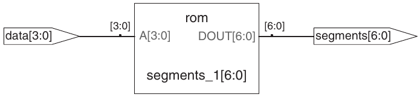

Hình 4.20 Circuit synthesize từ `sevenseg`

#### Ví dụ HDL 4.25 DECODER 3:8

SystemVerilog

```
module  decoder3_8(input    logic   [2:0]   a,
                   output logic [7:0] y);

 always_comb
    case(a)
      3'b000:     y = 8'b00000001;
      3'b001:     y = 8'b00000010;
      3'b010:     y = 8'b00000100;
      3'b011:     y = 8'b00001000;
      3'b100:     y = 8'b00010000;
      3'b101:     y = 8'b00100000;
      3'b110:     y = 8'b01000000;
      3'b111:     y = 8'b10000000;
      default:  y = 8'bxxxxxxxx;
    endcase
endmodule
```

Trong trường hợp này, câu lệnh `default` không thực sự bắt buộc đối với logic synthesis vì tất cả các tổ hợp input có thể có đều được định nghĩa. Tuy nhiên, việc đưa nó vào là thận trọng đối với simulation, phòng trường hợp một trong các input là `x` hoặc `z`.

VHDL

```
library IEEE; use IEEE.STD_LOGIC_1164.all;
entity decoder3_8 is
  port(a: in    STD_LOGIC_VECTOR(2 downto 0);
       y: out STD_LOGIC_VECTOR(7 downto 0));
end;
architecture synth of decoder3_8 is
begin
  process(all) begin
   case a is
      when "000"    => y <= "00000001";
      when "001"    => y <= "00000010";
      when "010"    => y <= "00000100";
      when "011"    => y <= "00001000";
      when "100"    => y <= "00010000";
      when "101"    => y <= "00100000";
      when "110"    => y <= "01000000";
      when "111"    => y <= "10000000";
      when others => y <= "XXXXXXXX";
   end case;
  end process;
end;
```

Trong trường hợp này, mệnh đề `others` không thực sự bắt buộc đối với logic synthesis vì tất cả các tổ hợp input có thể có đều được định nghĩa. Tuy nhiên, việc đưa nó vào là thận trọng đối với simulation, phòng trường hợp một trong các input là `x`, `z` hoặc `u`.

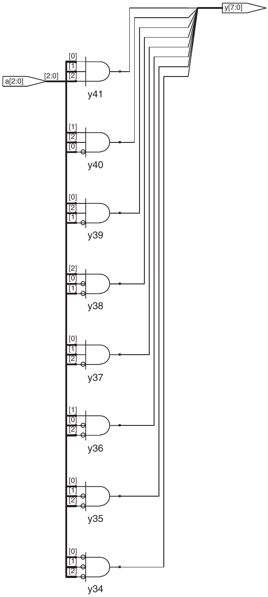

Hình 4.21 Circuit synthesize từ `decoder3_8`

#### Ví dụ HDL 4.26 PRIORITY CIRCUIT

SystemVerilog

```
module priorityckt(input  logic [3:0] a,
                   output logic [3:0] y);
  always_comb
   if         (a[3])  y = 4'b1000;
   else if (a[2]) y = 4'b0100;
   else if (a[1]) y = 4'b0010;
   else if (a[0]) y = 4'b0001;
   else                  y = 4'b0000;
endmodule
```

Trong SystemVerilog, `if` phải trong `always`.

VHDL

```
library IEEE; use IEEE.STD_LOGIC_1164.all;
entity priorityckt is
  port(a: in    STD_LOGIC_VECTOR(3 downto 0);
       y: out STD_LOGIC_VECTOR(3 downto 0));
end;
architecture synth of priorityckt is
begin
  process(all)  begin
   if       a(3) then  y <= "1000";
   elsif a(2) then y <= "0100";
   elsif a(1) then y <= "0010";
   elsif a(0) then y <= "0001";
   else                    y <= "0000";
   end  if;
  end  process;
end;
```

Khác với SystemVerilog, VHDL hỗ trợ các câu lệnh conditional signal assignment (xem Ví dụ HDL 4.6), rất giống câu lệnh `if` nhưng có thể xuất hiện bên ngoài process. Vì vậy, ít có lý do hơn để sử dụng process nhằm mô tả combinational logic.

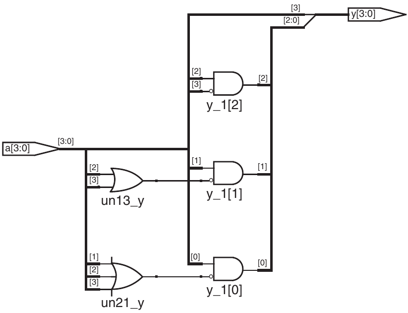

Hình 4.22 Circuit synthesize từ `priorityckt`

Ví dụ HDL 4.26 sử dụng các câu lệnh `if` để mô tả một priority circuit, được định nghĩa trong Mục 2.4. Hãy nhớ rằng priority circuit N-input đặt output thành TRUE tương ứng với input có độ quan trọng cao nhất đang có giá trị TRUE.

### 4.5.3 Truth table có don’t care

Như đã xem xét trong Mục 2.7.3, truth table có thể bao gồm don’t care để cho phép đơn giản hóa logic nhiều hơn. Ví dụ HDL 4.27 minh họa cách mô tả một priority circuit có don’t care.

Công cụ synthesis tạo ra circuit trong Hình 4.23 cho module này, hơi khác so với priority circuit mà nó đã tạo ra trong Hình 4.22. Tuy nhiên, hai circuit tương đương nhau về mặt logic.

### 4.5.4 Blocking và nonblocking assignment

Các hướng dẫn ở trang 204 giải thích khi nào và cách sử dụng từng loại phép gán. Nếu không tuân theo những hướng dẫn này, bạn có thể viết code có vẻ hoạt động đúng trong simulation nhưng lại được synthesize thành hardware không chính xác. Phần còn lại của mục này là nội dung đọc tùy chọn, giải thích các nguyên lý đằng sau những hướng dẫn đó.

#### Ví dụ HDL 4.27 PRIORITY CIRCUIT DÙNG DON’T CARE

SystemVerilog

```
module priority_casez(input  logic [3:0] a,
                      output logic [3:0] y);
  always_comb
    casez(a)
     4'b1???: y = 4'b1000;
     4'b01??: y = 4'b0100;
     4'b001?: y = 4'b0010;
     4'b0001: y = 4'b0001;
     default: y = 4'b0000;
    endcase
endmodule
```

`casez` giống `case` nhưng nhận `?` là don’t care.

VHDL

```
library IEEE; use IEEE.STD_LOGIC_1164.all;
entity priority_casez is
  port(a: in   STD_LOGIC_VECTOR(3 downto 0);
       y: out STD_LOGIC_VECTOR(3 downto 0));
end;
architecture dontcare of priority_casez is
begin
  process(all)  begin
    case? a is
     when "1---" => y <= "1000";
     when "01--" => y <= "0100";
     when "001-" => y <= "0010";
     when "0001" => y <= "0001";
     when others => y <= "0000";
    end  case?;
  end  process;
end;
```

`case?` giống `case` nhưng nhận `–` là don’t care.

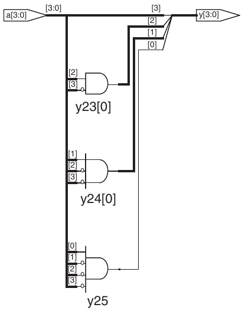

Hình 4.23 Circuit synthesize từ `priority_casez`

HƯỚNG DẪN BLOCKING VÀ NONBLOCKING ASSIGNMENT

SystemVerilog

1\. Dùng `always_ff @(posedge clk)` và nonblocking assignment để mô hình hóa synchronous sequential logic.

```
always_ff @(posedge clk)
  begin
    n1 <= d; // nonblocking
    q <= n1; // nonblocking
  end
```

2\. Dùng continuous assignment mô hình hóa combinational logic đơn giản.

```
assign y = s ? d1 : d0;
```

3\. Dùng `always_comb` và blocking assignment mô hình hóa combinational logic phức tạp hơn, nơi câu

`always` hữu ích.

```
always_comb
  if         (a[3]) y = 4’b1000;
  else if (a[2]) y = 4’b0100;
  else if (a[1]) y = 4’b0010;
  else if (a[0]) y = 4’b0001;
  else                 y = 4’b0000;
```

4\. Không gán cùng signal trong nhiều hơn một câu `always` hoặc continuous assignment.

VHDL

1\. Dùng `process(clk)` và nonblocking assignment mô hình hóa synchronous sequential logic.

```
process(clk) begin
  if rising_edge(clk) then
    n1 <= d; –– nonblocking
    q <= n1; –– nonblocking
  end  if;
end process;
```

2\. Dùng concurrent assignment ngoài `process` để mô hình hóa combinational logic đơn giản.

```
y <= d0 when s = '0' else d1;
```

3\. Dùng `process(all)` mô hình hóa combinational logic phức tạp hơn, nơi `process` hữu ích. Dùng blocking assignment cho internal variable.

```
process(all)
  variable p, g: STD_LOGIC;
begin
   p := a xor b; –– blocking
   g := a and b; –– blocking
   s <= p xor cin;
   cout <= g or (p and cin);
end process;
```

4\. Không gán cùng variable trong nhiều hơn một `process` hoặc concurrent assignment.

Combinational logic\*

Full adder trong Ví dụ HDL 4.23 được mô hình hóa chính xác bằng blocking assignment. Mục này tìm hiểu cách nó hoạt động và những khác biệt sẽ xuất hiện nếu sử dụng nonblocking assignment.

Giả sử ban đầu `a`, `b` và `cin` đều bằng 0. Vì vậy, `p`, `g`, `s` và `cout` cũng bằng 0. Tại một thời điểm nào đó, `a` thay đổi thành 1, kích hoạt câu lệnh `always/process`. Bốn blocking assignment được thực hiện theo thứ tự trình bày ở đây. (Trong code VHDL, `s` và `cout` được gán đồng thời.) Lưu ý rằng `p` và `g` nhận giá trị mới trước khi `s` và `cout` được tính, nhờ các blocking assignment. Điều này quan trọng vì chúng ta muốn tính `s` và `cout` bằng các giá trị mới của `p` và `g`.

1\. `p` ← 1 ⊕ 0 = 1 2. `g` ← 1 ∙ 0 = 0

3\. `s` ← 1 ⊕ 0 = 1 4. `cout` ← 0 + 1 ∙ 0 = 0

Ngược lại, Ví dụ HDL 4.28 minh họa nonblocking.

Xét cùng trường hợp `a` tăng 0 lên 1, `b`, `cin` bằng 0. Bốn nonblocking evaluate đồng thời:

`p` ← 1 ⊕ 0 = 1 `g` ← 1 ∙ 0 = 0 `s` ← 0 ⊕ 0 = 0 `cout` ← 0 + 0 ∙ 0 = 0

#### Ví dụ HDL 4.28 FULL ADDER DÙNG NONBLOCKING ASSIGNMENT

SystemVerilog

```
// nonblocking assignments (not recommended)
module fulladder(input    logic a, b, cin,
                 output logic s, cout);
 logic p, g;

  always_comb
   begin
      p <= a ^ b; // nonblocking
      g <= a & b; // nonblocking

      s <= p ^ cin;
    cout <= g | (p & cin);
  end
endmodule
```

VHDL

```
–– nonblocking assignments (not recommended)
library IEEE; use IEEE.STD_LOGIC_1164.all;

entity fulladder is
  port(a, b, cin: in    STD_LOGIC;
       s, cout:    out STD_LOGIC);
end;

architecture nonblocking of fulladder is
  signal p, g: STD_LOGIC;
begin
  process(all) begin
   p <= a xor b; –– nonblocking
   g <= a and b; –– nonblocking
   s <= p xor cin;
   cout <= g or (p and cin);
  end process;
end;
```

Vì `p` và `g` xuất hiện ở left-hand side của nonblocking assignment trong câu lệnh `process`, chúng phải được khai báo là `signal` thay vì `variable`. Khai báo `signal` xuất hiện trước `begin` trong `architecture`, không phải trong `process`.

Lưu ý rằng `s` được tính đồng thời với `p`. Vì vậy, nó sử dụng giá trị cũ của `p`, chứ không phải giá trị mới. Do đó, `s` vẫn bằng 0 thay vì trở thành 1. Tuy nhiên, `p` thay đổi từ 0 thành 1. Sự thay đổi này kích hoạt câu lệnh `always/process` thực hiện tính toán lần thứ hai, như sau:

`p` ← 1 ⊕ 0 = 1 `g` ← 1 ∙ 0 = 0 `s` ← 1 ⊕ 0 = 1 `cout` ← 0 + 1 ∙ 0 = 0

Lần này, `p` đã bằng 1, nên `s` thay đổi chính xác thành 1. Các nonblocking assignment cuối cùng cũng cho kết quả đúng, nhưng câu lệnh `always/process` phải thực hiện tính toán hai lần. Điều này khiến simulation chậm hơn, mặc dù kết quả synthesis vẫn là cùng một hardware.

Một nhược điểm khác của nonblocking assignment khi mô hình combinational logic là HDL cho kết quả sai nếu quên đưa intermediate variable vào sensitivity list.

Tệ hơn, một số synthesis tool vẫn tạo hardware đúng dù sensitivity list sai gây simulation không đúng. Điều này dẫn đến mismatch giữa kết quả simulation và hoạt động thực của hardware.

Sequential logic\*

Synchronizer trong Ví dụ HDL 4.20 được mô hình hóa chính xác bằng nonblocking assignment. Tại rising edge của clock, `d` được sao chép sang `n1` đồng thời với việc `n1` được sao chép sang `q`, nên code mô tả đúng hai register. Ví dụ, giả sử ban đầu `d` = 0, `n1` = 1 và `q` = 0. Tại rising edge của clock, hai phép gán sau diễn ra đồng thời, vì vậy sau clock edge, `n1` = 0 và `q` = 1.

`n1`←`d` = 0 `q`←`n1` = 1

Ví dụ HDL 4.29 thử mô tả cùng module đó bằng blocking assignment. Tại rising edge của `clk`, `d` được sao chép sang `n1`. Sau đó, giá trị mới này của `n1` được sao chép sang `q`, khiến `d` xuất hiện không đúng ở cả `n1` và `q`. Các phép gán diễn ra lần lượt, nên sau clock edge, `q = n1` = 0.

1\. `n1` ←`d` = 0

2\. `q` ←`n1` = 0

SystemVerilog

Nếu sensitivity list của câu lệnh `always` trong Ví dụ HDL 4.28 được viết là `always @(a, b, cin)` thay vì `always_comb`, câu lệnh sẽ không được thực hiện lại khi `p` hoặc `g` thay đổi. Trong trường hợp đó, `s` sẽ bị giữ sai ở giá trị 0 thay vì 1.

VHDL

Nếu sensitivity list của câu lệnh process trong Ví dụ HDL 4.28 được viết là `process(a, b, cin)` thay vì `process(all)`, câu lệnh sẽ không được thực hiện lại khi `p` hoặc `g` thay đổi. Trong trường hợp đó, `s` sẽ bị giữ sai ở giá trị 0 thay vì 1.

Vì `n1` vô hình với ngoài, không ảnh hưởng `q`, synthesizer bỏ hoàn toàn như Hình 4.24.

Bài học của ví dụ là chỉ dùng nonblocking assignment trong câu `always/process` khi mô hình sequential logic. Đủ khéo léo, như đảo thứ tự assignment, bạn có thể làm blocking hoạt động đúng, nhưng blocking không đem lại lợi thế và chỉ thêm nguy cơ hành vi ngoài ý muốn. Một số sequential circuit không hoạt động với blocking bất kể thứ tự.

## 4.6 FINITE STATE MACHINE

Hãy nhớ lại rằng finite state machine (FSM) gồm một state register và hai khối combinational logic để tính next state và output từ current state và input, như đã minh họa trong Hình 3.22. Tương ứng, mô tả HDL của state machine được chia thành ba phần để mô hình hóa state register, next state logic và output logic.

### Ví dụ HDL 4.29 SYNCHRONIZER SAI VỚI BLOCKING ASSIGNMENT

SystemVerilog

```
// Bad implementation of a synchronizer using blocking
//    assignments

module syncbad(input    logic clk,
              input      logic  d,
              output logic q);

 logic  n1;

 always_ff @(posedge clk)
   begin
    n1 = d; // blocking
    q = n1; // blocking
   end
endmodule
```

VHDL

```
–– Bad implementation of a synchronizer using blocking
––    assignment

library IEEE; use IEEE.STD_LOGIC_1164.all;

entity syncbad is
  port(clk:in      STD_LOGIC;
       d:   in    STD_LOGIC;
       q:   out STD_LOGIC);
end;

architecture bad of syncbad is
begin
  process(clk)
   variable n1: STD_LOGIC;
  begin
   if rising_edge(clk) then
    n1 := d; –– blocking
    q <= n1;
   end  if;
  end  process;
end;
```

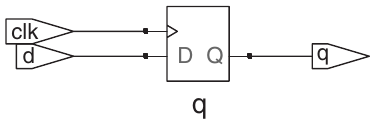

Hình 4.24 Circuit synthesize từ `syncbad`

Ví dụ HDL 4.30 mô tả FSM divide-by-3 trong Mục 3.4.2. Nó cung cấp asynchronous reset để khởi tạo FSM. State register sử dụng idiom thông thường cho flip-flops. Các khối next state logic và output logic đều là combinational logic.

Đối với state machine, các công cụ synthesis chỉ tạo block diagram và state transition diagram; chúng không hiển thị các logic gate hoặc các input và output trên những cung và state. Vì vậy, hãy cẩn thận để chỉ định chính xác FSM trong code HDL của bạn. State transition diagram trong Hình 4.25 cho FSM divide-by-3 tương tự sơ đồ trong Hình 3.28(b). Vòng tròn kép biểu thị rằng S0 là reset state. Các cách triển khai Gate-level của FSM divide-by-3 đã được minh họa trong Mục 3.4.2.

### Ví dụ HDL 4.30 FINITE STATE MACHINE DIVIDE-BY-3

SystemVerilog

```
module divideby3FSM(input    logic clk,
                    input    logic reset,
                    output logic y);
   typedef enum logic [1:0] {S0, S1, S2} statetype;
  statetype  state,  nextstate;

  //  state  register
  always_ff @(posedge clk, posedge reset)
    if (reset) state <= S0;
    else           state <= nextstate;

  // next state logic
  always_comb
    case (state)
     S0:          nextstate = S1;
     S1:          nextstate = S2;
     S2:          nextstate = S0;
     default: nextstate = S0;
    endcase

  // output logic
  assign y = (state = = S0);
endmodule
```

`typedef` định nghĩa `statetype` là logic value two-bit với ba khả năng `S0`, `S1`, `S2`. `state`, `nextstate` là signal `statetype`.

Các giá trị encoding của kiểu enumeration mặc định theo thứ tự số: `S0`=00, `S1`=01 và `S2`=10. Người dùng có thể chỉ định tường minh các giá trị encoding; tuy nhiên, công cụ synthesis xem chúng là gợi ý, không phải yêu cầu bắt buộc. Ví dụ, đoạn code sau encode các state thành giá trị one-hot 3-bit:

```
typedef enum logic [2:0] {S0 = 3'b001, S1 = 3'b010, S2 = 3'b100}
statetype;
```

Lưu ý cách sử dụng câu lệnh `case` để định nghĩa state transition table. Vì next state logic phải là combinational logic, cần có `default`, mặc dù state `2'b11` không bao giờ được xuất hiện.

Output `y` bằng 1 khi state là `S0`. Phép so sánh bằng `a = = b` cho giá trị 1 nếu `a` bằng `b`, và bằng 0 trong trường hợp ngược lại. Phép so sánh khác `a != b` thực hiện điều ngược lại, cho giá trị 1 nếu `a` không bằng `b`.

VHDL

```
library IEEE; use IEEE.STD_LOGIC_1164.all;
entity divideby3FSM is
  port(clk, reset: in    STD_LOGIC;
       y:                 out STD_LOGIC);
end;
architecture synth of divideby3FSM is
  type statetype is (S0, S1, S2);
  signal state, nextstate: statetype;
begin
  –– state register
  process(clk, reset) begin
   if reset then state <= S0;
   elsif rising_edge(clk) then
     state <= nextstate;
   end if;
  end process;
  –– next state logic
  nextstate <= S1 when state = S0 else
              S2 when state = S1 else
              S0;
  –– output logic
  y <= '1' when state = S0 else '0';
end;
```

Ví dụ này định nghĩa một enumeration data type mới, `statetype`, với ba giá trị có thể có: `S0`, `S1` và `S2`. `state` và `nextstate` là các signal có kiểu `statetype`. Bằng cách sử dụng enumeration thay vì tự chọn state encoding, VHDL cho phép synthesizer khảo sát nhiều state encoding khác nhau để chọn ra cách tốt nhất.

Trong HDL ở trên, output `y` bằng 1 khi `state` là `S0`. Phép so sánh khác sử dụng `/=`. Để tạo output bằng 1 khi state là bất kỳ giá trị nào khác `S0`, hãy đổi phép so sánh thành `state /= S0`.

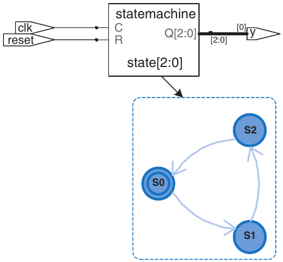

Hình 4.25 Circuit synthesize từ `divideby3fsm`

> Tool dùng encoding 3-bit `(Q[2:0])` thay 2-bit gợi ý trong SystemVerilog.

Lưu ý rằng các state được đặt tên bằng một kiểu dữ liệu enumeration, thay vì được tham chiếu bằng các giá trị binary. Điều này giúp code dễ đọc và dễ thay đổi hơn.

Nếu vì lý do nào muốn HIGH ở S0, S1, sửa output logic như sau.

Hai ví dụ tiếp theo mô tả FSM nhận dạng mẫu của ốc sên trong Mục 3.4.3. Code minh họa cách sử dụng các câu lệnh `case` và `if` để xử lý next state logic và output logic phụ thuộc vào cả input lẫn current state. Chúng ta trình bày cả module Moore và module Mealy. Trong Moore machine (Ví dụ HDL 4.31), output chỉ phụ thuộc vào current state, còn trong Mealy machine (Ví dụ HDL 4.32), output logic phụ thuộc vào cả current state và input.

SystemVerilog

```
// output logic
assign y = (state = = S0 | state = = S1);
```

VHDL

```
–– output logic
y <= '1' when (state = S0 or state = S1) else '0';
```

### Ví dụ HDL 4.31 MOORE FSM NHẬN DẠNG MẪU

SystemVerilog

```
module  patternMoore(input     logic  clk,
                    input    logic reset,
                    input    logic a,
                    output logic y);

  typedef enum logic [1:0] {S0, S1, S2} statetype;
  statetype state, nextstate;

  // state register
  always_ff @(posedge clk, posedge reset)
   if (reset) state <= S0;
   else           state <= nextstate;

  // next state logic
  always_comb
   case (state)
     S0: if (a) nextstate = S0;
         else     nextstate = S1;
     S1: if (a) nextstate = S2;
         else     nextstate = S1;
     S2: if (a) nextstate = S0;
         else     nextstate = S1;
     default:   nextstate = S0;
   endcase

  // output logic
  assign  y  =  (state  = =  S2);
endmodule
```

Lưu ý cách sử dụng nonblocking assignment (`<=`) trong state register để mô tả sequential logic, trong khi blocking assignment (`=`) được sử dụng trong next state logic để mô tả combinational logic.

VHDL

```
library IEEE; use IEEE.STD_LOGIC_1164.all;
entity patternMoore is
   port(clk, reset: in   STD_LOGIC;
        a:                 in     STD_LOGIC;
        y:                out STD_LOGIC);
end;
architecture synth of patternMoore is
  type statetype is (S0, S1, S2);
  signal state, nextstate: statetype;
begin
  –– state register
  process(clk, reset) begin
     if reset then                             state <= S0;
     elsif rising_edge(clk) then state <= nextstate;
     end  if;
  end process;
  –– next state logic
  process(all) begin
     case  state  is
      when S0 =>
       if a then nextstate <= S0;
       else          nextstate <= S1;
       end if;
      when S1 =>
       if a then nextstate <= S2;
       else          nextstate <= S1;
       end if;
      when S2 =>
       if a then nextstate <= S0;
       else          nextstate <= S1;
       end if;
      when others =>
                     nextstate <= S0;
    end case;
  end process;
  ––output logic
  y <= '1' when state = S2 else '0';
end;
```

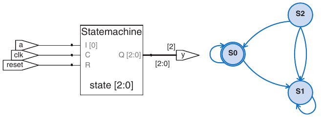

Hình 4.26 Circuit synthesize từ `patternMoore`

## 4.7 DATA TYPE\*

Phần này giải thích sâu các điểm tinh tế type SystemVerilog/VHDL.

### Ví dụ HDL 4.32 MEALY FSM NHẬN DẠNG MẪU

SystemVerilog

```
module  patternMealy(input     logic  clk,
                    input      logic reset,
                    input    logic a,
                    output logic y);

  typedef enum logic {S0, S1} statetype;
  statetype state, nextstate;

  // state register
  always_ff @(posedge clk, posedge reset)
   if (reset) state <= S0;
   else           state <= nextstate;

  // next state logic
  always_comb
   case  (state)
     S0: if (a)  nextstate = S0;
         else    nextstate = S1;
     S1: if (a) nextstate = S0;
         else    nextstate = S1;
     default:   nextstate = S0;
   endcase

  // output logic
  assign  y  =  (a  &  state  = =  S1);
endmodule
```

VHDL

```
library IEEE; use IEEE.STD_LOGIC_1164.all;
entity patternMealy is
   port(clk, reset: in     STD_LOGIC;
       a:                in    STD_LOGIC;
       y:                out STD_LOGIC);
end;
architecture synth of patternMealy is
   type statetype is (S0, S1);
   signal state, nextstate: statetype;
begin
   –– state register
   process(clk, reset) begin
     if reset then                        state <= S0;
     elsif rising_edge(clk) then state <= nextstate;
     end if;
  end process;
  –– next state logic
  process(all) begin
    case state is
      when S0 =>
       if a then nextstate <= S0;
       else        nextstate <= S1;
       end if;
      when S1 =>
       if a then nextstate <= S0;
       else        nextstate <= S1;
       end if;
      when others =>
                   nextstate <= S0;
    end  case;
  end process;
  –– output logic
  y <= '1' when (a = '1' and state = S1) else '0';
end;
```

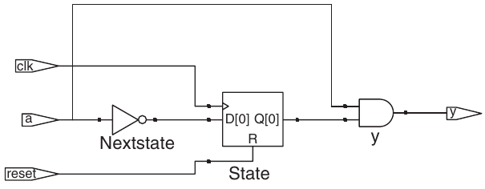

Hình 4.27 Circuit synthesize từ `patternMealy`

### 4.7.1 SystemVerilog

Trước SystemVerilog, Verilog chủ yếu sử dụng hai kiểu: `reg` và `wire`. Mặc dù có tên như vậy, một signal `reg` có thể liên quan hoặc không liên quan đến register. Điều này gây ra nhiều nhầm lẫn cho những người học ngôn ngữ này. SystemVerilog giới thiệu kiểu `logic` để loại bỏ sự nhầm lẫn đó; vì vậy, cuốn sách này tập trung vào kiểu `logic`. Mục này giải thích chi tiết hơn các kiểu `reg` và `wire` dành cho những người cần đọc code Verilog cũ.

Trong Verilog, nếu một signal xuất hiện ở left-hand side của `<=` hoặc `=` trong một khối `always`, signal đó phải được khai báo là `reg`. Nếu không, nó nên được khai báo là `wire`. Do đó, một signal `reg` có thể là output của một flip-flop, một latch hoặc combinational logic, tùy thuộc vào sensitivity list và statement của khối `always`.

Các port input và output mặc định có kiểu `wire`, trừ khi kiểu của chúng được định nghĩa tường minh là `reg`. Ví dụ sau minh họa cách mô tả một flip-flop trong Verilog truyền thống. Lưu ý rằng `clk` và `d` mặc định có kiểu `wire`, còn `q` được định nghĩa tường minh là `reg` vì nó xuất hiện ở left-hand side của `<=` trong khối `always`.

```
module flop(input            clk,
            input      [3:0] d,
            output reg [3:0] q);

  always @(posedge clk)
    q <= d;
endmodule
```

SystemVerilog giới thiệu kiểu `logic`. `logic` đồng nghĩa với `reg` và tránh khiến người dùng hiểu nhầm rằng nó nhất thiết là một flip-flop. Hơn nữa, SystemVerilog nới lỏng các quy tắc đối với câu lệnh `assign` và hierarchical port instantiation để có thể sử dụng `logic` bên ngoài các khối `always`, tại những nơi trước đây bắt buộc phải dùng `wire`. Vì vậy, gần như tất cả các signal trong SystemVerilog đều có thể là `logic`. Ngoại lệ là các signal có nhiều driver (ví dụ, một tristate bus) phải được khai báo là net, như mô tả trong Ví dụ HDL 4.10. Quy tắc này cho phép SystemVerilog tạo thông báo lỗi thay vì giá trị `x` khi một signal `logic` vô tình được nối với nhiều driver.

Loại net phổ biến nhất được gọi là `wire` hoặc `tri`. Hai kiểu này đồng nghĩa, nhưng theo quy ước, `wire` được sử dụng khi có một driver, còn `tri` được sử dụng khi có nhiều driver. Vì vậy, `wire` đã trở nên lỗi thời trong SystemVerilog vì `logic` được ưu tiên sử dụng cho các signal có một driver.

Khi net `tri` được một hoặc nhiều driver điều khiển đến cùng một giá trị, nó nhận giá trị đó. Khi không có driver nào điều khiển, nó ở trạng thái floating (`z`). Khi nhiều driver điều khiển nó đến các giá trị khác nhau (`0`, `1` hoặc `x`), nó ở trạng thái contention (`x`).

Có những kiểu net khác có cách resolve giá trị khác nhau khi không được điều khiển hoặc được điều khiển bởi nhiều nguồn. Những kiểu này hiếm khi được sử dụng, nhưng có thể thay thế tại bất kỳ vị trí nào thường sử dụng net `tri` (ví dụ, cho các signal có nhiều driver). Từng kiểu được mô tả trong Bảng 4.7.

Bảng 4.7 Net resolution

| Net type | Không driver | Driver xung đột |
|---|---|---|
| `tri` | `z` | `x` |
| `trireg` | `previous value` | `x` |
| `triand` | `z` | `0 if there are any 0` |
| `trior` | `z` | `1 if there are any 1` |
| `tri0` | `0` | `x` |
| `tri1` | `1` | `x` |

### 4.7.2 VHDL

Khác SystemVerilog, VHDL cưỡng chế type system chặt, bảo vệ khỏi vài lỗi nhưng đôi lúc cồng kềnh.

Mặc dù có vai trò quan trọng nền tảng, kiểu `STD_LOGIC` không được tích hợp sẵn trong VHDL. Thay vào đó, nó là một phần của library `IEEE.STD_LOGIC_1164`. Vì vậy, mỗi file phải chứa các library statement được trình bày trong những ví dụ trước.

Hơn nữa `IEEE.STD_LOGIC_1164` thiếu operation cơ bản cộng, so sánh, shift, chuyển integer cho data `STD_` `LOGIC_VECTOR`. Cuối cùng chúng thêm vào VHDL 2008 trong `IEEE.NUMERIC_STD_UNSIGNED`.

VHDL cũng có kiểu `BOOLEAN` với hai giá trị: `true` và `false`. Các giá trị `BOOLEAN` được trả về từ các phép so sánh (chẳng hạn phép so sánh bằng `s ='0'`), và các giá trị này được sử dụng trong các câu lệnh điều kiện như `when` và `if`. Mặc dù dễ cho rằng giá trị `BOOLEAN true` tương đương với `STD_LOGIC '1'` và `BOOLEAN false` có nghĩa là `STD_LOGIC` '`0`', các kiểu này không thể sử dụng thay thế cho nhau trước VHDL 2008. Ví dụ, trong code VHDL cũ, ta phải viết

```
y <= d1 when (s = '1') else d0;
```

còn VHDL 2008, `when` tự chuyển `s` từ `STD_LOGIC` sang `BOOLEAN`, nên chỉ cần

```
y <= d1 when s else d0;
```

Ngay VHDL 2008 vẫn phải viết

```
q <= '1' when (state = S2) else '0';
```

thay vì

```
q  <=  (state = S2);
```

vì `(state = S2)` trả `BOOLEAN`, không gán trực tiếp cho signal `STD_LOGIC` `y` được.

Mặc dù chúng ta không khai báo bất kỳ signal nào có kiểu `BOOLEAN`, kiểu này tự động được suy ra từ các phép so sánh và được sử dụng trong các câu lệnh điều kiện. Tương tự, VHDL có kiểu `INTEGER` để biểu diễn cả số nguyên dương lẫn số nguyên âm. Các signal có kiểu `INTEGER` bao phủ ít nhất khoảng giá trị từ –(2<sup>31</sup> – 1) đến 2<sup>31</sup> – 1. Các giá trị số nguyên được sử dụng làm chỉ số của bus. Ví dụ, trong câu lệnh

```
y <= a(3) and a(2) and a(1) and a(0);
```

0, 1, 2 và 3 là những số nguyên đóng vai trò chỉ số để chọn các bit của signal `a`. Chúng ta không thể trực tiếp dùng một signal `STD_LOGIC` hoặc `STD_LOGIC_VECTOR` làm chỉ số của bus. Thay vào đó, phải chuyển signal thành `INTEGER`. Điều này được minh họa trong ví dụ dưới đây về multiplexer 8:1 chọn một bit từ vector bằng một chỉ số 3-bit. Hàm `TO_INTEGER` được định nghĩa trong thư viện `IEEE.NUMERIC_STD_UNSIGNED` và thực hiện chuyển đổi từ `STD_LOGIC_VECTOR` sang `INTEGER` đối với các giá trị dương (unsigned).

```
library IEEE;
use IEEE.STD_LOGIC_1164.all;
use IEEE.NUMERIC_STD_UNSIGNED.all;
entity mux8 is
  port(d: in  STD_LOGIC_VECTOR(7 downto 0);
         s: in  STD_LOGIC_VECTOR(2 downto 0);
        y: out STD_LOGIC);
end;
architecture synth of mux8 is
begin
  y  <=   d(TO_INTEGER(s));
end;
```

VHDL cũng quy định chặt chẽ rằng các port `out` chỉ được sử dụng làm output. Ví dụ, code sau cho các gate AND two- và three-input không hợp lệ trong VHDL vì `v` là output nhưng đồng thời được sử dụng để tính `w`.

```
library IEEE; use IEEE.STD_LOGIC_1164.all;
entity  and23  is
  port(a, b, c: in STD_LOGIC;
       v, w: out   STD_LOGIC);
end;

architecture synth of and23 is
begin
  v  <=   a  and  b;
  w  <=   v  and  c;
end;
```

VHDL định nghĩa một kiểu port đặc biệt, `buffer`, để giải quyết vấn đề này. Signal nối với port `buffer` hoạt động như output nhưng cũng có thể được sử dụng bên trong module. Định nghĩa entity đã được sửa được trình bày dưới đây. Verilog và SystemVerilog không có hạn chế này và không cần các port `buffer`. VHDL 2008 loại bỏ hạn chế này bằng cách cho phép đọc các port `out`.

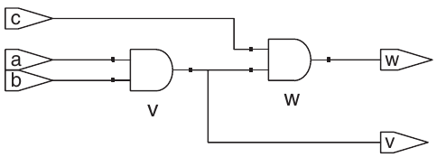

Hình 4.28 Circuit synthesize từ `and23`

```
entity and23 is
  port(a,    b,  c:  in  STD_LOGIC;
       v:   buffer      STD_LOGIC;
       w:    out            STD_LOGIC);
end;
```

Phần lớn các phép toán như cộng, trừ và Boolean logic đều giống nhau, bất kể số đó là signed hay unsigned. Tuy nhiên, phép so sánh độ lớn, phép nhân và arithmetic right shift được thực hiện khác nhau đối với số signed two’s complement và số unsigned binary. Chúng ta sẽ xem xét các phép toán này trong Chương 5. Ví dụ HDL 4.33 mô tả cách chỉ định rằng một signal biểu diễn một số signed.

## 4.8 PARAMETERIZED MODULE\*

Đến đây module có input/output fixed-width. Ví dụ phải định nghĩa riêng multiplexer 2:1 4- và 8-bit-wide. HDL cho độ rộng biến đổi bằng parameterized module.

Ví dụ HDL 4.34 khai báo multiplexer 2:1 parameterized mặc định 8, rồi tạo multiplexer 4:1 8- và 12-bit.

### Ví dụ HDL 4.33 (a) UNSIGNED MULTIPLIER (b) SIGNED MULTIPLIER

SystemVerilog

```
// 4.33(a): unsigned multiplier
module multiplier(input    logic [3:0] a, b,
                  output logic [7:0] y);
  assign y = a * b;
endmodule

// 4.33(b): signed multiplier
module multiplier(input    logic signed [3:0] a, b,
                  output logic signed [7:0] y);

  assign y = a * b;
endmodule
```

SystemVerilog mặc định signal unsigned. Thêm modifier `signed` (như `logic signed [3:0] a`) khiến signal `a` được xem signed, tức two’s complement.

VHDL

```
–– 4.33(a): unsigned multiplier
library IEEE; use IEEE.STD_LOGIC_1164.all;
use IEEE.NUMERIC_STD_UNSIGNED.all;

entity multiplier is
  port(a, b: in     STD_LOGIC_VECTOR(3 downto 0);
       y:       out STD_LOGIC_VECTOR(7 downto 0));
end;

architecture synth of multiplier is
begin
  y <= a * b;
end;
```

VHDL dùng library `NUMERIC_STD_UNSIGNED` làm arithmetic/comparison trên `STD_LOGIC_VECTOR`, xem vector unsigned.

```
use IEEE.NUMERIC_STD_UNSIGNED.all;
```

VHDL cũng định nghĩa type `UNSIGNED`, `SIGNED` trong `IEEE.NUMERIC_STD`, nhưng cần type conversion ngoài phạm vi chương.

### Ví dụ HDL 4.34 MULTIPLEXER 2:1 N-BIT PARAMETERIZED

SystemVerilog

```
module mux2
  #(parameter width = 8)
   (input     logic [width–1:0] d0, d1,
    input     logic                     s,
    output  logic [width–1:0] y);

    assign y = s ? d1 : d0;
endmodule
```

SystemVerilog cho phép đặt câu lệnh `#(parameter . . .)` trước các input và output để định nghĩa parameter. Câu lệnh `parameter` bao gồm giá trị mặc định (`8`) của parameter, trong trường hợp này có tên là `width`. Số bit của các input và output có thể phụ thuộc vào parameter này.

```
module mux4_8(input   logic [7:0] d0, d1, d2, d3,
              input   logic [1:0] s,
               output logic [7:0] y);

  logic [7:0] low, hi;

  mux2 lowmux(d0, d1, s[0], low);
  mux2 himux(d2, d3, s[0], hi);
  mux2 outmux(low, hi, s[1], y);
endmodule
```

Multiplexer 4:1 8-bit instantiate ba multiplexer 2:1 với độ rộng mặc định.

Ngược lại multiplexer 4:1 12-bit `mux4_12` phải override mặc định bằng `#( )` trước tên instance như sau.

```
module mux4_12(input    logic [11:0] d0, d1, d2, d3,
               input    logic [1:0]    s,
               output logic [11:0] y);

  logic [11:0] low, hi;

  mux2 #(12) lowmux(d0, d1, s[0], low);
  mux2 #(12) himux(d2, d3, s[0], hi);
  mux2 #(12) outmux(low, hi, s[1], y);
endmodule
```

Đừng nhầm `#` chỉ delay với `#(...)` định nghĩa/override parameter.

VHDL

```
library IEEE; use IEEE.STD_LOGIC_1164.all;
entity mux2 is
  generic(width: integer := 8);
  port(d0,
   d1: in    STD_LOGIC_VECTOR(width–1 downto 0);
   s:   in    STD_LOGIC;
   y:   out STD_LOGIC_VECTOR(width–1 downto 0));
end;
architecture synth of mux2 is
begin
  y <= d1 when s else d0;
end;
```

Câu `generic` gồm mặc định (`8`) của `width`, giá trị integer.

```
library IEEE; use IEEE.STD_LOGIC_1164.all;
entity mux4_8 is
  port(d0, d1, d2,
       d3: in     STD_LOGIC_VECTOR(7 downto 0);
        s:    in     STD_LOGIC_VECTOR(1 downto 0);
        y:    out STD_LOGIC_VECTOR(7 downto 0));
end;
architecture struct of mux4_8 is
  component mux2
   generic(width: integer := 8);
   port(d0,
         d1: in    STD_LOGIC_VECTOR(width-1 downto 0);
         s:    in    STD_LOGIC;
         y:    out STD_LOGIC_VECTOR(width-1 downto 0));
  end component;
  signal low, hi: STD_LOGIC_VECTOR(7 downto 0);
begin
  lowmux: mux2   port   map(d0, d1, s(0), low);
  himux:       mux2    port    map(d2,  d3,  s(0),  hi);
  outmux: mux2   port   map(low, hi, s(1), y);
end;
```

Multiplexer 4:1 8-bit `mux4_8` instantiate ba multiplexer 2:1 độ rộng mặc định.

Ngược lại multiplexer 4:1 12-bit `mux4_12` phải override mặc định bằng `generic map` như sau.

```
lowmux: mux2 generic map(12)
            port map(d0, d1, s(0), low);
himux:       mux2  generic  map(12)
            port map(d2, d3, s(0), hi);
outmux: mux2 generic map(12)
            port map(low, hi, s(1), y);
```

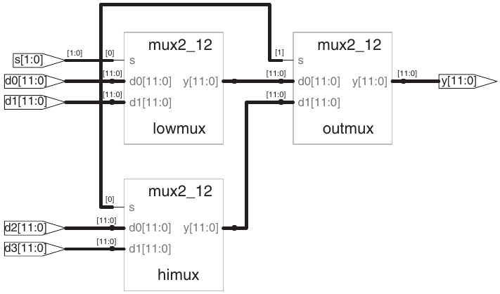

Hình 4.29 Circuit synthesize từ `mux4_12`

Ví dụ HDL 4.35 minh họa một decoder, là ứng dụng còn phù hợp hơn của parameterized module. Một decoder N:2<sup>N</sup> lớn khó được chỉ định bằng các câu lệnh `case`, nhưng có thể dễ dàng được mô tả bằng parameterized code chỉ cần đặt bit output thích hợp thành 1. Cụ thể, decoder sử dụng blocking assignment để đặt tất cả các bit thành 0, rồi thay đổi bit thích hợp thành 1.

HDL cũng cung cấp các câu lệnh `generate` để tạo ra lượng hardware thay đổi tùy theo giá trị của một parameter. `generate` hỗ trợ vòng lặp `for` và câu lệnh `if` để xác định cần tạo bao nhiêu phần tử hardware thuộc những loại nào. Ví dụ HDL 4.36 minh họa cách sử dụng các câu lệnh `generate` để tạo chức năng AND N-input từ một chuỗi các gate AND two-input. Dĩ nhiên, reduction operator sẽ gọn gàng và đơn giản hơn cho ứng dụng này, nhưng ví dụ minh họa nguyên lý chung của hardware generator.

### Ví dụ HDL 4.35 DECODER N:2<sup>N</sup> PARAMETERIZED

SystemVerilog

```
module decoder
  #(parameter N = 3)
   (input     logic [N–1:0]        a,
     output logic [2**N–1:0] y);

  always_comb
    begin
      y = 0;
      y[a] = 1;
   end
endmodule
```

`2**N` chỉ 2<sup>N</sup>.

VHDL

```
library IEEE; use IEEE.STD_LOGIC_1164.all;
use IEEE. NUMERIC_STD_UNSIGNED.all;

entity decoder is
  generic(N: integer := 3);
  port(a: in     STD_LOGIC_VECTOR(N–1 downto 0);
       y: out STD_LOGIC_VECTOR(2**N–1 downto 0));
end;

architecture synth of decoder is
begin
  process(all)
  begin
   y <= (OTHERS => '0');
   y(TO_INTEGER(a)) <= '1';
  end process;
end;
```

`2**N` chỉ 2<sup>N</sup>.

Hãy thận trọng với câu `generate`; rất dễ vô tình tạo một lượng hardware lớn!

## 4.9 TESTBENCH

Testbench là một module HDL dùng để kiểm tra một module khác, được gọi là device under test (DUT). Testbench chứa các câu lệnh để đưa input vào DUT và, lý tưởng nhất, kiểm tra xem các output được tạo ra có chính xác hay không. Các mẫu input và output mong muốn được gọi là test vector.

> Một số công cụ cũng gọi module cần được kiểm tra là unit under test (UUT).

Hãy xét việc kiểm tra module `sillyfunction` trong Mục 4.1.1, thực hiện tính `y` = $\overline{\texttt{a}}$ $\overline{\texttt{b}}$ $\overline{\texttt{c}}$ + `a`$\overline{\texttt{b}}$ $\overline{\texttt{c}}$ + `a`$\overline{\texttt{b}}$`c`. Đây là một module đơn giản, vì vậy chúng ta có thể thực hiện exhaustive testing bằng cách đưa vào tất cả tám test vector có thể có.

### Ví dụ HDL 4.36 AND GATE N-INPUT PARAMETERIZED

SystemVerilog

```
module andN
  #(parameter width = 8)
   (input     logic [width–1:0] a,
    output logic                         y);

  genvar  i;
  logic [width–1:0] x;

  generate
    assign x[0] = a[0];
    for(i=1; i<width; i=i+1) begin: forloop
      assign x[i] = a[i] & x[i–1];
    end

  endgenerate

  assign y = x[width–1];
endmodule
```

Câu `for` lặp `i` = 1, 2, …, `width–1` tạo nhiều AND liên tiếp. Sau `begin` trong loop `generate` `for` phải có `a` : và nhãn tùy ý (ở đây `forloop`).

VHDL

```
library IEEE; use IEEE.STD_LOGIC_1164.all;
entity andN is
  generic(width: integer := 8);
  port(a: in    STD_LOGIC_VECTOR(width–1 downto 0);
       y: out STD_LOGIC);
end;
architecture synth of andN is
  signal x: STD_LOGIC_VECTOR(width–1 downto 0);
begin
  x(0) <= a(0);
  gen: for i in 1 to width-1 generate
    x(i) <= a(i) and x(i-1);
  end generate;
  y <= x(width–1);
end;
```

Không cần khai báo generate loop variable `i`.

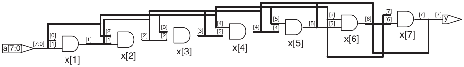

Hình 4.30 Circuit synthesize từ `andN`

Ví dụ HDL 4.37 minh họa một testbench đơn giản. Testbench này tạo một instance của DUT, sau đó đưa các input vào. Blocking assignment và delay được sử dụng để đưa các input vào theo đúng thứ tự. Người dùng phải xem kết quả simulation và kiểm tra trực tiếp để xác nhận rằng các output được tạo ra là chính xác. Testbench được mô phỏng giống như các HDL module khác. Tuy nhiên, chúng không thể được synthesize.

Việc kiểm tra tính chính xác của output rất tẻ nhạt và error-prone. Hơn nữa, xác định output chính xác sẽ dễ dàng hơn nhiều khi bạn vẫn còn nhớ rõ thiết kế. Nếu bạn thực hiện những thay đổi nhỏ và cần kiểm tra lại sau vài tuần, việc xác định output chính xác sẽ trở nên phiền phức. Một cách tốt hơn nhiều là viết self-checking testbench, như trong Ví dụ HDL 4.38.

Việc viết code cho từng test vector cũng trở nên tẻ nhạt, đặc biệt đối với các module cần nhiều vector. Một cách còn tốt hơn là đặt các test vector trong một file riêng. Testbench chỉ cần đọc các test vector từ file, đưa test vector đầu vào vào DUT, chờ, kiểm tra xem các giá trị output của DUT có khớp với vector đầu ra hay không, rồi lặp lại cho đến cuối file test vector.

### Ví dụ HDL 4.37 TESTBENCH

SystemVerilog

```
module testbench1();
 logic a, b, c, y;

 // instantiate device under test
 sillyfunction dut(a, b, c, y);

 // apply inputs one at a time
 initial begin
   a = 0; b = 0; c = 0; #10;
   c = 1;                     #10;
   b = 1; c = 0;            #10;
   c = 1;                     #10;
   a = 1; b = 0; c = 0; #10;
   c = 1;                     #10;
   b = 1; c = 0;            #10;
   c = 1;                     #10;
 end
endmodule
```

Câu lệnh `initial` thực thi các câu lệnh trong phần thân của nó khi simulation bắt đầu. Trong trường hợp này, trước tiên nó đưa mẫu input 000 vào và chờ 10 đơn vị thời gian. Sau đó, nó đưa mẫu 001 vào và chờ thêm 10 đơn vị thời gian, rồi tiếp tục như vậy cho đến khi đã đưa vào tất cả tám tổ hợp input có thể có. Chỉ nên sử dụng các câu lệnh `initial` trong testbench phục vụ simulation, không nên sử dụng trong các module dự định synthesize thành hardware thực tế. Hardware không có cách nào tự động thực thi một chuỗi bước đặc biệt một cách kỳ diệu ngay khi được bật lên.

VHDL

```
library IEEE; use IEEE.STD_LOGIC_1164.all;
entity testbench1 is –– no inputs or outputs
end;
architecture sim of testbench1 is
  component sillyfunction
     port(a, b, c: in   STD_LOGIC;
          y:          out STD_LOGIC);
  end component;
  signal a, b, c, y: STD_LOGIC;
begin
  –– instantiate device under test
  dut: sillyfunction port map(a, b, c, y);
  –– apply inputs one at a time
  process begin
    a <= '0'; b <= '0'; c <= '0'; wait for 10 ns;
    c <= '1';                                wait for 10 ns;
    b <= '1'; c <= '0';                 wait for 10 ns;
    c <= '1';                                  wait for 10 ns;
    a <= '1'; b <= '0'; c <= '0'; wait for 10 ns;
    c <= '1';                               wait for 10 ns;
    b <= '1'; c <= '0';                 wait for 10 ns;
    c <= '1';                              wait for 10 ns;
    wait;  –– wait  forever
  end process;
```

```
end;
```

Câu lệnh `process` trước tiên đưa mẫu input 000 vào và chờ 10 ns. Sau đó, nó đưa mẫu 001 vào và chờ thêm 10 ns, rồi tiếp tục như vậy cho đến khi đã đưa vào tất cả tám tổ hợp input có thể có.

Cuối cùng process đợi vô hạn, nếu không sẽ bắt đầu lại và lặp pattern test vector.

Ví dụ HDL 4.39 minh họa một testbench như vậy. Testbench tạo clock bằng câu lệnh `always/process` không có sensitivity list, để câu lệnh này liên tục được thực hiện lại. Khi simulation bắt đầu, nó đọc các test vector từ một file văn bản và tạo pulse `reset` trong hai chu kỳ. Mặc dù clock và reset không cần thiết để kiểm tra combinational logic, chúng vẫn được đưa vào vì sẽ quan trọng khi kiểm tra một sequential DUT. `example.txt` là một file văn bản chứa các test vector, gồm input và output mong đợi được viết ở dạng binary:

### Ví dụ HDL 4.38 SELF-CHECKING TESTBENCH

SystemVerilog

```
module testbench2();
  logic a, b, c, y;

  // instantiate device under test
  sillyfunction dut(a, b, c, y);

  // apply inputs one at a time
  // checking results
  initial begin
   a = 0; b = 0; c = 0; #10;
   assert (y = = = 1) else $error("000 failed.");
   c = 1;     #10;
   assert (y = = = 0) else $error("001 failed.");
   b = 1; c = 0;   #10;
   assert (y = = = 0) else $error("010 failed.");
   c = 1;      #10;
   assert (y = = = 0) else $error("011 failed.");
   a = 1; b = 0; c = 0; #10;
   assert (y = = = 1) else $error("100 failed.");
   c = 1;      #10;
   assert (y = = = 1) else $error("101 failed.");
   b = 1; c = 0;      #10;
   assert (y = = = 0) else $error("110 failed.");
   c = 1;     #10;
   assert (y = = = 0) else $error("111 failed.");
  end
endmodule
```

Câu lệnh `assert` của SystemVerilog kiểm tra xem một điều kiện được chỉ định có đúng hay không. Nếu không, nó thực thi câu lệnh `else`. System task `$error` trong câu lệnh `else` in ra thông báo lỗi mô tả assertion failure. Câu lệnh `assert` được bỏ qua trong quá trình synthesis.

Trong SystemVerilog, phép so sánh bằng `==` hoặc `!=` có hiệu lực giữa các signal không nhận các giá trị `x` và `z`. Testbench sử dụng các toán tử `== =` và `!= =` tương ứng để so sánh bằng và khác, vì các toán tử này hoạt động chính xác với các toán hạng có thể nhận giá trị `x` hoặc `z`.

VHDL

```
library IEEE; use IEEE.STD_LOGIC_1164.all;
entity testbench2 is –– no inputs or outputs
end;
architecture sim of testbench2 is
  component sillyfunction
   port(a, b, c: in     STD_LOGIC;
        y:            out STD_LOGIC);
  end component;
  signal a, b, c, y: STD_LOGIC;
begin
  –– instantiate device under test
  dut: sillyfunction port map(a, b, c, y);
  –– apply inputs one at a time
  –– checking results
  process begin
   a <= '0'; b <= '0'; c <= '0'; wait for 10 ns;
     assert y = '1' report "000  failed.";
   c <= '1';                               wait for 10 ns;
     assert y = '0' report "001  failed.";
   b <= '1'; c <= '0';                 wait for 10 ns;
     assert y = '0' report "010  failed.";
   c <= '1';                               wait for 10 ns;
     assert y = '0' report "011  failed.";
   a <= '1'; b <= '0'; c <= '0'; wait for 10 ns;
     assert y = '1' report "100 failed.";
   c <= '1';                               wait for 10 ns;
     assert y = '1' report "101 failed.";
   b <= '1'; c <= '0';                 wait for 10 ns;
     assert y = '0' report "110  failed.";
   c <= '1';                               wait for 10 ns;
     assert y = '0' report "111  failed.";
   wait; ––   wait forever
 end process;
end;
```

Câu lệnh `assert` kiểm tra một điều kiện và in thông báo được cung cấp trong mệnh đề `report` nếu điều kiện không được thỏa mãn. `assert` chỉ có ý nghĩa trong simulation, không có ý nghĩa trong synthesis.

```
000_1
001_0
010_0
011_0
100_1
101_1
110_0
111_0
```

Các input mới được đưa vào tại rising edge của clock, và output được kiểm tra tại falling edge của clock. Các lỗi được báo ngay khi chúng xảy ra. Khi simulation kết thúc, testbench in ra tổng số test vector đã được đưa vào và số lỗi đã phát hiện.

Testbench trong Ví dụ HDL 4.39 phức tạp hơn mức cần thiết đối với một circuit đơn giản như vậy. Tuy nhiên, bạn có thể dễ dàng sửa đổi nó để kiểm tra các circuit phức tạp hơn bằng cách thay đổi file `example.txt`, tạo instance của DUT mới và thay đổi một vài dòng code để thiết lập input và kiểm tra output.

## 4.10 TÓM TẮT

Hardware description language (HDL) là công cụ cực kỳ quan trọng của digital designer hiện đại. Khi học SystemVerilog hoặc VHDL, bạn chỉ định digital system nhanh hơn nhiều so với vẽ toàn bộ schematic. Debug cycle thường nhanh hơn vì chỉ cần sửa code thay nối lại schematic tẻ nhạt. Tuy nhiên, debug cycle bằng HDL có thể dài hơn nhiều nếu không hình dung rõ hardware mà code ngụ ý.

### Ví dụ HDL 4.39 TESTBENCH VỚI TEST VECTOR FILE

SystemVerilog

```
module testbench3();
  logic              clk,  reset;
  logic              a, b, c, y, yexpected;
  logic [31:0]    vectornum, errors;
  logic [3:0]       testvectors[10000:0];

  // instantiate device under test
  sillyfunction dut(a, b, c, y);

  // generate clock
  always
   begin
     clk = 1; #5; clk = 0; #5;
   end

  // at start of test, load vectors
  // and pulse reset
  initial
   begin
     $readmemb("example.txt", testvectors);
     vectornum = 0; errors = 0;
     reset = 1; #22; reset = 0;
   end

  // apply test vectors on rising edge of clk
  always @(posedge clk)
   begin
     #1; {a, b, c, yexpected} = testvectors[vectornum];
   end

  // check results on falling edge of clk
  always @(negedge clk)
    if (~reset) begin // skip during reset
     if (y ! = = yexpected) begin // check result
        $display("Error: inputs = %b", {a, b, c});
        $display(" outputs = %b (%b expected)", y, yexpected);
        errors = errors + 1;
     end
     vectornum = vectornum + 1;
     if (testvectors[vectornum] = = = 4'bx) begin
       $display("%d tests completed with %d errors",
                vectornum, errors);
       $stop;
     end
    end
endmodule
```

`$readmemb` đọc file binary vào array `testvectors`. `$readmemh` tương tự nhưng đọc hexadecimal.

Khối code tiếp theo chờ một đơn vị thời gian sau rising edge của clock (để tránh nhầm lẫn nếu clock và data thay đổi đồng thời), rồi thiết lập ba input và output mong đợi dựa trên bốn bit trong test vector hiện tại.

Testbench so sánh output được tạo ra, `y`, với output mong đợi, `yexpected`, và in thông báo lỗi nếu chúng không khớp. `%b` và `%d` chỉ định việc in các giá trị lần lượt ở dạng binary và decimal. `$display` là một system task dùng để in trong cửa sổ simulator. Ví dụ, `$display ("%b %b",` `y, yexpected);` in hai giá trị `y` và `yexpected` ở dạng binary. `%h` in một giá trị ở dạng hexadecimal.

Lặp đến khi hết vector hợp lệ trong array `testvectors`. `$stop` dừng simulation.

Lưu ý rằng mặc dù module SystemVerilog hỗ trợ đến 10,001 test vector, nó sẽ kết thúc simulation sau khi thực thi tám vector trong file.

VHDL

```
library IEEE; use IEEE.STD_LOGIC_1164.all;
use IEEE.STD_LOGIC_TEXTIO.ALL; use STD.TEXTIO.all;

entity testbench3 is –– no inputs or outputs
end;

architecture sim of testbench3 is
  component sillyfunction
    port(a, b, c: in   STD_LOGIC;
         y:          out STD_LOGIC);
  end component;
  signal a, b, c, y:     STD_LOGIC;
  signal y_expected: STD_LOGIC;
  signal clk, reset:   STD_LOGIC;
begin
 –– instantiate device under test
 dut: sillyfunction port map(a, b, c, y);

 –– generate clock
 process begin
   clk <= '1'; wait for 5 ns;
   clk <= '0'; wait for 5 ns;
 end process;

 –– at start of test, pulse reset
 process begin
   reset <= '1'; wait for 27 ns; reset <= '0';
   wait;
 end process;

 –– run tests
 process is
   file tv: text;
   variable L: line;
   variable vector_in: std_logic_vector(2 downto 0);
   variable dummy: character;
   variable vector_out: std_logic;
   variable vectornum: integer := 0;
   variable errors: integer := 0;
 begin
   FILE_OPEN(tv, "example.txt", READ_MODE);
   while not endfile(tv) loop

     –– change vectors on rising edge
     wait until rising_edge(clk);

     –– read the next line of testvectors and split into pieces
     readline(tv, L);
     read(L, vector_in);
       read(L, dummy); –– skip over underscore
    read(L, vector_out);
    (a, b, c) <= vector_in(2 downto 0) after 1 ns;
    y_expected <= vector_out after 1 ns;

    -- check results on falling edge
    wait until falling_edge(clk);

    if y /= y_expected then
      report "Error: y = " & std_logic'image(y);
      errors := errors + 1;
    end if;

    vectornum := vectornum + 1;
  end loop;

  -- summarize results at end of simulation
  if (errors = 0) then
    report "NO ERRORS -- " &
          integer'image(vectornum) &
          " tests completed successfully."
          severity failure;
  else
    report integer'image(vectornum) &
          " tests completed, errors = " &
          integer'image(errors)
          severity failure;
  end if;
 end process;
end;
```

Code VHDL dùng lệnh đọc file ngoài phạm vi chương nhưng cho hình dung self-checking testbench.

HDL được sử dụng cho cả simulation và synthesis. Logic simulation là một phương pháp mạnh mẽ để kiểm tra một hệ thống trên máy tính trước khi chuyển nó thành hardware. Simulator cho phép bạn kiểm tra giá trị của các signal bên trong hệ thống mà có thể không đo được trên hardware vật lý. Logic synthesis chuyển code HDL thành các digital logic circuit.

Điều quan trọng nhất cần nhớ khi viết HDL code là bạn đang mô tả hardware thực, chứ không phải viết một chương trình máy tính. Lỗi phổ biến nhất của người mới là viết HDL code mà không suy nghĩ về hardware mình định tạo ra. Nếu không biết code của mình đang mô tả hardware nào, gần như chắc chắn bạn sẽ không nhận được kết quả mong muốn. Thay vào đó, hãy bắt đầu bằng cách phác thảo block diagram của hệ thống, xác định phần nào là combinational logic, phần nào là sequential circuit hoặc finite state machine, v.v. Sau đó, viết HDL code cho từng phần, sử dụng idiom phù hợp để mô tả loại hardware bạn cần.

## Bài tập

Bạn có thể làm các bài tập sau bằng HDL mà mình ưa thích. Nếu có simulator, hãy kiểm tra thiết kế của bạn. In các waveform và giải thích cách chúng chứng minh rằng thiết kế hoạt động chính xác. Nếu có synthesizer, hãy synthesize code của bạn. In circuit diagram được tạo ra và giải thích vì sao nó phù hợp với mong đợi của bạn.

Bài tập 4.1 Phác thảo schematic circuit mô tả bởi HDL sau. Đơn giản hóa để có ít gate nhất.

Bài tập 4.2 Phác thảo schematic circuit mô tả bởi HDL sau. Đơn giản hóa để có ít gate nhất.

SystemVerilog

```
module exercise1(input    logic a, b, c,
                 output logic y, z);

  assign y = a & b & c | a & b & ~c | a & ~b & c;
  assign z = a & b | ~a & ~b;
endmodule
```

VHDL

```
library IEEE; use IEEE.STD_LOGIC_1164.all;
entity exercise1 is
  port(a, b, c: in    STD_LOGIC;
       y, z:      out   STD_LOGIC);
end;
architecture synth of exercise1 is
begin
  y <= (a and b and c) or (a and b and not c) or
      (a and not b and c);
  z <= (a and b) or (not a and not b);
end;
```

Bài tập 4.3 Viết HDL module tính XOR four-input. Input `a`<sub>`3:0`</sub>, output `y`.

Bài tập 4.4 Viết một self-checking testbench cho Bài tập 4.3. Tạo file test vector chứa tất cả 16 trường hợp kiểm tra. Mô phỏng circuit và chứng minh rằng nó hoạt động chính xác. Cố ý thêm một lỗi vào file test vector và cho thấy testbench báo cáo sự không khớp.

SystemVerilog

```
module exercise2(input    logic [3:0] a,
                 output logic [1:0] y);
  always_comb
   if          (a[0]) y = 2'b11;
   else if (a[1]) y = 2'b10;
   else if (a[2]) y = 2'b01;
   else if (a[3]) y = 2'b00;
   else                  y = a[1:0];
endmodule
```

VHDL

```
library IEEE; use IEEE.STD_LOGIC_1164.all;
entity exercise2 is
  port(a: in    STD_LOGIC_VECTOR(3 downto 0);
       y: out STD_LOGIC_VECTOR(1 downto 0));
end;
architecture synth of exercise2 is
begin
  process(all)  begin
   if        a(0) then y <= "11";
   elsif   a(1)  then  y  <=  "10";
   elsif   a(2)  then  y  <=  "01";
   elsif   a(3)  then  y  <=  "00";
   else                    y <=  a(1 downto 0);
   end  if;
  end  process;
end;
```

Bài tập 4.5 Viết một module HDL có tên `minority`. Module nhận ba input là `a`, `b` và `c`. Nó tạo ra một output `y`, có giá trị TRUE nếu ít nhất hai trong số các input là FALSE.

Bài tập 4.6 Viết module decoder hexadecimal seven-segment display, xử lý A, B, C, D, E, F và 0–9.

Bài tập 4.7 Viết một self-checking testbench cho Bài tập 4.6. Tạo file test vector chứa tất cả 16 trường hợp kiểm tra. Mô phỏng circuit và chứng minh rằng nó hoạt động chính xác. Cố ý thêm một lỗi vào file test vector và cho thấy testbench báo cáo sự không khớp.

Bài tập 4.8 Viết module multiplexer 8:1 tên `mux8`, input `s`<sub>`2:0`</sub>, `d0`, `d1`, `d2`, `d3`, `d4`, `d5`, `d6`, `d7`, output `y`.

Bài tập 4.9 Viết structural module tính `y` = `a`$\overline{\texttt{b}}$ + $\overline{\texttt{b}}\overline{\texttt{c}}$ + $\overline{\texttt{a}}$`bc` bằng multiplexer logic. Dùng multiplexer 8:1 Bài 4.8.

Bài tập 4.10 Làm lại Bài 4.9 bằng multiplexer 4:1 và số NOT gate tùy cần.

Bài tập 4.11 Mục 4.5.4 đã chỉ ra rằng có thể mô tả chính xác một synchronizer bằng blocking assignment nếu các phép gán được sắp xếp đúng thứ tự. Hãy nghĩ ra một sequential circuit đơn giản không thể được mô tả chính xác bằng blocking assignment, bất kể thứ tự các phép gán.

Bài tập 4.12 Viết module priority circuit eight-input.

Bài tập 4.13 Viết module decoder 2:4.

Bài tập 4.14 Viết module decoder 6:64 bằng ba instance decoder 2:4 Bài 4.13 và một nhóm AND gate three-input.

Bài tập 4.15 Viết module triển khai Boolean equation Bài 2.13.

Bài tập 4.16 Viết module triển khai circuit Bài 2.26.

Bài tập 4.17 Viết module triển khai circuit Bài 2.27.

Bài tập 4.18 Viết module triển khai logic function Bài 2.28. Chú ý kỹ cách xử lý don’t care.

Bài tập 4.19 Viết module triển khai function Bài 2.35.

Bài tập 4.20 Viết module triển khai priority encoder Bài 2.36.

Bài tập 4.21 Viết module triển khai priority encoder sửa đổi Bài 2.37.

Bài tập 4.22 Viết module triển khai converter binary-to-thermometer Bài 2.38.

Bài tập 4.23 Viết module triển khai function days-in-month Câu hỏi 2.2.

Bài tập 4.24 Phác thảo state transition diagram cho FSM trong HDL sau.

SystemVerilog

```
module fsm2(input    logic clk, reset,
            input    logic a, b,
            output logic y);

 logic [1:0] state, nextstate;

 parameter  S0 =  2'b00;
 parameter  S1 =  2'b01;
 parameter  S2 =  2'b10;
 parameter  S3 =  2'b11;

 always_ff @(posedge clk, posedge reset)
   if (reset) state <= S0;
   else           state <= nextstate;

 always_comb
   case (state)
    S0: if (a ^ b) nextstate = S1;
       else           nextstate = S0;
    S1: if (a & b) nextstate = S2;
       else           nextstate = S0;
    S2: if (a | b) nextstate = S3;
       else           nextstate = S0;
    S3: if (a | b) nextstate = S3;
       else           nextstate = S0;
   endcase

 assign y = (state = = S1) | (state = = S2);
endmodule
```

VHDL

```
library IEEE; use IEEE.STD_LOGIC_1164.all;
entity fsm2 is
  port(clk, reset: in    STD_LOGIC;
       a, b:             in    STD_LOGIC;
       y:                out STD_LOGIC);
end;
architecture synth of fsm2 is
  type statetype is (S0, S1, S2, S3);
  signal state, nextstate: statetype;
begin
  process(clk, reset) begin
   if reset then state <= S0;
   elsif rising_edge(clk) then
     state <= nextstate;
   end if;
  end process;
  process(all) begin
   case state is
    when S0 => if (a xor b) then
                  nextstate <= S1;
              else nextstate <= S0;
              end if;
    when S1 => if (a and b) then
                  nextstate <= S2;
              else nextstate <= S0;
              end if;
    when S2 => if (a or b) then
                  nextstate <= S3;
              else nextstate <= S0;
              end if;
    when S3 => if (a or b) then
                  nextstate <= S3;
              else nextstate <= S0;
              end if;
   end case;
  end process;
  y <= '1' when((state = S1) or (state = S2))
      else '0';
end;
```

Bài tập 4.25 Phác thảo state transition diagram cho FSM trong HDL sau. FSM kiểu này dùng trong branch predictor của một số microprocessor.

SystemVerilog

```
module fsm1(input    logic clk, reset,
            input    logic taken, back,
            output logic predicttaken);

 logic [4:0] state, nextstate;

 parameter  S0 = 5'b00001;
 parameter   S1 = 5'b00010;
 parameter  S2 = 5'b00100;
 parameter  S3 = 5'b01000;
 parameter  S4 = 5'b10000;

 always_ff @(posedge clk, posedge reset)
   if (reset) state <= S2;
   else           state <= nextstate;

 always_comb
   case (state)
    S0:  if (taken) nextstate = S1;
         else           nextstate = S0;
    S1: if (taken)  nextstate = S2;
         else          nextstate = S0;
    S2: if (taken)  nextstate = S3;
         else          nextstate = S1;
    S3: if (taken)  nextstate = S4;
         else          nextstate = S2;
    S4: if (taken)  nextstate = S4;
         else          nextstate = S3;
    default:            nextstate = S2;
   endcase

 assign predicttaken = (state  = = S4) |
                      (state  = = S3) |
                      (state  = = S2 & back);
endmodule
```

VHDL

```
library IEEE; use IEEE.STD_LOGIC_1164. all;
entity fsm1 is
  port(clk, reset:       in     STD_LOGIC;
       taken, back:     in     STD_LOGIC;
       predicttaken: out STD_LOGIC);
end;
architecture synth of fsm1 is
  type statetype is (S0, S1, S2, S3, S4);
  signal state, nextstate: statetype;
begin
  process(clk, reset) begin
   if reset then state <= S2;
   elsif rising_edge(clk) then
     state <= nextstate;
   end if;
  end process;
process(all) begin
   case state is
     when S0 => if taken then
                   nextstate <= S1;
               else nextstate <= S0;
               end if;
     when S1 => if taken then
                   nextstate <= S2;
               else nextstate <= S0;
               end if;
     when S2 => if taken then
                   nextstate <= S3;
               else nextstate <= S1;
               end if;
     when S3 => if taken then
                   nextstate <= S4;
               else nextstate <= S2;
               end if;
     when S4 => if taken then
                   nextstate <= S4;
               else nextstate <= S3;
               end if;
     when others =>    nextstate <= S2;
   end case;
  end process;
  –– output logic
  predicttaken <= '1' when
                ((state = S4) or (state = S3) or
                (state = S2 and back = '1'))
  else '0';
end;
```

Bài tập 4.26 Viết module cho SR latch.

Bài tập 4.27 Viết một module HDL cho JK flip-flop. Flip-flop có các input clk, J và K, cùng output Q. Tại rising edge của clock, flip-flop giữ giá trị cũ của Q nếu J = K = 0. Nó đặt Q thành 1 nếu J = 1, reset Q về 0 nếu K = 1 và đảo Q nếu J = K = 1.

Bài tập 4.28 Viết một module HDL cho latch trong Hình 3.18. Sử dụng một câu lệnh gán cho mỗi gate. Chỉ định delay bằng 1 đơn vị hoặc 1 ns cho mỗi gate. Mô phỏng latch và chứng minh rằng nó hoạt động chính xác. Sau đó, tăng delay của inverter. Delay phải dài đến mức nào thì race condition mới khiến latch hoạt động sai?

Bài tập 4.29 Viết module traffic light controller Mục 3.4.1.

Bài tập 4.30 Viết ba module HDL cho traffic light controller có chế độ diễu hành đã được phân rã trong Ví dụ 3.8. Các module phải có tên `controller`, `mode` và `lights`, cùng các input và output như trong Hình 3.33(b).

Bài tập 4.31 Viết module mô tả circuit Hình 3.42.

Bài tập 4.32 Viết module FSM có state transition Hình 3.69 Bài 3.22.

Bài tập 4.33 Viết module FSM có state transition Hình 3.70 Bài 3.23.

Bài tập 4.34 Viết module traffic light controller cải tiến Bài 3.24.

Bài tập 4.35 Viết module ốc sên con Bài 3.25.

Bài tập 4.36 Viết module máy bán soda Bài 3.26.

Bài tập 4.37 Viết module Gray code counter Bài 3.27.

Bài tập 4.38 Viết module UP/DOWN Gray code counter Bài 3.28.

Bài tập 4.39 Viết module FSM Bài 3.29.

Bài tập 4.40 Viết module FSM Bài 3.30.

Bài tập 4.41 Viết module serial two’s complementer Câu hỏi 3.2.

Bài tập 4.42 Viết module circuit Bài 3.31.

Bài tập 4.43 Viết module circuit Bài 3.32.

Bài tập 4.44 Viết module circuit Bài 3.33.

Bài tập 4.45 Viết module circuit Bài 3.34. Có thể dùng full adder Mục 4.2.5.

### Bài tập SystemVerilog

Các bài sau riêng cho SystemVerilog.

Bài tập 4.46 Khai báo signal `tri` trong SystemVerilog nghĩa là gì?

Bài tập 4.47 Viết lại module `syncbad` trong Ví dụ HDL 4.29. Sử dụng nonblocking assignment, nhưng thay đổi code để tạo ra một synchronizer hoạt động chính xác với hai flip-flops.

Bài tập 4.48 Xét hai module SystemVerilog sau. Function giống nhau không? Phác thảo hardware từng cái ngụ ý.

```
module code1(input  logic clk, a, b, c,
             output logic y);
  logic x;
  always_ff @(posedge clk) begin
    x <= a & b;
    y <= x | c;
  end
endmodule

module code2(input  logic a, b, c, clk,
             output logic y);

  logic x;

  always_ff @(posedge clk) begin
    y <= x | c;
    x <= a & b;
  end
endmodule
```

Bài tập 4.49 Làm lại Bài 4.48 nếu thay <= bằng = ở mọi assignment.

Bài tập 4.50 Các module SystemVerilog sau minh họa những lỗi mà các tác giả từng thấy sinh viên mắc phải trong phòng thực hành. Hãy giải thích lỗi trong từng module và chỉ ra cách sửa lỗi đó.

(a)

```
module latch(input logic        clk,
             input logic [3:0] d,
             output reg  [3:0] q);
  always  @(clk)
    if (clk) q <= d;
endmodule
```

(b)

```
module gates(input  logic [3:0] a, b,
             output logic [3:0] y1, y2, y3, y4, y5);
  always  @(a)
    begin
     y1 = a & b;
     y2 = a | b;
     y3 = a ^ b;
     y4 = ~(a & b);
     y5 = ~(a | b);
    end
endmodule
```

(c)

```
module mux2(input  logic [3:0] d0, d1,
            input  logic        s,
            output logic [3:0] y);
   always @(posedge s)
    if (s) y <= d1;
    else   y <= d0;
endmodule
```

(d)

```
module twoflops(input  logic clk,
                input  logic d0, d1,
                output logic q0, q1);
   always @(posedge clk)
     q1 = d1;
     q0 = d0;
 endmodule
```

(e)

```
module FSM(input  logic clk,
           input    logic  a,
           output logic out1, out2);

    logic  state;

    // next state logic and register (sequential)
    always_ff @(posedge clk)
     if  (state  = =  0)  begin
         if (a)  state  <= 1;
     end else begin
         if (~a) state <= 0;
     end
    always_comb // output logic (combinational)
     if (state = = 0) out1 = 1;
     else             out2 = 1;
endmodule
```

(f)

```
module priority(input   logic [3:0] a,
                output logic [3:0] y);

   always_comb
     if       (a[3]) y = 4'b1000;
     else if (a[2]) y = 4'b0100;
     else if (a[1]) y = 4'b0010;
     else if (a[0]) y = 4'b0001;
endmodule
```

(g)

```
module divideby3FSM(input  logic clk,
                    input     logic  reset,
                    output logic  out);

   logic [1:0] state, nextstate;

   parameter S0  = 2'b00;
   parameter S1  = 2'b01;
   parameter S2  =  2'b10;

   // state register
   always_ff @(posedge clk, posedge reset)
     if (reset) state <= S0;
     else           state <= nextstate;

   // next state logic
   always  @(state)
     case  (state)
       S0: nextstate =  S1;
       S1: nextstate =  S2;
       S2: nextstate =  S0;
     endcase

   // output logic
   assign out = (state = = S2);
endmodule
```

(h)

```
module mux2tri(input   logic [3:0] d0, d1,
               input   logic             s,
               output tri      [3:0] y);
   tristate t0(d0, s, y);
   tristate t1(d1, s, y);
endmodule
```

(i)

```
module floprsen(input  logic      clk,
                input  logic          reset,
                input  logic          set,
                input  logic  [3:0]  d,
                output  logic  [3:0]  q);
   always_ff @(posedge clk, posedge reset)
     if (reset) q <= 0;
     else            q <= d;
   always  @(set)
     if (set)     q <= 1;
endmodule
```

(j)

```
module and3(input    logic   a, b, c,
            output logic y);

   logic  tmp;
   always @(a, b, c)
   begin
     tmp <= a & b;
     y    <= tmp & c;
   end
endmodule
```

### Bài tập VHDL

Các bài sau riêng cho VHDL.

Bài tập 4.51 Trong VHDL vì sao cần viết

```
q <= '1' when state = S0 else '0';
```

thay vì chỉ

```
q <= (state = S0);
```

Bài tập 4.52 Mỗi module VHDL sau đều chứa lỗi. Để ngắn gọn, chỉ phần architecture được trình bày; hãy giả định rằng mệnh đề sử dụng `library` và khai báo `entity` đều chính xác. Giải thích các lỗi và chỉ ra cách sửa chúng.

(a)

```
architecture synth of latch is
begin
  process(clk) begin
    if clk = '1' then q <= d;
    end if;
  end process;
end;
```

(b)

```
architecture proc of gates is
begin
  process(a) begin
   Y1 <= a and b;
   y2 <= a or b;
   y3 <= a xor b;
   y4 <= a nand b;
   y5 <= a nor b;
 end process;
end;
```

(c)

```
architecture synth of flop is
begin
 process(clk)
   if rising_edge(clk) then
     q <= d;
end;
```

(d)

```
architecture synth of priority is
begin
  process(all)  begin
   if         a(3) then y <= "1000";
   elsif a(2) then y <= "0100";
   elsif  a(1) then y <= "0010";
   elsif  a(0) then y <= "0001";
   end if;
  end  process;
end;
```

(e)

```
architecture synth of divideby3FSM is
   type statetype is (S0, S1, S2);
   signal state, nextstate: statetype;
begin
  process(clk, reset) begin
     if reset then state <= S0;
     elsif rising_edge(clk) then
      state <= nextstate;
     end  if;
  end  process;

  process(state)  begin
    case state is
      when S0 => nextstate <= S1;
      when S1 => nextstate <= S2;
      when S2 => nextstate <= S0;
    end  case;
  end  process;
  q <= '1' when state = S0 else '0';
end;
```

(f)

```
 architecture struct of mux2 is
   component  tristate
     port(a:   in    STD_LOGIC_VECTOR(3 downto 0);
         en:  in      STD_LOGIC;
         y:    out STD_LOGIC_VECTOR(3 downto 0));
   end  component;

 begin
  t0: tristate port map(d0, s, y);
  t1: tristate port map(d1, s, y);
end;
```

(g)

```
architecture asynchronous of floprs is
begin
  process(clk, reset) begin
    if reset then
     q <= '0';
    elsif rising_edge(clk) then
     q <= d;
    end  if;
  end  process;

  process(set)  begin
    if set then
       q <= '1';
    end  if;
  end  process;
end;
```

## Câu hỏi phỏng vấn

Các bài sau là câu hỏi từng dùng phỏng vấn digital design.

Câu hỏi 4.1 Viết một dòng HDL gate bus 32-bit tên `data` bằng signal `sel`, tạo `result` 32-bit. Nếu `sel` TRUE, `result =` `data`; nếu không, `result` toàn 0.

Câu hỏi 4.2 Giải thích blocking và nonblocking assignment trong SystemVerilog khác nhau, cho ví dụ.

Câu hỏi 4.3 Câu SystemVerilog sau làm gì?

```
assign result = |(data[15:0] & 16'hC820);
```

[^1]: Institute of Electrical and Electronics Engineers (IEEE) là hội nghề nghiệp chịu trách nhiệm nhiều chuẩn máy tính, gồm Wi-Fi (802.11), Ethernet (802.3), floating-point (754).

[^2]: Các simulation trong chương này được thực hiện bằng ModelSim PE Student Edition Version 10.3c. ModelSim được chọn vì nó được sử dụng trong thương mại, đồng thời có một phiên bản dành cho sinh viên được cung cấp miễn phí với khả năng xử lý 10,000 dòng code.

[^3]: Trong toàn bộ chương này, synthesis được thực hiện bằng Synplify Premier của Synopsys. Tuy nhiên, có nhiều synthesis tool khác, chẳng hạn những tool đi kèm Vivado và Quartus, các design tool được Xilinx và Intel cung cấp miễn phí để synthesize HDL thành field programmable
