# 5 Các Digital Building Block

- 5.1 Giới thiệu
- 5.2 Arithmetic Circuit
- 5.3 Hệ thống số
- 5.4 Sequential Building Block
- 5.5 Memory Array
- 5.6 Logic Array
- 5.7 Tổng kết
- Bài tập
- Câu hỏi phỏng vấn

## 5.1 GIỚI THIỆU

Đến đây, chúng ta đã xem xét thiết kế combinational circuit và sequential circuit bằng phương trình Boolean, schematic và HDL. Chương này giới thiệu combinational building block và sequential building block phức tạp hơn dùng trong digital system. Chúng gồm arithmetic circuit, counter, shift register, memory array và logic array. Các building block không chỉ tự chúng hữu ích mà còn minh họa nguyên lý hierarchy, modularity và regularity. Chúng được lắp ghép phân cấp từ thành phần đơn giản hơn như logic gate, multiplexer và decoder. Mỗi building block có interface well-defined và có thể xem như hộp đen khi cách triển khai bên dưới không quan trọng. Cấu trúc đều đặn của mỗi building block dễ mở rộng sang kích thước khác. Trong Chương 7, chúng ta dùng nhiều building block này để xây microprocessor.

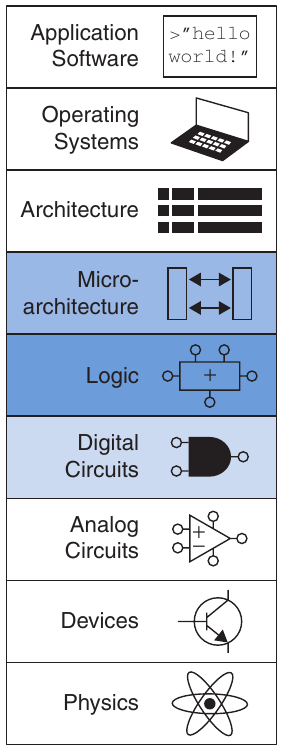

## 5.2 ARITHMETIC CIRCUIT

Arithmetic circuit là building block trung tâm của máy tính. Máy tính và digital logic thực hiện nhiều hàm số học: cộng, trừ, so sánh, dịch, nhân và chia. Mục này mô tả cách triển khai hardware cho mọi phép toán đó.

### 5.2.1 Phép cộng

Cộng là một trong những phép toán phổ biến nhất trong digital system. Trước hết xét cách cộng hai số nhị phân 1-bit. Sau đó mở rộng sang số nhị phân N-bit. Adder cũng minh họa trade-offs giữa tốc độ và độ phức tạp.

Half Adder

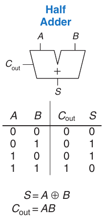

Hình 5.1 Half adder 1-bit

Bắt đầu bằng xây half adder. Như Hình 5.1, half adder có hai input A, B và hai output S, C<sub>out</sub>. S là tổng A và B. Nếu A và B đều 1, S là 2, không thể biểu diễn bằng một chữ số nhị phân. Thay vào đó, nó được biểu thị bằng carry out C<sub>out</sub> ở cột tiếp theo. Half adder có thể xây bằng XOR gate và AND gate.

Trong adder multi-bit, C<sub>out</sub> được cộng hay carry in vào bit có trọng số cao hơn kế tiếp. Ví dụ, trong Hình 5.2, carry bit màu xanh là output C<sub>out</sub> của cột cộng 1-bit đầu tiên và input C<sub>in</sub> của cột cộng thứ hai. Tuy nhiên, half adder thiếu input C<sub>in</sub> để nhận C<sub>out</sub> từ cột trước. Full adder mô tả trong mục sau giải quyết vấn đề.

Full Adder

Full adder, được giới thiệu ở Mục 2.1, nhận carry in C<sub>in</sub> như Hình 5.3. Hình cũng trình bày phương trình output cho S và C<sub>out</sub>.

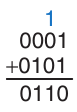

Hình 5.2 Carry bit

Carry Propagate Adder

Adder N-bit cộng hai input N-bit A, B cùng carry in C<sub>in</sub> để tạo kết quả N-bit S và carry out C<sub>out</sub>. Nó thường gọi là carry propagate adder (CPA) vì carry out của bit này truyền vào bit kế tiếp. Ký hiệu CPA trong Hình 5.4 được vẽ như full adder, ngoại trừ A, B, S là bus thay vì bit đơn. Ba cách triển khai CPA phổ biến gọi là adder ripple-carry, adder carry-lookahead và prefix adder.

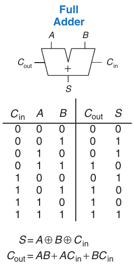

Hình 5.3 Full adder 1-bit

Ripple-Carry Adder

Cách đơn giản nhất xây carry propagate adder N-bit là nối chuỗi N full adder. C<sub>out</sub> stage này đóng vai trò C<sub>in</sub> stage tiếp, như Hình 5.5 cho phép cộng 32-bit. Đây gọi là adder ripple-carry. Nó là ứng dụng tốt của modularity và regularity: module full adder được tái sử dụng nhiều lần để tạo hệ thống lớn hơn. Adder ripple-carry có nhược điểm chậm khi N lớn. S<sub>31</sub> phụ thuộc C<sub>30</sub>, phụ thuộc C<sub>29</sub>, phụ thuộc C<sub>28</sub>, v.v. ngược về tận C<sub>in</sub>, như màu xanh trong Hình 5.5. Chúng ta nói carry lan qua carry chain. Độ trễ adder t<sub>ripple</sub> tăng tỷ lệ thuận số bit như Phương trình 5.1, với t<sub>FA</sub> là độ trễ full adder.

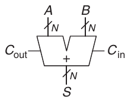

Hình 5.4 Carry propagate adder

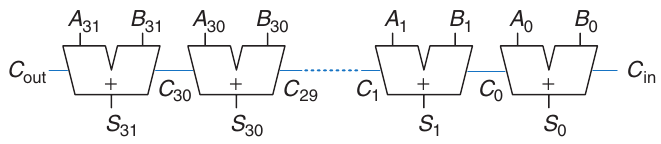

Hình 5.5 Adder ripple-carry 32-bit

> Schematic thường biểu thị signal từ trái sang phải. Arithmetic circuit phá quy tắc vì carry chạy từ phải sang trái (từ cột trọng số thấp nhất đến cao nhất). Chúng ta giữ cột trọng số thấp nhất bên phải và cao nhất bên trái vì quen nhìn và cộng số như vậy.


t<sub>ripple</sub> = Nt<sub>FA</sub> (5.1)

Carry-Lookahead Adder

Lý do cơ bản khiến adder ripple-carry lớn chậm là carry signal phải truyền qua mọi bit trong adder. Adder carry- lookahead (CLA) là loại carry propagate adder khác giải quyết bằng chia adder thành khối và cung cấp circuit nhanh chóng xác định carry out của khối ngay khi biết carry in. Vì vậy nói nó nhìn trước qua các khối thay vì chờ lan qua mọi full adder trong khối. Ví dụ, adder 32-bit có thể chia thành tám khối 4-bit.

CLA dùng signal generate (G) và propagate (P) mô tả cách cột hoặc khối xác định carry out. Cột thứ i của adder được nói generate carry nếu tạo carry out không phụ thuộc carry in. Cột thứ i chắc chắn generate carry C<sub>i</sub> nếu A<sub>i</sub> và B<sub>i</sub> đều 1. Vì vậy G<sub>i</sub>, generate signal của cột i, được tính G<sub>i</sub> = A<sub>i</sub> \& B<sub>i</sub>. Cột được nói propagate carry nếu tạo carry out mỗi khi có carry in. Cột thứ i propagate carry in C<sub>i−1</sub> nếu A<sub>i</sub> hoặc B<sub>i</sub> là 1. Do đó P<sub>i</sub> = A<sub>i</sub> \| B<sub>i</sub>. Với định nghĩa này, có thể viết lại carry logic của một cột cụ thể. Cột thứ i tạo carry out C<sub>i</sub> nếu nó generate carry G<sub>i</sub> hoặc propagate carry in P<sub>i</sub>C<sub>i−1</sub>. Dưới dạng phương trình,

C<sub>i</sub> = A<sub>i</sub>B<sub>i</sub> + (A<sub>i</sub> + B<sub>i</sub>)C<sub>i−1</sub> = G<sub>i</sub> + P<sub>i</sub>C<sub>i−1</sub> (5.2)

Định nghĩa generate và propagate mở rộng đến khối multiple-bit. Khối được nói generate carry nếu tạo carry out không phụ thuộc carry in của khối. Khối được nói propagate carry nếu tạo carry out mỗi khi có carry in vào khối. Chúng ta định nghĩa các signal generate và propagate khối 1-bit, G<sub>i:j</sub> và P<sub>i:j</sub>, cho khối trải từ cột i đến j.

> Qua các thời đại, con người dùng nhiều công cụ để làm số học. Trẻ nhỏ đếm ngón tay (và một số người lớn cũng lén làm vậy). Người Trung Quốc và Babylon phát minh bàn tính sớm từ 2400 TCN. Thước tính, phát minh năm 1630, được dùng đến thập niên 1970 khi máy tính khoa học cầm tay phổ biến. Máy tính và máy tính số hiện có khắp nơi. Tiếp theo sẽ là gì?

Khối generate carry nếu cột trọng số cao nhất generate carry, hoặc cột trước generate carry và cột trọng số cao nhất propagate nó, v.v. Ví dụ, generate logic cho khối trải từ cột 3 đến 0 là

G<sub>3:0</sub> = G<sub>3</sub> + P<sub>3</sub>(G<sub>2</sub> + P<sub>2</sub>(G<sub>1</sub> + P<sub>1</sub>G<sub>0</sub>)) (5.3)

Khối propagate carry nếu mọi cột trong khối propagate carry. Ví dụ, propagate logic cho khối trải từ cột 3 đến 0 là

P<sub>3:0</sub> = P<sub>3</sub>P<sub>2</sub>P<sub>1</sub>P<sub>0</sub> (5.4)

Dùng block generate và propagate signal, có thể nhanh chóng tính carry out của khối C<sub>i</sub> bằng carry in của khối C<sub>j−1</sub>.

C<sub>i</sub> = G<sub>i:j</sub> + P<sub>i:j</sub>C<sub>j−1</sub> (5.5)

Hình 5.6(a) trình bày adder carry-lookahead 32-bit gồm tám khối 4-bit. Mỗi khối chứa adder ripple-carry 4-bit cùng lookahead logic tính carry out của khối khi biết carry in, như Hình 5.6(b). AND và OR gate cần để tính column generate và propagate signal G<sub>i</sub>, P<sub>i</sub> từ signal A<sub>i</sub>, B<sub>i</sub> được bỏ cho ngắn gọn. Một lần nữa, adder carry-lookahead thể hiện modularity và regularity.

Mọi khối CLA đồng thời tính column và block generate cùng propagate signal 1-bit. Critical path bắt đầu bằng tính G<sub>0</sub> và G<sub>3:0</sub> trong khối CLA đầu. Sau đó C<sub>in</sub> tiến trực tiếp đến C<sub>out</sub> qua AND/OR gate trong từng khối đến khối cuối. Cụ thể, sau khi tính mọi column và block propagate cùng generate signal, C<sub>in</sub> đi qua AND/OR gate tạo C<sub>3</sub>; C<sub>3</sub> qua AND/OR gate của khối nó tạo C<sub>7</sub>; C<sub>7</sub> qua AND/OR gate của khối nó tạo C<sub>11</sub>, v.v. đến C<sub>27</sub>, carry in của khối cuối. Với adder lớn, cách này nhanh hơn nhiều so với chờ carry lan qua từng bit liên tiếp. Cuối cùng, critical path qua khối cuối chứa adder ripple-carry ngắn. Do đó, adder N-bit chia thành khối k-bit có độ trễ

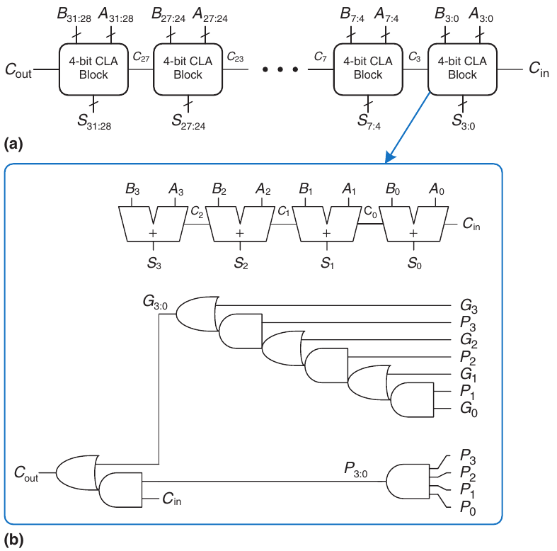

Hình 5.6 (a) Adder carry-lookahead 32-bit (CLA), (b) khối CLA 4-bit

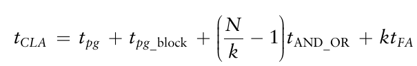 (5.6)

trong đó t<sub>pg</sub> là độ trễ các column propagate và generate gate (một AND hoặc OR gate) tạo P<sub>i</sub>, G<sub>i</sub>; t<sub>pg\_block</sub> là độ trễ tìm block propagate và generate signal P<sub>i:j</sub>, G<sub>i:j</sub> cho khối k-bit; t<sub>AND\_OR</sub> là độ trễ từ C<sub>in</sub> đến C<sub>out</sub> qua AND/OR logic cuối của khối CLA k-bit. Với N \> 16, adder carry-lookahead thường nhanh hơn nhiều adder ripple-carry. Tuy nhiên, độ trễ vẫn tăng tuyến tính theo N.

#### Ví dụ 5.1 ĐỘ TRỄ ADDER RIPPLE-CARRY VÀ CARRY-LOOKAHEAD

ADDER

So sánh độ trễ adder ripple-carry 32-bit và adder carry-lookahead 32-bit có khối 4-bit. Giả sử độ trễ mỗi gate two-input là 100 ps và độ trễ full adder là 300 ps.

Lời giải Theo Phương trình 5.1, propagation delay của adder ripple- carry 32-bit là 32 × 300 ps = 9.6 ns.

CLA có t<sub>pg</sub> = 100 ps, t<sub>pg\_block</sub> = 6 × 100 ps = 600 ps và t<sub>AND\_OR</sub> = 2 × 100 ps = 200 ps. Theo Phương trình 5.6, propagation delay của adder carry-lookahead 32-bit có khối 4-bit vì vậy là 100 ps + 600 ps + (32/4 − 1) × 200 ps + (4 × 300 ps) = 3.3 ns, nhanh gần ba lần adder ripple-carry.

Prefix Adder\*

Prefix adder mở rộng generate và propagate logic của adder carry- lookahead để cộng nhanh hơn nữa. Đầu tiên chúng tính G, P cho cặp cột, rồi khối 4, khối 8, rồi 16, v.v. cho đến khi biết generate signal của mọi cột. Sum được tính từ các generate signal này.

Nói cách khác, chiến lược prefix adder là tính carry in C<sub>i−1</sub> cho từng cột i nhanh nhất có thể, rồi tính sum bằng

S<sub>i</sub> = (A<sub>i</sub> ⊕ B<sub>i</sub>) ⊕ C<sub>i−1</sub> (5.7)

Định nghĩa cột i = −1 để chứa C<sub>in</sub>, nên G<sub>−1</sub> = C<sub>in</sub> và P<sub>−1</sub> = 0. Khi đó C<sub>i−1</sub> = G<sub>i−1:−1</sub> vì có carry out cột i − 1 nếu khối trải cột i − 1 đến −1 generate carry. Carry hoặc được generate trong cột i − 1, hoặc generate ở cột trước và propagate tới. Vì thế viết lại Phương trình 5.7 thành

S<sub>i</sub> = (A<sub>i</sub> ⊕ B<sub>i</sub>) ⊕ G<sub>i−1:−1</sub> (5.8)

> Máy tính ban đầu dùng adder ripple-carry vì linh kiện đắt và adder ripple-carry dùng ít hardware nhất. Hầu như mọi PC hiện đại dùng prefix adder trên critical path vì transistor hiện rẻ và tốc độ rất quan trọng.

Do đó, thách thức chính là nhanh chóng tính mọi block generate signal G<sub>−1:−1</sub>, G<sub>0:−1</sub>, G<sub>1:−1</sub>, G<sub>2:−1</sub>,…, G<sub>N−2:−1</sub>. Các signal này cùng P<sub>−1:−1,</sub>P<sub>0:−1</sub>, P<sub>1:−1</sub>, P<sub>2:−1</sub>,…, P<sub>N−2:−1</sub> được gọi là prefix.

Hình 5.7 trình bày prefix adder N = 16-bit. Adder bắt đầu bằng precomputation tạo P<sub>i</sub>, G<sub>i</sub> cho từng cột từ A<sub>i</sub>, B<sub>i</sub> bằng AND và OR gate. Sau đó dùng log<sub>2</sub>N = 4 tầng black cell để tạo prefix G<sub>i:j</sub>, P<sub>i:j</sub>. Black cell lấy input từ phần trên khối trải bit i:k và phần dưới trải bit k − 1:j. Nó kết hợp hai phần để tạo generate và propagate signal cho cả khối trải bit i:j bằng phương trình

G<sub>i:j</sub> = G<sub>i:k</sub> + P<sub>i:k</sub>G<sub>k−1:j</sub> (5.9)

P<sub>i:j</sub> = P<sub>i:k</sub> P<sub>k−1:j</sub> (5.10)

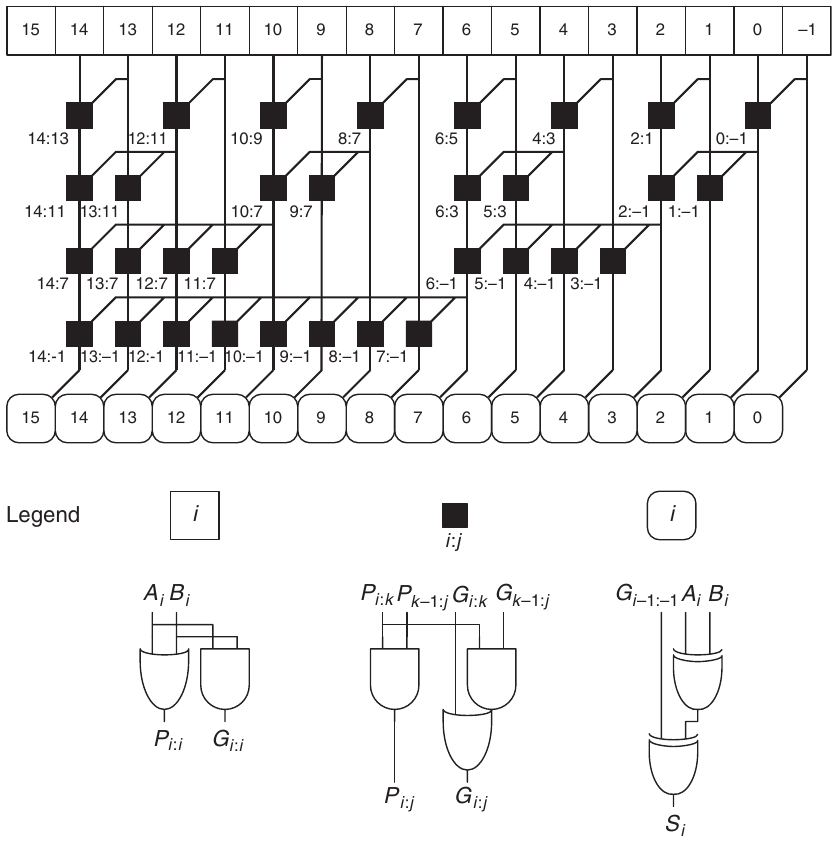

Hình 5.7 Prefix adder 16-bit

Nói cách khác, khối trải bit i:j generate carry nếu phần trên (i:k) generate carry hoặc phần trên propagate carry được generate ở phần dưới (k − 1:j). Khối propagate carry nếu cả phần trên lẫn dưới propagate carry. Cuối cùng, prefix adder tính sum bằng Phương trình 5.8.

Tóm lại, prefix adder đạt độ trễ tăng logarithm thay vì tuyến tính theo số cột adder. Sự tăng tốc đáng kể, nhất là với adder từ 32 bit trở lên, nhưng phải dùng nhiều hardware hơn adder carry- lookahead đơn giản. Mạng black cell gọi là prefix tree.

Nguyên lý chung dùng prefix tree để tính toán trong thời gian tăng logarithm theo số input là kỹ thuật mạnh. Khéo léo một chút, có thể áp dụng cho nhiều loại circuit khác (ví dụ Bài tập 5.7).

Critical path của prefix adder N-bit gồm precomputation P<sub>i</sub>, G<sub>i</sub>, sau đó log<sub>2</sub>N stage black prefix cell để thu mọi prefix. G<sub>i-1:−1</sub> sau đó qua XOR gate cuối phía dưới để tính S<sub>i</sub>. Về toán học, độ trễ prefix adder N-bit là

> Chú ý độ trễ hộp cuối (sum) của prefix adder là một độ trễ XOR (không phải hai) vì phép tính A<sub>i</sub> ⊕ B<sub>i</sub> đã thực hiện trước đó do A<sub>i</sub>, B<sub>i</sub> đã sẵn có.

t<sub>PA</sub> = t<sub>pg</sub> + log<sub>2</sub>N(t<sub>pg\_prefix</sub>) + t<sub>XOR</sub> (5.11)

trong đó t<sub>pg\_prefix</sub> là độ trễ black prefix cell.

#### Ví dụ 5.2 ĐỘ TRỄ PREFIX ADDER

Tính độ trễ prefix adder 32-bit. Giả sử độ trễ mỗi gate two-input là 100 ps.

Lời giải Propagation delay của mỗi black prefix cell t<sub>pg\_prefix</sub> là 200 ps (tức hai độ trễ gate). Do đó, dùng Phương trình 5.11, propagation delay prefix adder 32-bit là 100 ps + log<sub>2</sub>(32) × 200 ps + 100 ps = 1.2 ns, nhanh khoảng ba lần adder carry-lookahead và tám lần adder ripple-carry ở Ví dụ 5.1. Thực tế lợi ích không lớn đến vậy, nhưng prefix adder vẫn nhanh hơn đáng kể các phương án khác.

Kết hợp tất cả

Mục này giới thiệu half adder, full adder và ba loại carry propagate adder: ripple-carry, carry-lookahead và prefix adder. Adder nhanh hơn cần nhiều hardware hơn nên đắt hơn và power-hungry hơn. Phải cân nhắc trade-offs này khi chọn adder phù hợp cho thiết kế.

Hardware description language cung cấp phép + để chỉ CPA. Công cụ synthesis hiện đại chọn giữa nhiều cách triển khai, chọn thiết kế rẻ nhất (nhỏ nhất) thỏa tốc độ. Điều này đơn giản hóa nhiều công việc người thiết kế. Ví dụ HDL 5.1 mô tả CPA có carry in và carry out, Hình 5.8 trình bày hardware kết quả.

### 5.2.2 Phép trừ

Nhớ từ Mục 1.4.6 rằng adder có thể cộng số dương và âm bằng biểu diễn số two’s complement. Phép trừ gần như dễ tương tự: đảo dấu số thứ hai rồi cộng. Đảo dấu số two’s complement bằng cách đảo bit và cộng 1.

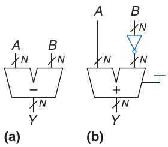

Hình 5.9 Subtractor: (a) ký hiệu, (b) cách triển khai

Để tính Y = A − B, trước hết tạo two’s complement của B: đảo bit B thu $\overline{B}$ và cộng 1 để được −B = $\overline{B}$ + 1. Cộng lượng này với A để được Y = A + $\overline{B}$ + 1 = A − B. Có thể thực hiện tổng bằng một CPA duy nhất, cộng A + $\overline{B}$ với C<sub>in</sub> = 1. Hình 5.9 trình bày ký hiệu subtractor và hardware bên dưới để thực hiện Y = A − B. Ví dụ HDL 5.2 mô tả subtractor, Hình 5.10 trình bày hardware kết quả.

#### Ví dụ HDL 5.1 CARRY PROPAGATE ADDER (CPA)

SystemVerilog

```
module adder #(parameter N = 8)
              (input  logic [N–1:0] a, b,
               input  logic         cin,
               output logic [N–1:0] s,
               output logic         cout);

  assign {cout, s} = a + b + cin;
endmodule
```

VHDL

```
library IEEE; use IEEE.STD_LOGIC_1164.ALL;
use IEEE.NUMERIC_STD_UNSIGNED.ALL;

entity adder is
   generic(N: integer := 8);
   port(a, b: in  STD_LOGIC_VECTOR(N–1 downto 0);
        cin:  in  STD_LOGIC;
        s:    out STD_LOGIC_VECTOR(N–1 downto 0);
        cout: out STD_LOGIC);
end;

architecture synth of adder is
   signal result: STD_LOGIC_VECTOR(N downto 0);
begin
   result <= (“0” & a) + (“0” & b) + cin;
   s      <= result(N–1 downto 0);
   cout   <= result(N);
end;
```

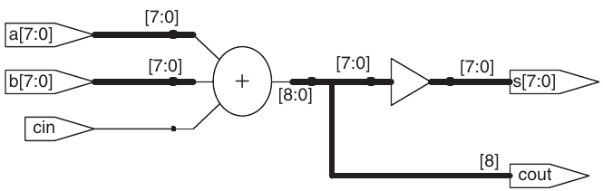

Hình 5.8 Adder sau synthesis

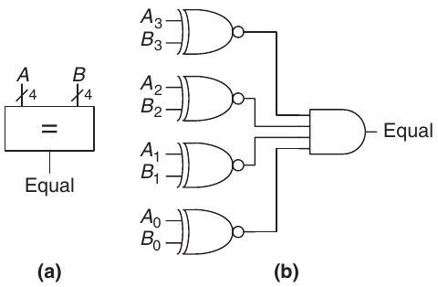

Hình 5.11 Equality comparator 4-bit: (a) ký hiệu, (b) cách triển khai

### 5.2.3 Comparators

Comparator xác định hai số nhị phân có bằng nhau hay số này lớn hơn hoặc nhỏ hơn số kia. Comparator nhận hai số nhị phân N-bit A và B, xuất kết quả so sánh 1-bit.

Equality comparator tạo một output cho biết A có bằng B (A == B) hay không. Magnitude comparator tạo một hoặc nhiều output cho biết giá trị tương đối của A và B.

Equality comparator là phần hardware đơn giản hơn. Hình 5.11 trình bày ký hiệu và cách triển khai equality comparator 4-bit. Trước hết, nó dùng XNOR gate kiểm tra các bit tương ứng trong từng cột A và B có bằng nhau không. Hai số bằng nhau nếu mọi cột đều bằng nhau.

#### Ví dụ HDL 5.2 SUBTRACTOR

SystemVerilog

```
module subtractor #(parameter N = 8)
                   (input  logic [N–1:0] a, b,
                    output logic [N–1:0] y);

  assign y = a – b;
endmodule
```

VHDL

```
library IEEE; use IEEE.STD_LOGIC_1164.ALL;
use IEEE.NUMERIC_STD_UNSIGNED.ALL;

entity subtractor is
  generic(N: integer := 8);
  port(a, b: in   STD_LOGIC_VECTOR(N–1 downto 0);
       y:    out STD_LOGIC_VECTOR(N–1 downto 0));
end;

architecture synth of subtractor is
begin
  y <= a – b;
end;
```

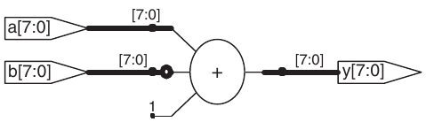

Hình 5.10 Subtractor sau synthesis

So sánh độ lớn số signed thường thực hiện bằng tính A − B và xem dấu (bit trọng số cao nhất) của kết quả, như Hình 5.12. Nếu kết quả âm (tức sign bit là 1), A nhỏ hơn B. Nếu không, A lớn hơn hoặc bằng B. Tuy nhiên, comparator này hoạt động sai khi overflow. Bài tập 5.9 và 5.10 khảo sát hạn chế này và cách khắc phục. Ví dụ HDL 5.3 trình bày cách dùng các phép so sánh cho số unsigned, Hình 5.13 trình bày hardware kết quả.

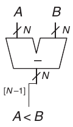

Hình 5.12 Signed comparator N-bit

#### Ví dụ HDL 5.3 COMPARATOR

SystemVerilog

```
module comparators #(parameter N = 8)
                    (input  logic [N–1:0] a, b,
                     output logic eq, neq, lt, lte, gt, gte);

  assign eq  = (a == b);
  assign neq = (a != b);
  assign lt  = (a < b);
  assign lte = (a <= b);
  assign gt  = (a > b);
  assign gte = (a >= b);
endmodule
```

VHDL

```
library IEEE; use IEEE.STD_LOGIC_1164.ALL;
entity comparators is
  generic(N: integer := 8);
  port(a, b: in STD_LOGIC_VECTOR(N–1 downto 0);
       eq, neq, lt, lte, gt, gte: out STD_LOGIC);
end;
architecture synth of comparators is
begin
  eq  <= ‘1’ when (a = b)  else ‘0’;
  neq <= ‘1’ when (a /= b) else ‘0’;
  lt  <= ‘1’ when (a < b)  else ‘0’;
  lte <= ‘1’ when (a <= b) else ‘0’;
  gt  <= ‘1’ when (a > b)  else ‘0’;
  gte <= ‘1’ when (a >= b) else ‘0’;
end;
```

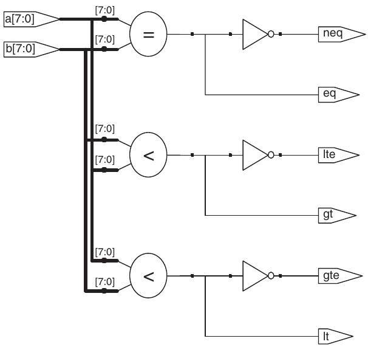

Hình 5.13 Comparator sau synthesis

Bảng 5.1 Các phép toán ALU

| ALUControl<sub>1:0</sub> | Chức năng |
|---|---|
| 00 | Cộng |
| 01 | Trừ |
| 10 | AND |
| 11 | OR |

### 5.2.4 ALU

Arithmetic/Logical Unit (ALU) kết hợp nhiều phép toán toán học và logic trong một unit. Ví dụ, ALU điển hình có thể thực hiện cộng, trừ, AND và OR. ALU là trái tim của phần lớn hệ thống máy tính.

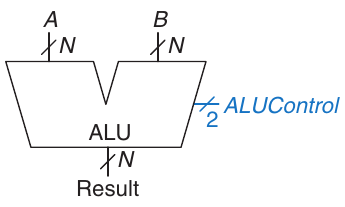

Hình 5.14 Ký hiệu ALU

Hình 5.14 trình bày ký hiệu ALU N-bit có input và output N-bit. ALU nhận control signal 2-bit ALUControl chỉ định chức năng cần thực hiện. Control signal thường được vẽ màu xanh để phân biệt với data. Bảng 5.1 liệt kê các chức năng điển hình ALU có thể thực hiện.

Hình 5.15 trình bày cách triển khai ALU. ALU chứa adder N-bit và N AND gate cùng OR gate 2-input. Nó còn có inverter và multiplexer để đảo input B khi ALUControl<sub>0</sub> được assert. Multiplexer 4:1 chọn chức năng mong muốn dựa trên ALUControl.

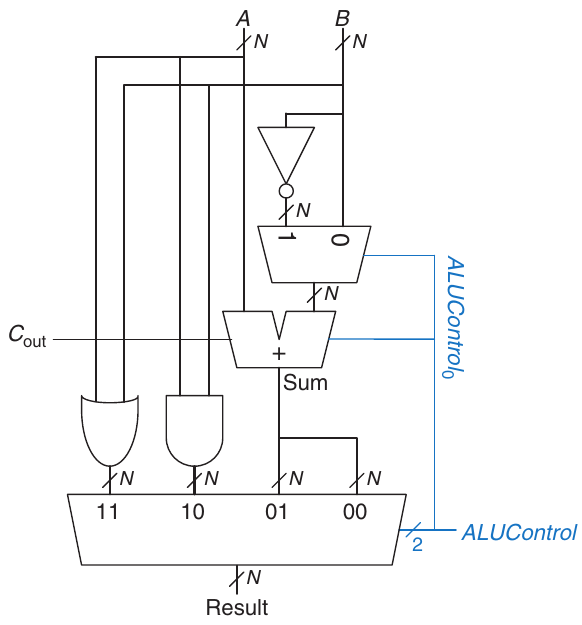

Hình 5.15 ALU N-bit

Cụ thể hơn, nếu ALUControl = 00, output multiplexer chọn A + B. Nếu ALUControl = 01, ALU tính A − B. (Nhớ từ Mục 5.2.2 rằng $\overline{B}$ + 1 = −B trong số học two’s complement. Vì ALUControl<sub>0</sub> là 1, adder nhận input A và $\overline{B}$ cùng carry in được assert, khiến nó thực hiện phép trừ: A + $\overline{B}$ + 1 = A − B.) Nếu ALUControl = 10, ALU tính A AND B. Nếu ALUControl = 11, ALU thực hiện A OR B.

Một số ALU tạo output bổ sung gọi là flag, cho biết thông tin về output ALU. Hình 5.16 trình bày ký hiệu ALU có output Flags 4-bit. Như schematic ALU này ở Hình 5.17, output Flags gồm flag N, Z, C và V, lần lượt cho biết output ALU Result âm hoặc bằng không, hoặc adder tạo carry out hay overflow. Nhớ bit trọng số cao nhất của số two’s complement là 1 nếu âm, ngược lại là 0. Vì vậy flag N (Negative) nối với bit trọng số cao nhất của output ALU, Result<sub>31</sub>. Flag Z (Zero) được assert khi mọi bit Result là 0, được NOR gate N-bit trong Hình 5.17 phát hiện. Flag C (Carry out) được assert khi adder tạo carry out và ALU đang cộng hoặc trừ (biểu thị bằng ALUControl<sub>1</sub> = 0).

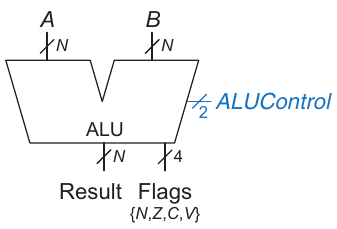

Hình 5.16 Ký hiệu ALU có output flag

Phát hiện overflow như phía trái Hình 5.17 phức tạp hơn. Nhớ từ Mục 1.4.6 rằng overflow xảy ra khi cộng hai số cùng dấu cho kết quả trái dấu. Vì vậy V (oVerflow) được assert khi cả ba điều kiện sau đúng: (1) ALU đang cộng hoặc trừ (ALUControl<sub>1</sub> = 0), (2) A và Sum trái dấu, được XOR gate phát hiện, và (3) overflow có thể xảy ra. Nghĩa là, như XNOR gate phát hiện, hoặc A và B cùng dấu và adder đang cộng (ALUControl<sub>0</sub> = 0), hoặc A và B trái dấu và adder đang trừ (ALUControl<sub>0</sub> = 1). AND gate 3-input phát hiện cả ba điều kiện đúng và assert V.

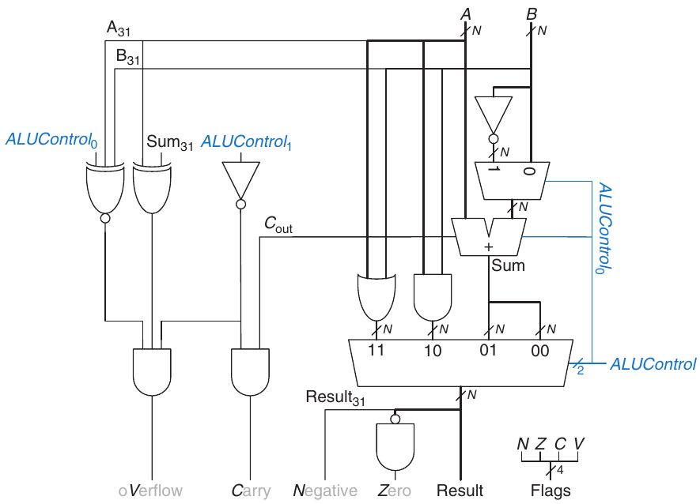

Hình 5.17 ALU N-bit có output flag

Bảng 5.2 So sánh signed và unsigned

| So sánh | Signed | Unsigned |
|---|---|---|
| = | Z | Z |
| ≠ | $\overline{Z}$ | $\overline{Z}$ |
| \< | N⊕V | $\overline{C}$ |
| ≤ | Z + (N⊕V) | Z + $\overline{C}$ |
| \> | $\overline{Z}$ • ($\overline{N{\oplus}V}$) | $\overline{Z}$ • C |
| ≥ | ($\overline{N{\oplus}V}$) | C |

Flag ALU cũng có thể dùng để so sánh, như Bảng 5.2. Để so sánh input A và B, ALU tính A − B rồi xem flag. Nếu Z được assert, kết quả là 0 nên A = B. Nếu không, A không bằng B.

So sánh độ lớn rắc rối hơn và phụ thuộc số signed hay unsigned. Ví dụ, để xác định A \< B, tính A − B và kiểm tra kết quả âm hay không. Nếu số unsigned, kết quả âm nếu không có carry out.[^1] Nếu số signed, không thể dựa vào carry vì số âm nhỏ biểu diễn giống số unsigned dương lớn. Thay vào đó, chỉ tính A − B và xem kết quả âm hay không qua flag N. Tuy nhiên, nếu overflow, flag N sai. Vì vậy A nhỏ hơn B nếu N ⊕ V (nói cách khác, kết quả âm và không overflow, hoặc kết quả dương nhưng đã overflow). Tóm lại, định nghĩa L (signal Less than) đúng nếu A \< B. Với số unsigned, L = $\overline{C}$. Với số signed, L = N ⊕ V. Các kiểm tra còn lại dễ hơn. Nhỏ hơn hoặc bằng (≤) là L OR Z vì L chỉ nhỏ hơn và Z chỉ bằng. Lớn hơn hoặc bằng (≥) là đối của nhỏ hơn: $\overline{L}$. Lớn hơn (\>) được biểu thị bằng lớn hơn hoặc bằng nhưng không bằng: $\overline{L}$ AND $\overline{Z}$.

#### Ví dụ 5.3 SO SÁNH

Xét số 4-bit A = 1111 và B = 0010. Xác định A \< B hay không, trước hết hiểu là số unsigned (15 và 2), rồi là số signed (−1 và 2).

Lời giải Tính A – B = A + $\overline{B}$ + 1 = 1111 + 1101 + 1 = 11101. Carry out C là 1, như màu xanh. Flag N là 1, như chữ nghiêng. Flag V là 0 vì kết quả cùng sign bit với A. Flag Z là 0 vì kết quả không phải 0000.

Với so sánh unsigned, L = \~C = 0 vì 15 không nhỏ hơn 2. Với so sánh signed, L = N ⊕ V = 1 vì −1 nhỏ hơn 2.

Một số ALU còn triển khai instruction gọi là set if less than (SLT). Khi A \< B, Result = 1. Nếu không, Result = 0. Điều này tiện cho máy tính không truy cập được flag ALU vì về cơ bản nó lưu thông tin flag trong kết quả. SLT thường coi input là signed. Biến thể khác SLTU coi input là unsigned. Có nhiều biến thể ALU cơ bản này hỗ trợ chức năng khác như NOT, XOR hoặc XNOR. HDL cho ALU N-bit, gồm phiên bản hỗ trợ SLT và output flag, được dành cho Bài tập 5.11 đến 5.14.

#### Ví dụ 5.4 MỞ RỘNG ALU XỬ LÝ SLT

Mở rộng ALU để xử lý phép set if less than (SLT).

Lời giải Để thêm chức năng ALU, phải mở rộng multiplexer thành năm input. Xác định A nhỏ hơn B bằng tính A − B; nếu kết quả âm, A nhỏ hơn B. Bảng 5.3 trình bày signal ALUControl cập nhật để xử lý SLT, Hình 5.18(a) trình bày circuit mở rộng với thay đổi tô xanh (cho control signal) và đen. Dùng ALUControl = 101 cho SLT và tận dụng việc ALUControl<sub>0</sub> = 1 khiến adder tính A − B. Khi Sum<sub>N–1</sub> = 1, kết quả A − B âm và A nhỏ hơn B. Vì vậy zero-extend Sum<sub>N–1</sub> rồi đưa vào input 101 của multiplexer để hoàn thành SLT. Tuy nhiên, cách triển khai này chưa xét overflow. Khi overflow, Sum có dấu sai. Do đó XOR sign bit của Sum với overflow signal V để chỉ Sum âm chính xác, như Hình 5.18(b).

Bảng 5.3 Phép toán ALU mở rộng cho SLT

| ALUControl<sub>2:0</sub> | Chức năng |
|---|---|
| 000 | Cộng |
| 001 | Trừ |
| 010 | AND |
| 011 | OR |
| 101 | SLT |

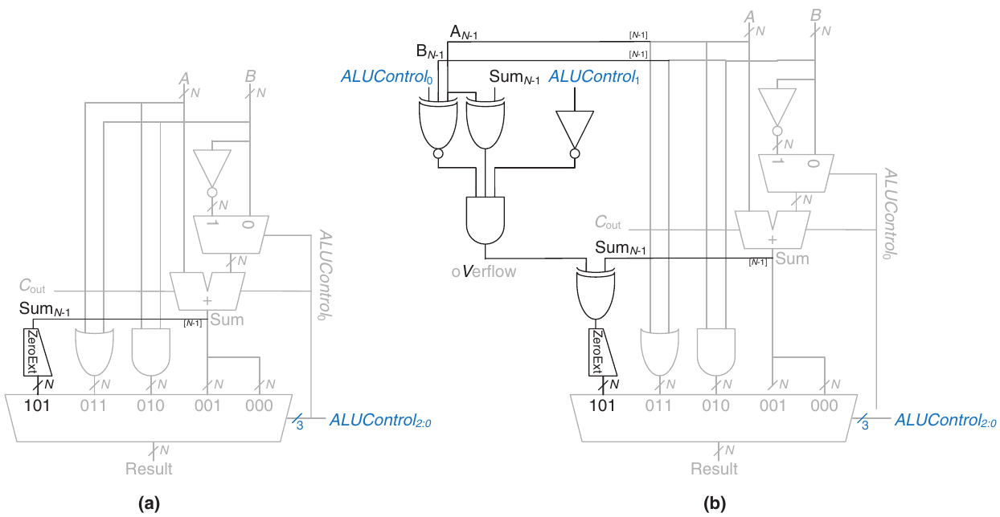

Hình 5.18 ALU mở rộng hỗ trợ SLT (a) chưa xét overflow, (b) có xét overflow

### 5.2.5 Shifter và Rotator

Shifter và rotator di chuyển bit và nhân hoặc chia cho lũy thừa 2. Như tên gọi, shifter dịch số nhị phân sang trái hoặc phải một số vị trí chỉ định. Có một số loại shifter thường dùng:

- Logical shifter—dịch số sang trái hoặc phải và điền 0 vào chỗ trống.

Ví dụ: 11001 \>\> 2 = 00110; 11001 \<\< 2 = 00100

- Arithmetic shifter—giống logical shifter nhưng khi dịch phải, điền các bit trọng số cao nhất bằng bản sao bit trọng số cao nhất (msb) cũ. Hữu ích khi nhân chia số signed (xem Mục 5.2.6 và 5.2.7). Arithmetic shift left giống logical shift left.

Ví dụ: 11001 \>\>\> 2 = 11110; 11001 \<\< 2 = 00100. Các toán

tử \<\<, \>\> và \>\>\> thường lần lượt chỉ shift left, logical shift right

và arithmetic shift right.

- Rotator—xoay số theo vòng, sao cho chỗ trống được điền bằng các bit đã dịch ra ở đầu kia.

Ví dụ: 11001 ROR 2 = 01110; 11001 ROL 2 = 00111. ROR = rotate

right; ROL = rotate left.

Shifter N-bit có thể xây từ N multiplexer N:1. Input được dịch 0 đến N−1 bit tùy giá trị các select line log<sub>2</sub>N-bit. Hình 5.19 trình bày ký hiệu và hardware của shifter 4-bit. Tùy giá trị shift amount 2-bit shamt<sub>1:0</sub>, output Y nhận input A dịch 0 đến 3 bit. Với mọi shifter, khi shamt<sub>1:0</sub> = 00, Y = A. Bài tập 5.22 đề cập thiết kế rotator.

Dịch trái là trường hợp đặc biệt của phép nhân. Dịch trái N bit nhân số với 2<sup>N</sup>. Ví dụ 000011<sub>2</sub> \<\< 4 = 110000<sub>2</sub> tương đương 3<sub>10</sub> × 2<sup>4</sup> = 48<sub>10</sub>.

Arithmetic right shift là trường hợp đặc biệt của phép chia. Arithmetic right shift N bit chia số cho 2<sup>N</sup>. Ví dụ 11100<sub>2</sub> \>\>\> 2 = 11111<sub>2</sub> tương đương −4<sub>10</sub>/2<sup>2</sup> = −1<sub>10</sub>.

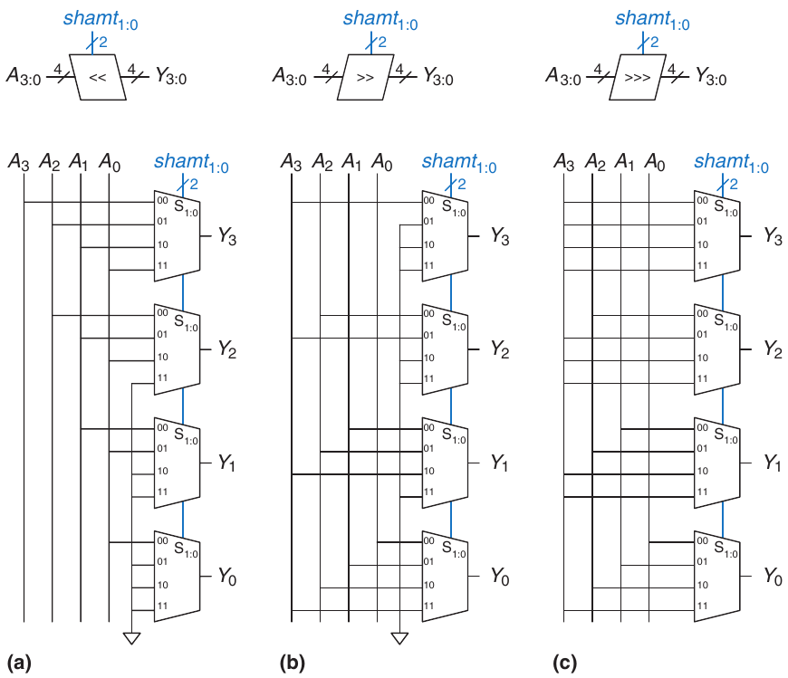

Hình 5.19 Shifter 4-bit: (a) shift left, (b) logical shift right, (c) arithmetic shift right

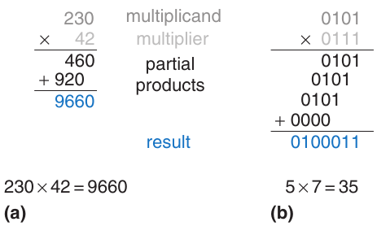

Hình 5.20 Phép nhân: (a) thập phân, (b) nhị phân

### 5.2.6 Phép nhân\*

Nhân số nhị phân unsigned tương tự nhân thập phân nhưng chỉ gồm 1 và 0. Hình 5.20 so sánh nhân thập phân và nhị phân. Cả hai trường hợp, partial product được tạo bằng nhân một chữ số của multiplier với toàn bộ multiplicand. Các partial product đã dịch được cộng để tạo kết quả.

Nhìn chung, multiplier N × N nhân hai số N-bit và tạo kết quả 2N-bit. Partial product trong nhân nhị phân là multiplicand hoặc toàn 0. Nhân số nhị phân 1-bit tương đương phép AND nên dùng AND gate tạo partial product.

Nhân signed và unsigned khác nhau. Ví dụ xét 0xFE × 0xFD. Nếu các số 8-bit hiểu là số nguyên signed, chúng biểu diễn −2 và −3 nên product 16-bit là 0x0006. Nếu hiểu là số nguyên unsigned, product 16-bit là 0xFB06. Chú ý cả hai trường hợp byte trọng số thấp nhất là 0x06.

Hình 5.21 trình bày ký hiệu, chức năng và cách triển khai unsigned multiplier 4 × 4. Unsigned multiplier nhận multiplicand và multiplier A, B rồi tạo product P. Hình 5.21(b) trình bày cách tạo partial product. Mỗi partial product là một multiplier bit (B<sub>3</sub>, B<sub>2</sub>, B<sub>1</sub> hoặc B<sub>0</sub>) AND các multiplicand bit (A<sub>3</sub>, A<sub>2</sub>, A<sub>1</sub>, A<sub>0</sub>). Với operand N-bit, có N partial product và N − 1 stage adder 1-bit. Ví dụ với multiplier 4 × 4, partial product hàng đầu là B<sub>0</sub> AND (A<sub>3</sub>, A<sub>2</sub>, A<sub>1</sub>, A<sub>0</sub>). Nó được cộng vào partial product thứ hai đã dịch B<sub>1</sub> AND (A<sub>3</sub>, A<sub>2</sub>, A<sub>1</sub>, A<sub>0</sub>). Các hàng AND gate và adder tiếp theo tạo và cộng các partial product còn lại.

HDL cho multiplier signed và unsigned ở Ví dụ HDL 4.33. Giống adder, có nhiều thiết kế multiplier với trade-offs tốc độ/chi phí khác nhau. Công cụ synthesis có thể chọn thiết kế thích hợp nhất theo timing constraint.

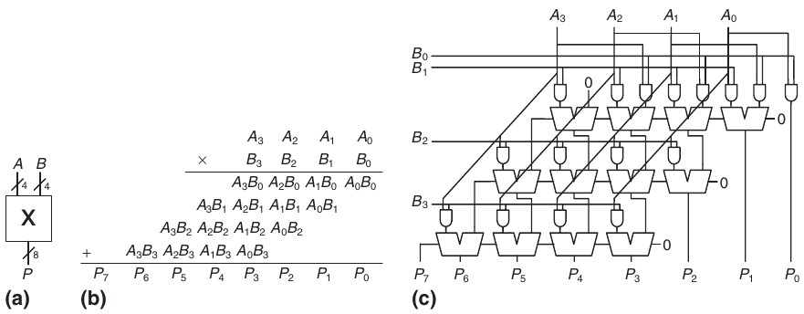

Hình 5.21 Multiplier 4 × 4: (a) ký hiệu, (b) chức năng, (c) cách triển khai

Phép multiply accumulate nhân hai số rồi cộng kết quả vào số thứ ba—thường là giá trị tích lũy. Những phép này còn gọi MAC, thường dùng trong thuật toán digital signal processing (DSP) như Fourier transform cần tổng các product.

### 5.2.7 Phép chia\*

Chia nhị phân có thể thực hiện bằng thuật toán sau cho số unsigned N-bit trong khoảng \[0, 2<sup>N</sup> − 1\]:

<pre>
R′ = 0
for i = N−1 to 0
   R = {R′ &lt;&lt; 1, A<sub>i</sub>}
   D = R − B
   if D &lt; 0 then Q<sub>i</sub> = 0,  R′ = R   // R &lt; B
   else        Q<sub>i</sub> = 1,  R′ = D     // R ≥ B
R = R′
</pre>

Partial remainder R được khởi tạo 0 (R′ = 0), và bit trọng số cao nhất của dividend A trở thành bit trọng số thấp nhất của R (R = {R′ \<\< 1, Ai}). Divisor B được trừ khỏi partial remainder để xác định có trừ được không (D = R − B). Nếu hiệu D âm (tức sign bit D là 1), quotient bit Q<sub>i</sub> là 0 và hiệu bị bỏ. Ngược lại, Q<sub>i</sub> là 1 và partial remainder cập nhật bằng hiệu. Dù trường hợp nào, partial remainder sau đó được nhân đôi (left-shifted một cột), bit trọng số cao tiếp theo của A trở thành bit trọng số thấp nhất của R, và quá trình lặp lại. Kết quả thỏa

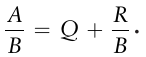

Hình 5.22 trình bày schematic array divider 4-bit. Divider tính A/B, tạo quotient Q và remainder R. Chú giải trình bày ký hiệu và schematic từng khối trong array divider. Mỗi hàng thực hiện một vòng lặp thuật toán chia. Cụ thể, mỗi hàng tính hiệu D = R − B. (Nhớ R + $\overline{B}$ + 1 = R − B). Multiplexer select signal N (Negative) nhận 1 khi hiệu D của hàng âm. Vì vậy N được drive bởi bit trọng số cao nhất của D, là 1 khi hiệu âm. Mỗi quotient bit (Q<sub>i</sub>) là 0 khi D âm, ngược lại 1. Multiplexer truyền R đến hàng tiếp nếu hiệu âm, nếu không truyền D. Hàng tiếp dịch partial remainder mới sang trái một bit, nối thêm bit trọng số cao tiếp theo của A rồi lặp quá trình.

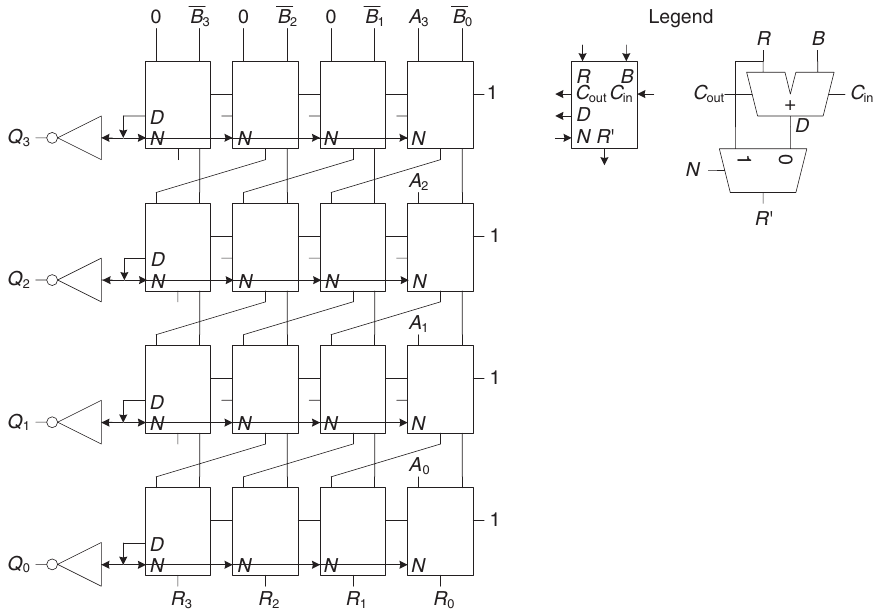

Hình 5.22 Array divider

Độ trễ array divider N-bit tăng tỷ lệ N<sup>2</sup> vì carry phải lan qua mọi N stage trong hàng trước khi xác định dấu và multiplexer chọn R hoặc D. Điều này lặp cho mọi N hàng. Phép chia chậm và đắt trong hardware; vì vậy nên dùng ít nhất có thể.

### 5.2.8 Đọc thêm

Số học máy tính có thể là chủ đề cả giáo trình. Digital Arithmetic của Ercegovac và Lang là tổng quan xuất sắc toàn lĩnh vực. CMOS VLSI Design của Weste và Harris trình bày thiết kế circuit high- performance cho phép toán số học.

## 5.3 HỆ THỐNG SỐ

Máy tính làm việc với cả số nguyên và phân số. Đến đây chúng ta mới xét biểu diễn số nguyên signed hoặc unsigned, giới thiệu ở Mục 1.4. Mục này giới thiệu hệ thống số fixed- và floating-point có thể biểu diễn số hữu tỷ. Số Fixed-point tương tự số thập phân; một số bit biểu diễn phần nguyên, còn lại biểu diễn phần phân số. Số Floating-point tương tự ký pháp khoa học, có mantissa và exponent.

### 5.3.1 Hệ thống số Fixed-Point

Ký pháp Fixed-point có binary point ngầm định giữa integer bit và fraction bit, tương tự decimal point giữa chữ số nguyên và phân số của số thập phân thông thường. Ví dụ Hình 5.23(a) trình bày số fixed-point có bốn integer bit và bốn fraction bit. Hình 5.23(b) hiển thị binary point ngầm định màu xanh, Hình 5.23(c) cho giá trị thập phân tương đương.

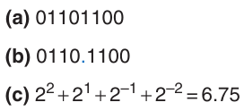

Hình 5.23 Ký pháp Fixed-point của 6.75 với bốn integer bit và bốn fraction bit

Số fixed-point signed có thể dùng ký pháp two’s complement hoặc sign/magnitude. Hình 5.24 trình bày biểu diễn fixed-point của −2.375 bằng cả hai ký pháp với bốn integer bit và bốn fraction bit. Binary point ngầm định tô xanh cho rõ. Trong dạng sign/magnitude, bit trọng số cao nhất dùng chỉ dấu. Biểu diễn two’s complement được tạo bằng đảo bit giá trị tuyệt đối rồi cộng 1 vào bit trọng số thấp nhất (ngoài cùng phải). Ở đây, vị trí bit trọng số thấp nhất nằm ở cột 2<sup>−4</sup>.

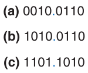

Hình 5.24 Biểu diễn Fixed-point của −2.375: (a) giá trị tuyệt đối, (b) sign và magnitude, (c) two’s complement

Giống mọi biểu diễn số nhị phân, số fixed-point chỉ là tập bit. Không có cách biết binary point tồn tại ngoài thỏa thuận giữa những người diễn giải số.

Nhìn chung, dùng Ua.b chỉ số fixed-point unsigned với a integer bit và b fraction bit. Qa.b chỉ số fixed point signed (two’s complement) với a integer bit (gồm sign bit) và b fractional bit.

#### Ví dụ 5.5 SỐ HỌC VỚI SỐ FIXED-POINT

Tính 0.75 + (−0.625) bằng số fixed-point Q4.4.

Lời giải Trước hết chuyển 0.625, độ lớn số thứ hai, sang ký pháp nhị phân fixed-point. 0.625 ≥ 2<sup>−1</sup> nên cột 2<sup>−1</sup> có 1, còn 0.625 − 0.5 = 0.125. Vì 0.125 \< 2<sup>−2</sup>, cột 2<sup>−2</sup> có 0. Vì 0.125 ≥ 2<sup>−3</sup>, cột 2<sup>−3</sup> có 1, còn 0.125 − 0.125 = 0. Do đó cột 2<sup>−4</sup> phải có 0. Kết hợp lại, 0.625<sub>10</sub> = 0000.1010<sub>2</sub>.

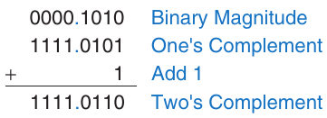

Hình 5.25 Chuyển đổi two’s complement Fixed-point

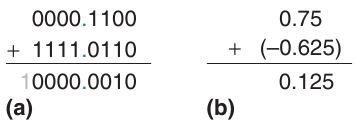

Hình 5.26 Phép cộng: (a) nhị phân fixed-point, (b) thập phân tương đương

> Hệ thống số Fixed-point thường dùng trong digital signal processing (DSP), đồ họa và machine learning vì tính toán nhanh hơn và tốn ít công suất hơn floating-point system. Q1.15 (còn gọi Q15) là định dạng phổ biến nhất, lưu số signed trong khoảng (−1, 1) với độ chính xác 15 bit. Q1.31 (còn gọi ngắn Q31) đôi khi dùng cho kết quả trung gian higher-precision như trong Fast Fourier Transform. U8.8 đôi khi dùng cho giá trị sensor được analog/digital converter (ADC) sample. Chú ý mọi định dạng này đóng gói vào word 16- hoặc 32-bit để lưu hiệu quả trong memory máy tính, vốn thường có độ rộng là lũy thừa 2.

Dùng biểu diễn two’s complement cho số signed để phép cộng hoạt động đúng. Hình 5.25 trình bày chuyển −0.625 sang ký pháp two’s complement fixed-point.

Hình 5.26 trình bày phép cộng nhị phân fixed-point và thập phân tương đương để so sánh. Chú ý số 1 đầu trong phép cộng nhị phân fixed-point của Hình 5.26(a) bị bỏ khỏi kết quả 8-bit.

### 5.3.2 Hệ thống số Floating-Point\*

Số Floating-point tương tự ký pháp khoa học. Chúng vượt hạn chế số lượng integer bit và fraction bit cố định, cho phép biểu diễn số rất lớn và rất nhỏ. Giống ký pháp khoa học, số floating-point có sign, mantissa (M), base (B) và exponent (E), như Hình 5.27. Ví dụ 4.1 × 10<sup>3</sup> là ký pháp khoa học thập phân của 4100, có mantissa 4.1, base 10 và exponent 3. Decimal point di chuyển đến vị trí ngay sau chữ số trọng số cao nhất. Số Floating-point có base 2 với mantissa nhị phân. Dùng 32 bit biểu diễn 1 sign bit, 8 exponent bit và 23 mantissa bit.

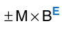

Hình 5.27 Số Floating-point

#### Ví dụ 5.6 SỐ FLOATING-POINT 32-BIT

Trình bày biểu diễn floating-point của số thập phân 228.

Lời giải Trước hết chuyển số thập phân sang nhị phân: 228<sub>10</sub> = 11100100<sub>2</sub> = 1.11001<sub>2</sub> × 2<sup>7</sup>. Hình 5.28 trình bày encoding 32-bit, sau sẽ sửa để hiệu quả hơn. Sign bit là dương (0), 8 exponent bit cho giá trị 7, 23 bit còn lại là mantissa. Trong floating-point nhị phân, bit đầu mantissa (bên trái binary point) luôn là 1 nên không cần lưu. Nó gọi là implicit leading one. Hình 5.29 trình bày biểu diễn floating-point sửa đổi của 228<sub>10</sub> = 11100100<sub>2</sub> × 2<sup>0</sup> = 1.11001<sub>2</sub> × 2<sup>7</sup>. Implicit leading one không nằm trong mantissa 23-bit để tăng hiệu quả. Chỉ fraction bit được lưu. Điều này giải phóng một bit cho data hữu ích.

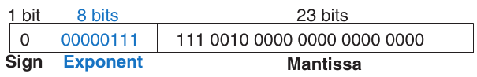

Hình 5.28 floating-point 32-bit phiên bản 1

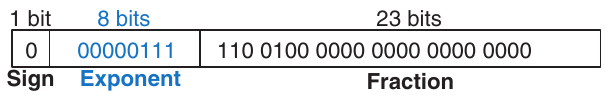

Hình 5.29 floating-point 32-bit phiên bản 2

> Như có thể thấy, có nhiều cách hợp lý biểu diễn số floating-point. Trong nhiều năm, nhà sản xuất máy tính dùng định dạng floating-point không tương thích. Kết quả máy tính này không thể diễn giải trực tiếp trên máy tính khác.
>
> Institute of Electrical and Electronics Engineers (IEEE) giải quyết bằng tạo IEEE 754 Floating-Point Standard năm 1985, định nghĩa số floating-point. Định dạng floating-point này hiện được dùng gần như phổ quát và được bàn trong mục này.

Chúng ta sửa exponent field lần cuối. Exponent cần biểu diễn cả exponent dương và âm. Để làm vậy, floating- point dùng biased exponent, là exponent gốc cộng bias hằng số. floating-point 32-bit dùng bias 127. Ví dụ với exponent 7, biased exponent là 7 + 127 = 134 = 10000110<sub>2</sub>. Với exponent −4, biased exponent là −4 + 127 = 123 = 01111011<sub>2</sub>. Hình 5.30 trình bày 1.11001<sub>2</sub> × 2<sup>7</sup> trong ký pháp floating-point với implicit leading one và biased exponent 134 (7 + 127). Ký pháp tuân chuẩn floating-point IEEE 754.

Trường hợp đặc biệt: 0, ±∞ và NaN

Chuẩn floating-point IEEE có các trường hợp đặc biệt biểu diễn số như zero, vô cực và kết quả illegal. Ví dụ, biểu diễn zero khó trong ký pháp floating-point vì implicit leading one. Code đặc biệt có exponent toàn 0 hoặc toàn l *(ghi chú: sách in chữ “l”; đúng là số 1: all 1’s)* được dành cho các trường hợp này. Bảng 5.4 trình bày biểu diễn floating-point của 0, ±∞ và NaN. Giống số sign/magnitude, floating-point có cả 0 dương và âm. NaN dùng cho số không tồn tại như √–1 hoặc log<sub>2</sub>(−5).

Định dạng Single-, Double- và Quad-Precision

Đến đây, đã xét số floating-point 32-bit. Định dạng còn gọi single-precision, single hoặc float. Chuẩn IEEE 754 còn định nghĩa số double-precision 64-bit (còn gọi double) và số quadruple-precision 128-bit (còn gọi quad), cho độ chính xác và khoảng biểu diễn lớn hơn. Bảng 5.5 trình bày số bit dùng cho từng field trong mỗi định dạng.

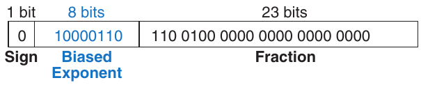

Hình 5.30 Ký pháp floating-point IEEE 754

Bảng 5.4 Ký pháp floating-point IEEE 754 cho 0, ±∞ và NaN

| Số | Sign | Exponent | Fraction |
|---|---|---|---|
| 0 | X | 00000000 | 00000000000000000000000 |
| ∞ | 0 | 11111111 | 00000000000000000000000 |
| −∞ | 1 | 11111111 | 00000000000000000000000 |
| NaN | X | 11111111 | Non-zero |

Bảng 5.5 Các định dạng Floating-point

| Định dạng | Tổng số bit | Sign bit | Exponent bit | Fraction bit | Bias |
|---|---|---|---|---|---|
| Single | 32 | 1 | 8 | 23 | 127 |
| Double | 64 | 1 | 11 | 52 | 1023 |
| Quad | 128 | 1 | 15 | 112 | 16363 *(ghi chú: sách in 16363; theo IEEE 754 bias là 2<sup>14</sup> − 1 = 16383)* |

> Floating-point không thể biểu diễn chính xác một số số như 1.7. Tuy nhiên, khi gõ 1.7 vào máy tính cầm tay, bạn thấy đúng 1.7 thay vì 1.69999.… Để xử lý, một số ứng dụng như máy tính cầm tay và phần mềm tài chính dùng số binary coded decimal (BCD) hoặc định dạng có exponent base 10. BCD encode mỗi chữ số thập phân bằng bốn bit trong khoảng 0 đến 9. Ví dụ, ký pháp fixed-point BCD của 1.7 với bốn integer bit và bốn fraction bit là 0001.0111. Dĩ nhiên không gì miễn phí. Giá phải trả là arithmetic hardware phức tạp hơn và encoding lãng phí (không dùng encoding A–F), do đó giảm hiệu năng. Vì vậy với ứng dụng compute-intensive, floating-point nhanh hơn nhiều.

Không tính các trường hợp đặc biệt đã nói, số single- precision thông thường trải khoảng ±1.175494 × 10<sup>−38</sup> đến ±3.402824 × 10<sup>38</sup>. Chúng có độ chính xác khoảng bảy chữ số thập phân có nghĩa (vì 2<sup>−24</sup> ≈ 10<sup>−7</sup>). Tương tự, số double-precision thông thường trải khoảng ±2.22507385850720 × 10<sup>−308</sup> đến ±1.79769313486232 × 10<sup>308</sup>, có độ chính xác khoảng 15 chữ số thập phân có nghĩa. Quad có độ chính xác 34 chữ số thập phân nhưng chưa được hỗ trợ rộng rãi trong hardware hay software.

Làm tròn

Kết quả số học vượt độ chính xác sẵn có phải làm tròn đến số lân cận. Các rounding mode là round down, round up, round toward zero và round to nearest. Mặc định là round to nearest. Trong mode round-to-nearest, nếu hai số gần bằng nhau, chọn số có 0 ở vị trí trọng số thấp nhất của fraction.

Nhớ số overflow khi độ lớn quá lớn để biểu diễn. Tương tự, số underflow khi quá nhỏ để biểu diễn. Trong mode round-to-nearest, overflow làm tròn lên ±∞ và underflow làm tròn xuống 0.

Phép cộng Floating-Point

Cộng số floating-point không đơn giản như cộng số two’s complement. Các bước cộng số floating-point cùng dấu như sau:

1\. Trích exponent bit và fraction bit.

2\. Thêm 1 vào đầu để tạo mantissa.

3\. So sánh exponent.

4\. Dịch mantissa nhỏ hơn nếu cần.

5\. Cộng các mantissa.

6\. Chuẩn hóa mantissa và điều chỉnh exponent nếu cần.

7\. Làm tròn kết quả.

8\. Ghép exponent và fraction trở lại thành số floating-point.

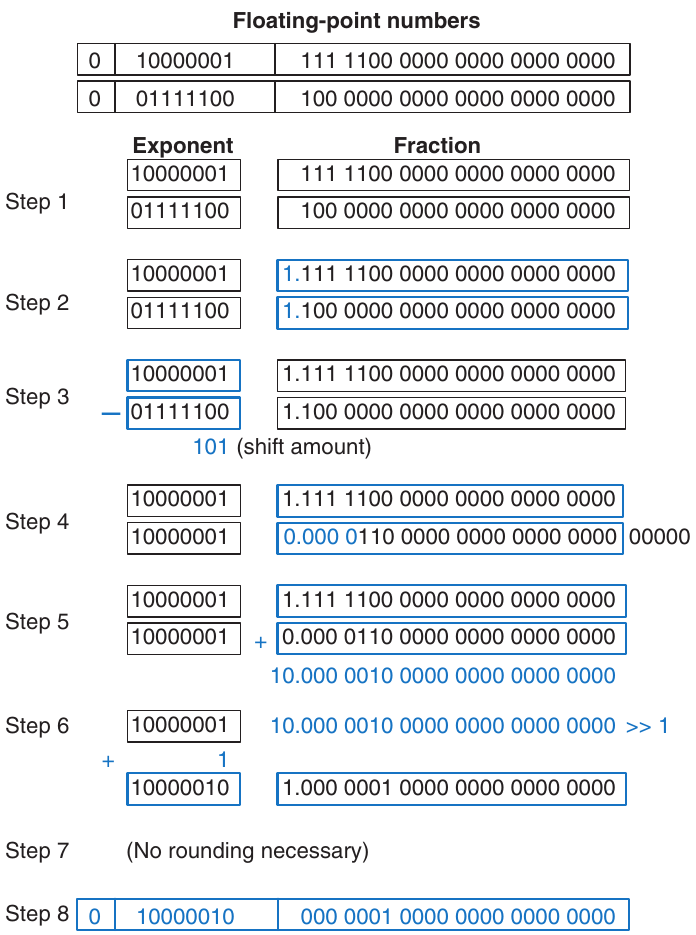

Hình 5.31 Phép cộng Floating-point

Hình 5.31 trình bày phép cộng floating-point của 7.875 (1.11111 × 2<sup>2</sup>) và 0.1875 (1.1 × 2<sup>−3</sup>). Kết quả là 8.0625 (1.0000001 × 2<sup>3</sup>). Sau khi trích fraction bit và exponent bit rồi thêm implicit leading 1 ở bước 1 và 2, so sánh exponent bằng trừ exponent nhỏ khỏi exponent lớn. Kết quả là số bit cần dịch phải số nhỏ hơn để căn binary point ngầm định (tức làm exponent bằng nhau) ở bước 4. Cộng các số đã căn. Vì sum có mantissa lớn hơn hoặc bằng 2.0, chuẩn hóa bằng dịch phải một bit và tăng exponent. Trong ví dụ kết quả chính xác nên không cần làm tròn. Lưu kết quả trong ký pháp floating- point bằng bỏ implicit leading one của mantissa và thêm sign bit ở đầu.

> Số học Floating-point thường thực hiện trong hardware để nhanh. Hardware này gọi floating-point unit (FPU), thường tách khỏi central processing unit (CPU). Bug phép chia floating-point (FDIV) khét tiếng trong Pentium FPU khiến Intel tốn \$475 triệu thu hồi và thay chip lỗi. Bug xảy ra chỉ vì lookup table không được nạp đúng.

## 5.4 SEQUENTIAL BUILDING BLOCK

Mục này xem xét sequential building block, gồm counter và shift register.

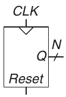

Hình 5.32 Ký hiệu counter

### 5.4.1 Counters

Binary counter N-bit ở Hình 5.32 là sequential arithmetic circuit có input clock và reset cùng output Q N-bit. Reset khởi tạo output bằng 0. Sau đó counter tiến qua mọi 2<sup>N</sup> output có thể có theo thứ tự nhị phân, tăng trên rising edge clock.

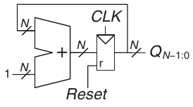

Hình 5.33 Counter N-bit

Hình 5.33 trình bày counter N-bit gồm adder và resettable register. Mỗi cycle, counter cộng 1 vào giá trị lưu trong register. Ví dụ HDL 5.4 trình bày binary counter có asynchronous reset, Hình 5.34 trình bày hardware kết quả.

Bit trọng số cao nhất của counter N-bit đổi mức mỗi 2<sup>N</sup> cycle. Vì vậy nó giảm tần số clock 2<sup>N</sup> lần. Đây gọi counter divide-by-2<sup>N</sup>, hữu ích để làm chậm signal nhanh. Ví dụ, nếu digital system có internal clock 50 MHz, có thể dùng counter 24-bit tạo signal (50 × 10<sup>6</sup> Hz/2<sup>24</sup>) = 2.98 Hz để nhấp nháy diode light-emitting (LED) với tốc độ mắt người quan sát được.

Khái quát counter thêm để tạo tần số bất kỳ gọi là digitally controlled oscillator (DCO, Ví dụ 5.7). Xét counter N-bit cộng p mỗi cycle thay vì 1. Nếu counter nhận clock tần số f<sub>clk</sub>, bit trọng số cao nhất giờ đổi mức ở f<sub>out</sub> = f<sub>clk</sub> × p/2<sup>N</sup>. Chọn p, N khéo léo có thể tạo output tần số bất kỳ. N lớn hơn cho điều khiển chính xác hơn nhưng tốn hardware hơn.

#### Ví dụ 5.7 DIGITALLY CONTROLLED OSCILLATOR

Giả sử có clock 50 MHz và muốn output 500 Hz. Xét dùng counter N = 24- hoặc 32-bit. Nên chọn p bao nhiêu và có thể gần 500 Hz đến mức nào?

Lời giải Muốn p/2<sup>N</sup> = 500 Hz/50 MHz = 0.001. Nếu N = 24, chọn p = 168 để f<sub>out</sub> = 500.68 Hz. Nếu N = 32, chọn p = 42950 để f<sub>out</sub> = 500.038 Hz.

Các loại counter khác như Up/Down counter được khảo sát ở Bài tập 5.51 đến 5.54.

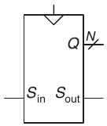

Hình 5.35 Ký hiệu shift register

### 5.4.2 Shift Registers

Shift register có clock, serial input S<sub>in</sub>, serial output S<sub>out</sub> và N parallel output Q<sub>N−1:0</sub>, như Hình 5.35. Trên mỗi rising edge clock, bit mới được dịch vào từ S<sub>in</sub>, và mọi nội dung tiếp sau dịch về trước. Bit cuối shift register có tại S<sub>out</sub>. Có thể xem shift register là converter serial-to-parallel. Input được cung cấp serial (mỗi lần một bit) tại S<sub>in</sub>. Sau N cycle, N input trước đó có song song tại Q.

#### Ví dụ HDL 5.4 COUNTER

SystemVerilog

```
module counter #(parameter N = 8)
                (input  logic          clk,
                 input  logic          reset,
                 output  logic [N–1:0] q);

  always_ff @(posedge clk, posedge reset)
    if (reset) q <= 0;
    else       q <= q + 1;
endmodule
```

VHDL

```
library IEEE; use IEEE.STD_LOGIC_1164.ALL;
use IEEE.NUMERIC_STD_UNSIGNED.ALL;

entity counter is
  generic(N: integer := 8);
  port(clk, reset: in  STD_LOGIC;
       q:          out STD_LOGIC_VECTOR(N-1 downto 0));
end;

architecture synth of counter is
begin
  process(clk, reset) begin
    if reset then               q <= (OTHERS => ‘0’);
    elsif rising_edge(clk) then q <= q + ‘1’;
    end  if;
  end  process;
end;
```

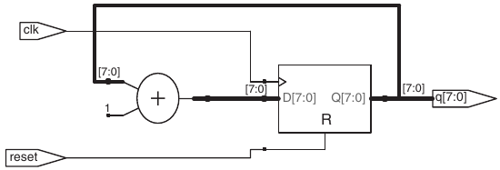

Hình 5.34 Counter sau synthesis

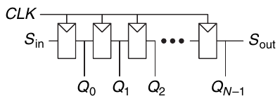

Hình 5.36 Schematic của shift register

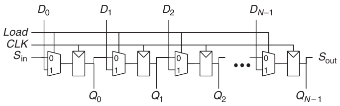

Hình 5.37 Shift register có parallel load

Shift register có thể xây từ N flip-flops nối tiếp như Hình 5.36. Một số shift register còn có reset signal để khởi tạo mọi flip-flops.

Circuit liên quan là converter parallel-to-serial, nạp N bit song song rồi dịch từng bit ra. Có thể sửa shift register để thực hiện cả serial-to-parallel lẫn parallel-to-serial bằng thêm parallel input D<sub>N−1:0</sub> và control signal Load như Hình 5.37. Khi Load được assert, flip-flops được nạp song song từ input D. Nếu không, shift register dịch bình thường. Ví dụ HDL 5.5 mô tả shift register như vậy, Hình 5.38 trình bày hardware kết quả.

Scan Chains\*

Shift register thường dùng kiểm thử sequential circuit bằng kỹ thuật scan chain. Kiểm thử combinational circuit tương đối thẳng thắn. Đưa vào các input đã biết gọi là test vector rồi đối chiếu output với kết quả dự kiến. Kiểm thử sequential circuit khó hơn vì circuit có state. Từ điều kiện đầu đã biết, có thể cần nhiều cycle test vector để đưa circuit về state mong muốn. Ví dụ, kiểm tra bit trọng số cao nhất của counter 32-bit tăng 0 lên 1 cần reset counter, rồi đưa 2<sup>31</sup> (khoảng hai tỷ) clock pulse!

> Đừng nhầm shift register với shifter ở Mục 5.2.5. Shift register là sequential logic block dịch vào bit mới trên mỗi clock edge. Shifter là combinational logic block không clock, dịch input một lượng chỉ định.

Để giải quyết, người thiết kế muốn trực tiếp quan sát và điều khiển toàn bộ state của machine. Điều này thực hiện bằng thêm test mode, trong đó nội dung mọi flip-flops có thể đọc ra hoặc nạp giá trị mong muốn. Phần lớn hệ thống có quá nhiều flip-flops để dành pin riêng đọc ghi mỗi flip-flop. Thay vào đó, mọi flip-flops nối thành shift register gọi là scan chain. Khi hoạt động bình thường, flip-flops nạp data từ input D và bỏ qua scan chain. Trong test mode, flip-flops serially dịch nội dung ra và dịch nội dung mới vào bằng S<sub>in</sub>, S<sub>out</sub>. Load multiplexer thường tích hợp vào flip-flop tạo scannable flip-flop. Hình 5.39 trình bày schematic và ký hiệu scannable flip-flop, minh họa cách nối chuỗi các flop để xây scannable register N-bit.

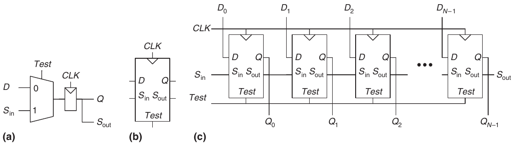

Hình 5.39 Scannable flip-flop: (a) schematic, (b) ký hiệu và (c) scannable register N-bit

#### Ví dụ HDL 5.5 SHIFT REGISTER CÓ PARALLEL LOAD

SystemVerilog

```
module shiftreg #(parameter N = 8)
                 (input    logic        clk,
                  input    logic        reset,  load,
                  input    logic        sin,
                  input  logic [N–1:0] d,
                  output logic [N–1:0] q,
                  output  logic         sout);

  always_ff @(posedge clk, posedge reset)
    if (reset)       q <= 0;
    else if (load)   q <= d;
    else             q <= {q[N–2:0], sin};

  assign sout = q[N–1];
endmodule
```

VHDL

```
library IEEE; use IEEE.STD_LOGIC_1164.ALL;
entity shiftreg is
  generic(N: integer := 8);
  port(clk, reset: in  STD_LOGIC;
       load,  sin:   in    STD_LOGIC;
       d:            in  STD_LOGIC_VECTOR(N–1 downto 0);
       q:            out STD_LOGIC_VECTOR(N–1 downto 0);
       sout:         out  STD_LOGIC);
end;
architecture synth of shiftreg is
begin
  process(clk, reset) begin
    if reset = ‘1’ then q <= (OTHERS => ‘0’);
    elsif rising_edge(clk) then
      if load then          q <= d;
      else                  q <= q(N–2 downto 0) & sin;
      end  if;
    end  if;
  end  process;
  sout <= q(N–1);
end;
```

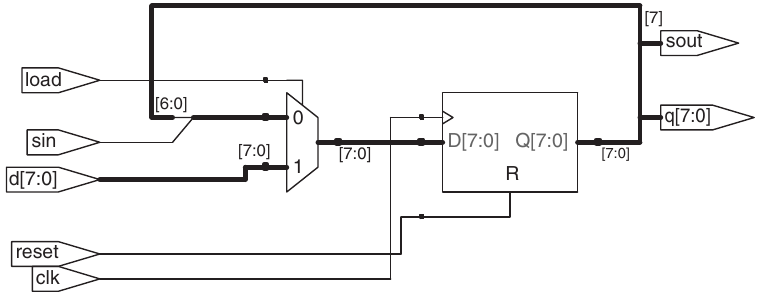

Hình 5.38 shiftreg sau synthesis

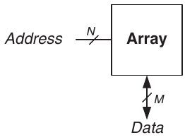

Hình 5.40 Ký hiệu memory array tổng quát

Ví dụ, có thể kiểm thử counter 32-bit bằng dịch mẫu 011111…111 vào trong test mode, đếm một cycle trong normal mode rồi dịch kết quả ra, phải là 100000…000. Chỉ cần 32 + 1 + 32 = 65 cycle.

## 5.5 MEMORY ARRAY

Các mục trước giới thiệu arithmetic circuit và sequential circuit để biến đổi data. Digital system còn cần memory lưu data mà circuit dùng và tạo. Register xây từ flip-flops là loại memory lưu lượng data nhỏ. Mục này mô tả memory array có thể lưu lượng data lớn hiệu quả.

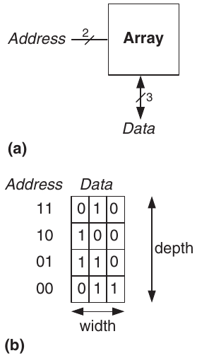

Hình 5.41 Memory array 4 × 3: (a) ký hiệu, (b) chức năng

Bắt đầu bằng tổng quan đặc tính chung của mọi memory array rồi giới thiệu ba loại: dynamic random access memory (DRAM), static random access memory (SRAM) và read only memory (ROM). Mỗi memory khác cách lưu data. Chúng ta bàn ngắn gọn trade-offs diện tích và độ trễ, trình bày cách dùng memory array không chỉ lưu data mà còn thực hiện logic function. Cuối cùng mục kết thúc bằng HDL cho memory array.

### 5.5.1 Tổng quan

Hình 5.40 trình bày ký hiệu tổng quát memory array. Memory tổ chức thành array two-dimensional các memory cell. Memory đọc hoặc ghi nội dung một hàng array. Hàng được chỉ định bằng address. Giá trị đọc hoặc ghi gọi là data. Array có address N-bit và data M-bit có 2<sup>N</sup> hàng và M cột. Mỗi hàng data gọi là word. Vì vậy array chứa 2<sup>N</sup> word M-bit.

Hình 5.41 trình bày memory array có hai address bit và ba data bit. Hai address bit chỉ định một trong bốn hàng (data word) của array. Mỗi data word rộng ba bit. Hình 5.41(b) cho một nội dung có thể có của memory array.

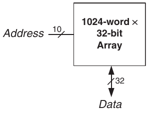

Hình 5.42 Array 32-Kb: depth = 2<sup>10</sup> = 1024 word, width = 32 bit

Depth array là số hàng, width là số cột, còn gọi word size. Size array được cho bằng depth × width. Hình 5.41 là array 4-word × 3-bit, hoặc ngắn gọn array 4 × 3. Ký hiệu array 1024-word × 32-bit trong Hình 5.42. Tổng kích thước array này là 32 kilobit (Kb), còn gọi 32 kibibit (Kib).

Bit Cells

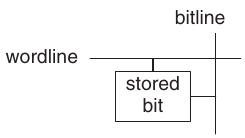

Hình 5.43 Bit cell

Memory array được xây thành array bit cell, mỗi cell lưu 1 bit data. Hình 5.43 cho thấy mỗi bit cell nối với wordline và bitline. Với từng tổ hợp address bit, memory assert một wordline kích hoạt bit cell ở hàng đó. Khi wordline HIGH, bit được lưu truyền đến hoặc từ bitline. Nếu không, bitline bị ngắt khỏi bit cell. Circuit lưu bit khác nhau tùy loại memory.

Để đọc bit cell, ban đầu để bitline floating (Z). Sau đó bật wordline ON, cho giá trị được lưu drive bitline về 0 hoặc 1. Để ghi bit cell, drive mạnh bitline đến giá trị mong muốn. Sau đó bật wordline ON, nối bitline với bit được lưu. Bitline được drive mạnh lấn át nội dung bit cell, ghi giá trị mong muốn vào bit được lưu.

Tổ chức

Hình 5.44 trình bày tổ chức nội bộ memory array 4 × 3. Dĩ nhiên memory thực lớn hơn nhiều, nhưng có thể suy hành vi array lớn từ array nhỏ. Trong ví dụ, array lưu data từ Hình 5.41(b).

Khi đọc memory, assert wordline và hàng bit cell tương ứng drive bitline HIGH hoặc LOW. Khi ghi memory, trước hết drive bitline HIGH hoặc LOW rồi assert wordline, cho phép giá trị bitline lưu vào hàng bit cell đó. Ví dụ, để đọc Address 10, bitline để floating, decoder assert wordline<sub>2</sub>, data lưu trong hàng bit cell (100) đọc ra các Data bitline. Để ghi 001 vào Address 11, drive bitline giá trị 001, rồi assert wordline<sub>3</sub> và giá trị mới (001) lưu vào bit cell.

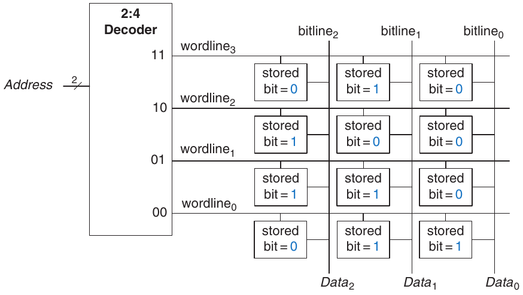

Hình 5.44 Memory array 4 × 3

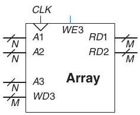

Hình 5.45 Memory Three-ported

Memory Ports

Mọi memory có một hoặc nhiều port. Mỗi port cho truy cập đọc và/hoặc ghi một memory address. Các ví dụ trước đều là memory single- ported.

Memory multiported có thể truy cập nhiều address đồng thời. Hình 5.45 trình bày memory three-ported có hai read port và một write port. Port 1 đọc data từ address A1 lên read data output RD1. Port 2 đọc data từ address A2 lên RD2. Port 3 ghi data từ write data input WD3 vào address A3 trên rising edge clock nếu write enable WE3 được assert.

> 
>
> Robert Dennard, 1932–
>
> Phát minh DRAM năm 1966 tại IBM. Dù nhiều người nghi ngờ ý tưởng hoạt động, đến mid-1970’s DRAM đã có trong hầu như mọi máy tính. Ông nói mình ít sáng tạo cho đến khi đến IBM, được đưa sổ ghi bằng sáng chế và bảo “ghi mọi ý tưởng của anh vào đây.” Từ 1965, ông nhận 35 bằng sáng chế về semiconductor và microelectronics. (Ảnh do IBM cung cấp.)

Các loại memory

Memory array được chỉ định bằng size (depth × width) cùng số lượng và loại port. Mọi memory array lưu data như array bit cell, nhưng khác nhau ở cách lưu bit.

Memory được phân loại theo cách lưu bit trong bit cell. Phân loại rộng nhất là random access memory (RAM) và read only memory (ROM). RAM là volatile, nghĩa là mất data khi tắt nguồn. ROM là nonvolatile, nghĩa là giữ data vô thời hạn ngay cả khi không có nguồn.

Tên RAM và ROM xuất phát lý do lịch sử hiện không còn nhiều ý nghĩa. RAM gọi random access memory vì mọi data word được truy cập với cùng độ trễ. Ngược lại, sequential access memory như máy ghi băng truy cập data gần nhanh hơn data xa (ví dụ ở đầu kia băng). ROM gọi read only memory vì lịch sử chỉ có thể đọc không thể ghi. Tên gây nhầm vì ROM cũng truy cập ngẫu nhiên. Tệ hơn, phần lớn ROM hiện đại có thể ghi lẫn đọc! Khác biệt quan trọng cần nhớ là RAM volatile, ROM nonvolatile.

Hai loại RAM chính là dynamic RAM (DRAM) và static RAM (SRAM). Dynamic RAM lưu data bằng điện tích trên capacitor, trong khi static RAM lưu data bằng cặp inverter cross-coupled. Có nhiều biến thể ROM khác nhau ở cách ghi và xóa. Các loại memory này được bàn trong mục tiếp theo.

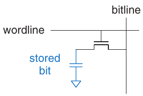

Hình 5.46 DRAM bit cell

### 5.5.2 Dynamic Random Access Memory (DRAM)

DRAM, phát âm “dee-ram”, lưu bit bằng có hoặc không có điện tích trên capacitor. Hình 5.46 trình bày DRAM bit cell. Giá trị bit lưu trên capacitor. Transistor nMOS hoạt động như switch nối hoặc ngắt capacitor khỏi bitline. Khi wordline được assert, transistor nMOS bật ON và giá trị bit được lưu truyền đến hoặc từ bitline.

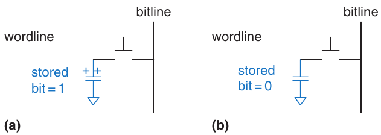

Hình 5.47 Các giá trị được lưu trong DRAM

Như Hình 5.47(a), khi capacitor nạp đến V<sub>DD</sub>, bit được lưu là 1; khi xả về GND (Hình 5.47(b)), bit là 0. Capacitor node là dynamic vì không được transistor nối V<sub>DD</sub> hoặc GND chủ động drive HIGH hay LOW.

Khi đọc, giá trị data truyền từ capacitor đến bitline. Khi ghi, giá trị data truyền từ bitline đến capacitor. Đọc phá hủy giá trị bit lưu trên capacitor, nên phải khôi phục (ghi lại) data word sau mỗi lần đọc. Ngay cả khi DRAM không được đọc, nội dung phải refresh (đọc và ghi lại) mỗi vài millisecond vì điện tích capacitor dần rò mất.

### 5.5.3 Static Random Access Memory (SRAM)

SRAM, phát âm “es-ram”, là static vì bit lưu không cần refresh. Hình 5.48 trình bày SRAM bit cell. Data bit được lưu trên inverter cross-coupled giống Mục 3.2. Mỗi cell có hai output bitline và $\overline{bitline}$. Khi wordline được assert, cả hai transistor nMOS bật và giá trị data truyền đến hoặc từ bitline. Khác DRAM, nếu nhiễu làm suy giảm giá trị bit được lưu, inverter cross-coupled khôi phục giá trị.


Hình 5.48 SRAM bit cell

### 5.5.4 Diện tích và độ trễ

Flip-flops, SRAM và DRAM đều là volatile memory, nhưng có đặc tính diện tích và độ trễ khác nhau. Bảng 5.6 so sánh ba loại volatile memory. Data bit lưu trong flip-flop có ngay tại output. Nhưng flip-flops cần ít nhất 20 transistor để xây dựng. Nhìn chung, thiết bị càng nhiều transistor càng cần diện tích, công suất và chi phí lớn. Latency DRAM dài hơn SRAM vì bitline không được transistor chủ động drive. DRAM phải chờ điện tích di chuyển tương đối chậm từ capacitor đến bitline. DRAM về cơ bản còn có throughput thấp hơn SRAM vì phải refresh data định kỳ và sau khi đọc. Công nghệ DRAM như synchronous DRAM (SDRAM) và double data rate (DDR) SDRAM được phát triển để khắc phục. SDRAM dùng clock để pipeline memory access. DDR SDRAM, đôi khi gọi ngắn DDR, dùng cả rising edge lẫn falling edge clock để truy cập data, gấp đôi throughput với cùng tốc độ clock. DDR lần đầu được tiêu chuẩn hóa năm 2000, chạy 100 đến 200 MHz. Các chuẩn sau DDR2, DDR3 và DDR4 tăng tốc độ clock, năm 2021 vượt 3 GHz.

Bảng 5.6 So sánh memory

| Loại memory | Transistor mỗi bit cell | Latency |
|---|---|---|
| Flip-flop | \~20 | Nhanh |
| SRAM | 6 | Trung bình |
| DRAM | 1 | Chậm |


Hình 5.49 Register file 32 × 32 có hai read port và một write port

Latency và throughput memory còn phụ thuộc memory size; memory lớn có xu hướng chậm hơn memory nhỏ nếu các yếu tố khác như nhau. Loại memory tốt nhất cho thiết kế cụ thể phụ thuộc ràng buộc tốc độ, chi phí và công suất.

### 5.5.5 Register Files

Digital system thường dùng một số register lưu biến tạm. Nhóm register này gọi register file, thường xây như SRAM array nhỏ, multiported vì gọn hơn array flip-flops. Trong một số register file, entry cụ thể như register 0 được hardwire để luôn đọc giá trị 0 vì 0 là hằng số thường dùng.


Hình 5.50 ROM bit cell chứa 0 và 1

Hình 5.49 trình bày register file three-ported 32-register × 32-bit xây từ memory three-ported Hình 5.45. Register file có hai read port (A1/RD1 và A2/RD2), một write port (A3/WD3). Mỗi address 5-bit A1, A2 và A3 truy cập được mọi 2<sup>5</sup> = 32 register. Vì vậy có thể đọc hai register và ghi một register đồng thời.

### 5.5.6 Read Only Memory (ROM)

ROM lưu bit bằng có hoặc không có transistor. Hình 5.50 trình bày ROM bit cell đơn giản. Để đọc cell, bitline được kéo yếu lên HIGH. Sau đó bật wordline ON. Nếu có transistor, nó kéo bitline LOW. Nếu không, bitline giữ HIGH. Chú ý ROM bit cell là combinational circuit, không có state để “quên” khi tắt nguồn.

Có thể biểu thị nội dung ROM bằng dot notation. Hình 5.51 trình bày dot notation cho ROM 4-word × 3-bit chứa data từ Hình 5.41. Dấu chấm tại giao hàng (wordline) và cột (bitline) biểu thị data bit là 1. Ví dụ, wordline trên cùng có một dấu chấm ở Data<sub>1</sub> nên data word lưu tại Address 11 là 010.

Về khái niệm, có thể xây ROM bằng logic two-level với nhóm AND gate tiếp theo nhóm OR gate. AND gate tạo mọi minterm có thể có nên tạo thành decoder. Hình 5.52 trình bày ROM Hình 5.51 xây bằng decoder và OR gate. Mỗi hàng có dấu chấm ở Hình 5.51 là input một OR gate trong Hình 5.52. Với data bit chỉ một dấu chấm—ở đây Data<sub>0</sub>—không cần OR gate. Biểu diễn ROM này thú vị vì cho thấy ROM có thể thực hiện mọi logic function two-level. Thực tế, ROM xây từ transistor thay logic gate để giảm size và chi phí. Mục 5.6.3 khảo sát sâu hơn cách triển khai transistor-level.


Hình 5.51 ROM 4 × 3: dot notation


Hình 5.52 Triển khai ROM 4 × 3 bằng gate


Hình 5.53 ROM bit cell Fuse-programmable

Nội dung ROM bit cell Hình 5.50 được quy định khi chế tạo bằng có hoặc không có transistor trong mỗi bit cell. Programmable ROM (PROM, phát âm như từ chỉ dạ hội) đặt transistor trong mọi bit cell nhưng cung cấp cách nối hoặc ngắt transistor với ground.

Hình 5.53 trình bày bit cell của ROM fuse-programmable. Người dùng lập trình ROM bằng áp điện áp cao để đốt chọn lọc fuse. Nếu còn fuse, transistor nối GND và cell giữ 0. Nếu fuse bị phá, transistor ngắt ground và cell giữ 1. Đây còn gọi ROM one-time programmable vì fuse không sửa được sau khi đốt.

> 
>
> Fujio Masuoka, 1944–
>
> Nhận bằng tiến sĩ kỹ thuật điện tại Tohoku University, Nhật Bản. Phát triển memory và circuit high-speed tại Toshiba từ 1971 đến 1994. Phát minh Flash memory như dự án không được cho phép, theo đuổi ban đêm và cuối tuần vào cuối thập niên 1970. Flash có tên vì quá trình xóa memory gợi ánh chớp máy ảnh. Toshiba chậm thương mại hóa; Intel ra thị trường đầu tiên năm 1988. Flash tăng thành thị trường \$170 tỷ mỗi năm. Sau đó Tiến sĩ Masuoka gia nhập đội ngũ giảng viên Tohoku University và đang phát triển transistor 3-dimensional.

Reprogrammable ROM cung cấp cơ chế đảo ngược được để nối hoặc ngắt transistor với GND. Erasable PROM (EPROM, phát âm “e-proms”) thay transistor nMOS và fuse bằng transistor floating-gate. Floating gate không gắn vật lý với dây khác. Khi áp điện áp cao thích hợp, electron tunnel qua insulator vào floating gate, bật transistor và nối bitline với wordline (decoder output). Khi EPROM phơi dưới ánh sáng ultraviolet (UV) mạnh khoảng nửa giờ, electron bị bật khỏi floating gate, tắt transistor. Hai hành động lần lượt gọi programming và erasing. Electrically erasable PROM (EEPROM, phát âm “e-e-proms” hoặc “double-e proms”) và Flash memory dùng nguyên lý tương tự nhưng có circuit trên chip cho cả erasing lẫn programming nên không cần UV. EEPROM bit cell xóa riêng được; Flash memory xóa khối bit lớn hơn và rẻ hơn vì cần ít erasing circuit. Năm 2021, Flash memory giá khoảng \$0.10 mỗi GB và giá tiếp tục giảm 30% đến 40% mỗi năm. Flash trở thành cách cực phổ biến lưu lượng data lớn trong hệ thống battery-powered di động như máy ảnh và máy nghe nhạc.

Tóm lại, ROM hiện đại không thật sự read only; cũng có thể program (ghi). Khác biệt RAM và ROM là ROM mất thời gian ghi lâu hơn nhưng nonvolatile.

### 5.5.7 Logic bằng Memory Array

Dù chủ yếu dùng lưu data, memory array cũng thực hiện được combinational logic function. Ví dụ output Data<sub>2</sub> của ROM Hình 5.51 là XOR hai Address input. Tương tự Data<sub>0</sub> là NOR hai input. Memory 2<sup>N</sup>-word × M-bit có thể thực hiện combinational function bất kỳ của N input và M output. Ví dụ ROM Hình 5.51 thực hiện ba hàm hai input.

> 
>
> Ổ Flash memory có connector Universal Serial Bus (USB) đã thay đĩa mềm và CD để chia sẻ file vì chi phí Flash giảm mạnh.

Memory array dùng thực hiện logic gọi lookup table (LUT). Hình 5.54 trình bày memory array 4-word × 1-bit dùng như lookup table thực hiện hàm Y = AB. Dùng memory thực hiện logic, người dùng tra được giá trị output cho tổ hợp input (address) nhất định. Mỗi address tương ứng một hàng truth table, mỗi data bit tương ứng một giá trị output.

### 5.5.8 Memory HDL

Ví dụ HDL 5.6 mô tả RAM 2<sup>N</sup>-word × M-bit, Hình 5.55 trình bày hardware kết quả. RAM có synchronous enabled write. Nói cách khác, ghi xảy ra trên rising edge clock nếu write enable we được assert. Đọc xảy ra ngay. Khi mới cấp nguồn, nội dung RAM không thể dự đoán.

Ví dụ HDL 5.7 mô tả ROM 4-word × 3-bit. Nội dung ROM quy định trong case statement HDL. ROM nhỏ như vậy có thể synthesis thành logic gate thay vì array. Chú ý decoder seven-segment ở Ví dụ HDL 4.24 synthesis thành ROM trong Hình 4.20. Ví dụ HDL 5.8 trình bày register file 3-ported 32 × 32 có entry 0 hardwire về 0.

> 
>
> Programmable ROM có thể cấu hình bằng device programmer như hình dưới. Device programmer nối máy tính chỉ định loại ROM và giá trị data cần program. Device programmer đốt fuse hoặc bơm điện tích lên floating gate trên ROM. Vì vậy quá trình program đôi khi gọi là burning ROM.

## 5.6 LOGIC ARRAY

Giống memory, gate có thể tổ chức thành array đều đặn. Nếu kết nối có thể program, logic array có thể cấu hình thực hiện mọi hàm mà người dùng không phải nối dây theo cách cụ thể. Cấu trúc đều đặn đơn giản hóa thiết kế. Logic array được mass- produced số lượng lớn nên rẻ. Công cụ software cho phép map thiết kế logic lên array. Phần lớn logic array cũng reconfigurable, cho sửa thiết kế mà không thay hardware. Khả năng reconfigure có giá trị khi phát triển và ngoài thực địa vì hệ thống có thể nâng cấp chỉ bằng tải cấu hình mới.


Hình 5.54 Memory array 4-word × 1-bit dùng như lookup table

Mục này giới thiệu hai loại logic array: programmable logic array (PLA) và field programmable gate array (FPGA). PLA, công nghệ cũ hơn, chỉ thực hiện combinational logic function. FPGA thực hiện cả combinational lẫn sequential logic.

### Ví dụ HDL 5.6 RAM

SystemVerilog

```
module ram #(parameter N = 6, M = 32)
            (input    logic       clk,
             input    logic       we,
             input  logic [N–1:0] adr,
             input  logic [M–1:0] din,
             output logic [M–1:0] dout);

  logic [M–1:0] mem [2**N–1:0];

  always_ff @(posedge clk)
    if (we) mem [adr] <= din;

  assign dout = mem[adr];
endmodule
```

VHDL

```
library IEEE; use IEEE.STD_LOGIC_1164.ALL;
use IEEE.NUMERIC_STD_UNSIGNED.ALL;

entity ram_array is
  generic(N: integer := 6; M: integer := 32);
  port(clk,
       we:   in  STD_LOGIC;
       adr:  in  STD_LOGIC_VECTOR(N–1 downto 0);
       din:  in  STD_LOGIC_VECTOR(M–1 downto 0);
       dout: out STD_LOGIC_VECTOR(M–1 downto 0));
end;

architecture synth of ram_array is
  type mem_array is array ((2**N–1) downto 0)
       of STD_LOGIC_VECTOR (M–1 downto 0);
  signal mem: mem_array;
begin
  process(clk)  begin
    if rising_edge(clk) then
      if we then mem(TO_INTEGER(adr)) <= din;
      end  if;
    end  if;
  end  process;

  dout <= mem(TO_INTEGER(adr));
end;
```


Hình 5.55 ram sau synthesis

#### Ví dụ HDL 5.7 ROM

SystemVerilog

```
module rom(input  logic [1:0] adr,
           output logic [2:0] dout);

  always_comb
    case(adr)
      2’b00: dout = 3’b011;
      2’b01: dout = 3’b110;
      2’b10: dout = 3’b100;
      2’b11: dout = 3’b010;
    endcase
endmodule
```

VHDL

```
library IEEE; use IEEE.STD_LOGIC_1164.all;
entity rom is
  port(adr:  in  STD_LOGIC_VECTOR(1 downto 0);
       dout: out STD_LOGIC_VECTOR(2 downto 0));
end;
architecture synth of rom is
begin
  process(all)  begin
    case adr is
      when “00”   => dout <= “011”;
      when “01”   => dout <= “110”;
      when “10”   => dout <= “100”;
      when “11”   => dout <= “010”;
      when others => dout <= “---”;
    end  case;
  end process;
end;
```

#### Ví dụ HDL 5.8 REGISTER FILE

SystemVerilog

```
module regfile(input  logic         clk,
               input    logic       we3,
               input  logic  [5:0]  a1, a2, a3,
               input  logic  [31:0] wd3,
               output logic  [31:0] rd1, rd2);

  logic [31:0] rf[31:0];
  // three ported register file
  // read two ports combinationally (A1/RD1, A2/RD2)
  // write third port on rising edge of clock (A3/WD3/WE3)
  // register 0 hardwired to 0

  always_ff @(posedge clk)
    if (we3) rf[a3] <= wd3;

  assign rd1 = (a1 != 0) ? rf[a1] : 0;
  assign rd2 = (a2 != 0) ? rf[a2] : 0;
endmodule
```

VHDL

```
library IEEE;
use IEEE.STD_LOGIC_1164.all;
use IEEE.NUMERIC_STD_UNSIGNED.all;

entity regfile is
  port(clk:         in    STD_LOGIC;
       we3:         in    STD_LOGIC;
       a1, a2, a3:  in  STD_LOGIC_VECTOR(5  downto 0);
       wd3:         in  STD_LOGIC_VECTOR(31 downto 0);
       rd1, rd2:   out  STD_LOGIC_VECTOR(31 downto 0));
end;

architecture behave of regfile is
  type ramtype is array (31 downto 0) of  STD_LOGIC_VECTOR
                                          (31 downto 0);
  signal mem: ramtype;
begin
  –– three ported register file
  –– read two ports combinationally (A1/RD1, A2/RD2)
  –– write third port on rising edge of clock (A3/WD3/WE3)
  –– register 0 hardwired to 0
  process(clk) begin
    if rising_edge(clk) then
      if we3 = ‘1’ then mem(to_integer(a3)) <= wd3;
      end  if;
    end  if;
  end process;
  process(a1, a2) begin
    if (to_integer(a1) = 0) then rd1 <= X"00000000";
    else rd1 <= mem(to_integer(a1));
    end  if;
    if (to_integer(a2) = 0) then rd2 <= X"00000000";
    else rd2 <= mem(to_integer(a2));
    end  if;
  end process;
```

### 5.6.1 Programmable Logic Array (PLA)

PLA triển khai combinational logic two-level dạng sum-of-products (SOP). PLA xây từ AND array tiếp theo OR array, như Hình 5.56. Input (dạng true và complement) drive AND array tạo implicant. Các implicant sau đó được OR để tạo output. PLA M × N × P-bit có M input, N implicant và P output.

Hình 5.57 trình bày dot notation cho PLA 3 × 3 × 2-bit thực hiện hàm X = $\overline{A}$$\overline{B}$C + AB$\overline{C}$ và Y = A$\overline{B}$. Mỗi hàng AND array tạo implicant. Dấu chấm trong mỗi hàng AND array chỉ literal nào tạo thành implicant. AND array Hình 5.57 tạo ba implicant: $\overline{A}$$\overline{B}$C, AB$\overline{C}$ và A$\overline{B}$. Dấu chấm trong OR array chỉ implicant nào thuộc output function.


Hình 5.56 PLA M × N × P-bit


Hình 5.57 PLA 3 × 3 × 2-bit: dot notation


Hình 5.58 PLA 3 × 3 × 2-bit dùng logic two-level

Hình 5.58 trình bày cách xây PLA bằng logic two-level. Cách triển khai khác ở Mục 5.6.3.

Có thể xem ROM là trường hợp đặc biệt PLA. ROM 2M-word × N-bit đơn giản là PLA M × 2<sup>M</sup> × N-bit. Decoder hoạt động như AND plane tạo mọi 2<sup>M</sup> minterm. ROM array hoạt động như OR plane tạo output. Nếu hàm không phụ thuộc mọi 2<sup>M</sup> minterm, PLA có khả năng nhỏ hơn ROM. Ví dụ cần ROM 8-word × 2-bit để thực hiện cùng các hàm của PLA 3 × 3 × 2-bit trong Hình 5.57 và 5.58.

Simple programmable logic device (SPLD) là PLA souped-up, thêm register và nhiều tính năng khác vào AND/OR plane cơ bản. Tuy nhiên SPLD và PLA phần lớn đã bị FPGA thay thế, vì linh hoạt và hiệu quả hơn để xây hệ thống lớn.


### 5.6.2 Field Programmable Gate Array (FPGA)

FPGA là array gate reconfigurable. Dùng công cụ software programming, người dùng triển khai thiết kế trên FPGA bằng HDL hoặc schematic. FPGA mạnh và linh hoạt hơn PLA vì nhiều lý do. Chúng triển khai cả combinational và sequential logic. Chúng còn triển khai logic function multilevel, trong khi PLA chỉ triển khai logic two-level. FPGA hiện đại tích hợp tính năng hữu ích khác như multiplier built-in, I/O high-speed, data converter gồm converter analog-to-digital, RAM array lớn và processor.

FPGA xây như array configurable logic element (LE), còn gọi configurable logic block (CLB). Mỗi LE cấu hình được để thực hiện combinational hoặc sequential function. Hình 5.59 trình bày block diagram tổng quát FPGA. Bao quanh LE là input/output element (IOE) giao tiếp thế giới ngoài. IOE nối input và output LE đến pin chip package. LE nối được với LE khác và IOE qua programmable routing channel.

> FPGA là bộ não nhiều sản phẩm tiêu dùng, gồm ô tô, thiết bị y tế và thiết bị đa phương tiện như máy nghe MP3. Ví dụ dòng Mercedes Benz S-Class có hơn một tá FPGA hoặc PLD Xilinx cho ứng dụng từ giải trí đến định vị và cruise control system. FPGA cho thời gian ra thị trường nhanh, giúp debug hoặc thêm tính năng cuối quá trình thiết kế dễ hơn.


Hình 5.59 Bố trí FPGA tổng quát

Hai nhà sản xuất FPGA hàng đầu là Intel (trước đây Altera Corp.) và Xilinx, Inc. Hình 5.60 trình bày một LE trong Cyclone IV FPGA của Intel, giới thiệu năm 2009. Thành phần chủ chốt LE là lookup table (LUT) 4-input và register 1-bit. LE còn chứa multiplexer cấu hình được để route signal qua LE. FPGA được cấu hình bằng quy định nội dung LUT và select signal cho multiplexer.

> Altera Corporation thành lập năm 1983, là một trong các nhà sản xuất FPGA đầu tiên cùng Xilinx Inc., thành lập năm 1984. Intel mua Altera năm 2015 với \$16.7 tỷ.

Mỗi Cyclone IV LE có một LUT 4-input và một flip-flop. Nạp giá trị thích hợp vào LUT cho phép cấu hình thực hiện hàm bất kỳ tối đa bốn biến. Cấu hình FPGA còn gồm chọn select signal quyết định cách multiplexer route data qua LE đến LE và IOE lân cận. Ví dụ, tùy cấu hình multiplexer, LUT nhận một input từ data 3 hoặc output register của chính LE. Ba input khác luôn từ data 1, data 2 và data 4. Các input data 1–4 đến từ IOE hoặc output LE khác tùy routing bên ngoài LE. Output LUT hoặc đi trực tiếp đến


Hình 5.60 Cyclone IV Logic Element (LE)

(Tái bản có phép từ Altera Cyclone™ IV Handbook © 2010

Altera Corporation)

output LE cho combinational function, hoặc qua flip-flop cho registered function. Input flip-flop đến từ output LUT của chính nó, input data 3 hoặc register output của LE trước. Hardware bổ sung hỗ trợ phép cộng bằng carry chain hardware, các multiplexer routing khác, cùng enable và reset flip-flop. Altera nhóm 16 LE thành logic array block (LAB), cung cấp kết nối cục bộ giữa LE trong LAB.

Tóm lại, mỗi Cyclone IV LE thực hiện một combinational và/hoặc registered function, có thể có tối đa bốn biến. FPGA hãng khác tổ chức hơi khác nhưng cùng nguyên lý chung. Ví dụ FPGA 7-series của Xilinx dùng LUT 6-input thay LUT 4-input.

Người thiết kế cấu hình FPGA bằng trước hết tạo schematic hoặc mô tả HDL. Thiết kế sau đó synthesis lên FPGA. Công cụ synthesis xác định cấu hình LUT, multiplexer và routing channel để thực hiện chức năng quy định. Thông tin cấu hình sau đó tải xuống FPGA. Vì Cyclone IV FPGA lưu thông tin cấu hình trong SRAM, dễ reprogram. FPGA có thể tải nội dung SRAM từ máy tính trong phòng thí nghiệm hoặc chip EEPROM khi bật hệ thống. Một số nhà sản xuất tích hợp EEPROM trực tiếp trên FPGA hoặc dùng fuse one-time programmable để cấu hình FPGA.

#### Ví dụ 5.8 CÁC HÀM XÂY BẰNG LE

Giải thích cách cấu hình một hoặc nhiều Cyclone IV LE để thực hiện: (a) X = $\overline{A}$$\overline{B}$C + AB$\overline{C}$ và Y = A$\overline{B}$ (b) Y = JKLMPQR; (c) counter divide-by-3 với binary state encoding (xem Hình 3.29(a)). Có thể biểu diễn kết nối giữa LE nếu cần.

Lời giải (a) Cấu hình hai LE. Một LUT tính X, LUT kia tính Y như Hình 5.61. Với LE đầu, input data 1, data 2 và data 3 lần lượt là A, B, C (kết nối đặt bởi routing channel). data 4 là don’t care nhưng phải nối vào thứ gì đó nên nối 0. Với LE thứ hai, input data 1 và data 2 lần lượt là A, B; input LUT khác là don’t care và nối 0. Cấu hình multiplexer cuối để chọn combinational output từ LUT tạo X và Y. Nhìn chung, một LE có thể tính mọi hàm tối đa bốn biến input như vậy.

(b) Cấu hình LUT của LE đầu tính X = JKLM, LUT của LE thứ hai tính Y = XPQR. Cấu hình multiplexer cuối chọn combinational output X và Y từ từng LE. Cấu hình được trình bày ở Hình 5.62. Routing channel giữa LE, biểu thị bằng nét đứt xanh, nối output LE 1 đến input LE 2. Nhìn chung, nhóm LE có thể tính hàm N biến input theo cách này.


Hình 5.61 Cấu hình LE cho hai hàm, mỗi hàm tối đa bốn input

(c) FSM có hai bit state (S<sub>1:0</sub>) và một output (Y). Next state phụ thuộc hai bit current state. Dùng hai LE tính next state từ current state như Hình 5.63. Dùng hai flip-flops, mỗi LE một cái, giữ state này. Các flip-flops có reset input nối được với signal Reset ngoài. Registered output hồi tiếp vào input LUT qua multiplexer trên data 3 và routing channel giữa LE như nét đứt xanh. Nhìn chung có thể cần thêm LE tính output Y. Tuy nhiên ở đây Y = S′<sub>0</sub> nên Y lấy được từ LE 1. Do đó toàn FSM vừa trong hai LE. Nhìn chung, FSM cần ít nhất một LE cho mỗi bit state, có thể cần thêm LE cho output hoặc next state logic nếu quá phức tạp để vừa một LUT.


Hình 5.62 Cấu hình LE cho một hàm hơn bốn input


Hình 5.63 Cấu hình LE cho FSM có hai bit state

#### Ví dụ 5.9 THÊM VÍ DỤ LOGIC ELEMENT

Cần bao nhiêu Cyclone IV LE để xây từng circuit sau?

(a) 4-input AND

(b) 7-input XOR

(c) Y = A(B + C + D + E) + $\overline{A}$(BCDE)

(d) Shift register 12-bit

(e) Multiplexer 2:1 32-bit

(f) Counter 16-bit

(g) Finite state machine bất kỳ có 2 bit state, 2 input và 3 output

Lời giải

(a) 1: LUT có thể thực hiện mọi hàm tối đa 4 input.

(b) 2: LUT đầu tính XOR 4-input. LUT thứ hai XOR output đó với ba input nữa.

(c) 3: Một LUT tính B + C + D + E, hàm 4 input. LUT thứ hai tính BCDE, hàm 4 input khác. LUT thứ ba dùng 3 input (hai output này và A) tính Y.

(d) 12: Shift register có một flip-flop mỗi bit.

(e) 32: Multiplexer 2:1 là hàm ba input S, D<sub>0</sub>, D<sub>1</sub> nên cần một LUT mỗi bit.

(f) 16: Mỗi bit counter cần flip-flop và full adder. LE chứa flip-flop và adder logic. Dù full adder có hai output và dường như cần hai LUT, LE chứa carry chain logic đặc biệt như Hình 5.60, tối ưu để cộng bằng một LE.

(g) 5: FSM có hai flip-flops, hai next state signal và ba output signal. Mỗi next state signal là hàm bốn biến (hai bit state và hai input), nên tính được bằng một LUT. Do đó hai LE đủ cho next state logic và state register. Mỗi output là hàm tối đa bốn signal nên cần thêm một LUT cho mỗi output.

#### Ví dụ 5.10 ĐỘ TRỄ LE

Alyssa P. Hacker xây finite state machine phải chạy 200 MHz. Cô dùng Cyclone IV FPGA có specification: t<sub>LE</sub> = 381 ps mỗi LE, t<sub>setup</sub> = 76 ps và t<sub>pcq</sub> = 199 ps cho mọi flip-flops. Độ trễ dây giữa LE là 246 ps. Giả sử hold time flip-flops là 0. Thiết kế có thể dùng tối đa bao nhiêu tầng LE giữa hai register?

Lời giải Alyssa dùng Phương trình 3.13 giải propagation delay tối đa của logic: t<sub>pd</sub> ≤ T<sub>c</sub> − (t<sub>pcq</sub> + t<sub>setup</sub>).

Do đó t<sub>pd</sub> = 5 ns − (0.199 ns + 0.076 ns), nên t<sub>pd</sub> ≤ 4.725 ns. Độ trễ mỗi LE cộng độ trễ dây giữa LE, t<sub>LE+wire</sub>, là 381 ps + 246 ps = 627 ps. Số LE tối đa N thỏa Nt<sub>LE+wire</sub> ≤ 4.725 ns. Do đó N = 7.

### 5.6.3 Cách triển khai Array\*

Để giảm size và chi phí, ROM và PLA thường dùng pseudo- nMOS (xem Mục 1.7.8) hoặc dynamic circuit thay logic gate thông thường.

> Nhiều ROM và PLA dùng dynamic circuit thay circuit pseudo-nMOS. Dynamic gate chỉ bật transistor pMOS ON trong một phần thời gian, tiết kiệm công suất khi pMOS OFF và không cần kết quả. Ngoài điểm đó, memory array dynamic và pseudo-nMOS giống nhau về thiết kế và hành vi.

Hình 5.64(a) trình bày dot notation cho ROM 4 × 3-bit thực hiện hàm: X = A ⊕ B,Y = $\overline{A}$ + B và Z = $\overline{A}$$\overline{B}$. Chúng giống hàm Hình 5.51 với address input đổi tên A, B và data output đổi tên X, Y, Z. Triển khai pseudo-nMOS ở Hình 5.64(b). Mỗi decoder output nối gate của transistor nMOS trong hàng của nó. Nhớ circuit pseudo-nMOS có transistor pMOS yếu kéo output HIGH chỉ khi không có đường đến GND qua mạng pull-down (nMOS).

Transistor Pull-down đặt tại mọi chỗ giao không có dấu chấm. Dấu chấm từ sơ đồ dot notation Hình 5.64(a) vẫn để trong Hình 5.64(b) để dễ so sánh. Transistor pull-up yếu kéo output HIGH cho mỗi wordline không có transistor pull-down. Ví dụ, khi AB = 11, wordline 11 HIGH, transistor trên X và Z bật, kéo các output đó LOW. Output Y không có transistor nối wordline 11 nên Y được pull-up yếu kéo HIGH.


Hình 5.64 Triển khai ROM: (a) dot notation, (b) circuit pseudo-nMOS


Hình 5.65 PLA 3 × 3 × 2-bit dùng circuit pseudo-nMOS

PLA cũng có thể xây bằng circuit pseudo-nMOS, như Hình 5.65 cho PLA Hình 5.57. Transistor Pull-down (nMOS) đặt trên complement của literal có dấu chấm trong AND array và trên hàng có dấu chấm trong OR array. Cột trong OR array đi qua inverter trước khi đưa vào output bit. Một lần nữa, dấu chấm xanh từ sơ đồ dot notation Hình 5.57 vẫn để trong Hình 5.65 cho dễ so sánh.

## 5.7 TỔNG KẾT

Chương giới thiệu digital building block dùng trong nhiều digital system. Chúng gồm arithmetic circuit như adder, subtractor, comparator, shifter, multiplier và divider; sequential circuit như counter và shift register; array cho memory và logic. Chương cũng khảo sát biểu diễn fixed-point và floating-point của số phân số. Trong Chương 7, dùng các building block này xây microprocessor.

Adder tạo nền tảng phần lớn arithmetic circuit. Half adder cộng hai input 1-bit A, B tạo sum và carry out. Full adder mở rộng half adder để nhận thêm carry in. N full adder nối chuỗi tạo carry propagate adder (CPA) cộng hai số N-bit. Loại CPA này gọi adder ripple-carry vì carry lan qua từng full adder. CPA nhanh hơn xây được bằng kỹ thuật lookahead hoặc prefix.

Subtractor đổi dấu input thứ hai rồi cộng vào input đầu. Magnitude comparator trừ số này khỏi số kia, xác định giá trị tương đối theo dấu hoặc carry out kết quả. Multiplier tạo partial product bằng AND gate rồi cộng bit bằng full adder. Divider liên tục trừ divisor khỏi partial remainder, kiểm tra dấu hiệu để xác định quotient bit. Counter dùng adder và register để tăng giá trị đếm đang chạy.

Số phân số biểu diễn bằng dạng fixed-point hoặc floating- point. Số Fixed-point tương tự số thập phân, số floating-point tương tự ký pháp khoa học. Số Fixed-point dùng arithmetic circuit thông thường, trong khi số floating-point cần hardware phức tạp hơn để trích và xử lý sign, exponent, mantissa.

Memory lớn tổ chức thành array word. Memory có một hoặc nhiều port đọc và/hoặc ghi word. Volatile memory như SRAM, DRAM mất state khi tắt nguồn. SRAM nhanh hơn DRAM nhưng cần nhiều transistor hơn. Register file là SRAM array multiported nhỏ. Nonvolatile memory gọi ROM giữ state vô thời hạn. Dù tên gọi như vậy, phần lớn ROM hiện đại có thể ghi.

Array còn là cách đều đặn xây logic. Memory array dùng như LUT thực hiện combinational function. PLA gồm kết nối chuyên dụng giữa AND và OR array cấu hình được; chỉ triển khai combinational logic. FPGA gồm nhiều LUT nhỏ và register; triển khai combinational lẫn sequential logic. Nội dung LUT và kết nối giữa chúng cấu hình được để thực hiện logic function bất kỳ. FPGA hiện đại dễ reprogram, lớn và rẻ đủ để xây digital system rất tinh vi, nên dùng rộng trong sản phẩm thương mại low- và medium-volume cũng như giáo dục.

## Bài tập

Bài tập 5.1 Độ trễ các loại adder 64-bit sau là bao nhiêu? Giả sử mỗi gate two-input trễ 150 ps và full adder trễ 450 ps.

(a) adder ripple-carry

(b) adder carry-lookahead có khối 4-bit

(c) prefix adder

Bài tập 5.2 Thiết kế hai adder: ripple-carry 64-bit và carry-lookahead 64-bit có khối 4-bit. Chỉ dùng gate two-input. Mỗi gate two-input có diện tích 15 μm<sup>2</sup>, trễ 50 ps và tổng gate capacitance 20 fF. Có thể giả sử static power không đáng kể.

(a) So sánh diện tích, độ trễ và công suất các adder (hoạt động 100 MHz và 1.2 V).

(b) Bàn về trade-offs giữa công suất, diện tích và độ trễ.

Bài tập 5.3 Giải thích vì sao người thiết kế có thể chọn adder ripple-carry thay carry-lookahead.

Bài tập 5.4 Thiết kế prefix adder 16-bit Hình 5.7 bằng HDL. Mô phỏng và kiểm thử module để chứng minh hoạt động đúng.

Bài tập 5.5 Prefix network Hình 5.7 dùng black cell tính mọi prefix. Một số block propagate signal không thực sự cần. Thiết kế “gray cell” nhận signal G và P cho bit i:k và k − 1:j nhưng chỉ tạo G<sub>i:j</sub>, không P<sub>i:j</sub>. Vẽ lại prefix network, thay black cell bằng gray cell ở mọi chỗ có thể.

Bài tập 5.6 Prefix network Hình 5.7 không phải cách duy nhất tính mọi prefix trong thời gian logarithm. Kogge-Stone network là prefix network phổ biến khác thực hiện cùng hàm bằng kết nối black cell khác. Nghiên cứu adder Kogge-Stone và vẽ schematic giống Hình 5.7 chỉ kết nối black cell trong adder Kogge-Stone.

Bài tập 5.7 Nhớ priority encoder N-input có log<sub>2</sub>N output encode input nào trong N input được ưu tiên (xem Bài tập 2.36).

(a) Thiết kế priority encoder N-input có độ trễ tăng logarithm theo N. Phác thảo thiết kế và cho độ trễ circuit theo độ trễ circuit element của nó.

(b) Viết code thiết kế bằng HDL. Mô phỏng và kiểm thử module để chứng minh hoạt động đúng.

Bài tập 5.8 Thiết kế comparator sau cho số unsigned 32-bit. Phác thảo schematic.

(a) không bằng

(b) lớn hơn hoặc bằng

(c) nhỏ hơn

Bài tập 5.9 Xét signed comparator Hình 5.12.

(a) Cho ví dụ hai số signed 4-bit A, B mà signed comparator 4-bit tính đúng A \< B.

(b) Cho ví dụ hai số signed 4-bit A, B mà signed comparator 4-bit tính sai A \< B.

(c) Nhìn chung, khi nào signed comparator N-bit hoạt động sai?

Bài tập 5.10 Sửa signed comparator N-bit Hình 5.12 để tính đúng A \< B cho mọi input signed N-bit A, B.

Bài tập 5.11 Thiết kế ALU 32-bit Hình 5.15 bằng HDL yêu thích. Có thể làm module top-level dạng behavioral hoặc structural.

Bài tập 5.12 Thiết kế ALU 32-bit Hình 5.17 bằng HDL yêu thích. Có thể làm module top-level dạng behavioral hoặc structural.

Bài tập 5.13 Thiết kế ALU 32-bit Hình 5.18(a) bằng HDL yêu thích. Có thể làm module top-level dạng behavioral hoặc structural.

Bài tập 5.14 Thiết kế ALU 32-bit Hình 5.18(b) bằng HDL yêu thích. Có thể làm module top-level dạng behavioral hoặc structural.

Bài tập 5.15 Viết testbench kiểm thử ALU 32-bit ở Bài tập 5.11, rồi dùng để kiểm thử ALU. Kèm mọi test vector file cần thiết. Bảo đảm thử đủ corner case để thuyết phục người hoài nghi hợp lý rằng ALU hoạt động đúng.

Bài tập 5.16 Làm lại Bài tập 5.15 cho ALU ở Bài tập 5.12.

Bài tập 5.17 Làm lại Bài tập 5.15 cho ALU ở Bài tập 5.13.

Bài tập 5.18 Làm lại Bài tập 5.15 cho ALU ở Bài tập 5.14.

Bài tập 5.19 Xây unsigned comparison unit so sánh hai số unsigned A, B. Input unit là signal Flags (N, Z, C, V) từ ALU Hình 5.16 đang trừ A − B. Output unit là HS, LS, HI, LO, chỉ A cao hơn hoặc bằng (HS), thấp hơn hoặc bằng (LS), cao hơn (HI), thấp hơn (LO) B.

(a) Viết phương trình tối thiểu cho HS, LS, HI, LO theo N, Z, C, V.

(b) Phác thảo circuit cho HS, LS, HI, LO.

Bài tập 5.20 Xây signed comparison unit so sánh hai số signed A, B. Input unit là signal Flags (N, Z, C, V) từ ALU Hình 5.16 đang trừ A − B. Output unit là GE, LE, GT, LT, chỉ A lớn hơn hoặc bằng (GE), nhỏ hơn hoặc bằng (LE), lớn hơn (GT), nhỏ hơn (LT) B.

(a) Viết phương trình tối thiểu cho GE, LE, GT, LT theo N, Z, C, V.

(b) Phác thảo circuit cho GE, LE, GT, LT.

Bài tập 5.21 Thiết kế shifter luôn dịch input 32-bit sang trái 2 bit. Input và output đều 32 bit. Giải thích thiết kế bằng lời và phác thảo schematic. Triển khai thiết kế bằng HDL yêu thích.

Bài tập 5.22 Thiết kế rotator trái và phải 4-bit. Phác thảo schematic mỗi thiết kế. Triển khai bằng HDL yêu thích.

Bài tập 5.23 Thiết kế left shifter 8-bit chỉ dùng 24 multiplexer 2:1. Shifter nhận input 8-bit A và shift amount 3-bit shamt<sub>2:0</sub>. Nó tạo output Y 8-bit. Phác thảo schematic.

Bài tập 5.24 Giải thích cách xây shifter hoặc rotator N-bit bất kỳ chỉ dùng Nlog<sub>2</sub>N multiplexer 2:1.

Bài tập 5.25 Funnel shifter Hình 5.66 thực hiện được mọi phép shift hoặc rotate N-bit. Nó dịch input 2N-bit sang phải k bit. Output Y là N bit trọng số thấp nhất của kết quả. N bit trọng số cao nhất input gọi B, N bit trọng số thấp nhất gọi C. Chọn B, C, k phù hợp, funnel shifter thực hiện được mọi loại shift hoặc rotate. Giải thích các giá trị này theo A, shamt, N cho

(a) logical right shift A một lượng shamt

(b) arithmetic right shift A một lượng shamt

(c) left shift A một lượng shamt

(d) right rotate A một lượng shamt

(e) left rotate A một lượng shamt


Hình 5.66 Funnel shifter

Bài tập 5.26 Tìm critical path unsigned multiplier 4 × 4 Hình 5.21 theo độ trễ AND gate (t<sub>AND</sub>) và full adder (t<sub>FA</sub>). Độ trễ multiplier N × N xây cùng cách là bao nhiêu?

Bài tập 5.27 Tìm critical path unsigned divider 4 × 4 Hình 5.22 theo độ trễ mux 2:1 (t<sub>MUX</sub>), adder (t<sub>FA</sub>) và inverter (t<sub>INV</sub>). Độ trễ divider N × N xây cùng cách là bao nhiêu?

Bài tập 5.28 Thiết kế multiplier xử lý số two’s complement.

Bài tập 5.29 Sign extension unit mở rộng số two’s complement từ M lên N bit (N \> M) bằng sao chép bit trọng số cao nhất input vào các bit cao output (xem Mục 1.4.6). Nó nhận input A M-bit, tạo output Y N-bit. Phác thảo circuit sign extension unit có input 4-bit, output 8-bit. Viết HDL cho thiết kế.

Bài tập 5.30 Zero extension unit mở rộng số unsigned từ M lên N bit (N \> M) bằng điền zero vào bit cao output. Phác thảo circuit zero extension unit có input 4-bit, output 8-bit. Viết HDL cho thiết kế.

Bài tập 5.31 Tính 111001.000<sub>2</sub>/001100.000<sub>2</sub> trong nhị phân bằng thuật toán chia chuẩn ở tiểu học. Trình bày cách làm.

Bài tập 5.32 Khoảng số biểu diễn được bởi các hệ thống số sau là gì?

(a) định dạng U12.12 (số fixed-point unsigned 24-bit có 12 integer bit và 12 fraction bit)

(b) số fixed-point sign/magnitude 24-bit có 12 integer bit và 12 fraction bit

(c) định dạng Q12.12 (số fixed-point two’s complement 24-bit có 12 integer bit và 12 fraction bit)

Bài tập 5.33 Biểu diễn các số base 10 sau ở định dạng fixed-point sign/magnitude 16-bit có tám integer bit và tám fraction bit. Viết kết quả hexadecimal.

(a) −13.5625

(b) 42.3125

(c) −17.15625

Bài tập 5.34 Biểu diễn các số base 10 sau ở định dạng fixed-point sign/magnitude 12-bit có sáu integer bit và sáu fraction bit. Viết kết quả hexadecimal.

(a) −30.5

(b) 16.25

(c) −8.078125

Bài tập 5.35 Biểu diễn các số base 10 trong Bài tập 5.33 theo Q8.8 (định dạng fixed-point two’s complement 16-bit với tám integer bit và tám fraction bit). Viết đáp án hexadecimal.

Bài tập 5.36 Biểu diễn các số base 10 trong Bài tập 5.34 theo Q6.6 (định dạng fixed-point two’s complement 12-bit với sáu integer bit và sáu fraction bit). Viết đáp án hexadecimal.

Bài tập 5.37 Biểu diễn các số base 10 trong Bài tập 5.33 bằng IEEE 754 single-precision floating-point. Viết đáp án hexadecimal.

Bài tập 5.38 Biểu diễn các số base 10 trong Bài tập 5.34 bằng IEEE 754 single-precision floating-point. Viết đáp án hexadecimal.

Bài tập 5.39 Chuyển các số Q4.4 sau (binary fixed-point two’s complement) sang base 10. Binary point ngầm được viết rõ để giúp diễn giải.

(a) 0101.1000

(b) 1111.1111

(c) 1000.0000

Bài tập 5.40 Làm lại Bài tập 5.39 cho các số Q6.5 (binary fixed-point two’s complement) sau.

(a) 011101.10101

(b) 100110.11010

(c) 101000.00100

Bài tập 5.41 Khi cộng hai số floating-point, số có exponent nhỏ hơn được shift. Vì sao? Giải thích bằng lời và cho ví dụ chứng minh.

Bài tập 5.42 Cộng các số IEEE 754 single-precision floating-point sau.

(a) C0123456 + 81C564B7

(b) D0B10301 + D1B43203

(c) 5EF10324 + 5E039020

Bài tập 5.43 Cộng các số IEEE 754 single-precision floating-point sau.

(a) C0D20004 + 72407020

(b) C0D20004 + 40DC0004

(c) (5FBE4000 + 3FF80000) + DFDE4000 (Vì sao kết quả trái trực giác? Giải thích.)

Bài tập 5.44 Mở rộng các bước cộng floating-point trong Mục 5.3.2 để xử lý cả số floating-point âm lẫn dương.

Bài tập 5.45 Xét số IEEE 754 single-precision floating-point.

(a) Có bao nhiêu số biểu diễn được bằng IEEE 754 single-precision floating-point? Không cần đếm ±∞ hay NaN.

(b) Nếu không biểu diễn ±∞ và NaN, có thể biểu diễn thêm bao nhiêu số?

(c) Giải thích vì sao ±∞ và NaN có biểu diễn đặc biệt.

Bài tập 5.46 Xét các số decimal: 245 và 0.0625.

(a) Viết hai số theo single-precision floating-point. Cho đáp án hexadecimal.

(b) So sánh độ lớn hai số 32-bit ở phần (a). Tức diễn giải hai số 32-bit như two’s complement rồi so sánh. Integer comparison có cho kết quả đúng không?

(c) Bạn quyết định tạo notation single-precision floating-point mới. Mọi thứ giống chuẩn IEEE 754 single-precision floating-point, nhưng biểu diễn exponent bằng two’s complement

thay vì bias. Viết hai số theo chuẩn mới. Cho

đáp án hexadecimal.

(d) Integer comparison có hoạt động với notation floating-point mới ở phần (c) không?

(e) Vì sao thuận tiện khi integer comparison hoạt động với số floating-point?

Bài tập 5.47 Thiết kế single-precision floating-point adder bằng HDL ưa thích. Trước khi viết code, phác schematic thiết kế. Simulation và test để chứng minh cho người hoài nghi rằng adder đúng. Có thể chỉ xét số dương và round toward zero (truncate). Cũng có thể bỏ special case Bảng 5.4.

Bài tập 5.48 Trong bài này, tìm hiểu thiết kế multiplier floating-point 32-bit. Nó nhận hai input floating-point 32-bit, tạo output floating-point 32-bit. Có thể chỉ xét số dương và round toward zero (truncate). Cũng có thể bỏ special case Bảng 5.4.

(a) Viết các bước cần để nhân floating-point 32-bit.

(b) Phác schematic multiplier floating-point 32-bit.

(c) Thiết kế multiplier floating-point 32-bit bằng HDL. Simulation và test chứng minh cho người hoài nghi rằng nó đúng.

Bài tập 5.49 Trong bài này, tìm hiểu thiết kế prefix adder 32-bit.

(a) Phác schematic thiết kế.

(b) Thiết kế prefix adder 32-bit bằng HDL. Simulation và test chứng minh hoạt động đúng.

(c) Delay prefix adder 32-bit ở phần (a) là bao nhiêu? Giả định mỗi gate two-input có delay 100 ps.

(d) Thiết kế bản pipelined của prefix adder 32-bit. Phác schematic. Adder pipelined chạy nhanh đến đâu? Có thể giả định sequencing overhead (t<sub>pcq</sub> + t<sub>setup</sub>) là 80 ps. Làm thiết kế nhanh nhất có thể.

(e) Thiết kế pipelined prefix adder 32-bit bằng HDL.

Bài tập 5.50 Incrementer cộng 1 vào số N-bit. Xây incrementer 8-bit bằng half adder.

Bài tập 5.51 Xây synchronous Up/Down counter 32-bit. Input Reset và Up. Reset bằng 1 thì mọi output 0. Nếu không, Up = 1 thì đếm lên, Up = 0 thì đếm xuống.

Bài tập 5.52 Thiết kế counter 32-bit cộng 4 mỗi clock edge. Input reset và clock. Khi reset, output toàn 0.

Bài tập 5.53 Sửa counter Bài tập 5.52 để mỗi clock edge tăng 4 hoặc load giá trị 32-bit D mới tùy control signal Load. Load = 1 thì load D; nếu không tăng 4.

Bài tập 5.54 Johnson counter N-bit gồm shift register N-bit có reset. Output shift register (S<sub>out</sub>) bị đảo rồi đưa về input (S<sub>in</sub>). Khi reset, mọi bit clear về 0.

(a) Cho chuỗi output Q<sub>3:0</sub> của Johnson counter 4-bit bắt đầu ngay sau reset.

(b) Sau bao nhiêu cycle thì Johnson counter N-bit lặp chuỗi? Giải thích.

(c) Thiết kế decimal counter bằng Johnson counter 5-bit, mười AND gate và inverter. Counter có clock, reset, mười output one-hot Y<sub>9:0</sub>. Reset thì Y<sub>0</sub> assert. Mỗi cycle tiếp, output kế được assert. Sau mười cycle lặp lại. Phác schematic decimal counter.

(d) Johnson counter có thể có lợi thế gì so với counter thông thường?

Bài tập 5.55 Viết HDL cho scannable flip-flop 4-bit như Hình 5.39. Simulation và test module để chứng minh đúng.

Bài tập 5.56 Tiếng Anh có nhiều dư thừa, cho phép tái dựng thông tin truyền bị nhiễu. Binary data cũng có thể truyền dư thừa để sửa lỗi. Ví dụ encode 0 thành 00000, 1 thành 11111, gửi qua noisy channel có thể đảo tối đa hai bit. Receiver tái dựng data gốc vì 0 có ít nhất ba trong năm bit nhận là 0; tương tự 1 có ít nhất ba bit 1.

(a) Đề xuất encoding gửi 00, 01, 10 hoặc 11 bằng năm bit thông tin để mọi lỗi làm hỏng một bit data đã encode

đều sửa được. Gợi ý: encoding 00000 và 11111 lần lượt cho 00 và 11

sẽ không hoạt động.

(b) Thiết kế circuit nhận data encode five-bit rồi decode về 00, 01, 10 hoặc 11 ngay cả khi một bit truyền bị đổi.

(c) Giả sử muốn đổi encoding 5-bit khác. Triển khai thiết kế thế nào để dễ đổi encoding mà không cần hardware khác?

Bài tập 5.57 Flash EEPROM, gọi gọn Flash memory, là phát minh khá gần đây cách mạng hóa điện tử tiêu dùng. Nghiên cứu và giải thích hoạt động Flash. Dùng sơ đồ minh họa floating gate. Mô tả lập trình một bit memory. Trích nguồn đúng cách.

Bài tập 5.58 Nhóm nghiên cứu sự sống ngoài Trái Đất vừa phát hiện sinh vật ngoài hành tinh dưới đáy Mono Lake. Họ cần circuit phân loại nguồn hành tinh tiềm năng theo đặc tính đo từ NASA probe: mức xanh lá, nâu, nhầy và xấu xí. Tham vấn kỹ xenobiologist cho kết luận:

- Nếu sinh vật xanh lá và nhầy hoặc xấu xí, nâu và nhầy, nó có thể từ sao Hỏa.

- Nếu sinh vật xấu xí, nâu, nhầy hoặc xanh lá và không xấu cũng không nhầy, nó có thể từ sao Kim.

- Nếu sinh vật nâu và không xấu cũng không nhầy hoặc xanh lá và nhầy, nó có thể từ sao Mộc.

Đây là khoa học chưa chính xác; ví dụ sinh vật lốm đốm xanh/nâu, nhầy nhưng không xấu có thể từ sao Hỏa hoặc sao Mộc.

(a) Lập trình PLA 4 × 4 × 3 nhận dạng sinh vật. Có thể dùng dot notation.

(b) Lập trình ROM 16 × 3 nhận dạng sinh vật. Có thể dùng dot notation.

(c) Triển khai thiết kế bằng HDL.

Bài tập 5.59 Triển khai các function sau bằng một ROM 16 × 3. Dùng dot notation chỉ nội dung ROM.

(a) X = AB + B$\overline{C}$D + $\overline{A}$$\overline{B}$

(b) Y = AB + BD

(c) Z = A + B + C + D

Bài tập 5.60 Triển khai các function Bài tập 5.59 bằng PLA 4 × 8 × 3. Có thể dùng dot notation.

Bài tập 5.61 Chỉ kích thước ROM dùng lập trình mỗi combinational circuit sau. ROM có là lựa chọn thiết kế tốt cho chúng không? Giải thích vì sao có hoặc không.

(a) adder/subtractor 16-bit có C<sub>in</sub> và C<sub>out</sub>

(b) multiplier 8 × 8

(c) priority encoder 16-bit (Bài tập 2.36)

Bài tập 5.62 Xét circuit ROM Hình 5.67. Với mỗi row, có thể thay circuit cột I bằng circuit tương đương cột II bằng lập trình ROM của nó đúng không?


Hình 5.67 ROM circuit

Bài tập 5.63 Cần bao nhiêu LE FPGA Cyclone IV để thực hiện từng function sau? Chỉ cách cấu hình một hoặc nhiều LE. Bạn nên làm được bằng quan sát, không cần logic synthesis.

(a) combinational function Bài tập 2.13(c)

(b) combinational function Bài tập 2.17(c)

(c) function two-output Bài tập 2.24

(d) function Bài tập 2.35

(e) priority encoder four-input (Bài tập 2.36)

Bài tập 5.64 Làm lại Bài tập 5.63 cho các function:

(a) priority encoder eight-input (Bài tập 2.36)

(b) decoder 3:8

(c) carry propagate adder 4-bit (không carry vào/ra)

(d) FSM Bài tập 3.22

(e) Gray code counter Bài tập 3.27

Bài tập 5.65 Xét Cyclone IV LE Hình 5.60. Theo datasheet, timing specification trong Bảng 5.7.

(a) Số LE Cyclone IV tối thiểu triển khai FSM Hình 3.26 là bao nhiêu?

(b) Không có clock skew, clock frequency nhanh nhất FSM chạy tin cậy là bao nhiêu?

(c) Với clock skew 3 ns, frequency nhanh nhất FSM chạy tin cậy là bao nhiêu?

Bảng 5.7 Timing Cyclone IV

| Tên | Giá trị (ps) |
|---|---|
| t<sub>pcq</sub>, t<sub>ccq</sub> | 199 |
| t<sub>setup</sub> | 76 |
| t<sub>hold</sub> | 0 |
| t<sub>pd</sub> (mỗi LE) | 381 |
| t<sub>wire</sub> (giữa các LE) | 246 |
| t<sub>skew</sub> | 0 |

Bài tập 5.66 Làm lại Bài tập 5.65 cho FSM Hình 3.31(b).

Bài tập 5.67 Bạn muốn FPGA phân loại M\&M bằng color sensor và motor để đưa kẹo đỏ vào lọ này, kẹo xanh vào lọ khác. Thiết kế FSM dùng Cyclone IV FPGA. Datasheet cho timing Bảng 5.7. Muốn FSM chạy 100 MHz. Số LE tối đa trên critical path là bao nhiêu? Tốc độ nhanh nhất FSM chạy là bao nhiêu?

## Câu hỏi phỏng vấn

Các bài sau là câu hỏi từng được dùng phỏng vấn việc digital design.

Câu hỏi 5.1 Kết quả lớn nhất khi nhân hai số unsigned N-bit là gì?

Câu hỏi 5.2 Binary coded decimal (BCD) dùng bốn bit encode mỗi decimal digit. Ví dụ 42<sub>10</sub> biểu diễn 01000010<sub>BCD</sub>. Giải thích bằng lời vì sao processor có thể dùng BCD.

Câu hỏi 5.3 Thiết kế hardware cộng hai số BCD unsigned 8-bit (Câu hỏi 5.2). Phác schematic và viết module HDL BCD adder. Input A, B, C<sub>in</sub>; output S, C<sub>out</sub>. C<sub>in</sub>, C<sub>out</sub> là carry 1-bit; A, B, S là BCD 8-bit.

[^1]: Có thể kiểm bằng thử vài số. Hoặc chú ý đổi dấu (lấy two’s complement) số N-bit để trừ cho −B = $\overline{B}$ + 1 = 2<sup>N</sup> – B. Nay A + (−B) = 2<sup>N</sup> + A – B. Nó có carry out (1 ở cột N) nếu A ≥ B, nên không carry out nếu A \< B.
