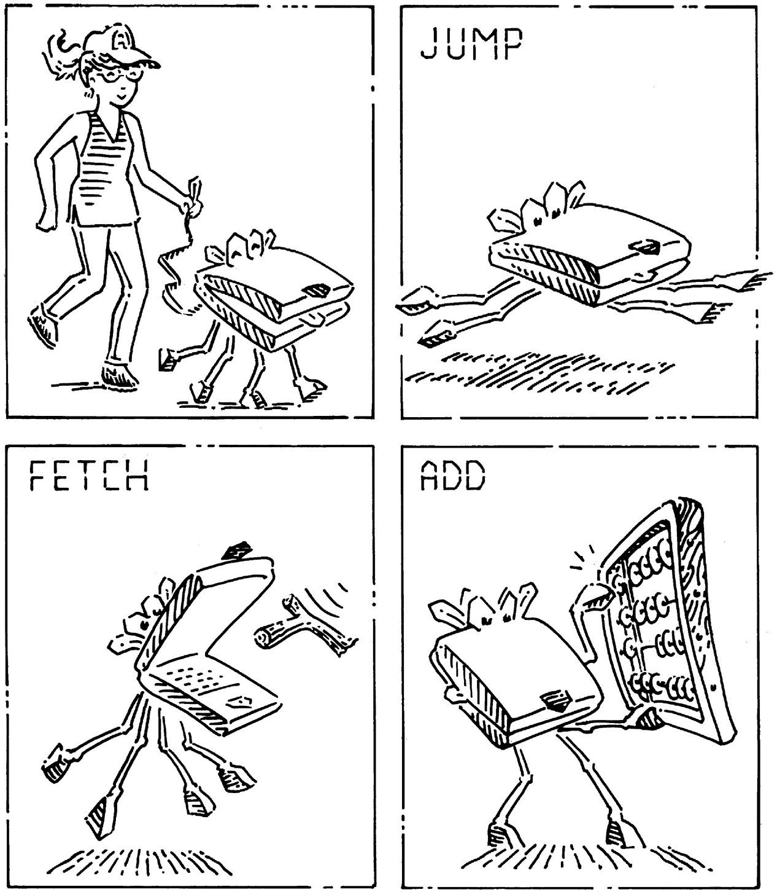

# 6 Architecture

- 6.1 Giới thiệu
- 6.2 Assembly Language
- 6.3 Lập trình
- 6.4 Machine Language
- 6.5 Ánh sáng, máy quay, diễn: Compile, Assemble và Load\*
- 6.6 Những nội dung khác\*
- 6.7 Sự phát triển của RISC-V Architecture
- 6.8 Một góc nhìn khác: x86 Architecture
- 6.9 Tổng kết Bài tập
- Câu hỏi phỏng vấn

## 6.1 GIỚI THIỆU

Các chương trước đã giới thiệu nguyên tắc và building block của digital design. Trong chương này, chúng ta tăng vài mức abstraction để xác định architecture của máy tính. Architecture là góc nhìn của người lập trình về máy tính. Nó được xác định bởi instruction set (ngôn ngữ) và vị trí operand (register và bộ nhớ). Có nhiều architecture khác nhau, như RISC-V, ARM, x86, MIPS, SPARC và PowerPC.

Bước đầu tiên để hiểu bất kỳ computer architecture nào là học ngôn ngữ của nó. Các từ trong ngôn ngữ máy tính được gọi là instruction. Vốn từ của máy tính được gọi là instruction set. Mọi chương trình chạy trên một máy tính đều dùng cùng instruction set. Ngay cả những ứng dụng phần mềm phức tạp như xử lý văn bản và bảng tính cuối cùng cũng được compile thành một chuỗi instruction đơn giản như cộng, trừ và branch. Computer instruction chỉ cả operation cần thực hiện lẫn operand cần dùng. Operand có thể đến từ bộ nhớ, register hoặc chính instruction.

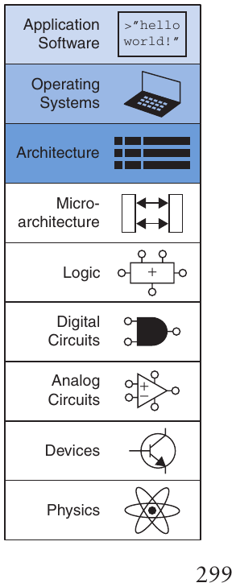

Phần cứng máy tính chỉ hiểu 1 và 0, nên instruction được mã hóa thành số binary theo một định dạng gọi là machine language. Giống như chúng ta dùng chữ cái để mã hóa ngôn ngữ con người, máy tính dùng số binary để mã hóa machine language. RISC-V architecture biểu diễn mỗi instruction thành một word 32-bit. Microprocessor là digital system đọc và thực thi machine language instruction. Tuy nhiên, con người thấy việc đọc machine language tẻ nhạt nên thích biểu diễn instruction bằng định dạng ký hiệu gọi là assembly language.

Instruction set của các architecture khác nhau giống các phương ngữ khác nhau hơn là các ngôn ngữ khác nhau. Hầu hết architecture đều định nghĩa instruction cơ bản—như cộng, trừ và branch—hoạt động trên bộ nhớ hoặc register. Khi đã học một instruction set, việc hiểu những instruction set khác khá đơn giản.

Computer architecture không xác định cách triển khai phần cứng bên dưới. Thường có nhiều cách triển khai phần cứng khác nhau cho cùng một architecture. Ví dụ, Intel và Advanced Micro Devices (AMD) đều bán nhiều microprocessor thuộc cùng x86 architecture. Tất cả microprocessor này có thể chạy cùng chương trình, nhưng dùng phần cứng bên dưới khác nhau. Vì vậy, chúng có các trade-offs về hiệu năng, giá và điện năng. Một số microprocessor được tối ưu cho server high-performance, trong khi số khác được tối ưu cho thời lượng pin dài trong thiết bị hoặc laptop. Cách bố trí cụ thể register, bộ nhớ, arithmetic/logical unit (ALU) và các building block khác để tạo thành microprocessor gọi là microarchitecture và là chủ đề của Chương 7.

> 
>
> Krste Asanović khởi đầu RISC-V như một dự án mùa hè. Ông là giáo sư khoa học máy tính tại University of California, Berkeley và Chủ tịch Hội đồng quản trị RISC-V International, trước đây gọi là RISC-V Foundation. Ông cũng là đồng sáng lập SiFive, công ty phát triển và thương mại hóa chip, board và công cụ hỗ trợ RISC-V. (Ảnh được in với sự cho phép.)

Trong sách này, chúng ta giới thiệu RISC-V (đọc là “risk five”) architecture, instruction set architecture open-source đầu tiên được hỗ trợ thương mại rộng rãi. Chúng ta mô tả RISC-V 32-bit integer instruction set (RV32I) phiên bản 2.2, tạo thành phần lõi của instruction set RISC-V. Mục 6.6 và 6.7 tóm tắt tính năng của các phiên bản architecture khác. RISC-V Instruction Set Manual, có sẵn trực tuyến, là tài liệu định nghĩa có thẩm quyền về architecture này.

RISC-V architecture ban đầu được định nghĩa năm 2010 tại University of California, Berkeley bởi Krste Asanović, Andrew Waterman, David Patterson và những người khác. Kể từ khi ra đời, nhiều người đã đóng góp vào sự phát triển của nó. RISC-V khác thường ở chỗ tính chất open-source khiến nó được dùng miễn phí, và khả năng của nó tương đương các architecture thương mại như ARM và x86. Đến nay mới có vài công ty xây dựng chip thương mại, gồm SiFive và Western Digital, nhưng mức độ áp dụng đang tăng nhanh. Chúng ta bắt đầu hành trình tìm hiểu RISC-V architecture bằng việc giới thiệu assembly language instruction, vị trí operand và cấu trúc lập trình phổ biến như branch, loop, thao tác array và function call. Sau đó, chúng ta mô tả cách assembly language được dịch thành machine language và chỉ cách chương trình được load vào bộ nhớ rồi thực thi.

> 
>
> Andrew Waterman thiết kế microprocessor tại SiFive, công ty ông đồng sáng lập với Krste Asanović năm 2015 nhằm cung cấp RISC-V core low-cost và chip tùy chỉnh. Ông nhận bằng tiến sĩ khoa học máy tính từ UC Berkeley năm 2016; tại đây, mệt mỏi với sự thất thường của các instruction-set architecture hiện có, ông đã co-designed RISC-V ISA và những RISC-V core đầu tiên. (Ảnh được in với sự cho phép.)

Xuyên suốt chương, chúng ta mô tả cách thiết kế RISC-V architecture được thúc đẩy bởi bốn nguyên tắc David Patterson và John Hennessy trình bày trong sách Computer Organization and Design: (1) tính đều đặn hỗ trợ sự đơn giản; (2) làm cho trường hợp thường gặp diễn ra nhanh; (3) nhỏ hơn thì nhanh hơn; và (4) thiết kế tốt đòi hỏi sự thỏa hiệp tốt.

## 6.2 ASSEMBLY LANGUAGE

Assembly language là biểu diễn human-readable của ngôn ngữ gốc của máy tính. Mỗi assembly language instruction chỉ cả operation cần thực hiện lẫn operand để thực hiện operation đó. Chúng ta giới thiệu các arithmetic instruction đơn giản và chỉ cách viết các operation này trong assembly language. Sau đó, chúng ta xác định operand của RISC-V instruction: register, bộ nhớ và hằng số.

> 
>
> David Patterson là giáo sư khoa học máy tính tại University of California, Berkeley từ năm 1976, và đồng phát minh reduced instruction set computing với John Hennessy năm 1984. Sau đó nó được thương mại hóa thành SPARC architecture. Ông giúp phát triển RISC-V architecture và tiếp tục giữ vai trò không thể thiếu trong sự phát triển của nó. (Ảnh được in với sự cho phép.)

Chương này giả định bạn đã phần nào quen với high-level programming language như C, C++ hoặc Java. (Các ngôn ngữ này gần như giống hệt nhau trong phần lớn ví dụ ở chương, nhưng khi khác nhau, chúng ta dùng C.) Phụ lục C giới thiệu C cho người có ít hoặc chưa có kinh nghiệm lập trình.

### 6.2.1 Instruction

Một trong những operation phổ biến nhất máy tính thực hiện là phép cộng. Ví dụ code 6.1 cho thấy code cộng biến `b` và `c` rồi ghi kết quả vào `a`. Code bên trái dùng high-level language (với cú pháp C, C++ và Java), rồi được viết lại bên phải bằng RISC-V assembly language. Lưu ý statement trong chương trình C kết thúc bằng dấu chấm phẩy.

Phần đầu của assembly instruction, `add`, gọi là mnemonic và chỉ operation cần thực hiện. Operation được thực hiện trên `b` và `c`, các source operand, và kết quả được ghi vào `a`, destination operand.

> Mnemonic (đọc là nuh- maa-nik) bắt nguồn từ từ Hy Lạp μιμνΕσκεστηαι, nghĩa là nhớ. Assembly language mnemonic dễ nhớ hơn pattern machine language gồm 0 và 1 biểu diễn cùng operation.

Ví dụ code 6.2 cho thấy phép trừ tương tự phép cộng. Định dạng instruction `sub` giống instruction `add`: destination operand, theo sau bởi hai source. Định dạng instruction nhất quán này là ví dụ của nguyên tắc thiết kế đầu tiên:

Nguyên tắc thiết kế 1: Tính đều đặn hỗ trợ sự đơn giản.

#### Ví dụ code 6.1 PHÉP CỘNG

Code High-Level

```
a = b + c;
```

Assembly Code RISC-V

```
add a, b, c
```

Instruction có số operand nhất quán—ở đây là hai source và một destination—dễ mã hóa và xử lý bằng phần cứng hơn. Code high-level phức tạp hơn được dịch thành nhiều RISC-V instruction, như Ví dụ code 6.3.

> RISC-V được gọi là “five” vì đây là RISC architecture thứ năm được phát triển tại Berkeley.

#### Ví dụ code 6.2 PHÉP TRỪ

Code High-Level

```
a = b − c;
```

Assembly Code RISC-V

```
sub a, b, c
```

> Trong Lời nói đầu, chúng tôi mô tả vài simulator và công cụ compile, mô phỏng C code và RISC-V assembly code. Chúng tôi cũng cung cấp bài thực hành (trên website đồng hành của sách này, xem Lời nói đầu) hướng dẫn cách dùng những công cụ này.

Trong các ví dụ high-level language, comment single-line bắt đầu bằng `//` và tiếp tục đến cuối dòng. Comment nhiều dòng bắt đầu bằng `/*` và kết thúc bằng `*/`. Trong RISC-V assembly language, chỉ dùng comment single-line. Chúng bắt đầu bằng dấu thăng (`#`) và tiếp tục đến cuối dòng. Chương trình assembly language ở Ví dụ code 6.3 lưu kết quả trung gian (`b` + `c`) trong biến tạm `t`. Dùng nhiều assembly language instruction để thực hiện operation phức tạp hơn là ví dụ của nguyên tắc thiết kế computer architecture thứ hai:

> 
>
> John Hennessy là giáo sư kỹ thuật điện và khoa học máy tính tại Stanford University, và giữ chức hiệu trưởng Stanford từ năm 2000 đến 2016. Ông đồng phát minh reduced instruction set computing với David Patterson. Ông cũng phát triển MIPS computer architecture và đồng sáng lập MIPS Computer Systems năm 1984. MIPS processor được dùng trong nhiều hệ thống thương mại, gồm sản phẩm của Silicon Graphics, Nintendo và Cisco. John Hennessy và David Patterson được trao Turing Award năm 2017 vì tiên phong trong phương pháp định lượng để thiết kế và đánh giá computer architecture. (Ảnh được in với sự cho phép.)

Nguyên tắc thiết kế 2: Làm cho trường hợp thường gặp diễn ra nhanh.

RISC-V instruction set làm cho trường hợp thường gặp diễn ra nhanh bằng cách chỉ bao gồm instruction đơn giản, thường dùng. Số instruction được giữ nhỏ để phần cứng cần giải mã instruction và operand có thể đơn giản, nhỏ và nhanh. Những operation phức tạp hơn, ít phổ biến hơn được thực hiện bằng chuỗi nhiều instruction đơn giản. Vì vậy, RISC-V là reduced instruction set computer (RISC) architecture. Architecture có nhiều instruction phức tạp, như x86 architecture của Intel, là complex instruction set computer (CISC). Ví dụ, x86 định nghĩa instruction “string move” sao chép một string (chuỗi ký tự) từ phần này của bộ nhớ sang phần khác. Operation như vậy cần nhiều, thậm chí hàng trăm instruction đơn giản trên RISC machine. Tuy nhiên, cái giá của việc triển khai instruction phức tạp trong CISC architecture là phần cứng và overhead bổ sung khiến instruction đơn giản chậm lại.

RISC architecture, như RISC-V, giảm thiểu độ phức tạp phần cứng và phần mã hóa instruction cần thiết bằng cách giữ tập instruction phân biệt nhỏ. Ví dụ, instruction set có 64 instruction đơn giản sẽ cần log<sub>2</sub>64 = 6 bit mã hóa operation, trong khi instruction set có 256 instruction cần log<sub>2</sub>256 = 8 bit mã hóa mỗi instruction. Trong CISC machine, dù instruction phức tạp có thể ít khi được dùng, chúng vẫn thêm overhead cho mọi instruction, kể cả instruction đơn giản.

### 6.2.2 Operand: Register, bộ nhớ và hằng số

Instruction hoạt động trên operand. Trong Ví dụ code 6.2, các biến `a`, `b` và `c` đều là operand. Nhưng máy tính hoạt động với 1 và 0, không phải tên biến. Instruction cần một vị trí vật lý để lấy dữ liệu binary. Operand có thể được lưu trong register hoặc bộ nhớ, hoặc là hằng số lưu ngay trong instruction. Máy tính dùng nhiều vị trí khác nhau để chứa operand nhằm tối ưu tốc độ và dung lượng dữ liệu. Operand được lưu dưới dạng hằng số hoặc trong register được truy cập nhanh nhưng chỉ chứa lượng dữ liệu nhỏ. Dữ liệu bổ sung phải được truy cập từ bộ nhớ, vốn lớn nhưng chậm. RISC-V được gọi là architecture 32-bit vì hoạt động trên dữ liệu 32-bit.

#### Ví dụ code 6.3 CODE PHỨC TẠP HƠN

Code High-Level

```
a = b + c − d;   // single-line comment
             /* multiple-line
                comment */
```

Assembly Code RISC-V

```
add t, b, c  # t = b + c
sub a, t, d  # a = t − d
```

> Các phiên bản 64- và 128-bit của RISC-V architecture cũng tồn tại, nhưng chúng ta tập trung vào phiên bản 32-bit trong sách này. Các phiên bản rộng hơn (RV64I và RV128I) gần như giống hệt phiên bản 32-bit (RV32I), ngoại trừ độ rộng register và memory address. Những bổ sung chính khác là instruction chỉ hoạt động trên nửa dưới của word và memory operation truyền word rộng hơn.

Register

Instruction cần truy cập operand nhanh để chạy nhanh, nhưng operand lưu trong bộ nhớ mất nhiều thời gian để lấy. Vì vậy, phần lớn architecture quy định số register nhỏ để chứa operand thường dùng. RISC-V architecture có 32 register, gọi là register set, lưu trong bộ nhớ multiported nhỏ gọi là register file. Càng ít register thì truy cập càng nhanh. Điều này dẫn đến nguyên tắc thiết kế thứ ba:

Nguyên tắc thiết kế 3: Nhỏ hơn thì nhanh hơn.

Tra cứu thông tin từ một số ít sách liên quan trên bàn nhanh hơn nhiều so với tìm thông tin trong các kệ của thư viện. Tương tự, đọc dữ liệu từ register file nhỏ nhanh hơn đọc từ bộ nhớ lớn. Register file thường được xây dựng từ SRAM array nhỏ (xem Mục 5.5.3).

Ví dụ code 6.4 cho thấy instruction `add` với register operand. Các biến `a`, `b` và `c` được tùy ý đặt vào `s0`, `s1` và `s2`. Tên `s1` được đọc là “register s1” hoặc đơn giản “s1”. Instruction cộng các giá trị 32-bit trong `s1` (`b`) và `s2` (`c`), rồi ghi kết quả 32-bit vào `s0` (`a`). Ví dụ code 6.5 cho thấy RISC-V assembly code dùng register `t0` để lưu phép tính trung gian `b` + `c`.

> Phụ lục B, nằm ở mặt trong bìa sách, cung cấp bản tóm tắt tiện dụng của toàn bộ RISC-V instruction set.

#### Ví dụ code 6.4 REGISTER OPERAND

Code High-Level

```
a = b + c;
```

Assembly Code RISC-V

```
#  s0 = a, s1 = b, s2 = c
   add s0, s1, s2        # a = b + c
```

#### Ví dụ code 6.5 TEMPORARY REGISTER

Code High-Level

```
a = b + c − d;
```

Assembly Code RISC-V

```
#  s0 = a, s1 = b, s2 = c, s3 = d, t0 = t
  add t0, s1, s2   # t = b + c
  sub s0, t0, s3   # a = t − d
```

> 
>
> Alan Turing, 1912–1954
>
> Nhà toán học và khoa học máy tính người Anh, được coi là người sáng lập khoa học máy tính lý thuyết và trí tuệ nhân tạo. Ông phát minh Turing machine, mô hình toán học về tính toán biểu diễn một processor trừu tượng. Ông cũng phát triển một máy điện cơ để giải mã thông điệp được mã hóa trong Thế chiến II, giúp rút ngắn chiến tranh và cứu hàng triệu sinh mạng. Năm 1952, Turing bị truy tố vì hành vi đồng tính và bị buộc điều trị triệt sản hóa học thay cho án tù. Hai năm sau, ông chết do ngộ độc cyanide. Turing Award, vinh dự cao nhất trong lĩnh vực máy tính, được đặt tên để tôn vinh ông và trao hằng năm từ năm 1966. Hiện giải đi kèm khoản tiền thưởng \$1 triệu.

#### Ví dụ 6.1 DỊCH CODE HIGH-LEVEL SANG ASSEMBLY LANGUAGE

Dịch code high-level sau sang RISC-V assembly language. Giả sử biến `a−c` được giữ trong register `s0−s2`, còn `f−j` trong `s3−s7`.

```
// high-level code
a = b − c;
f = (g + h) − (i + j);
```

Lời giải Chương trình dùng bốn assembly language instruction.

```
# RISC-V assembly code
# s0 = a, s1 = b, s2 = c, s3 = f, s4 = g, s5 = h, s6 = i, s7 = j
  sub s0, s1, s2 # a = b − c
  add t0, s4, s5 # t0 = g + h
  add t1, s6, s7 # t1 = i + j
  sub s3, t0, t1 # f = (g + h) − (i + j)
```

Register Set

Bảng 6.1 liệt kê tên và cách dùng từng register trong 32 RISC-V register. Register được đánh số 0 đến 31 và được đặt tên đặc biệt để chỉ mục đích thông thường. Assembly instruction thường dùng tên đặc biệt—ví dụ `s1`—cho rõ ràng, nhưng cũng có thể dùng số register (ví dụ `x9` cho register số 9). Register `zero` luôn giữ hằng số 0; giá trị ghi vào nó bị bỏ đi. Register `s0` đến `s11` (register 8–9 và 18–27) và `t0` đến `t6` (register 5–7 và 28–31) dùng để lưu biến; `ra` và `a0` đến `a7` có cách dùng đặc biệt trong function call, như thảo luận ở Mục 6.3.7. Register 2 đến 4 còn gọi là `sp`, `gp` và `tp`, sẽ được mô tả sau.

Hằng số/Immediate

Ngoài register operation, RISC-V instruction có thể dùng operand hằng số hay immediate. Những hằng số này gọi là immediate vì giá trị có sẵn ngay từ instruction và không cần truy cập register hoặc bộ nhớ. Ví dụ code 6.6 cho thấy add immediate instruction, `addi`, cộng immediate vào register. Trong assembly code, immediate có thể viết ở hệ decimal, hexadecimal hoặc binary. Hằng số hexadecimal trong RISC-V assembly language bắt đầu bằng 0x, còn hằng số binary bắt đầu bằng 0b, giống trong C. Immediate là số two’s complement 12-bit, nên được sign-extended thành 32 bit. Instruction `addi` là cách hữu ích để khởi tạo giá trị register bằng hằng số nhỏ. Ví dụ code 6.7 khởi tạo biến `i`, `x` và `y` lần lượt thành 0, 2032, –78.

> Immediate có thể viết ở hệ decimal, hexadecimal hoặc binary. Ví dụ, mọi instruction sau đều đặt giá trị decimal 109 vào `s5`:
>
> ```
> addi s5,x0,0b1101101
> addi s5,x0,0x6D
> addi s5,x0,109
> ```

Bảng 6.1 RISC-V register set

| Tên | Số register | Cách dùng |
|---|---|---|
| `zero` | `x0` | Giá trị hằng số 0 |
| `ra` | `x1` | Return address |
| `sp` | `x2` | Stack pointer |
| `gp` | `x3` | Global pointer |
| `tp` | `x4` | Thread pointer |
| `t0−2` | `x5−7` | Temporary register |
| `s0/fp` | `x8` | Saved register/Frame pointer |
| `s1` | `x9` | Saved register |
| `a0−1` | `x10−11` | Function argument/Return value |
| `a2−7` | `x12−17` | Function argument |
| `s2−11` | `x18−27` | Saved register |
| `t3−6` | `x28−31` | Temporary register |

#### Ví dụ code 6.6 IMMEDIATE OPERAND

Code High-Level

```
a = a + 4;
b = a − 12;
```

Assembly Code RISC-V

```
#   s0 = a, s1 = b
  addi s0, s0, 4     # a = a + 4
  addi s1, s0, −12   # b = a − 12
```

Để tạo hằng số lớn hơn, dùng load upper immediate instruction (`lui`) theo sau bởi add immediate instruction (`addi`), như Ví dụ code 6.8. Instruction `lui` load immediate 20-bit vào 20 bit quan trọng nhất của instruction và đặt 0 vào các bit ít quan trọng nhất.

#### Ví dụ code 6.7 KHỞI TẠO GIÁ TRỊ BẰNG IMMEDIATE

Code High-Level

```
i = 0;
x = 2032;
y = −78;
```

Assembly Code RISC-V

```
# s4 = i, s5 = x, s6 = y
  addi s4, zero, 0    # i = 0
  addi s5, zero, 2032 # x = 2032
  addi s6, zero, −78  # y = −78
```

> Data type `int` trong C biểu diễn một số signed, tức số nguyên two’s complement. Đặc tả C yêu cầu `int` rộng ít nhất 16 bit nhưng không yêu cầu kích thước cụ thể. Phần lớn compiler hiện đại (gồm compiler cho RV32I) dùng 32 bit, nên `int` biểu diễn số trong khoảng [−2<sup>31</sup>, 2<sup>31</sup>− 1]. C cũng định nghĩa `int32_t` là số nguyên two’s complement 32-bit, nhưng tên này gõ bất tiện hơn.

Khi tạo immediate lớn, nếu immediate 12-bit trong `addi` âm (tức bit 11 bằng 1), upper immediate trong `lui` phải tăng thêm một. Hãy nhớ `addi` sign-extends immediate 12-bit, nên immediate âm sẽ có toàn 1 ở 20 bit phía trên. Vì toàn 1 là −1 trong two’s complement, cộng toàn 1 vào upper immediate dẫn đến trừ 1 khỏi upper immediate. Ví dụ code 6.9 cho thấy trường hợp như vậy, với immediate mong muốn là 0xFEEDA987. `lui s2, 0xFEEDB` đặt 0xFEEDB000 vào `s2`. Upper immediate 20-bit mong muốn, 0xFEEDA, được tăng thêm 1. 0x987 là biểu diễn 12-bit của −1657, nên `addi s2, s2, −1657` cộng `s2` với immediate 12-bit đã sign- extended (0xFEEDB000 + 0xFFFFF987 = 0xFEEDA987), rồi đặt kết quả vào `s2`, đúng như mong muốn.

#### Ví dụ code 6.8 VÍ DỤ HẰNG SỐ 32-BIT

Code High-Level

```
int a = 0xABCDE123;
```

Assembly Code RISC-V

```
lui  s2, 0xABCDE      # s2 = 0xABCDE000
addi s2, s2, 0x123    # s2 = 0xABCDE123
```

Bộ nhớ

Nếu register là không gian lưu trữ operand duy nhất, chúng ta sẽ bị giới hạn ở chương trình đơn giản với không quá 32 biến. Tuy nhiên, dữ liệu cũng có thể lưu trong bộ nhớ. Trong khi register file nhỏ và nhanh, bộ nhớ lớn hơn và chậm hơn. Vì lý do này, biến thường dùng được giữ trong register. Trong RISC-V architecture, instruction chỉ hoạt động trên register, nên dữ liệu lưu trong bộ nhớ phải chuyển sang register trước khi xử lý. Kết hợp bộ nhớ và register cho phép chương trình truy cập lượng dữ liệu lớn khá nhanh. Hãy nhớ từ Mục 5.5 rằng bộ nhớ được tổ chức thành array gồm các data word. RV32I RISC-V architecture dùng memory address 32-bit và data word 32-bit.

RISC-V dùng bộ nhớ byte-addressable. Nghĩa là mỗi byte trong bộ nhớ có địa chỉ riêng, như Hình 6.1(a). Word 32-bit gồm bốn byte 8-bit, nên mỗi word address là bội số của 4. Most significant byte (MSB) ở bên trái, least significant byte (LSB) ở bên phải. Thứ tự byte trong word được thảo luận thêm ở Mục 6.6.1. Cả word address 32-bit lẫn giá trị dữ liệu ở Hình 6.1(b) đều biểu diễn bằng hexadecimal. Ví dụ, data word 0xF2F1AC07 được lưu tại memory address 4. Theo quy ước, bộ nhớ được vẽ với memory address thấp về phía dưới và memory address cao về phía trên.

#### Ví dụ code 6.9 HẰNG SỐ 32-BIT VỚI BIT 11 BẰNG MỘT

Code High-Level

```
int a = 0xFEEDA987;
```

Assembly Code RISC-V

```
lui  s2, 0xFEEDB      # s2 = 0xFEEDB000
addi s2, s2, −1657    # s2 = 0xFEEDA987
```

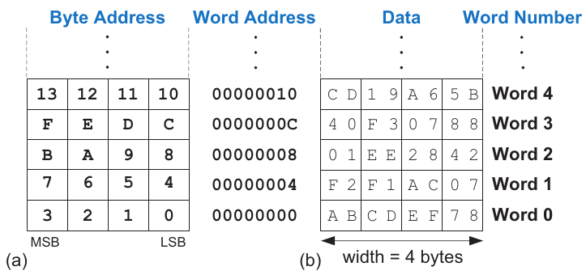

Hình 6.1 Bộ nhớ byte-addressable RISC-V hiển thị: (a) byte address và (b) dữ liệu

Load word instruction, `lw`, đọc một data word từ bộ nhớ vào register. Ví dụ code 6.10 load memory word 2, nằm tại địa chỉ 8, vào `a` (`s7`). Trong C, số trong ngoặc vuông là index hay word number, được thảo luận thêm ở Mục 6.3.6. Instruction `lw` chỉ memory address bằng một offset cộng với base register. Hãy nhớ mỗi data word dài 4 byte, nên word address bằng bốn lần word number. Word số 0 ở địa chỉ 0, word 1 ở địa chỉ 4, word 2 ở địa chỉ 8, v.v. Trong ví dụ này, base register zero được cộng với offset 8 để có địa chỉ 8, hay word 2. Sau khi load word instruction (`lw`) được thực thi ở Ví dụ code 6.10, `s7` giữ giá trị 0x01EE2842, tức giá trị dữ liệu được lưu tại memory address 8 trong Hình 6.1.

> Nhiều cách triển khai RISC-V yêu cầu địa chỉ word-aligned—tức word address chia hết cho bốn—cho `lw` và `sw`. Một số architecture, như x86, cho phép đọc và ghi dữ liệu non-word-aligned, nhưng số khác yêu cầu alignment nghiêm ngặt để đơn giản. Trong sách này, chúng ta giả định alignment nghiêm ngặt. Dĩ nhiên, byte address cho load byte và store byte, `lb` và `sb` (thảo luận ở Mục 6.3.6), không cần word aligned.

Store word instruction, `sw`, ghi một data word từ register vào bộ nhớ. Ví dụ code 6.11 ghi giá trị 42 từ register `t3` vào memory word 5, nằm tại địa chỉ 20.

#### Ví dụ code 6.10 ĐỌC BỘ NHỚ

Code High-Level

```
a = mem[2];
```

Assembly Code RISC-V

```
#  s7 = a
   lw s7, 8(zero) # s7 = data at memory address (zero + 8)
```

## 6.3 LẬP TRÌNH

> 
>
> Katherine Johnson, 1918–2020
>
> Creola Katherine Johnson là nhà toán học và khoa học máy tính, một trong những phụ nữ Mỹ gốc Phi đầu tiên làm việc tại NASA. Năm 18 tuổi, bà tốt nghiệp loại xuất sắc nhất với bằng cử nhân toán học và tiếng Pháp từ West Virginia University. Khi gia nhập NASA, bà làm “computer”, một nhóm người, chủ yếu là phụ nữ, thực hiện các phép tính chính xác. Năm 1961, Johnson tính quỹ đạo của Alan Shepard, người Mỹ đầu tiên vào không gian. Trong lịch sử đầu NASA, phụ nữ bị ngăn cản ghi tên trên báo cáo, ngay cả khi họ làm phần lớn công việc. Đồng nghiệp NASA tin tưởng phép tính của bà, nên Johnson giúp thúc đẩy việc áp dụng máy tính điện tử bằng cách xác minh các phép tính của chúng. Tổng thống Barack Obama trao cho bà Presidential Medal of Freedom năm 2015.

Ngôn ngữ phần mềm như C hoặc Java gọi là high-level programming language vì chúng được viết ở mức trừu tượng hơn assembly language. Nhiều high-level language dùng cấu trúc phần mềm chung như arithmetic operation và logical operation, if/else statement, for loop và while loop, array indexing và function call. Xem Phụ lục C để có thêm ví dụ các cấu trúc này trong C. Trong mục này, chúng ta bắt đầu bằng thảo luận program flow và instruction hỗ trợ những cấu trúc high-level này. Sau đó, chúng ta tìm hiểu cách dịch cấu trúc high-level thành RISC-V assembly code.

### 6.3.1 Program Flow

Giống dữ liệu, instruction được lưu trong bộ nhớ. Mỗi instruction dài 32 bit (4 byte), như sẽ thảo luận ở Mục 6.4, nên địa chỉ instruction liên tiếp tăng thêm bốn. Ví dụ, trong đoạn code dưới đây, instruction `addi` nằm trong bộ nhớ tại địa chỉ 0x538 và instruction tiếp theo, `lw`, ở địa chỉ 0x53C.

Memory address Instruction

```
0x538 addi s1, s2, s3
0x53C lw   t2, 8(s1)
0x540 sw   s3, 3(t6)
```

Program counter—còn gọi là PC—theo dõi instruction hiện tại. PC giữ memory address của instruction hiện tại và tăng thêm bốn sau khi mỗi instruction hoàn tất để processor đọc hay fetch instruction tiếp theo từ bộ nhớ. Ví dụ, khi `addi` đang thực thi, PC bằng 0x538. Sau khi `addi` hoàn tất, PC tăng thêm bốn lên 0x53C và processor fetch instruction `lw` tại địa chỉ đó.

### 6.3.2 Logical Instruction, Shift Instruction và Multiply Instruction

RISC-V architecture định nghĩa nhiều logical instruction và arithmetic instruction. Chúng ta giới thiệu ngắn gọn các instruction này ở đây vì chúng cần thiết để triển khai cấu trúc higher-level.

#### Ví dụ code 6.11 GHI BỘ NHỚ

Code High-Level

```
mem[5] = 42;
```

Assembly Code RISC-V

```
addi t3, zero, 42     # t3 = 42
sw     t3, 20(zero)   # data value at memory address 20 = 42
```

Logical Instruction

RISC-V logical operation gồm `and`, `or` và `xor`. Mỗi operation này hoạt động bitwise trên hai source register và ghi kết quả vào destination register, như Hình 6.2. Phiên bản immediate của các logical operation này, `andi`, `ori` và `xori`, dùng một source register và immediate sign-extended 12-bit.[^1]

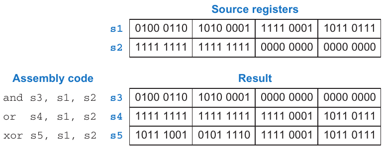

Hình 6.2 Logical operation

Instruction `and` hữu ích để xóa hoặc mask bit (tức ép bit thành 0). Ví dụ, instruction `and` ở Hình 6.2 xóa các bit trong `s1` ở vị trí thấp trong `s2`. Trong trường hợp này, hai byte dưới của `s1` bị xóa. Hai byte trên không bị mask của `s1`, 0x46A1, được đặt vào `s3`. Có thể xóa bất kỳ tập con register bit nào. Ví dụ, để xóa bit 3 của `s0` và đặt kết quả vào `s6,` dùng `andi s6, s0, 0xFF7`.

Instruction `or` hữu ích để kết hợp bitfield từ hai register. Ví dụ, 0x347A0000 OR 0x000072FC = 0x347A72FC. Nó cũng có thể dùng để đặt bit trong register (tức ép bit thành 1). Ví dụ, để đặt bit 5 của `s0` và đặt kết quả vào `s7`, dùng `ori s7, s0, 0x020`.

Có thể thực hiện logical NOT operation bằng `xori s8, s1, −1`. Hãy nhớ −1 (0xFFF) được sign-extended thành 0xFFFFFFFF (toàn 1). XOR với toàn 1 đảo tất cả bit, nên `s8` nhận one’s complement của `s1`.

Shift Instruction

> RISC-V base instruction set hiện không bao gồm bit manipulation ngoài shift. Một số instruction set architecture còn có rotate instruction, cũng như các bit manipulation instruction khác như bit clear, bit set, v.v. Tính đến năm 2021, Standard Extension “B” của RISC-V cho Bit Manipulations đã được lên kế hoạch nhưng chưa hoàn tất.

Shift instruction dịch giá trị trong register sang trái hoặc phải, loại bỏ bit ở đầu mút. RISC-V shift operation gồm `sll` (shift left logical), `srl` (shift right logical) và `sra` (shift right arithmetic). Như thảo luận ở Mục 5.2.5, left shift luôn điền 0 vào những bit ít quan trọng nhất. Tuy nhiên, right shift có thể là logical (0 được dịch vào các bit quan trọng nhất) hoặc arithmetic (sign bit được dịch vào các bit quan trọng nhất). Những shift này xác định shift amount trong source register thứ hai. Phiên bản immediate của mỗi instruction cũng có sẵn (`slli`, `srli` và `srai`), với lượng dịch được xác định bởi unsigned immediate 5-bit.

Hình 6.3 cho thấy assembly code và giá trị register kết quả cho `slli`, `srli` và `srai` khi dịch theo giá trị immediate. `s5` được dịch theo lượng immediate, và kết quả được đặt vào destination register.

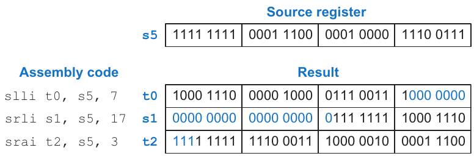

Hình 6.3 Shift instruction với shift amount immediate

Như thảo luận ở Mục 5.2.5, dịch trái một giá trị N vị trí tương đương nhân nó với 2<sup>N</sup>. Ví dụ, `slli s0, s0, 3` nhân `s0` với 8 (tức 2<sup>3</sup>). Tương tự, dịch phải một giá trị N vị trí tương đương chia nó cho 2<sup>N</sup>. Arithmetic right shift chia số two’s complement, trong khi logical right shift chia số unsigned.

Logical shift cũng được dùng với instruction `and` và `or` để trích hoặc ghép bitfield. Ví dụ, code sau trích bit 15:8 từ `s7` và đặt vào byte dưới của `s6`. Nếu `s7` là 0x1234ABCD, thì `s6` sẽ là 0xAB sau khi code này hoàn tất.

```
srli s6, s7, 8
andi s6, s6, 0xFF
```

Multiply Instruction\*

Phép nhân khác đôi chút so với arithmetic operation khác vì nhân hai số N-bit cho tích 2N-bit. RISC-V architecture cung cấp nhiều multiply instruction cho kết quả 32- hoặc 64-bit. Những instruction này không thuộc RV32I mà nằm trong extension RVM (RISC-V multiply/divide).

Multiply instruction (`mul`) nhân hai số 32-bit và cho tích 32-bit. `mul s1, s2, s3` nhân các giá trị trong `s2` và `s3`, đặt 32 bit ít quan trọng nhất của tích vào `s1`; 32 bit quan trọng nhất của tích bị bỏ đi. Instruction này hữu ích khi nhân số nhỏ có tích vừa trong 32 bit. 32 bit dưới của tích giống nhau dù operand được xem là signed hay unsigned.

Có ba phiên bản operation “multiply high”: `mulh`, `mulhsu` và `mulhu`. Những instruction này đặt 32 bit cao của kết quả nhân vào destination register. `mulh` (multiply high signed signed) xem cả hai operand là signed. `mulhsu` (multiply high signed unsigned) xem operand đầu là signed và operand thứ hai là unsigned, còn `mulhu` (multiply high unsigned unsigned) xem cả hai là unsigned. Ví dụ, `mulhsu t1, t2, t3` xem `t2` là số signed (two’s complement) 32-bit và `t3` là số unsigned 32-bit, nhân hai source operand này, rồi đặt 32 bit trên của kết quả vào `t1`. Dùng chuỗi hai instruction—một instruction “multiply high” theo sau bởi instruction `mul`—sẽ đặt toàn bộ kết quả 64-bit của phép nhân 32-bit vào hai register do người dùng chỉ định. Ví dụ, code sau nhân các số signed 32-bit trong `s3` và `s5`, đặt tích 64-bit vào `t1` và `t2`. Tức là {`t1`, `t2`} = `s3` × `s5`.

```
mulh t1, s3, s5
mul  t2, s3, s5
```

### 6.3.3 Branching

Chương trình sẽ nhàm chán nếu lúc nào cũng chỉ chạy theo cùng một thứ tự, bất kể input. Một ưu thế của máy tính so với máy tính bỏ túi là khả năng ra quyết định. Máy tính thực hiện nhiệm vụ khác nhau tùy input. Ví dụ, if/else statement, switch/case statement, while loop và for loop đều thực thi code có điều kiện dựa trên phép kiểm tra nào đó. Branch instruction thay đổi flow của chương trình để processor có thể fetch instruction không theo thứ tự liên tiếp trong bộ nhớ. Chúng thay đổi PC để bỏ qua đoạn code hoặc lặp lại code trước đó. Conditional branch instruction thực hiện kiểm tra và chỉ branch nếu phép kiểm tra là TRUE. Unconditional branch instruction, gọi là jump, luôn branch.

Conditional Branch

RISC-V instruction set có sáu conditional branch instruction, mỗi instruction nhận hai source register và một label chỉ đích đến. `beq` (branch if equal) branch khi giá trị trong hai source register bằng nhau. `bne` (branch if not equal) branch khi chúng không bằng nhau. `blt` (branch if less than) branch khi giá trị trong source register thứ nhất nhỏ hơn giá trị trong source register thứ hai, và `bge` (branch if greater than or equal to) branch khi giá trị thứ nhất lớn hơn hoặc bằng giá trị thứ hai. `blt` và `bge` xem operand là số signed, trong khi `bltu` và `bgeu` xem operand là unsigned.

> Không cần `bgt` hoặc `ble` vì có thể có chúng bằng cách đổi thứ tự source register của `blt` và `bge`. Tuy nhiên, chúng có sẵn dưới dạng pseudoinstruction (xem Mục 6.3.8).

Ví dụ code 6.12 minh họa cách dùng `beq`. Khi chương trình đến branch if equal instruction (`beq`), giá trị trong `s0` bằng giá trị trong `s1`, nên branch được thực hiện. Vì vậy, instruction tiếp theo được thực thi là instruction `add` ngay sau label tên `target`. Instruction `addi` và `sub` nằm giữa branch và label không được thực thi.

Assembly code dùng label để chỉ vị trí instruction trong chương trình. Label tham chiếu instruction ngay sau label. Khi assembly code được dịch thành machine code, các label này tương ứng với instruction address (sẽ được thảo luận ở Mục 6.4.3 và 6.4.4). Label RISC-V assembly được theo sau bởi dấu hai chấm (:). Phần lớn người lập trình thụt đầu dòng instruction nhưng không thụt label để label nổi bật.

Trong Ví dụ code 6.13, branch không được thực hiện vì `s0` bằng `s1`, và code tiếp tục thực thi ngay sau instruction `bne` (branch if not equal). Mọi instruction trong đoạn code này đều được thực thi.

#### Ví dụ code 6.12 CONDITIONAL BRANCHING BẰNG `beq`

Assembly Code RISC-V

```
 addi  s0, zero, 4            # s0 = 0 + 4 = 4
 addi  s1, zero, 1            # s1 = 0 + 1 = 1
 slli  s1, s1, 2              # s1 = 1 << 2 = 4
 beq   s0, s1, target         # s0 = = s1, so branch is taken
 addi  s1, s1, 1              # not executed
 sub   s1, s1, s0             # not executed
target:                       # label
 add   s1, s1, s0             # s1 = 4 + 4 = 8
```

Jump

Chương trình có thể jump—tức branch vô điều kiện—bằng một trong ba instruction: jump (`j`), jump and link (`jal`) hoặc jump register (`jr`). `j` nhảy trực tiếp đến instruction tại label đã chỉ định. Ví dụ code 6.14 cho thấy dùng instruction `j` (jump) để bỏ qua ba instruction và tiếp tục tại instruction `add` sau label `target`. Sau khi instruction `j` thực thi, chương trình tiếp tục vô điều kiện với instruction `add` tại label `target`. Mọi instruction giữa jump và label đều bị bỏ qua. Chúng ta sẽ thảo luận instruction `jal` và `jr` ở Mục 6.3.7, nơi chúng được dùng cho function call.

#### Ví dụ code 6.13 CONDITIONAL BRANCHING BẰNG `bne`

Assembly Code RISC-V

```
 addi   s0, zero, 4             # s0 = 0 + 4 = 4
 addi   s1, zero, 1             # s1 = 0 + 1 = 1
 slli   s1, s1, 2               # s1 = 1 << 2 = 4
 bne      s0, s1, target        # branch not taken
 addi   s1, s1, 1               # s1 = 4 + 1 = 5
 sub      s1, s1, s0            # s1 = 5 − 4 = 1
target:
 add     s1, s1, s0             # s1 = 1 + 4 = 5
```

### 6.3.4 Conditional Statement

If, if/else và switch/case statement là những conditional statement thường dùng trong high-level language. Mỗi cấu trúc thực thi có điều kiện một block code gồm một hoặc nhiều statement. Mục này cho thấy cách dịch những cấu trúc high-level này sang RISC-V assembly language.

If Statement

If statement chỉ thực thi block code, gọi là if block, khi điều kiện được thỏa mãn. Ví dụ code 6.15 cho thấy cách dịch if statement thành RISC-V assembly code. Assembly code của if statement kiểm tra điều kiện ngược với điều kiện trong code high-level. Trong Ví dụ code 6.15, code high-level kiểm tra `apples = = oranges`. Assembly code kiểm tra `apples != oranges` bằng `bne` để bỏ qua if block nếu điều kiện không được thỏa mãn. Nếu không (tức khi `apples = = oranges`), branch không được thực hiện và if block được thực thi.

> Trong C và nhiều high-level programming language khác, dấu bằng kép `= =` là phép so sánh bằng, trả TRUE nếu hai vế bằng nhau. `!=` là phép so sánh khác.

#### Ví dụ code 6.14 UNCONDITIONAL BRANCHING BẰNG `j`

Assembly Code RISC-V

```
 j      target          # jump to target
 srai  s1, s1, 2        # not executed
 addi  s1, s1, 1        # not executed
 sub   s1, s1, s0       # not executed
target:
 add   s1, s1, s0       # s1 = s1 + s0
```

If/else Statement

If/else statement thực thi một trong hai block code tùy điều kiện. Khi điều kiện trong if statement được thỏa mãn, if block được thực thi. Nếu không, else block được thực thi. Ví dụ code 6.16 cho thấy một if/else statement.

Giống if statement, assembly code if/else kiểm tra điều kiện ngược với code high-level. Trong Ví dụ code 6.16, code high-level kiểm tra (`apples = = oranges`), còn assembly code kiểm tra (`apples != oranges`). Nếu điều kiện ngược này là TRUE, `bne` bỏ qua if block và thực thi else block. Nếu không, if block thực thi và kết thúc bằng jump (`j`) qua else block.

#### Ví dụ code 6.15 IF STATEMENT

Code High-Level

```
if (apples = = oranges)
 f = g + h;
apples = oranges − h;
```

Assembly Code RISC-V

```
# s0 = apples, s1 = oranges
# s2 = f, s3 = g, s4 = h
    bne s0, s1, L1 # skip if (apples != oranges)
    add s2, s3, s4 # f = g + h
L1: sub s0, s1, s4 # apples = oranges − h
```

Switch/case Statement\*

Switch/case statement, còn gọi đơn giản là case statement, thực thi một trong vài block code tùy điều kiện. Nếu không điều kiện nào được thỏa mãn, default block được thực thi. Case statement tương đương chuỗi if/else statement lồng nhau. Ví dụ code 6.17 cho thấy hai đoạn code high-level có cùng chức năng: chúng tính xem cần nhả \$20, \$50 hay \$100 từ ATM (máy rút tiền tự động) tùy nút được nhấn. Cách triển khai RISC-V assembly giống nhau cho cả hai đoạn code high-level.

#### Ví dụ code 6.16 IF/ELSE STATEMENT

Code High-Level

```
if (apples = = oranges)
 f = g + h;
else
 apples = oranges − h;
```

Assembly Code RISC-V

```
# s0 = apples, s1 = oranges
# s2 = f, s3 = g, s4 = h
    bne s0, s1, L1 # skip if (apples != oranges)
    add s2, s3, s4 # f = g + h
    j     L2
L1: sub s0, s1, s4 # apples = oranges − h
L2:
```

#### Ví dụ code 6.17 SWITCH/CASE STATEMENT

Code High-Level

```
switch (button) {
 case 1:   amt = 20;  break;


 case 2:   amt = 50;  break;


 case 3:   amt = 100; break;


 default: amt = 0;
}

// equivalent function using
// if/else statements
if          (button = = 1)   amt = 20;
else if (button = = 2)   amt = 50;
else if (button = = 3)   amt = 100;
else                              amt = 0;
```

Assembly Code RISC-V

```
# s0 = button, s1 = amt
case1:
 addi  t0, zero, 1                  # t0 = 1
 bne   s0, t0, case2                # button = = 1?
 addi  s1, zero, 20                 # if yes, amt = 20
 j         done                     # break out of case
case2:
 addi  t0, zero, 2                  # t0 = 2
 bne       s0, t0, case3            # button = = 2?
 addi  s1, zero, 50                 # if yes, amt = 50
 j         done                     # break out of case
case3:
 addi  t0, zero, 3                  # t0 = 3
 bne       s0, t0, default          # button = = 3?
 addi  s1, zero, 100                # if yes, amt = 100
 j         done                     # break out of case
default:
 add       s1, zero, zero           # amt=0
done:
```

### 6.3.5 Làm quen với loop

Loop thực thi lặp lại một block code tùy điều kiện. While loop và for loop thường được dùng trong high-level language. Mục này cho thấy cách dịch chúng sang RISC-V assembly language, tận dụng conditional branching.

While Loop

While loop thực thi lặp lại block code trong khi điều kiện còn được thỏa mãn—tức đến khi điều kiện không được thỏa mãn. While loop ở Ví dụ code 6.18 xác định giá trị `x` sao cho 2<sup>x</sup> = 128. Nó thực thi bảy lần, đến khi `pow` = 128.

Giống if/else statement, assembly code của while loop kiểm tra điều kiện ngược với code high-level. Nếu điều kiện ngược này là TRUE (ở đây, `s0` = = 128), while loop kết thúc. Nếu không, branch không được thực hiện và loop body thực thi. Ví dụ code 6.18 khởi tạo `pow` thành 1 và `x` thành 0 trước while loop. While loop so sánh `pow` với 128 và thoát loop nếu bằng nhau. Nếu không, nó nhân đôi `pow` (bằng left shift), tăng `x` rồi branch về đầu while loop.

Do/while loop tương tự while loop nhưng thực thi loop body một lần trước khi kiểm tra điều kiện. Ví dụ code 6.19 minh họa loop như vậy. Lưu ý rằng, khác các ví dụ trước, branch kiểm tra cùng điều kiện với code high-level.

For Loop

Việc khởi tạo biến trước while loop, kiểm tra biến đó trong điều kiện loop và thay đổi biến đó mỗi lần qua while loop rất phổ biến. For loop là cách viết tắt tiện dụng kết hợp khởi tạo, kiểm tra điều kiện và thay đổi biến tại một nơi. Định dạng code high-level của for loop là:

#### Ví dụ code 6.18 WHILE LOOP

Code High-Level

<pre>
// determines the power
// of x such that 2<sup>x</sup>  = 128
int pow = 1;
int x     = 0;


while (pow != 128) {
 pow = pow * 2;
 x = x + 1;
}
</pre>

Assembly Code RISC-V

```
#  s0 =  pow, s1 =  x
      addi s0,  zero, 1              # pow = 1
      add   s1,  zero, zero          # x = 0

      addi t0,  zero, 128            # t0 = 128
while: beq   s0,  t0, done           # pow = 128?
      slli s0,  s0, 1                # pow = pow * 2
      addi s1,  s1, 1                # x = x + 1
      j      while                   # repeat loop
done:
```

```
for (initialization; condition; loop operation)
  statement
```

Code khởi tạo thực thi trước khi for loop bắt đầu. Điều kiện được kiểm tra ở đầu mỗi lần lặp. Nếu điều kiện không được thỏa mãn, loop thoát. Nếu điều kiện được thỏa mãn, statement (hoặc các statement) trong loop body được thực thi. Loop operation thực thi vào cuối mỗi lần lặp.

Ví dụ code 6.20 cộng các số từ 0 đến 9. Loop variable, ở đây là `i`, được khởi tạo thành 0 và tăng vào cuối mỗi lần lặp. For loop thực thi chừng nào `i` còn nhỏ hơn 10. Lưu ý ví dụ này cũng minh họa so sánh tương đối. Loop kiểm tra điều kiện < để tiếp tục, nên assembly code kiểm tra điều kiện ngược, >=, để thoát loop.

For loop đặc biệt hữu ích để truy cập lượng lớn dữ liệu tương tự được lưu trong memory array, sẽ thảo luận tiếp theo.

#### Ví dụ code 6.19 DO/WHILE LOOP

Code High-Level

<pre>
// determines the power
// of x such that 2<sup>x</sup> = 128
int pow = 1;
int x     = 0;

do {
 pow = pow * 2;
 x = x + 1;
} while (pow != 128);
</pre>

Assembly Code RISC-V

```
#  s0 = pow, s1 =  x
      addi s0,  zero, 1             # pow = 1
      add   s1,  zero, zero         # x = 0

      addi t0,  zero, 128           # t0 = 128
while: slli s0,  s0, 1              # pow = pow * 2
      addi s1,  s1, 1               # x = x + 1
      bne   s0,  t0, while          # pow = 128?
done:
```

#### Ví dụ code 6.20 FOR LOOP

Code High-Level

```
// add the numbers from 0 to 9
int sum = 0;
int i;

for (i = 0; i < 10; i = i + 1) {
   sum = sum + i;
}
```

Assembly Code RISC-V

```
# s0 = i, s1 = sum
      addi  s1,  zero, 0             # sum = 0
      addi  s0,  zero, 0             # i = 0
      addi  t0,  zero, 10            # t0 = 10
for:   bge    s0,  t0,  done         # i >= 10?
      add    s1,  s1,  s0            # sum = sum + i
      addi  s0,  s0,  1              # i = i + 1
      j      for                     # repeat loop
done:
```

### 6.3.6 Array

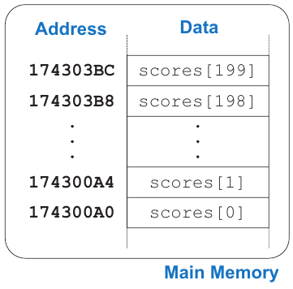

Hình 6.4 Bộ nhớ chứa `scores[200]` bắt đầu tại base address 0x174300A0

Để dễ lưu trữ và truy cập, dữ liệu tương tự có thể được nhóm thành array. Array lưu nội dung tại các địa chỉ liên tiếp trong bộ nhớ. Mỗi array element được xác định bằng một số gọi là index. Số phần tử trong array gọi là độ dài array. Hình 6.4 cho thấy array 200-element chứa các điểm số nguyên được lưu trong bộ nhớ. Địa chỉ mỗi phần tử liên tiếp tăng thêm 4, số byte trong một số nguyên. Địa chỉ của phần tử thứ 0<sup>th</sup> trong array gọi là base address của array.

Ví dụ code 6.21 là thuật toán nâng điểm, cộng 10 điểm vào mỗi điểm số. Code khởi tạo array `scores` không được trình bày. Giả sử `s0` ban đầu là 0x174300A0, base address của array. Index vào array là biến (`i`) tăng thêm 1 cho mỗi array element, nên ta nhân nó với 4 trước khi cộng vào base address.

Byte và ký tự

Số trong khoảng [−128, 127] có thể lưu trong một byte thay vì cả word. Vì bàn phím tiếng Anh có ít hơn 256 ký tự, ký tự tiếng Anh thường được biểu diễn bằng byte. Ngôn ngữ C dùng type `char` để biểu diễn byte hoặc ký tự.

> Ngôn ngữ lập trình khác, như Java, dùng character encoding khác, nổi bật nhất là Unicode. Unicode dùng 16 bit biểu diễn mỗi ký tự nên hỗ trợ dấu, umlaut và các ngôn ngữ châu Á. Xem thêm thông tin tại www.unicode.org.

Máy tính đời đầu thiếu mapping tiêu chuẩn giữa byte và ký tự tiếng Anh, nên trao đổi văn bản giữa máy tính khó khăn. Năm 1963, American Standards Association công bố American Standard Code for Information Interchange (ASCII), gán cho mỗi ký tự văn bản một giá trị byte riêng. Bảng 6.2 cho thấy những character encoding này cho ký tự in được. Giá trị ASCII được biểu diễn bằng hexadecimal. Chữ thường và chữ hoa khác nhau 0x20 (32).

#### Ví dụ code 6.21 DÙNG FOR LOOP ĐỂ TRUY CẬP ARRAY

Code High-Level

```
int i;
int scores[200];


for (i = 0; i < 200; i = i + 1)


 scores[i] = scores[i] + 10;
```

Assembly Code RISC-V

```
# s0 = scores base address, s1 = i
 addi s1, zero, 0           # i = 0
 addi t2, zero, 200 # t2 = 200
for:
 bge   s1, t2, done         # if i >= 200 then done
 slli t0, s1, 2             # t0 = i * 4
 add    t0, t0, s0          # address of scores[i]
 lw     t1, 0(t0)           # t1 = scores[i]
 addi t1, t1, 10            # t1 = scores[i] + 10
 sw     t1, 0(t0)           # scores[i] = t1
 addi s1, s1, 1             # i = i + 1
 j      for                 # repeat
done:
```

Bảng 6.2 ASCII encoding

| # | Ký tự | # | Ký tự | # | Ký tự | # | Ký tự | # | Ký tự | # | Ký tự |
|---|---|---|---|---|---|---|---|---|---|---|---|
| 20 | `space` | 30 | `0` | 40 | `@` | 50 | `P` | 60 | `` ` `` | 70 | `p` |
| 21 | `!` | 31 | `1` | 41 | `A` | 51 | `Q` | 61 | `a` | 71 | `q` |
| 22 | `"` | 32 | `2` | 42 | `B` | 52 | `R` | 62 | `b` | 72 | `r` |
| 23 | `#` | 33 | `3` | 43 | `C` | 53 | `S` | 63 | `c` | 73 | `s` |
| 24 | `$` | 34 | `4` | 44 | `D` | 54 | `T` | 64 | `d` | 74 | `t` |
| 25 | `%` | 35 | `5` | 45 | `E` | 55 | `U` | 65 | `e` | 75 | `u` |
| 26 | `&` | 36 | `6` | 46 | `F` | 56 | `V` | 66 | `f` | 76 | `v` |
| 27 | `'` | 37 | `7` | 47 | `G` | 57 | `W` | 67 | `g` | 77 | `w` |
| 28 | `(` | 38 | `8` | 48 | `H` | 58 | `X` | 68 | `h` | 78 | `x` |
| 29 | `)` | 39 | `9` | 49 | `I` | 59 | `Y` | 69 | `i` | 79 | `y` |
| 2A | `*` | 3A | `:` | 4A | `J` | 5A | `Z` | 6A | `j` | 7A | `z` |
| 2B | `+` | 3B | `;` | 4B | `K` | 5B | `[` | 6B | `k` | 7B | `{` |
| 2C | `,` | 3C | `<` | 4C | `L` | 5C | `\` | 6C | `l` | 7C | `\|` |
| 2D | `−` | 3D | `=` | 4D | `M` | 5D | `]` | 6D | `m` | 7D | `}` |
| 2E | `.` | 3E | `>` | 4E | `N` | 5E | `^` | 6E | `n` | 7E | `~` |
| 2F | `/` | 3F | `?` | 4F | `O` | 5F | `_` | 6F | `o` |  |  |

Instruction load byte (`lb`), load byte unsigned (`lbu`) và store byte (`sb`) truy cập từng byte trong bộ nhớ. `lb` sign-extends byte, trong khi `lbu` zero-extends byte để điền toàn bộ register 32-bit. `sb` lưu byte ít quan trọng nhất của register 32-bit vào byte address chỉ định trong bộ nhớ. Cả ba instruction được minh họa ở Hình 6.5, với base address `s4` bằng 0xD0. `lbu s1, 2(s4)` load byte tại memory address 0xD2 vào byte ít quan trọng nhất của `s1` và điền 0 vào register bit còn lại. `lb s2, 3(s4)` load byte tại memory address 0xD3 vào byte ít quan trọng nhất của `s2` và sign- extends byte vào 24 bit trên của register. `sb s3, 1(s4)` lưu byte ít quan trọng nhất của `s3` (0x9B) vào memory byte address 0xD1; nó thay 0x42 bằng 0x9B. Không memory byte nào khác thay đổi, và các byte quan trọng hơn của `s3` bị bỏ qua.

> RISC-V cũng định nghĩa các load và store half-word `lh`, `lhu` và `sh` hoạt động trên dữ liệu 16-bit. Memory address của các instruction này phải half-word aligned.

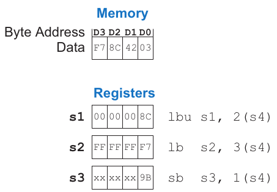

Hình 6.5 Instruction load và store byte

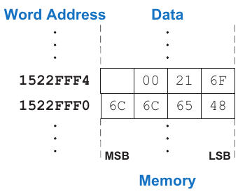

Hình 6.6 String “Hello!” được lưu trong bộ nhớ

Một chuỗi ký tự, như một từ hoặc câu, gọi là string. String có độ dài thay đổi, nên ngôn ngữ lập trình phải cung cấp cách xác định độ dài hoặc điểm kết thúc string. Trong C, null character (0x00) biểu thị kết thúc string. Ví dụ, Hình 6.6 cho thấy string “Hello!” (0x48 65 6C 6C 6F 21 00) được lưu trong bộ nhớ. String dài bảy byte, trải từ địa chỉ 0x1522FFF0 đến 0x1522FFF6. Ký tự đầu của string (H = 0x48) được lưu tại byte address thấp nhất (0x1522FFF0).

> ASCII code phát triển từ các dạng character encoding trước đó. Bắt đầu năm 1838, máy điện báo dùng Morse code, chuỗi dấu chấm (.) và gạch (–), để biểu diễn ký tự. Ví dụ, chữ A, B, C và D lần lượt được biểu diễn là –, – …, – . – . , và – .. . Số dấu chấm và gạch thay đổi theo từng chữ. Để hiệu quả, các chữ thường gặp dùng code ngắn hơn.
>
> Năm 1874, Jean-Maurice-Emile Baudot phát minh code 5-bit gọi là Baudot code. Ví dụ, A, B, C và D được biểu diễn là 00011, 11001, 01110 và 01001. Tuy nhiên, 32 cách mã hóa có thể có của code 5-bit không đủ cho mọi ký tự bàn phím, trong khi encoding 8-bit thì đủ. Vì vậy, khi truyền thông điện tử trở nên phổ biến, encoding ASCII 8-bit xuất hiện thành tiêu chuẩn.

#### Ví dụ 6.2 DÙNG `lb` VÀ `sb` ĐỂ TRUY CẬP CHARACTER ARRAY

Code high-level sau chuyển array ký tự 10-entry từ chữ thường sang chữ hoa bằng cách trừ 32 khỏi mỗi array entry. Dịch nó sang RISC-V assembly language. Hãy nhớ array element giờ dài 1 byte thay vì 4 byte, nên phần tử liên tiếp nằm tại địa chỉ liên tiếp. Giả sử `s0` đã giữ base address của `chararray`.

```
// high-level code
// chararray[10] was declared and initialized earlier
int i;

for (i = 0; i < 10; i = i + 1)
  chararray[i] = chararray[i] − 32;
```

Lời giải

```
# RISC-V assembly code
# s0 = base address of chararray (initialized earlier), s1 = i
       addi s1, zero, 0       # i = 0
       addi t3, zero, 10      # t3 = 10
for:  bge  s1, t3, done       # i >= 10 ?
       add  t4, s0, s1        # t4 = address of chararray[i]
       lb   t5, 0(t4)         # t5 = chararray[i]
      addi t5, t5, −32       # t5 = chararray[i]  −  32
       sb   t5, 0(t4)         # chararray[i] = t5
       addi s1, s1, 1         # i = i + 1
       j    for               # repeat loop
done:
```

### 6.3.7 Function Call

High-level language hỗ trợ function (còn gọi là procedure hoặc subroutine) để tái sử dụng code chung và làm chương trình có tính modular hơn, dễ đọc hơn. Function có thể có input, gọi là argument, và một output, gọi là return value. Function nên tính return value và không gây side effect ngoài ý muốn nào khác.

Khi một function gọi function khác, function gọi, tức caller, và function được gọi, tức callee, phải thống nhất vị trí đặt argument và return value. Trong chương trình RISC-V, theo quy ước caller đặt tối đa tám argument vào register `a0` đến `a7` trước function call, còn callee đặt return value vào register `a0` trước khi hoàn tất. Theo quy ước này, cả hai function đều biết tìm argument và return value ở đâu, ngay cả khi caller và callee do những người khác nhau viết.

> RISC-V thực tế cung cấp hai register cho return value, `a0` và `a1`. Điều này cho phép return value 64-bit, như `int64_t`.

Callee không được can thiệp vào hành vi của caller. Nghĩa là callee phải biết quay về đâu sau khi hoàn tất và không được ghi đè register hoặc bộ nhớ caller cần. Caller lưu return address trong return address register `ra` đồng thời nhảy đến callee bằng jump and link instruction (`jal`). Callee không được ghi đè architectural state hoặc bộ nhớ caller đang phụ thuộc. Cụ thể, callee phải giữ nguyên saved register (`s0−s11`), return address (`ra`) và stack, một phần bộ nhớ dùng cho biến tạm.

Mục này cho thấy cách gọi và return từ function. Nó cũng cho thấy cách function truy cập argument và return value, và cách dùng stack lưu biến tạm.

Function Call và Return

RISC-V dùng jump and link instruction (`jal`) để gọi function và jump register instruction (`jr`) để return từ function. Ví dụ code 6.22 cho thấy function `main` gọi function `simple`. `main` là caller và `simple` là callee. Function `simple` được gọi không có input argument và không tạo return value; nó chỉ return về caller. Trong Ví dụ code 6.22, instruction address ví dụ được ghi bên trái mỗi RISC-V instruction.

#### Ví dụ code 6.22 FUNCTION CALL `simple`

Code High-Level

```
int main() {
  simple();
  ...
}

// void means the function
// returns no value
void simple() {
  return;
}
```

Assembly Code RISC-V

```
0x00000300 main:     jal  simple     # call function
0x00000304 ...
...             ...


0x0000051c simple: jr    ra          # return
```

`jal` và `jr ra` là hai instruction thiết yếu cho function call và return. Trong Ví dụ code 6.22, function `main` gọi function `simple` bằng cách thực thi `jal simple`, thực hiện hai việc: nhảy đến target instruction tại `simple` (0x0000051C), và lưu return address, tức địa chỉ instruction sau `jal` (ở đây là 0x00000304), vào return address register (`ra`). Người lập trình có thể chỉ định register nào được ghi return address, nhưng mặc định là `ra`. Vì vậy, `jal simple` tương đương `jal ra, simple` và là cách viết được ưu tiên. Function `simple` return ngay bằng cách thực thi instruction `jr ra`, nhảy đến instruction address giữ trong `ra`. Function `main` sau đó tiếp tục thực thi tại địa chỉ này (0x00000304).

> Instruction address của instruction đang thực thi được giữ trong PC, program counter. Vì vậy, địa chỉ instruction tiếp theo được gọi là PC+4.

Input Argument và Return Value

Function `simple` ở Ví dụ code 6.22 không hữu ích lắm vì không nhận input từ calling function (`main`) và không trả output. Theo quy ước RISC-V, function dùng `a0` đến `a7` cho input argument và `a0` cho return value. Trong Ví dụ code 6.23, function `diffofsums` được gọi với bốn argument và trả một kết quả. `result` là local variable, được chọn giữ trong `s3`. (Việc lưu và khôi phục register sẽ sớm được thảo luận.)

> `j` và `jr` là pseudoinstruction. Chúng không thuộc instruction set nhưng tiện cho người lập trình. RISC-V assembler thay chúng bằng RISC-V instruction thực tế. Assembler thay `j target` bằng `jal zero, target`, nhảy và bỏ return address bằng cách ghi vào register `zero`; assembler thay `jr ra` bằng `jalr zero, ra, 0`.
>
> Jump and link register instruction (`jalr`) giống `jal`, nhưng lấy destination address từ register, có thể cộng thêm signed immediate 12-bit. Ví dụ, `jalr ra, s1, 0x4C` nhảy đến địa chỉ `s1` + `0x4C` và đặt PC+4 vào `ra`.

Theo quy ước RISC-V, calling function `main` đặt function argument từ trái sang phải vào input register `a0` đến `a7` trước khi gọi function. Called function `diffofsums` lưu return value trong return register `a0`. Khi function có hơn tám argument được gọi, input argument bổ sung được đặt trên stack, sẽ được thảo luận tiếp theo.

#### Ví dụ code 6.23 FUNCTION CALL VỚI ARGUMENT VÀ RETURN VALUE

Code High-Level

```
int main(){
 int y;
 . . .


 y = diffofsums(2, 3, 4, 5);
 . . .
}

int diffofsums(int f, int g, int h, int i){
 int result;

 result = (f + g) − (h + i);

 return result;
}
```

Assembly Code RISC-V

```
# s7 = y
main:
   . . .
   addi  a0, zero,  2         # argument 0 = 2
   addi  a1, zero,  3         # argument 1 = 3
   addi  a2, zero,  4         # argument 2 = 4
   addi  a3, zero,  5         # argument 3 = 5
   jal   diffofsums           # call function
   add   s7, a0, zero         # y = returned value
   . . .
#  s3 = result
diffofsums:
   add   t0, a0, a1           # t0 = f+g
   add   t1, a2, a3           # t1 = h+i
   sub   s3, t0, t1           # result = (f+g)−(h+i)
   add    a0, s3, zero        # put return value in a0
   jr     ra                  # return to caller
```

> Stack thường được lưu đảo chiều trong bộ nhớ, sao cho đỉnh stack thực tế là địa chỉ thấp nhất và stack phát triển xuống phía memory address thấp hơn. Đây gọi là descending stack. Một số architecture cũng cho phép ascending stack phát triển lên phía memory address cao hơn. Stack pointer (`sp`) thường trỏ đến phần tử trên cùng trên stack; đây gọi là full stack. Một số architecture, như ARM, còn cho phép empty stack, trong đó `sp` trỏ một word ra ngoài đỉnh stack. RISC-V architecture định nghĩa cách chuẩn để function truyền biến và dùng stack nhằm giúp thư viện do compiler khác nhau phát triển có thể tương tác. Nó quy định full descending stack, được dùng trong chương này.

Stack

Stack là bộ nhớ dùng làm scratch space—tức lưu thông tin tạm trong function. Stack mở rộng (dùng thêm bộ nhớ) khi processor cần thêm scratch space và thu hẹp (dùng ít bộ nhớ hơn) khi processor không còn cần biến lưu ở đó. Trước khi giải thích cách function dùng stack lưu giá trị tạm, chúng ta giải thích cách stack hoạt động.

Stack là queue last-in-first-out (LIFO). Giống chồng đĩa, phần tử được push (hay đặt) lên stack cuối cùng (chiếc đĩa trên cùng) là phần tử đầu tiên có thể pop ra (lấy ra). Mỗi function có thể cấp phát stack space để lưu local variable và dùng làm scratch space, nhưng function phải giải phóng trước khi return. Đỉnh stack là không gian được cấp phát gần nhất. Trong khi chồng đĩa cao dần lên, RISC-V stack phát triển xuống trong bộ nhớ. Nghĩa là stack mở rộng về memory address thấp hơn khi chương trình cần thêm scratch space.

Hình 6.7 cho thấy stack. Stack pointer `sp` (register 2) là RISC-V register thông thường, theo quy ước trỏ đến đỉnh stack. Pointer là tên gọi cầu kỳ cho memory address. `sp` trỏ đến (cho địa chỉ của) dữ liệu. Ví dụ, trong Hình 6.7(a), stack pointer `sp` giữ giá trị địa chỉ 0xBEFFFAE8 và trỏ đến giá trị dữ liệu 0xAB000001.

Stack pointer (`sp`) bắt đầu tại memory address cao và giảm để mở rộng khi cần. Hình 6.7(b) cho thấy stack mở rộng để có thêm hai data word lưu trữ tạm. Để làm vậy, `sp` giảm tám thành 0xBEFFFAE0. Hai data word bổ sung, 0x12345678 và 0xFFEEDDCC, được lưu tạm trên stack.

Một cách dùng quan trọng của stack là lưu và khôi phục register mà function sử dụng. Hãy nhớ function nên tính return value mà không có side effect ngoài ý muốn khác. Cụ thể, function không nên thay đổi register ngoài `a0`, register chứa return value. Function `diffofsums` ở Ví dụ code 6.23 vi phạm quy tắc này vì thay đổi `t0`, `t1` và `s3`. Nếu `main` dùng các register này trước khi gọi `diffofsums`, nội dung của chúng sẽ bị function call làm hỏng.

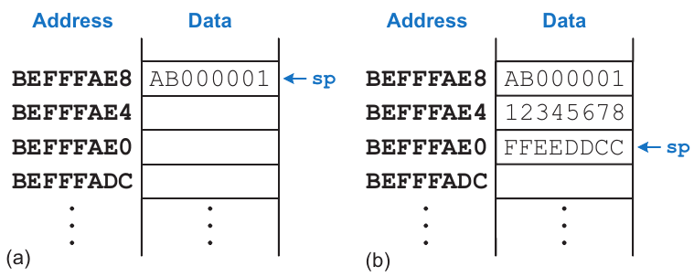

Hình 6.7 Stack (a) trước khi mở rộng và (b) sau khi mở rộng two-word

Để giải quyết vấn đề này, function lưu register trên stack trước khi thay đổi rồi khôi phục từ stack trước khi return. Cụ thể, nó thực hiện các bước sau:

1\. Tạo chỗ trên stack để lưu giá trị của một hoặc nhiều register

2\. Lưu giá trị register trên stack

3\. Thực thi function bằng các register

4\. Khôi phục giá trị register ban đầu từ stack

5\. Giải phóng chỗ trên stack

Ví dụ code 6.24 cho thấy phiên bản cải tiến của `diffofsums` lưu và khôi phục `t0`, `t1` và `s3`. Hình 6.8 cho thấy stack trước, trong và sau khi gọi function `diffofsums` từ Ví dụ code 6.24. Stack bắt đầu tại 0xBEF0F0FC. `diffofsums` tạo chỗ cho ba word trên stack bằng cách giảm stack pointer `sp` đi 12. Sau đó nó lưu giá trị hiện có trong `t0`, `t1` và `s3` vào không gian mới cấp phát. Nó thực thi phần function còn lại, thay đổi giá trị ba register này. Ở cuối function, `diffofsums` khôi phục giá trị các register này từ stack, giải phóng stack space rồi return. Khi function return, `a0` giữ kết quả, nhưng không có side effect khác: `t0`, `t1`, `s3` và `sp` có cùng giá trị như trước function call.

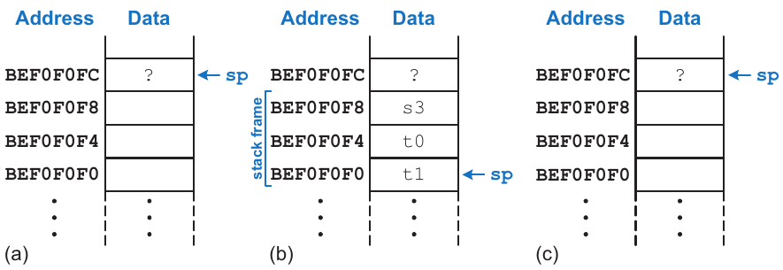

Hình 6.8 Stack: (a) trước, (b) trong và (c) sau function call `diffofsums`

#### Ví dụ code 6.24 FUNCTION LƯU REGISTER TRÊN STACK

Code High-Level

```
int diffofsums(int f, int g, int h, int
i){
 int result;


 result = (f + g) − (h + i);


 return result;
}
```

Assembly Code RISC-V

```
# s3 = result
diffofsums:
  addi  sp, sp, −12            # make space on stack to
                               # store three registers
  sw     s3,  8(sp)            # save s3 on stack
  sw     t0,  4(sp)            # save t0 on stack
  sw     t1,  0(sp)            # save t1 on stack
  add    t0,  a0, a1           # t0 = f + g
  add   t1, a2, a3             # t1 = h + i
  sub   s3, t0, t1             # result = (f + g) − (h + i)
  add   a0, s3, zero           # put return value in a0
  lw      s3, 8(sp)            # restore s3 from stack
  lw      t0, 4(sp)            # restore t0 from stack
  lw      t1, 0(sp)            # restore t1 from stack
  addi  sp, sp, 12             # deallocate stack space
  jr      ra                   # return to caller
```

> Lưu giá trị register trên stack gọi là push register lên stack. Khôi phục giá trị register từ stack gọi là pop register khỏi stack.

Stack space mà function cấp phát cho chính nó gọi là stack frame. Stack frame của `diffofsums` sâu ba word. Nguyên tắc modularity cho biết mỗi function chỉ nên truy cập stack frame riêng, không truy cập frame thuộc function khác.

Preserved Register

Ví dụ code 6.24 giả định mọi register được dùng (`t0`, `t1` và `s3`) đều phải được lưu và khôi phục. Nếu calling function không dùng các register này, công sức lưu và khôi phục là lãng phí. Để tránh lãng phí, RISC-V chia register thành nhóm preserved và nonpreserved. Preserved register phải chứa cùng giá trị ở đầu và cuối called function vì caller mong giá trị preserved register không đổi sau call.

Preserved register gồm `s0` đến `s11` (vì thế có tên saved), `sp` và `ra`. Nonpreserved register, còn gọi là scratch register, gồm `t0` đến `t6` (vì thế có tên temporary) và các argument register `a0` đến `a7`. Function có thể tự do thay đổi nonpreserved register nhưng phải lưu và khôi phục mọi preserved register được dùng.

Ví dụ code 6.25 cho thấy phiên bản `diffofsums` cải tiến hơn, chỉ lưu `s3` trên stack. `t0` và `t1` là nonpreserved register nên không cần lưu.

#### Ví dụ code 6.25 FUNCTION LƯU PRESERVED REGISTER TRÊN STACK

Assembly Code RISC-V

```
# s3 = result
diffofsums:
  addi sp, sp, −4            # make space on stack to store one register
  sw     s3, 0(sp)           # save s3 on stack
  add   t0, a0, a1           # t0 = f + g
  add   t1, a2, a3           # t1 = h + i
  sub   s3, t0, t1           # result = (f + g) − (h + i)
  add    a0, s3, zero        # put return value in a0
  lw     s3, 0(sp)           # restore s3 from stack
  addi sp, sp, 4             # deallocate stack space
  jr    ra                   # return to caller
```

Bảng 6.3 Register và bộ nhớ preserved, nonpreserved

| Preserved (callee-saved) | Nonpreserved (caller-saved) |
|---|---|
| Saved register: `s0–s11` | Temporary register: `t0–t6` |
| Return address: `ra` | Argument register: `a0–a7` |
| Stack pointer: `sp` |  |
| Stack phía trên stack pointer | Stack phía dưới stack pointer |

Vì callee function có thể tự do thay đổi mọi nonpreserved register, caller phải lưu mọi nonpreserved register chứa thông tin thiết yếu trước function call rồi khôi phục sau đó. Vì vậy, preserved register còn gọi là callee-saved, và nonpreserved register gọi là caller-saved.

Bảng 6.3 tóm tắt register nào được preserved. Quy ước register nào preserved hoặc không preserved là một phần của standard calling convention[^2] cho RISC-V Architecture, thay vì thuộc chính architecture.

`s0` đến `s11` thường được dùng giữ local variable trong function nên phải lưu. `ra` cũng phải lưu để callee biết return về đâu. `t0` đến `t6` dùng giữ kết quả tạm. Những phép tính này thường hoàn tất trước function call nên không được preserved qua function call, và caller hiếm khi cần lưu chúng. `a0` đến `a7` thường bị ghi đè trong quá trình gọi function. Vì vậy, caller phải lưu chúng nếu còn phụ thuộc bất kỳ argument riêng nào sau khi called function return.

Stack phía trên stack pointer tự động được preserved chừng nào callee không ghi vào memory address phía trên `sp`. Như vậy, nó không sửa stack frame của function khác. Chính stack pointer cũng được preserved vì callee giải phóng stack frame trước khi return bằng cách cộng lại đúng lượng đã trừ khỏi `sp` ở đầu function.

Người đọc tinh ý hoặc optimizing compiler có thể nhận thấy local variable của `diffofsums`, `result`, được return ngay mà không dùng vào việc khác. Vì vậy, ta có thể loại bỏ biến và lưu phép tính trực tiếp trong return register `a0`, loại bỏ nhu cầu vừa cấp phát chỗ trong stack frame vừa chuyển kết quả từ `s3` sang `a0`. Ví dụ code 6.26 cho thấy function `diffofsums` được tối ưu thêm này.

Nonleaf Function Call

Function không gọi function khác gọi là leaf function; `diffofsums` là ví dụ. Function gọi function khác gọi là nonleaf function. Nonleaf function phức tạp hơn đôi chút vì có thể cần lưu nonpreserved register trên stack trước khi gọi function khác rồi khôi phục sau đó. Cụ thể, chúng phải tuân theo quy tắc:

Quy tắc caller save: Trước function call, caller phải lưu mọi nonpreserved register (`t0–t6` và `a0–a7`) cần sau call. Sau call, phải khôi phục các register này trước khi dùng.

Quy tắc callee save: Trước khi callee thay đổi bất kỳ preserved register nào (`s0–s11` và `ra`), nó phải lưu register. Trước khi return, phải khôi phục các register này.

Ví dụ code 6.27 cho thấy nonleaf function `f1` và leaf function `f2`, gồm đầy đủ việc lưu và bảo toàn register cần thiết. `f1` giữ `i` trong `s4` và `x` trong `s5`; `f2` giữ `r` trong `s4`. `f1` dùng preserved register `s4`, `s5` và `ra`, nên ban đầu push chúng lên stack theo quy tắc callee save. Nó dùng `t3` giữ kết quả trung gian (`a–b`) để không phải bảo toàn thêm register cho phép tính này. Trước khi gọi `f2`, `f1` lưu `a0` và `a1` lên stack theo quy tắc caller save vì đây là nonpreserved register mà `f2` có thể thay đổi và `f1` vẫn cần sau call. `ra` thay đổi vì bị ghi đè bởi call đến `f2`. Dù `t3` cũng là nonpreserved register mà `f2` có thể ghi đè, `f1` không còn cần `t3` nên không phải lưu. `f1` sau đó truyền argument cho `f2` trong `a0`, thực hiện function call và nhận kết quả trong `a0`. `f1` tiếp tục khôi phục `a0` và `a1` vì vẫn cần chúng. Khi `f1` hoàn tất, nó đặt return value vào `a0`, khôi phục register `s4`, `s5`, `ra` và `sp`, rồi return. `f2` lưu và khôi phục `s4` (và `sp`) theo quy tắc callee save.

> Nonleaf function ghi đè `ra` khi gọi function khác bằng `jal`. Vì vậy, nonleaf function luôn phải lưu `ra` trên stack và khôi phục trước khi return.

Quan sát kỹ có thể thấy `f2` không sửa `a1`, nên `f1` không cần lưu và khôi phục nó. Tuy nhiên, compiler không phải lúc nào cũng dễ xác định nonpreserved register nào có thể bị thay đổi trong function call. Vì vậy, compiler đơn giản luôn khiến caller lưu và khôi phục mọi nonpreserved register cần sau call. Optimizing compiler có thể nhận thấy `f2` là leaf procedure và cấp phát `r` vào nonpreserved register, tránh lưu và khôi phục `s4`. Hình 6.9 cho thấy stack trong quá trình thực thi các function. Với ví dụ này, stack pointer ban đầu bắt đầu tại 0xBEF7FF0C.

#### Ví dụ code 6.26 FUNCTION `diffofsums` ĐƯỢC TỐI ƯU

Assembly Code RISC-V

```
# a0 = result
diffofsums:
  add  t0, a0, a1         # t0 = f + g
  add  t1, a2, a3         # t1 = h + i
  sub  a0, t0, t1         # result = (f + g) − (h + i)
  jr     ra               # return to caller
```

Recursive Function Call

Recursive function là nonleaf function tự gọi chính nó. Recursive function đóng vai trò cả caller lẫn callee, phải lưu cả preserved register lẫn nonpreserved register. Ví dụ, function giai thừa có thể viết thành recursive function. Hãy nhớ factorial(n) = n × (n – 1) × (n – 2) × ⋯ × 2 × 1. Có thể viết đệ quy factorial(n) = n × factorial(n – 1), như Ví dụ code 6.28. Giai thừa của 1 đơn giản là 1. Để tiện tham chiếu program address, chúng ta cho chương trình bắt đầu tại địa chỉ 0x8500. Theo quy tắc callee save, `factorial` là nonleaf function nên phải lưu `ra`. Theo quy tắc caller save, `factorial` sẽ cần `n` sau khi tự gọi, nên phải lưu `a0`. Vì vậy, nó push cả hai register lên stack ngay từ đầu. Sau đó nó kiểm tra `n` ≤ 1 hay không. Nếu đúng, nó đặt return value 1 vào `a0`, khôi phục stack pointer rồi return về caller. Nó không phải khôi phục `ra` trong trường hợp này vì register chưa bị thay đổi. Nếu `n` > 1, function gọi đệ quy `factorial(n−1)`. Sau đó nó khôi phục giá trị `n` và return address register (`ra`) từ stack, thực hiện phép nhân và return kết quả. Lưu ý function khéo léo khôi phục `n` vào `t1` để không ghi đè giá trị vừa được return. Multiply instruction (`mul a0, t1, a0`) nhân `n` (`t1`) với giá trị được return (`a0`), đặt kết quả vào `a0`, return register.

#### Ví dụ code 6.27 NONLEAF FUNCTION CALL

Code High-Level

```
int f1(int a, int b) {
  int i, x;


  x = (a + b)*(a − b);


  for (i = 0; i < a; i++)


     x = x + f2(b + i);


  return x;
 }


int f2(int p) {
  int r;

  r = p + 5;
  return r + p;
}
```

Assembly Code RISC-V

```
#  a0 = a, a1 = b, s4 = i, s5 = x
f1:
  addi sp,  sp,  −12             # make room on stack for 3 registers
  sw  ra,  8(sp)                 # save preserved registers used by f1
  sw  s4, −4(sp)
  sw  s5, 0(sp)
  add  s5,  a0, a1               # x = (a + b)
  sub  t3,  a0, a1               # temp = (a − b)
  mul  s5,  s5, t3               # x = x * temp = (a + b) * (a − b)
  addi s4,  zero, 0              # i = 0
for:
  bge    s4,  a0,  return        # if i >= a, exit loop
  addi sp,  sp,  −8              # make room on stack for 2 registers
  sw  a0,  4(sp)                 # save nonpreserved regs. on stack
  sw  a1, 0(sp)
  add  a0,  a1,  s4              # argument is b + i
  jal  f2                        # call f2(b + i)
  add  s5,  s5,  a0              # x = x + f2(b + i)
  lw  a0,  4(sp)                 # restore nonpreserved registers
  lw  a1, 0(sp)
  addi sp, sp, 8
  addi s4,  s4,  1               # i++
  j       for                    # continue for loop
return:
  add  a0,  zero,  s5            # return value is x
  lw  ra,  8(sp)                 # restore preserved registers
  lw  s4,  4(sp)
  lw  s5,  0(sp)
  addi sp,  sp,  12              # restore sp
  jr  ra                         # return from f1

#  a0  =  p,    s4 = r
f2:
  addi sp,  sp,  −4              # save preserved regs. used by f2
  sw    s4,  0(sp)
  addi s4,  a0,  5               # r = p + 5
  add  a0,  s4,  a0              # return value is r + p
  lw    s4,  0(sp)               # restore preserved registers
  addi sp,  sp,  4               # restore sp
  jr     ra                      # return from f2
```

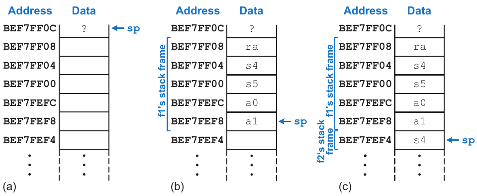

Hình 6.9 Stack: (a) trước function call, (b) trong `f1` và (c) trong `f2`

#### Ví dụ code 6.28 RECURSIVE FUNCTION CALL `factorial`

Code High-Level

```
int factorial(int n) {
  if (n <= 1)
   return 1;


  else
    return (n * factorial(n − 1));
}
```

Assembly Code RISC-V

```
0x8500 factorial: addi  sp, sp, −8                # make room for a0, ra
0x8504                   sw  a0, 4(sp)
0x8508                   sw  ra, 0(sp)
0x850C                   addi t0, zero, 1         # temporary = 1
0x8510                   bgt  a0, t0, else        # if n > 1, go to else
0x8514                   addi a0, zero, 1         # otherwise, return 1
0x8518                   addi sp, sp, 8           # restore sp
0x851C                   jr  ra                   # return
0x8520 else:          addi a0, a0, −1             # n = n − 1
0x8524                   jal  factorial           # recursive call
0x8528                   lw  t1, 4(sp)            # restore n into t1
0x852C                   lw  ra, 0(sp)            # restore ra
0x8530                   addi sp, sp, 8           # restore sp
0x8534                   mul  a0, t1, a0          # a0 = n * factorial(n − 1)
0x8538                   jr  ra                   # return
```

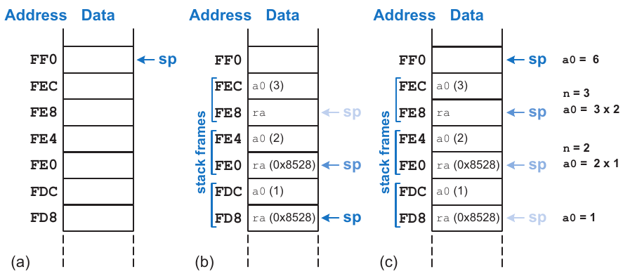

Hình 6.10 Stack: (a) trước, (b) trong và (c) sau function call `factorial` với `n` = 3

Để rõ ràng, chúng ta lưu register ở đầu function call. Optimizing compiler có thể thấy không cần lưu `a0` và `ra` khi `n` ≤ 1, nên chỉ lưu register lên stack trong phần `else` của function.

Hình 6.10 cho thấy stack khi thực thi `factorial(3)`. Để minh họa, chúng ta cho `sp` ban đầu trỏ đến 0xFF0 (các address bit phía trên bằng 0), như Hình 6.10(a). Function tạo stack frame two-word giữ `n` (`a0`) và `ra`. Trong lần gọi đầu, `factorial` lưu `a0` (giữ `n` = 3) tại 0xFEC và `ra` tại 0xFE8, như Hình 6.10(b). Function sau đó đổi `n` thành 2 và gọi đệ quy `factorial(2)`, khiến `ra` giữ 0x8528. Trong lần gọi thứ hai, nó lưu `a0` (giữ `n` = 2) tại 0xFE4 và `ra` tại 0xFE0. Lần này, ta biết `ra` chứa 0x8528. Function sau đó đổi `n` thành 1 và gọi đệ quy `factorial(1)`. Trong lần gọi thứ ba, nó lưu `a0` (giữ `n` = 1) tại 0xFDC và `ra` tại 0xFD8. Lần này `ra` lại chứa 0x8528. Lần gọi `factorial` thứ ba return giá trị 1 trong `a0` và giải phóng stack frame trước khi return về lần gọi thứ hai. Lần gọi thứ hai khôi phục `n` (vào `t1`) thành 2, khôi phục `ra` thành 0x8528 (tình cờ đã có giá trị này), giải phóng stack frame và return `a0` = 2 × 1 = 2 về lần gọi đầu. Lần gọi đầu khôi phục `n` (vào `t1`) thành 3, khôi phục `ra`, return address của caller, giải phóng stack frame và return `a0` = 3 × 2 = 6. Hình 6.10(c) cho thấy stack khi các function được gọi đệ quy return. Khi `factorial` return về caller, stack pointer trở về vị trí ban đầu (0xFF0), không nội dung stack nào phía trên pointer thay đổi, và mọi preserved register giữ giá trị ban đầu. `a0` giữ return value 6.

Argument bổ sung và Local Variable\*

Function có thể có hơn tám input argument và có quá nhiều local variable để giữ trong preserved register. Stack được dùng lưu thông tin này. Theo quy ước RISC-V, nếu function có hơn tám argument, tám argument đầu được truyền trong argument register (`a0 −a7`) như thường lệ. Argument bổ sung được truyền trên stack, ngay phía trên `sp`. Caller phải mở rộng stack để tạo chỗ cho argument bổ sung. Hình 6.11(a) cho thấy stack của caller khi gọi function có hơn tám argument.

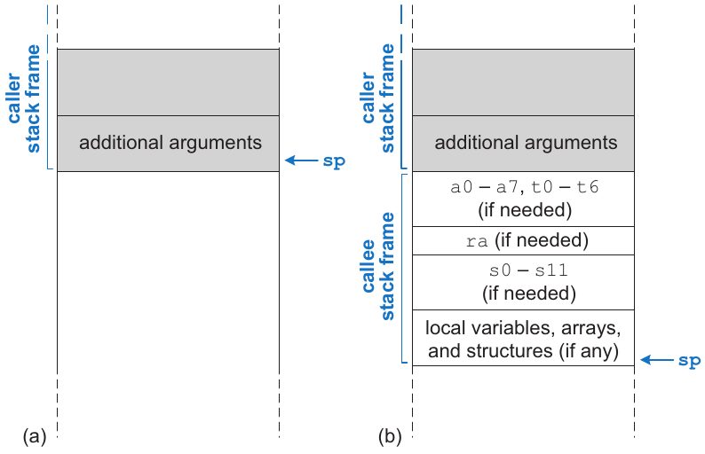

Hình 6.11 Stack frame mở rộng với argument bổ sung (a) trước call, (b) sau call

Function cũng có thể khai báo local variable hoặc array. Local variable được khai báo bên trong function và chỉ có thể truy cập trong function đó. Local variable được lưu trong `s0` đến `s11`; nếu function có quá nhiều local variable, chúng cũng có thể lưu trong stack frame của function. Local array và structure cũng được lưu trên stack.

> Một số function còn có frame pointer trỏ đến đáy active stack frame – stack frame của function đang thực thi. Theo quy ước, địa chỉ này được giữ trong register `fp` (`x8`), cũng là preserved register.

Hình 6.11(b) cho thấy cách tổ chức stack frame của callee. Stack frame giữ temporary register, argument register và return address register (nếu cần lưu vì có function call tiếp theo), cùng mọi saved register mà function sẽ sửa. Nó cũng giữ local array và local variable vượt quá số register. Nếu callee có hơn tám argument, nó tìm chúng trong stack frame của caller. Truy cập input argument bổ sung là ngoại lệ duy nhất cho phép function truy cập stack data không thuộc stack frame riêng.

### 6.3.8 Pseudoinstruction

Trước khi chỉ cách chuyển assembly code thành machine code, các số 1 và 0, hãy xem lại pseudoinstruction. Hãy nhớ RISC-V là reduced instruction set computer (RISC), nên instruction size và độ phức tạp phần cứng được giảm thiểu bằng cách giữ số instruction nhỏ. Tuy nhiên, RISC-V định nghĩa pseudoinstruction thực tế không thuộc RISC-V instruction set nhưng được người lập trình và compiler dùng thường xuyên. Khi chuyển thành machine code, pseudoinstruction được dịch thành một hoặc nhiều RISC-V instruction. Ví dụ, chúng ta đã thảo luận pseudoinstruction jump (`j`) được chuyển thành instruction jump and link (`jal`) với `x0` làm destination address—tức không ghi return address. Chúng ta cũng lưu ý logical NOT có thể thực hiện bằng XOR source operand với toàn 1.

Bảng 6.4 Pseudoinstruction

| Pseudoinstruction | RISC-V Instruction | Mô tả | Operation |
|---|---|---|---|
| `j label` | `jal zero, label` | jump | `PC = label` |
| `jr ra` | `jalr zero, ra, 0` | jump register | `PC = ra` |
| `mv t5, s3` | `addi t5, s3, 0` | move | `t5 = t3` *(ghi chú: sách in t3; đúng là `t5 = s3`)* |
| `not s7, t2` | `xori s7, t2, −1` | one’s complement | `s7 = ~t2` |
| `nop` | `addi zero, zero, 0` | không thực hiện operation |  |
| `li s8, 0x7EF` | `addi s8, zero, 0x7EF` | load immediate 12-bit | `s8 = 0x7EF` |
| `li s8, 0x56789DEF` | `lui s8, 0x5678A` `addi s8, s8, 0xDEF` | load immediate 32-bit | `s8 = 0x56789DEF` |
| `bgt s1, t3, L3` | `blt t3, s1, L3` | branch nếu > | `if (s1 > t3), PC = L3` |
| `bgez t2, L7` | `bge t2, zero, L7` | branch nếu ≥ 0 | `if (t2 ≥ 0), PC = L7` |
| `call L1` | `jal L1` | gọi function ở gần | `PC = L1, ra = PC + 4` |
| `call L5` | `auipc ra, imm`<sub>`31:12`</sub> `jalr ra, ra, imm`<sub>`11:0`</sub> | gọi function ở xa | `PC = L5, ra = PC + 4` |
| `ret` | `jalr zero, ra, 0` | return từ function | `PC = ra` |

Bảng 6.4 cho ví dụ pseudoinstruction và RISC-V instruction dùng để triển khai chúng. Ví dụ, move instruction (`mv`) sao chép nội dung register sang register khác. Load immediate pseudoinstruction (`li`) load hằng số 32-bit bằng cách kết hợp instruction `lui` và `addi`. Nếu hằng số biểu diễn được trong 12 bit, `li` được dịch thành instruction `addi`. No operation pseudoinstruction (`nop`, đọc “no op”) không thực hiện operation. PC tăng thêm 4 khi nó thực thi, nhưng không register hay giá trị bộ nhớ khác nào thay đổi. Pseudoinstruction `call` thực hiện procedure call. Nếu call đến function ở gần, `call` được dịch thành instruction `jalr`. Tuy nhiên, nếu function ở xa, `call` được dịch thành hai RISC-V instruction: `auipc` và `jalr`. Ví dụ, `auipc s1, 0xABCDE` cộng 0xABCDE000 với PC, đặt kết quả vào `s1`. Vì vậy, nếu PC là 0x02000000 thì `s1` giờ giữ 0xADCDE000. Sau đó `jalr ra, s1, 0x730` nhảy đến địa chỉ `s1` + 0x730 (0xADCDE730) và đặt PC+4 vào `ra`. Pseudoinstruction `ret` return từ function. Nó được dịch thành `jalr x0, ra, 0`. Bảng B.7 trong Phụ lục B liệt kê RV32I pseudoinstruction phổ biến nhất. Phụ lục B được in ở mặt trong bìa sách.

> Nop thường được dùng tạo độ trễ chính xác trong chương trình.

## 6.4 MACHINE LANGUAGE

Assembly language thuận tiện cho con người đọc. Tuy nhiên, digital circuit chỉ hiểu 1 và 0. Vì vậy, chương trình viết bằng assembly language được dịch từ mnemonic sang biểu diễn chỉ dùng 1 và 0, gọi là machine language. Mục này mô tả RISC-V machine language và quá trình tẻ nhạt chuyển đổi giữa assembly language và machine language.

RISC-V dùng instruction 32-bit. Một lần nữa, tính đều đặn hỗ trợ sự đơn giản, và lựa chọn đều đặn nhất là mã hóa mọi instruction thành word có thể lưu trong bộ nhớ. Dù một số instruction có thể không cần đủ 32 bit mã hóa, instruction variable-length sẽ làm tăng độ phức tạp. Sự đơn giản cũng khuyến khích định dạng single-instruction, nhưng điều đó quá hạn chế. Tuy nhiên, vấn đề này cho phép giới thiệu nguyên tắc thiết kế cuối:

Nguyên tắc thiết kế 4: Thiết kế tốt đòi hỏi sự thỏa hiệp tốt.

RISC-V thỏa hiệp bằng cách định nghĩa bốn instruction format chính: R-type, I-type, S/B-type và U/J-type. Số format nhỏ này cho phép instruction có tính đều đặn và do đó decoder hardware đơn giản hơn, trong khi vẫn đáp ứng nhu cầu instruction khác nhau. Instruction R-type (register), như `add s0, s1, s2`, hoạt động trên ba register. Instruction I-type (immediate), như `addi s3, s4, 42`, và instruction S/B-type (store/branch), như `sw a0, 4(sp)` hoặc `beq a0,a1,L1`, hoạt động trên hai register và signed immediate 12- hoặc 13-bit. Instruction U/J-type (upper immediate/jump), như `jal ra, factorial`, hoạt động trên một register và immediate 20- hoặc 21-bit. Mục này thảo luận các RISC-V machine instruction format và cách mã hóa chúng thành binary. Phụ lục B cung cấp tham khảo nhanh cho mọi RV32I instruction.

> Đáng chú ý, S/B-type không được gọi là B/S-type.

### 6.4.1 Instruction R-Type

Instruction R-type (register-type) dùng ba register làm operand: hai source và một destination. Hình 6.12 cho thấy machine instruction format R-type. Instruction 32-bit có sáu trường: funct7, rs2, rs1, funct3, rd và op. Mỗi trường dài ba đến bảy bit, như được chỉ ra.

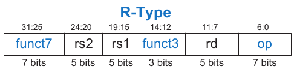

Hình 6.12 Instruction format R-type

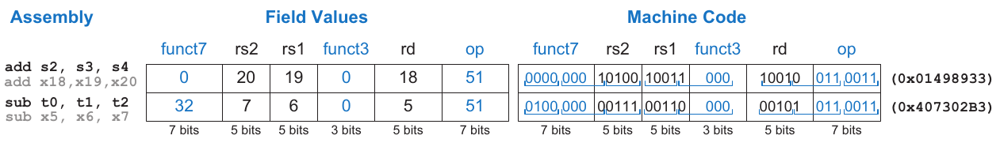

Hình 6.13 Machine code cho instruction R-type

Operation mà instruction thực hiện được mã hóa trong ba trường tô xanh: op 7-bit (còn gọi opcode hoặc operation code), funct7 7- bit và funct3 3-bit (còn gọi function field). Operation R-type cụ thể được xác định bởi opcode và function field. Các bit này cùng gọi là control bit vì điều khiển operation cần thực hiện. Ví dụ, opcode và function field của instruction `add` là op = 51 (0110011<sub>2</sub>), funct7 = 0 (0000000<sub>2</sub>) và funct3 = 0 (000<sub>2</sub>). Tương tự, instruction `sub` có op = 51, funct7 = 32 (0100000<sub>2</sub>) và funct3 = 0 (000<sub>2</sub>). Hình 6.13 cho thấy machine code của hai instruction R-type, `add` và `sub`. Hai source register và destination register được mã hóa trong ba trường: rs1, rs2 và rd. Các trường chứa số register trong Bảng 6.1. Ví dụ, `s0` là register 8 (`x8`). Lưu ý register có thứ tự ngược nhau trong assembly language instruction và machine language instruction. Ví dụ, assembly instruction `add s2, s3, s4` có rd = `s2` (18), rs1 = `s3` (19) và rs2 = `s4` (20). Các register này liệt kê từ trái sang phải trong assembly instruction nhưng từ phải sang trái trong machine instruction.

Bảng B.1 trong Phụ lục B liệt kê opcode và function field (funct3, funct7) cho RV32I instruction. Cách dễ nhất để dịch từ assembly sang machine code (như Hình 6.13) là viết giá trị từng trường rồi chuyển thành binary. Sau đó nhóm bit thành khối bốn để chuyển thành hexadecimal, làm biểu diễn machine language gọn hơn.

> Phụ lục B nằm ở mặt trong bìa sách này.

Instruction R-type khác gồm shift (`sll`, `srl` và `sra`) và logical operation (`and`, `or` và `xor`). Shift instruction có shift amount immediate (`slli`, `srli` và `srai`) là instruction I-type, được thảo luận tiếp ở Mục 6.4.2.

Hình 6.14 cho thấy machine code của shift left logical (`sll`) và `xor`. Opcode là 51 (0110011<sub>2</sub>) cho mọi operation R-type. Shift instruction có shift amount trong register (`sll`, `srl` và `sra`) dịch rs1 theo giá trị unsigned 5-bit trong bit 4:0 của register rs2, đặt kết quả vào rd. Với mọi shift instruction, funct7 và funct3 mã hóa loại shift hoặc logical operation cần thực hiện, như Bảng B.1. Với `sll`, funct7 = 0 và funct3 = 1; `xor` dùng funct7 = 0 và funct3 = 4.

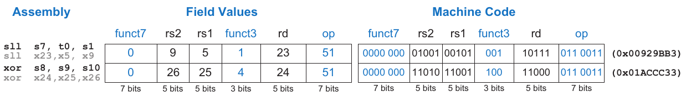

Hình 6.14 Thêm machine code cho instruction R-type

> Instruction R-type có 17 bit op code và funct code, đủ biểu diễn 2<sup>17</sup> = 131,072 instruction khác nhau. Điều này có vẻ quá dư thừa khi đến nay chúng ta định nghĩa chưa đến một chục instruction R-type. Tuy nhiên, chỉ cần 15 bit khác để mã hóa source register và destination register. Không gian instruction set lớn này khiến RISC-V có khả năng mở rộng cao. Ví dụ, RISC-V F Extension thêm floating-point instruction, được mô tả thêm ở Mục 6.6.4 và Phụ lục B.

#### Ví dụ 6.3 DỊCH ASSEMBLY INSTRUCTION R-TYPE THÀNH MACHINE CODE

Dịch RISC-V assembly instruction sau sang machine language:

```
add t3, s4, s5
```

Lời giải Theo Bảng 6.1, `t3`, `s4` và `s5` là register 28, 20 và 21. Theo Bảng B.1, `add` có opcode 51 (0110011<sub>2</sub>) và function code funct7 = 0, funct3 = 0. Vì vậy, các trường và machine code được cho ở Hình 6.15. Cách dễ nhất để viết machine language bằng hexadecimal là trước hết viết bằng binary, rồi xem các nhóm bốn bit liên tiếp tương ứng với chữ số hexadecimal (được chỉ bằng gạch dưới màu xanh). Do đó, machine language instruction là 0x015A0E33.

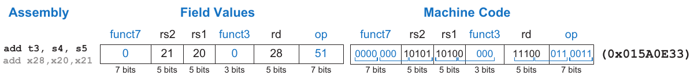

Hình 6.15 Machine code của instruction R-type ở Ví dụ 6.3

### 6.4.2 Instruction l-Type

Instruction I-type (immediate) dùng hai register operand và một immediate operand. Instruction I-type gồm `addi`, `andi`, `ori` và `xori`, load (`lw`, `lh`, `lb`, `lhu` và `lbu`), và register jump (`jalr`). Hình 6.16 cho thấy machine instruction format I-type. Nó tương tự R-type nhưng có immediate field imm 12-bit thay cho trường funct7 và rs2. rs1 và imm là source operand, rd là destination register.

Hình 6.17 cho vài ví dụ mã hóa instruction I-type. Immediate field biểu diễn số signed (two’s complement) 12-bit cho mọi instruction I-type trừ immediate shift instruction (`slli`, `srli` và `srai`). Với các shift instruction này, imm<sub>4:0</sub> là shift amount unsigned 5-bit; bảy imm bit trên bằng 0 với `srli` và `slli`, nhưng `srai` đặt 1 vào imm<sub>10</sub> (tức instruction bit 30), như Hình 6.17. Giống instruction R-type, thứ tự operand trong assembly instruction I-type khác thứ tự trong machine instruction.

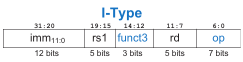

Hình 6.16 Instruction format I-type

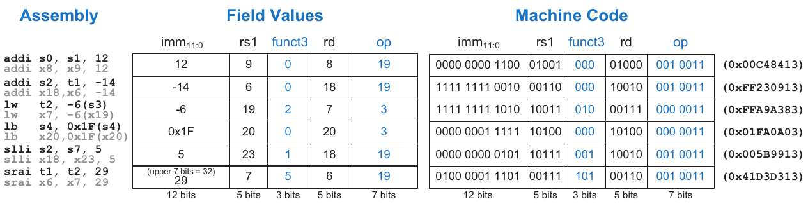

Hình 6.17 Machine code cho instruction I-type

#### Ví dụ 6.4 DỊCH ASSEMBLY INSTRUCTION I-TYPE THÀNH MACHINE CODE

Dịch assembly instruction sau sang machine language.

```
lw t3, −36(s4)
```

Lời giải Theo Bảng 6.1, `t3` và `s4` là register 28 và 20. rs1 (`s4 =` `x20`) xác định base address, còn rd (`t3 = x28`) xác định destination. Immediate imm mã hóa offset 12-bit (−36). Bảng B.1 cho biết `lw` có op 3 (0000011<sub>2</sub>) và funct3 bằng 2 (010<sub>2</sub>). Các trường và machine code được cho ở Hình 6.18.

Instruction I-type có immediate field 12-bit nhưng immediate được dùng trong operation 32-bit. Ví dụ, `lw` cộng offset 12-bit vào base register 32-bit. Cần đặt gì vào 20 bit trên của 32 bit? Với immediate dương, các bit trên phải toàn 0; với immediate âm, các bit trên phải toàn 1. Hãy nhớ từ Mục 1.4.6 rằng đây gọi là sign extension.

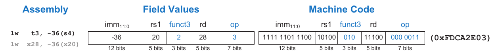

Hình 6.18 Machine code của instruction I-type ở Ví dụ 6.4

> Hãy nhớ số two’s complement M-bit được sign-extended thành số N-bit (N>M) bằng cách sao chép sign bit (bit quan trọng nhất) của số M-bit vào mọi bit trên của số N-bit. Sign-extending một số two’s complement không làm đổi giá trị. Ví dụ, 1101<sub>2</sub> là số two’s complement 4-bit
>
> biểu diễn −3<sub>10</sub>. Khi được sign-extended thành 8 bit, nó trở thành 11111101<sub>2</sub> và vẫn
>
> biểu diễn −3<sub>10</sub>.

### 6.4.3 Instruction S/B-Type

Giống instruction I-type, instruction S/B-type (store/branch) dùng hai register operand và một immediate operand. Tuy nhiên, cả hai register operand đều là source register (rs1 và rs2) trong S/B-type, còn instruction I-type dùng một source register (rs1) và một destination register (rd). Hình 6.19 cho thấy machine instruction format S/B-type. Instruction thay trường funct7 và rd của instruction R-type bằng immediate imm 12-bit. Vì vậy, immediate field này bị chia trên hai dải bit, bit 31:25 và bit 11:7 của instruction.

Store instruction dùng S-type, còn branch instruction dùng B-type. Format S- và B-type chỉ khác cách mã hóa immediate. Instruction S-type mã hóa signed immediate (two’s complement) 12-bit, với bảy bit trên (imm<sub>11:5</sub>) nằm ở bit 31:25 của instruction và năm bit dưới (imm<sub>4:0</sub>) nằm ở bit 11:7 của instruction.

Instruction B-type mã hóa signed immediate 13-bit biểu diễn branch offset, nhưng chỉ 12 bit được mã hóa trong instruction. Bit ít quan trọng nhất luôn bằng 0 vì branch amount luôn là số byte chẵn, như sẽ giải thích sau. Immediate của instruction B-type là phép xáo trộn bit hơi kỳ lạ của immediate. imm<sub>12</sub> nằm trong instr<sub>31</sub>; imm<sub>11</sub> nằm trong instr<sub>7</sub> ; imm<sub>10:5</sub> nằm trong instr<sub>30:25</sub> ; imm<sub>4:1</sub> nằm trong instr<sub>11:8</sub> ; và imm<sub>0</sub> luôn bằng 0 nên không thuộc instruction. Việc trộn bit này nhằm để immediate bit chiếm cùng instruction bit giữa các instruction format nhiều nhất có thể và để sign bit luôn nằm trong instr<sub>31</sub>, như sẽ mô tả ở Mục 6.4.5.

Hình 6.20 cho vài ví dụ mã hóa store instruction bằng format S-type. rs1 là base address, imm là offset và rs2 là giá trị cần lưu vào bộ nhớ. Hãy nhớ giá trị immediate âm được biểu diễn bằng ký hiệu two’s complement 12-bit. Ví dụ, trong `sw x7, −6(x19)`, register `x19` là base address (rs1), `x7` là source thứ hai (rs2), giá trị cần lưu vào bộ nhớ, và −6 là offset. Với mọi instruction S-type, op bằng 35 (0100011<sub>2</sub>), và funct3 phân biệt `sb` (0), `sh` (1), `sw` (2).

> Trong assembly instruction `sw`, rs2 là register ngoài cùng bên trái, tức: `sw rs2, offset(rs1)`

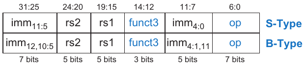

Hình 6.19 Instruction format S- và B-type

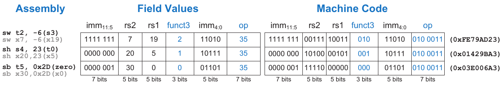

Hình 6.20 Machine code cho instruction S-type

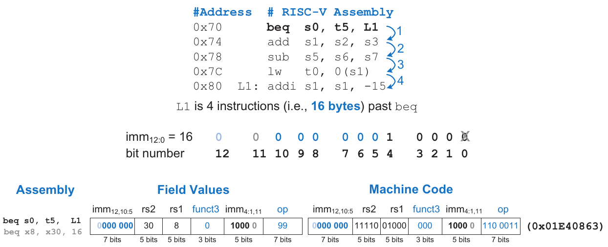

Hình 6.21 Instruction format B-type và các phép tính cho `beq`

> Với instruction 32-bit, bit 1:0 của branch offset 13-bit (imm<sub>12:0</sub>) luôn bằng không vì instruction 32-bit chiếm 4 byte bộ nhớ. Vì vậy, instruction address luôn chia hết cho bốn và cả bit 1 lẫn bit 0 của branch offset đều không cần mã hóa trong instruction. Tuy nhiên, RV32I chỉ bỏ bit 0. Điều này cho phép tương thích với RISC-V compressed instruction 16-bit (2-byte) (xem Mục 6.6.5). Compiler sau đó có thể trộn instruction 16-bit và 32-bit nếu processor hardware hỗ trợ cả hai instruction size.

Branch (`beq`, `bne`, `blt`, `bge`, `bltu` và `bgeu`) dùng instruction format B-type. Hình 6.21 cho code ví dụ với branch if equal instruction `beq`. Instruction address được cho bên trái mỗi instruction. Branch target address (BTA) là đích đến của branch. Instruction `beq` trong Hình 6.21 có BTA 0x80, instruction address của label `L1`. Branch offset được sign-extended rồi cộng vào địa chỉ branch instruction để có branch target address.

Với instruction B-type, rs1 và rs2 là hai source register, còn immediate branch offset 13-bit, imm<sub>12:0</sub> , cho số byte giữa branch instruction và BTA. Ở đây, BTA nằm bốn instruction sau instruction `beq`, tức 4 × 4 = 16 byte sau `beq`. Vì vậy, branch offset là 16. Chỉ bit 12:1 được mã hóa trong instruction vì bit 0 của branch offset luôn bằng 0.

#### Ví dụ 6.5 MÃ HÓA ASSEMBLY INSTRUCTION B-TYPE THÀNH MACHINE CODE

Xét đoạn RISC-V assembly code sau. Instruction address được viết bên trái mỗi instruction. Dịch branch if not equal instruction (`bne`) thành machine code.

Địa chỉ Instruction

```
0x354 L1: addi s1, s1, 1
0x358     sub  t0, t1, s7
...       ...
0xEB0     bne  s8, s9, L1
```

Lời giải Theo Bảng 6.1, `s8` và `s9` là register 24 và 25. Vì vậy, rs1 bằng 24 và rs2 bằng 25. Label `L1` nằm trước instruction `bne` 0xEB0 − 0x354 = 0xB5C (2908) byte. Vì vậy, immediate 13-bit là −2908 (1010010100100<sub>2</sub>). Theo Phụ lục B, op bằng 99 (1100011<sub>2</sub>) và funct3 bằng 1 (001<sub>2</sub>). Do đó machine code được cho ở Hình 6.22. Lưu ý branch instruction có thể branch về trước (địa chỉ cao hơn) hoặc, như trường hợp này, về sau (địa chỉ thấp hơn).

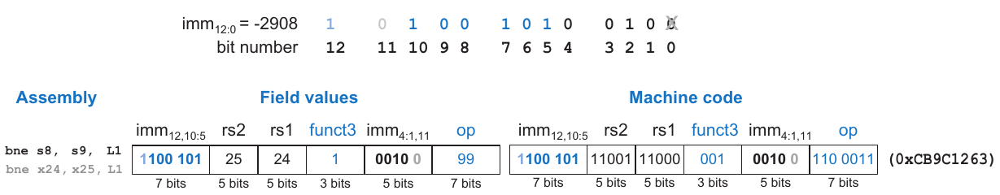

Hình 6.22 Machine code của instruction B-type ở Ví dụ 6.5

### 6.4.4 Instruction U/J-Type

Instruction U/J-type (upper immediate/jump) có một destination register operand rd và immediate field 20-bit, như Hình 6.23. Giống format khác, instruction U/J-type có opcode 7-bit. Trong instruction U-type, các bit còn lại xác định 20 bit quan trọng nhất của immediate 32-bit. Trong instruction J-type, 20 bit còn lại xác định 20 bit quan trọng nhất của immediate jump offset 21-bit. Giống instruction B-type, bit ít quan trọng nhất của immediate luôn bằng 0 và không được mã hóa trong instruction J-type.

> Giống instruction B-type, immediate bit J-type bị xáo trộn kỳ lạ. Máy tính không quan tâm, nhưng điều này gây khó chịu cho con người.

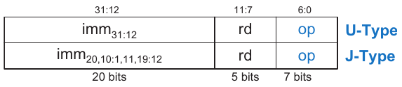

Hình 6.23 Instruction format U- và J-type

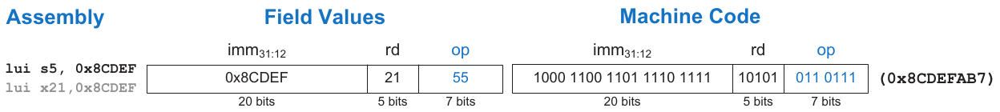

Hình 6.24 Machine code cho instruction U-type `lui`

Hình 6.24 cho thấy load upper immediate instruction `lui` được dịch thành machine code. Immediate 32-bit gồm 20 bit trên được mã hóa trong instruction và 0 ở các bit dưới. Vì vậy, trong trường hợp này, sau khi instruction thực thi, register `s5` (rd) giữ giá trị 0x8CDEF000.

Hình 6.25 cho code ví dụ dùng jump and link instruction `jal`. Instruction address được viết bên trái mỗi instruction. Giống branch instruction, instruction J-type nhảy đến instruction address tương đối với PC hiện tại, tức instruction address của instruction `jal`. Trong Hình 6.25, jump target address (JTA) là 0xABC04, nằm sau instruction `jal` tại địa chỉ 0x540C một khoảng 0xA67F8 byte vì 0xABC04 − 0x540C = 0xA67F8 byte. Giống branch instruction, bit ít quan trọng nhất không được mã hóa trong instruction vì luôn bằng 0. Các bit còn lại được xáo vào immediate field 20-bit, như Hình 6.25. Nếu assembly instruction `jal` không chỉ định destination register rd, trường đó mặc định là `ra` (`x1`). Ví dụ, instruction `jal L1` tương đương `jal ra, L1` và có rd = 1. Jump thông thường (`j`) được mã hóa thành `jal` với rd = 0.

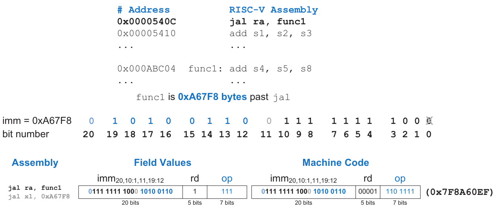

Hình 6.25 Machine code cho instruction J-type `jal`

> `jalr` là instruction I-type (không phải J-type!). `jal` là instruction J-type duy nhất.

### 6.4.5 Immediate Encoding

RISC-V dùng signed immediate 32-bit. Chỉ 12 đến 21 bit của immediate được mã hóa trong instruction. Hình 6.26 cho thấy cách tạo immediate với từng instruction type. Instruction I- và S-type mã hóa signed immediate 12-bit. Instruction J- và B-type dùng signed immediate 21- và 13-bit, trong đó bit ít quan trọng nhất luôn bằng 0 (xem Mục 6.4.3 và 6.4.4). Instruction U-type mã hóa 20 bit trên của immediate 32-bit.

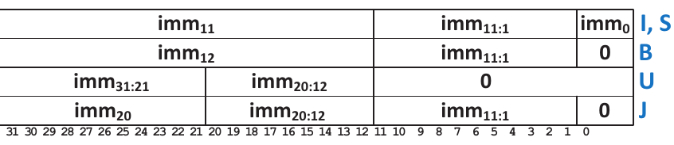

Hình 6.26 RISC-V immediate

Giữa các instruction format, RV32I cố giữ immediate bit ở cùng instruction bit nhằm đơn giản hóa thiết kế phần cứng (đổi lại instruction encoding phức tạp hơn). Hình 6.27 nhấn mạnh tính nhất quán này bằng cách hiển thị instruction field cho mọi format. (Opcode là bit 6:0 cho mọi instruction và không được vẽ.) instr<sub>31</sub> luôn giữ sign bit của immediate. instr<sub>30:20</sub> giữ imm<sub>30:20</sub> cho instruction U-type. Nếu không, instr<sub>30:25</sub> giữ imm<sub>10:5</sub> instr<sub>19:12</sub> giữ imm<sub>19:12</sub> cho instruction U/J-type. imm<sub>4:1</sub> chiếm instr<sub>24:21</sub> hoặc instr<sub>11:8</sub>. Immediate bit 11 (khi không phải sign bit) và bit 0 là các bit di động nằm ở bit 0 hoặc 20 của instruction.

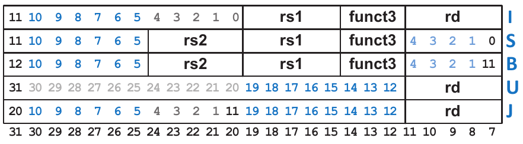

Hình 6.27 RISC-V immediate encoding trong machine instruction

Giữ vị trí immediate bit nhất quán giữa instruction format là ví dụ khác về tính đều đặn giúp đơn giản hóa thiết kế—cụ thể, giảm thiểu số dây và multiplexer cần để trích và sign-extend immediate. Bài tập 6.47 và 6.48 tìm hiểu thêm tác động phần cứng của quyết định thiết kế này.

### 6.4.6 Addressing Mode

Addressing mode định nghĩa cách instruction chỉ định operand. Mục này tóm tắt các mode dùng để đánh địa chỉ instruction operand. RISC-V dùng bốn mode chính: register addressing, immediate addressing, base addressing và PC-relative addressing. Phần lớn architecture khác cung cấp addressing mode tương tự, nên hiểu các mode này giúp bạn học assembly language khác. Ba mode đầu (register, immediate và base addressing) định nghĩa cách đọc và ghi operand. Mode cuối (PC-relative addressing) định nghĩa cách ghi program counter (PC).

Addressing Register-Only

Addressing Register-only dùng register cho mọi source operand và destination operand. Mọi instruction R-type dùng addressing register-only.

Immediate Addressing

Immediate addressing dùng immediate cùng register làm operand. Một số instruction I-type, như add immediate (`addi`) và `xori`, dùng immediate addressing với signed immediate 12-bit. Shift instruction có shift amount immediate (`slli`, `srli` và `srai`) là instruction I-type mã hóa shift amount unsigned immediate 5-bit trong imm<sub>4:0</sub>. Load instruction (`lb`, `lh` và `lw`) dùng instruction format I-type nhưng dùng base addressing, sẽ thảo luận tiếp.

Base Addressing

Memory access instruction, như load word (`lw`) và store word (`sw`), dùng base addressing. Effective address của memory operand được tính bằng cách cộng base address trong register rs1 với offset 12-bit đã sign- extended nằm trong immediate field. Load là instruction I-type và store là instruction S-type.

Addressing PC-Relative

Branch instruction và jump and link instruction (`jal`) dùng PC-relative addressing để chỉ giá trị PC mới. Signed offset mã hóa trong immediate field được cộng vào PC để có target address, PC mới; vì vậy target address được gọi là tương đối với PC hiện tại. Branch và `jal` lần lượt dùng signed immediate 13- và 21-bit cho offset. Các bit quan trọng nhất của offset được mã hóa trong immediate field 12- và 20-bit của instruction B- và J-type. Bit ít quan trọng nhất của offset luôn bằng 0 nên không được mã hóa trong instruction. Instruction `auipc` (add upper immediate to PC) cũng dùng PC-relative addressing. Ví dụ, instruction `auipc s3, 0xABCDE` đặt PC + 0xABCDE000 vào `s3`.

> Jump and link register instruction (`jalr`) dùng base addressing, không phải PC-relative addressing. Nó có thể nhảy đến mọi instruction address trong address space 32-bit vì target address được tạo bằng cách cộng rs1 với signed immediate 12-bit. Return address PC+4 được ghi vào rd.
>
> Chuỗi instruction dưới đây cho phép chương trình nhảy đến bất kỳ địa chỉ nào. Instruction address liệt kê bên trái mỗi instruction. Trong trường hợp này, chương trình nhảy đến địa chỉ 0x12345678 và ghi 0x0100FE7C (tức PC+4) vào `t1`.
>
> \# Địa chỉ RISC-V assembly
>
> ```
> 0x0100FE74  lui    s1,     0x12345
> 0x0100FE78  jalr  t1,    s1,    0x678
> ... ...
> 0x12345678 ...
> ```

### 6.4.7 Diễn giải Machine Language Code

Để diễn giải machine language, phải giải mã các trường của mỗi instruction word 32-bit. Instruction khác nhau dùng format khác nhau nhưng mọi format cùng có opcode field 7-bit. Vì vậy, nơi bắt đầu tốt nhất là xem opcode để xác định instruction R-, I-, S/B- hay U/J-type.

#### Ví dụ 6.6 DỊCH MACHINE LANGUAGE SANG ASSEMBLY LANGUAGE

Dịch machine language code sau sang assembly language.

```
0x41FE83B3
0xFDA48293
```

Lời giải Trước tiên, biểu diễn mỗi instruction bằng binary rồi xem bảy bit ít quan trọng nhất để tìm opcode cho từng instruction.

```
0100 0001 1111 1110 1000 0011 1011 0011  (0x41FE83B3)
1111 1101 1010 0100 1000 0010 1001 0011  (0xFDA48293)
```

Opcode xác định cách diễn giải các bit còn lại. Opcode của instruction đầu là 0110011<sub>2</sub>; do đó, theo Bảng B.1 trong Phụ lục B, đây là instruction R-type và ta có thể chia các bit còn lại thành trường R-type, như phía trên Hình 6.28. Opcode của instruction thứ hai là 0010011<sub>2</sub>, nghĩa là instruction I-type. Ta nhóm các bit còn lại theo format I-type, như Hình 6.28, cho thấy assembly code tương đương của hai machine instruction.

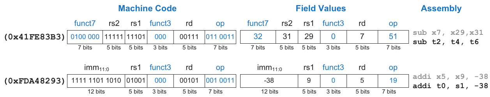

Hình 6.28 Dịch machine code sang assembly code

### 6.4.8 Sức mạnh của Stored Program

Chương trình viết bằng machine language là chuỗi số 32-bit biểu diễn instruction. Giống số binary khác, các instruction này có thể lưu trong bộ nhớ. Đây gọi là stored program concept và là lý do then chốt khiến máy tính mạnh đến vậy. Chạy chương trình khác không đòi hỏi nhiều thời gian và công sức cấu hình lại hoặc nối dây lại phần cứng; chỉ cần ghi chương trình mới vào bộ nhớ. Khác phần cứng chuyên dụng, stored program cung cấp tính toán general- purpose. Theo cách này, máy tính có thể thực thi ứng dụng từ máy tính bỏ túi đến trình xử lý văn bản và trình phát video chỉ bằng cách thay stored program.

> 
>
> Ada Lovelace, 1815–1852
>
> Nhà toán học người Anh viết chương trình máy tính đầu tiên, tính các số Bernoulli bằng Analytical Engine của Charles Babbage. Bà là con gái nhà thơ Lord Byron.

Instruction trong stored program được lấy, hay fetch, từ bộ nhớ và thực thi bởi processor. Ngay cả chương trình lớn, phức tạp cũng chỉ là chuỗi truy cập bộ nhớ và thực thi instruction. Hình 6.29 cho thấy machine instruction được lưu trong bộ nhớ thế nào. Trong chương trình RISC-V, instruction thường được lưu bắt đầu từ địa chỉ thấp, nhưng điều này có thể khác tùy cách triển khai. Hình 6.29 cho thấy code lưu giữa địa chỉ 0x00000830 và 0x0000083C. Hãy nhớ bộ nhớ RISC-V là byte-addressable, nên instruction address tăng 4, không phải 1.

Để chạy hay thực thi stored program, processor fetch instruction tuần tự từ bộ nhớ. Instruction vừa fetch sau đó được digital hardware giải mã và thực thi. Địa chỉ instruction hiện tại được giữ trong program counter (PC) register 32-bit. Để thực thi code trong Hình 6.29, PC được khởi tạo thành địa chỉ 0x00000830. Processor fetch instruction tại memory address đó rồi thực thi instruction 0x01498933 (`add s2, s3, s4`). Sau đó processor tăng PC thêm 4 thành 0x00000834, fetch và thực thi instruction đó, rồi lặp lại.

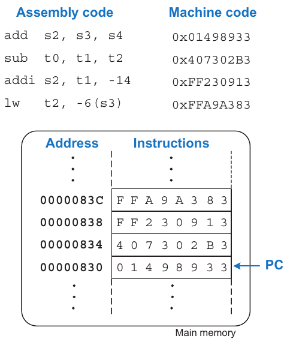

Hình 6.29 Stored program

Architectural state của microprocessor giữ mọi thứ cần thiết để xác định chương trình sẽ làm gì. Với RISC-V, architectural state gồm bộ nhớ, register file và PC. Nếu operating system (OS) lưu architectural state tại một điểm trong chương trình, nó có thể interrupt chương trình, làm việc khác rồi khôi phục state sao cho chương trình tiếp tục đúng, không biết mình từng bị interrupt. Architectural state cũng rất quan trọng khi chúng ta xây dựng microprocessor ở Chương 7.

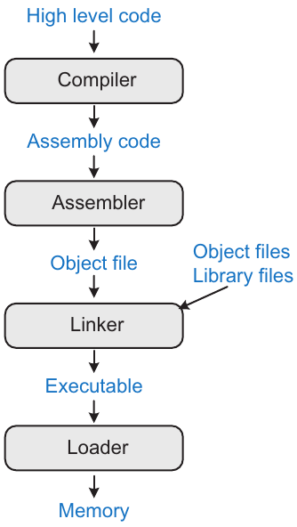

Hình 6.30 Các bước dịch và khởi động chương trình

## 6.5 ÁNH SÁNG, MÁY QUAY, DIỄN: COMPILE, ASSEMBLE VÀ LOAD\*

Đến đây, chúng ta đã chỉ cách dịch đoạn code high-level ngắn thành assembly code và machine code. Mục này mô tả cách compile và assemble chương trình high-level hoàn chỉnh, và cách load chương trình vào bộ nhớ để thực thi. Chúng ta bắt đầu bằng giới thiệu một RISC-V memory map ví dụ, định nghĩa vị trí code, data và stack memory.

Hình 6.30 cho thấy các bước cần để dịch chương trình từ high-level language thành machine language và bắt đầu thực thi. Trước tiên, compiler dịch code high-level thành assembly code. Assembler dịch assembly code thành machine code và đặt vào object file. Linker kết hợp machine code với code từ thư viện và file khác, xác định branch address và vị trí biến thích hợp để tạo chương trình executable hoàn chỉnh. Trong thực tế, phần lớn compiler thực hiện cả ba bước compile, assemble và link. Cuối cùng, loader load chương trình vào bộ nhớ và bắt đầu thực thi. Phần còn lại của mục này lần lượt thực hiện các bước đó cho chương trình đơn giản.

### 6.5.1 Memory Map

Với địa chỉ 32-bit, RISC-V address space trải rộng 2<sup>32</sup> byte (4 GB). Word address là bội số của 4, từ 0 đến 0xFFFFFFFC. Hình 6.31 cho thấy memory map ví dụ. Memory map của chúng ta chia address space thành năm phần hay segment: text, global data và dynamic data segment, cùng segment cho exception handler và operating system (OS), bao gồm bộ nhớ dành cho input/output (I/O). Các mục sau mô tả từng segment. Chúng ta trình bày RISC-V memory map ví dụ ở đây; tuy nhiên, RISC-V không định nghĩa memory map cụ thể. Trong khi exception handler thường nằm tại địa chỉ thấp hoặc cao, người dùng có thể định nghĩa nơi đặt text (code và constant data), memory-mapped I/O, stack và global data. Điều này tạo sự linh hoạt, đặc biệt với hệ thống nhỏ như thiết bị cầm tay, nơi chỉ một phần dải bộ nhớ được dùng và do đó được lắp physical memory.

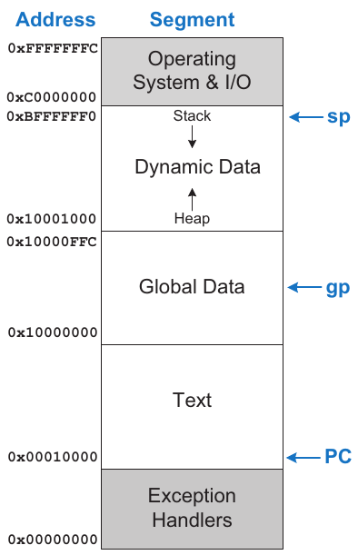

Hình 6.31 RISC-V memory map ví dụ

Text Segment

Text segment lưu user program bằng machine language. Ngoài code, nó có thể chứa literal (hằng số) và dữ liệu read-only.

Global Data Segment

Global data segment lưu global variable, khác local variable ở chỗ có thể được mọi function trong chương trình truy cập. Local variable được định nghĩa trong function và chỉ function đó truy cập được; chúng thường nằm trong register hoặc trên stack. Global variable được cấp phát trong bộ nhớ trước khi chương trình bắt đầu thực thi và thường được truy cập bằng global pointer register `gp` (register `x3`) trỏ đến giữa global data segment. Ở đây, `gp` là 0x10000800. Với signed offset 12-bit, người lập trình có thể dùng `gp` truy cập toàn bộ global data segment.

Dynamic Data Segment

> RISC-V yêu cầu `sp` duy trì alignment 16-byte để tương thích với quad-precision RISC-V base instruction set, RV128I, hoạt động trên dữ liệu 128-bit (tức 16-byte). Vì vậy, `sp` giảm theo bội số 16 để tạo chỗ trên stack, ngay cả khi cần ít stack space hơn. Chúng ta lướt qua yêu cầu này ở Mục 6.3.7 để nhấn mạnh chức năng thay vì quy ước.

Dynamic data segment chứa stack và heap. Dữ liệu trong segment này chưa được biết lúc start-up mà được cấp phát và deallocated động trong suốt quá trình thực thi chương trình.

Khi start-up, operating system thiết lập stack pointer (`sp`, register `x2`) trỏ đến đỉnh stack, ở đây là 0xBFFFFFF0. Stack thường phát triển xuống dưới như minh họa. Stack gồm vùng lưu trữ tạm và local variable, như array, không vừa register. Như thảo luận ở Mục 6.3.7, function cũng dùng stack để lưu và khôi phục register. Mỗi stack frame được truy cập theo thứ tự last-in-first-out.

Heap lưu dữ liệu do chương trình cấp phát trong runtime. Trong C, việc cấp phát bộ nhớ thực hiện bằng function `malloc`; trong C++ và Java, dùng `new` để cấp phát bộ nhớ. Giống đống quần áo trên sàn phòng ký túc xá, heap data có thể được dùng và loại bỏ theo thứ tự bất kỳ. Heap thường phát triển lên từ đáy dynamic data segment.

Nếu stack và heap phát triển chạm nhau, dữ liệu chương trình có thể hỏng. Memory allocator bảo đảm điều này không bao giờ xảy ra bằng cách trả lỗi out-of-memory nếu không đủ chỗ cấp phát thêm dynamic data.

Exception Handler, OS và I/O Segment

Phần thấp nhất của RISC-V memory map ví dụ dành cho exception handler (xem Mục 6.6.2) và boot code chạy lúc start-up. Phần cao nhất của memory map dành cho operating system và memory-mapped I/O (xem Mục 9.2).

### 6.5.2 Assembler Directive

Assembler directive hướng dẫn assembler cấp phát và khởi tạo global variable, định nghĩa hằng số và phân biệt code với data. Bảng 6.5 liệt kê RISC-V assembler directive thường gặp, và Ví dụ code 6.29 chỉ cách dùng chúng.

Các assembler directive `.data`, `.text`, `.bss` và `.section .rodata` bảo assembler đặt data hoặc code theo sau lần lượt vào global data, text (code), BSS hoặc read-only data (`.rodata`) segment của bộ nhớ. BSS segment nằm trong global data segment nhưng được khởi tạo thành không. Data segment read-only là constant data được đặt trong text segment (tức program memory).

> BSS là viết tắt của block started symbol, ban đầu là keyword cấp phát một block dữ liệu chưa khởi tạo. Hiện nay, phần lớn operating system khởi tạo dữ liệu trong BSS segment thành không.

Chương trình ở Ví dụ code 6.29 bắt đầu bằng cách đặt label `main` thành global (`.globl main`) để function `main` có thể được gọi từ ngoài file này, thường bởi OS hoặc bootloader. Giá trị `N` sau đó được đặt thành 5 (`.equ N, 5`). Assembler thay `N` bằng 5 trước khi dịch assembly instruction thành machine code. Ví dụ, instruction `lw t5, N*4(t0)` được dịch thành `lw t5, 20(t0)` rồi chuyển thành machine code (0x0142AF03). Tiếp theo, chương trình cấp phát các global variable sau, như Hình 6.32: `A` (array 7-element gồm giá trị 32-byte), `str1` (string null-terminated), `B` và `C` (mỗi biến 4 byte), và `D` (1 byte). `A`, `B` và `str1` lần lượt được khởi tạo thành {5, 42, -88, 2, -5033, 720, 314}, 0x32A và “RISC-V” (tức {52, 49, 53, 43, 2D, 56, 00} – xem Bảng 6.2). Hãy nhớ trong ngôn ngữ lập trình C, string kết thúc bằng null character (0x00). Biến `C` và `D` không được người dùng khởi tạo, nằm trong BSS segment. Assembler này chèn 16 byte bộ nhớ chưa cấp phát giữa data segment và BSS segment, như các ô xám ở Hình 6.32.

Bảng 6.5 RISC-V assembler directive

| Assembler Directive | Mô tả |
|---|---|
| `.text` | Text section |
| `.data` | Global data section |
| `.bss` | Global data được khởi tạo thành 0 |
| `.section .foo` | Section có tên `.foo` |
| `.align N` | Căn chỉnh data/instruction tiếp theo theo boundary 2<sup>N</sup>-byte |
| `.balign N` | Căn chỉnh data/instruction tiếp theo theo boundary N-byte |
| `.globl sym` | Label `sym` là global |
| `.string “str”` | Lưu string “`str`” trong bộ nhớ |
| `.word w1, w2,..., wN` | Lưu N giá trị 32-bit trong các memory word liên tiếp |
| `.byte b1, b2,..., bN` | Lưu N giá trị 8-bit trong các memory byte liên tiếp |
| `.space N` | Dành N byte để lưu biến |
| `.equ name, constant` | Định nghĩa symbol `name` với giá trị `constant` |
| `.end` | Kết thúc assembly code |

> Chương trình ở Ví dụ code 6.29 được chạy trên RISC-V core thương mại open-source SweRV EH1 của Western Digital. Processor khác dùng memory map khác nên đặt biến và code tại địa chỉ khác. Khóa học RVfpga (RISC-V FPGA) miễn phí của Imagination Technologies chỉ cách dùng SweRV EH1 core nhắm đến FPGA để chạy chương trình C và assembly, khám phá, mở rộng và sửa đổi RISC-V processor cùng system đó. Xem https://university.imgtec.com/rvfpga/.

> Lưu ý `str2` nằm trong code segment (không phải data segment) tại địa chỉ 0x140, gần user code (`main`) bắt đầu tại địa chỉ 0x88. Bằng cách đặt code và data cùng nhau, chương trình giảm thiểu bộ nhớ cần thiết và số instruction truy cập dữ liệu, cả hai đều thiết yếu trong handheld system và embedded system.

Assembler directive `.align 2` căn chỉnh data hoặc code theo sau tại boundary 2<sup>2</sup> = 4-byte. Assembler directive `.balign 4` (byte align 4) tương đương. Các assembler directive này giúp duy trì alignment cho data và instruction. Ví dụ, nếu bỏ `.align 2` trước khi cấp phát `B` (tức trước `B: .word 0x32A`), `B` sẽ được cấp phát ngay sau biến `str1`, trong byte 0x2157 – 0x215A (thay vì 0x2158 – 0x215B).

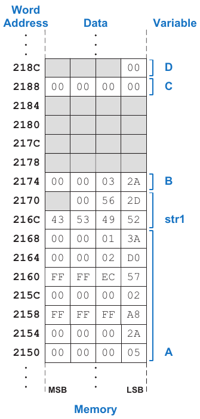

Hình 6.32 Cấp phát bộ nhớ cho global variable trong Ví dụ code 6.29

Ví dụ code 6.29 SỬ DỤNG ASSEMBLER DIRECTIVE

```
.globl main         #  make the main label global
.equ N, 5           #  N = 5

.data               #  global data segment
A: .word 5, 42, −88, 2, −5033, 720, 314
str1: .string "RISC-V"
.align 2            #  align next data on 2^2-byte boundary
B: .word 0x32A

.bss                #  bss segment – variables initialized to 0
C: .space 4
D: .space 1

.balign 4           #  align next instruction on 4-byte boundary
.text               #  text segment (code)
main:
  la   t0, A        #  t0 = address of A                = 0x2150
  la   t1, str1     #  t1 = address of str1             = 0x216C
  la   t2, B        #  t2 = address of B                = 0x2174
  la   t3, C        #  t3 = address of C                = 0x2188
  la   t4, D        #  t4 = address of D                = 0x218C
  lw   t5, N*4(t0)  #  t5  = A[N] = A[5] = 720          = 0x2D0
  lw   t6, 0(t2)    #  t6 = B = 810                     = 0x32A
  add t5, t5, t6    #  t5 = A[N] + C = 720 + 810 = 1530 = 0x5FA
  sw   t5, 0(t3)    #  C    = 1530                      = 0x5FA
  lb   t5, N−1(t1)  #  t5 = str1[N−1] = str1[4] = '−'  = 0x2D
  sb   t5, 0(t4)    #  D    = str1[N−1]                 = 0x2D
  la   t5, str2     #  t5 = address of str2             = 0x140
  lb   t6, 8(t5)    #  t6 = str2[8] = 'r'               = 0x72
  sb   t6, 0(t1)    #  str1[0] = 'r'                    = 0x72
  jr     ra         #    return
.section .rodata
str2: .string "Hello world!"
.end                # end of assembly file
```

Function `main` bắt đầu bằng load địa chỉ global variable vào `t0` –`t4` bằng pseudoinstruction load address (`la`) (xem Bảng B.7 ở mặt trong bìa sách). Chương trình lấy `A[5]` và `C` từ bộ nhớ, cộng chúng rồi đặt kết quả (0x5FA) vào `D`. Sau đó nó load giá trị `str1[4]` (là ‘–’ = ASCII code 0x2D) bằng instruction `lb t5, N−1(t1)` và đặt giá trị đó vào global variable `B`. Cuối cùng, chương trình đọc `str2[8]`, tức ký tự ‘`r`’, và đặt vào `str1[0]`. Function `main` kết thúc bằng return về operating system hoặc boot code bằng `jr ra`. Hình 6.33 cho thấy giá trị cuối của `C`, `D` và `str1`. Assembly directive `.end` chỉ kết thúc assembly file.

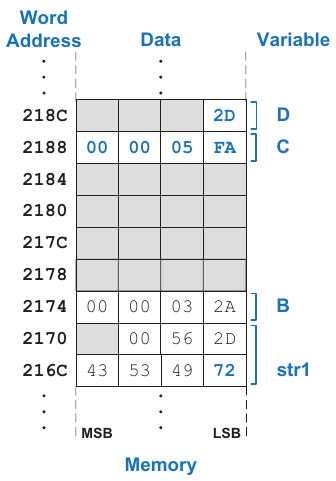

Hình 6.33 Giá trị cuối của global variable `C`, `D` và `str1`

### 6.5.3 Compile

Compiler dịch code high-level thành assembly language, rồi assembler dịch assembly code đó thành machine code. Các ví dụ trong mục này dựa trên GCC, compiler miễn phí phổ biến và được dùng rộng rãi. GCC thuộc toolchain có những khả năng khác, một số được thảo luận trong mục này. Ví dụ code 6.30 cho thấy chương trình high-level đơn giản có ba global variable và hai function, cùng assembly code do GCC trong Freedom E SDK toolchain của SiFive tạo ra. Xem Lời nói đầu để biết hướng dẫn dùng RISC-V compiler.

> 
>
> Grace Hopper, 1906–1902
>
> Tốt nghiệp Yale University với bằng tiến sĩ toán học. Bà phát triển compiler đầu tiên khi làm tại Remington Rand Corporation và giữ vai trò quan trọng trong phát triển ngôn ngữ lập trình COBOL. Là sĩ quan hải quân, bà nhận nhiều phần thưởng, gồm World War II Victory Medal và National Defense Service Medal. Bà cũng ghi lại “bug” máy tính đầu tiên, trong trường hợp này là một côn trùng thật gây cản trở punchcard.

Trong Ví dụ code 6.30, function `main` bắt đầu bằng lưu `ra` trên stack. Nó tạo chỗ cho bốn word (16 byte) nhưng chỉ dùng một vị trí stack. Hãy nhớ `sp` phải giữ alignment 16-byte để tương thích RV128I. Sau đó `main` ghi giá trị 2 vào global variable `f` và 3 vào global variable `g`. Global variable chưa được đặt trong bộ nhớ—assembler sẽ làm sau. Vì vậy, hiện tại assembly code dùng hai instruction (`lui` theo sau bởi `sw`) thay vì chỉ một (`sw`) để store vào từng global variable, phòng khi cần chỉ định địa chỉ 32-bit.

#### Ví dụ code 6.30 COMPILE CHƯƠNG TRÌNH HIGH-LEVEL

Code High-Level

```
int f, g, y;

int func(int a, int b) {
 if (b < 0)
   return (a + b);
 else
   return(a + func(a, b − 1));
}


void main() {
 f=2;
 g=3;
 y=func(f,g);

 return;
}
```

Assembly Code RISC-V

```
      .text
      .globl      func
      .type func, @function
func:
      addi  sp,sp,−16
      sw    ra,12(sp)
      sw    s0,8(sp)
      mv    s0,a0
      add   a0,a1,a0
      bge   a1,zero,.L5
.L1:
      lw    ra,12(sp)
      lw    s0,8(sp)
      addi  sp,sp,16
      jr    ra
.L5:
      addi  a1,a1,−1
      mv    a0,s0
      call  func
      add   a0,a0,s0
      j     .L1

      .globl      main
      .type main, @function
main:
      addi  sp,sp,−16
      sw    ra,12(sp)
      lui   a5,%hi(f)
      li    a4,2
      sw    a4,%lo(f)(a5)
      lui   a5,%hi(g)
      li    a4,3
      sw    a4,%lo(g)(a5)
      li    a1,3
      li    a0,2
      call  func
      lui   a5,%hi(y)
      sw    a0,%lo(y)(a5)
      lw    ra,12(sp)
      addi  sp,sp,16
      jr    ra
      .comm y,4,4
      .comm g,4,4
      .comm f,4,4
```

Chương trình sau đó đặt `f` và `g` (tức 2 và 3) vào argument register `a0` và `a1`, rồi gọi `func` bằng pseudocode `call func`. Function (`func)` lưu `ra` và `s0` trên stack. Tiếp theo nó đặt `a0` (`a`) vào `s0` (vì sẽ cần sau recursive call đến `func`) và tính `a0 = a0 + a1` (return value = `a + b`). Sau đó `func` branch nếu `a1` (`b`) lớn hơn hoặc bằng không. Nếu không, nó khôi phục `ra`, `s0` và `sp`, rồi return bằng `jr ra`. Nếu branch được thực hiện (`b` ≥ 0), `func` giảm `a1` (`b`) rồi gọi đệ quy `func`. Sau khi return từ recursive call, nó cộng return value (`a0`) và `s0` (`a`), nhảy đến label `.L1`, nơi `ra`, `s0` và `sp` được khôi phục và function return. Function `main` sau đó lưu kết quả được return từ `func` (`a0`) vào global variable `y`, khôi phục `ra` và `sp`, rồi return `y`. Ở cuối assembly code, chương trình cho biết có ba global variable 4-byte-wide `f`, `g` và `y`, bằng `.comm g, 4, 4`, v.v. `4` đầu chỉ alignment 4-byte và `4` thứ hai chỉ kích thước biến (4 byte).

Để compile, assemble và link chương trình C tên `prog.c` bằng GCC, dùng lệnh:

```
gcc –O1 –g prog.c –o prog
```

Lệnh này tạo ra một executable output file có tên `prog`. Flag `–O1` yêu cầu compiler thực hiện các tối ưu hóa cơ bản thay vì tạo code cực kỳ kém hiệu quả. Flag `–g` yêu cầu compiler đưa thông tin phục vụ debug vào file.

Để xem các bước trung gian, ta có thể dùng flag `–S` của GCC để compile mà không assemble hoặc link.

```
gcc –O1 –S prog.c –o prog.s
```

Output `prog.s` khá dài dòng, nhưng phần đáng chú ý được trình bày trong Ví dụ code 6.30.

### 6.5.4 Assemble

Assembler chuyển assembly language code thành object file chứa machine language code. GCC có thể tạo object file từ `prog.s` hoặc trực tiếp từ `prog.c` bằng:

```
gcc –c prog.s –o prog.o
```

hoặc

```
gcc –O1 –g –c prog.c –o prog.o
```

Assembler duyệt assembly code hai lượt. Trong lượt đầu, assembler gán các instruction address và tìm tất cả các symbol, chẳng hạn label và tên global variable. Tên và địa chỉ của các symbol được lưu trong một symbol table. Trong lượt duyệt code thứ hai, assembler tạo machine language code. Địa chỉ của các label được lấy từ symbol table. Machine language code và symbol table được lưu trong object file.

Ta có thể disassemble object file bằng lệnh `objdump` để xem assembly language code bên cạnh machine language code.

```
objdump –S prog.o
```

Dưới đây là disassembly của .text section. Nếu code ban đầu được compile với `–g`, disassembler cũng hiển thị dòng C code tương ứng, như dưới đây, xen kẽ assembly code. Lưu ý pseudoinstruction `call` được dịch thành hai RISC-V instruction: `auipc ra, 0x0` và `jalr ra`, phòng khi function ở xa, tức xa PC hiện tại hơn mức signed offset 21-bit của `jal` có thể tới. Instruction store vào global variable cũng chỉ là placeholder cho đến khi global variable được đặt trong bộ nhớ. Ví dụ, ba instruction tại địa chỉ 0x48 đến 0x50 dùng để lưu giá trị 2 vào global variable `f`. Khi `f` được đặt trong bộ nhớ ở bước link, instruction sẽ được cập nhật.

```
00000000 <func>:
int f, g, y;
int func(int a, int b) {
    0: ff010113                addi  sp,sp,−16
    4: 00112623                sw    ra,12(sp)
    8: 00812423                sw    s0,8(sp)
    c: 00050413                mv    s0,a0
    if  (b<0) return (a+b);
  10: 00a58533                 add  a0,a1,a0
  14:  0005da63                bgez  a1,28 <.L5>
00000018 <.L1>:
   else return(a + func(a, b-1));
}
   18: 00c12083                lw    ra,12(sp)
   1c: 00812403                lw    s0,8(sp)
   20: 01010113                addi  sp,sp,16
   24: 00008067                ret
00000028 <.L5>:
   else return(a + func(a, b-1));
   28: fff58593                addi  a1,a1,−1
   2c: 00040513                mv    a0,s0
  30: 00000097 auipc ra,0x0
  34: 000080e7 jalr  ra # 30 <.LVL5+0x4>
  38: 00850533 add a0,a0,s0
  3c: fddff06f j     18 <.L1>

00000040 <main>:
void main() {
  40: ff010113 addi  sp,sp,−16
  44: 00112623 sw    ra,12(sp)
  f=2;
  48: 000007b7 lui  a5,0x0
  4c: 00200713 li    a4,2
  50: 00e7a023 sw    a4,0(a5) # 0 <func>
  g=3;
  54: 000007b7 lui  a5,0x0
  58: 00300713 li    a4,3
  5c: 00e7a023 sw    a4,0(a5) # 0 <func>
  y=func(f,g);
  60: 00300593 li    a1,3
  64: 00200513 li    a0,2
  68: 00000097 auipc ra,0x0
  6c: 000080e7 jalr  ra # 68 <main+0x28>
  70: 000007b7 lui  a5,0x0
  74: 00a7a023 sw    a0,0(a5) # 0 <func>
  return;
}
  78: 00c12083 lw    ra,12(sp)
  7c: 01010113 addi  sp,sp,16
  80: 00008067 ret
```

Ta có thể xem symbol table từ object file bằng `objdump` với flag `−t`. Phần đáng chú ý hiển thị dưới đây. Chúng ta thêm nhãn cho ba cột cần quan tâm: memory address, kích thước và tên symbol. Vì chương trình chưa được đặt trong bộ nhớ (chưa link), địa chỉ hiện chỉ là placeholder. `.text` chỉ code (text) segment và `.data` chỉ data (global data) segment. Kích thước hai symbol này hiện bằng 0 vì chương trình chưa link. Kích thước hai function `func` và `main` được liệt kê: `func` là 0x40 (64) byte = 16 instruction, và `main` là 0x44 (68) byte = 17 instruction, như code phía trên. Global variable symbol `f`, `g` và `y` được liệt kê, mỗi biến 4 byte, nhưng địa chỉ được ghi là placeholder 0x00000004 vì chưa được gán địa chỉ.

```
objdump −t prog.o
SYMBOL TABLE:
```

Địa chỉ Kích thước Tên symbol

> Chúng ta phần lớn bỏ qua các cột chưa ghi nhãn trong symbol table này. Chúng hiển thị flag gắn với symbol (`l` cho local hoặc `g` cho global, và `d` cho debug, `F` cho function hoặc `O` cho object) và section chứa symbol (`.text`, `.data` hoặc `*COM*` (common) khi không nằm trong section).

```
00000000   l   d   .text  00000000 .text
00000000   l   d   .data  00000000 .data
00000000   g   F   .text  00000040 func
00000040   g   F   .text  00000044 main
00000004        O   *COM* 00000004 f
00000004        O   *COM* 00000004 g
00000004        O   *COM* 00000004 y
```

### 6.5.5 Link

Phần lớn chương trình lớn có nhiều file. Nếu người lập trình chỉ sửa một file, compile và assemble lại các file khác sẽ lãng phí. Đặc biệt, chương trình thường gọi function trong library file; các library file này hầu như không thay đổi. Nếu file code high-level không thay đổi, object file tương ứng không cần cập nhật. Ngoài ra, chương trình thường có start-up code (khởi tạo stack, heap, v.v.) phải thực thi trước khi gọi function `main`.

Nhiệm vụ linker là kết hợp mọi object file và start-up code thành một machine language file gọi là executable, đồng thời gán địa chỉ cho global variable. Linker relocate data và instruction trong object file để chúng không nằm chồng lên nhau. Nó dùng thông tin trong symbol table để điều chỉnh code dựa trên địa chỉ label và global variable mới. Gọi GCC để link object file bằng:

```
gcc prog.o −o prog
```

Ta có thể disassemble executable lần nữa bằng:

```
objdump −S −t prog
```

Code start-up quá dài để trình bày, nhưng symbol table và program code đã cập nhật được disassemble từ executable hiển thị dưới đây. Chúng ta lại thêm nhãn vào các cột cần quan tâm. Function và global variable giờ được relocate đến địa chỉ thực tế. Theo symbol table, toàn bộ text segment và data segment (gồm start-up code và system data) lần lượt bắt đầu tại 0x10074 và 0x115e0. `func` bắt đầu tại địa chỉ 0x10144 và dài 0x3c byte (15 instruction). `main` bắt đầu tại 0x10180 và dài 0x34 byte (13 instruction). Mỗi global variable dài 4 byte; `f` tại memory address 0x11a30, `g` tại 0x11a34 và `y` tại 0x11a38.

```
SYMBOL TABLE:
```

> Lưu ý giờ đây global variable `f`, `g` và `y` được cấp memory address, chúng được liệt kê thành global symbol (thể hiện bằng flag `g`) và nằm trong `.bss` segment, nơi chứa global variable chưa khởi tạo.

Địa chỉ Kích thước Tên symbol

```
00010074   l   d   .text 00000000 .text
000115e0   l   d   .data 00000000 .data
00010144   g   F   .text 0000003c func
00010180   g   F   .text 00000034 main
00011a30   g   O   .bss  00000004 f
00011a34   g   O   .bss  00000004 g
00011a38   g   O   .bss  00000004 y
```

Lưu ý kích thước `func` ở dưới giờ chỉ còn 15 instruction thay vì 16. Call đến `func` ở gần nên chỉ cần một instruction `jalr` để call. Tương tự, code `main` giảm từ 17 xuống 13 instruction nhờ near call và store gần global pointer `gp`. Chương trình store vào `f` bằng một instruction: `sw a4, −944(gp)`. Từ instruction này, ta cũng có thể xác định giá trị global pointer `gp` do start-up code khởi tạo. Ta biết `f` ở địa chỉ 0x11a30 nên `gp` bằng 0x11a30 + 944 = 0x11DE0.

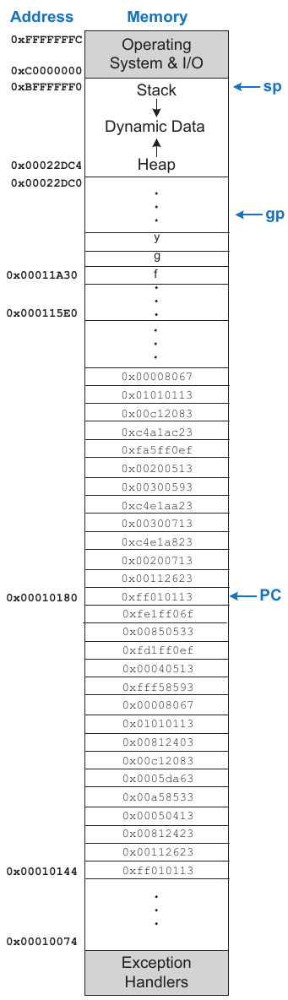

Hình 6.34 `prog` được load vào bộ nhớ

```
00010144 <func>:
int f, g, y;

int func(int a, int b) {
   10144: ff010113 addi  sp,sp,−16
   10148: 00112623 sw    ra,12(sp)
   1014c: 00812423 sw    s0,8(sp)
   10150: 00050413 mv    s0,a0
  if (b<0) return (a+b);
   10154: 00a58533 add  a0,a1,a0
   10158: 0005da63 bgez  a1,1016c <func+0x28>
  else return(a + func(a, b-1));
}
   1015c: 00c12083 lw    ra,12(sp)
   10160: 00812403 lw    s0,8(sp)
   10164: 01010113 addi  sp,sp,16
   10168: 00008067 ret
  else return(a + func(a, b-1));
   1016c: fff58593 addi  a1,a1,−1
   10170: 00040513 mv    a0,s0
   10174: fd1ff0ef jal  ra,10144 <func>
   10178: 00850533 add  a0,a0,s0
   1017c: fe1ff06f j     1015c <func+0x18>

00010180 <main>:
void main() {
   10180: ff010113 addi  sp,sp,−16
   10184: 00112623 sw    ra,12(sp)
  f=2;
   10188: 00200713 li    a4,2
   1018c: c4e1a823 sw    a4,−944(gp) # 11a30 <f>
  g=3;
   10190: 00300713 li    a4,3
   10194: c4e1aa23 sw    a4,−940(gp) # 11a34 <g>
  y=func(f,g);
   10198: 00300593 li    a1,3
   1019c: 00200513 li    a0,2
   101a0: fa5ff0ef jal  ra,10144 <func>
   101a4: c4a1ac23 sw    a0,−936(gp) # 11a38 <y>

  return;
}
   101a8: 00c12083 lw    ra,12(sp)
   101ac: 01010113 addi  sp,sp,16
   101b0: 00008067 ret
```

### 6.5.6 Load

Operating system load chương trình bằng cách đọc text segment của executable file từ thiết bị lưu trữ (thường hard disk hoặc flash storage) vào text segment trong bộ nhớ. Operating system nhảy đến đầu chương trình để bắt đầu thực thi. Hình 6.34 cho thấy memory map lúc bắt đầu thực thi chương trình.

## 6.6 NHỮNG NỘI DUNG KHÁC\*

Mục này đề cập vài chủ đề tùy chọn không phù hợp một cách tự nhiên ở phần khác của chương. Chúng gồm endianness, exception, signed arithmetic instruction và unsigned arithmetic instruction, floating-point instruction và compressed instruction (16-bit).

### 6.6.1 Endianness

Bộ nhớ Byte-addressable được tổ chức theo big-endian hoặc little-endian, như Hình 6.35. Trong cả hai format, most significant byte (MSB) của word 32-bit ở bên trái và least significant byte (LSB) ở bên phải. Word address giống nhau ở cả hai format, tham chiếu cùng bốn byte. Chỉ địa chỉ byte trong word khác nhau (xem Hình 6.35). Trong máy big-endian, byte được đánh số bắt đầu từ 0 ở đầu lớn (quan trọng nhất). Trong máy little-endian, byte được đánh số bắt đầu từ 0 ở đầu nhỏ (ít quan trọng nhất).

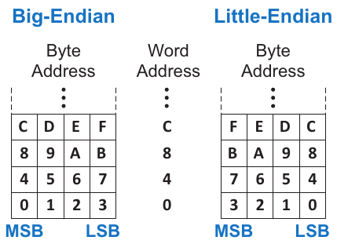

Hình 6.35 Memory addressing Big- và little-endian

> 
>
> Thuật ngữ big-endian và little-endian bắt nguồn từ Gulliver’s Travels của Jonathan Swift, xuất bản lần đầu năm 1726 dưới bút danh Isaac Bickerstaff. Trong truyện, vua Lilliput yêu cầu dân chúng (Little-Endians) đập trứng ở đầu nhỏ. Big-Endians là những kẻ nổi loạn đập trứng ở đầu lớn.
>
> Những thuật ngữ này được Danny Cohen áp dụng lần đầu cho computer architecture trong bài “On Holy Wars and a Plea for Peace”, xuất bản vào ngày Cá tháng Tư năm 1980 (USC/ISI IEN 137). (Ảnh do The Brotherton Collection, Leeds University Library cung cấp.)

RISC-V thường là little-endian, dù đã định nghĩa một biến thể big-endian. PowerPC của IBM (trước đây có trong Macintosh) dùng addressing big-endian. x86 architecture của Intel (có trong PC) dùng addressing little-endian. Lựa chọn endianness hoàn toàn tùy ý nhưng gây rắc rối khi chia sẻ dữ liệu giữa máy tính big- và little-endian. Trong ví dụ của sách, chúng ta dùng format little-endian bất cứ khi nào thứ tự byte có ý nghĩa.

### 6.6.2 Exception

Exception giống function call không được lên lịch, do sự kiện phần cứng hoặc phần mềm gây ra. Ví dụ, processor có thể nhận thông báo người dùng nhấn phím trên bàn phím. Processor có thể dừng việc đang làm, xác định phím được nhấn, lưu lại để dùng sau rồi tiếp tục chương trình đang chạy. Hardware exception như vậy được kích hoạt bởi thiết bị input/output (I/O) như bàn phím thường gọi là interrupt. Ngoài ra, chương trình có thể gặp điều kiện lỗi do phần mềm, như instruction chưa định nghĩa. Software exception đôi khi gọi là trap. Nguyên nhân exception khác gồm reset và cố đọc bộ nhớ không tồn tại. Giống function call khác, exception phải lưu return address, nhảy đến địa chỉ nào đó, làm việc, tự dọn dẹp rồi return về chương trình tại nơi đã dừng.

> Có privilege level thứ tư gọi là hypervisor mode (H-mode), hỗ trợ machine virtualization, tức tạo cảm giác nhiều máy (có thể có nhiều operating system) đang chạy trên một máy vật lý. H-mode có privilege cao hơn S-mode nhưng thấp hơn M-mode.

Execution Mode và Privilege Level

RISC-V processor có thể hoạt động trong một trong nhiều execution mode có privilege level khác nhau. Privilege level quy định instruction nào được thực thi và bộ nhớ nào được truy cập. Ba privilege level chính của RISC-V là user mode, supervisor mode và machine mode, theo thứ tự privilege tăng dần. Machine mode (M-mode) là privilege level cao nhất; chương trình chạy trong mode này có thể truy cập mọi register và memory location. M-mode là privilege mode bắt buộc duy nhất và là mode duy nhất dùng trong processor không có operating system (OS), gồm nhiều embedded system. User application chạy trên OS thường ở user mode (U-mode), còn OS chạy ở supervisor mode (S-mode); user program không truy cập được privileged register hoặc memory location dành cho OS. Các mode khác nhau bảo vệ state then chốt khỏi bị hỏng. Chúng ta thảo luận exception khi chạy trong M-mode. Exception xảy ra tại level khác tương tự nhưng dùng register gắn với mode đó.

Exception Handler

Exception handler dùng bốn register special-purpose, gọi là control and status register (CSR), để xử lý exception: `mtvec`, `mcause`, `mepc` và `mscratch`. Machine trap-vector base-address register `mtvec` giữ địa chỉ exception handler code. Khi exception xảy ra, processor ghi nguyên nhân vào `mcause` (xem Bảng 6.6), lưu PC của instruction gây exception vào `mepc`, machine exception PC register, và nhảy đến exception handler tại địa chỉ đã cấu hình trong `mtvec.`

> RISC-V định nghĩa rất nhiều CSR, tất cả phải được khởi tạo lúc start-up.

> Giá trị `mcause` có thể được phân loại thành interrupt hoặc exception, như cột left-most trong Bảng 6.6, tức bit 31 của `mcause`. Bit [30:0] của `mcause` giữ exception code, chỉ nguyên nhân interrupt hoặc exception.

Sau khi nhảy đến địa chỉ trong `mtvec`, exception handler đọc register `mcause` để xem nguyên nhân exception và phản ứng thích hợp (ví dụ đọc bàn phím khi hardware interrupt). Sau đó nó hủy chương trình hoặc return về chương trình bằng instruction `mret`, machine exception return, nhảy đến địa chỉ trong `mepc`. Giữ PC của instruction gây exception trong `mepc` tương tự dùng `ra` lưu return address trong instruction `jal`. Exception handler phải dùng program register (`x1−x31`) để xử lý exception, nên dùng bộ nhớ do `mscratch` trỏ đến để lưu và khôi phục các register này.

Bảng 6.6 Encoding nguyên nhân exception thường gặp

| Interrupt | Exception Code | Mô tả |
|---|---|---|
| 1 | 3 | Machine software interrupt |
| 1 | 7 | Machine timer interrupt |
| 1 | 11 | Machine external interrupt |
| 0 | 0 | Instruction address không được aligned |
| 0 | 2 | Instruction không hợp lệ |
| 0 | 3 | Breakpoint |
| 0 | 4 | Load address không được aligned |
| 0 | 5 | Load access fault |
| 0 | 6 | Store address không được aligned |
| 0 | 7 | Store access fault |
| 0 | 8 | Environment call từ U-Mode |
| 0 | 9 | Environment call từ S-Mode |
| 0 | 11 | Environment call từ M-Mode |

> Exception có thể dùng một trong hai exception handling mode: direct hoặc vectored. RISC-V thường dùng direct mode mô tả ở đây, nơi mọi exception branch đến cùng địa chỉ, tức base address mã hóa trong bit 31:2 của `mtvec`. Trong vectored mode, exception branch đến offset tính từ base address, tùy nguyên nhân exception. Mỗi offset cách nhau một số ít địa chỉ—ví dụ 32 byte—nên exception handler code có thể phải nhảy đến exception handler lớn hơn để xử lý. Exception mode được mã hóa trong bit 1:0 của `mtvec`; 00<sub>2</sub> cho direct mode và 01<sub>2</sub> cho vectored.

> Register Exception-related riêng cho từng operating mode. Register M-mode gồm `mtvec`, `mepc`, `mcause` và `mscratch`, còn register S-mode gồm `sepc`, `scause` và `sscratch`. H-mode cũng có register riêng. Exception register riêng dành cho từng mode cung cấp hỗ trợ phần cứng cho nhiều privilege level.

Instruction Exception-Related

Exception handler dùng instruction đặc biệt để xử lý exception. Những instruction này gọi là privileged instruction vì truy cập CSR. Chúng thuộc base RV32I instruction set (xem Phụ lục B, Bảng B.8). Register `mepc` và `mcause` không thuộc RISC-V program register (`x1−x31`), nên exception handler phải chuyển các register special-purpose (CSR) này vào program register để đọc và thao tác. RISC-V dùng ba instruction để đọc, ghi hoặc vừa đọc vừa ghi CSR: `csrr` (read CSR), `csrw` (write CSR) và `csrrw` (read/write CSR). Ví dụ, `csrr t1, mcause` đọc giá trị trong `mcause` vào `t1`; `csrw mepc, t2` ghi giá trị trong `t2` vào `mepc`; còn `csrrw t1, mscratch, t0` đồng thời đọc giá trị trong `mscratch` vào `t1` và ghi giá trị trong `t0` vào `mscratch`.

> `csrrw` là RISC-V instruction thực tế (xem Bảng B.8 trong Phụ lục B), nhưng `csrr` và `csrw` là pseudoinstruction. `csrr` được triển khai thành `csrrs` `rd, CSR, x0`, còn `csrw` thành `csrrw` `x0, CSR, rs1`.

Tóm tắt Exception Handling

Tóm lại, khi processor phát hiện exception, nó:

1\. Nhảy đến exception handler address giữ trong `mtvec`.

2\. Exception handler lưu register trên stack nhỏ do `mscratch` trỏ đến rồi dùng `csrr` (read CSR) xem nguyên nhân exception (mã hóa trong `mcause`) và phản ứng tương ứng.

3\. Khi handler hoàn tất, nó có thể tăng `mepc` thêm 4, khôi phục register từ bộ nhớ rồi hủy chương trình hoặc return về user code bằng instruction `mret`, nhảy đến địa chỉ giữ trong `mepc`.

#### Ví dụ 6.7 EXCEPTION HANDLER CODE

Viết exception handler xử lý hai exception sau: illegal instruction (`mcause` = 2) và load address misaligned (`mcause` = 4). Nếu xuất hiện illegal instruction, chương trình chỉ cần tiếp tục thực thi sau illegal instruction. Khi load address misaligned exception, chương trình nên hủy. Nếu exception khác xảy ra, chương trình nên thử re-execute instruction.

Lời giải Exception handler bắt đầu bằng bảo toàn program register sẽ bị ghi đè. Sau đó nó kiểm tra từng exception cause và (1) tiếp tục thực thi ngay sau instruction gây exception (tức tại `mepc` + 4) khi illegal instruction exception, (2) hủy khi load address không aligned, hoặc (3) thử re-execute instruction gây exception (tức return về `mepc`) khi exception khác. Trước khi return về chương trình, handler khôi phục mọi register bị ghi đè. Để hủy chương trình, handler nhảy đến exit code tại label `exit` (không trình bày). Với chương trình chạy trên OS, instruction `j exit` có thể được thay bằng environment call (`ecall`) với return code lưu trong program register như `a0`.

> Lúc start-up, processor nhảy đến reset exception vector, memory address hardwired—ví dụ 0x200—là địa chỉ bắt đầu boot loader code, còn gọi boot code. Dù reset không phải exception điển hình xảy ra trong quá trình thực thi chương trình, nó được gọi vậy vì reset là state ngoại lệ của processor. Boot code cấu hình memory system, khởi tạo CSR và stack pointer, đọc một phần OS từ disk. Sau đó nó bắt đầu boot process dài hơn nhiều trong OS. Cuối cùng OS load chương trình, chuyển sang unprivileged user mode và nhảy đến đầu chương trình. Trong bare metal system—tức hệ thống không OS—user code (có thể kèm boot code nhẹ thiết lập stack pointer, v.v.) thường được đặt ngay tại reset vector.

> Exception đặc biệt quan trọng là system call, còn gọi environment call. Chương trình dùng chúng gọi function trong OS, vốn chạy tại privilege level cao hơn user code. Exception này được khởi tạo khi user program thực thi instruction `ecall`. Giống function call, chương trình có thể thiết lập argument register trước khi thực hiện system call.

```
# save registers that will be overwritten
  csrrw t0, mscratch, t0    # swap t0 and mscratch
  sw    t1, 0(t0)           # save t1 on mscratch stack
  sw    t2, 4(t0)           # save t2 on mscratch stack

# check cause of exception
  csrr  t1, mcause          # t1 = mcause
  addi  t2, x0, 2           # t2 = 2 (illegal instruction exception code)

illegalinstr:
  bne  t1, t2, checkother   # branch if not an illegal instruction
  csrr  t2, mepc            # t2 = exception PC
  addi  t2, t2, 4           # increment exception PC by 4
  csrw  mepc, t2            # mepc = mepc + 4
  j     done                # restore registers and return

checkother:
  addi  t2, x0, 4           # t2 = 4 (misaligned load exception code)
  bne  t1, t2, done         # branch if not a misaligned load
  j     exit                # exit program
# restore registers and return from the exception
done:
  lw    t1, 0(t0)           # restore t1 from mscratch stack
  lw    t2, 4(t0)           # restore t2 from mscratch stack
  csrrw t0, mscratch, t0    # swap t0 and mscratch
  mret                      # return to program (PC = mepc)
  ...
exit:
  ...
```

### 6.6.3 Signed Instruction và Unsigned Instruction

> Khác architecture khác như MIPS và ARM, RISC-V không có instruction (hoặc exception) phát hiện overflow vì có thể phát hiện bằng chuỗi instruction hiện có. Ví dụ, code sau phát hiện unsigned overflow khi cộng `t1` và `t2`.
>
> ```
> add  t0, t1, t2
> bltu t0, t1, overflow
> ```
>
> Nói cách khác, nếu kết quả (`t0`) nhỏ hơn một trong các operand (ở đây `t1`), overflow đã xảy ra.
>
> Code sau phát hiện overflow khi cộng hai số signed `t1` và `t2`:
>
> ```
> add  t0, t1, t2
> slti t3, t2, 0
> slt  t4, t0, t1
> bne  t3, t4, overflow
> ```
>
> Ở dạng phương trình, overflow = (`t2` < 0) \& (`t0` ≥ `t1`) \| (`t2` ≥ 0) \& (`t0` < `t1`)
>
> Diễn đạt bằng lời, overflow xảy ra khi một operand âm (`t3` = 1) và kết quả không nhỏ hơn operand kia
>
> (`t4` = 0), hoặc khi một operand lớn hơn hoặc
>
> bằng 0 (`t3` = 0), và kết quả nhỏ hơn
>
> operand kia (`t4` = 1).

Hãy nhớ số binary có thể signed hoặc unsigned. Giống phần lớn architecture, RISC-V dùng biểu diễn two’s complement cho số signed. RISC-V có những instruction có cả dạng signed và unsigned, gồm phép nhân, phép chia, set less than, branch và partial word load.

Phép nhân và phép chia

Phép nhân và phép chia hoạt động khác nhau với số signed và unsigned. Ví dụ, khi unsigned, 0xFFFFFFFF biểu diễn số lớn, nhưng khi signed, nó biểu diễn –1. Vì vậy, 0xFFFFFFFF × 0xFFFFFFFF bằng 0xFFFFFFFE00000001 nếu số là unsigned nhưng bằng 0x0000000000000001 nếu số là signed. (Lưu ý 32 bit dưới giống nhau cho cả phép nhân signed và unsigned.) Vì vậy, phép nhân và phép chia có cả dạng signed lẫn unsigned. `mulh` và `div` xem operand là số signed. `multhu` và `divu` xem operand là số unsigned. `mulhsu` xem operand đầu là signed và operand thứ hai là unsigned. Mọi multiply high instruction (`mulh`, `mulhu` và `mulhsu`) đặt 32 bit quan trọng nhất vào destination register rd. 32 bit dưới của kết quả giống nhau với phép nhân unsigned hoặc signed, nên `mul` đặt 32 bit dưới của kết quả nhân vào rd cho cả phép nhân unsigned và signed.

Set Less Than

Set less than instruction so sánh hai register (`slt`) hoặc register với immediate (`slti`). Set less than cũng có phiên bản signed (`slt` và `slti`) và unsigned (`sltu` và `sltiu`). Trong so sánh signed, 0x80000000 nhỏ hơn mọi số khác vì là số two’s complement âm nhất. Trong so sánh unsigned, 0x80000000 lớn hơn 0x7FFFFFFF nhưng nhỏ hơn 0x80000001 vì mọi số đều dương. Lưu ý `sltiu` sign-extends immediate 12-bit trước khi xem là số unsigned. Ví dụ, `sltiu s0, s1, −1273` so sánh `s1` với 0xFFFFFB07, xem immediate là số dương lớn.

Branch

Instruction branch if less than và branch if greater than or equal to cũng có phiên bản signed (`blt` và `bge`) và unsigned (`bltu` và `bgeu`). Phiên bản signed xem hai source operand là số two’s complement, còn phiên bản unsigned xem source operand là số unsigned.

Load

Như mô tả ở Mục 6.3.6, byte load có phiên bản signed (`lb`) và unsigned (`lbu`). `lb` sign-extends byte, và `lbu` zero-extends byte để điền toàn bộ register 32-bit. Tương tự, half-word load signed và unsigned (`lh` và `lhu`) load hai byte vào nửa dưới và sign- hoặc zero-extend nửa trên word.

### 6.6.4 Instruction Floating-Point

RISC-V architecture định nghĩa extension floating-point tùy chọn gọi là RVF, RVD và RVQ, lần lượt hoạt động trên số floating-point single-, double- và quad-precision. RVF/D/Q định nghĩa 32 register floating-point, `f0` đến `f31`, có độ rộng tương ứng 32, 64 hoặc 128 bit. Khi processor triển khai nhiều extension floating-point, nó dùng phần dưới register floating-point cho instruction lower- precision. `f0` đến `f31` tách biệt program register (còn gọi integer register), `x0` đến `x31`. Giống program register, register floating- point được dành cho mục đích nhất định theo quy ước, như Bảng 6.7.

Bảng B.3 trong Phụ lục B liệt kê mọi instruction floating-point. Computation instruction và comparison instruction dùng cùng mnemonic cho mọi precision, thêm `.s`, `.d` hoặc `.q` ở cuối để chỉ precision. Ví dụ, `fadd.s`, `fadd.d` và `fadd.q` lần lượt thực hiện phép cộng single-, double- và quad-precision. Instruction floating-point khác gồm `fsub`, `fmul`, `fdiv`, `fsqrt`, `fmadd` (multiply-add) và `fmin`. Truy cập bộ nhớ dùng instruction riêng cho mỗi precision. Load gồm `flw`, `fld` và `flq`, còn store gồm `fsw`, `fsd` và `fsq`.

Instruction Floating-point dùng format R-, I- và S-type, cùng một format mới, instruction format R4-type (xem Hình B.1 trong Phụ lục B). Format này cần cho instruction multiply-add, dùng bốn register operand. Ví dụ code 6.31 sửa Ví dụ code 6.21 để hoạt động trên array chứa điểm số floating-point single-precision. Các thay đổi được in đậm.

Bảng 6.7 Register set floating-point RISC-V

| Tên | Số register | Cách dùng |
|---|---|---|
| ft0–7 | f0–7 | Biến tạm |
| fs0–1 | f8–9 | Biến được lưu |
| fa0–1 | f10–11 | Function argument/Return value |
| fa2–7 | f12–17 | Function argument |
| fs2–11 | f18–27 | Biến được lưu |
| ft8–11 | f28–31 | Biến tạm |

### 6.6.5 Compressed Instruction

Compressed instruction extension (RVC) của RISC-V giảm kích thước integer instruction và floating-point instruction phổ biến xuống 16 bit bằng cách giảm kích thước control field, immediate field và register field, đồng thời tận dụng register dư thừa hoặc ngầm định. Instruction size giảm giúp giảm chi phí, điện năng và bộ nhớ cần thiết—tất cả đều có thể rất quan trọng với handheld application và mobile application. Theo RISC-V Instruction Set Manual, thường 50% đến 60% instruction của chương trình có thể thay bằng RVC instruction. Instruction 16-bit vẫn hoạt động trên base data size (32, 64 hoặc 128 bit) do base instruction set xác định. Assembly program có thể trộn compressed instruction và instruction 32-bit nếu processor xử lý được cả hai.

Phần lớn RV32I instruction có compressed counterpart bắt đầu bằng `c.`, như Bảng B.6 trong Phụ lục B. Để giảm kích thước, phần lớn compressed instruction chỉ chỉ định hai register; source đầu cũng là destination. Phần lớn dùng register code 3-bit để chỉ một trong 8 register từ `x8` đến `x15`. `x8` được mã hóa là 000<sub>2</sub>, `x9` là 001<sub>2</sub>, v.v. Immediate cũng ngắn hơn (6–11 bit) và có ít bit hơn cho opcode. Hình B.2 ở mặt trong bìa sau sách cho thấy compressed instruction format.

#### Ví dụ code 6.31 DÙNG FOR LOOP ĐỂ TRUY CẬP ARRAY CHỨA FLOAT

Code High-Level

```
int i;
float scores[200];

for (i = 0; i < 200; i = i + 1)


 scores[i] = scores[i] + 10;
```

Assembly Code RISC-V

```
# s0 = scores base address, s1 = i
 addi         s1,    zero, 0        # i = 0
 addi         t2,    zero, 200      # t2 = 200
 addi         t3,    zero, 10       # t3 = 10
 fcvt.s.w  ft0, t3                  # ft0 = 10.0

for:
 bge            s1,   t2,   done    # if i >= 200 then done
 slli         t3,   s1,   2         # t3 = i * 4
 add           t3,   t3,   s0       # address of scores[i]
 flw           ft1, 0(t3)           # ft1 = scores[i]
 fadd.s      ft1, ft1, ft0          # ft1 = scores[i] + 10
 fsw           ft1, 0(t3)           # scores[i] = t1
 addi          s1,   s1,  1         # i = i + 1
 j              for                 # repeat
done:
```

Ví dụ code 6.32 sửa Ví dụ code 6.21 để dùng compressed instruction. Lưu ý hằng số 200 quá lớn để vừa compressed immediate, nên `s0` được khởi tạo bằng `addi` không nén. Không có `c.bge` nén nên chúng ta cũng dùng `bge` không nén. Chúng ta còn tăng `s0` như pointer đến `scores[i]` vì shift và add bất tiện với compressed instruction 2-operand. Chương trình thu nhỏ từ 40 xuống 22 byte.

> Nhiều RISC-V assembler tạo code trộn compressed instruction và instruction không nén, dùng compressed instruction bất cứ khi nào có thể để giảm thiểu code size.

## 6.7 SỰ PHÁT TRIỂN CỦA RISC-V ARCHITECTURE

RISC-V được thiết kế thành computer architecture open-source khả thi về thương mại, vững chắc, hiệu quả và linh hoạt. RISC-V khác biệt với architecture khác vì là open source, dùng base instruction set để dễ tương thích, hỗ trợ toàn dải microarchitecture từ embedded system đến máy tính high-performance, cung cấp extension đã định nghĩa và tùy chỉnh, và có tính năng như compressed instruction, RV128I giúp tối ưu phần cứng, hỗ trợ cả thiết kế hiện có lẫn tương lai, bảo đảm tuổi thọ architecture.

> RISC-V architecture được mô tả trong The RISC-V Instruction Set Manual (riscv.org/specifications). Các phiên bản đầu của manual, đến phiên bản 2.2, là một đặc tả tuyệt vời: súc tích, dễ đọc, xen kẽ lý do đằng sau quyết định thiết kế được thể hiện trong architecture.

RISC-V cũng tạo cộng đồng đối tác công nghiệp và học thuật bằng cách thành lập RISC-V International (xem riscv.org), nhờ đó tăng tốc đổi mới, thương mại hóa và hợp tác. Liên minh nhà phát triển này cũng giúp thiết kế và phê chuẩn RISC-V architecture. Tính đến năm 2021, RISC-V International đã phát triển đến hơn 500 thành viên công nghiệp và học thuật, gồm Western Digital, NVIDIA, Microchip và Samsung.

### Ví dụ code 6.32 SỬ DỤNG COMPRESSED INSTRUCTION

Code High-Level

```
int i;
int scores[200];

for (i = 0; i < 200; i = i + 1)


  scores[i] = scores[i] + 10;
```

Assembly Code RISC-V

```
# s0 = scores base address, s1 = i
  c.li s1, 0           # i = 0
  addi t2, zero, 200   # t2 = 200
for:
  bge    s1, t2, done  # if i >= 200 then done
  c.lw    a3, 0(s0)    # a3 = scores[i]
  c.addi a3, 10        # a3 = scores[i] + 10
  c.sw    a3, 0(s0)    # scores[i] = a3
  c.addi s0, 4         #  next element of
                  scores
  c.addi s1, 1         # i = i + 1
  c.j    for           # repeat
done:
```

### 6.7.1 RISC-V Base Instruction Set và Extension

RISC-V gồm nhiều base instruction set và extension để hỗ trợ dải processor rộng—từ embedded processor nhỏ, rẻ như trong thiết bị cầm tay đến hệ thống high-performance, multicore, multithreaded. RISC-V có base instruction set 32-, 64- và 128-bit: RV32I/E, RV64I, RV128I. Base instruction set 32-bit có phiên bản chuẩn RV32I thảo luận trong chương và phiên bản embedded RV32E chỉ có 16 register, dành cho processor rất low-cost. Tính đến năm 2021, chỉ instruction set RV32I và RV64I được đóng băng; RV32E và RV128I vẫn đang được định nghĩa. Cùng với các base architecture, RISC-V còn định nghĩa extension trong Bảng 6.8. Extension thường dùng nhất—cho operation floating-point (RVF/D/Q), compressed instruction (RVC) và atomic instruction (RVA)—đã được đặc tả đầy đủ và đóng băng để hỗ trợ phát triển và thương mại hóa. Các extension còn lại vẫn đang phát triển.

Mọi RISC-V processor phải hỗ trợ một base architecture—RV32/64/128I hoặc RV32E—và có thể tùy chọn hỗ trợ extension như compressed hoặc floating-point extension. Bằng cách dùng extension thay vì phiên bản architecture mới, RISC-V giảm gánh nặng tương thích ngược hoặc xuôi giữa microarchitecture. Mọi processor phải hỗ trợ ít nhất base architecture. Tuy nhiên, processor không cần hỗ trợ tất cả (hoặc thậm chí bất kỳ) extension nào.

Bảng 6.8 RISC-V extension

| Extension | Mô tả | Trạng thái |
|---|---|---|
| M | Phép nhân và chia số nguyên | Đã đóng băng |
| F | Single-precision floating-point | Đã đóng băng |
| D | Double-precision floating-point | Đã đóng băng |
| Q | Quad-precision floating-point | Đã đóng băng |
| C | Compressed instruction | Đã đóng băng |
| A | Atomic instruction | Đã đóng băng |
| B | Bit manipulation | Còn mở |
| L | Decimal floating-point | Còn mở |
| J | Ngôn ngữ được dịch động | Còn mở |
| T | Transactional memory | Còn mở |
| P | Instruction Packed-SIMD | Còn mở |
| V | Vector operation | Còn mở |

Để hiểu sự phát triển RISC-V architecture, cần hiểu các architecture có trước RISC-V, đặc biệt MIPS architecture. RISC-V theo nhiều nguyên tắc của MIPS architecture nhưng cũng hưởng lợi từ góc nhìn về architecture và ứng dụng hiện đại, bổ sung tính năng hỗ trợ embedded system, multicore system, multithreaded system và khả năng mở rộng, cùng những tính năng khác. Mục tiếp theo so sánh RISC-V architecture với MIPS architecture.

### 6.7.2 So sánh RISC-V Architecture và MIPS Architecture

RISC-V architecture có nhiều điểm tương đồng với MIPS architecture do John Hennessy phát triển trong thập niên 1980, nhưng loại bỏ một số phức tạp không cần thiết—và thêm một số, trong trường hợp immediate! Điểm tương đồng gồm format assembly code và machine code, instruction mnemonic, cách đặt tên register, stack convention và calling convention. Khác biệt gồm kích thước và encoding immediate của RISC-V, branch tương đối với PC (thay vì PC+4), cả branch lẫn jump đều PC-relative, loại bỏ branch delay slot của MIPS, định nghĩa chặt chẽ instruction field cho source register và destination register, số temporary register, saved register và argument register khác nhau, cùng khả năng mở rộng cao hơn nhờ nhiều control bit trong instruction. Giữ rs1, rs2 và rd ở cùng bitfield của mọi instruction type có dùng chúng giúp RISC-V đơn giản hóa decoder hardware so với MIPS. Tương tự, immediate encoding của RISC-V đơn giản hóa immediate extension hardware.

### 6.7.3 So sánh RISC-V Architecture và ARM Architecture

ARM là RISC architecture phát triển khoảng cùng thời với MIPS architecture trong thập niên 1980. Hơn một thập kỷ qua, ARM processor thống trị lĩnh vực thiết bị di động và cũng có trong ứng dụng khác như robot, máy pinball và server. Điểm giống RISC-V của ARM gồm số ít machine code format và assembly instruction, stack convention và calling convention tương tự. ARM khác RISC-V vì có conditional execution, indexing mode phức tạp để truy cập bộ nhớ, khả năng push và pop nhiều register lên/khỏi stack bằng một instruction, source register có thể được shift, và immediate encoding khác thường. Immediate được mã hóa thành giá trị 8-bit và rotation 4-bit, chỉ mã hóa immediate dương (phép trừ được quyết định bởi control bit). Những tính năng này—đặc biệt conditional execution, shifted register và indexing mode—thường chỉ có trong CISC architecture, nhưng ARM đưa vào để giảm chương trình và do đó kích thước bộ nhớ, điều thiết yếu cho embedded device và handheld device. Tuy nhiên, những quyết định thiết kế này cũng khiến phần cứng phức tạp hơn.

## 6.8 MỘT GÓC NHÌN KHÁC: x86 ARCHITECTURE

Hầu hết máy tính cá nhân ngày nay dùng microprocessor x86 architecture. x86, còn gọi IA-32, là architecture 32-bit ban đầu do Intel phát triển. AMD cũng bán microprocessor x86-compatible.

x86 architecture có lịch sử dài và rắc rối từ năm 1978, khi Intel công bố microprocessor 8086 16-bit. IBM chọn 8086 và người anh em 8088 cho máy tính cá nhân đầu tiên của IBM. Năm 1985, Intel giới thiệu microprocessor 80386 32-bit, tương thích ngược 8086 nên chạy được phần mềm phát triển cho PC trước đó. Processor architecture tương thích 80386 gọi là x86 processor. Pentium, Core và Athlon là những x86 processor nổi tiếng.

Nhiều nhóm tại Intel và AMD qua nhiều năm đã nhồi thêm instruction và khả năng vào architecture lỗi thời. Kết quả kém thanh nhã hơn RISC-V nhiều. Tuy nhiên, tương thích phần mềm quan trọng hơn nhiều sự thanh nhã kỹ thuật, nên x86 là tiêu chuẩn PC trên thực tế hơn hai thập kỷ. Hơn 100 triệu x86 processor được bán mỗi năm. Thị trường khổng lồ này làm cho chi phí nghiên cứu phát triển hơn \$5 tỷ mỗi năm để tiếp tục cải tiến processor trở nên xứng đáng.

x86 là ví dụ complex instruction set computer (CISC) architecture. Khác RISC architecture như RISC-V, mỗi CISC instruction có thể làm nhiều việc hơn. Chương trình cho CISC architecture thường cần ít instruction hơn. Instruction encoding được chọn gọn hơn để tiết kiệm bộ nhớ khi RAM đắt hơn ngày nay rất nhiều; instruction có độ dài thay đổi và thường dưới 32 bit. Sự trade-off là instruction phức tạp khó giải mã hơn và có xu hướng thực thi chậm hơn.

Mục này giới thiệu x86 architecture. Mục tiêu không phải biến bạn thành người lập trình x86 assembly language mà minh họa một số điểm giống và khác giữa x86 với RISC-V. Chúng tôi nghĩ tìm hiểu x86 hoạt động thế nào rất thú vị. Tuy nhiên, không nội dung nào trong mục cần thiết để hiểu phần còn lại cuốn sách. Những khác biệt chính giữa x86 và RISC-V (RV32I) được tóm tắt trong Bảng 6.9.

### 6.8.1 x86 Register

Microprocessor 8086 cung cấp tám register 16-bit. Nó có thể truy cập riêng tám bit trên và dưới của một số register. Khi 80386 32-bit ra đời, register được mở rộng thành 32 bit. Chúng gọi là EAX, ECX, EDX, EBX, ESP, EBP, ESI và EDI. Để tương thích ngược, 16 bit dưới và một số phần 8-bit dưới cũng dùng được, như Hình 6.36

Bảng 6.9 Khác biệt chính giữa RISC-V (RV32I) và x86

| Tính năng | RISC-V | x86 |
|---|---|---|
| Số register | 32 general-purpose | 8, một số hạn chế về mục đích |
| Số operand | 3 (2 source, 1 destination) | 2 (1 source, 1 source/destination) |
| Vị trí operand | Register hoặc immediate | Register, immediate hoặc bộ nhớ |
| Operand size | 32 bit | 8, 16 hoặc 32 bit |
| Condition flag | Không | Có |
| Instruction type | Đơn giản | Đơn giản và phức tạp |
| Instruction encoding | Cố định: 4 byte | Thay đổi: 1–15 byte |

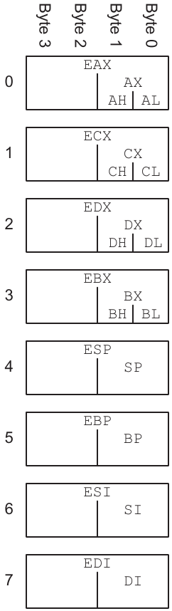

Hình 6.36 x86 register

Tám register gần như, nhưng chưa hoàn toàn, general purpose. Một số instruction không dùng được một số register. Instruction khác luôn đặt kết quả trong register nhất định. Giống `sp` trong RISC-V, ESP thường dành cho stack pointer.

x86 program counter gọi là EIP (extended instruction pointer). Giống RISC-V PC, nó chuyển từ instruction này sang instruction kế tiếp hoặc có thể thay đổi bằng branch instruction và function call instruction.

### 6.8.2 x86 Operand

RISC-V instruction luôn hoạt động trên register hoặc immediate. Cần load instruction và store instruction tường minh để chuyển dữ liệu giữa bộ nhớ và register. Ngược lại, x86 instruction có thể hoạt động trên register, immediate hoặc bộ nhớ. Điều này bù đắp phần nào register set nhỏ.

RISC-V instruction thường chỉ ba operand: hai source và một destination. x86 instruction chỉ hai operand. Operand đầu là source. Operand thứ hai vừa là source vừa là destination. Do đó, x86 instruction luôn ghi đè một source bằng kết quả. Bảng 6.10 liệt kê các kết hợp vị trí operand trong x86. Mọi kết hợp đều được, ngoại trừ bộ nhớ đến bộ nhớ.

Giống RISC-V (RV32I), x86 có memory space 32-bit byte-addressable. Tuy nhiên, khác RISC-V, x86 hỗ trợ nhiều memory indexing mode hơn. Memory location được xác định bằng tổ hợp bất kỳ giữa base register, displacement và scaled index register. Bảng 6.11 minh họa các tổ hợp. Displacement có thể là giá trị 8-, 16- hoặc 32-bit. Scale nhân index register có thể là 1, 2, 4 hoặc 8. Mode base + displacement tương đương base addressing mode RISC-V cho load và store, nhưng RISC-V instruction không cho scaling. x86 cũng cung cấp scaled index. Trong x86, scaled index giúp dễ truy cập array hoặc structure có phần tử 2-, 4- hoặc 8-byte mà không cần chuỗi instruction tạo địa chỉ. Trong khi RISC-V luôn hoạt động trên word 32-bit, x86 instruction có thể hoạt động trên dữ liệu 8-, 16- hoặc 32-bit. Bảng 6.12 minh họa các biến thể này.

Bảng 6.10 Vị trí operand

| Source/ Destination | Source | Ví dụ | Ý nghĩa |
|---|---|---|---|
| register | register | `add EAX, EBX` | `EAX <− EAX + EBX` |
| register | immediate | `add EAX, 42` | `EAX <− EAX + 42` |
| register | memory | `add EAX, [20]` | `EAX <− EAX + Mem[20]` |
| memory | register | `add [20], EAX` | `Mem[20] <− Mem[20] + EAX` |
| memory | immediate | `add [20], 42` | `Mem[20] <− Mem[20] + 42` |

Bảng 6.11 Memory addressing mode

| Ví dụ | Ý nghĩa | Ghi chú |
|---|---|---|
| `add EAX, [20]` | `EAX <− EAX + Mem[20]` | displacement |
| `add EAX, [ESP]` | `EAX <− EAX + Mem[ESP]` | base addressing |
| `add EAX, [EDX+40]` | `EAX <− EAX + Mem[EDX+40]` | base + displacement |
| `add EAX, [60+EDI*4]` | `EAX <− EAX + Mem[60+EDI*4]` | displacement + scaled index |
| `add EAX, [EDX+80+EDI*2]` | `EAX <− EAX + Mem[EDX+80+EDI*2]` | base + displacement + scaled index |

Bảng 6.12 Instruction hoạt động trên dữ liệu 8-, 16- hoặc 32-bit

| Ví dụ | Ý nghĩa | Data Size |
|---|---|---|
| `add AH, BL` | `AH <− AH + BL` | 8-bit |
| `add AX, −1` | `AX <− AX + 0xFFFF` | 16-bit |
| `add EAX, EDX` | `EAX <− EAX + EDX` | 32-bit |

Bảng 6.13 Một số EFLAGS

| Tên | Ý nghĩa |
|---|---|
| `CF` (Carry Flag) | Carry out do arithmetic operation cuối tạo ra. Chỉ overflow trong unsigned arithmetic. Cũng dùng truyền carry giữa word trong arithmetic multiple-precision |
| `ZF` (Zero Flag) | Kết quả operation cuối bằng không |
| `SF` (Sign Flag) | Kết quả operation cuối âm (msb = 1) |
| `OF` (Overflow Flag) | Overflow của two’s complement arithmetic |

### 6.8.3 Status Flag

x86, giống nhiều CISC architecture, dùng condition flag (còn gọi status flag) để quyết định branch và theo dõi carry, arithmetic overflow. x86 dùng register 32-bit gọi là EFLAGS lưu status flag. Một số bit của EFLAGS register được cho trong Bảng 6.13. Các bit khác do operating system dùng. Architectural state của x86 processor gồm EFLAGS cùng tám register và EIP.

### 6.8.4 x86 Instruction

x86 có instruction set lớn hơn RISC-V. Bảng 6.14 mô tả một số instruction general-purpose. x86 cũng có instruction cho arithmetic floating-point và arithmetic trên nhiều phần tử dữ liệu ngắn được đóng gói trong word dài hơn. D chỉ destination (register hoặc memory location), S chỉ source (register, memory location hoặc immediate).

Lưu ý một số instruction luôn hoạt động trên register cụ thể. Ví dụ, phép nhân 32×32-bit luôn lấy một source từ EAX và luôn đặt kết quả 64-bit vào EDX và EAX. LOOP luôn lưu loop counter trong ECX. PUSH, POP, CALL và RET dùng stack pointer ESP.

Conditional jump kiểm tra flag và branch nếu điều kiện thích hợp được thỏa mãn. Chúng có nhiều dạng. Ví dụ, JZ jump nếu zero flag (ZF) bằng 1. JNZ jump nếu zero flag bằng 0. Jump thường theo sau instruction đặt flag, như compare instruction (CMP). Bảng 6.15 liệt kê một số conditional jump và cách chúng phụ thuộc flag do compare operation trước đặt. Khác RISC-V, conditional jump (gọi là conditional branch trong RISC-V) thường cần hai instruction thay vì một.

Bảng 6.14 Một số x86 instruction

| Instruction | Ý nghĩa | Chức năng |
|---|---|---|
| `ADD/SUB` | cộng/trừ | `D = D + S / D = D − S` |
| `ADDC` | cộng với carry | `D = D + S + CF` |
| `INC/DEC` | tăng/giảm | `D = D + 1 / D = D − 1` |
| `CMP` | so sánh | đặt flag dựa trên `D − S` |
| `NEG` | đổi dấu | `D = − D` |
| `AND/OR/XOR` | logical AND/OR/XOR | `D = D op S` |
| `NOT` | logical NOT | `D =` $\overline{\texttt{D}}$ |
| `IMUL/MUL` | phép nhân signed/unsigned | `EDX:EAX = EAX × D` |
| `IDIV/DIV` | phép chia signed/unsigned | `EDX:EAX/D` `EAX` = thương`;` `EDX` = số dư |
| `SAR/SHR` | dịch phải arithmetic/logical | `D = D >>> S / D = D >> S` |
| `SAL/SHL` | dịch trái | `D = D << S` |
| `ROR/ROL` | xoay phải/trái | xoay `D` theo `S` |
| `RCR/RCL` | xoay phải/trái với carry | xoay `CF` và `D` theo `S` |
| `BT` | kiểm tra bit | `CF = D[S] (`bit thứ `S` của `D)` |
| `BTR/BTS` | kiểm tra bit và reset/set | `CF = D[S]; D[S] = 0 / 1` |
| `TEST` | đặt flag dựa trên bit được mask | đặt flag dựa trên `D AND S` |
| `MOV` | di chuyển | `D = S` |
| `PUSH` | push lên stack | `ESP = ESP − 4; Mem[ESP] = S` |
| `POP` | pop khỏi stack | `D = MEM[ESP]; ESP = ESP + 4` |
| `CLC, STC` | xóa/đặt carry flag | `CF = 0 / 1` |
| `JMP` | jump vô điều kiện | jump tương đối: `EIP = EIP + S` jump tuyệt đối: `EIP = S` |
| `Jcc` | jump có điều kiện | `if (flag) EIP = EIP + S` |
| `LOOP` | loop | `ECX = ECX −1` `if (ECX ≠ 0) EIP = EIP + imm` |
| `CALL` | function call | `ESP = ESP − 4;` `MEM[ESP] = EIP; EIP = S` |
| `RET` | function return | `EIP = MEM[ESP]; ESP = ESP + 4` |

Bảng 6.15 Một số branch condition

| Instruction | Ý nghĩa | Chức năng sau `CMP D, S` |
|---|---|---|
| `JZ/JE` | jump nếu `ZF = 1` | jump nếu `D = S` |
| `JNZ/JNE` | jump nếu `ZF = 0` | jump nếu `D ≠ S` |
| `JGE` | jump nếu `SF = OF` | jump nếu `D ≥ S` |
| `JG` | jump nếu `SF = OF` và `ZF = 0` | jump nếu `D > S` |
| `JLE` | jump nếu `SF ≠ OF` hoặc `ZF = 1` | jump nếu `D ≤ S` |
| `JL` | jump nếu `SF ≠ OF` | jump nếu `D < S` |
| `JC/JB` | jump nếu `CF = 1` |  |
| `JNC` | jump nếu `CF = 0` |  |
| `JO` | jump nếu `OF = 1` |  |
| `JNO` | jump nếu `OF = 0` |  |
| `JS` | jump nếu `SF = 1` |  |
| `JNS` | jump nếu `SF = 0` |  |

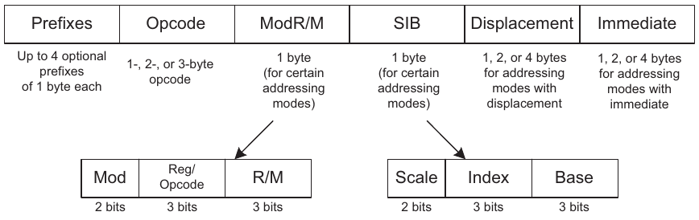

Hình 6.37 x86 instruction encoding

### 6.8.5 x86 Instruction Encoding

Instruction encoding x86 thực sự hỗn độn, di sản hàng thập kỷ thay đổi chắp vá. Khác RISC-V có instruction đồng nhất 32 bit (hoặc 16 bit với compressed instruction), x86 instruction thay đổi từ 1 đến 15 byte, như Hình 6.37.[^3] Opcode có thể dài 1, 2 hoặc 3 byte. Theo sau là bốn trường tùy chọn: ModR/M, SIB, Displacement và Immediate. ModR/M chỉ addressing mode. SIB chỉ scale, index register và base register trong một số addressing mode. Displacement chỉ displacement 1-, 2- hoặc 4-byte trong một số addressing mode. Immediate là hằng số 1-, 2- hoặc 4-byte cho instruction dùng immediate làm source operand. Hơn nữa, trước instruction có thể có tối đa bốn prefix byte-long tùy chọn thay đổi hành vi.

Byte ModR/M dùng trường Mod 2-bit và R/M 3-bit để chỉ addressing mode cho một operand. Operand có thể đến từ một trong tám register hoặc một trong 24 memory addressing mode. Do di sản encoding, register ESP và EBP không dùng được làm base register hoặc index register trong một số addressing mode. Trường Reg chỉ register dùng làm operand kia. Với instruction không cần operand thứ hai, trường Reg được dùng chỉ thêm ba bit của opcode.

Trong addressing mode dùng scaled index register, byte SIB chỉ index register và scale (1, 2, 4 hoặc 8). Nếu dùng cả base và index, byte SIB cũng chỉ base register.

RISC-V xác định đầy đủ instruction trong trường op, funct3 và funct7. x86 dùng số bit thay đổi để xác định instruction khác nhau. Nó dùng ít bit hơn cho instruction phổ biến hơn, giảm độ dài instruction trung bình. Một số instruction thậm chí có nhiều opcode. Ví dụ, `ADD AL, imm8` thực hiện phép cộng 8-bit immediate vào AL. Nó được biểu diễn bằng opcode 1-byte 0x04 theo sau bởi immediate 1-byte. Register A (AL, AX hoặc EAX) gọi là accumulator. Mặt khác, `ADD D, imm8` thực hiện phép cộng 8-bit immediate vào destination tùy ý D (bộ nhớ hoặc register). Nó được biểu diễn bằng opcode 1-byte 0x80, theo sau bởi một hoặc nhiều byte chỉ D, rồi immediate 1-byte. Nhiều instruction có encoding rút gọn khi destination là accumulator.

Trong 8086 ban đầu, opcode xác định instruction hoạt động trên operand 8- hay 16-bit. Khi 80386 đưa vào operand 32-bit, không còn opcode mới để chỉ dạng 32-bit. Thay vào đó, cùng opcode được dùng cho cả dạng 16- và 32-bit. Một bit bổ sung trong code segment descriptor do OS sử dụng chỉ dạng processor nên chọn. Bit được đặt 0 để tương thích ngược chương trình 8086, mặc định opcode dùng operand 16-bit. Nó được đặt 1 cho chương trình mặc định dùng operand 32-bit. Hơn nữa, người lập trình có thể chỉ prefix đổi dạng cho instruction cụ thể. Nếu prefix 0x66 xuất hiện trước opcode, operand có kích thước thay thế được dùng (16 bit trong mode 32-bit hoặc 32 bit trong mode 16-bit).

### 6.8.6 Những đặc điểm khác của x86

80286 đưa vào segmentation để chia bộ nhớ thành segment dài tối đa 64 KB. Khi OS bật segmentation, địa chỉ được tính tương đối với đầu segment. Processor kiểm tra địa chỉ vượt cuối segment và báo lỗi, nhờ đó ngăn chương trình truy cập bộ nhớ ngoài segment riêng. Segmentation tỏ ra rắc rối cho người lập trình và không được dùng trong phiên bản Windows operating system hiện đại.

x86 có string instruction hoạt động trên toàn string byte hoặc word. Operation gồm di chuyển, so sánh hoặc quét tìm giá trị cụ thể. Trong processor hiện đại, các instruction này thường chậm hơn thực hiện operation tương đương bằng chuỗi instruction đơn giản hơn, nên tốt nhất tránh dùng.

Như đã đề cập, prefix 0x66 dùng chọn giữa operand size 16- và 32-bit. Prefix khác gồm prefix khóa bus (để kiểm soát truy cập shared variable trong multiprocessor system), dự đoán branch có được thực hiện hay không và lặp instruction trong string move.

Intel và Hewlett-Packard cùng phát triển architecture 64-bit mới tên IA-64 vào mid-1990’s. Nó được thiết kế mới hoàn toàn, bỏ qua lịch sử rắc rối x86, tận dụng 20 năm nghiên cứu mới về computer architecture và cung cấp address space 64-bit. Tuy nhiên, chip IA-64 đầu tiên ra thị trường quá muộn và không bao giờ thành công thương mại. Phần lớn máy tính cần address space lớn hiện dùng extension 64-bit của x86.

Tai họa của mọi architecture là hết dung lượng bộ nhớ. Với địa chỉ 32-bit, x86 truy cập được 4 GB bộ nhớ. Con số này lớn hơn nhiều bộ nhớ của máy tính lớn nhất năm 1985. Tuy nhiên, đến đầu những năm 2000, nó đã trở thành giới hạn. Năm 2003, AMD mở rộng address space và register size thành 64 bit, gọi architecture nâng cấp là AMD64. AMD64 có compatibility mode cho phép chạy nguyên chương trình 32-bit trong khi OS tận dụng address space lớn hơn. Năm 2004, Intel nhượng bộ và áp dụng extension 64-bit, đổi tên thành Extended Memory 64 Technology (EM64T). Với địa chỉ 64-bit, máy tính truy cập được 16 exabyte (16 tỷ GB) bộ nhớ.

Với ai muốn tìm hiểu x86 architecture sâu hơn, x86 Intel Architecture Software Developer’s Manual được cung cấp miễn phí trên website Intel.

### 6.8.7 Bức tranh tổng thể

Mục này đã giới thiệu sơ bộ một số khác biệt giữa RISC-V architecture và x86 CISC architecture. x86 thường có chương trình ngắn hơn vì instruction phức tạp tương đương chuỗi RISC-V instruction đơn giản và instruction được mã hóa nhằm giảm thiểu bộ nhớ sử dụng. Tuy nhiên, x86 architecture là tập hợp hỗn tạp tính năng tích lũy qua nhiều năm, một số không còn hữu ích nhưng phải giữ để tương thích chương trình cũ. Nó có quá ít register và instruction khó giải mã. Chỉ giải thích instruction set thôi cũng khó. Dù có tất cả hạn chế này, x86 vẫn vững chắc là computer architecture thống trị PC vì giá trị tương thích phần mềm rất lớn và thị trường khổng lồ làm cho công sức xây dựng x86 microprocessor nhanh trở nên xứng đáng.

## 6.9 TỔNG KẾT

Để ra lệnh máy tính, bạn phải nói ngôn ngữ của nó. Computer architecture định nghĩa cách ra lệnh processor. Nhiều computer architecture khác nhau đang được dùng thương mại rộng rãi, nhưng khi hiểu một architecture, học architecture khác dễ hơn nhiều. Các câu hỏi then chốt khi tiếp cận architecture mới là:

- Độ dài data word bằng bao nhiêu?

- Có những register nào?

- Bộ nhớ được tổ chức thế nào?

- Có những instruction nào?

RISC-V (RV32I) là architecture 32-bit vì hoạt động trên dữ liệu 32-bit. RISC-V architecture có 32 register general-purpose. Về nguyên tắc, gần như mọi register đều dùng được cho mọi mục đích. Tuy nhiên, theo quy ước, register nhất định dành cho mục đích nhất định để dễ lập trình và để function do người khác nhau viết giao tiếp dễ dàng. Ví dụ, register 0 (`zero`) luôn giữ hằng số 0, `ra` giữ return address sau instruction `jal`, và `a0` đến `a7` giữ argument của function. `a0` đến `a1` giữ return value của function. RISC-V có memory system byte-addressable với địa chỉ 32-bit. Instruction dài 32 bit và word-aligned để truy cập hiệu quả. Chương này đã thảo luận RISC-V instruction thường dùng nhất.

Sức mạnh của việc định nghĩa computer architecture là chương trình viết cho một architecture có thể chạy trên nhiều cách triển khai khác nhau của architecture đó. Ví dụ, chương trình viết cho Intel Pentium processor năm 1993 thường vẫn chạy được (và nhanh hơn nhiều) trên Intel i9 hoặc AMD Ryzen processor năm 2021.

Trong phần đầu sách, chúng ta học circuit level và logic level của abstraction. Trong chương này, chúng ta nhảy lên architecture level. Chương tiếp theo nghiên cứu microarchitecture, cách bố trí digital building block để triển khai processor architecture.

Microarchitecture là liên kết giữa phần cứng và phần mềm. Chúng tôi tin đây là một trong những chủ đề thú vị nhất của toàn bộ kỹ thuật: Bạn sẽ học xây dựng microprocessor riêng!

## Bài tập

Bài tập 6.1 Đưa ra ba ví dụ từ RISC-V architecture cho mỗi nguyên tắc thiết kế architecture: (1) tính đều đặn hỗ trợ sự đơn giản; (2) làm cho trường hợp thường gặp diễn ra nhanh; (3) nhỏ hơn thì nhanh hơn; và (4) thiết kế tốt đòi hỏi sự thỏa hiệp tốt. Giải thích cách mỗi ví dụ thể hiện nguyên tắc thiết kế.

Bài tập 6.2 RISC-V architecture có register set gồm 32 register 32-bit. Có thể thiết kế computer architecture không có register set không? Nếu có, mô tả ngắn gọn architecture, bao gồm instruction set. Architecture này có ưu điểm và nhược điểm gì so với RISC-V architecture?

Bài tập 6.3 Viết các string sau bằng ASCII encoding. Viết đáp án cuối bằng hexadecimal.

(a) hello there

(b) bag o’ chips

(c) To the rescue!

Bài tập 6.4 Lặp lại Bài tập 6.3 cho các string sau.

(a) Cool

(b) RISC-V

(c) boo!

Bài tập 6.5 Cho biết cách các string trong Bài tập 6.3 được lưu trong bộ nhớ byte-addressable bắt đầu tại memory address 0x004F05BC. Ký tự đầu của string được lưu tại byte address thấp nhất (ở đây là 0x004F05BC). Chỉ rõ memory address của từng byte.

Bài tập 6.6 Lặp lại Bài tập 6.5 cho các string trong Bài tập 6.4.

Bài tập 6.7 Instruction `nor` không thuộc RISC-V instruction set vì có thể triển khai cùng chức năng bằng instruction hiện có. Viết một đoạn assembly code ngắn có chức năng sau: `s3 = s4` NOR `s5`. Dùng ít instruction nhất có thể.

Bài tập 6.8 Instruction `nand` không thuộc RISC-V instruction set vì có thể triển khai cùng chức năng bằng instruction hiện có. Viết một đoạn assembly code ngắn có chức năng sau: `s3 = s4` NAND `s5`. Dùng ít instruction nhất có thể.

Bài tập 6.9 Chuyển các đoạn code high-level sau sang RISC-V assembly language. Giả sử biến số nguyên (signed) `g` và `h` lần lượt nằm trong register `a0` và `a1`. Viết comment rõ ràng cho code.

a) `if (g > h)`

```
  g = g + 1;
else
  h = h − 1;
```

b) `if (g <= h)`

```
  g = 0;
else
  h = 0;
```

Bài tập 6.10 Lặp lại Bài tập 6.9 cho các đoạn code sau.

a) `if (g >= h)`

```
  g = g + h;
else
  g = g − h;
```

b) `if (g < h)`

```
  h = h + 1;
else
  h = h * 2;
```

Bài tập 6.11 Chuyển đoạn code high-level sau sang RISC-V assembly. Giả sử base address của `array1` và `array2` được giữ trong `t1` và `t2`, và array `array2` được khởi tạo trước khi sử dụng. Dùng ít instruction nhất có thể. Viết comment rõ ràng cho code.

```
int i;
int array1[100];
int array2[100];
...
for (i = 0; i < 100; i = i + 1)
   array1[i] = array2[i];
```

Bài tập 6.12 Lặp lại Bài tập 6.11 cho đoạn code high-level sau. Giả sử array `temp` được khởi tạo trước khi sử dụng và `t3` giữ base address của `temp`.

```
int i;
int temp[100];
...
for (i = 0; i < 100; i = i + 1)
 temp[i] = temp[i] * 128;
```

Bài tập 6.13 Viết RISC-V assembly code để đặt các immediate (hằng số) sau vào `s7`. Dùng số instruction ít nhất.

(a) 29

(b) –214

(c) –2999

(d) 0xABCDE000

(e) 0xEDCBA123

(f) 0xEEEEEFAB

Bài tập 6.14 Lặp lại Bài tập 6.13 cho các immediate sau.

(a) 47

(b) -349

(c) 5328

(d) 0xBBCCD000

(e) 0xFEEBC789

(f) 0xCCAAB9AB

Bài tập 6.15 Viết function bằng high-level language cho `int find42(int` `array[], int size)`. `size` chỉ số phần tử trong `array`, còn `array[]` chỉ base address của array. Function cần return index của array entry đầu tiên giữ giá trị 42. Nếu không array entry nào bằng 42, nó phải return giá trị –1. Viết comment rõ ràng cho code.

> String copy function đơn giản này có lỗ hổng nghiêm trọng: nó không có cách biết `dst` có đủ chỗ nhận `src` hay không. Nếu một người lập trình ác ý thực thi được `strcpy` với string `src` dài, người đó có thể ghi byte khắp bộ nhớ, thậm chí sửa code lưu ở các memory location tiếp theo. Với chút khéo léo, code đã sửa có thể chiếm quyền máy tính. Đây gọi là buffer overflow attack; nó được nhiều chương trình độc hại sử dụng, gồm Blaster worm khét tiếng, gây thiệt hại ước tính \$525 triệu năm 2003.

Bài tập 6.16 Function high-level `strcpy` (string copy) sao chép character string `src` sang character string `dst`.

```
// C code
void strcpy(char dst[], char src[]) {
  int i = 0;
  do  {
    dst[i] = src[i];
  } while (src[i++]);
}
```

(a) Triển khai function `strcpy` bằng RISC-V assembly code. Dùng `t0` cho `i`.

(b) Vẽ stack trước, trong và sau function call `strcpy`. Giả sử `sp` = 0xFFC000 ngay trước khi `strcpy` được gọi.

Bài tập 6.17 Chuyển function high-level ở Bài tập 6.15 sang RISC-V assembly code. Viết comment rõ ràng cho code.

Bài tập 6.18 Xét RISC-V assembly code dưới đây. `func1`, `func2` và `func3` là nonleaf function. `func4` là leaf function. Code từng function không được trình bày, nhưng comment chỉ register nào được dùng trong mỗi function. Có thể giả sử các function không cần lưu nonpreserved register nào trên stack của chúng.

```
0x00091000 func1: ...  # func1 uses t2−t3, s4−s10
...
0x00091020         jal  func2
...
0x00091100 func2: ...  # func2 uses a0−a2, s0−s5
...
0x0009117C         jal  func3
...
0x00091400 func3: ...  # func3 uses t3, s7−s9
...
0x00091704         jal  func4
...
0x00093008 func4: ...  # func4 uses s10−s12
...
0x00093118         jr    ra
```

(a) Stack frame của mỗi function dài bao nhiêu word?

(b) Phác họa stack sau khi `func4` được gọi. Chỉ rõ register nào được lưu ở đâu trên stack và đánh dấu từng stack frame. Cho giá trị khi có thể. Giả sử `sp` = 0xABC124 ngay trước khi `func1` được gọi.

Bài tập 6.19 Mỗi số trong dãy Fibonacci là tổng của hai số trước. Bảng 6.16 liệt kê những số đầu tiên trong dãy, fib(n).

(a) fib(n) bằng bao nhiêu với n = 0 và n = –1?

(b) Viết function tên `fib` bằng high-level language, return số Fibonacci cho mọi giá trị không âm của `n`. Gợi ý: Bạn có lẽ sẽ muốn dùng loop. Viết comment rõ ràng cho code.

(c) Chuyển function high-level ở phần (b) sang RISC-V assembly code. Thêm comment sau mỗi dòng code giải thích rõ chức năng. Dùng simulator kiểm tra code với fib(9). (Xem Lời nói đầu để có link đến RISC-V simulator.)

Bảng 6.16 Dãy Fibonacci

| n | 1 | 2 | 3 | 4 | 5 | 6 | 7 | 8 | 9 | 10 | 11 | … |
|---|---|---|---|---|---|---|---|---|---|---|---|---|
| fib(n) | 1 | 1 | 2 | 3 | 5 | 8 | 13 | 21 | 34 | 55 | 89 | … |

Bài tập 6.20 Xét Ví dụ code 6.28. Với bài tập này, giả sử factorial(n) được gọi với input argument n = 5.

(a) Giá trị trong `a0` bằng bao nhiêu khi factorial return về calling function?

(b) Giả sử bạn thay instruction tại địa chỉ 0x8508 và 0x852C bằng nop. Chương trình sẽ: (1) vào loop vô hạn nhưng không crash; (2) crash (khiến stack phát triển hoặc thu hẹp vượt dynamic data

segment hoặc PC nhảy đến vị trí ngoài chương trình);

(3) tạo giá trị sai trong `a0` khi chương trình return về loop

(nếu vậy, giá trị nào?); hoặc

(4) chạy đúng dù các dòng bị xóa?

(c) Lặp lại phần (b) với các sửa đổi instruction sau: (1) Thay instruction tại địa chỉ 0x8504 và 0x8528 bằng nop. (2) Thay instruction tại địa chỉ 0x8518 bằng nop. (3) Thay instruction tại địa chỉ 0x8530 bằng nop.

Bài tập 6.21 Ben Bitdiddle đang cố tính hàm f(a, b) = 2a + 3b với b không âm. Anh lạm dụng function call và đệ quy, tạo ra code high-level sau cho các hàm `f` và `g`.

```
// high-level code for functions f and g
int f(int a, int b) {
  int j;

  j = a;
  return j + a + g(b);
}

int g(int x) {
  int k;

  k = 3;
  if (x = = 0) return 0;
  else return k + g(x − l);
}
```

Ben sau đó dịch hai function sang RISC-V assembly language như sau. Anh cũng viết function `test` gọi function `f(5,3)`.

```
# RISC-V assembly code
# f: a0 = a, a1 = b, s4 = j;
# g: a0 = x, s4 = k

0x8000 test:   addi  a0, zero, 5   # a = 5
0x8004         addi  a1, zero, 3   # b = 3
0x8008         jal   f             #  call  f(5,  3)
0x800C loop:   j     loop          # and loop forever
0x8010 f:      addi  sp, sp, −16   # make room on stack
0x8014         sw    a0, 0xC(sp)   # save a0
0x8018         sw    a1,  0x8(sp)  #  save  a1
0x801C         sw    ra,  0x4(sp)     #  save  ra
0x8020         sw    s4, 0x0(sp)      # save s4
0x8024         addi  s4, a0, 0        # j = a
0x8028         addi  a0, a1, 0        # place b as argument for g()
0x802C         jal   g                # call g
0x8030         lw   t0, 0xC(sp)       # restore a into t0
0x8034         add   a0, a0, t0       # a0 = g(b) + a
0x8038         add   a0, a0, s4       # a0 = (g(b) + a) + j
0x803C         lw    s4,  0x0(sp)     #  restore  registers
0x8040         lw    ra,  0x4(sp)
0x8044         addi  sp, sp, 16
0x8048         jr    ra               #  return
0x804C g:      addi  sp, sp, −8       # make room on stack
0x8050         sw   ra, 4(sp)         # save registers
0x8054         sw    s4,  0(sp)
0x8058         addi  s4, zero, 3      # k = 3
0x805C         bne   a0, zero, else   # if (x != 0), goto else
0x8060         addi  a0, zero, 0      # return 0
0x8064         j     done             # clean up and return
0x8068 else:   addi  a0, a0, −1       # decrement x
0x806C         jal   g                # call g(x − 1)
0x8070         add   a0, s4, a0       # return k + g(x − 1)
0x8074 done:   lw   s4, 0(sp)         # restore registers
0x8078         lw    ra,  4(sp)
0x807C         addi  sp, sp, 8
0x8080         jr    ra               #  return
```

Bạn có thể thấy hữu ích khi vẽ stack tương tự Hình 6.10 để trả lời các câu hỏi sau.

(a) Nếu code bắt đầu chạy tại `test`, giá trị trong `a0` bằng bao nhiêu khi chương trình đến loop? Chương trình của anh có tính đúng 2a + 3b không?

(b) Giả sử Ben thay instruction tại địa chỉ 0x8014 bằng nop. Chương trình sẽ (1) vào loop vô hạn nhưng không crash; (2) crash (khiến stack phát triển hoặc thu hẹp vượt dynamic data

segment hoặc PC nhảy đến vị trí ngoài chương trình);

(3) tạo giá trị sai trong `a0` khi chương trình return về loop

(nếu vậy, giá trị nào?); hoặc

(4) chạy đúng dù các dòng bị xóa?

(c) Lặp lại phần (b) khi thay đổi các instruction sau. Lưu ý label không thay đổi, chỉ instruction thay đổi.

(i) Instruction tại 0x8014 và 0x8030 được thay bằng nop.

(ii) Instruction tại 0x803C và 0x8040 được thay bằng nop.

(iii) Instruction tại 0x803C được thay bằng nop.

(iv) Instruction tại 0x8030 được thay bằng nop.

(v) Instruction tại 0x8054 và 0x8074 được thay bằng nop.

(vi) Instruction tại 0x8020 và 0x803C được thay bằng nop.

(vii) Instruction tại 0x8050 và 0x8078 được thay bằng nop.

Bài tập 6.22 Chuyển RISC-V assembly code sau sang machine language. Viết instruction bằng hexadecimal.

```
addi s3, s4, 28
sll   t1,  t2,  t3
srli s3, s1, 14
sw    s9,  16(t4)
```

Bài tập 6.23 Lặp lại Bài tập 6.22 cho RISC-V assembly code sau:

```
add   s7,  s8,  s9
srai t0, t1, 0xC
ori  s3, s1, 0xABC
lw    s4,  0x5C(t3)
```

Bài tập 6.24 Xét mọi instruction có immediate field.

(a) Instruction nào trong Bài tập 6.22 dùng immediate field trong machine code format?

(b) Instruction type (I-, S-, B-, U- hoặc J-type) của các instruction ở phần (a) là gì?

(c) Viết các immediate 5- đến 21-bit của mỗi instruction ở phần (a) bằng hexadecimal. Nếu số được extend, cũng viết chúng dưới dạng extended immediate 32-bit. Nếu không, chỉ ra rằng chúng không được extend.

Bài tập 6.25 Lặp lại Bài tập 6.24 cho instruction trong Bài tập 6.23.

Bài tập 6.26 Xét đoạn RISC-V machine code dưới đây. Instruction đầu được liệt kê trên cùng.

(a) Chuyển đoạn machine code sang RISC-V assembly language.

(b) Reverse engineer và viết một chương trình high-level có thể được compile thành assembly language routine này. Viết comment rõ ràng cho code.

(c) Giải thích bằng lời chương trình làm gì. `a0` và `a1` là input, ban đầu chứa các số dương `A` và `B`. Cuối chương trình, register `a0` giữ output (tức return value).

```
0x01800513
0x00300593
0x00000393
0x00058E33
0x01C54863
0x00138393
0x00BE0E33
0xFF5FF06F
0x00038533
```

Bài tập 6.27 Lặp lại Bài tập 6.26 cho machine code sau. `a0` và `a1` là input. `a0` chứa số 32-bit và `a1` là địa chỉ array ký tự (`char`) 32-element.

```
0x01F00393
0x00755E33
0x001E7E13
0x01C580A3
0x00158593
0xFFF38393
0xFE03D6E3
0x00008067
```

Bài tập 6.28 Chuyển branch instruction sau sang machine code. Instruction address được cho bên trái mỗi instruction.

a) `0x0000A000 beq t4, zero, Loop`

```
0x0000A004 ...
0x0000A008 ...
0x0000A00C Loop: ...
```

b) `0x00801000 bne s5, a1, L1`

```
... ...
0x0080174C  L1:  ...
```

c) `0x0000C10C Back: ...`

```
... ...
0x0000D000 blt s1, s2, Back
```

d) `0x01030AAC bge t4, t6, L2`

```
...            ...
0x01031AA4 L2: ...
```

e) `0x0BC08004 L3: ...`

```
...        ...
0x0BC09000 beq s3, s7, L3
```

Bài tập 6.29 Chuyển branch instruction sau sang machine code. Instruction address được cho bên trái mỗi instruction.

a) `0xAA00E124 blt t4, s3, Loop`

```
0xAA00E128 ...
0xAA00E12C ...
0xAA00E130 Loop: ...
```

b) `0xC0901000 bge t1, t2, L1`

```
...            ...
0xC090174C L1: ...
```

c) `0x1230D10C Back: ...`

```
...         ...
0x1230D908  bne s10, s11, Back
```

d) `0xAB0C99A8 beq a0, s1, L2`

```
...              ...
0xAB0CA0FC  L2:  ...
```

e) `0xFFABCF04 L3: ...`

```
...         ...
0xFFABD640  blt s1, t3, L3
```

Bài tập 6.30 Chuyển jump instruction sau sang machine code. Instruction address được cho bên trái mỗi instruction.

a) `0x1234ABC0 j Loop`

```
...              ...
0x123CABBC Loop: ...
```

b) `0x12345678 Back: ...`

```
...         ...
0x123B8760  jal s0, Back
```

c) `0xAABBCCD0 jal L1`

```
...              ...
0xAABDCD98  L1:  ...
```

d) `0x11223344 j L2`

```
...              ...
0x1127BCDC  L2:  ...
```

e) `0x9876543C L3: ...`

```
...         ...
0x9886543C  jal  L3
```

Bài tập 6.31 Chuyển jump instruction sau sang machine code. Instruction address được cho bên trái mỗi instruction.

a) `0x0000ABC0 jal Loop`

```
...              ...
0x0000EEEC Loop: ...
```

b) `0x0000C10C Back: ...`

```
...         ...
0x000F1230  jal  Back
```

c) `0x00801000 jal s1, L1`

```
...              ...
0x008FFFDC  L1:  ...
```

d) `0xA1234560 j L2`

```
...              ...
0xA131347C  L2:  ...
```

e) `0xF0BBCCD4 L3: ...`

```
...         ...
0xF0CBCCD4  j  L3
```

Bài tập 6.32 Xét đoạn RISC-V assembly language sau. Các số bên trái mỗi instruction chỉ instruction address.

```
0xA0028 Func1: addi t4, a1, 0
0xA002C         ori   a0,  a0,  32
0xA0030         sub   a1,  a1,  a0
0xA0034         jal   Func2
...             ...
0xA0058 Func2: lw   t2, 4(a0)
0xA005C         sw    t2,  16(a1)
0xA0060         srli t3, t2, 8
0xA0064         beq   t2,  t3,  Else
0xA0068         jr    ra
0xA006C Else:   addi a0, a0, 4
0xA0070         j     Func2
```

(a) Dịch chuỗi instruction sang machine code. Viết machine code instruction bằng hexadecimal.

(b) Liệt kê instruction type và addressing mode dùng tại từng dòng code.

Bài tập 6.33 Xét đoạn C code sau.

```
// C code
void setArray(int num) {
   int i;
   int array[10];

 for (i = 0; i < 10; i = i + 1)
   array[i] = compare(num, i);
}

int compare(int a, int b) {
   if (sub(a, b) >= 0)
     return 1;
  else
    return 0;
}
int sub(int a, int b) {
    return a − b;
}
```

(a) Triển khai đoạn C code bằng RISC-V assembly language. Dùng `s4` giữ biến `i`. Nhớ xử lý stack pointer đúng cách. Array được lưu trên stack của function `setArray` (xem cuối Mục 6.3.7). Viết comment rõ ràng cho code.

(b) Giả sử `setArray` là function được gọi đầu tiên. Vẽ trạng thái stack trước khi gọi `setArray` và trong mỗi function call. Chỉ stack address cùng tên register và biến lưu trên stack; đánh dấu vị trí `sp`; đánh dấu rõ từng stack frame. Giả sử `sp` bắt đầu tại 0x8000.

(c) Code sẽ hoạt động thế nào nếu bạn không lưu `ra` trên stack?

Bài tập 6.34 Xét function high-level sau.

```
// C code
int f(int n, int k) {
  int b;

  b = k + 2;
  if (n = = 0)
    b = 10;
  else
    b = b + (n * n) + f(n − 1, k + 1);
  return b * k;
}
```

(a) Dịch function high-level `f` sang RISC-V assembly language. Đặc biệt chú ý lưu và khôi phục register đúng cách qua function call, dùng quy ước preserved register RISC-V. Viết comment rõ ràng cho code. Giả sử function bắt đầu tại instruction address 0x8100. Giữ local variable `b` trong `s4`. Viết comment rõ ràng cho code.

(b) Thực hiện từng bước function ở phần (a) bằng tay cho trường hợp `f(2, 4)`. Vẽ stack tương tự Hình 6.10 và giả sử `sp` bằng 0xBFF00100 khi `f` được gọi. Viết stack address, tên register và giá trị dữ liệu lưu tại từng vị trí trên stack, theo dõi giá trị stack pointer (`sp`). Đánh dấu rõ từng stack frame. Bạn cũng có thể thấy hữu ích khi theo dõi giá trị trong `a0`, `a1` và `s4` suốt quá trình thực thi. Giả sử khi `f` được gọi, `s4` = 0xABCD và `ra` = 0x8010.

(c) Giá trị cuối của `a0` bằng bao nhiêu khi gọi `f(2, 4)`?

Bài tập 6.35 Số instruction tối đa mà branch instruction (như `beq`) có thể branch về trước (tức đến instruction address cao hơn) bằng bao nhiêu?

Bài tập 6.36 Số instruction tối đa mà branch instruction (như `beq`) có thể branch về sau (tức đến instruction address thấp hơn) bằng bao nhiêu?

Bài tập 6.37 Viết assembly code branch có điều kiện đến instruction cách một instruction nhất định 32 Minstruction về trước. Hãy nhớ 1 Minstruction = 2<sup>20</sup> instruction = 1,048,576 instruction. Giả sử code bắt đầu tại địa chỉ 0x8000. Dùng số instruction ít nhất.

Bài tập 6.38 Giải thích tại sao có immediate field lớn trong machine format của jump and link instruction `jal` lại có lợi.

Bài tập 6.39 Xét function nhận array 10-entry chứa số nguyên 32-bit lưu theo format little-endian và chuyển sang format big-endian.

(a) Viết function này bằng code high-level.

(b) Chuyển function này sang RISC-V assembly code. Viết comment cho toàn bộ code và dùng số instruction ít nhất.

Bài tập 6.40 Xét hai string: `string1` và `string2`.

(a) Viết code high-level cho function tên `concat` nối (ghép lại) hai string: `void concat(char string1[], char` `string2[], char stringconcat[])`. Function không return giá trị. Nó nối `string1` và `string2`, đặt string kết quả vào `stringconcat`. Có thể giả sử character array `stringconcat` đủ lớn chứa string sau khi nối. Viết comment rõ ràng cho code.

(b) Chuyển function ở phần (a) sang RISC-V assembly language. Viết comment rõ ràng cho code.

Bài tập 6.41 Viết chương trình RISC-V assembly cộng hai số dương floating-point single-precision giữ trong `a0` và `a1`. Không dùng bất kỳ RISC-V floating-point instruction nào. Không cần lo các encoding dành cho mục đích đặc biệt (ví dụ 0, NAN, v.v.) hoặc số overflow hay underflow. Dùng simulator kiểm tra code. (Xem Lời nói đầu để có link đến RISC-V simulator.) Bạn sẽ cần tự đặt giá trị `a0` và `a1` để kiểm tra code. Chứng minh code hoạt động đáng tin cậy. Viết comment rõ ràng cho code.

Bài tập 6.42 Mở rộng chương trình RISC-V assembly từ Bài tập 6.41 để xử lý cả số dương và âm floating-point single-precision. Viết comment rõ ràng cho code.

Bài tập 6.43 Xét function sắp xếp array 10-element tên `scores` từ thấp đến cao. Sau khi function hoàn tất, `scores[0]` giữ giá trị nhỏ nhất và `scores[9]` giữ giá trị lớn nhất.

(a) Viết function high-level `sort` thực hiện chức năng trên. `sort` nhận một argument là địa chỉ array `scores`. Viết comment rõ ràng cho code.

(b) Chuyển function `sort` sang RISC-V assembly language. Viết comment rõ ràng cho code.

Bài tập 6.44 Xét chương trình RISC-V sau. Giả sử instruction được đặt bắt đầu tại memory address 0x8400, và global variable `x`, `y` lần lượt tại memory address 0x10024, 0x10028.

```
# RISC-V assembly code
main:
  addi sp, sp, −4    # make room on stack
  sw   ra, 0(sp)     # save ra on stack
  lw   a0, −940(gp) # a0 = x
  lw   a1, −936(gp)  # a1 = y
  jal   diff         #  call  diff()
  lw    ra,  0(sp)   #  restore  registers
  addi sp, sp, 4
  jr    ra           #  return
diff:
  sub   a0, a0, a1   # return (a0−a1)
  jr    ra
```

(a) Trước tiên, ghi instruction address cạnh mỗi assembly instruction.

(b) Mô tả symbol table: tức liệt kê tên, địa chỉ và kích thước từng symbol (tức function label và global variable).

(c) Chuyển mọi instruction sang machine code.

(d) Data segment và text segment lớn bao nhiêu (bao nhiêu byte)?

(e) Phác họa memory map cho thấy nơi lưu data và instruction, tương tự Hình 6.34. Nhớ ghi nhãn giá trị PC và `gp` ở đầu chương trình.

Bài tập 6.45 Lặp lại Bài tập 6.44 cho RISC-V code sau. Giả sử instruction được đặt bắt đầu tại memory address 0x8534 và global variable `g`, `h` tại memory address 0x1305C, 0x13060.

```
# RISC-V assembly code
main:      addi sp, sp, −8
           sw    ra,  4(sp)
           sw    s4,  0(sp)
           addi s4, zero, 15
           sw   s4, −300(gp)   # g = 15
           addi a1, zero, 27   # arg1 = 27
           sw   a1, −296(gp)   # h = 27
           lw   a0, −300(gp)   # arg0 = g = 15
           jal   greater
           lw    s4,  0(sp)
           lw    ra,  4(sp)
           addi sp, sp, 8
           jr    ra
greater:   blt   a1,  a0,  isGreater
           addi a0, zero, 0
           jr    ra
isGreater: addi a0, zero, 1
           jr    ra
```

Bài tập 6.46 Giải thích ưu điểm và nhược điểm của bit-swizzling trong encoding RISC-V immediate.

Bài tập 6.47 Xét sign-extension của immediate trong RISC-V instruction. Thiết kế sign-extension unit cho RISC-V immediate theo các bước dưới. Giảm thiểu lượng phần cứng cần thiết.

(a) Phác họa schematic của sign-extension unit thực hiện sign-extends immediate 12-bit trong instruction I-type. Input của circuit là 12 bit trên của instruction, Instr<sub>31:20</sub>, mã hóa signed immediate 12-bit. Output là immediate sign-extended 32-bit, ImmExt<sub>31:0</sub>.

(b) Mở rộng sign-extension unit ở phần (a) để còn sign-extend immediate 12-bit trong instruction S-type. Sửa input nếu cần và tái sử dụng phần cứng khi có thể.

(c) Mở rộng sign-extension unit ở phần (b) để còn sign-extend immediate 13-bit trong instruction B-type.

(d) Mở rộng sign-extension unit ở phần (c) để còn sign-extend immediate 21-bit trong instruction J-type.

Bài tập 6.48 Trong bài này, bạn thiết kế extension unit thay thế cho RISC-V immediate với lượng phần cứng ít nhất. Giả sử người thiết kế RISC-V chọn immediate encoding dễ hiểu hơn với con người, như Hình 6.38. Hình cho mọi instruction field trừ op. Immediate encoding trong Hình 6.38 không dùng bit-swizzling (nhưng vẫn chia immediate field trong instruction S/B-type thành hai instruction field). Những bit khác với RISC-V immediate encoding thực tế (ở Hình 6.27) được tô xanh. Cụ thể, các immediate encoding giả định (dễ hiểu) này khác RISC-V immediate encoding thực tế ở format B- và J-type.

(a) Phác họa schematic của sign-extension unit thực hiện sign-extends immediate 12-bit trong instruction I-type. Input của circuit là 12 bit trên của

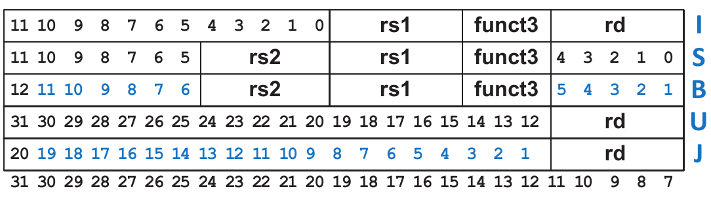

Hình 6.38 Immediate encoding thay thế

instruction, Instr<sub>31:20</sub>, mã hóa signed immediate 12-bit. Output là immediate sign-extended 32-bit, ImmExt<sub>31:0</sub>.

(b) Mở rộng sign-extension unit ở phần (a) để còn sign-extend immediate 12-bit trong instruction S-type. Sửa input nếu cần và tái sử dụng phần cứng khi có thể.

(c) Mở rộng sign-extension unit ở phần (b) để còn sign-extend immediate 13-bit trong instruction B-type (đã sửa) (xem Hình 6.38).

(d) Mở rộng sign-extension unit ở phần (c) để còn sign-extend immediate 21-bit trong instruction J-type (đã sửa) (xem Hình 6.38).

(e) Nếu đã hoàn thành Bài tập 6.47, so sánh với phần cứng trong RISC-V extension unit thực tế.

Bài tập 6.49 Xét khoảng cách instruction `jal` có thể nhảy.

(a) Instruction `jal` có thể nhảy về trước bao nhiêu instruction (tức đến địa chỉ cao hơn)?

(b) Instruction `jal` có thể nhảy về sau bao nhiêu instruction (tức đến địa chỉ thấp hơn)?

Bài tập 6.50 Xét việc lưu word 32-bit tại memory word thứ 42<sup>nd</sup> trong bộ nhớ byte-addressable. Hãy nhớ word thứ 0<sup>th</sup> được lưu tại memory address 0, word đầu tại địa chỉ 4, v.v.

(a) Byte address của word thứ 42<sup>nd</sup> lưu trong bộ nhớ bằng bao nhiêu?

(b) Word thứ 42<sup>nd</sup> trải qua những byte address nào?

(c) Vẽ số 0xFF223344 lưu tại word 42 trong cả máy big-endian và little-endian. Ghi rõ byte address tương ứng với từng giá trị data byte.

Bài tập 6.51 Lặp lại Bài tập 6.50 cho việc lưu word 32-bit tại word thứ 15<sup>th</sup> trong bộ nhớ byte-addressable.

Bài tập 6.52 Giải thích cách chương trình RISC-V sau được dùng để xác định máy tính là big-endian hay little-endian:

```
addi s7, 100
lui   s3,  0xABCD8   #  s3  =  0xABCD8000
addi s3, s3, 0x765   # s3 = 0xABCD8765
sw    s3,  0(s7)
lb    s2,  1(s7)
```

## Câu hỏi phỏng vấn

Các bài tập sau đưa ra câu hỏi từng được hỏi khi phỏng vấn việc làm digital design.

Câu hỏi 6.1 Viết chương trình RISC-V assembly language hoán đổi nội dung hai register `a0` và `a1`. Không được dùng register nào khác.

Câu hỏi 6.2 Giả sử bạn có array gồm cả số nguyên dương và âm. Viết RISC-V assembly code tìm tập con array có tổng lớn nhất. Giả sử base address của array và số array element lần lượt trong `a0` và `a1`. Code phải đặt tập con array kết quả bắt đầu tại base address trong `a2`. Viết code chạy nhanh nhất có thể.

Câu hỏi 6.3 Bạn có array chứa một câu trong string null-terminated. Viết chương trình RISC-V assembly language đảo thứ tự từ trong câu và lưu câu mới trở lại array.

Câu hỏi 6.4 Viết chương trình RISC-V assembly language đếm số bit một trong số 32-bit.

Câu hỏi 6.5 Viết chương trình RISC-V assembly language đảo thứ tự bit trong register. Dùng ít instruction nhất có thể.

Câu hỏi 6.6 Viết chương trình RISC-V assembly language súc tích kiểm tra overflow có xảy ra khi trừ `a2` khỏi `a3` hay không.

Câu hỏi 6.7 Viết chương trình RISC-V assembly language kiểm tra string cho trước có phải palindrome hay không. (Hãy nhớ palindrome là từ đọc xuôi và ngược đều giống nhau. Ví dụ, “wow” và “racecar” là palindrome.)

[^1]: Logical immediate Sign-extended hơi khác thường. Nhiều architecture khác, như MIPS và ARM, zero-extend immediate cho logical operation.

[^2]: Từ RISC-V Instruction Set Manual, Quyển I, phiên bản 2.2 © 2017.

[^3]: Có thể tạo instruction 17-byte nếu dùng mọi trường tùy chọn. Tuy nhiên, x86 đặt giới hạn 15-byte cho độ dài instruction hợp lệ.
