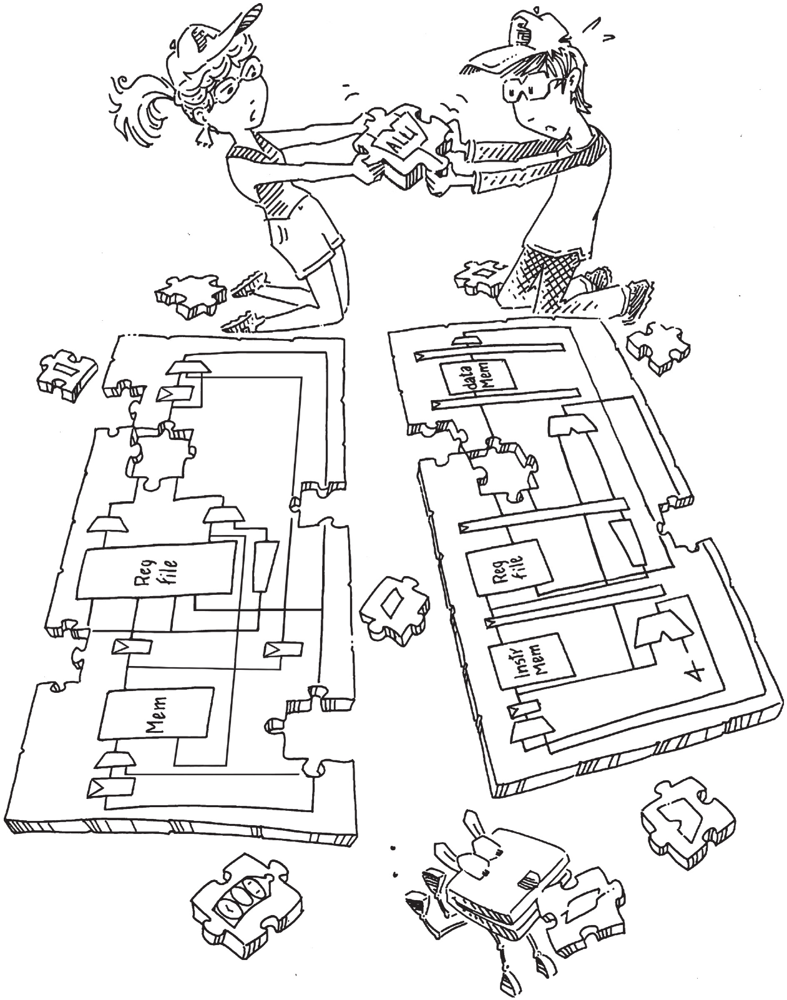

# 7 Microarchitecture

- 7.1 Giới thiệu
- 7.2 Phân tích hiệu năng
- 7.3 Processor Single-Cycle
- 7.4 Processor multicycle
- 7.5 Processor pipelined
- 7.6 Biểu diễn HDL\*
- 7.7 Microarchitecture nâng cao\*
- 7.8 Góc nhìn Real-World: Sự phát triển microarchitecture RISC-V\*
- 7.9 Tóm tắt
- Bài tập
- Câu hỏi phỏng vấn

## 7.1 GIỚI THIỆU

Trong chương này, bạn sẽ học cách ghép các thành phần thành một microprocessor. Thật vậy, bạn sẽ tìm ra ba phiên bản khác nhau, mỗi phiên bản có những trade-offs khác nhau giữa hiệu năng, chi phí và độ phức tạp.

Với người chưa biết, xây dựng microprocessor có vẻ như ma thuật. Nhưng thực ra nó tương đối đơn giản, và đến lúc này bạn đã học mọi thứ cần biết. Cụ thể, bạn đã học thiết kế logic tổ hợp và tuần tự từ đặc tả chức năng và timing. Bạn đã quen các mạch số học và bộ nhớ. Và bạn đã học architecture RISC-V, quy định góc nhìn của lập trình viên về processor RISC-V theo register, instruction và bộ nhớ.

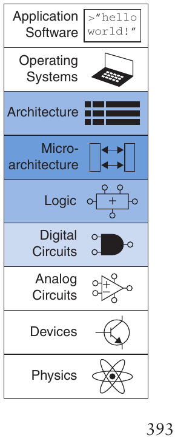

Chương này trình bày microarchitecture, là kết nối giữa logic và architecture. Microarchitecture là cách sắp xếp cụ thể các register, arithmetic logic unit (ALU), finite state machine (FSM), bộ nhớ và các logic building block khác cần để triển khai một architecture. Một architecture cụ thể, như RISC-V, có thể có nhiều microarchitecture khác nhau, mỗi loại có trade-offs về hiệu năng, chi phí và độ phức tạp. Chúng đều chạy cùng chương trình nhưng thiết kế bên trong khác biệt lớn. Chúng ta thiết kế ba microarchitecture trong chương để minh họa các trade-offs.

### 7.1.1 Architectural State và Instruction Set

Nhớ rằng computer architecture được xác định bởi instruction set và architectural state. Architectural state của processor RISC-V gồm program counter và 32 register 32-bit. Mọi microarchitecture RISC-V phải chứa toàn bộ trạng thái này. Dựa trên architectural state hiện tại, processor thực thi instruction cụ thể với một tập dữ liệu cụ thể để tạo architectural state mới. Một số microarchitecture chứa thêm nonarchitectural state để đơn giản hóa logic hoặc cải thiện hiệu năng; chúng tôi sẽ chỉ rõ khi gặp.

> Architectural state là thông tin cần để xác định máy tính đang làm gì. Nếu lưu bản sao architectural state và nội dung bộ nhớ, tắt máy tính, rồi bật lại và khôi phục architectural state cùng bộ nhớ, máy tính sẽ tiếp tục chương trình đang chạy mà không biết đã bị tắt và bật lại. Hãy nghĩ đến tiểu thuyết khoa học viễn tưởng trong đó não nhân vật chính bị đông lạnh rồi được rã đông nhiều năm sau để tỉnh dậy trong thế giới mới.

Để dễ hiểu các microarchitecture, chúng ta tập trung vào tập con của instruction set RISC-V. Cụ thể, chúng ta xử lý các instruction sau:

- Instruction R-type: `add`, `sub`, `and`, `or`, `slt`

- Instruction bộ nhớ: `lw`, `sw`

- Branch: `beq`

Những instruction này được chọn vì đủ để viết chương trình hữu ích. Khi hiểu cách triển khai chúng, bạn có thể mở rộng phần cứng để xử lý các instruction khác.

### 7.1.2 Quy trình thiết kế

Chúng ta chia microarchitecture thành hai phần tương tác: datapath và control unit. Datapath thao tác trên các word dữ liệu. Nó chứa các cấu trúc như bộ nhớ, register, ALU và multiplexer. Chúng ta triển khai architecture RISC-V 32-bit (RV32I), nên dùng datapath 32-bit. Control unit nhận instruction hiện tại từ datapath và chỉ cho datapath cách thực thi instruction. Cụ thể, control unit tạo các tín hiệu multiplexer select, register enable và memory write để điều khiển hoạt động datapath.

Cách tốt để thiết kế hệ thống phức tạp là bắt đầu với phần cứng chứa state element. Chúng gồm bộ nhớ và architectural state (program counter và register). Sau đó thêm các block logic tổ hợp giữa state element để tính trạng thái mới dựa trên trạng thái hiện tại. Instruction được đọc từ một phần bộ nhớ; instruction load và store sau đó đọc hoặc ghi dữ liệu từ phần bộ nhớ khác. Vì vậy, thường tiện khi chia bộ nhớ tổng thể thành hai bộ nhớ nhỏ hơn, một chứa instruction và một chứa dữ liệu. Hình 7.1 thể hiện block diagram với bốn state element: program counter, register file, instruction memory và data memory.

> Ít nhất program counter phải có tín hiệu reset để khởi tạo giá trị khi processor bật. Khi reset, processor RISC-V thường khởi tạo PC ở địa chỉ thấp trong bộ nhớ, như 0x00001000, và chúng ta bắt đầu chương trình tại đó.

Trong chương này, đường đậm chỉ data bus 32-bit. Đường vừa chỉ bus hẹp hơn, như address bus 5-bit của register file. Đường mảnh chỉ dây 1-bit, và đường xanh dùng cho control signal như write enable của register file. Register thường có reset input để đưa về trạng thái đã biết khi start-up, nhưng reset không được vẽ để giảm rối.

Program counter (PC) trỏ tới instruction hiện tại. Input của nó, PCNext, chỉ địa chỉ instruction tiếp theo.

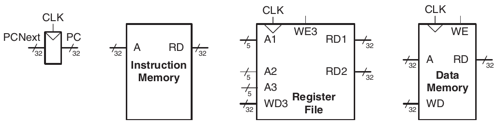

Hình 7.1 Các state element của processor RISC-V

Instruction memory có một read port.[^1] Nó nhận input địa chỉ instruction 32-bit, A, và đọc dữ liệu 32-bit (tức instruction) từ địa chỉ đó ra read data output, RD.

Register file 32-element × 32-bit chứa register `x0–x31`. Nhớ rằng `x0` được nối cứng bằng 0. Register file có hai read port và một write port. Read port nhận input địa chỉ 5-bit, A1 và A2, mỗi input chỉ một trong 2<sup>5</sup> = 32 register làm source operand. Register file đặt giá trị register 32-bit lên các read data output RD1, RD2. Write port, port 3, nhận input địa chỉ 5-bit A3; input write data 32-bit WD3; input write enable WE3; và clock. Nếu write enable (WE3) được asserted, register file ghi dữ liệu (WD3) vào register chỉ định (A3) tại rising edge của clock.

Data memory có một read/write port. Nếu write enable WE được asserted, nó ghi dữ liệu WD vào địa chỉ A tại rising edge của clock. Nếu write enable bằng 0, nó đọc từ địa chỉ A ra read data bus RD.

Instruction memory, register file và data memory đều được đọc theo logic tổ hợp. Nói cách khác, nếu địa chỉ đổi, dữ liệu mới xuất hiện ở RD sau một propagation delay; không liên quan clock. Clock chỉ điều khiển việc ghi. Những bộ nhớ này chỉ được ghi ở rising edge của clock. Bằng cách đó, trạng thái hệ thống chỉ đổi tại clock edge. Địa chỉ, dữ liệu và write enable phải được thiết lập trước clock edge và giữ ổn định đến hết hold time sau clock edge.

Vì state element chỉ đổi trạng thái tại rising edge của clock, chúng là synchronous sequential circuit. Microprocessor được tạo từ các clocked state element và logic tổ hợp, nên cũng là synchronous sequential circuit. Thật vậy, có thể xem processor là finite state machine khổng lồ hoặc tập hợp các state machine đơn giản hơn tương tác với nhau.

### 7.1.3 Các microarchitecture

Trong chương này, chúng ta phát triển ba microarchitecture cho architecture RISC-V: single-cycle, multicycle và pipelined. Chúng khác về cách nối các state element và lượng nonarchitectural state cần thiết.

Microarchitecture single-cycle thực thi cả instruction trong một chu kỳ. Nó dễ giải thích và có control unit đơn giản. Vì hoàn tất thao tác trong một chu kỳ, nó không cần nonarchitectural state. Tuy nhiên, cycle time bị giới hạn bởi instruction chậm nhất. Hơn nữa, processor cần instruction memory và data memory riêng, thường không thực tế.

> Ví dụ processor multicycle kinh điển gồm MIT Whirlwind năm 1947, IBM System/360, VAX của Digital Equipment Corporation, 6502 trong Apple II và 8088 trong IBM PC. Microarchitecture multicycle vẫn được dùng trong microcontroller rẻ như 8051, 68HC11 và PIC16-series trong thiết bị gia dụng, đồ chơi và đồ dùng nhỏ.

Microarchitecture multicycle thực thi instruction qua chuỗi chu kỳ ngắn hơn. Instruction đơn giản cần ít chu kỳ hơn instruction phức tạp. Hơn nữa, microarchitecture multicycle giảm chi phí phần cứng bằng cách tái sử dụng block phần cứng đắt như adder và bộ nhớ. Chẳng hạn, adder có thể được dùng ở các chu kỳ khác nhau cho nhiều mục đích khi thực hiện một instruction. Microprocessor multicycle làm được điều này bằng cách thêm vài nonarchitectural register để chứa kết quả trung gian. Processor multicycle chỉ thực thi một instruction mỗi lúc, nhưng mỗi instruction mất nhiều clock cycle. Processor này chỉ cần một bộ nhớ, truy cập ở một chu kỳ để fetch instruction và ở chu kỳ khác để đọc hoặc ghi dữ liệu. Vì dùng ít phần cứng hơn processor single-cycle, processor multicycle từng là lựa chọn cho hệ thống rẻ.

> Processor Intel đã dùng pipeline kể từ khi 80486 được giới thiệu năm 1989. Gần như mọi microprocessor RISC cũng có pipeline, và mọi processor RISC-V thương mại đều có pipeline. Nhờ chi phí transistor giảm, processor có pipeline hiện chỉ tốn một phần nhỏ của một cent, và cả hệ thống với bộ nhớ cùng peripheral có giá vài chục cent. Vì vậy, processor có pipeline đang thay thế phiên bản multicycle chậm hơn ngay cả trong ứng dụng cost-sensitive nhất.

Microarchitecture pipelined áp dụng pipelining cho microarchitecture single-cycle. Vì vậy nó có thể thực thi đồng thời nhiều instruction, cải thiện throughput đáng kể. Pipelining phải thêm logic xử lý dependency giữa các instruction đang thực thi đồng thời. Nó cũng cần nonarchitectural pipeline register. Processor pipelined phải truy cập instruction và dữ liệu trong cùng chu kỳ; chúng thường dùng instruction cache và data cache riêng cho mục đích này, như Chương 8 thảo luận. Logic và register thêm vào là xứng đáng; mọi processor high-performance thương mại hiện nay đều dùng pipelining.

Chúng ta tìm hiểu chi tiết và trade-offs của ba microarchitecture trong các phần sau. Cuối chương, chúng tôi đề cập ngắn gọn các kỹ thuật bổ sung để đạt tốc độ cao hơn nữa trong microprocessor high-performance hiện đại.

## 7.2 PHÂN TÍCH HIỆU NĂNG

Như đã đề cập, một processor architecture có thể có nhiều microarchitecture với trade-offs chi phí và hiệu năng khác nhau. Chi phí phụ thuộc lượng phần cứng cần thiết và công nghệ triển khai. Tính chi phí chính xác cần hiểu biết chi tiết công nghệ, nhưng nói chung nhiều gate và nhiều bộ nhớ hơn nghĩa là nhiều tiền hơn.

Phần này đặt nền tảng phân tích hiệu năng. Có nhiều cách đo hiệu năng hệ thống máy tính, và bộ phận tiếp thị nổi tiếng vì chọn phương pháp khiến máy tính trông nhanh nhất, bất kể phép đo có tương quan với hiệu năng real-world hay không. Chẳng hạn, nhà sản xuất microprocessor thường tiếp thị dựa trên clock frequency và số core. Tuy nhiên, họ lướt qua sự phức tạp rằng một số processor làm nhiều việc hơn các processor khác trong một clock cycle và điều này thay đổi theo chương trình. Người mua phải làm gì?

> Khi mua máy tính dựa trên benchmark, khách hàng phải cẩn thận vì nhà sản xuất có động lực lớn để làm lệch benchmark. Chẳng hạn, Dhrystone sao chép string rất nhiều, nhưng string có độ dài hằng và word alignment đã biết. Vì vậy, compiler thông minh có thể thay code thông thường gồm vòng lặp và truy cập byte bằng chuỗi load và store word, cải thiện điểm Dhrystone hơn 30% nhưng không tăng tốc ứng dụng real-world. Benchmark SPEC89 chứa chương trình Matrix 300 trong đó 99% thời gian thực thi nằm ở một dòng. IBM tăng tốc chương trình gấp 9 bằng kỹ thuật compiler gọi là blocking. Benchmark multicore computing còn khó hơn vì có nhiều cách viết chương trình; một số tăng tốc tỷ lệ với số core có sẵn nhưng không hiệu quả trên một core. Những chương trình khác nhanh trên một core nhưng gần như không được lợi từ core thêm.

Cách gimmick-free duy nhất đo hiệu năng là đo thời gian thực thi chương trình bạn quan tâm. Máy tính chạy chương trình của bạn nhanh nhất có hiệu năng cao nhất. Lựa chọn tốt kế tiếp là đo tổng thời gian thực thi một tập chương trình tương tự chương trình bạn định chạy. Điều này có thể cần nếu bạn chưa viết chương trình hoặc người khác không có chương trình của bạn thực hiện phép đo. Các tập chương trình đó gọi là benchmark, và thời gian thực thi của chúng thường được công bố để cho biết phần nào hiệu năng processor.

Dhrystone, CoreMark và SPEC là ba benchmark phổ biến. Hai benchmark đầu là synthetic benchmark gồm những phần chương trình thông dụng quan trọng. Dhrystone được phát triển năm 1984 và vẫn thường dùng cho embedded processor, dù code không thật đại diện cho chương trình real-life. CoreMark cải thiện Dhrystone, gồm nhân ma trận để thử multiplier và adder, linked list để thử hệ thống bộ nhớ, state machine để thử branch logic, và cyclical redundancy check liên quan nhiều phần processor. Cả hai nhỏ hơn 16 KB và không tạo tải lớn lên instruction cache.

Benchmark SPECspeed 2017 Integer của Standard Performance Evaluation Corporation (SPEC) gồm chương trình thực, trong đó có x264 (nén video), deepsjeng (chương trình chơi cờ trí tuệ nhân tạo), omnetpp (mô phỏng) và GCC (compiler C). Benchmark được dùng rộng rãi cho processor high-performance vì kiểm tra toàn hệ thống theo cách đại diện.

Phương trình 7.1 cho thời gian thực thi chương trình, đo bằng giây.

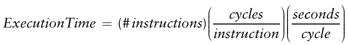 (7.1)

Số instruction trong chương trình phụ thuộc processor architecture. Một số architecture có instruction phức tạp thực hiện nhiều việc hơn trong mỗi instruction, do đó giảm số instruction trong chương trình. Tuy nhiên, những instruction phức tạp thường thực thi chậm hơn trong phần cứng. Số instruction cũng phụ thuộc rất nhiều vào sự khéo léo của lập trình viên. Trong chương này, chúng ta giả định thực thi chương trình đã biết trên processor RISC-V, nên số instruction mỗi chương trình không đổi, độc lập microarchitecture. Cycles per instruction (CPI) là số clock cycle cần để thực thi một instruction trung bình. Nó là nghịch đảo của throughput (instructions per cycle, hay IPC). Microarchitecture khác nhau có CPI khác nhau. Chương này giả định hệ thống bộ nhớ lý tưởng không ảnh hưởng CPI. Chương 8 xem xét việc processor đôi khi phải chờ bộ nhớ, làm tăng CPI.

Số giây mỗi chu kỳ là clock period, T<sub>c</sub>. Clock period do critical path qua logic trong processor quyết định. Microarchitecture khác nhau có clock period khác nhau. Thiết kế logic và mạch cũng ảnh hưởng đáng kể clock period. Chẳng hạn, adder carry-lookahead nhanh hơn adder ripple-carry. Tiến bộ sản xuất cũng cải thiện tốc độ transistor, nên microprocessor chế tạo hôm nay nhanh hơn từ thập kỷ trước dù microarchitecture và logic không đổi.

Thách thức của microarchitect là chọn thiết kế giảm thiểu thời gian thực thi trong khi đáp ứng ràng buộc chi phí và/hoặc công suất tiêu thụ. Vì quyết định microarchitecture ảnh hưởng cả CPI và T<sub>c</sub> và chịu ảnh hưởng thiết kế logic, mạch, xác định lựa chọn tốt nhất cần phân tích kỹ.

Nhiều yếu tố khác ảnh hưởng hiệu năng tổng thể máy tính. Chẳng hạn, hard disk, bộ nhớ, hệ đồ họa và kết nối mạng có thể là yếu tố giới hạn khiến hiệu năng processor không còn liên quan. Microprocessor nhanh nhất thế giới không giúp lướt Internet trên kết nối kém. Nhưng những yếu tố này nằm ngoài phạm vi sách.

## 7.3 PROCESSOR SINGLE-CYCLE

Trước hết, chúng ta thiết kế microarchitecture thực thi instruction trong một chu kỳ. Chúng ta bắt đầu xây datapath bằng cách nối các state element từ Hình 7.1 bằng logic tổ hợp có thể thực thi các instruction khác nhau. Control signal quyết định instruction cụ thể nào được datapath thực hiện tại mỗi thời điểm. Control unit chứa logic tổ hợp tạo control signal thích hợp dựa trên instruction hiện tại. Cuối cùng, chúng ta phân tích hiệu năng processor single-cycle.

### 7.3.1 Chương trình mẫu

Để cụ thể, processor single-cycle sẽ chạy chương trình ngắn trong Hình 7.2, thử load, store, một instruction R-type (`or`) và một branch (`beq`). Giả sử chương trình được lưu trong bộ nhớ bắt đầu tại 0x1000. Hình chỉ địa chỉ mỗi instruction, instruction type, các instruction field và machine language code dạng hexadecimal.

Giả sử register `x5` ban đầu chứa 6 và `x9` chứa 0x2004. Vị trí bộ nhớ 0x2000 chứa 10. Program counter bắt đầu tại 0x1000. `lw` đọc 10 từ địa chỉ (0x2004 – 4) = 0x2000 và đưa vào `x6`. `sw` ghi 10 vào địa chỉ (0x2004 + 8) = 0x200C. `or` tính `x4` = 6 \| 10 = 0110<sub>2</sub> \| 1010<sub>2</sub> = 1110<sub>2</sub> = 14. Sau đó `beq` quay lại label `L7`, nên chương trình lặp mãi.

### 7.3.2 Datapath Single-Cycle

Phần này từng bước phát triển datapath single-cycle, thêm từng thành phần vào state element từ Hình 7.1. Kết nối mới được nhấn mạnh bằng màu đen (hoặc xanh cho control signal mới), còn phần cứng đã học được vẽ màu xám. Instruction ví dụ đang thực thi nằm ở cuối mỗi hình.

Program counter chứa địa chỉ instruction cần thực thi. Bước đầu là đọc instruction này từ instruction memory. Hình 7.3 cho thấy PC đơn giản nối với address input của instruction memory. Instruction memory đọc ra, hay fetch, instruction 32-bit, có nhãn Instr. Trong chương trình mẫu từ Hình 7.2, PC là 0x1000. (Lưu ý đây là processor 32-bit nên PC thực sự là 0x00001000, nhưng bỏ các số không đầu để hình đỡ rối.) Instr là `lw`, 0xFFC4A303, cũng thể hiện ở cuối Hình 7.3. Các giá trị mẫu được ghi chú xanh nhạt trên sơ đồ.

> Chúng tôi in nghiêng tên tín hiệu trong văn bản nhưng không in nghiêng tên module phần cứng. Chẳng hạn, PC là tín hiệu ra từ PC register, hoặc đơn giản là PC.

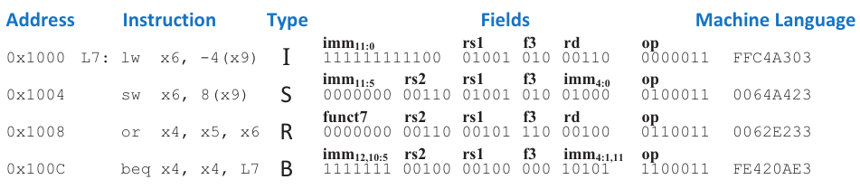

Hình 7.2 Chương trình mẫu thử các loại instruction khác nhau

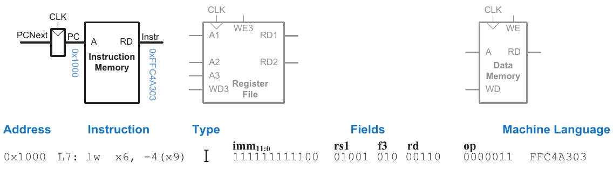

Hình 7.3 Fetch instruction từ bộ nhớ

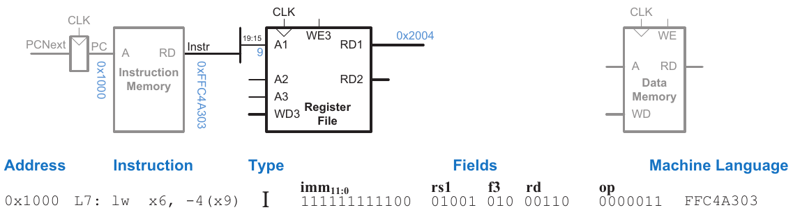

Hình 7.4 Đọc source operand từ register file

Các hành động của processor phụ thuộc instruction cụ thể đã fetch. Trước tiên, chúng ta xác định kết nối datapath cho instruction `lw`. Sau đó xem cách tổng quát hóa datapath để xử lý các instruction khác.

```
lw
```

Với instruction `lw`, bước tiếp theo là đọc source register chứa base address. Nhớ rằng `lw` là instruction I-type, và base register được chỉ định trong trường rs1 của instruction, Instr<sub>19:15</sub>. Các bit này nối với address input A1 của register file, như Hình 7.4. Register file đọc giá trị register ra RD1. Trong ví dụ, register file đọc 0x2004 từ `x9`.

Instruction `lw` còn cần offset. Offset lưu trong trường immediate 12-bit của instruction, Instr<sub>31:20</sub>. Nó là giá trị có dấu nên phải được sign-extended thành 32 bit. Sign extension đơn giản là sao chép sign bit vào các bit trọng số cao nhất: ImmExt<sub>31:12</sub> = Instr<sub>31</sub> , và ImmExt<sub>11:0</sub> = Instr<sub>31:20</sub>. Sign-extension được thực hiện bởi Extend unit trong Hình 7.5, nhận immediate có dấu 12-bit ở Instr<sub>31:20</sub> và tạo immediate sign-extended 32-bit, ImmExt. Trong ví dụ, immediate bù hai −4 được mở rộng từ biểu diễn 12-bit 0xFFC sang biểu diễn 32-bit 0xFFFFFFFC.

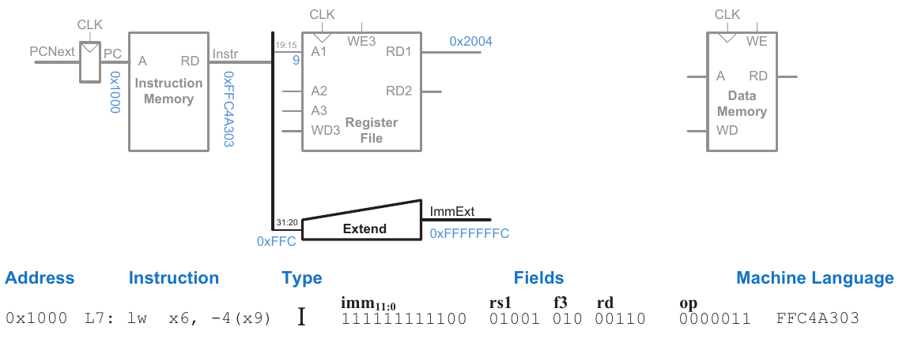

Hình 7.5 Sign-extend immediate

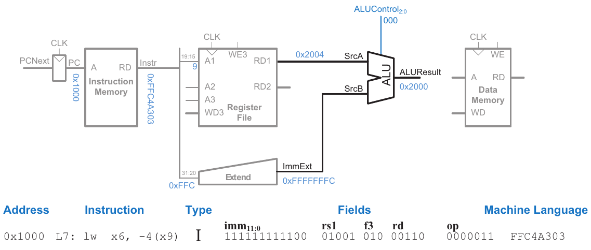

Hình 7.6 Tính địa chỉ bộ nhớ

Processor cộng base address với offset để tìm địa chỉ cần đọc từ bộ nhớ. Hình 7.6 thêm ALU để thực hiện phép cộng. ALU nhận hai operand, SrcA và SrcB. SrcA là base address từ register file, SrcB là offset từ immediate sign-extended ImmExt. ALU có thể thực hiện nhiều thao tác như Phần 5.2.4 mô tả. Tín hiệu ALUControl 3-bit chỉ thao tác (xem Bảng 5.3 trang 250). ALU nhận operand 32-bit và tạo ALUResult 32-bit. Với instruction `lw`, ALUControl nên đặt 000 để cộng. ALUResult gửi tới data memory làm địa chỉ đọc, như Hình 7.6. Trong ví dụ, ALU tính 0x2004 + 0xFFFFFFFC = 0x2000. Một lần nữa, đây là giá trị 32-bit nhưng chúng ta bỏ số không đầu để hình đỡ rối.

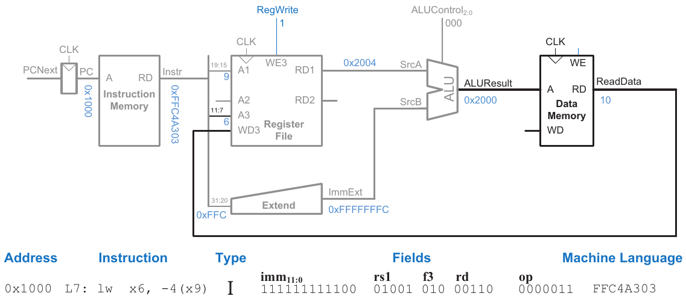

Hình 7.7 Đọc bộ nhớ và ghi kết quả trở lại register file

Địa chỉ bộ nhớ từ ALU được cung cấp cho address port (A) của data memory. Dữ liệu được đọc từ data memory ra bus ReadData rồi ghi lại destination register cuối chu kỳ, như Hình 7.7. Port 3 của register file là write port. Destination register của `lw`, do trường rd (Instr<sub>11:7</sub>) chỉ định, nối với A3, address input của port 3. Bus ReadData nối WD3, write data input của port 3. Control signal RegWrite (register write) nối với WE3, write enable input của port 3, và được asserted trong instruction `lw` để ghi giá trị dữ liệu vào register file. Việc ghi diễn ra tại rising edge của clock ở cuối chu kỳ. Trong ví dụ, processor đọc 10 từ địa chỉ 0x2000 trong data memory và đưa giá trị đó (10) vào `x6` trong register file.

Trong lúc thực thi instruction, processor cũng phải tính địa chỉ instruction tiếp theo, PCNext. Vì instruction dài 32 bit (4 byte), instruction tiếp theo ở PC+4. Hình 7.8 dùng adder tăng PC thêm 4. Trong ví dụ, PCNext = 0x1000 + 4 = 0x1004. Địa chỉ mới được ghi vào program counter tại rising edge clock tiếp theo. Điều này hoàn tất datapath cho instruction `lw`.

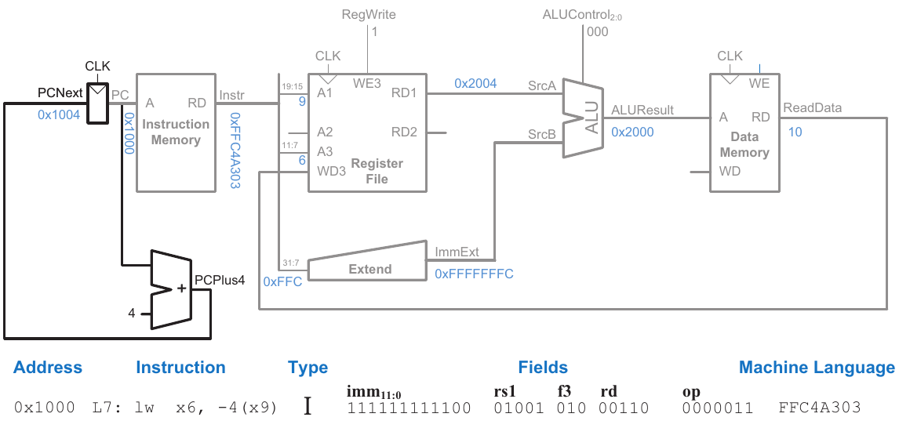

Hình 7.8 Tăng program counter

```
sw
```

Tiếp theo mở rộng datapath để xử lý `sw`, là instruction S-type. Giống `lw`, `sw` đọc base address từ port 1 register file và sign-extends immediate. ALU cộng base address với immediate để tìm địa chỉ bộ nhớ. Tất cả chức năng này đã được datapath hỗ trợ, nhưng immediate có dấu 12-bit lưu trong Instr<sub>31:25</sub>,<sub>11:7</sub> (thay vì Instr<sub>31:20</sub> như `lw`). Vì vậy Extend unit phải được sửa để nhận thêm các bit Instr<sub>11:7</sub>. Để đơn giản (và cho instruction tương lai như `jal`), Extend unit nhận mọi bit của Instr<sub>31:7</sub>. Control signal ImmSrc quyết định dùng bit instruction nào làm immediate. Khi ImmSrc = 0 (cho `lw`), Extend unit chọn Instr<sub>31:20</sub> làm immediate có dấu 12-bit; khi ImmSrc = 1 (cho `sw`), nó chọn Instr<sub>31:25</sub>,<sub>11:7.</sub>

Instruction `sw` cũng đọc register thứ hai từ register file và ghi nội dung vào data memory. Hình 7.9 thể hiện kết nối mới cho chức năng này. Register được chỉ định trong trường rs2, Instr<sub>24:20</sub>, nối với input address 2 (A2) của register file. Nội dung register được đọc ra output read data 2 (RD2), rồi nối input write data (WD) của data memory. Write enable port của data memory, WE, do MemWrite điều khiển. Với instruction `sw`: MemWrite = 1 để ghi dữ liệu vào bộ nhớ; ALUControl = 000 để cộng base address và offset; RegWrite = 0 vì không được ghi gì vào register file. Lưu ý dữ liệu vẫn được đọc từ địa chỉ cung cấp cho data memory, nhưng ReadData này bị bỏ qua vì RegWrite = 0.

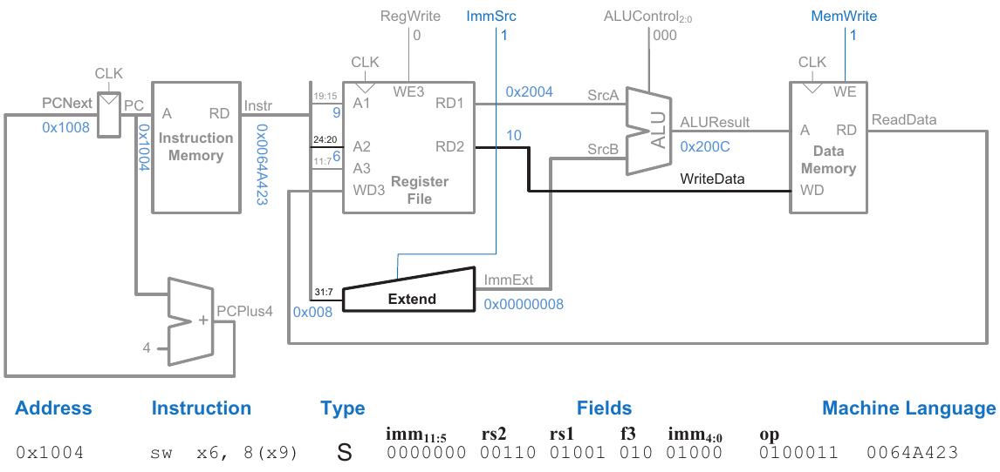

Hình 7.9 Ghi dữ liệu vào bộ nhớ cho instruction `sw`

Trong ví dụ, PC là 0x1004. Vì vậy instruction memory đọc instruction `sw`, 0x0064A423. Register file đọc 0x2004 (base address) từ `x9` và 10 từ `x6` trong khi Extend unit mở rộng immediate offset 8 từ 12 lên 32 bit. ALU tính 0x2004 + 8 = 0x200C. Data memory ghi 10 vào địa chỉ 0x200C. Đồng thời PC tăng lên 0x1008.

Instruction R-Type

Tiếp theo, xem xét mở rộng datapath để xử lý instruction R-type, `add`, `sub`, `and`, `or` và `slt`. Tất cả đọc hai source register từ register file, thực hiện thao tác ALU trên chúng và ghi kết quả lại destination register. Chúng chỉ khác thao tác ALU cụ thể. Vì thế, có thể xử lý chúng bằng cùng phần cứng nhưng tín hiệu ALUControl khác nhau. Nhớ từ Phần 5.2.4 rằng ALUControl là 000 cho cộng, 001 cho trừ, 010 cho AND, 011 cho OR và 101 cho set less than.

Hình 7.10 thể hiện datapath cải tiến xử lý các instruction R-type này. Datapath đọc rs1, rs2 từ port 1, 2 register file và thực hiện thao tác ALU trên chúng. Chúng ta thêm multiplexer và select signal mới ALUSrc để chọn ImmExt hoặc RD2 làm source ALU thứ hai, SrcB. Với `lw` và `sw`, ALUSrc là 1 để chọn ImmExt; với instruction R-type, ALUSrc là 0 để chọn output RD2 của register file làm SrcB.

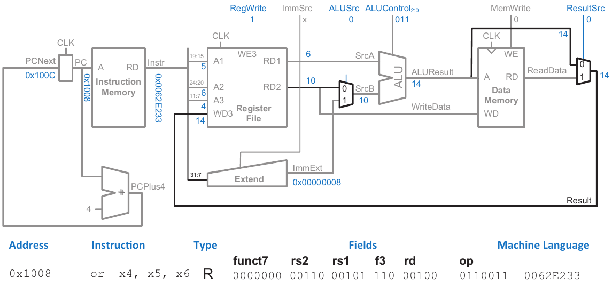

Hình 7.10 Cải tiến datapath cho instruction R-type

> Quan sát thấy phần cứng tính mọi đáp án có thể cần cho các instruction khác nhau (ví dụ ALUResult và ReadData) rồi dùng multiplexer chọn đáp án thích hợp dựa trên instruction. Đây là chiến lược thiết kế quan trọng. Trong phần còn lại của chương, chúng ta thêm multiplexer để chọn đáp án mong muốn.
>
> Một khác biệt lớn giữa phần mềm và phần cứng là phần mềm hoạt động tuần tự, nên có thể chỉ tính đáp án cần. Phần cứng hoạt động song song; vì vậy chúng ta thường tính mọi đáp án có thể rồi chọn đáp án cần. Chẳng hạn, khi thực thi instruction R-type bằng ALU, bộ nhớ vẫn nhận địa chỉ và đọc dữ liệu từ đó dù chúng ta không quan tâm dữ liệu là gì.

Hãy gọi giá trị ghi lại register file là Result. Với `lw`, Result đến từ output ReadData của bộ nhớ. Tuy nhiên, với instruction R-type, Result đến từ output ALUResult của ALU. Chúng ta thêm multiplexer Result để chọn Result đúng theo loại instruction. Select signal ResultSrc của multiplexer là 0 cho instruction R-type để chọn ALUResult làm Result; ResultSrc là 1 cho `lw` để chọn ReadData. Không quan tâm ResultSrc với `sw` vì nó không ghi register file.

Trong ví dụ, PC là 0x1008. Vì vậy instruction memory đọc instruction `or` 0x0062E233. Register file đọc source operand 6 từ `x5` và 10 từ `x6`. ALUControl là 011 nên ALU tính 6 \| 10 = 0110<sub>2</sub> \| 1010<sub>2</sub> = 1110<sub>2</sub> = 14. Kết quả ghi lại `x4`. Đồng thời PC tăng lên 0x100C.

```
beq
```

Cuối cùng, mở rộng datapath để xử lý instruction branch if equal (`beq`). `beq` so sánh hai register. Nếu bằng nhau, nó lấy branch bằng cách cộng branch offset vào program counter (PC).

Branch offset là immediate có dấu 13-bit lưu trong trường immediate 12-bit của instruction B-type. Vì thế logic Extend cần thêm một chế độ để chọn immediate đúng. ImmSrc tăng thành 2 bit, dùng cách mã hóa ở Bảng 7.1. ImmExt lúc này là immediate sign-extended (khi ImmSrc = 00 hoặc 01) hoặc branch offset (khi ImmSrc = 10).

Bảng 7.1 Mã hóa ImmSrc

| ImmSrc | ImmExt | Loại | Mô tả |
|---|---|---|---|
| 00 | {{20{Instr[31]}}, Instr[31:20]} | I | Immediate có dấu 12-bit |
| 01 | {{20{Instr[31]}}, Instr[31:25], Instr[11:7]} | S | Immediate có dấu 12-bit |
| 10 | {{20{Instr[31]}}, Instr[7], Instr[30:25], Instr[11:8], 1’b0} | B | Immediate có dấu 13-bit |

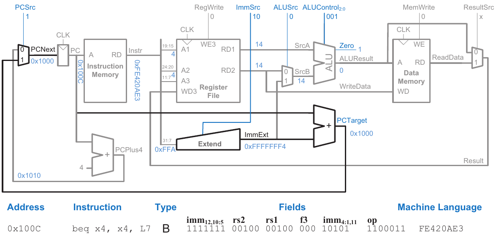

Hình 7.11 Cải tiến datapath cho `beq`

> Về logic, có thể xây Extend unit bằng multiplexer 3:1 32-bit chọn một trong ba input dựa vào ImmSrc và các bitfield instruction. Thực tế, bit trên của immediate sign-extended luôn đến từ bit 31 instruction, Instr<sub>31</sub>, nên có thể tối ưu thiết kế và chỉ dùng multiplexer chọn các bit dưới.

Hình 7.11 thể hiện sửa đổi datapath. Cần adder khác tính branch target address, PCTarget = PC + ImmExt. Hai source register được so sánh bằng cách dùng ALU tính (SrcA – SrcB). Nếu ALUResult bằng 0, được cờ Zero của ALU chỉ ra, các register bằng nhau. Thêm multiplexer chọn PCNext từ PCPlus4 hoặc PCTarget. PCTarget được chọn nếu instruction là branch và cờ Zero được asserted. Với `beq`, ALUControl = 001 để ALU thực hiện phép trừ. ALUSrc = 0 để chọn SrcB từ register file. RegWrite và MemWrite bằng 0 vì branch không ghi register file hay bộ nhớ. Không quan tâm ResultSrc vì register file không được ghi.

Trong ví dụ, PC là 0x100C nên instruction memory đọc instruction `beq` 0xFE420AE3. Cả hai source register là `x4`, nên register file đọc 14 trên cả hai port. ALU tính 14 – 14 = 0 và cờ Zero được asserted. Đồng thời Extend unit tạo 0xFFFFFFF4 (tức −12), được cộng với PC để có PCTarget = 0x1000. Lưu ý hình thể hiện 12 bit trên chưa được hoán vị của immediate 13-bit tại input Extend unit (0xFFA). Mux PCNext chọn PCTarget làm PC tiếp theo và branch về đầu code ở clock edge tiếp theo.

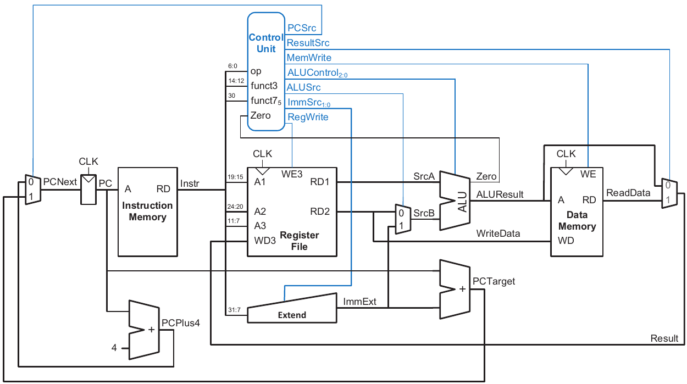

Hình 7.12 Processor single-cycle hoàn chỉnh

> Chúng tôi đặt tên multiplexer (mux) theo tín hiệu chúng tạo ra. Chẳng hạn, mux PCNext tạo tín hiệu PCNext, mux Result tạo tín hiệu Result.

Đến đây, việc thiết kế datapath của processor single-cycle đã hoàn tất. Chúng ta đã minh họa cả bản thiết kế lẫn quy trình thiết kế, trong đó các state element được xác định trước, rồi combinational logic được bổ sung một cách có hệ thống để kết nối các state element đó. Trong phần tiếp theo, chúng ta sẽ xem cách tính các control signal điều khiển hoạt động của datapath.

### 7.3.3 Control Single-Cycle

Control unit của processor single-cycle tính control signal dựa trên op, funct3 và funct7. Với instruction set RV32I, chỉ bit 5 của funct7 được dùng, nên chỉ cần xét op (Instr<sub>6:0</sub>), funct3 (Instr<sub>14:12</sub>) và funct7<sub>5</sub> (Instr<sub>30</sub>). Hình 7.12 thể hiện toàn bộ processor single- cycle với control unit nối datapath.

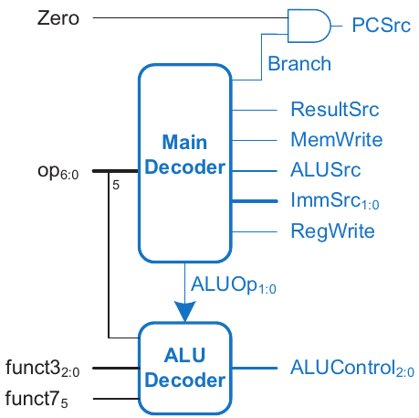

Hình 7.13 Control unit của processor Single-cycle

Bảng 7.2 Truth table của Main Decoder

| Instruction | Op | RegWrite | ImmSrc | ALUSrc | MemWrite | ResultSrc | Branch | ALUOp |
|---|---|---|---|---|---|---|---|---|
| `lw` | 0000011 | 1 | 00 | 1 | 0 | 1 | 0 | 00 |
| `sw` | 0100011 | 0 | 01 | 1 | 1 | x | 0 | 00 |
| R-type | 0110011 | 1 | xx | 0 | 0 | 0 | 0 | 10 |
| `beq` | 1100011 | 0 | 10 | 0 | 0 | x | 1 | 01 |

Hình 7.13 phân rã control unit theo phân cấp; nó còn gọi là controller hoặc decoder vì giải mã việc instruction cần làm. Chúng ta chia thành hai phần chính: Main Decoder tạo đa số control signal, và ALU Decoder xác định thao tác ALU thực hiện.

Bảng 7.2 thể hiện control signal Main Decoder tạo ra, như đã xác định khi thiết kế datapath. Main Decoder xác định loại instruction từ opcode rồi tạo control signal thích hợp cho datapath. Main Decoder tạo đa số control signal của datapath. Nó còn tạo tín hiệu nội bộ Branch và ALUOp, được dùng trong controller. Logic Main Decoder có thể được phát triển từ truth table bằng kỹ thuật thiết kế logic tổ hợp bạn thích.

ALU Decoder tạo ALUControl dựa vào ALUOp và funct3. Với instruction `sub` và `add`, ALU Decoder còn dùng funct7<sub>5</sub> và op<sub>5</sub> để xác định ALUControl như Bảng 7.3. ALUOp 00 chỉ phép cộng (ví dụ tìm địa chỉ load hoặc store). ALUOp 01 chỉ phép trừ (ví dụ so sánh hai số cho branch). ALUOp 10 chỉ instruction ALU R-type mà ALU Decoder phải xem trường funct3 (và đôi khi cả bit op<sub>5</sub>, funct7<sub>5</sub>) để xác định thao tác ALU (ví dụ `add`, `sub`, `and`, `or`, `slt`).

Bảng 7.3 Truth table của ALU Decoder

| ALUOp | funct3 | {op<sub>5</sub>, funct7<sub>5</sub>} | ALUControl | Instruction |
|---|---|---|---|---|
| 00 | x | x | 000 (add) | `lw`, `sw` |
| 01 | x | x | 001 (subtract) | `beq` |
| 10 | 000 | 00, 01, 10 | 000 (add) | `add` |
|  | 000 | 11 | 001 (subtract) | `sub` |
|  | 010 | x | 101 (set less than) | `slt` |
|  | 110 | x | 011 (or) | `or` |
|  | 111 | x | 010 (and) | `and` |

> Theo Bảng B.1 ở mặt trong bìa sách, `add`, `sub` và `addi` đều có funct3 = 000. `add` có funct7 = 0000000 còn `sub` có funct7 = 0100000, nên funct7<sub>5</sub> đủ phân biệt chúng. Nhưng sắp tới chúng ta xét hỗ trợ `addi`, không có trường funct7 nhưng có op 0010011. Suy nghĩ một chút, có thể thấy một
>
> instruction ALU có funct3 = 000 là `sub` nếu op<sub>5</sub> và funct7<sub>5</sub> đều bằng 1, nếu không thì là `add` hoặc `addi`.

#### Ví dụ 7.1 HOẠT ĐỘNG PROCESSOR SINGLE-CYCLE

Xác định giá trị control signal và những phần datapath được dùng khi thực thi instruction `and`.

Lời giải Hình 7.14 minh họa control signal và luồng dữ liệu khi thực thi instruction `and`. PC trỏ tới vị trí bộ nhớ chứa instruction; instruction memory xuất instruction này. Luồng dữ liệu chính qua register file và ALU được biểu diễn bằng đường xanh đậm. Register file đọc hai source operand do Instr chỉ định. SrcB phải đến từ port thứ hai register file (không phải ImmExt), nên ALUSrc phải bằng 0. ALU thực hiện AND theo bit nên ALUControl phải là 010. Kết quả đến từ ALU nên ResultSrc là 0, và kết quả được ghi register file nên RegWrite là 1. Instruction không ghi bộ nhớ nên MemWrite là 0.

Việc cập nhật PC bằng PCPlus4 được thể hiện bằng đường xám đậm. PCSrc là 0 để chọn PC đã tăng. Lưu ý dữ liệu vẫn đi qua những đường không được nhấn mạnh nhưng giá trị đó bị bỏ qua. Chẳng hạn, immediate được mở rộng và một giá trị được đọc từ bộ nhớ nhưng chúng không ảnh hưởng trạng thái tiếp theo của hệ thống.

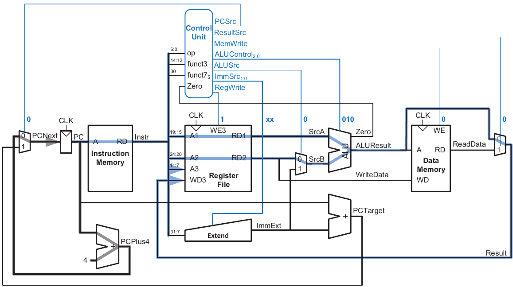

Hình 7.14 Control signal và luồng dữ liệu khi thực thi instruction `and`

### 7.3.4 Thêm các instruction

Đến nay, chúng ta chỉ xét tập con nhỏ của instruction set RISC-V. Phần này cải tiến datapath và controller để hỗ trợ instruction `addi` (add immediate) và `jal` (jump and link). Các ví dụ minh họa nguyên lý xử lý instruction mới và cung cấp instruction set đủ phong phú để viết nhiều chương trình thú vị. Nếu bỏ đủ công sức, bạn có thể mở rộng processor single-cycle để xử lý mọi instruction RISC-V. Hơn nữa, chúng ta sẽ thấy một số instruction chỉ cần cải tiến decoder, trong khi những instruction khác cần thêm phần cứng datapath.

#### Ví dụ 7.2 INSTRUCTION `addi`

Nhớ rằng `addi rd,rs1,imm` là instruction I-type cộng giá trị rs1 với immediate sign-extended và ghi kết quả vào rd. Datapath đã có khả năng này. Xác định những thay đổi controller cần để hỗ trợ `addi`.

Lời giải Chỉ cần thêm hàng vào truth table Main Decoder cho biết giá trị control signal của `addi`, như Bảng 7.4. Kết quả phải ghi register file nên RegWrite = 1. Immediate 12-bit trong Instr<sub>31:20</sub> được sign-extended như với `lw`, một instruction I-type khác, nên ImmSrc là 00 (xem Bảng 7.1). SrcB đến từ immediate nên ALUSrc = 1. Instruction không ghi bộ nhớ cũng không phải branch nên MemWrite = Branch = 0. Kết quả đến từ ALU, không phải bộ nhớ, nên ResultSrc = 0. Cuối cùng, ALU phải cộng nên ALUOp = 10; ALU Decoder đặt ALUControl = 000 vì funct3 = 000 và op<sub>5</sub> = 0.

Bảng 7.4 Truth table Main Decoder được cải tiến hỗ trợ `addi`

| Instruction | Opcode | RegWrite | ImmSrc | ALUSrc | MemWrite | ResultSrc | Branch | ALUOp |
|---|---|---|---|---|---|---|---|---|
| `lw` | 0000011 | 1 | 00 | 1 | 0 | 1 | 0 | 00 |
| `sw` | 0100011 | 0 | 01 | 1 | 1 | x | 0 | 00 |
| R-type | 0110011 | 1 | xx | 0 | 0 | 0 | 0 | 10 |
| `beq` | 1100011 | 0 | 10 | 0 | 0 | x | 1 | 01 |
| `addi` | 0010011 | 1 | 00 | 1 | 0 | 0 | 0 | 10 |

Người đọc tinh ý có thể nhận thấy thay đổi này còn cung cấp các instruction ALU I-type khác: `andi`, `ori` và `slti`. Những instruction này có cùng op 0010011, cần cùng control signal, chỉ khác trường funct3 mà ALU Decoder đã dùng để xác định ALUControl và từ đó thao tác ALU.

#### Ví dụ 7.3 INSTRUCTION `jal`

Trình bày cách sửa processor RISC-V single-cycle để hỗ trợ instruction jump and link (`jal`). `jal` ghi PC+4 vào rd và đổi PC thành jump target address, PC + imm.

Lời giải Processor tính jump target address, giá trị PCNext, bằng cách cộng PC với immediate có dấu 21-bit mã hóa trong instruction. Bit trọng số thấp nhất của immediate luôn là 0, và 20 bit cao tiếp theo đến từ Instr<sub>31:12</sub>. Immediate 21-bit này sau đó được sign-extended. Datapath đã có phần cứng cộng PC với immediate sign-extended, chọn nó làm PC tiếp theo, tính PC+4 và ghi một giá trị vào register file. Vì thế, trong datapath chỉ cần sửa Extend unit để sign-extend immediate 21-bit và mở rộng multiplexer Result để chọn PC+4 (tức PCPlus4), như Hình 7.15. Bảng 7.5 thể hiện cách mã hóa ImmSrc mới hỗ trợ immediate dài của `jal`.

Control unit cần đặt PCSrc = 1 cho jump. Để làm điều này, thêm gate OR và control signal khác, Jump, như Hình 7.16. Khi Jump asserts, PCSrc = 1 và PCTarget (jump target address) được chọn làm PC tiếp theo.

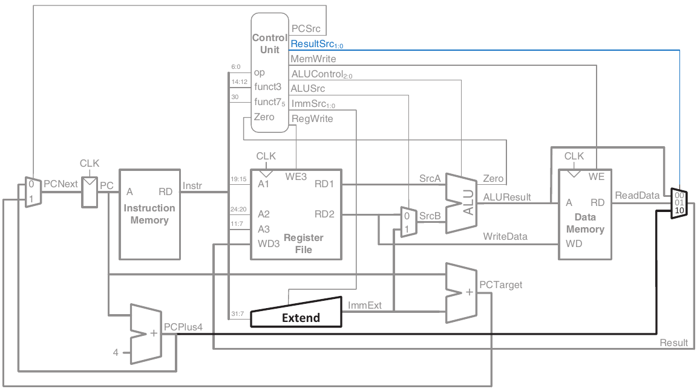

Hình 7.15 Datapath được cải tiến cho `jal`

Bảng 7.5 Mã hóa ImmSrc.

| ImmSrc | ImmExt | Loại | Mô tả |
|---|---|---|---|
| 00 | {{20{Instr[31]}}, Instr[31:20]} | I | Immediate có dấu 12-bit |
| 01 | {{20{Instr[31]}}, Instr[31:25], Instr[11:7]} | S | Immediate có dấu 12-bit |
| 10 | {{20{Instr[31]}}, Instr[7], Instr[30:25], Instr[11:8], 1’b0} | B | Immediate có dấu 13-bit |
| 11 | {{12{Instr[31]}}, Instr[19:12], Instr[20], Instr[30:21], 1’b0} | J | Immediate có dấu 21-bit |

Bảng 7.6 thể hiện Main Decoder cập nhật với hàng mới cho `jal`. RegWrite = 1 và ResultSrc = 10 để ghi PC+4 vào rd. ImmSrc = 11 để chọn jump offset 21-bit. ALUSrc và ALUOp không quan trọng vì ALU không được dùng. MemWrite = 0 vì instruction không phải store, và Branch = 0 vì không phải branch. Tín hiệu Jump mới là 1 để chọn jump target address làm PC tiếp theo.

### 7.3.5 Phân tích hiệu năng

Hãy nhớ lại từ Phương trình 7.1 rằng thời gian thực thi chương trình là tích số instruction, cycles per instruction và cycle time. Mỗi instruction trong processor single-cycle mất một clock cycle nên clock cycles per instruction (CPI) là 1. Cycle time do critical path quyết định. Trong processor của chúng ta, instruction `lw` là time-consuming nhất và liên quan critical path ở Hình 7.17. Như các đường xanh đậm chỉ ra, critical path bắt đầu khi PC nạp địa chỉ mới ở rising edge của clock. Instruction memory sau đó đọc instruction mới và register file đọc rs1 làm SrcA. Trong khi register file đọc, trường immediate được sign-extended theo ImmSrc và chọn tại multiplexer SrcB (đường tô xám). ALU cộng SrcA và SrcB để tìm địa chỉ bộ nhớ. Data memory đọc từ địa chỉ này, và multiplexer Result chọn ReadData làm Result. Cuối cùng, Result phải được thiết lập tại register file trước rising clock edge tiếp theo để ghi đúng. Vì vậy cycle time của processor single-cycle là:

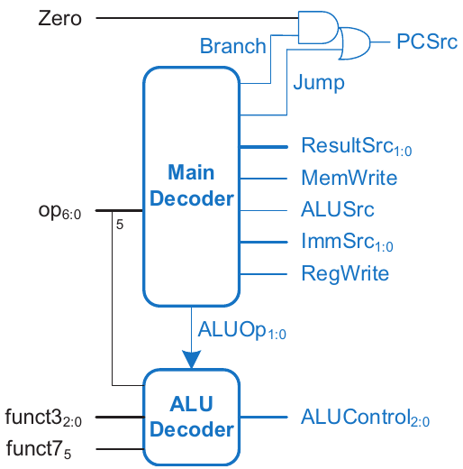

Hình 7.16 Control unit cải tiến cho `jal`

Bảng 7.6 Truth table Main Decoder được cải tiến hỗ trợ `jal`

| Instruction | Opcode | RegWrite | ImmSrc | ALUSrc | MemWrite | ResultSrc | Branch | ALUOp | Jump |
|---|---|---|---|---|---|---|---|---|---|
| `lw` | 0000011 | 1 | 00 | 1 | 0 | 01 | 0 | 00 | 0 |
| `sw` | 0100011 | 0 | 01 | 1 | 1 | xx | 0 | 00 | 0 |
| R-type | 0110011 | 1 | xx | 0 | 0 | 00 | 0 | 10 | 0 |
| `beq` | 1100011 | 0 | 10 | 0 | 0 | xx | 1 | 01 | 0 |
| I-type ALU | 0010011 | 1 | 00 | 1 | 0 | 00 | 0 | 10 | 0 |
| `jal` | 1101111 | 1 | 11 | x | 0 | 10 | 0 | xx | 1 |

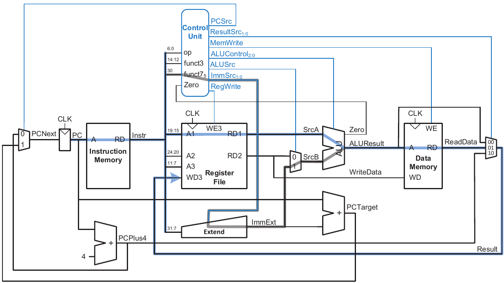

Hình 7.17 Critical path cho `lw`

T<sub>c_single</sub> = t<sub>pcq_PC</sub> + t<sub>mem</sub> + max[t<sub>RFread</sub>, t<sub>dec</sub> + t<sub>ext</sub> + t<sub>mux</sub>]

\+ t<sub>ALU</sub> + t<sub>mem</sub> + t<sub>mux</sub> + t<sub>RFsetup</sub> (7.2)

Trong hầu hết công nghệ triển khai, ALU, bộ nhớ và register file chậm hơn đáng kể các block tổ hợp khác. Vì vậy critical path đi qua register file—không qua decoder (controller), Extend unit và multiplexer—là đường tô xanh trong Hình 7.17. Cycle time được đơn giản thành:

> Nhớ rằng `lw` không dùng read port thứ hai (A2/RD2) của register file.

T<sub>c_single</sub> = t<sub>pcq_PC</sub> + 2t<sub>mem</sub> + t<sub>RFread</sub> + t<sub>ALU</sub> + t<sub>mux</sub> + t<sub>RFsetup</sub> (7.3)

Giá trị số của những thời gian này phụ thuộc công nghệ triển khai cụ thể.

Instruction khác có critical path ngắn hơn. Chẳng hạn, instruction R-type không cần truy cập data memory. Tuy nhiên, chúng ta tuân thủ thiết kế synchronous sequential nên clock period không đổi và phải đủ dài cho instruction chậm nhất.

Bảng 7.7 Delay của các phần tử mạch

| Phần tử | Tham số | Delay (ps) |
|---|---|---|
| Register clk-to-Q | t<sub>pcq</sub> | 40 |
| Register setup | t<sub>setup</sub> | 50 |
| Multiplexer | t<sub>mux</sub> | 30 |
| AND-OR gate | t<sub>AND-OR</sub> | 20 |
| ALU | t<sub>ALU</sub> | 120 |
| Decoder (control unit) | t<sub>dec</sub> | 25 |
| Extend unit | t<sub>ext</sub> | 35 |
| Đọc bộ nhớ | t<sub>mem</sub> | 200 |
| Đọc register file | t<sub>RFread</sub> | 100 |
| Setup register file | t<sub>RFsetup</sub> | 60 |

#### Ví dụ 7.4 HIỆU NĂNG PROCESSOR SINGLE-CYCLE

Ben Bitdiddle đang cân nhắc xây processor single-cycle bằng quy trình sản xuất CMOS 7-nm. Anh xác định các logic element có delay ở Bảng 7.7. Hãy giúp anh tính thời gian thực thi chương trình có 100 tỷ instruction.

Lời giải Theo Phương trình 7.3, cycle time của processor single-cycle là T<sub>c_single</sub> = 40 + 2(200) + 100 + 120 + 30 + 60 = 750 ps. Theo Phương trình 7.1, tổng thời gian thực thi là T<sub>single</sub> = (100 × 10<sup>9</sup> instruction) (1 cycle/instruction) (750 × 10<sup>−12</sup> s/cycle) = 75 giây.

## 7.4 PROCESSOR MULTICYCLE

Processor single-cycle có ba điểm yếu đáng chú ý. Thứ nhất, cần bộ nhớ riêng cho instruction và dữ liệu, trong khi đa số processor chỉ có một bộ nhớ ngoài chứa cả hai. Thứ hai, cần clock cycle đủ dài cho instruction chậm nhất (`lw`) dù đa số instruction có thể nhanh hơn. Cuối cùng, cần ba adder (một trong ALU và hai cho logic PC); adder là mạch tương đối đắt, nhất là nếu phải nhanh.

Processor multicycle khắc phục bằng cách chia instruction thành nhiều bước ngắn hơn. Bộ nhớ, ALU và register file có delay dài nhất nên để delay mỗi bước gần bằng nhau, processor chỉ có thể dùng một unit đó mỗi bước. Processor dùng một bộ nhớ vì instruction được đọc ở một bước còn dữ liệu đọc hoặc ghi ở bước sau. Processor chỉ cần một adder, tái sử dụng cho mục đích khác nhau ở bước khác nhau. Instruction khác nhau dùng số bước khác nhau, nên instruction đơn giản hoàn tất nhanh hơn instruction phức tạp.

Chúng ta thiết kế processor multicycle theo cùng quy trình đã dùng cho processor single-cycle. Trước hết tạo datapath bằng cách nối architectural state element và bộ nhớ bằng logic tổ hợp. Nhưng lần này thêm nonarchitectural state element để giữ kết quả trung gian giữa các bước. Sau đó thiết kế controller. Khi thực thi một instruction, controller tạo tín hiệu khác nhau mỗi bước, nên lúc này controller dùng finite state machine thay vì logic tổ hợp. Cuối cùng phân tích hiệu năng processor multicycle và so sánh processor single-cycle.

### 7.4.1 Datapath multicycle

Một lần nữa, bắt đầu thiết kế với bộ nhớ và architectural state của processor như Hình 7.18. Trong thiết kế single-cycle, dùng instruction memory và data memory riêng vì cần đọc instruction memory và đọc hoặc ghi data memory trong một chu kỳ. Nay chọn dùng bộ nhớ kết hợp cho cả instruction và dữ liệu. Điều này thực tế hơn và khả thi vì có thể đọc instruction ở một chu kỳ rồi đọc hoặc ghi dữ liệu ở chu kỳ khác. PC và register file không đổi.

Giống processor single-cycle, xây dần datapath bằng cách thêm thành phần xử lý mỗi bước của từng instruction. PC chứa địa chỉ instruction cần thực thi. Bước đầu là đọc instruction từ bộ nhớ. Hình 7.19 cho thấy PC đơn giản nối address input bộ nhớ. Instruction được đọc và lưu trong nonarchitectural instruction register (IR) mới để dùng ở chu kỳ sau. IR nhận enable signal gọi là IRWrite, được asserted khi cần nạp instruction mới vào IR.

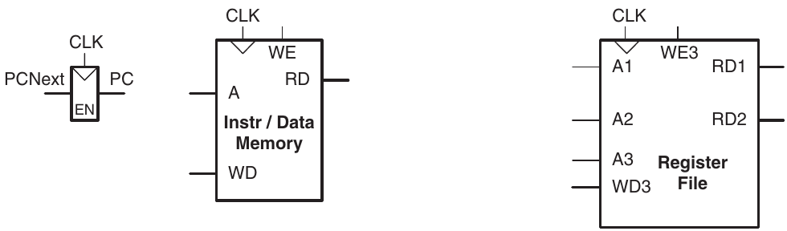

Hình 7.18 State element với instruction/data memory hợp nhất

> Giống processor single-cycle, chúng ta đặt tên multiplexer và nonarchitectural register theo tín hiệu chúng tạo ra. Chẳng hạn, instruction register tạo instruction signal (Instr), multiplexer Result tạo tín hiệu Result.

```
lw
```

Như đã làm với processor single-cycle, trước hết xác định kết nối datapath cho instruction `lw`. Sau khi fetch `lw`, bước thứ hai là đọc source register chứa base address. Register này được chỉ định trong trường rs1, Instr<sub>19:15</sub>. Các bit này nối address input A1 register file như Hình 7.20. Register file đọc register ra RD1, giá trị được lưu trong nonarchitectural register khác, A.

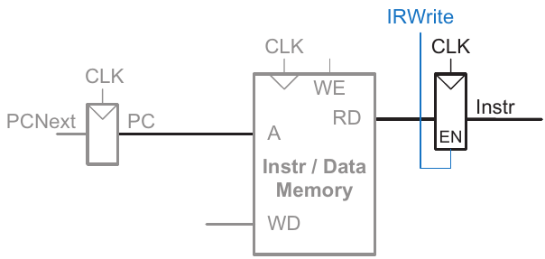

Hình 7.19 Fetch instruction từ bộ nhớ

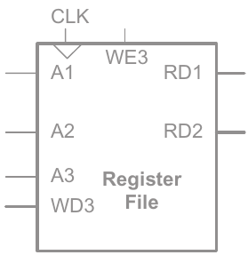

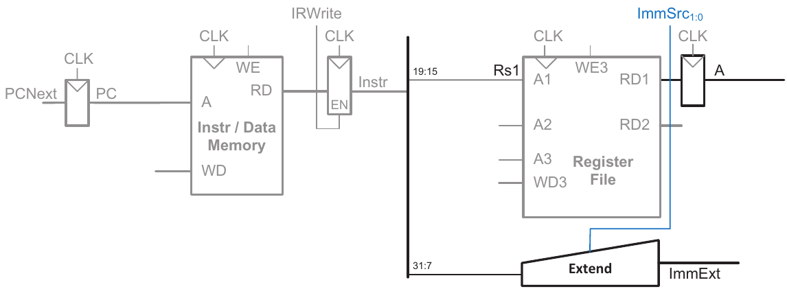

Hình 7.20 Đọc một source từ register file và mở rộng source thứ hai từ trường immediate

Instruction `lw` còn cần offset 12-bit trong trường immediate Instr<sub>31:20</sub>, phải được sign-extended thành 32 bit như Hình 7.20. Như processor single-cycle, Extend unit nhận control signal ImmSrc 2-bit chỉ định immediate 12-, 13- hoặc 21-bit cần mở rộng cho các loại instruction khác nhau. Immediate đã mở rộng 32-bit gọi là ImmExt. Để nhất quán có thể lưu ImmExt trong nonarchitectural register khác. Tuy nhiên, ImmExt là hàm tổ hợp của Instr, không đổi trong lúc xử lý instruction hiện tại, nên không cần dành register giữ giá trị hằng này.

Địa chỉ của instruction load là tổng của base address và offset. Trong bước thứ ba, chúng ta sử dụng ALU để tính tổng này, như trong Hình 7.21. ALUControl cần được đặt thành 000 để thực hiện phép cộng. ALUResult được lưu trong một nonarchitectural register có tên ALUOut.

Bước thứ tư là load dữ liệu từ địa chỉ đã tính trong bộ nhớ. Thêm multiplexer trước bộ nhớ để chọn memory address Adr từ PC hoặc ALUOut theo select signal AdrSrc như Hình 7.22. Dữ liệu đọc được lưu trong nonarchitectural register khác tên Data. Lưu ý multiplexer địa chỉ (Adr) cho phép tái sử dụng memory unit trong instruction `lw`. Ở bước đầu, lấy địa chỉ từ PC để fetch instruction. Bước thứ tư lấy địa chỉ từ ALUOut để load dữ liệu. Vì vậy AdrSrc phải có giá trị khác nhau ở các bước của một instruction. Phần 7.4.2 phát triển FSM controller tạo các chuỗi control signal này.

Cuối cùng dữ liệu được ghi lại register file như Hình 7.23. Destination register được chỉ bởi trường rd, Instr<sub>11:7</sub>. Kết quả đến từ register Data. Thay vì nối thẳng register Data với write port WD3 của register file, hãy thêm multiplexer trên bus Result để chọn ALUOut hoặc Data trước khi đưa Result về writedata port (WD3) register file. Điều này hữu ích vì instruction khác cần ghi kết quả ALU vào register file. Tín hiệu RegWrite là 1 để chỉ register file phải cập nhật.

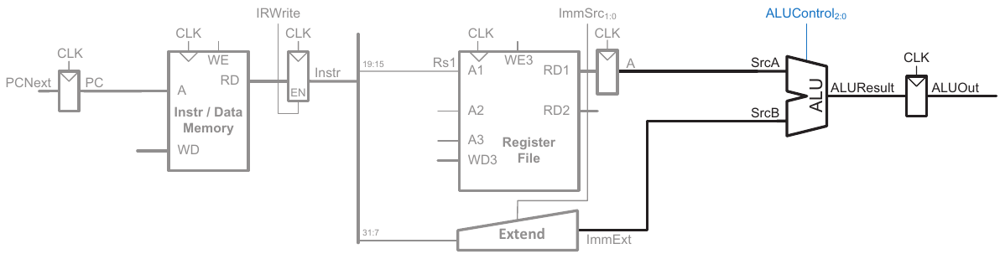

Hình 7.21 Cộng base address với offset

Trong lúc đó, processor phải cập nhật program counter bằng cách cộng 4 vào PC. Processor single-cycle cần adder riêng. Với processor multicycle, có thể dùng ALU hiện có trong bước instruction fetch vì nó không bận. Để làm vậy, chèn source multiplexer chọn PC và hằng 4 làm ALU input như Hình 7.24. Multiplexer do ALUSrcA điều khiển chọn PC hoặc A làm SrcA. Multiplexer khác chọn 4 hoặc ImmExt làm SrcB. Hình còn thể hiện input multiplexer bổ sung dùng khi triển khai thêm instruction. Để cập nhật PC, ALU cộng SrcA (PC) với SrcB (4), và ghi kết quả vào program counter. Multiplexer Result chọn tổng từ ALUResult thay vì ALUOut; cần input multiplexer thứ ba. Control signal PCWrite chỉ cho phép ghi PC ở một số chu kỳ. Điều này hoàn tất datapath cho instruction `lw`.

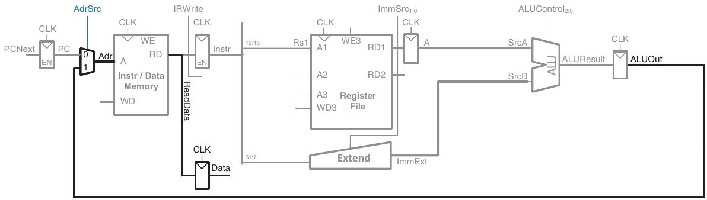

Hình 7.22 Load dữ liệu từ bộ nhớ

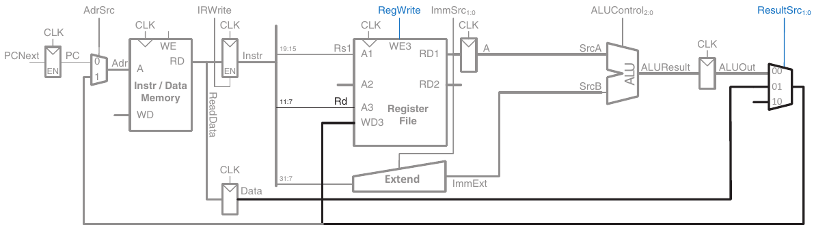

Hình 7.23 Ghi dữ liệu lại register file

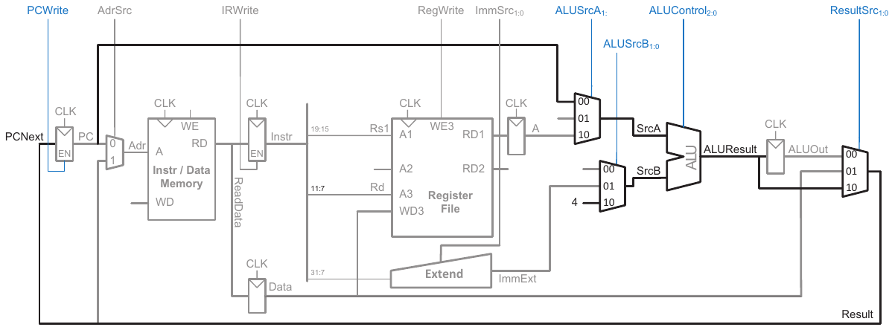

Hình 7.24 Tăng PC thêm 4

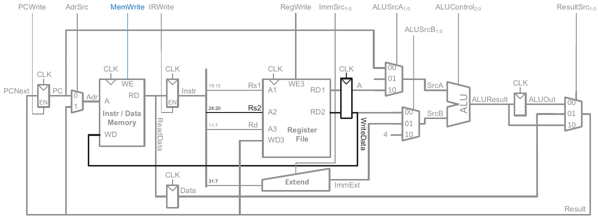

Hình 7.25 Datapath cải tiến cho instruction `sw`

```
sw
```

Tiếp theo mở rộng datapath xử lý instruction `sw`. Giống `lw`, `sw` đọc base address từ port 1 register file và mở rộng immediate ở bước thứ hai. Sau đó ALU cộng base address với immediate để tìm memory address ở bước thứ ba. Tính năng mới duy nhất của `sw` là phải đọc register thứ hai từ register file và ghi nội dung vào bộ nhớ như Hình 7.25. Register được chỉ định trong trường rs2 của instruction, Instr<sub>24:20</sub>, nối port thứ hai register file (A2). Sau khi đọc ở bước hai, nội dung register được lưu trong nonarchitectural register WriteData, ngay dưới register A. Rồi nó gửi tới write data port (WD) data memory để ghi ở bước bốn. Bộ nhớ nhận control signal MemWrite, được asserted khi cần ghi bộ nhớ.

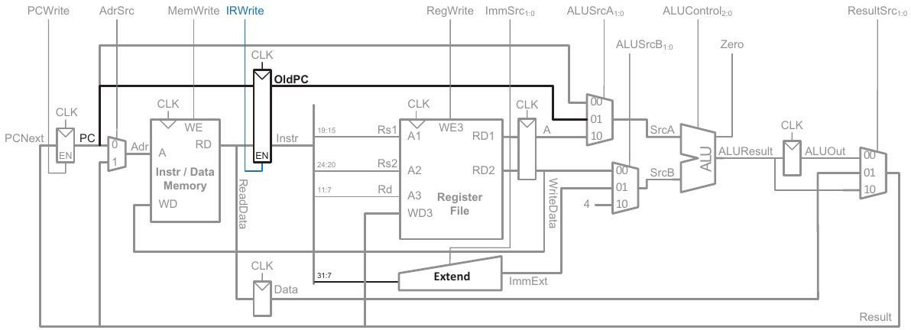

Hình 7.26 Datapath cải tiến để tính target address của `beq`

Instruction R-Type

Instruction R-type thao tác trên hai source register và ghi kết quả lại register file. Datapath đã chứa mọi kết nối cần cho các bước này.

```
beq
```

`beq` kiểm tra nội dung hai register có bằng nhau không và tính branch target address bằng cách cộng PC hiện tại với branch offset có dấu 13-bit. Phần cứng so sánh register bằng phép trừ đã có trong datapath.

ALU không được dùng ở bước thực thi instruction thứ hai nên dùng nó khi đó để tính branch target address PCTarget = PC + ImmExt. Ở bước này, instruction đã được fetch từ bộ nhớ và PC đã cập nhật thành PC+4. Vì vậy ở bước đầu, PC của instruction hiện tại, OldPC, phải lưu trong nonarchitectural register. Ở bước hai, trong lúc fetch các register, ALU tính PC + ImmExt bằng cách chọn OldPC làm SrcA, ImmExt làm SrcB và đặt ALUControl = 000 để cộng. Processor lưu tổng này trong ALUOut. Hình 7.26 thể hiện datapath cập nhật cho `beq`.

Ở bước ba, ALU trừ các source register và asserts output Zero nếu chúng bằng nhau. Nếu vậy, control unit asserts PCWrite và multiplexer Result chọn ALUOut (chứa target address) để đưa vào PC. Không cần phần cứng mới.

Điều này hoàn tất thiết kế datapath multicycle. Quy trình tương tự processor single-cycle ở chỗ phần cứng được nối có hệ thống giữa state element để xử lý từng instruction. Khác biệt chính là instruction được thực thi qua nhiều bước. Nonarchitectural register được chèn để giữ kết quả mỗi bước. Nhờ đó bộ nhớ được chia sẻ cho instruction và dữ liệu, ALU tái sử dụng nhiều lần, giảm chi phí phần cứng. Phần tiếp theo phát triển FSM controller cung cấp chuỗi control signal thích hợp cho datapath ở mỗi bước từng instruction.

### 7.4.2 Control multicycle

Như processor single-cycle, control unit tính control signal dựa trên trường op, funct3 và funct7<sub>5</sub> của instruction (Instr<sub>6:0</sub>, Instr<sub>14:12</sub> và Instr<sub>30</sub>). Hình 7.27 thể hiện toàn processor multicycle với control unit nối datapath. Datapath màu đen, control unit màu xanh.

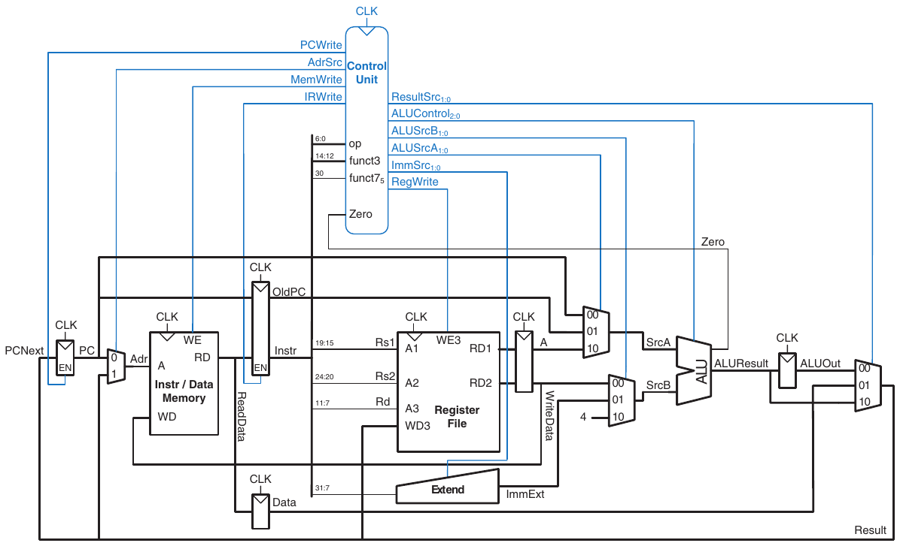

Hình 7.27 Processor multicycle hoàn chỉnh

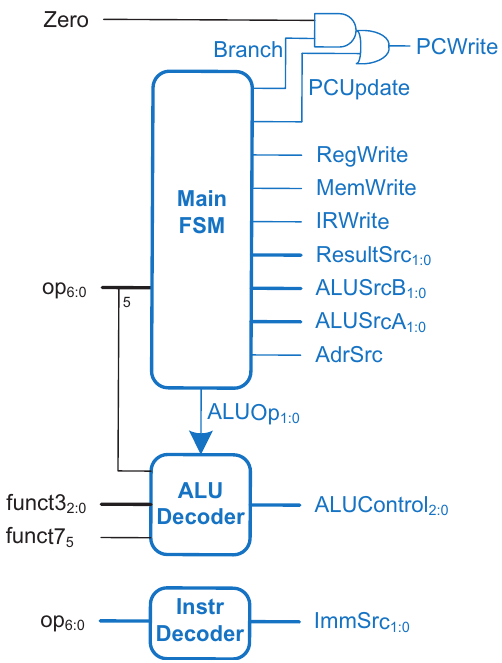

Hình 7.28 Control unit multicycle

Control unit gồm Main FSM, ALU Decoder và Instruction Decoder (Instr Decoder) như Hình 7.28. ALU Decoder giống processor single-cycle (xem Bảng 7.3), nhưng Main Decoder tổ hợp của processor single-cycle được thay bằng Main FSM trong processor multicycle để tạo chuỗi control signal ở các chu kỳ thích hợp. Instruction Decoder nhỏ tạo select signal ImmSrc theo logic tổ hợp từ opcode bằng cột ImmSrc của Bảng 7.6. Main FSM được thiết kế là Moore machine để output chỉ là hàm trạng thái hiện tại. Phần còn lại phát triển state transition diagram của Main FSM.

Main FSM tạo multiplexer select, register enable và memory write enable cho datapath. Để các state transition diagram sau dễ đọc, chỉ liệt kê control signal liên quan. Multiplexer select signal chỉ được liệt kê khi giá trị quan trọng; nếu không là don’t care. Enable signal (RegWrite, MemWrite, IRWrite, PCUpdate và Branch) chỉ được liệt kê khi asserted; nếu không bằng 0.

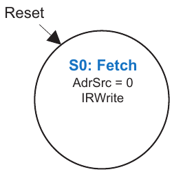

Hình 7.29 Fetch

Fetch

Bước đầu cho mọi instruction là fetch instruction từ bộ nhớ tại địa chỉ PC giữ. FSM vào trạng thái Fetch này khi reset. Control signal ở Hình 7.29. Để đọc instruction, AdrSrc = 0 nên lấy địa chỉ từ PC. IRWrite được asserted để ghi instruction vào instruction register IR. Đồng thời PC hiện tại ghi vào register OldPC. Luồng dữ liệu qua datapath cho bước này và hai bước tiếp theo của `lw` ở Hình 7.32, với luồng trong Fetch tô xám.

Decode

Bước thứ hai đọc register file và decode instruction. Control unit decode instruction, tức xác định thao tác cần thực hiện dựa trên op, funct3 và funct7<sub>5</sub>. Ở trạng thái này, processor còn đọc source register rs1, rs2 và đưa giá trị vào nonarchitectural register A và WriteData. Không cần control signal cho các việc này. Hình 7.30 thể hiện trạng thái Decode trong Main FSM, và Hình 7.32 thể hiện luồng datapath trong trạng thái bằng đường xanh vừa. Sau bước này, processor có thể phân biệt hành động theo instruction vì instruction đã fetch và decode. Trước tiên sẽ trình bày bước còn lại của `lw`, rồi các bước instruction RISC-V khác.

MemAdr

Bước thứ ba của `lw` là tính memory address. ALU cộng base address và offset, nên ALUSrcA = 10 để chọn A (giá trị đọc từ rs1) làm SrcA, ALUSrcB = 01 để chọn ImmExt làm SrcB. ImmSrc do Instruction Decoder xác định là 00 để sign-extend immediate I-type, và ALUOp là 00 để cộng SrcA, SrcB. Cuối trạng thái, kết quả ALU (tính địa chỉ) lưu vào ALUOut. Hình 7.31 thể hiện trạng thái MemAdr thêm vào Main FSM; Hình 7.32 tô luồng datapath bằng đường dark-blue.

MemRead

Bước memory read (MemRead) gửi địa chỉ đã tính vào bộ nhớ bằng cách gửi ALUOut tới address port Adr. ResultSrc = 00 và AdrSrc = 1 để đưa ALUOut qua multiplexer Result, Adr đến memory address input. ReadData nhận giá trị đọc từ địa chỉ mong muốn. Cuối trạng thái, ReadData được ghi vào Data register.

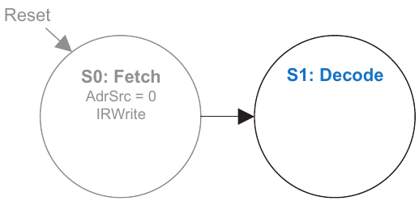

Hình 7.30 Decode

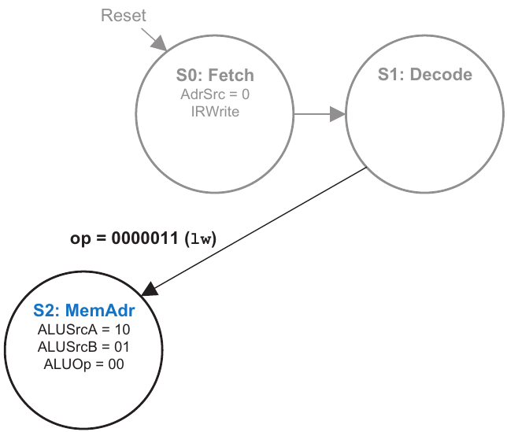

Hình 7.31 Tính memory address

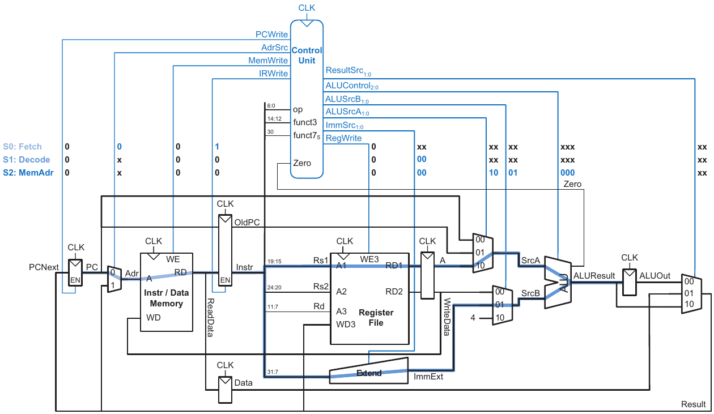

Hình 7.32 Luồng dữ liệu trong các trạng thái Fetch, Decode và MemAdr

MemWB

Ở bước memory writeback (MemWB), dữ liệu đọc từ bộ nhớ, Data, được ghi destination register. ResultSrc là 01 để chọn Data làm Result, RegWrite được asserted để ghi dữ liệu register file. Address input và write data input của port 3 register file (A3 và WD3) đã nối lần lượt rd (Instr<sub>11:7</sub>) và Result. Hình 7.33, 7.34 thể hiện trạng thái MemRead, MemWB và luồng datapath cho cả hai bước. MemWB là bước cuối instruction `lw`. Hình 7.33 còn thể hiện chuyển từ MemWB về Fetch để fetch instruction tiếp theo. Tuy nhiên PC chưa tăng. Chúng ta xử lý vấn đề này tiếp theo.

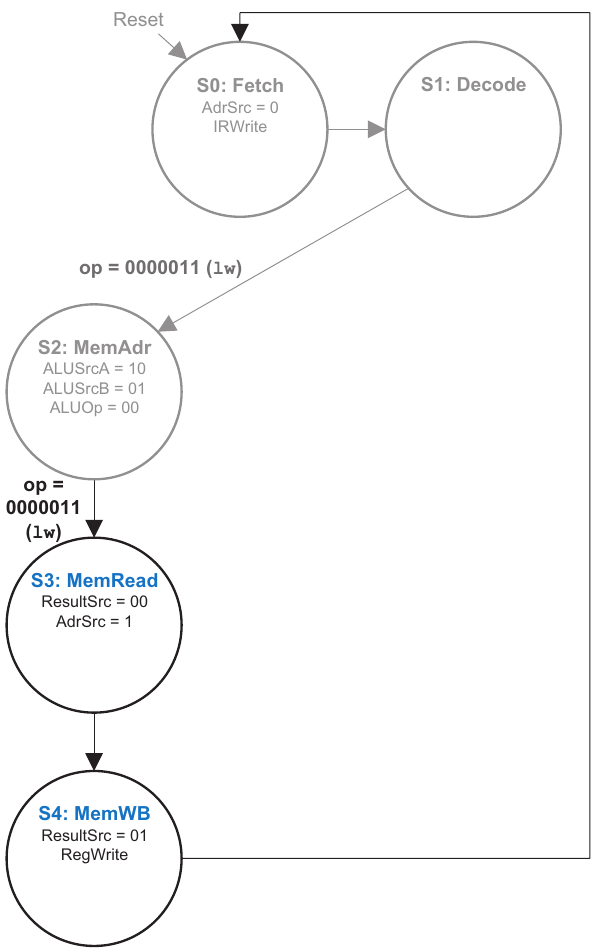

Hình 7.33 Trạng thái memory read (MemRead) và memory write back (MemWB)

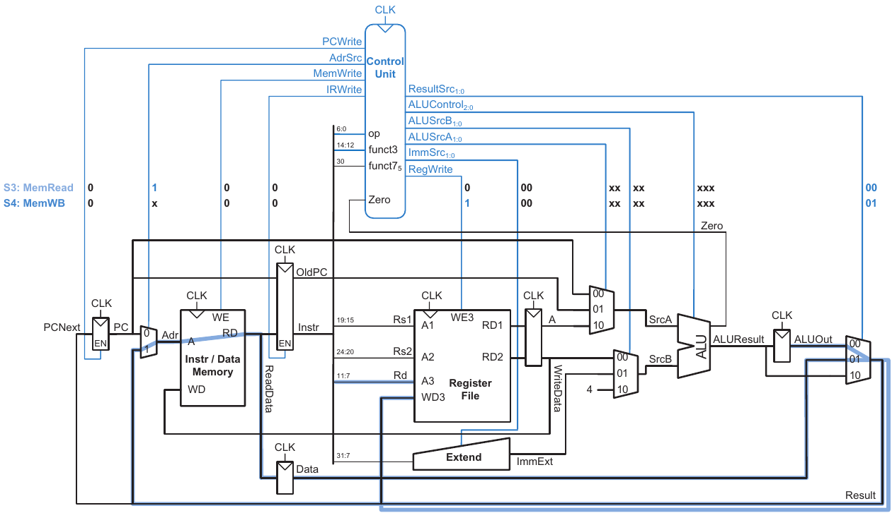

Hình 7.34 Luồng dữ liệu trong MemRead và MemWB

> Chúng ta bắt đầu phần này bằng khẳng định mỗi bước chỉ dùng được một unit time-consuming (bộ nhớ, ALU hoặc register file). Tuy nhiên ở đây dùng cả register file và ALU. Miễn các unit được dùng cùng lúc—tức song song—có thể dùng hơn một unit trong một bước.

Trước khi xong instruction `lw`, processor phải tăng PC để fetch instruction tiếp theo. Có thể thêm trạng thái cho việc này nhưng thay vào đó tiết kiệm một chu kỳ bằng cách nhận ra ALU không được dùng trong Fetch, nên processor dùng trạng thái đó tính PC+4 đồng thời fetch instruction. ALUSrcA = 00 để lấy SrcA từ PC (tức tín hiệu OldPC). ALUSrcB = 10 để lấy hằng 4 cho SrcB. ALUOp = 00 để ALU cộng PC với 4. Để cập nhật PC bằng PC+4, ResultSrc = 10 chọn ALUResult làm Result, PCUpdate = 1 buộc PCWrite high (xem Hình 7.28). Hình 7.35 thể hiện Fetch sửa đổi. Phần còn lại sơ đồ như Hình 7.33. Hình 7.36 tô xanh luồng tính PC+4. Instruction fetch diễn ra đồng thời được tô xám.

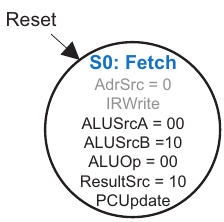

Hình 7.35 Tăng PC trong trạng thái Fetch

```
sw
```

Giờ mở rộng Main FSM xử lý thêm instruction RISC-V. Mọi instruction qua hai trạng thái đầu Fetch và Decode. Instruction `sw` dùng cùng MemAdr như `lw` để tính memory address nhưng sau đó sang memory write (MemWrite), nơi WriteData, giá trị từ rs2, được ghi bộ nhớ. WriteData nối cứng write data port (WD) bộ nhớ. Address port Adr được đặt bằng địa chỉ đã tính trong ALUOut bằng ResultSrc = 00 và AdrSrc = 1. MemWrite được asserted để ghi bộ nhớ. Điều này hoàn tất `sw`, nên Main FSM về Fetch bắt đầu instruction tiếp theo. Hình 7.37, 7.38 thể hiện Main FSM mở rộng và luồng datapath của MemWrite. Lưu ý hai trạng thái đầu (Fetch và Decode), không vẽ ở Hình 7.37, giống Hình 7.33.

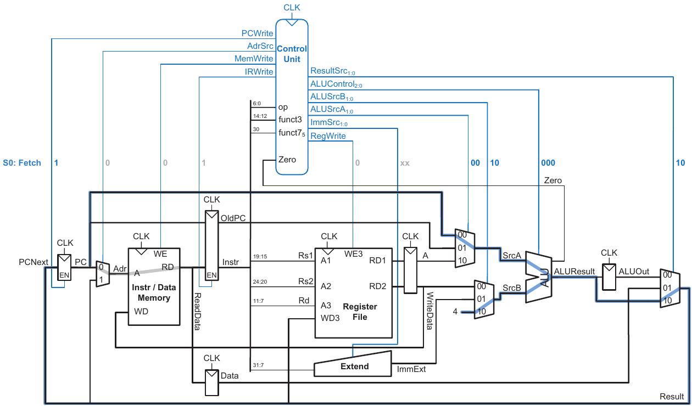

Hình 7.36 Luồng dữ liệu khi tăng PC trong trạng thái Fetch

> Tín hiệu ImmSrc khác nhau giữa `lw` và `sw` trong MemAdr. Nhưng nhớ rằng ImmSrc được Instruction Decoder tạo theo logic tổ hợp (xem Hình 7.28).

Instruction R-Type

Sau Decode, instruction ALU R-type tới trạng thái execute (ExecuteR), thực hiện tính toán ALU mong muốn. Cụ thể, ALUSrcA = 10 và ALUSrcB = 00 chọn nội dung rs1 làm SrcA, rs2 làm SrcB. ALUOp = 10 để ALU Decoder dùng các trường điều khiển instruction xác định thao tác cần thực hiện. ALUResult ghi vào ALUOut cuối chu kỳ. Instruction R-type sau đó tới ALU writeback (ALUWB), nơi kết quả ALUOut ghi lại register file. Trong ALUWB, ResultSrc = 00 chọn ALUOut làm Result và RegWrite = 1 để ghi kết quả vào rd. Hình 7.39 thể hiện ExecuteR và ALUWB thêm vào Main FSM. Hình 7.40 thể hiện luồng dữ liệu trong cả hai: ExecuteR bằng đường light-blue đậm và ALUWB bằng đường dark-blue đậm.

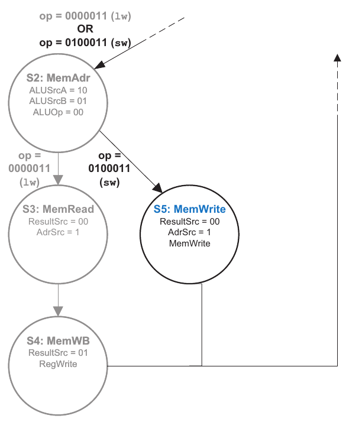

Hình 7.37 Memory write

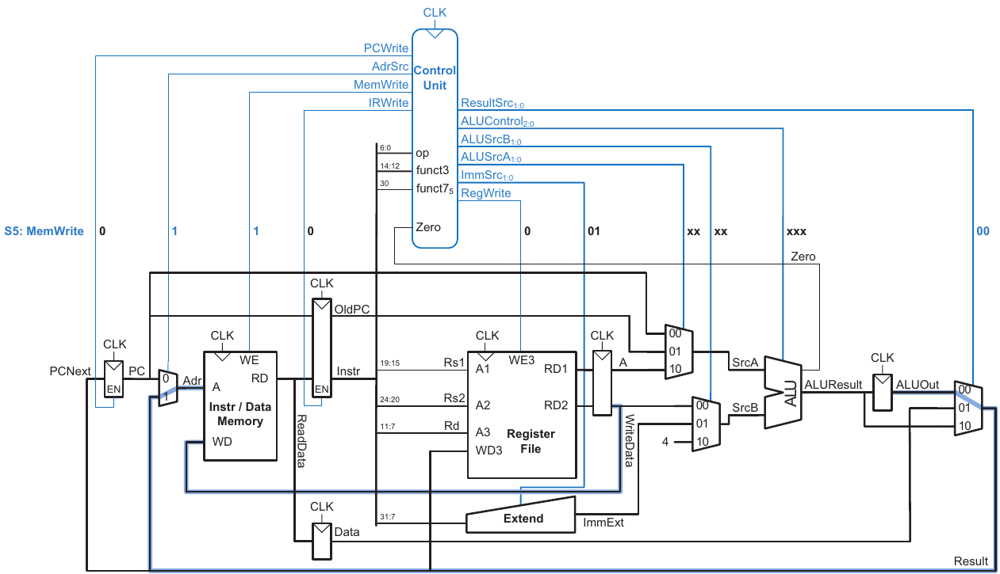

Hình 7.38 Luồng dữ liệu trong trạng thái memory write (MemWrite)

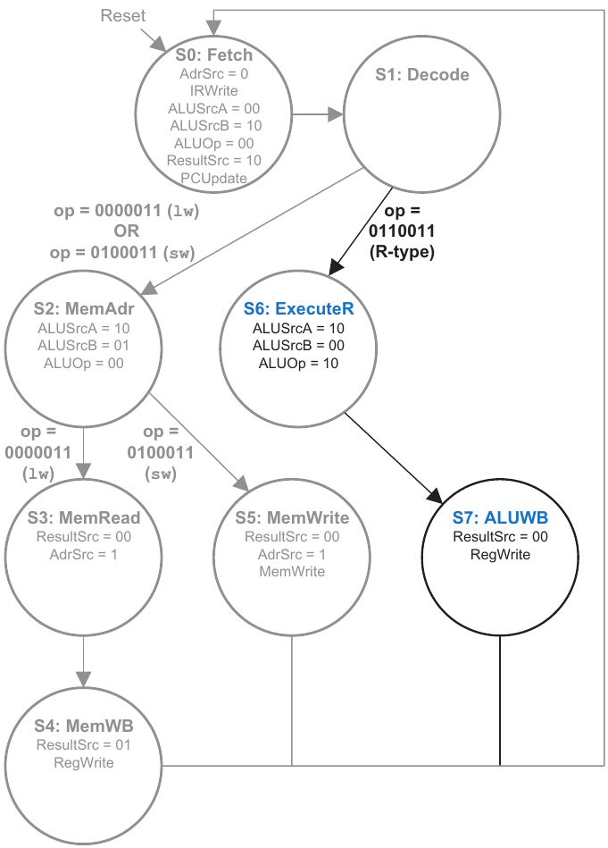

Hình 7.39 Trạng thái execute R-type (ExecuteR) và ALU writeback (ALUWB)

```
beq
```

Instruction cuối cùng, `beq`, so sánh hai register và tính branch target address. Cho đến đây, ALU không hoạt động trong state Decode, nên chúng ta có thể sử dụng ALU trong state này để tính branch target address là OldPC + ImmExt. ALUSrcA và ALUSrcB đều bằng 01 để OldPC là SrcA và branch offset (ImmExt) là SrcB. ALUOp = 00 để ALU thực hiện phép cộng. Địa chỉ đích được lưu trong register ALUOut vào cuối state Decode. Hình 7.41 minh họa state Decode đã được bổ sung cùng state BEQ tiếp theo, sẽ được thảo luận ngay sau đây. Trong Hình 7.42, luồng data trong state Decode được thể hiện bằng các đường light-blue và màu xám. Phép tính branch target address được tô xanh nhạt, còn việc đọc register và mở rộng immediate được tô bằng các đường xám đậm.

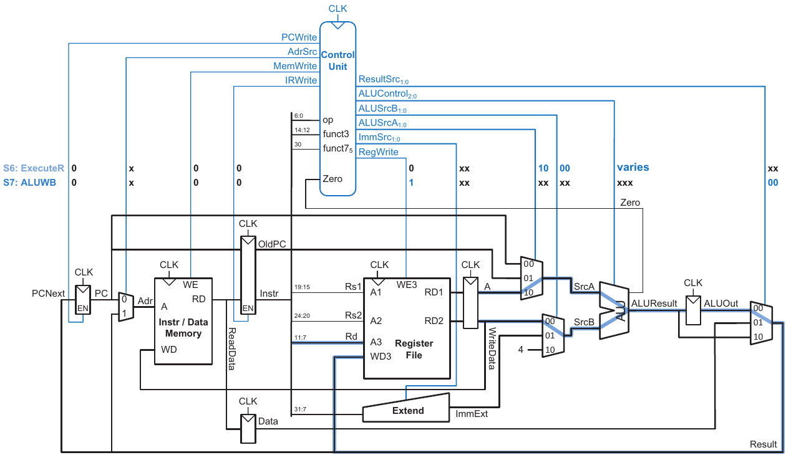

Hình 7.40 Luồng dữ liệu trong ExecuteR và ALUWB

> Dù instruction chưa decode ở đầu Decode—thậm chí có thể không phải instruction `beq`—branch target address vẫn được tính như thể là branch. Nếu hóa ra instruction không phải branch hoặc branch không được lấy, kết quả tính đơn giản không được dùng.

Sau Decode, `beq` tới BEQ, nơi so sánh source register. ALUSrcA = 10 và ALUSrcB = 00 chọn giá trị đọc từ register file làm SrcA, SrcB. ALUOp = 01 để ALU trừ. Nếu source register bằng nhau, output Zero ALU asserts (vì rs1 − rs2 = 0). Branch = 1 ở đây để nếu Zero cũng được đặt, PCWrite được asserted (như logic PCWrite Hình 7.28), và branch target address (trong ALUOut) trở thành PC tiếp theo. ALUOut được đưa tới PC register bằng ResultSrc 00. Hình 7.41 thể hiện BEQ, Hình 7.42 thể hiện luồng dữ liệu BEQ. Đường so sánh rs1 và rs2 tô xanh đậm, đường đặt PC (có điều kiện) bằng target address tô xám qua Result register. Điều này kết thúc thiết kế controller cho các instruction này.

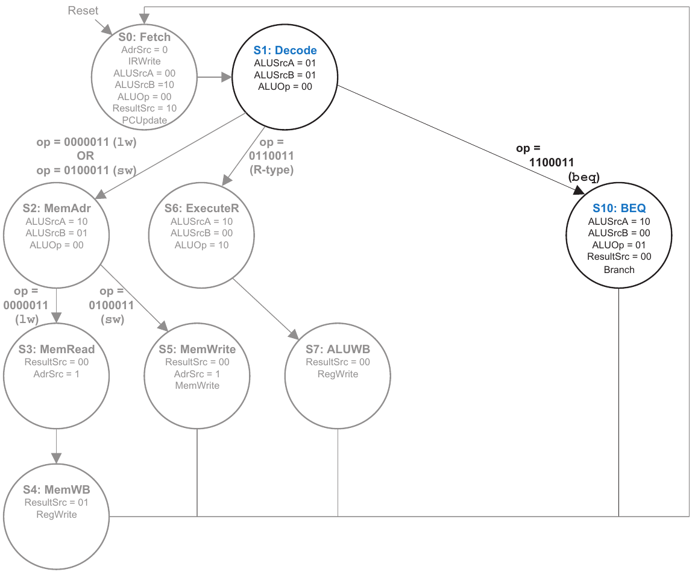

Hình 7.41 Decode cải tiến có tính branch target address, và trạng thái BEQ

### 7.4.3 Thêm instruction

Tương tự cách đã làm với processor single-cycle, tiếp theo chúng ta sẽ xét các ví dụ về cách sửa đổi datapath và controller của processor multicycle để xử lý những instruction mới: các ALU instruction I-type (`addi`, `andi`, `ori`, `slti`) và `jal`.

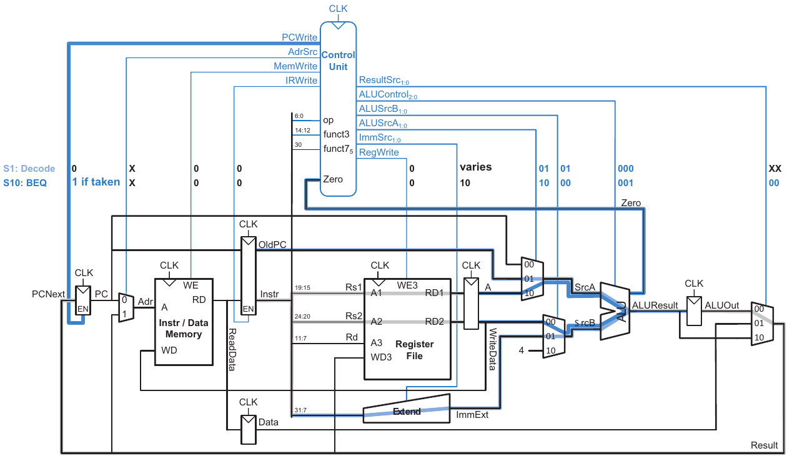

Hình 7.42 Luồng dữ liệu trong Decode và BEQ

#### Ví dụ 7.5 MỞ RỘNG PROCESSOR MULTICYCLE ĐỂ BAO GỒM INSTRUCTION ALU I-TYPE

Mở rộng processor multicycle để bao gồm instruction ALU I-type `addi`, `andi`, `ori` và `slti`.

Lời giải Instruction ALU I-type gần như giống phiên bản R-type tương đương (`add`, `and`, `or`, `slt`), ngoại trừ source thứ hai từ ImmExt thay vì register file. Thêm ExecuteI để thực hiện tính toán mong muốn cho mọi instruction ALU I-type. Trạng thái giống ExecuteR trừ ALUSrcB = 01 để chọn ImmExt làm SrcB. Sau ExecuteI, instruction ALU I-type tới ALU writeback (ALUWB) để ghi kết quả register file. Hình 7.43 thể hiện Main FSM cải tiến, cũng gồm JAL cho Ví dụ 7.6.

#### Ví dụ 7.6 MỞ RỘNG PROCESSOR MULTICYCLE ĐỂ BAO GỒM `jal`

Mở rộng processor multicycle để bao gồm instruction jump and link (`jal`).

Lời giải Giống instruction ALU I-type từ Ví dụ 7.5, không cần thêm phần cứng triển khai `jal`. Chỉ cập nhật Main FSM. Hai bước đầu giống instruction khác. Trong Decode, jump target address tính bằng cùng luồng branch target address nhưng ImmSrc = 11 do Instruction Decoder đặt. Vì thế trong Decode, jump offset được sign-extended và cộng PC hiện tại (trong tín hiệu OldPC) thành jump target address, ghi vào ALUOut cuối trạng thái. `jal` sau đó tới JAL, nơi processor ghi target address vào PC và tính return address (PC+4) để ghi rd ở trạng thái tiếp theo. ALU tính PC+4 (tức OldPC+4) với ALUSrcA = 01 (SrcA = OldPC), ALUSrcB = 10 (SrcB = 4), ALUOp = 00 để cộng. Để ghi target address vào PC, ResultSrc = 00 chọn target address (trong ALUOut) làm Result và PCUpdate = 1 để PCWrite được asserted. Hình 7.43 thể hiện JAL mới và Hình 7.44 luồng dữ liệu JAL. Luồng cập nhật PC bằng target address tô xám, tính PC+4 tô xanh. Sau JAL, `jal` tới ALUWB, nơi return address (ALUOut = PC+4) ghi vào rd. Điều này hoàn tất instruction `jal`, nên Main FSM về Fetch.

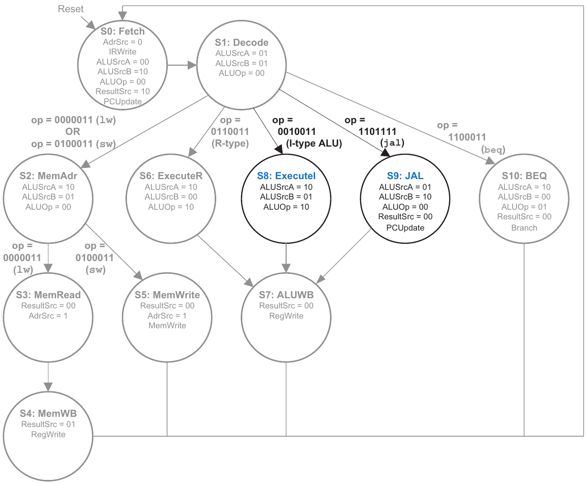

Hình 7.43 Main FSM cải tiến: ExecuteI và JAL

> Bạn có thể thấy khi processor tới JAL, PC register đã được cập nhật thành PC+4. Vì thế có thể dùng ngay output PC register để ghi rd. Nhưng điều đó đòi hỏi mở rộng multiplexer Result nhận PC làm input. Giải pháp trên cần ít phần cứng hơn vì dùng datapath hiện có.

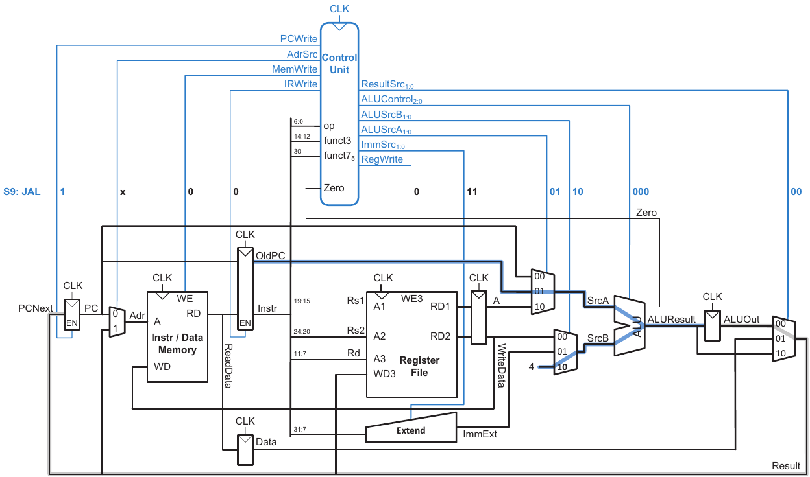

Hình 7.44 Luồng dữ liệu trong JAL

Kết hợp các bước, Hình 7.45 thể hiện state transition diagram Main FSM hoàn chỉnh cho processor multicycle. Chức năng mỗi trạng thái được tóm tắt dưới hình. Chuyển sơ đồ thành phần cứng là việc đơn giản nhưng tẻ nhạt bằng kỹ thuật Chương 3. Tốt hơn, FSM có thể viết bằng HDL và synthesize bằng kỹ thuật Chương 4.

### 7.4.4 Phân tích hiệu năng

Thời gian thực thi instruction phụ thuộc cả số chu kỳ và cycle time. Trong khi processor single-cycle thực hiện mọi instruction trong một chu kỳ, processor multicycle dùng số chu kỳ khác nhau cho từng instruction. Tuy nhiên, processor multicycle làm ít việc hơn trong một chu kỳ, do đó cycle time ngắn hơn.

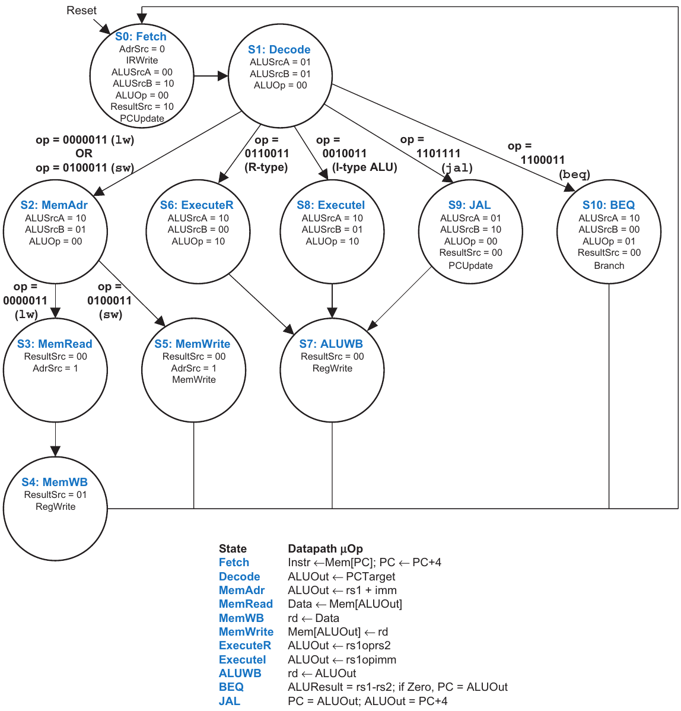

Hình 7.45 Control FSM multicycle hoàn chỉnh

Processor multicycle cần ba chu kỳ cho branch, bốn cho instruction R-type, ALU I-type, jump và store, và năm cho load. Số clock cycle mỗi instruction (CPI) phụ thuộc tỷ lệ tương đối

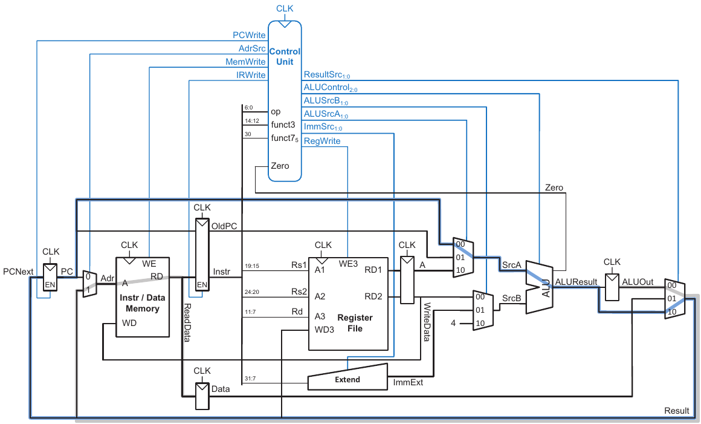

Hình 7.46 Các critical path tiềm năng của processor multicycle

#### Ví dụ 7.7 CPI PROCESSOR MULTICYCLE

Benchmark SPECINT2000 gồm khoảng 25% load, 10% store, 11% branch, 2% jump và 52% instruction ALU R- hoặc I-type.[^2] Xác định CPI trung bình cho benchmark.

Lời giải CPI trung bình là tổng có trọng số trên từng instruction của CPI instruction đó nhân tỷ phần thời gian instruction được dùng. Với benchmark này, CPI trung bình = (0.11)(3) + (0.10 + 0.02 + 0.52)(4) + (0.25)(5) = 4.14. Tốt hơn CPI worst-case 5, cần nếu mọi instruction mất cùng số chu kỳ.

Nhớ rằng thiết kế processor multicycle để mỗi chu kỳ liên quan một thao tác ALU, truy cập bộ nhớ hoặc truy cập register file. Giả sử register file nhanh hơn bộ nhớ và ghi bộ nhớ nhanh hơn đọc. Xem datapath cho thấy hai critical path có thể giới hạn cycle time như Hình 7.46:

1\. Đường tính PC+4: Từ PC register qua multiplexer SrcA , ALU và multiplexer Result trở lại PC register

(tô đường xanh đậm); hoặc 2. Đường đọc dữ liệu từ bộ nhớ: Từ ALUOut register qua mux Result và Adr để đọc bộ nhớ vào Data register (tô đường xám đậm)

Cả hai đường còn cần delay qua decoder sau khi trạng thái cập nhật (tức sau delay t<sub>pcq</sub>) để tạo control signal (multiplexer select và ALUControl). Vì vậy clock period theo Phương trình 7.4.

T<sub>c_multi</sub> = t<sub>pcq</sub> + t<sub>dec</sub> + 2t<sub>mux</sub> + max[t<sub>ALU</sub> , t<sub>mem</sub>] + t<sub>setup</sub> (7.4)

Giá trị số của các thời gian này phụ thuộc công nghệ triển khai cụ thể.

#### Ví dụ 7.8 SO SÁNH HIỆU NĂNG PROCESSOR MULTICYCLE.

Ben Bitdiddle tự hỏi processor multicycle có nhanh hơn processor single-cycle không. Với cả hai thiết kế, anh định dùng quy trình sản xuất CMOS 7-nm với delay trong Bảng 7.7 trang 415. Giúp anh so sánh thời gian thực thi 100 tỷ instruction từ benchmark SPECINT2000 của mỗi processor (xem Ví dụ 7.4).

Lời giải Theo Phương trình 7.4, cycle time của processor multicycle là T<sub>c_multi</sub> = t<sub>pcq</sub> + t<sub>dec</sub> + 2t<sub>mux</sub> + t<sub>mem</sub> + t<sub>setup</sub> = 40 + 25 + 2(30) + 200 + 50 = 375 ps. Dùng CPI 4.14 từ Ví dụ 7.7, tổng thời gian thực thi là T<sub>multi</sub> = (100 × 10<sup>9</sup> instructions)(4.14 cycles/instruction)(375 × 10<sup>−12</sup> s/cycle) = 155 giây. Theo Ví dụ 7.4, processor single-cycle có tổng thời gian thực thi 75 giây, nên processor multicycle chậm hơn.

Một động lực ban đầu xây processor multicycle là tránh buộc mọi instruction mất thời gian bằng instruction chậm nhất. Đáng tiếc, ví dụ cho thấy processor multicycle chậm hơn processor single-cycle với các giả định CPI và delay phần tử mạch. Vấn đề căn bản là dù instruction chậm nhất `lw` được chia năm bước, cycle time multicycle không cải thiện được gần năm lần. Một phần vì các bước không dài bằng nhau, một phần vì sequencing overhead 90-ps của register clock-to-Q và setup time giờ phải trả mỗi bước, thay vì một lần cho toàn instruction. Nhìn chung, kỹ sư đã học rằng khó khai thác việc một số tính toán nhanh hơn số khác trừ khi khác biệt lớn.

So với processor single-cycle, processor multicycle có thể rẻ hơn vì chia sẻ một bộ nhớ cho instruction và dữ liệu, đồng thời loại hai adder. Tuy nhiên, nó cần năm nonarchitectural register và multiplexer bổ sung.

## 7.5 PROCESSOR PIPELINED

Pipelining, giới thiệu ở Phần 3.6, là cách mạnh mẽ cải thiện throughput hệ thống số. Chúng ta thiết kế processor pipelined bằng cách chia processor single-cycle thành năm pipeline stage. Vì vậy năm instruction có thể thực thi đồng thời, mỗi stage một instruction. Vì mỗi stage chỉ có one-fifth toàn bộ logic, clock frequency nhanh hơn khoảng năm lần. Lý tưởng là latency mỗi instruction không đổi nhưng throughput tốt hơn năm lần. Microprocessor thực thi hàng triệu hay tỷ instruction mỗi giây nên throughput quan trọng hơn latency. Pipelining tạo một số overhead nên throughput không cao như mong muốn lý tưởng, nhưng vẫn mang lại ưu thế lớn với chi phí ít đến mức mọi microprocessor high-performance hiện đại đều có pipeline.

> Nhớ rằng throughput là số tác vụ (ở đây là instruction) hoàn tất mỗi giây. Latency là thời gian một instruction cần để hoàn tất, từ
>
> đầu đến cuối. (Xem Phần 3.6)

Đọc và ghi bộ nhớ, register file, cùng sử dụng ALU thường tạo delay lớn nhất trong processor. Chọn năm pipeline stage để mỗi stage gồm đúng một trong các bước chậm này. Cụ thể, gọi năm stage là Fetch, Decode, Execute, Memory và Writeback. Chúng tương tự năm bước processor multicycle dùng để thực hiện `lw`. Trong Fetch, processor đọc instruction từ instruction memory. Trong Decode, processor đọc source operand từ register file và decode instruction để tạo control signal. Trong Execute, processor thực hiện tính toán bằng ALU. Trong Memory, processor đọc hoặc ghi data memory nếu cần. Cuối cùng, trong Writeback, processor ghi kết quả register file nếu cần.

Hình 7.47 thể hiện timing diagram so sánh processor single-cycle và pipelined. Thời gian trên trục ngang, instruction trên trục dọc. Sơ đồ giả định delay thành phần từ Bảng 7.7 (xem trang 415), nhưng bỏ multiplexer và register để đơn giản. Trong processor single-cycle ở Hình 7.47(a), instruction đầu được đọc từ bộ nhớ tại thời điểm 0. Tiếp theo đọc operand từ register file. Rồi ALU thực hiện tính toán cần thiết. Cuối cùng có thể truy cập data memory và ghi kết quả register file tại 680 ps. Instruction thứ hai bắt đầu khi instruction đầu hoàn tất. Vì vậy trong sơ đồ này, processor single-cycle có instruction latency 200 + 100 + 120 + 200 + 60 = 680 ps (xem Bảng 7.7 trang 415), throughput 1 instruction mỗi 680 ps (1.47 tỷ instruction mỗi giây).

> Nhớ rằng trong so sánh trừu tượng này giữa hiệu năng processor single-cycle và pipelined, chúng ta bỏ qua overhead delay của decoder, multiplexer và register.

Trong processor pipelined Hình 7.47(b), độ dài pipeline stage được đặt 200 ps bởi stage chậm nhất, truy cập bộ nhớ trong Fetch hoặc Memory. Mỗi pipeline stage được chỉ bằng đường xanh dọc liền hoặc đứt. Tại thời điểm 0, instruction đầu được fetch. Tại 200 ps, instruction đầu vào Decode và instruction thứ hai được fetch. Tại 400 ps, instruction đầu thực thi, instruction thứ hai vào Decode và instruction thứ ba được fetch. Cứ vậy cho tới mọi instruction hoàn tất. Instruction latency là 5 × 200 = 1000 ps. Vì các stage không cân bằng hoàn hảo với lượng logic bằng nhau, latency processor pipelined dài hơn single-cycle. Throughput là 1 instruction mỗi 200 ps (5 tỷ instruction mỗi giây)—tức mỗi clock cycle hoàn tất một instruction. Throughput này gấp 3.4 lần processor single-cycle—chưa đạt năm lần nhưng vẫn tăng tốc đáng kể.


Hình 7.47 Timing diagram: (a) processor single-cycle và (b) processor pipelined

Hình 7.48 cho góc nhìn trừu tượng pipeline đang hoạt động, trong đó mỗi stage được thể hiện bằng hình. Mỗi pipeline stage được biểu diễn bằng thành phần chính—instruction memory (IM), đọc register file (RF), thực thi ALU, data memory (DM), và register file writeback—để minh họa luồng instruction qua pipeline. Đọc ngang một hàng cho thấy clock cycle mà instruction cụ thể ở mỗi stage. Ví dụ instruction `sub` được fetch ở chu kỳ 3 và thực thi ở chu kỳ 5. Đọc dọc một cột cho thấy các pipeline stage làm gì trong chu kỳ cụ thể. Ví dụ ở chu kỳ 6, register file ghi tổng vào `s3`, data memory nhàn rỗi, ALU tính (`s11 & t0`), `t4` được đọc từ register file, và instruction `or` đang fetch từ instruction memory. Stage được tô để chỉ khi được dùng. Ví dụ data memory được `lw` dùng ở chu kỳ 4 và `sw` ở chu kỳ 8. Instruction memory và ALU được dùng mỗi chu kỳ. Register file được mọi instruction trừ `sw` ghi. Trong processor pipelined, register file được dùng hai lần mỗi chu kỳ: ghi phần đầu và đọc phần sau, như cách tô màu gợi ý. Nhờ vậy, dữ liệu có thể được instruction này ghi rồi instruction khác đọc trong cùng chu kỳ.


Hình 7.48 Góc nhìn trừu tượng pipeline đang hoạt động

Thách thức trọng tâm của hệ thống pipelined là xử lý hazard khi kết quả instruction được instruction sau cần trước khi instruction trước hoàn tất. Ví dụ nếu `add` ở Hình 7.48 dùng `s2` làm source thay `s10`, hazard xảy ra vì register `s2` chưa được instruction `lw` ghi khi `add` đọc ở chu kỳ 3. Sau thiết kế datapath và control pipelined, phần này tìm hiểu forwarding, stall và flush để giải quyết hazard. Cuối cùng xem lại phân tích hiệu năng có sequencing overhead và tác động hazard.

### 7.5.1 Datapath pipelined

Datapath pipelined được tạo bằng cách chia datapath single-cycle thành năm stage ngăn bởi pipeline register. Hình 7.49(a) thể hiện datapath single-cycle kéo giãn để chừa chỗ cho pipeline register. Hình 7.49(b) thể hiện datapath pipelined tạo bằng cách chèn bốn pipeline register để chia datapath thành năm stage. Các stage và ranh giới màu xanh. Tín hiệu có hậu tố (F, D, E, M hoặc W) chỉ stage chúng thuộc về.

Register file có điểm đặc biệt là được đọc trong stage Decode và được ghi trong stage Writeback. Vì vậy, mặc dù register file được vẽ trong stage Decode, write address và write data của nó lại đến từ stage Writeback. Feedback này sẽ dẫn đến các pipeline hazard, được thảo luận trong Mục 7.5.3. Register file trong processor pipelined thực hiện ghi tại falling edge của CLK để có thể ghi kết quả trong nửa đầu của một chu kỳ và đọc kết quả đó trong nửa sau của chu kỳ để sử dụng cho một instruction tiếp theo.


Hình 7.49 Datapath: (a) single-cycle và (b) pipelined

Một vấn đề tinh tế nhưng thiết yếu của pipelining là mọi tín hiệu liên quan một instruction phải cùng tiến qua pipeline. Hình 7.49(b) có lỗi liên quan vấn đề này. Bạn tìm được không?

Lỗi nằm ở logic ghi register file, lẽ ra hoạt động trong Writeback. Giá trị dữ liệu từ ResultW, tín hiệu stage Writeback. Nhưng destination register từ RdD (InstrD<sub>11:7</sub>), tín hiệu stage Decode. Trong pipeline diagram Hình 7.48, ở chu kỳ 5 kết quả instruction `lw` sẽ bị ghi sai vào `s5` thay vì `s2`.


Hình 7.50 Datapath pipelined đã sửa

Hình 7.50 thể hiện datapath đã sửa với thay đổi màu xanh. Tín hiệu Rd giờ được pipeline qua Execution, Memory và Writeback nên đồng bộ phần còn lại instruction. RdW và ResultW cùng được hồi tiếp về register file trong Writeback.

Người đọc tinh ý có thể thấy logic tạo PCF’ (PC tiếp theo) cũng có vấn đề vì nó có thể cập nhật bằng tín hiệu Fetch hoặc Execute (PCPlus4F hoặc PCTargetE). Control hazard này sẽ được sửa trong Phần 7.5.3.

### 7.5.2 Control pipelined

Processor pipelined dùng cùng control signal như processor single-cycle nên có cùng control unit. Control unit xem các trường op, funct3 và funct7<sub>5</sub> của instruction trong Decode để tạo control signal, như Phần 7.3.3 mô tả cho processor single-cycle. Các control signal phải được pipeline cùng dữ liệu để giữ đồng bộ instruction.

Toàn processor pipelined có control ở Hình 7.51. RegWrite phải được pipeline tới Writeback trước khi hồi tiếp register file, như Rd được pipeline ở Hình 7.50. Ngoài instruction ALU R-type, `lw`, `sw`, `beq`, processor pipelined này còn hỗ trợ `jal` và instruction ALU I-type.

### 7.5.3 Hazard

Trong một hệ thống pipelined, nhiều instruction được xử lý đồng thời. Khi một instruction phụ thuộc vào kết quả của một instruction khác chưa hoàn tất, hazard sẽ xảy ra. Register file được ghi trong nửa đầu chu kỳ và được đọc trong nửa sau chu kỳ, vì vậy có thể ghi rồi đọc lại một register trong cùng một chu kỳ mà không gây ra hazard.


Hình 7.51 Processor pipelined có control

Hình 7.52 minh họa các hazard xảy ra khi một instruction ghi một register (`s8`) và những instruction tiếp theo đọc register đó. Các mũi tên xanh nhấn mạnh thời điểm `s8` được ghi vào register file (trong chu kỳ 5), so với thời điểm các instruction tiếp theo cần nó. Đây được gọi là read after write (RAW) hazard. Instruction `add` ghi kết quả vào `s8` trong nửa đầu chu kỳ 5. Tuy nhiên, instruction `sub` đọc `s8` trong chu kỳ 3 và nhận giá trị sai. Instruction `or` đọc `s8` trong chu kỳ 4 và cũng nhận giá trị sai. Instruction `and` đọc `s8` trong nửa sau chu kỳ 5 và nhận giá trị đúng, đã được ghi trong nửa đầu chu kỳ 5. Các instruction tiếp theo cũng đọc giá trị đúng của `s8`. Sơ đồ cho thấy hazard có thể xảy ra trong pipeline này khi một instruction ghi một register và một trong hai instruction ngay sau đó đọc register đó. Nếu không có cách xử lý đặc biệt, pipeline sẽ tính ra kết quả sai.

Giải pháp phần mềm là buộc lập trình viên hoặc compiler chèn instruction nop giữa `add` và `sub` để instruction phụ thuộc không đọc kết quả (`s8`) trước khi có trong register file, như Hình 7.53. Software interlock như vậy làm lập trình phức tạp và giảm hiệu năng nên không lý tưởng.


Hình 7.52 Pipeline diagram trừu tượng minh họa hazard


Hình 7.53 Giải quyết data hazard bằng nop

Xem kỹ hơn Hình 7.52, tổng của instruction `add` được ALU tính chu kỳ 3 và instruction `and` thực ra chưa cần tới khi ALU dùng ở chu kỳ 4. Về nguyên tắc có thể forward kết quả từ instruction này sang instruction tiếp theo để giải quyết RAW hazard mà không chờ kết quả xuất hiện trong register file và không làm chậm pipeline. Trong tình huống khác tìm hiểu sau đây, có thể phải stall pipeline để có thời gian tạo kết quả trước khi instruction sau dùng. Dù thế nào, phải giải quyết hazard để chương trình chạy đúng bất chấp pipelining.


Hình 7.54 Pipeline diagram trừu tượng minh họa forwarding

Hazard được phân thành data hazard hoặc control hazard. Data hazard xảy ra khi instruction cố đọc register chưa được instruction trước write back. Control hazard xảy ra khi chưa quyết định instruction fetch tiếp theo vào lúc fetch diễn ra. Trong phần còn lại, cải tiến processor pipelined bằng Hazard Unit phát hiện và xử lý hazard thích hợp để processor chạy đúng chương trình.

Giải quyết data hazard bằng forwarding

Một số data hazard có thể được giải quyết bằng cách forwarding (còn gọi là bypassing) kết quả từ stage Memory hoặc Writeback đến một instruction phụ thuộc trong stage Execute. Điều này đòi hỏi thêm các multiplexer phía trước ALU để chọn các toán hạng từ register file hoặc từ stage Memory hay Writeback. Hình 7.54 minh họa nguyên lý này. Chương trình tính `s8` bằng instruction `add` rồi sử dụng `s8` trong ba instruction tiếp theo. Trong chu kỳ 4, `s8` được forward từ stage Memory của instruction `add` đến stage Execute của instruction `sub` phụ thuộc. Trong chu kỳ 5, `s8` được forward từ stage Writeback của instruction `add` đến stage Execute của instruction `or` phụ thuộc. Một lần nữa, không cần forwarding cho instruction `and` vì `s8` được ghi vào register file trong nửa đầu chu kỳ 5 và được đọc trong nửa sau.

Forwarding cần khi instruction trong Execute có source register trùng destination register của instruction trong Memory hoặc Writeback. Hình 7.55 sửa processor pipelined hỗ trợ forwarding. Nó thêm Hazard Unit và hai forwarding multiplexer. Hazard detection unit nhận hai source register của instruction trong Execute, Rs1E và Rs2E, cùng destination register của instruction trong Memory và Writeback, RdM, RdW. Nó cũng nhận RegWrite từ Memory, Writeback (RegWriteM, RegWriteW) để biết destination register có thực sự được ghi không (ví dụ instruction `sw`, `beq` không ghi kết quả register file nên không forward kết quả).


Hình 7.55 Processor pipelined có forwarding giải quyết một số data hazard

Hazard Unit tính control signal cho forwarding multiplexer chọn operand từ register file hoặc kết quả Memory, Writeback (ALUResultM hoặc ResultW). Hazard Unit phải forward từ stage nếu stage đó sẽ ghi destination register và destination register trùng source register. Tuy nhiên `x0` nối cứng 0 và không bao giờ được forward. Nếu cả Memory và Writeback chứa destination register trùng, Memory ưu tiên vì chứa instruction thực thi gần hơn. Tóm lại, chức năng forwarding logic cho SrcAE (ForwardAE) ở trang sau. Logic forwarding cho SrcBE (ForwardBE) giống hệt trừ kiểm tra Rs2E thay Rs1E.

if ((Rs1E == RdM) \& RegWriteM) \& (Rs1E != 0) then // Forward from Memory stage

ForwardAE = 10

else if ((Rs1E == RdW) \& RegWriteW) \& (Rs1E != 0) then // Forward from Writeback stage

ForwardAE = 01

else ForwardAE = 00 // No forwarding (use RF output)

Giải quyết data hazard bằng stall

Forwarding đủ giải quyết RAW data hazard khi kết quả được tính trong Execute của instruction vì kết quả có thể forward sang Execute instruction kế. Đáng tiếc instruction `lw` chưa đọc xong dữ liệu cho tới cuối Memory nên không forward được kết quả tới Execute instruction kế. Ta nói `lw` có latency two-cycle vì instruction phụ thuộc chỉ dùng được kết quả sau hai chu kỳ. Hình 7.56 thể hiện vấn đề. `lw` nhận dữ liệu bộ nhớ cuối chu kỳ 4 nhưng `and` cần dữ liệu đó (giá trị `s7`) làm source operand đầu chu kỳ 4. Không cách giải quyết hazard này bằng forwarding.

Giải pháp là stall pipeline, tạm dừng hoạt động tới khi dữ liệu sẵn có. Hình 7.57 thể hiện stall instruction phụ thuộc (`and`) tại Decode. `and` vào Decode ở chu kỳ 3 và stall tại đó qua chu kỳ 4. Instruction kế tiếp (`or`) cũng phải ở Fetch cả hai chu kỳ vì Decode đầy.

Ở chu kỳ 5, kết quả có thể forward từ Writeback của `lw` tới Execute của `and`. Cũng ở chu kỳ 5, source `s7` của `or` được đọc trực tiếp register file, không cần forwarding.

Lưu ý Execute không được dùng chu kỳ 4. Tương tự Memory không dùng chu kỳ 5, Writeback không dùng chu kỳ 6. Stage không dùng lan qua pipeline này gọi là bubble, hành xử như instruction nop. Bubble được tạo bằng cách đặt control signal Execute bằng không trong lúc Decode stall để bubble không làm gì và không đổi architectural state.

Tóm lại, stall một stage bằng cách disable pipeline register của nó (tức register bên trái stage) để input stage không đổi. Khi stall stage, mọi stage trước cũng phải stall để không mất instruction sau. Pipeline register ngay sau stage stall phải được clear (flush) để ngăn thông tin vô nghĩa truyền tiếp. Stall làm giảm hiệu năng nên chỉ dùng khi cần.


Hình 7.56 Pipeline diagram trừu tượng minh họa khó khăn forwarding từ `lw`


Hình 7.57 Pipeline diagram trừu tượng minh họa stall để giải quyết hazard

Hình 7.58 sửa processor pipelined để thêm stall cho data dependency `lw`. Để Hazard Unit stall pipeline, phải đáp ứng các điều kiện:

1\. Load word ở Execute (chỉ bởi ResultSrcE<sub>0</sub> = 1) và

2\. Destination register của load (RdE) trùng Rs1D hoặc Rs2D, source operand của instruction trong Decode

Stall được hỗ trợ bằng cách thêm enable input (EN) cho pipeline register Fetch, Decode và synchronous reset/clear input (CLR) cho pipeline register Execute. Khi xảy ra load word (`lw`) stall, StallD và StallF được asserted để buộc pipeline register Decode, Fetch giữ giá trị hiện tại. FlushE cũng asserted để clear nội dung pipeline register Execute, tạo bubble. Tín hiệu lwStall (load word stall) của Hazard Unit chỉ khi nào cần stall pipeline do load word dependency. Mỗi khi lwStall TRUE, mọi tín hiệu stall, flush được asserted. Vì vậy logic tính stall, flush là:


Hình 7.58 Processor pipelined có stall giải quyết data hazard `lw`

> Logic lwStall ở đây có thể khiến processor stall không cần thiết khi destination load là `x0` hoặc có false dependency—tức instruction trong Decode là J- hoặc I-type tình cờ tạo trùng giả giữa bit trường immediate với RdE. Tuy nhiên các trường hợp hiếm (và là cách viết code kém với load destination `x0`) nên chỉ gây mất hiệu năng nhỏ.

lwStall = ResultSrcE<sub>0</sub> \& ((Rs1D = = RdE) \| (Rs2D = = RdE))

StallF = StallD = FlushE = lwStall

Giải quyết control hazard

Instruction `beq` gây control hazard: processor pipelined không biết fetch instruction nào tiếp vì quyết định branch chưa có khi fetch instruction kế.

Một cơ chế xử lý control hazard này là stall pipeline cho đến khi có quyết định về branch (tức là PCSrcE đã được tính). Vì quyết định được đưa ra trong Execute stage, pipeline sẽ phải stall hai chu kỳ tại mỗi branch. Điều này sẽ làm giảm nghiêm trọng hiệu năng hệ thống nếu branch xuất hiện thường xuyên, vốn là trường hợp thường gặp.


Hình 7.59 Pipeline diagram trừu tượng minh họa flush khi lấy branch

Thay vì stall pipeline, có thể dự đoán branch có được lấy không và bắt đầu chạy instruction theo dự đoán. Khi có quyết định branch, processor loại instruction nếu dự đoán sai. Trong pipeline đã trình bày (Hình 7.58), processor dự đoán không lấy branch và đơn giản tiếp tục chương trình theo thứ tự tới khi PCSrcE được asserted để chọn PC tiếp theo từ PCTargetE. Nếu lẽ ra lấy branch, hai instruction sau branch phải flush (loại) bằng cách clear pipeline register tương ứng. Các chu kỳ instruction lãng phí này gọi là branch misprediction penalty.

Hình 7.59 minh họa một cách thực hiện như vậy, trong đó branch từ địa chỉ 0x20 đến địa chỉ 0x58 được thực hiện. PC chưa được ghi cho đến chu kỳ 3; đến thời điểm đó, các instruction `sub` và `or` tại địa chỉ 0x24 và 0x28 đã được fetch. Những instruction này phải được flush, và instruction `add` được fetch từ địa chỉ 0x58 trong chu kỳ 4.

Cuối cùng xác định tín hiệu stall, flush để xử lý branch và ghi PC. Khi lấy branch, hai instruction sau phải flush khỏi pipeline register Decode, Execute. Vì vậy thêm synchronous clear input (CLR) cho pipeline register Decode và thêm output FlushD cho Hazard Unit. (Khi CLR = 1, nội dung register bị clear, tức bằng 0.) Khi lấy branch (PCSrcE là 1), FlushD và FlushE phải asserted để flush pipeline register Decode, Execute. Hình 7.60 thể hiện processor pipelined cải tiến xử lý control hazard. Flush nay được tính:

FlushD = PCSrcE

FlushE = lwStall \| PCSrcE


Hình 7.60 Hazard Unit mở rộng xử lý branch control hazard

Tóm tắt hazard

Tóm lại, RAW data hazard xảy ra khi instruction phụ thuộc kết quả (instruction khác) chưa được ghi register file. Có thể giải quyết bằng forwarding nếu tính kết quả đủ sớm; nếu không phải stall pipeline tới khi có kết quả. Control hazard xảy ra khi chưa quyết định instruction fetch vào lúc cần fetch instruction tiếp theo. Giải quyết bằng stall pipeline tới khi quyết định hoặc dự đoán instruction cần fetch rồi flush pipeline nếu sau đó thấy dự đoán sai. Đưa quyết định sớm nhất có thể giảm số instruction bị flush khi misprediction. Đến đây bạn có thể thấy thách thức thiết kế processor pipelined là hiểu mọi tương tác instruction và phát hiện mọi hazard có thể tồn tại. Hình 7.61 thể hiện processor pipelined hoàn chỉnh xử lý mọi hazard. Hazard logic tóm tắt ở trang tiếp. Forward để giải quyết data hazard khi có thể[^3]:


Hình 7.61 Processor pipelined xử lý hazard đầy đủ

if ((Rs1E = = RdM) \& RegWriteM) \& (Rs1E != 0) then

ForwardAE = 10

else if ((Rs1E = = RdW) \& RegWriteW) \& (Rs1E != 0) then

ForwardAE = 01

else ForwardAE = 00

Stall khi có load hazard:

lwStall = ResultSrcE<sub>0</sub> \& ((Rs1D = = RdE) \| (Rs2D = = RdE))

StallF = lwStall

StallD = lwStall

Flush khi lấy branch hoặc load tạo bubble:

FlushD = PCSrcE

FlushE = lwStall \| PCSrcE

### 7.5.4 Phân tích hiệu năng

Processor pipelined lý tưởng có CPI 1 vì instruction mới được issue—tức fetch—mỗi chu kỳ. Tuy nhiên stall hoặc flush lãng phí 1 đến 2 chu kỳ nên CPI hơi cao hơn, phụ thuộc chương trình cụ thể.

#### Ví dụ 7.9 CPI PROCESSOR PIPELINED

Benchmark SPECINT2000 được xét trong Ví dụ 7.4 gồm khoảng 25% load, 10% store, 11% branch, 2% jump và 52% ALU instruction R- hoặc I-type. Giả sử ngay sau 40% số load là một instruction sử dụng kết quả của load đó, khiến pipeline phải stall, và 50% số branch được thực hiện (bị dự đoán sai), khiến hai instruction phải bị flush. Bỏ qua các hazard khác. Tính CPI trung bình của processor pipelined.

Lời giải CPI trung bình là tổng có trọng số CPI mỗi instruction nhân tỷ phần thời gian dùng instruction. Load mất một clock cycle khi không dependency và hai khi phải stall vì dependency, nên CPI là (0.6)(1) + (0.4) (2) = 1.4. Branch mất một clock cycle khi dự đoán đúng và ba khi sai, nên CPI (0.5)(1) + (0.5)(3) = 2. Jump mất ba clock cycle (CPI = 3). Mọi instruction khác CPI 1. Vì vậy với benchmark này, CPI trung bình = (0.25)(1.4) + (0.1)(1) + (0.11)(2) + (0.02) (3) + (0.52)(1) = 1.25.

Có thể xác định cycle time bằng cách xét critical path mỗi pipeline stage trong năm stage Hình 7.61. Nhớ register file dùng hai lần trong một chu kỳ: ghi nửa đầu chu kỳ Writeback và đọc nửa sau chu kỳ Decode; nên các stage này chỉ dùng nửa cycle time cho critical path. Nói cách khác, hai lần critical path mỗi stage đó phải vừa một chu kỳ. Hình 7.62 thể hiện critical path Execute. Nó xảy ra khi branch trong Execute cần forwarding từ Writeback: đường đi từ pipeline register Writeback qua multiplexer Result, ForwardBE, SrcB, qua ALU và logic AND-OR tới multiplexer PC rồi PC register.

> Phân tích critical path cho Execute stage giả định rằng độ trễ của Hazard Unit khi tính ForwardAE và ForwardBE nhỏ hơn hoặc bằng độ trễ của multiplexer Result. Nếu độ trễ của Hazard Unit lớn hơn, phải đưa độ trễ đó vào critical path thay cho độ trễ của multiplexer Result.

 (7.5)


Hình 7.62 Critical path processor pipelined

#### Ví dụ 7.10 SO SÁNH HIỆU NĂNG PROCESSOR PIPELINED

Ben Bitdiddle cần so sánh hiệu năng của processor pipelined với hiệu năng của các processor single-cycle và multicycle đã xét trong Ví dụ 7.4 và 7.8. Các độ trễ logic được cho trong Bảng 7.7 (trang 415). Hãy giúp Ben so sánh thời gian thực thi 100 tỷ instruction từ benchmark SPECINT2000 trên từng processor.

Lời giải Theo Phương trình 7.5, cycle time processor pipelined là T<sub>c_pipelined</sub> = max[40 + 200 + 50, 2(100 + 50), 40 + 4(30) + 120 + 20 + 50, 40 + 200 + 50, 2(40 + 30 + 60)] = 350 ps. Execute lâu nhất. Theo Phương trình 7.1, tổng thời gian thực thi T<sub>pipelined</sub> = (100 × 10<sup>9</sup> instructions) (1.25 cycles / instruction)(350 × 10<sup>−12</sup> s /cycle) = 44 giây. So với 75 giây của processor single-cycle và 155 giây của multicycle.

> Processor pipelined của chúng ta không cân bằng, giải quyết branch trong Execute lâu hơn nhiều mọi stage khác. Có thể cân bằng tốt hơn bằng cách đẩy multiplexer Result về Memory, giảm cycle time còn 320 ps.

Processor pipelined nhanh hơn đáng kể những processor khác. Tuy nhiên lợi thế của nó so với processor single-cycle còn xa mức tăng năm lần có thể kỳ vọng từ pipeline five-stage. Pipeline hazard tạo CPI penalty nhỏ. Quan trọng hơn, sequencing overhead (clk-to-Q và setup time) của register áp dụng mỗi pipeline stage, không chỉ một lần toàn datapath. Sequencing overhead giới hạn lợi ích pipelining có thể đạt. Delay không cân bằng giữa các stage cũng giảm lợi ích. Processor pipelined có yêu cầu phần cứng tương tự single-cycle nhưng thêm nhiều pipeline register 32-bit, cùng multiplexer, pipeline register nhỏ hơn và control logic giải quyết hazard.

## 7.6 BIỂU DIỄN HDL\*

Phần này trình bày code HDL của processor RISC-V single-cycle hỗ trợ các instruction đã thảo luận trong chương. Code minh họa cách viết tốt cho hệ thống phức tạp vừa phải. Code HDL cho processor multicycle và pipelined được để lại cho Bài tập 7.25 đến 7.27 và 7.42 đến 7.44.

Trong phần này, instruction memory và data memory tách khỏi datapath, nối bằng address bus và data bus. Thực tế đa số processor lấy instruction và dữ liệu từ cache riêng. Tuy nhiên, để xử lý memory map nhỏ mà dữ liệu có thể xen instruction, processor đầy đủ hơn còn phải đọc được dữ liệu (ngoài instruction) từ instruction memory. Chương 8 xem lại hệ thống bộ nhớ, gồm tương tác cache với main memory.

Hình 7.63 minh họa block diagram của processor RISC-V single-cycle giao tiếp với các memory bên ngoài. Processor gồm datapath trong Hình 7.15 và controller trong Hình 7.16. Đến lượt mình, controller gồm Main Decoder và ALU Decoder.


Hình 7.63 Processor Single-cycle giao tiếp bộ nhớ ngoài

Code HDL chia nhiều phần. Phần 7.6.1 cung cấp HDL cho datapath và controller single-cycle. Phần 7.6.2 trình bày building block tổng quát như register và multiplexer dùng cho mọi microarchitecture. Phần 7.6.3 giới thiệu chương trình kiểm tra, testbench và bộ nhớ ngoài. HDL và chương trình kiểm tra có dạng điện tử trên website sách (xem Lời nói đầu).

### 7.6.1 Processor Single-Cycle

Các module chính của module processor single-cycle được cho trong các ví dụ HDL sau.

#### Ví dụ HDL 7.1 PROCESSOR SINGLE-CYCLE

SystemVerilog

```
module riscvsingle(input     logic               clk, reset,
                   output   logic   [31:0]   PC,
                   input       logic    [31:0]    Instr,
                   output  logic              MemWrite,
                   output  logic  [31:0]   ALUResult, WriteData,
                   input    logic  [31:0]  ReadData);

  logic           ALUSrc, RegWrite, Jump, Zero;
  logic [1:0] ResultSrc, ImmSrc;
  logic [2:0] ALUControl;

  controller c(Instr[6:0], Instr[14:12], Instr[30], Zero,
               ResultSrc, MemWrite, PCSrc,
               ALUSrc, RegWrite, Jump,
               ImmSrc,  ALUControl);
  datapath dp(clk, reset, ResultSrc, PCSrc,
              ALUSrc,  RegWrite,
              ImmSrc,  ALUControl,
              Zero, PC, Instr,
              ALUResult, WriteData, ReadData);
endmodule
```

VHDL

```
library IEEE;
use IEEE.STD_LOGIC_1164.all;

entity riscvsingle is
  port(clk, reset:                 in    STD_LOGIC;
       PC:                              out STD_LOGIC_VECTOR(31 downto 0);
       Instr:                        in    STD_LOGIC_VECTOR(31 downto 0);
       MemWrite:                     out STD_LOGIC;
       ALUResult, WriteData: out STD_LOGIC_VECTOR(31 downto 0);
       ReadData:                    in   STD_LOGIC_VECTOR(31 downto 0));
end;

architecture struct of riscvsingle is
  component controller
    port(op:                     in     STD_LOGIC_VECTOR(6 downto 0);
         funct3:              in     STD_LOGIC_VECTOR(2 downto 0);
         funct7b5, Zero: in     STD_LOGIC;
         ResultSrc:          out STD_LOGIC_VECTOR(1 downto 0);
         MemWrite:           out STD_LOGIC;
         PCSrc, ALUSrc:    out STD_LOGIC;
         RegWrite, Jump: out STD_LOGIC;
         ImmSrc:               out STD_LOGIC_VECTOR(1 downto 0);
         ALUControl:         out STD_LOGIC_VECTOR(2 downto 0));
  end component;
  component datapath
    port(clk, reset: in STD_LOGIC;
          ResultSrc:                in    STD_LOGIC_VECTOR(1   downto 0);
          PCSrc, ALUSrc:          in   STD_LOGIC;
          RegWrite:                  in    STD_LOGIC;
          ImmSrc:                      in   STD_LOGIC_VECTOR(1   downto 0);
          ALUControl:               in   STD_LOGIC_VECTOR(2   downto 0);
          Zero:                         out STD_LOGIC;
          PC:                            out STD_LOGIC_VECTOR(31 downto 0);
          Instr:                       in   STD_LOGIC_VECTOR(31 downto 0);
          ALUResult, WriteData: out STD_LOGIC_VECTOR(31 downto 0);
          ReadData:                  in   STD_LOGIC_VECTOR(31 downto 0));
  end component;
  signal ALUSrc, RegWrite, Jump, Zero, PCSrc: STD_LOGIC;
  signal ResultSrc, ImmSrc: STD_LOGIC_VECTOR(1 downto 0);
  signal ALUControl: STD_LOGIC_VECTOR(2 downto 0);
begin
  c: controller port map(Instr(6 downto 0), Instr(14 downto 12),
                       Instr(30), Zero, ResultSrc, MemWrite,
                       PCSrc, ALUSrc, RegWrite, Jump,
                       ImmSrc, ALUControl);
  dp: datapath port map(clk, reset, ResultSrc, PCSrc, ALUSrc,
                       RegWrite, ImmSrc, ALUControl, Zero,
                       PC, Instr, ALUResult, WriteData,
                       ReadData);

end;
```

#### Ví dụ HDL 7.2 CONTROLLER

SystemVerilog

```
module controller(input    logic [6:0] op,
                 input    logic [2:0] funct3,
                 input    logic           funct7b5,
                 input    logic           Zero,
                 output logic [1:0] ResultSrc,
                 output logic           MemWrite,
                 output logic           PCSrc, ALUSrc,
                 output logic           RegWrite, Jump,
                 output logic [1:0] ImmSrc,
                 output logic [2:0] ALUControl);
  logic [1:0] ALUOp;
  logic           Branch;

  maindec md(op, ResultSrc, MemWrite, Branch,
             ALUSrc, RegWrite, Jump, ImmSrc, ALUOp);
  aludec   ad(op[5], funct3, funct7b5, ALUOp, ALUControl);

  assign PCSrc = Branch & Zero | Jump;
endmodule
```

VHDL

```
library IEEE;
use IEEE.STD_LOGIC_1164.all;

entity controller is
  port(op:                     in         STD_LOGIC_VECTOR(6 downto 0);
       funct3:               in         STD_LOGIC_VECTOR(2 downto 0);
       funct7b5, Zero: in         STD_LOGIC;
       ResultSrc:          out       STD_LOGIC_VECTOR(1 downto 0);
       MemWrite:           out       STD_LOGIC;
       PCSrc, ALUSrc:    out       STD_LOGIC;
       RegWrite:             out       STD_LOGIC;
       Jump:                   buffer STD_LOGIC;
       ImmSrc:                out       STD_LOGIC_VECTOR(1 downto 0);
       ALUControl:         out       STD_LOGIC_VECTOR(2 downto 0));
end;

architecture struct of controller is
  component  maindec
    port(op:                     in    STD_LOGIC_VECTOR(6 downto 0);
         ResultSrc:          out STD_LOGIC_VECTOR(1 downto 0);
         MemWrite:           out STD_LOGIC;
         Branch, ALUSrc: out STD_LOGIC;
         RegWrite, Jump: out STD_LOGIC;
         ImmSrc:               out STD_LOGIC_VECTOR(1 downto 0);
         ALUOp:                out STD_LOGIC_VECTOR(1 downto 0));
  end  component;
  component aludec
    port(opb5:           in    STD_LOGIC;
         funct3:        in     STD_LOGIC_VECTOR(2 downto 0);
         funct7b5:     in    STD_LOGIC;
         ALUOp:          in    STD_LOGIC_VECTOR(1 downto 0);
         ALUControl: out STD_LOGIC_VECTOR(2 downto 0));
  end component;

  signal ALUOp:    STD_LOGIC_VECTOR(1 downto 0);
  signal Branch: STD_LOGIC;
begin
  md: maindec port map(op, ResultSrc, MemWrite, Branch,
                       ALUSrc, RegWrite, Jump, ImmSrc, ALUOp);
  ad: aludec port map(op(5), funct3, funct7b5, ALUOp, ALUControl);
  PCSrc <= (Branch and Zero) or Jump;
end;
```

#### Ví dụ HDL 7.3 MAIN DECODER

SystemVerilog

```
module maindec(input    logic [6:0] op,
               output logic [1:0] ResultSrc,
               output logic           MemWrite,
               output logic           Branch, ALUSrc,
               output logic           RegWrite, Jump,
               output logic [1:0] ImmSrc,
               output logic [1:0] ALUOp);
  logic [10:0] controls;

  assign {RegWrite, ImmSrc, ALUSrc, MemWrite,
          ResultSrc, Branch, ALUOp, Jump} = controls;

  always_comb
    case(op)
    // RegWrite_ImmSrc_ALUSrc_MemWrite_ResultSrc_Branch_ALUOp_Jump
      7'b0000011: controls = 11'b1_00_1_0_01_0_00_0; // lw
      7'b0100011: controls = 11'b0_01_1_1_00_0_00_0; // sw
      7'b0110011: controls = 11'b1_xx_0_0_00_0_10_0; // R–type
      7'b1100011: controls = 11'b0_10_0_0_00_1_01_0; // beq
      7'b0010011: controls = 11'b1_00_1_0_00_0_10_0; // I–type ALU
      7'b1101111: controls = 11'b1_11_0_0_10_0_00_1; // jal
      default:      controls = 11'bx_xx_x_x_xx_x_xx_x; // ???
    endcase
endmodule
```

VHDL

```
library IEEE;
use IEEE.STD_LOGIC_1164.all;

entity maindec is
  port(op:                     in     STD_LOGIC_VECTOR(6 downto 0);
       ResultSrc:          out STD_LOGIC_VECTOR(1 downto 0);
       MemWrite:           out STD_LOGIC;
       Branch, ALUSrc: out STD_LOGIC;
       RegWrite, Jump: out STD_LOGIC;
       ImmSrc:               out STD_LOGIC_VECTOR(1 downto 0);
       ALUOp:                out STD_LOGIC_VECTOR(1 downto 0));
end;

architecture behave of maindec is
  signal controls: STD_LOGIC_VECTOR(10 downto 0);
begin
  process(op) begin
    case op is
      when "0000011" => controls <= "10010010000"; –– lw
      when "0100011" => controls <= "00111000000"; –– sw
      when "0110011" => controls <= "1––00000100"; –– R–type
      when "1100011" => controls <= "01000001010"; –– beq
      when "0010011" => controls <= "10010000100"; –– I–type ALU
      when "1101111" => controls <= "11100100001"; –– jal
      when others       => controls <= "–––––––––––"; –– not valid
    end case;
  end process;

  (RegWrite, ImmSrc(1), ImmSrc(0), ALUSrc, MemWrite,
  ResultSrc(1), ResultSrc(0), Branch, ALUOp(1), ALUOp(0),
  Jump) <= controls;
end;
```

#### Ví dụ HDL 7.4 ALU DECODER

SystemVerilog

```
module aludec(input    logic           opb5,
              input    logic [2:0] funct3,
              input    logic           funct7b5,
              input    logic [1:0] ALUOp,
              output logic [2:0] ALUControl);

  logic   RtypeSub;
  assign RtypeSub = funct7b5 & opb5;  // TRUE for R–type subtract

  always_comb
    case(ALUOp)
      2'b00:                        ALUControl = 3'b000; // addition
      2'b01:                        ALUControl = 3'b001; // subtraction
      default: case(funct3) // R–type or I–type ALU
                 3'b000:    if (RtypeSub)
                               ALUControl = 3'b001; // sub
                         else
                         ALUControl = 3'b000; // add, addi
               3'b010:       ALUControl = 3'b101; // slt, slti
               3'b110:       ALUControl = 3'b011; // or, ori
               3'b111:       ALUControl = 3'b010; // and, andi
               default:      ALUControl = 3'bxxx; // ???
            endcase
    endcase
endmodule
```

VHDL

```
library IEEE;
use IEEE.STD_LOGIC_1164.all;

entity aludec is
  port(opb5:           in    STD_LOGIC;
       funct3:        in    STD_LOGIC_VECTOR(2 downto 0);
       funct7b5:     in    STD_LOGIC;
       ALUOp:          in    STD_LOGIC_VECTOR(1 downto 0);
       ALUControl: out STD_LOGIC_VECTOR(2 downto 0));
end;

architecture behave of aludec is
  signal RtypeSub: STD_LOGIC;
begin
  RtypeSub <= funct7b5 and opb5; –– TRUE for R–type subtract
  process(opb5, funct3, funct7b5, ALUOp, RtypeSub) begin
    case ALUOp is
      when "00" =>               ALUControl <= "000"; –– addition
      when "01" =>               ALUControl <= "001"; –– subtraction
      when others => case funct3 is      –– R–type or I–type ALU
           when "000" = if RtypeSub = '1' then
                          ALUControl <= "001"; –– sub
                        else
                          ALUControl <= "000"; –– add, addi
                        end if;
           when  "010"      =>     ALUControl  <=  "101";  ––  slt,  slti
           when  "110"      =>     ALUControl  <=  "011";  ––  or,  ori
           when "111"    =>  ALUControl <= "010"; –– and, andi
           when others =>   ALUControl <= "–––"; –– unknown
         end  case;
    end case;
  end process;
end;
```

### 7.6.2 Các building block tổng quát

Phần này chứa building block tổng quát có thể hữu ích trong mọi hệ thống số, gồm adder, flip-flops và multiplexer 2:1. Register file đã xuất hiện ở Ví dụ HDL 5.8. HDL cho ALU để lại cho Bài tập 5.11 đến 5.14.

#### Ví dụ HDL 7.5 DATAPATH

SystemVerilog

```
module datapath(input    logic             clk, reset,
               input    logic [1:0]    ResultSrc,
               input    logic              PCSrc, ALUSrc,
               input    logic             RegWrite,
               input    logic [1:0]    ImmSrc,
               input    logic [2:0]    ALUControl,
               output logic              Zero,
               output logic [31:0] PC,
               input      logic  [31:0]  Instr,
               output logic [31:0] ALUResult, WriteData,
               input      logic  [31:0]  ReadData);

  logic [31:0] PCNext, PCPlus4, PCTarget;
  logic [31:0] ImmExt;
  logic [31:0] SrcA, SrcB;
  logic [31:0] Result;

  // next PC logic
  flopr #(32) pcreg(clk, reset, PCNext, PC);
  adder           pcadd4(PC, 32'd4, PCPlus4);
  adder           pcaddbranch(PC, ImmExt, PCTarget);
  mux2 #(32)    pcmux(PCPlus4, PCTarget, PCSrc, PCNext);

  // register file logic
  regfile         rf(clk, RegWrite, Instr[19:15], Instr[24:20],
                     Instr[11:7], Result, SrcA, WriteData);
  extend         ext(Instr[31:7], ImmSrc, ImmExt);

  // ALU logic
  mux2 #(32)   srcbmux(WriteData, ImmExt, ALUSrc, SrcB);
  alu              alu(SrcA, SrcB, ALUControl, ALUResult, Zero);
  mux3 #(32)   resultmux( ALUResult, ReadData, PCPlus4,
                          ResultSrc, Result);
endmodule
```

VHDL

```
library IEEE;
use IEEE.STD_LOGIC_1164.all;
use IEEE.STD_LOGIC_ARITH.all;

entity datapath is
  port(clk,  reset:                  in     STD_LOGIC;
       ResultSrc:                    in     STD_LOGIC_VECTOR(1   downto 0);
       PCSrc, ALUSrc:                in     STD_LOGIC;
       RegWrite:                     in     STD_LOGIC;
       ImmSrc:                       in     STD_LOGIC_VECTOR(1   downto 0);
       ALUControl:                   in     STD_LOGIC_VECTOR(2    downto 0);
       Zero:                         out    STD_LOGIC;
       PC:                           buffer STD_LOGIC_VECTOR(31 downto 0);
       Instr:                        in     STD_LOGIC_VECTOR(31 downto 0);
       ALUResult, WriteData: buffer   STD_LOGIC_VECTOR(31 downto 0);
       ReadData:                     in     STD_LOGIC_VECTOR(31  downto 0));
end;

architecture struct of datapath is
  component flopr generic(width: integer);
    port(clk, reset: in    STD_LOGIC;
         d:                in    STD_LOGIC_VECTOR(width−1 downto 0);
         q:                out STD_LOGIC_VECTOR(width−1 downto 0));
  end component;
  component adder
    port(a, b: in     STD_LOGIC_VECTOR(31 downto 0);
         y:       out STD_LOGIC_VECTOR(31 downto 0));
  end component;
  component mux2 generic(width: integer);
    port(d0, d1: in    STD_LOGIC_VECTOR(width−1 downto 0);
         s:          in    STD_LOGIC;
         y:           out STD_LOGIC_VECTOR(width−1 downto 0));
  end component;
  component mux3 generic(width: integer);
    port(d0, d1, d2:  in     STD_LOGIC_VECTOR(width−1 downto 0);
         s:                in     STD_LOGIC_VECTOR(1 downto 0);
         y:                out  STD_LOGIC_VECTOR(width−1 downto 0));
  end component;
  component regfile
    port(clk:            in    STD_LOGIC;
         we3:            in    STD_LOGIC;
          wd3:            in    STD_LOGIC_VECTOR(31 downto 0);
          rd1, rd2:     out STD_LOGIC_VECTOR(31 downto 0));
  end component;
  component extend
    port(instr:    in    STD_LOGIC_VECTOR(31 downto 7);
         immsrc: in    STD_LOGIC_VECTOR(1   downto 0);
         immext: out STD_LOGIC_VECTOR(31 downto 0));
  end component;
  component alu
    port(a, b:             in           STD_LOGIC_VECTOR(31  downto 0);
         ALUControl: in          STD_LOGIC_VECTOR(2    downto 0);
         ALUResult:     buffer STD_LOGIC_VECTOR(31  downto 0);
         Zero:            out        STD_LOGIC);
  end component;

  signal PCNext, PCPlus4, PCTarget: STD_LOGIC_VECTOR(31 downto 0);
  signal ImmExt:                             STD_LOGIC_VECTOR(31 downto 0);
  signal SrcA, SrcB:                       STD_LOGIC_VECTOR(31 downto 0);
  signal Result:                             STD_LOGIC_VECTOR(31 downto 0);
begin
  –– next PC logic
  pcreg: flopr generic map(32) port map(clk, reset, PCNext, PC);
  pcadd4: adder port map(PC, X"00000004", PCPlus4);
  pcaddbranch: adder port map(PC, ImmExt, PCTarget);
  pcmux: mux2 generic map(32) port map(PCPlus4, PCTarget, PCSrc,
                                     PCNext);
  –– register file logic
  rf: regfile port map(clk, RegWrite, Instr(19 downto 15),
                     Instr(24 downto 20), Instr(11 downto 7),
                     Result, SrcA, WriteData);
  ext: extend port map(Instr(31 downto 7), ImmSrc, ImmExt);
  –– ALU logic
  srcbmux: mux2 generic map(32) port map( WriteData, ImmExt,
                                       ALUSrc, SrcB);
  mainalu: alu port map(SrcA, SrcB, ALUControl, ALUResult, Zero);
  resultmux: mux3 generic map(32) port map(ALUResult, ReadData,
                                       PCPlus4, ResultSrc,
                                       Result);
end;
```

#### Ví dụ HDL 7.6 ADDER

SystemVerilog

```
module adder(input   [31:0] a, b,
             output [31:0] y);

  assign y = a + b;
endmodule
```

VHDL

```
library IEEE;
use IEEE.STD_LOGIC_1164.all;
use IEEE.NUMERIC_STD_UNSIGNED.all;
entity adder is
  port(a, b: in    STD_LOGIC_VECTOR(31 downto 0);
       y:      out STD_LOGIC_VECTOR(31 downto 0));
end;
architecture behave of adder is
begin
  y <= a + b;
```

#### Ví dụ HDL 7.7 EXTEND UNIT

SystemVerilog

```
module extend(input    logic [31:7] instr,
              input    logic [1:0]   immsrc,
              output logic [31:0] immext);

  always_comb
    case(immsrc)
               // I−type
      2'b00:     immext = {{20{instr[31]}}, instr[31:20]};
               // S−type (stores)
      2'b01:     immext = {{20{instr[31]}}, instr[31:25],
                         instr[11:7]};
               // B−type (branches)
      2'b10:      immext = {{20{instr[31]}}, instr[7],
                         instr[30:25],  instr[11:8],  1’b0};
               // J−type (jal)
      2'b11:      immext = {{12{instr[31]}}, instr[19:12],
                         instr[20], instr[30:21], 1’b0};
      default: immext = 32'bx; // undefined
    endcase
endmodule
```

VHDL

```
library IEEE;
use IEEE.STD_LOGIC_1164.all;

entity extend is
  port(instr:    in    STD_LOGIC_VECTOR(31 downto 7);
       immsrc: in    STD_LOGIC_VECTOR(1    downto 0);
       immext: out STD_LOGIC_VECTOR(31 downto 0));
end;

architecture behave of extend is
begin
  process(instr, immsrc) begin
    case immsrc is
      –– I–type
      when "00" =>
        immext <= (31 downto 12 => instr(31)) & instr(31 downto 20);
      –– S–types (stores)
      when "01" =>
        immext <=  (31 downto 12 => instr(31)) &
                instr(31 downto 25) & instr(11 downto 7);
      –– B–type (branches)
      when "10" =>
        immext <=  (31 downto 12 => instr(31)) & instr(7) & instr(30
                downto 25) & instr(11 downto 8) & '0';
      –– J–type (jal)
      when "11" =>
        immext <=  (31 downto 20 => instr(31)) &
                instr(19 downto 12) & instr(20) &
                instr(30 downto 21) & '0';
      when others =>
        immext <= (31 downto 0  => '–');
    end case;
  end process;
end;
```

#### Ví dụ HDL 7.8 FLIP-FLOP CÓ RESET

SystemVerilog

```
module flopr #(parameter WIDTH = 8)
             (input    logic                     clk, reset,
              input    logic [WIDTH−1:0] d,
              output logic [WIDTH−1:0] q);

  always_ff @(posedge clk, posedge reset)
             if (reset) q <= 0;
             else           q <= d;
endmodule
```

VHDL

```
library IEEE;
use IEEE.STD_LOGIC_1164.all;
use IEEE.STD_LOGIC_ARITH.all;

entity flopr is
  generic(width: integer);
  port(clk, reset:  in    STD_LOGIC;
       d:                 in    STD_LOGIC_VECTOR(width−1 downto 0);
       q:                 out STD_LOGIC_VECTOR(width−1 downto 0));
end;

architecture asynchronous of flopr is
begin
  process(clk, reset) begin
    if reset = '1' then                q <= (others => '0');
    elsif rising_edge(clk) then q <= d;
    end if;
  end process;
end;
```

#### Ví dụ HDL 7.9 FLIP-FLOP CÓ RESET VÀ ENABLE

SystemVerilog

```
module flopenr #(parameter WIDTH = 8)
               (input    logic                     clk, reset, en,
                input    logic [WIDTH–1:0] d,
                output logic [WIDTH–1:0] q);

always_ff @(posedge clk, posedge reset)
    if (reset)     q <= 0;
  else if (en) q <= d;
endmodule
```

VHDL

```
library IEEE;
use IEEE.STD_LOGIC_1164.all;
use IEEE.STD_LOGIC_ARITH.all;

entity flopenr is
  generic(width: integer);
  port(clk, reset, en: in    STD_LOGIC;
       d:                      in    STD_LOGIC_VECTOR(width–1 downto 0);
       q:                       out STD_LOGIC_VECTOR(width–1 downto 0));
end;

architecture asynchronous of flopenr is
begin
  process(clk, reset, en) begin
    if reset = '1' then                                    q <= (others => '0');
    elsif rising_edge(clk) and en = '1' then q <= d;
    end if;
  end process;
end;
```

#### Ví dụ HDL 7.10 MULTIPLEXER 2:1

SystemVerilog

```
module mux2 #(parameter WIDTH = 8)
            (input    logic [WIDTH−1:0] d0, d1,
             input    logic                     s,
             output logic [WIDTH−1:0] y);

  assign y = s ? d1 : d0;
endmodule
```

VHDL

```
library IEEE;
use IEEE.STD_LOGIC_1164.all;

entity mux2 is
  generic(width: integer := 8);
  port(d0, d1: in    STD_LOGIC_VECTOR(width−1 downto 0);
         s:          in    STD_LOGIC;
           y:          out STD_LOGIC_VECTOR(width−1 downto 0));
end;

architecture behave of mux2 is
begin
  y <= d1 when s = '1' else d0;
end;
```

#### Ví dụ HDL 7.11 MULTIPLEXER 3:1

SystemVerilog

```
module mux3 #(parameter WIDTH = 8)
            (input    logic [WIDTH−1:0] d0, d1, d2,
             input    logic [1:0]             s,
             output logic [WIDTH−1:0] y);

  assign y = s[1] ? d2 : (s[0] ? d1 : d0);
endmodule
```

VHDL

```
library IEEE;
use IEEE.STD_LOGIC_1164.all;
entity mux3 is
  generic(width: integer := 8);
  port(d0, d1, d2: in    STD_LOGIC_VECTOR(width−1 downto 0);
       s:                in    STD_LOGIC_VECTOR(1 downto 0);
       y:                out STD_LOGIC_VECTOR(width−1 downto 0));
end;

architecture behave of mux3 is
begin
  process(d0, d1, d2, s) begin
    if        (s = "00") then y <= d0;
    elsif (s = "01") then y <= d1;
    elsif (s = "10") then y <= d2;
    end if;
  end process;
end;
```


Hình 7.64 riscvtest.s

### 7.6.3 Testbench


Hình 7.65 riscvtest.txt

Testbench load một chương trình vào các memory. Chương trình trong Hình 7.64 kiểm tra tất cả các instruction bằng cách thực hiện một phép tính chỉ cho kết quả chính xác nếu tất cả các instruction đều hoạt động đúng. Cụ thể, chương trình sẽ ghi giá trị 25 vào địa chỉ 100 nếu nó chạy chính xác, nhưng khó có thể làm được điều đó nếu hardware có bug. Đây là một ví dụ về ad hoc testing.

Machine code lưu trong file văn bản riscvtest.txt (Hình 7.65), được testbench nạp khi mô phỏng. File gồm machine code của instruction viết dạng hexadecimal, mỗi dòng một instruction.

Testbench, module RISC-V top-level (instantiate processor RISC-V và bộ nhớ), cùng code HDL bộ nhớ ngoài được cho trong các ví dụ sau. Testbench instantiate module top-level cần kiểm tra và tạo clock tuần hoàn, reset ở đầu mô phỏng. Nó kiểm tra ghi bộ nhớ và báo thành công nếu giá trị đúng (25) ghi vào địa chỉ 100. Mỗi bộ nhớ ví dụ chứa 64 word 32-bit.

#### Ví dụ HDL 7.12 TESTBENCH

SystemVerilog

```
module testbench();
  logic              clk;
  logic              reset;
  logic [31:0] WriteData, DataAdr;
  logic              MemWrite;
  // instantiate device to be tested
  top dut(clk, reset, WriteData, DataAdr, MemWrite);
  // initialize test
  initial
    begin
      reset <= 1; # 22; reset <= 0;
  end
  // generate clock to sequence tests
  always
    begin
      clk <= 1; # 5; clk <= 0; # 5;
  end
  // check results
  always @(negedge clk)
    begin
      if(MemWrite) begin
        if(DataAdr = = = 100 & WriteData = = = 25) begin
          $display("Simulation succeeded");
          $stop;
        end else if (DataAdr != = 96) begin
          $display("Simulation failed");
          $stop;
        end
      end
    end
endmodule
```

VHDL

```
library IEEE;
use IEEE.STD_LOGIC_1164.all;
use IEEE.NUMERIC_STD_UNSIGNED.all;

entity testbench is
end;

architecture test of testbench is
  component top
    port(clk, reset:               in   STD_LOGIC;
          WriteData, DataAdr: out STD_LOGIC_VECTOR(31 downto 0);
          MemWrite:                 out STD_LOGIC);
  end component;

  signal WriteData, DataAdr:     STD_LOGIC_VECTOR(31 downto 0);
  signal clk, reset, MemWrite: STD_LOGIC;
begin
  –– instantiate device to be tested
  dut: top port map(clk, reset, WriteData, DataAdr, MemWrite);

  –– Generate clock with 10 ns period
  process begin
     clk <= '1';
     wait for 5 ns;
     clk <= '0';
     wait for 5 ns;
  end process;

  –– Generate reset for first two clock cycles
  process begin
    reset <= '1';
    wait for 22 ns;
    reset <= '0';
    wait;
  end process;

  –– check that 25 gets written to address 100 at end of program
  process(clk) begin
    if(clk'event and clk = '0' and MemWrite = '1') then
      if( to_integer(DataAdr) = 100 and
         to_integer(writedata) = 25) then
        report "NO ERRORS: Simulation succeeded" severity
        failure;
      elsif (DataAdr /= 96) then
        report "Simulation failed" severity failure;
      end if;
    end if;
  end process;
end;
```

#### Ví dụ HDL 7.13 MODULE TOP-LEVEL

SystemVerilog

```
module top(input   logic              clk, reset,
          output logic [31:0] WriteData, DataAdr,
          output logic             MemWrite);

  logic [31:0] PC, Instr, ReadData;

  // instantiate processor and memories
  riscvsingle rvsingle( clk, reset, PC, Instr, MemWrite,
                        DataAdr,  WriteData, ReadData);
  imem imem(PC, Instr);
  dmem dmem(clk, MemWrite, DataAdr, WriteData, ReadData);
endmodule
```

VHDL

```
library IEEE;
use IEEE.STD_LOGIC_1164.all;
use IEEE.NUMERIC_STD_UNSIGNED.all;

entity top is
  port(clk, reset:              in        STD_LOGIC;
       WriteData, DataAdr: buffer STD_LOGIC_VECTOR(31 downto 0);
       MemWrite:                 buffer STD_LOGIC);
end;

architecture test of top is
  component riscvsingle
    port(clk, reset:            in     STD_LOGIC;
      PC:                               out STD_LOGIC_VECTOR(31 downto 0);
      Instr:                          in    STD_LOGIC_VECTOR(31 downto 0);
      MemWrite:                     out STD_LOGIC;
      ALUResult, WriteData: out STD_LOGIC_VECTOR(31 downto 0);
      ReadData:                    in     STD_LOGIC_VECTOR(31 downto 0));
  end component;
  component imem
  port(a:    in    STD_LOGIC_VECTOR(31 downto 0);
       rd: out STD_LOGIC_VECTOR(31 downto 0));
  end component;
  component dmem
  port(clk, we: in    STD_LOGIC;
     a, wd:           in    STD_LOGIC_VECTOR(31 downto 0);
     rd:              out STD_LOGIC_VECTOR(31 downto 0));
  end component;

  signal PC, Instr, ReadData: STD_LOGIC_VECTOR(31 downto 0);
begin
  –– instantiate processor and memories
  rvsingle: riscvsingle port map( clk, reset, PC, Instr,
                                MemWrite, DataAdr,
                                WriteData, ReadData);
  imem1: imem port map(PC, Instr);
  dmem1: dmem port map( clk, MemWrite, DataAdr, WriteData,
                        ReadData);
end;
```

#### Ví dụ HDL 7.14 INSTRUCTION MEMORY

SystemVerilog

```
module imem(input    logic [31:0] a,
            output logic [31:0] rd);

  logic [31:0] RAM[63:0];

  initial
    $readmemh("riscvtest.txt",RAM);

  assign rd = RAM[a[31:2]]; // word aligned
endmodule
```

VHDL

```
library IEEE;
use IEEE.STD_LOGIC_1164.all;
use STD.TEXTIO.all;
use IEEE.NUMERIC_STD_UNSIGNED.all;
use ieee.std_logic_textio.all;

entity imem is
  port(a:    in    STD_LOGIC_VECTOR(31 downto 0);
       rd: out STD_LOGIC_VECTOR(31 downto 0));
end;

architecture behave of imem is
type ramtype is array (63 downto 0) of
                      STD_LOGIC_VECTOR(31 downto 0);
  –– initialize memory from file
  impure function init_ram_hex return ramtype is
  file text_file : text open read_mode is "riscvtest.txt";
    variable text_line : line;
    variable ram_content : ramtype;
    variable i : integer := 0;
  begin
    for i in 0 to 63 loop –– set all contents low
      ram_content(i) := (others => '0');
    end loop;
    while not endfile(text_file) loop –– set contents from file
       readline(text_file, text_line);
       hread(text_line, ram_content(i));
       i := i + 1;
    end loop;

    return ram_content;
  end function;

  signal mem : ramtype := init_ram_hex;
  begin
  –– read memory
  process(a) begin
    rd <= mem(to_integer(a(31 downto 2)));
  end process;
end;
```

#### Ví dụ HDL 7.15 DATA MEMORY

SystemVerilog

```
module dmem(input    logic              clk, we,
            input    logic [31:0] a, wd,
            output logic [31:0] rd);

  logic [31:0] RAM[63:0];

  assign rd = RAM[a[31:2]]; // word aligned

  always_ff @(posedge clk)
    if (we) RAM[a[31:2]] <= wd;
endmodule
```

VHDL

```
library IEEE;
use IEEE.STD_LOGIC_1164.all;
use STD.TEXTIO.all;
use IEEE.NUMERIC_STD_UNSIGNED.all;

entity dmem is
  port(clk, we: in    STD_LOGIC;
       a, wd:      in    STD_LOGIC_VECTOR(31 downto 0);
       rd:         out STD_LOGIC_VECTOR(31 downto 0));
end;

architecture behave of dmem is
begin
  process is
    type ramtype is  array (63 downto 0) of
                     STD_LOGIC_VECTOR(31 downto 0);
    variable mem: ramtype;
  begin
    –– read or write memory
    loop
      if rising_edge(clk) then
         if (we = '1') then mem(to_integer(a(7 downto 2))) := wd;
         end if;
      end if;
      rd <= mem(to_integer(a(7 downto 2)));
      wait on clk, a;
    end loop;
  end process;
end;
```

## 7.7 MICROARCHITECTURE NÂNG CAO\*

Microprocessor High-performance dùng nhiều kỹ thuật để chạy chương trình nhanh hơn. Nhớ thời gian chạy chương trình tỷ lệ với clock period và số clock cycle mỗi instruction (CPI). Vì thế muốn tăng hiệu năng, cần tăng tốc clock và/hoặc giảm CPI. Phần này khảo sát một số kỹ thuật tăng tốc hiện có. Chi tiết triển khai khá phức tạp nên tập trung khái niệm. Sách Computer Architecture của Hennessy và Patterson là tài liệu tham khảo chuẩn nếu muốn hiểu đầy đủ chi tiết.

Tiến bộ sản xuất integrated circuit liên tục giảm kích thước transistor. Transistor nhỏ nhanh hơn và thường tiêu thụ ít công suất hơn. Vì vậy dù microarchitecture không đổi, clock frequency có thể tăng vì mọi gate nhanh hơn. Hơn nữa, transistor nhỏ cho phép đặt nhiều transistor hơn trên chip. Microarchitect dùng transistor bổ sung để xây processor phức tạp hơn hoặc đặt nhiều processor trên chip. Đáng tiếc, công suất tiêu thụ tăng theo số transistor và tốc độ hoạt động (xem Phần 1.8). Công suất trở thành mối quan tâm thiết yếu. Người thiết kế microprocessor có nhiệm vụ khó khăn cân bằng trade-offs tốc độ, công suất, chi phí cho chip hàng tỷ transistor trong những hệ thống phức tạp nhất con người từng xây.

### 7.7.1 Pipeline sâu

> Cuối thập niên 1990, đầu 2000, microprocessor được tiếp thị chủ yếu theo clock frequency (f = 1/T<sub>c</sub>). Điều này thúc đẩy dùng pipeline rất sâu (20–31 stage trên Pentium 4) để tối đa clock frequency dù lợi ích hiệu năng tổng thể đáng ngờ. Công suất tỷ lệ clock frequency và tăng theo số pipeline register, nên nay khi công suất rất quan trọng, độ sâu pipeline ngắn hơn.

Ngoài tiến bộ sản xuất, cách dễ nhất tăng tốc clock là chia pipeline thành nhiều stage. Mỗi stage ít logic hơn nên chạy nhanh hơn. Chương đã xét pipeline five-stage kinh điển nhưng hiện thường dùng 8 đến 20 stage. Ví dụ core SweRV EH1, processor RISC-V thương mại open-source của Western Digital, có chín pipeline stage.

Số pipeline stage tối đa bị giới hạn bởi pipeline hazard, sequencing overhead và chi phí. Pipeline dài tạo thêm dependency. Một số giải quyết bằng forwarding nhưng số khác cần stall làm tăng CPI. Pipeline register giữa stage có sequencing overhead từ setup time và clk-to-Q delay (cùng clock skew). Vì overhead này, thêm stage đem lại lợi ích giảm dần. Cuối cùng, thêm stage tăng chi phí do pipeline register và phần cứng xử lý hazard bổ sung.

#### Ví dụ 7.11 PIPELINE SÂU

Xét xây processor pipelined bằng cách chia processor single-cycle thành N stage. Processor single-cycle có propagation delay 750 ps qua logic tổ hợp. Sequencing overhead register là 90 ps. Giả sử có thể chia combinational delay tùy ý vào bất kỳ số stage nào và pipeline hazard logic không tăng delay. Pipeline five-stage Ví dụ 7.9 có CPI 1.25. Giả sử mỗi stage thêm tăng CPI 0.1 do branch misprediction và pipeline hazard khác. Nên dùng bao nhiêu stage để processor chạy chương trình nhanh nhất?

Lời giải Cycle time pipeline N-stage là T<sub>c</sub> = [(750/N) + 90] ps. CPI là 1.25 + 0.1(N – 5), với N ≥ 5. Thời gian mỗi instruction (instruction time) là tích cycle time T<sub>c</sub> và CPI. Hình 7.66 vẽ cycle time, instruction time theo số stage. Instruction time đạt cực tiểu 281 ps tại N = 8 stage. Cực tiểu chỉ tốt hơn chút so với 295 ps mỗi instruction của pipeline five-stage, và đường cong gần phẳng giữa 7 đến 10 stage.


Hình 7.66 Cycle time và instruction time theo số pipeline stage

### 7.7.2 Micro-Operations

Nhớ nguyên tắc thiết kế “tính đều đặn hỗ trợ tính đơn giản” và “làm trường hợp phổ biến nhanh”. Architecture reduced instruction set computer (RISC) thuần như RISC-V chỉ chứa instruction đơn giản, thường thực thi một chu kỳ trên datapath đơn giản nhanh với register file three-ported, một ALU và một truy cập data memory như đã phát triển trong chương. Architecture complex instruction set computer (CISC) thường có instruction cần nhiều register, nhiều phép cộng hoặc hơn một truy cập bộ nhớ mỗi instruction. Ví dụ instruction x86 `ADD [ESP],[EDX+80+EDI*2]` gồm đọc ba register (`ESP`, `EDX`, `EDI`), cộng base (`EDX`), displacement (80), scaled index (`EDI`\*2), đọc hai vị trí bộ nhớ, cộng giá trị và ghi kết quả lại bộ nhớ. Microprocessor làm được tất cả cùng lúc sẽ chậm không cần thiết khi thực thi instruction đơn giản thông dụng hơn.

Computer architect của processor CISC làm trường hợp phổ biến nhanh bằng cách định nghĩa tập micro-operations đơn giản (còn gọi micro-ops hoặc μops) có thể thực thi trên datapath đơn giản. Mỗi instruction CISC được decode thành một hoặc nhiều micro-ops. Ví dụ nếu định nghĩa μops giống instruction RISC-V và dùng register tạm `t1`, `t2` giữ kết quả trung gian, instruction x86 trên có thể thành sáu μops:

> Microarchitect quyết định có cung cấp phần cứng triển khai trực tiếp thao tác phức tạp hay chia thành chuỗi micro-op. Họ quyết định tương tự với tùy chọn khác ở phần sau. Những lựa chọn dẫn tới các điểm khác nhau trong không gian thiết kế performance-power-cost.

```
slli t2, EDI, 1    # t2 = EDI*2
add   t1, EDX, t2  # t1 = EDX + EDI*2
lw    t1, 80(t1)   # t1 = MEM[EDX + EDI*2 + 80]
lw    t2, 0(ESP)   # t2 = MEM[ESP]
add   t1, t2, t1   # t1 = MEM[ESP] + MEM[EDX + EDI*2 + 80]
sw    t1, 0(ESP)   # MEM[ESP] = MEM[ESP] + MEM[EDX + EDI*2 + 80]
```

### 7.7.3 Branch Prediction

Processor pipelined lý tưởng có CPI 1. Branch misprediction penalty là lý do chính tăng CPI. Khi pipeline sâu hơn, branch được giải quyết muộn hơn. Vì thế penalty tăng vì mọi instruction issue sau branch dự đoán sai phải flush. Để giải quyết, đa số processor pipelined dùng branch predictor đoán có nên lấy branch. Nhớ pipeline Phần 7.5.3 đơn giản dự đoán không bao giờ lấy branch.

Một số branch ở đầu vòng lặp kiểm tra điều kiện và nhảy qua vòng lặp khi điều kiện không còn thỏa (ví dụ vòng for, while). Vòng lặp thường chạy nhiều lần nên forward branch này thường không được lấy. Branch khác xuất hiện khi chương trình tới cuối vòng lặp và nhảy lại lặp tiếp (ví dụ do / while). Một lần nữa, vì thường lặp nhiều lần, backward branch thường được lấy. Dạng branch prediction đơn giản nhất kiểm tra hướng branch, dự đoán lấy backward branch và không lấy forward branch. Đây là static branch prediction vì không phụ thuộc lịch sử chương trình.

Tuy nhiên branch, nhất là forward branch, khó dự đoán nếu không biết thêm chương trình cụ thể. Vì vậy đa số processor dùng dynamic branch predictor, dùng lịch sử chạy chương trình đoán có nên lấy branch. Dynamic branch predictor duy trì bảng vài trăm (hoặc nghìn) branch instruction cuối processor đã chạy. Bảng gọi branch target buffer, gồm destination branch và lịch sử có lấy branch không.

Để xem hoạt động dynamic branch predictor, xét vòng lặp sau từ Ví dụ code 6.20. Vòng lặp lặp 10 lần, branch ra ngoài (`bge s0, t0, done`) chỉ được lấy lần lặp cuối.

```
      addi s1, zero, 0       # s1 = sum = 0
      addi s0, zero, 0       # s0 = i = 0
      addi t0, zero, 10      # t0 = 10
for:
      bge   s0, t0, done     # i >= 10?
      add   s1, s1, s0       # sum = sum + i
      addi s0, s0, 1         # i = i + 1
      j        for           # repeat loop
done:
```

Dynamic branch predictor one-bit ghi nhớ liệu branch có được thực hiện ở lần trước hay không và dự đoán rằng lần tiếp theo nó sẽ hoạt động tương tự. Khi vòng lặp đang lặp lại, predictor nhớ rằng `beq` không được thực hiện ở lần trước và dự đoán rằng nó cũng không nên được thực hiện ở lần tiếp theo. Dự đoán này đúng cho đến branch cuối cùng của vòng lặp, khi branch thực sự được thực hiện. Đáng tiếc, nếu vòng lặp được chạy lại, branch predictor nhớ rằng branch cuối cùng đã được thực hiện. Do đó, nó dự đoán sai rằng branch nên được thực hiện khi vòng lặp vừa bắt đầu chạy lại. Tóm lại, branch predictor 1-bit dự đoán sai branch đầu tiên và cuối cùng của một vòng lặp.

Dynamic branch predictor two-bit giải quyết bằng bốn trạng thái: Strongly Taken, Weakly Taken, Weakly Not Taken, Strongly Not Taken, như Hình 7.67. Khi vòng lặp đang lặp, nó vào Strongly Not Taken và dự đoán lần sau không lấy branch. Điều này đúng tới branch cuối, được lấy và chuyển predictor sang Weakly Not Taken. Khi chạy lại vòng lặp, predictor dự đoán đúng không lấy branch và vào lại Strongly Not Taken. Tóm lại, predictor two-bit chỉ dự đoán sai branch cuối vòng lặp. Gọi là predictor two-bit vì cần hai bit mã hóa bốn trạng thái.


Hình 7.67 State transition diagram của branch predictor Two-bit

Branch predictor hoạt động trong stage Fetch của pipeline để xác định instruction nào sẽ được thực thi trong chu kỳ tiếp theo. Khi dự đoán rằng branch sẽ được thực hiện, processor fetch instruction tiếp theo từ địa chỉ đích của branch được lưu trong branch target buffer.

> RISC-V SweRV EH1 của Western Digital là core superscalar two-way.

Như có thể hình dung, branch predictor có thể theo dõi thêm lịch sử chương trình để tăng độ chính xác dự đoán. Predictor tốt đạt chính xác hơn 90% trên chương trình điển hình.

> Scalar processor thao tác trên một dữ liệu mỗi lúc. Vector processor thao tác nhiều dữ liệu bằng một instruction. Superscalar processor issue nhiều instruction mỗi lúc, mỗi instruction thao tác trên một dữ liệu.
>
> Scalar processor được phân loại là máy single-instruction single-data (SISD). Vector processor và graphics processor (GPU: graphics processing unit) là máy single-instruction multiple-data (SIMD). Multiprocessor, như processor multicore, được phân loại máy multiple-instruction multiple-data (MIMD). Thông thường, máy MIMD có một chương trình chạy dùng tất cả hoặc tập con các core. Phong cách lập trình này gọi single-program multiple-data (SPMD), nhưng multiprocessor cũng có thể được lập trình cách khác.

### 7.7.4 Processor superscalar

Superscalar processor chứa nhiều bản sao phần cứng datapath để chạy nhiều instruction cùng lúc. Hình 7.68 thể hiện block diagram processor superscalar two-way fetch và thực thi hai instruction mỗi chu kỳ. Datapath fetch hai instruction mỗi lần từ instruction memory. Nó có register file six-ported đọc bốn source operand và ghi lại hai kết quả mỗi chu kỳ. Nó còn có hai ALU và data memory two-ported để thực thi hai instruction cùng lúc.

Hình 7.69 là pipeline diagram minh họa processor superscalar two-way chạy hai instruction mỗi chu kỳ. Với chương trình này, CPI là 0.5. Người thiết kế thường gọi nghịch đảo CPI là instructions per cycle, hay IPC. Processor có IPC 2 trên chương trình này.

Việc thực thi nhiều instruction đồng thời rất khó vì có các dependency. Ví dụ, Hình 7.70 minh họa pipeline diagram khi chạy một chương trình có data dependency. Các dependency trong code được biểu thị bằng màu xanh. Instruction `add` phụ thuộc vào `s8`, được tạo ra bởi instruction `lw`, nên nó không thể được issue cùng lúc với `lw`. Instruction `add` stall thêm một chu kỳ nữa để `lw` có thể forward `s8` đến `add` trong chu kỳ 5. Các dependency còn lại (giữa `sub` và `and` thông qua `s8`, và giữa `or` và `sw` thông qua `s11`) được xử lý bằng cách forwarding những kết quả được tạo ra trong một chu kỳ để sử dụng trong chu kỳ tiếp theo. Chương trình này cần năm chu kỳ để issue sáu instruction, cho IPC bằng 6/5 = 1.2.


Hình 7.68 Datapath superscalar

> Processor RISC-V pipelined của chúng ta là scalar processor. Vector processor phổ biến trong supercomputer thập niên 1980, 1990 vì xử lý hiệu quả vector dữ liệu dài thường gặp trong tính toán khoa học, và nay dùng nhiều trong GPU. Xử lý vector, hay SIMD nói chung, là ví dụ data-level parallelism, trong đó nhiều dữ liệu được thao tác song song. Microprocessor high-performance hiện đại là superscalar vì issue nhiều instruction độc lập linh hoạt hơn xử lý vector. Tuy nhiên processor hiện đại còn có phần cứng SIMD unit xử lý vector dữ liệu ngắn thường có trong ứng dụng multimedia và đồ họa. RISC-V gồm extension vector (V) hỗ trợ thao tác vector.

Nhớ parallelism có dạng temporal và spatial. Pipelining là temporal parallelism. Dùng nhiều execution unit là spatial parallelism. Processor superscalar khai thác cả hai để đạt hiệu năng vượt xa processor single-cycle và multicycle của chúng ta.

Processor thương mại có thể superscalar three-, four- hoặc thậm chí six-way. Chúng phải xử lý control hazard như branch cùng data hazard. Đáng tiếc chương trình thực có nhiều dependency nên processor superscalar rộng hiếm dùng hết mọi execution unit. Hơn nữa, nhiều execution unit và mạng forwarding phức tạp tiêu tốn lượng mạch và công suất khổng lồ.

### 7.7.5 Processor Out-of-Order

Để xử lý dependency, processor out-of-order nhìn trước nhiều instruction để issue instruction độc lập nhanh nhất có thể. Instruction có thể issue khác thứ tự lập trình viên viết miễn tôn trọng dependency để chương trình tạo kết quả mong muốn.


Hình 7.69 Góc nhìn trừu tượng pipeline superscalar đang hoạt động

Xét chạy cùng chương trình Hình 7.70 trên processor superscalar out-of-order two-way. Processor có thể issue tới hai instruction mỗi chu kỳ từ bất kỳ đâu trong chương trình miễn tuân thủ dependency. Hình 7.71 thể hiện data dependency và hoạt động processor. Phân loại dependency RAW và WAR sẽ thảo luận ngay sau. Ràng buộc issue instruction là:


Hình 7.70 Chương trình có data dependency


Hình 7.71 Thực thi Out-of-order chương trình có dependency

Chu kỳ 1

- Instruction `lw` được issue.

- Các instruction `add`, `sub` và `and` phụ thuộc vào `lw` thông qua `s8`, nên chưa thể được issue. Tuy nhiên, instruction `or` độc lập, nên nó cũng được issue.

Chu kỳ 2

- Nhớ có latency two-cycle giữa issue `lw` và instruction phụ thuộc, nên `add` chưa issue vì phụ thuộc `s8`. `sub` ghi `s8` nên không issue trước `add`, kẻo `add` nhận sai `s8`. `and` phụ thuộc `sub`.

- Chỉ instruction `sw` issue.

Chu kỳ 3

- Ở chu kỳ 3, `s8` sẵn có (đúng hơn là sẽ có khi `add` cần), nên `add` issue. `sub` issue đồng thời vì chưa ghi `s8` cho tới sau khi `add` dùng (tức đọc) nó.

Chu kỳ 4

- Instruction `and` issue. `s8` được forward từ `sub` đến `and`.

Processor out-of-order issue sáu instruction trong bốn chu kỳ, IPC 6/4 = 1.5. Dependency `add` vào `lw` qua `s8` là read after write (RAW) hazard. `add` không được đọc `s8` trước khi `lw` ghi. Đây là dependency quen xử lý trong processor pipelined. Nó vốn giới hạn tốc độ chạy chương trình dù có vô hạn execution unit. Tương tự, dependency `sw` vào `or` qua `s11` và `and` vào `sub` qua `s8` là RAW dependency.

Dependency giữa `sub` và `add` qua `s8` gọi là write after read (WAR) hazard hoặc antidependence. `sub` không được ghi `s8` trước khi `add` đọc `s8`, để `add` nhận đúng giá trị theo thứ tự chương trình ban đầu. WAR hazard không xảy ra trong pipeline đơn giản nhưng có thể trong processor out-of-order nếu instruction phụ thuộc (ở đây `sub`) được chuyển quá sớm.

WAR hazard không thiết yếu cho hoạt động chương trình. Nó chỉ phát sinh do lập trình viên chọn cùng register cho hai instruction không liên quan. Nếu `sub` ghi `s3` thay `s8`, dependency biến mất và `sub` có thể issue trước `add`. Architecture RISC-V chỉ có 31 register nên đôi khi lập trình viên buộc tái sử dụng register và tạo hazard chỉ vì mọi register khác đang dùng.

Loại hazard thứ ba không có trong chương trình là write after write (WAW) hazard hoặc output dependence. WAW hazard xảy ra nếu instruction cố ghi register sau khi instruction phía sau đã ghi nó. Hazard dẫn tới giá trị sai ghi register. Ví dụ trong code sau, `lw`, `add` đều ghi `s7`. Giá trị cuối `s7` phải từ `add` theo thứ tự chương trình. Nếu processor out-of-order cố chạy `add` trước rồi `lw`, WAW hazard xảy ra.

```
lw   s7, 0(t3)
add s7, s1, t2
```

WAW hazard cũng không thiết yếu; chúng lại phát sinh vì lập trình viên dùng cùng destination register cho instruction không liên quan. Nếu `add` issue trước, chương trình có thể loại WAW hazard bằng cách bỏ kết quả `lw` thay vì ghi `s7`. Đây gọi là squash `lw`.[^4]

Các processor Out-of-order sử dụng một bảng để theo dõi những instruction đang chờ issue. Bảng này, đôi khi được gọi là scoreboard, chứa thông tin về các dependency. Kích thước bảng quyết định số instruction có thể được xem xét để issue. Trong mỗi chu kỳ, processor kiểm tra bảng và issue nhiều instruction nhất có thể, trong giới hạn của các dependency và số execution unit sẵn có (chẳng hạn ALU và memory port).

instruction-level parallelism (ILP) là số instruction có thể thực thi đồng thời cho chương trình và microarchitecture cụ thể. Nghiên cứu lý thuyết cho thấy ILP có thể lớn với microarchitecture out-of-order có branch predictor hoàn hảo và lượng execution unit khổng lồ. Tuy nhiên processor thực tiễn hiếm đạt ILP hơn hai hoặc ba, kể cả datapath superscalar six-way với thực thi out-of-order.

### 7.7.6 Register Renaming

Processor Out-of-order dùng kỹ thuật register renaming loại WAR và WAW hazard. Register renaming thêm nonarchitectural renaming register vào processor. Ví dụ có thể thêm 20 renaming register tên `r0` đến `r19`. Lập trình viên không dùng trực tiếp vì chúng không thuộc architecture. Tuy nhiên processor tự do dùng chúng loại hazard.

Ví dụ, trong mục trước, một WAR hazard xuất hiện giữa các instruction `sub s8, t2, t3` và `add s9, s8, t1` do việc sử dụng lại `s8`. Processor out-of-order có thể đổi tên `s8` thành `r0` cho instruction `sub`. Khi đó, `sub` có thể được thực thi sớm hơn vì `r0` không có dependency với instruction `add`. Processor duy trì một bảng ghi nhận những register đã được đổi tên để có thể đổi tên nhất quán các register trong những instruction phụ thuộc tiếp theo. Trong ví dụ này, `s8` cũng phải được đổi tên thành `r0` trong instruction `and` vì nó tham chiếu kết quả của `sub`. Hình 7.72 minh họa cùng chương trình trong Hình 7.71 chạy trên một processor out-of-order có register renaming. `s8` được đổi tên thành `r0` trong `sub` và `and` để loại bỏ WAR hazard. Các ràng buộc khi issue instruction là:

Chu kỳ 1

- Instruction `lw` issue.

- Instruction `add` phụ thuộc vào `lw` thông qua `s8`, nên chưa thể được issue. Tuy nhiên, instruction `sub` hiện độc lập vì đích của nó đã được đổi tên thành `r0`, nên `sub` cũng được issue.

Chu kỳ 2

- Nhớ phải có latency two-cycle giữa issue `lw` và instruction phụ thuộc nên `add` chưa issue vì phụ thuộc `s8`.


Hình 7.72 Thực thi Out-of-order chương trình dùng register renaming

- Instruction `and` phụ thuộc `sub` nên có thể issue. `r0` forward từ `sub` tới `and`.

- Instruction `or` độc lập nên cũng issue.

Chu kỳ 3

- Ở chu kỳ 3, `s8` sẵn có nên `add` issue.

- `s11` cũng sẵn có nên `sw` issue.

Processor out-of-order có register renaming issue sáu instruction trong ba chu kỳ, IPC 2.

### 7.7.7 Multithreading

Vì instruction-level parallelism (ILP) chương trình thực thường khá thấp, thêm execution unit vào processor superscalar hoặc out-of-order cho lợi ích giảm dần. Vấn đề khác, ở Chương 8, là bộ nhớ chậm hơn processor nhiều. Đa số load, store truy cập bộ nhớ nhỏ nhanh hơn gọi cache. Tuy nhiên khi instruction hoặc dữ liệu không có trong cache, processor có thể stall 100 chu kỳ trở lên khi lấy thông tin từ main memory. Multithreading giúp processor nhiều execution unit bận rộn ngay cả khi ILP chương trình thấp hoặc chương trình stall chờ bộ nhớ.

Để giải thích multithreading, cần định nghĩa thuật ngữ mới. Chương trình đang chạy trên máy gọi process. Máy có thể chạy nhiều process đồng thời; ví dụ phát nhạc trên PC trong khi lướt web và chạy trình kiểm tra virus. Mỗi process gồm một hoặc nhiều thread cũng chạy đồng thời. Ví dụ trình soạn thảo có một thread xử lý người dùng gõ, thread thứ hai spell-checking tài liệu trong khi làm việc, thread thứ ba in tài liệu. Nhờ đó người dùng chẳng hạn không phải chờ in xong mới gõ tiếp. Mức độ chia process thành nhiều thread chạy đồng thời xác định thread-level parallelism (TLP).

Trong processor thông thường, thread chỉ tạo ảo giác chạy đồng thời. Thực ra chúng lần lượt thực thi trên processor do operating system (OS) điều khiển. Khi hết lượt thread, OS lưu architectural state của nó, nạp architectural state thread kế và bắt đầu chạy thread đó. Quy trình này gọi context switching. Miễn processor chuyển qua mọi thread đủ nhanh, người dùng thấy chúng cùng chạy. RISC-V dành một trong 32 register, thread pointer register `tp` (tức `x4`), để trỏ tới (giữ địa chỉ) bộ nhớ cục bộ thread.

Processor hardware multithreaded chứa hơn một bản architectural state để nhiều thread cùng active. Ví dụ nếu mở rộng thành bốn program counter và 128 register, bốn thread có thể sẵn có cùng lúc. Nếu một thread stall chờ dữ liệu main memory, processor context switch sang thread khác không delay vì program counter và register đã có sẵn. Hơn nữa nếu một thread không đủ parallelism giữ mọi execution unit superscalar bận, thread khác có thể issue vào unit nhàn. Chuyển thread có thể fine-grained hoặc coarse-grained. Multithreading Fine-grained chuyển thread mỗi instruction và phải có hỗ trợ hardware multithreading. Multithreading Coarse-grained chỉ chuyển thread ở stall đắt như truy cập bộ nhớ dài do cache miss.

Multithreading không cải thiện hiệu năng của một thread riêng lẻ vì nó không tăng ILP. Tuy nhiên, nó cải thiện throughput tổng thể của processor vì nhiều thread có thể sử dụng các tài nguyên processor vốn sẽ không hoạt động khi chỉ thực thi một thread. Multithreading cũng có chi phí triển khai tương đối thấp vì chỉ nhân bản PC và register file, không nhân bản các execution unit và memory.

### 7.7.8 Multiprocessor

Có đóng góp của Matthew Watkins

Các processor hiện đại có sẵn số lượng transistor khổng lồ. Việc sử dụng chúng để tăng độ sâu pipeline hoặc bổ sung execution unit cho superscalar processor mang lại ít lợi ích về hiệu năng và gây lãng phí công suất. Khoảng năm 2005, các kiến trúc sư máy tính đã thực hiện một bước chuyển lớn sang việc xây dựng nhiều bản sao của processor trên cùng một chip; các bản sao này được gọi là core.

Hệ thống multiprocessor gồm nhiều processor và phương thức giao tiếp giữa chúng. Ba loại thông dụng là symmetric (hoặc homogeneous) multiprocessor, heterogeneous multiprocessor và cluster.

Symmetric multiprocessor

Symmetric multiprocessor gồm ít nhất hai processor giống nhau chia sẻ một main memory. Các processor có thể là chip riêng hoặc nhiều core cùng chip.

Multiprocessor có thể chạy nhiều thread đồng thời hơn hoặc chạy một thread nhanh hơn. Chạy nhiều thread đồng thời dễ; chỉ chia thread cho processor. Đáng tiếc người dùng PC điển hình chỉ cần ít thread tại mỗi lúc. Chạy một thread nhanh hơn khó hơn nhiều. Lập trình viên phải chia thread hiện có thành nhiều thread thực thi trên mỗi processor. Việc này khó khi processor cần giao tiếp nhau. Thách thức lớn với người thiết kế và lập trình viên là dùng hiệu quả nhiều processor core.

Symmetric multiprocessor có một số ưu điểm. Chúng tương đối đơn giản để thiết kế vì processor có thể được thiết kế một lần rồi nhân bản nhiều lần để tăng hiệu năng. Việc lập trình và thực thi code trên symmetric multiprocessor cũng tương đối đơn giản vì mọi chương trình có thể chạy trên bất kỳ processor nào trong hệ thống và đạt hiệu năng gần như nhau.

Heterogeneous multiprocessor

Đáng tiếc tiếp tục thêm symmetric core không bảo đảm liên tục cải thiện hiệu năng. Đa số ứng dụng tiêu dùng chỉ dùng vài thread mỗi lúc và người dùng thường chỉ có vài ứng dụng thực sự tính toán đồng thời. Dù đủ giữ hệ thống dual-core và quad-core bận, nếu chương trình không bắt đầu tích hợp parallelism nhiều hơn đáng kể thì thêm core vượt mức này cho lợi ích giảm dần. Thêm nữa, vì processor general-purpose được thiết kế hiệu năng trung bình tốt, chúng thường không phải lựa chọn power-efficient nhất cho thao tác cụ thể. Sự kém hiệu quả năng lượng đặc biệt quan trọng trong hệ thống rất power-constrained như điện thoại di động.

Heterogeneous multiprocessor xử lý các vấn đề bằng cách kết hợp core khác loại và/hoặc phần cứng chuyên dụng trong một hệ thống. Mỗi ứng dụng dùng tài nguyên mang hiệu năng hoặc tỷ lệ power-performance tốt nhất cho mình. Vì transistor hiện khá dồi dào, việc không phải ứng dụng nào cũng dùng hết phần cứng ít đáng ngại hơn.

Hệ thống heterogeneous có nhiều dạng. Có thể kết hợp core cùng architecture nhưng microarchitecture khác nhau, mỗi loại có trade-offs công suất, hiệu năng, diện tích. Architecture RISC-V được thiết kế riêng nhằm hỗ trợ nhiều triển khai processor, từ embedded processor low-cost đến multiprocessor high-performance. Chiến lược khác là accelerator, trong đó hệ thống có phần cứng special- purpose tối ưu hiệu năng hoặc hiệu quả năng lượng cho loại tác vụ cụ thể. Ví dụ mobile system-on-chip (SoC) hiện có thể chứa accelerator riêng cho đồ họa, video, giao tiếp không dây, tác vụ real-time và mật mã. Accelerator có thể hiệu quả hơn 10 đến 100 lần (hiệu năng, chi phí, diện tích) so với processor general-purpose cho cùng tác vụ. Digital signal processor là loại accelerator khác. Chúng có instruction set chuyên biệt tối ưu tác vụ math-intensive.

Hệ thống heterogeneous cũng có nhược điểm. Chúng tăng phức tạp cả thiết kế thành phần khác loại lẫn công sức lập trình để quyết định khi nào, cách nào dùng tài nguyên khác nhau. Cả symmetric và heterogeneous đều có chỗ đứng trong hệ thống hiện đại. Symmetric multiprocessor tốt cho tình huống như data center lớn có nhiều thread-level parallelism. Hệ thống heterogeneous tốt cho workload biến đổi hoặc special-purpose như thiết bị di động.

Cluster

Khác multiprocessor khác, mỗi processor trong clustered multiprocessor có hệ thống bộ nhớ cục bộ riêng thay vì chia sẻ. Một dạng cluster là nhóm PC nối mạng chạy phần mềm cùng giải bài toán lớn. Máy giao tiếp bằng message passing thay shared memory. Computer cluster large-scale ngày càng quan trọng là data center, còn gọi warehouse-scale computer (WSC), trong đó rack máy tính và đĩa nối mạng, chia sẻ nguồn và làm mát. Hệ thống thường gồm 50,000 đến 100,000 máy tính, hay server, giá \$150 triệu.[^5] Công ty Internet lớn—Google, Amazon, Facebook—thúc đẩy data center phát triển nhanh để phục vụ hàng triệu người toàn cầu. Ưu điểm lớn là có thể thay từng máy khi cần do hỏng hoặc nâng cấp.

Những năm gần đây, server truyền thống do các công ty sở hữu được thay bằng cloud computing, nơi công ty nhỏ thuê phần WSC từ công ty như Google, Amazon. Tương tự, thay vì ứng dụng chạy hoàn toàn trên thiết bị cầm tay như smartphone hay tablet, gọi chung personal mobile device (PMD), phần ứng dụng có thể chạy trên cloud để tăng tốc tính toán và lưu dữ liệu hiệu quả hơn. Đây gọi software as a service (SaaS). Ví dụ phổ biến là tìm kiếm web, nơi database lưu trên WSC. Công ty thuê cloud hoặc web service đòi hỏi cả riêng tư (bảo vệ khỏi phần mềm khác trên cloud) lẫn hiệu năng. Cả hai đạt bằng virtual machine, mô phỏng cả máy tính gồm OS, chạy trên máy vật lý bản thân có thể chạy OS khác. Nhiều virtual machine có thể đồng thời chạy trên một máy vật lý, tài nguyên như bộ nhớ, I/O được chia hoặc chia sẻ theo thời gian. Nhờ đó nhà cung cấp như Amazon Web Services (AWS) dùng hiệu quả tài nguyên vật lý, bảo vệ giữa virtual machine và chuyển virtual machine khỏi máy không hoạt động hoặc low-performing. Hypervisor, còn gọi virtual machine monitor (VMM), là phần mềm chạy virtual machine và ánh xạ tài nguyên ảo sang vật lý. Hypervisor làm chức năng thường của OS như quản lý I/O, CPU và bộ nhớ. Nó chạy giữa host (nền tảng phần cứng vật lý bên dưới) với OS đang mô phỏng. Instruction set architecture cho phép hypervisor chạy trực tiếp trên phần cứng (thay vì trong phần mềm) gọi là virtualizable. Điều này cho virtual machine hiệu quả hơn, higher-performance. Ví dụ architecture virtualizable gồm x86 (từ 2005), RISC-V, IBM 370. ARMv7 và MIPS không virtualizable nhưng ARM giới thiệu virtualization extension năm 2013 cùng ARMv8.

Cloud computing còn thiết yếu trong ứng dụng Internet of Things (IoT), nơi thiết bị như loa, điện thoại, cảm biến nối qua mạng như Bluetooth hoặc Wi-Fi. Ví dụ IoT gồm nối tai nghe với smartphone bằng Bluetooth hay nối Alexa, Siri bằng Wi-Fi. Thiết bị low-cost (tai nghe, Google Home cho Google Assistant hoặc Echo Dot cho Alexa) nối mạng tới server higher-power có thể stream nhạc hoặc, với Siri, Alexa, nhận dạng giọng nói, truy vấn database và tính toán.

> Dù RISC-V là architecture open-source, không phải microarchitecture, nhiều triển khai phần cứng open-source xuất hiện, gồm core SweRV của Western Digital, SoC SweRVolf và PULP (Parallel Ultra Low Power) Platform. Các triển khai phần cứng RISC-V ever-increasing cùng công cụ hỗ trợ được gọi là RISC-V ecosystem. Xem Lời nói đầu về cách truy cập, dùng một số công cụ và phần cứng open-source này.

## 7.8 GÓC NHÌN REAL-WORLD: SỰ PHÁT TRIỂN MICROARCHITECTURE RISC-V\*

Phần này theo dõi phát triển microarchitecture RISC-V từ khi RISC-V ra đời năm 2010. Vì base instruction set chỉ mới mô tả đầy đủ năm 2017, nhiều chip RISC-V đang phát triển nhưng đến 2021 chỉ ít chip có trên thị trường. Tuy nhiên điều này dự kiến đổi nhanh khi công cụ hỗ trợ và chu kỳ phát triển trưởng thành.

Đa số triển khai processor hiện có thuộc processor low-level hoặc embedded, nhưng chip high-performance đang tới. RISC-V International (riscv.org) cung cấp danh sách core và nền tảng SoC ever-growing. Core thương mại RISC-V có trong development board HiFive của SiFive, ổ cứng Western Digital và GPU NVIDIA cùng nơi khác.

Đến 2021, hai processor RISC-V thương mại đáng chú ý là core Freedom E310 của SiFive và core SweRV open-source của Western Digital, có ba phiên bản. Freedom E310 là embedded processor low-cost trong board SiFive HiFive và Sparkfun RED-V. Nó chạy RV32IMAC (RV32I với extension nhân/chia [M], truy cập bộ nhớ atomic [A], instruction nén [C]), có 8 KB program memory, 8 KB mask ROM cho boot code, 16 KB data SRAM và instruction cache 16-KB two-way set-associative. Nó còn có interface JTAG, SPI, I2C, UART cùng QSPI flash memory interface. Processor chạy 320 MHz, là core single-issue, in-order có pipeline 5-stage cùng stage mô tả trong chương. Hình 7.73 thể hiện block diagram processor FE310-G002 trên board HiFive 1 Rev B.


Hình 7.73 Block Diagram Freedom E310-G002 (Được phép của SiFive Inc., SiFive FE310-G002 Preliminary Datasheet v1p0, ©2019)


Hình 7.74 Pipeline SweRV EH1 9-stage

(Được phép của Western Digital Corporation, RISC-V SweRV<sup>TM</sup> EH1 Programmer’s Reference Manual, ©2020)

Core SweRV Western Digital có ba phiên bản open-source: EH1, EH2, EL2. EH1 là core 32-bit, superscalar two-way với pipeline nine-stage, hỗ trợ một phần thực thi out-of-order. Các core triển khai instruction set RV32IMC gồm base instruction set 32-bit và extension nén (C), nhân/chia (M). Tần số mục tiêu 1 GHz với quy trình sản xuất chip 28-nm. HDL cũng có thể synthesize lên FPGA. EH2 thêm dual threading cho EH1. EL2 là processor lower-performance hướng embedded system. Hình 7.74 thể hiện chín pipeline stage EH1, bắt đầu hai fetch, một align, một decode. Decode giải mã tối đa hai instruction. Sau đó pipeline chia năm đường song song: load/store, hai đường instruction số nguyên (như `add`, `sub`, `xor`), một multiply, một divide—nằm ngoài pipeline vì delay 34-cycle. Hai stage cuối là commit và writeback. Commit cần vì thực thi out-of-order và store buffer. Stage cuối writeback ghi kết quả register file nếu cần.

> Source code (SystemVerilog) core open-source Western Digital có thể tải tại https://github.com/chipsalliance/Cores-SweRV

> 
>
> Robert Golla là Senior Fellow tại Western Digital, chịu trách nhiệm architecture các core embedded processor RISC-V open-source EH1, EL2 và EH2 của Western Digital. Ông còn thiết kế architecture core out-of-order T4, M7, M8, M9 của Oracle, core multithreaded N2 của Sun, embedded core e500 của Motorola, đóng góp vào x86 M3 thế hệ mới của Cyrix, 603 và 603e low-power của NXP, microprocessor POWER1 và POWER2 của IBM. Ông có hơn 50 bằng sáng chế về thiết kế microprocessor.


Hình 7.75 SweRV EH1 Core Complex (Được phép của Western Digital Corporation, RISC-V SweRV<sup>TM</sup> EH1 Programmer’s Reference Manual, ©2020)

> Khóa RISC-V FPGA (RVfpga) của Imagination Technologies chỉ cách đưa core SweRV EH1 lên FPGA và biên dịch, chạy chương trình trên core RISC-V. Khóa miễn phí còn có lab, bài tập chỉ cách mở rộng core thêm peripheral, hiểu và sửa pipeline, thực thi superscalar, branch predictor, memory hierarchy, và dùng tính năng như timer, interrupt, performance counter. Lab và tài liệu miễn phí từ Imagination Technologies University Program tại https://university.imgtec.com/rvfpga/.

Hình 7.75 thể hiện block diagram SweRV EH1 Core Complex. Nó gồm processor (nhãn SweRV EH1 Core trong hình), instruction cache (I-Cache), data memory và instruction memory (DCCM, ICCM—data và instruction closely coupled memory), programmable interrupt controller (PIC), JTAG debugger interface và memory/debug interface cấu hình thành bus AXI4 hoặc AHB-Lite. Processor gồm unit instruction fetch (IFU), decode (DEC), execute (EXU), load/store (LSU). IFU bao gồm cả hai fetch stage; DEC gồm align, decode; EXU gồm mọi stage khác trừ load/store pipeline trong LSU. Hệ thống gồm instruction cache 4-way set-associative cấu hình từ 16 đến 256 KiB. DCCM, ICCM gọi closely coupled memory vì là bộ nhớ on-chip low-latency, cấu hình từ 4 đến 512 KiB.

## 7.9 TÓM TẮT

Chương đã mô tả ba cách xây processor, mỗi cách có trade-offs hiệu năng, diện tích, chi phí khác nhau. Chúng tôi thấy chủ đề gần như kỳ diệu: làm sao thiết bị có vẻ phức tạp như microprocessor thực sự đủ đơn giản vừa schematic half-page? Hơn nữa, hoạt động bên trong bí ẩn với người chưa biết thực ra khá đơn giản.

Các microarchitecture đã kết hợp gần như mọi chủ đề được trình bày trong sách cho đến thời điểm này. Việc ghép các phần của bài toán microarchitecture minh họa những nguyên lý đã được giới thiệu trong các chương trước, bao gồm thiết kế combinational circuit và sequential circuit (được trình bày trong Chương 1 đến Chương 3), ứng dụng nhiều building block (được mô tả trong Chương 5) và triển khai architecture RISC-V (được giới thiệu trong Chương 6). Có thể mô tả các microarchitecture bằng một vài trang HDL, sử dụng những kỹ thuật trong Chương 4.

Xây microarchitecture còn dựa nhiều vào kỹ thuật quản lý độ phức tạp. Microarchitectural abstraction nối logic abstraction và architecture abstraction, là trọng tâm sách về digital design và computer architecture. Chúng ta còn dùng block diagram, HDL abstraction mô tả súc tích cách sắp xếp thành phần. Microarchitecture khai thác regularity, modularity, tái dùng thư viện building block như ALU, bộ nhớ, multiplexer, register. Hierarchy được dùng nhiều cách. Microarchitecture chia datapath và control unit, bản thân chúng chia unit nhỏ hơn. Mỗi unit xây từ logic block, logic block từ gate, gate từ transistor—đều dùng kỹ thuật năm chương đầu.

Chương này đã so sánh các microarchitecture single-cycle, multicycle và pipelined dành cho processor RISC-V. Cả ba microarchitecture đều triển khai cùng một tập con của instruction set RISC-V và có cùng architectural state. Processor single-cycle có thiết kế đơn giản nhất và có CPI bằng 1.

Processor multicycle dùng số bước ngắn hơn thay đổi để chạy instruction. Nhờ đó tái dùng ALU thay vì cần nhiều adder, và có bộ nhớ hợp nhất. Tuy nhiên cần vài nonarchitectural register lưu kết quả giữa các bước. Về nguyên tắc multicycle có thể nhanh hơn vì không phải mọi instruction dài bằng nhau. Thực tế thường chậm hơn vì giới hạn bởi bước chậm nhất và sequencing overhead mỗi bước.

Processor pipelined chia processor single-cycle thành năm pipeline stage tương đối nhanh. Nó thêm pipeline register giữa stage để tách năm instruction đang cùng chạy. Danh định CPI 1 nhưng hazard buộc stall hoặc flush làm CPI tăng nhẹ. Giải quyết hazard còn tốn thêm phần cứng và độ phức tạp thiết kế. Clock period lý tưởng ngắn hơn single-cycle năm lần. Thực tế không ngắn vậy vì giới hạn bởi stage chậm nhất và sequencing overhead mỗi stage. Dẫu vậy pipelining cho lợi ích hiệu năng đáng kể. Mọi microprocessor high-performance hiện đại đều dùng pipelining.

Dù microarchitecture trong chương chỉ triển khai tập con architecture RISC-V, chúng ta đã thấy hỗ trợ thêm instruction là cải tiến đơn giản datapath, controller.

Một hạn chế lớn của chương này là chúng ta đã giả định một memory system lý tưởng, đủ nhanh và đủ lớn để lưu toàn bộ chương trình cùng data. Trong thực tế, những memory vừa lớn vừa nhanh có chi phí quá cao. Chương tiếp theo minh họa cách đạt được phần lớn lợi ích của một memory lớn và nhanh bằng cách sử dụng một memory nhỏ và nhanh để giữ những thông tin được sử dụng thường xuyên nhất, cùng một hoặc nhiều memory lớn hơn nhưng chậm hơn để giữ phần thông tin còn lại.

## Bài tập

Bài tập 7.1 Giả sử một control signal sau của processor RISC-V single-cycle có lỗi stuck-at-0, nghĩa là luôn bằng 0 bất kể giá trị dự định. Instruction nào hoạt động sai? Tại sao? Dùng phiên bản processor single-cycle mở rộng Hình 7.15 và 7.16.

(a) RegWrite

(b) ALUOp<sub>1</sub>

(c) ALUOp<sub>0</sub>

(d) MemWrite

(e) ImmSrc<sub>1</sub>

(f) ImmSrc<sub>0</sub>

(g) ResultSrc<sub>1</sub>

(h) ResultSrc<sub>0</sub>

(i) PCSrc

(j) ALUSrc

Bài tập 7.2 Lặp Bài tập 7.1, giả sử tín hiệu có lỗi stuck-at-1.

Bài tập 7.3 Sửa processor RISC-V single-cycle triển khai một instruction sau. Xem Phụ lục B để biết định nghĩa instruction. Đánh dấu bản sao Hình 7.15 chỉ thay đổi datapath. Đặt tên control signal mới. Đánh dấu bản sao Bảng 7.3 và 7.6 cho thay đổi ALU Decoder, Main Decoder. Cũng đánh dấu thay đổi sơ đồ ALU, ALU Decoder, Main Decoder (xem Hình 7.16) nếu cần. Mô tả thay đổi cần thiết khác.

(a)

```
xor
```

(b)

```
sll
```

(c)

```
srl
```

(d)

```
bne
```

Bài tập 7.4 Lặp Bài tập 7.3 với các instruction RISC-V sau.

(a)

```
lui
```

(b)

```
sra
```

(c)

```
lbu
```

(d)

```
blt
```

(e)

```
bltu
```

(f)

```
bge
```

(g)

```
bgeu
```

(h)

```
jalr
```

(i)

```
auipc
```

(j)

```
sb
```

(k)

```
slli
```

(l)

```
srai
```

Bài tập 7.5 Mở rộng instruction set RISC-V thêm `lwpostinc`, thực hiện postindexing. `lwpostinc rd,imm(rs)` tương đương hai instruction:

```
lw    rd, 0(rs)
addi rs, rs, imm
```

Lặp Bài tập 7.3 cho `lwpostinc` với post-indexing.

Bài tập 7.6 Mở rộng instruction set RISC-V thêm `lwpreinc`, thực hiện preindexing. `lwpreinc rd, imm(rs)` tương đương hai instruction:

```
lw    rd, imm(rs)
addi rs, rs, imm
```

Lặp Bài tập 7.3 cho `lwpreinc`.

Bài tập 7.7 Bạn của bạn là người thiết kế mạch tài ba. Cô đề nghị thiết kế lại một unit processor RISC-V single-cycle để delay còn nửa. Dùng delay Bảng 7.7 trang 415, cô nên làm unit nào để tăng tốc processor tổng thể nhiều nhất, và cycle time máy cải tiến là bao nhiêu? Giải thích tại sao.

Bài tập 7.8 Xét các delay trong Bảng 7.7 ở trang 415. Ben Bitdiddle xây dựng một prefix adder làm giảm delay của ALU đi 20 ps. Nếu delay của các phần tử khác không đổi, hãy tìm cycle time mới của processor RISC-V single-cycle và xác định thời gian cần thiết để thực thi một benchmark có 100 tỷ instruction.

Bài tập 7.9 Sửa code HDL processor RISC-V single-cycle Phần 7.6 để xử lý một instruction mới Bài tập 7.3. Cải tiến testbench và chương trình kiểm tra (riscvtest.s, riscvtest.txt) Phần 7.6.3 để thử instruction mới. Thêm comment chỉ thay đổi.

Bài tập 7.10 Lặp Bài tập 7.9 cho instruction mới Bài tập 7.4.

Bài tập 7.11 Giả sử một control signal sau của processor RISC-V multicycle có lỗi stuck-at-0, nghĩa là luôn 0 bất kể giá trị dự định. Instruction nào hoạt động sai? Tại sao? Tham khảo datapath, control multicycle Hình 7.27 và 7.45.

(a) ResultSrc<sub>1</sub>

(b) ResultSrc<sub>0</sub>

(c) ALUSrcB<sub>1</sub>

(d) ALUSrcB<sub>0</sub>

(e) ALUSrcA<sub>1</sub>

(f) ALUSrcA<sub>0</sub>

(g) ImmSrc<sub>1</sub>

(h) ImmSrc<sub>0</sub>

(i) RegWrite

(j) PCUpdate

(k) Branch

(l) AdrSrc

(m) MemWrite

(n) IRWrite

Bài tập 7.12 Lặp Bài tập 7.11, giả sử mỗi tín hiệu có lỗi stuck-at-1.

Bài tập 7.13 Sửa processor RISC-V multicycle để triển khai một instruction sau. Xem Phụ lục B để biết định nghĩa instruction. Đặt tên mọi control signal mới. Đánh dấu bản sao Hình 7.27 cho thay đổi datapath và Hình 7.45 cho thay đổi controller FSM. Mô tả thay đổi cần thiết khác.

(a)

```
xor
```

(b)

```
sll
```

(c)

```
srl
```

(d)

```
bne
```

Bài tập 7.14 Lặp Bài tập 7.13 cho các instruction RISC-V sau.

(a)

```
lui
```

(b)

```
sra
```

(c)

```
lbu
```

(d)

```
blt
```

(e)

```
bltu
```

(f)

```
bge
```

(g)

```
bgeu
```

(h)

```
jalr
```

(i)

```
auipc
```

(j)

```
sb
```

(k)

```
slli
```

(l)

```
srai
```

Bài tập 7.15 Lặp Bài tập 7.5 cho processor RISC-V multicycle. Thể hiện thay đổi datapath multicycle và control FSM. Có thể thêm instruction không sửa register file không? Nếu có, chỉ cách.

Bài tập 7.16 Lặp Bài tập 7.6 cho processor RISC-V multicycle. Thể hiện thay đổi datapath multicycle và control FSM. Có thể thêm instruction không sửa register file không? Nếu có, chỉ cách.

Bài tập 7.17 Lặp Bài tập 7.7 cho processor RISC-V multicycle.

Bài tập 7.18 Lặp Bài tập 7.8 cho processor RISC-V multicycle. Dùng instruction mix Ví dụ 7.7.

Bài tập 7.19 Bạn của bạn, người thiết kế mạch tài ba, đề nghị thiết kế lại một unit processor RISC-V multicycle cho nhanh hơn nhiều. Dùng delay Bảng 7.7 trang 415, cô nên làm unit nào để tăng tốc toàn processor lớn nhất? Nên nhanh bao nhiêu? (Làm nhanh hơn cần thiết là lãng phí công sức bạn.) Cycle time processor cải tiến là bao nhiêu? Giải thích và trình bày cách làm.

Bài tập 7.20 Goliath Corp tuyên bố có bằng sáng chế register file three-ported. Thay vì tranh đấu ở tòa, Ben Bitdiddle thiết kế register file mới chỉ có một read/write port (giống instruction và data memory kết hợp). Thiết kế lại datapath và controller RISC-V multicycle để dùng register file mới.

Bài tập 7.21 Giả sử processor RISC-V multicycle có delay thành phần Bảng 7.7 trang 415. Alyssa P. Hacker thiết kế register file mới giảm 40% công suất nhưng delay gấp đôi. Cô có nên chuyển sang register file chậm hơn nhưng công suất thấp hơn cho thiết kế multicycle không? Giải thích tại sao.

Bài tập 7.22 CPI processor RISC-V multicycle thiết kế lại ở Bài tập 7.20 là bao nhiêu? Dùng instruction mix Ví dụ 7.7.

Bài tập 7.23 Cần bao nhiêu chu kỳ chạy chương trình sau trên processor RISC-V multicycle? CPI chương trình là bao nhiêu?

```
   addi s0, zero, 5      # result = 5
L1:
   bge   zero, s0, Done  # if result <= 0, exit loop
   addi s0, s0, –1       # result = result – 1
   j     L1
Done:
```

Bài tập 7.24 Lặp Bài tập 7.23 cho chương trình sau.

```
   addi s0, zero, 0     # i = 0
   addi s1, zero, 0     # sum = 0
   addi t3, zero, 10    # t3 = 10
Loop:
   beq   s0, t3, L2     # if i = = 10, goto L2
   add   s1, s1, s0     # sum = sum + i
   addi s0, s0, 1       # i = i + 1
   j    Loop
L2:
```

Bài tập 7.25 Viết code HDL processor RISC-V multicycle, đặt tên module `riscvmulti`. Nó phải hỗ trợ các instruction mô tả trong chương: `lw`, `sw`, `add`, `sub`, `and`, `or`, `slt`, `addi`, `andi`, `ori`, `slti`, `beq`, `jal`. Processor phải tương thích module top-level dưới đây. Module `mem` chứa cả instruction và dữ liệu. Nhớ có thể dùng building block từ HDL processor single-cycle Phần 7.6. Kiểm tra processor bằng testbench, chương trình kiểm tra (riscvtest.s, riscvtest.txt) Phần 7.6.3. Thêm comment chỉ thay đổi.

```
module top(input   logic         clk, reset,
           output logic [31:0] WriteData, DataAdr,
           output logic         MemWrite);
   logic [31:0] ReadData;
   // instantiate processor and memories
   riscvmulti rvmulti(clk, reset, MemWrite, DataAdr,
                      WriteData, ReadData);
   mem mem(clk, MemWrite, DataAdr, WriteData, ReadData);
endmodule
```

Bài tập 7.26 Mở rộng code HDL processor RISC-V multicycle Bài tập 7.25 để xử lý một instruction mới Bài tập 7.14. Cải tiến testbench, chương trình kiểm tra (riscvtest.s, riscvtest.txt) Phần 7.6.3 để thử instruction mới. Thêm comment chỉ thay đổi.

Bài tập 7.27 Lặp Bài tập 7.26 cho một instruction mới Bài tập 7.13.

Bài tập 7.28 Processor RISC-V pipelined đang chạy đoạn code sau. Register nào đang được ghi, register nào đang được đọc ở chu kỳ thứ năm? Nhớ processor RISC-V pipelined có Hazard Unit. Có thể giả định hệ thống bộ nhớ trả kết quả trong một chu kỳ.

```
addi s1, zero, 11   # s1 = 11
lw    s2, 25(s0)    # s2 = memory[s0+25]
add   s3, s3, s4    # s3 = s3 + s4
or    s4, s1, s2    # s4 = s1 | s2
lw    s5, 16(s2)    # s5 = memory[s2+16]
```

Bài tập 7.29 Lặp Bài tập 7.28 cho đoạn code RISC-V sau.

```
xor   s1, s2, s3    # s1 = s2 ^ s3
addi  s0, s3, −4    # s0 = s3 − 4
lw    s3, 16(s7)    # s3 = memory[s7+16]
sw    s4, 20(s1)    # memory[s1+20] = s4
or    t2, s0, s1    # t2 = s0 | s1
```

Bài tập 7.30 Lặp Bài tập 7.28 cho đoạn code RISC-V sau.

```
addi s1, zero, 11   # s1 = 11
lw    s2, 25(s1)    # s2 = memory[36]
lw    s5, 16(s2)    # s5 = memory[s2+16]
add   s3, s2, s5    # s3 = s2 + s5
or    s4, s3, t4    # s4 = s3 | t4
and   s2, s3, s4    # s2 = s3 & s4
```

Bài tập 7.31 Lặp Bài tập 7.28 cho đoạn code RISC-V sau.

```
addi s1, zero, 52   # s1 = 52
addi s0, s1, −4     # s0 = s1 − 4 = 48
```

```
lw     s3, 16(s0)     # s3 = memory[64]
sw     s3, 20(s0)     # memory[68] = s3
```

```
xor   s2, s0, s3    # s2 = s0 ^ s3
or    s2, s2, s3    # s2 = s2 | s3
```

Bài tập 7.32 Dùng sơ đồ tương tự Hình 7.57, thể hiện forwarding và stall cần để chạy instruction Bài tập 7.30 trên processor RISC-V pipelined.

Bài tập 7.33 Lặp Bài tập 7.32 cho instruction Bài tập 7.31.

Bài tập 7.34 Processor RISC-V pipelined cần bao nhiêu chu kỳ issue mọi instruction chương trình Bài tập 7.30? CPI processor trên chương trình là bao nhiêu?

Bài tập 7.35 Lặp Bài tập 7.34 cho instruction chương trình Bài tập 7.31.

Bài tập 7.36 Giải thích cách mở rộng processor RISC-V pipelined xử lý instruction load upper immediate `lui`. Đặt tên control signal mới. Đánh dấu bản sao Hình 7.61 cho thay đổi datapath, Bảng 7.3 và 7.6 cho thay đổi ALU Decoder, Main Decoder. Mô tả thay đổi cần thiết khác.

Bài tập 7.37 Lặp Bài tập 7.36 cho instruction `xor`.

Bài tập 7.38 Hiệu năng processor pipelined có thể tốt hơn nếu branch ở Decode thay Execute. Chỉ cách sửa processor Hình 7.61 chuyển branch logic về Decode. Tín hiệu stall, flush, forwarding thay đổi thế nào? Làm lại Ví dụ 7.9 và 7.10 tìm CPI, cycle time mới và tổng thời gian thực thi chương trình.

Bài tập 7.39 Bạn của bạn, người thiết kế mạch tài ba, đề nghị thiết kế lại một unit processor RISC-V pipelined nhanh hơn nhiều. Dùng delay Bảng 7.7 trang 415, cô nên làm unit nào để tăng tốc toàn processor lớn nhất? Nên nhanh bao nhiêu? (Nhanh hơn cần thiết là phí công bạn.) Cycle time processor cải tiến bao nhiêu? Giải thích câu trả lời và trình bày cách làm.

Bài tập 7.40 Xét delay Bảng 7.7 trang 415. Giả sử ALU nhanh hơn 20%. Cycle time processor RISC-V pipelined có đổi không? Nếu ALU chậm hơn 20% thì sao? Giải thích câu trả lời và trình bày cách làm.

Bài tập 7.41 Giả sử processor RISC-V pipelined được chia thành 10 stage, mỗi stage có thời gian 400 ps, bao gồm sequencing overhead. Giả định instruction mix như trong Ví dụ 7.7. Đồng thời, giả sử 50% số instruction load được theo ngay sau bởi một instruction sử dụng kết quả của nó, đòi hỏi sáu stall, và 30% số branch bị dự đoán sai. Địa chỉ đích của một instruction branch chỉ được tính xong vào cuối stage thứ hai. Hãy tính CPI trung bình và thời gian thực thi 100 tỷ instruction từ benchmark SPECINT2000 trên processor pipelined 10-stage này.

Bài tập 7.42 Viết code HDL processor RISC-V pipelined, gọi module `riscv`. Processor phải tương thích module top-level dưới đây, hỗ trợ instruction mô tả trong chương: `lw`, `sw`, `add`, `sub`, `and`, `or`, `slt`, `addi`, `andi`, `ori`, `slti`, `beq`, `jal`. Nhớ có thể dùng building block từ HDL processor single-cycle Phần 7.6. Sửa testbench Phần 7.6.3 để thử processor bằng chương trình kiểm tra (riscvtest.s, riscvtest.txt) phần đó.

```
module top(input   logic         clk, reset,
           output logic [31:0] WriteDataM, DataAdrM,
           output logic         MemWriteM);

  logic [31:0] PCF, InstrF, ReadDataM;

  // instantiate processor and memories
  riscv riscv(clk, reset, PCF, InstrF, MemWriteM, DataAdrM,
              WriteDataM, ReadDataM);
  imem imem(PCF, InstrF);
  dmem dmem(clk, MemWriteM, DataAdrM, WriteDataM, ReadDataM);
endmodule
```

Bài tập 7.43 Mở rộng HDL processor RISC-V pipelined Bài tập 7.42 để xử lý instruction `xor` từ Bài tập 7.37. Sửa testbench, chương trình kiểm tra (riscvtest.s, riscvtest.txt) Phần 7.6.3 để thử processor cải tiến.

Bài tập 7.44 Mở rộng HDL processor RISC-V pipelined Bài tập 7.42 để xử lý instruction `lui` từ Bài tập 7.36. Sửa testbench, chương trình kiểm tra (riscvtest.s, riscvtest.txt) Phần 7.6.3 để thử processor cải tiến.

Bài tập 7.45 Thiết kế Hazard Unit Hình 7.61 cho processor RISC-V pipelined. Dùng HDL triển khai thiết kế. Phác thảo phần cứng công cụ synthesis có thể tạo từ HDL.

Bài tập 7.46 Chỉ cách sửa processor RISC-V multicycle để nhận exception nếu gặp instruction không định nghĩa. Exception được mô tả Phần 6.6.2. Cause code cho instruction không định nghĩa là 2 (xem Bảng 6.6 trang 357). Sửa cả datapath (Hình 7.27) và control unit, gồm Main FSM (Hình 7.45), nếu cần. Có thể giả định `mtvec` đã ghi địa chỉ exception handler.

Bài tập 7.47 Lặp Bài tập 7.46 cho misaligned load exception có cause code 4 (xem Bảng 6.6).

Bài tập 7.48 Chỉ cách sửa processor RISC-V multicycle triển khai privileged instruction `csrrw` (CSR read/write). Hình 7.76 thể hiện assembly và machine code của `csrrw x9, mscratch, x8`, đồng thời sao chép `mscratch` vào `x9` và `x8` vào `mscratch`. Số CSR mã hóa trong trường immediate 12-bit của instruction I-type. `mscratch` là CSR số 0x340. Phải đọc/ghi được mọi số CSR 12-bit. Xem Bảng B.8 Phụ lục B về privileged instruction format. Sửa cả datapath (Hình 7.27), control unit gồm Main FSM (Hình 7.45) nếu cần để hỗ trợ instruction `cssrw`.


Hình 7.76 Privileged instruction `cssrw` (CSR read/write)

Bài tập 7.49 Lặp Bài tập 7.48 cho privileged instruction `csrrs` (CSR read and set). Hình 7.77 thể hiện assembly, machine code của `csrrs x7, mcause, x3`, đồng thời sao chép `mcause` vào `x7` và đưa (`mcause` \| `x3`) vào `mcause`. `mcause` là CSR số 0x342. Phải đọc/set được mọi số CSR 12-bit.


Hình 7.77 Privileged instruction `csrrs` (CSR read/set)

## Câu hỏi phỏng vấn

Các bài tập sau trình bày câu hỏi từng được hỏi ở phỏng vấn việc làm digital design.

Câu hỏi 7.1 Giải thích ưu điểm microprocessor pipelined.

Câu hỏi 7.2 Nếu thêm pipeline stage cho processor nhanh hơn, tại sao processor không có 100 stage?

Câu hỏi 7.3 Mô tả hazard trong microprocessor và giải thích các cách giải quyết. Ưu nhược điểm mỗi cách là gì?

Câu hỏi 7.4 Mô tả khái niệm superscalar processor và ưu nhược điểm.

[^1]: Đây là đơn giản hóa quá mức để coi instruction memory là ROM. Trong đa số processor thực, instruction memory phải ghi được để operating system (OS) nạp chương trình mới. Microarchitecture multicycle Phần 7.4 thực tế hơn vì dùng một bộ nhớ chứa cả instruction, dữ liệu, vừa đọc vừa ghi được.

[^2]: Tần suất instruction từ Patterson và Hennessy, Computer Organization and

[^3]: Nhớ forwarding logic cho SrcBE (ForwardBE) giống hệt trừ kiểm tra Rs2E thay Rs1E.

[^4]: Bạn có thể thắc mắc tại sao vẫn cần issue instruction `lw`. Lý do là các processor out-of-order phải bảo đảm xảy ra đầy đủ những exception giống như khi chương trình được thực thi theo thứ tự ban đầu. Instruction `lw` có thể gây ra load address misaligned exception hoặc load access fault, vì vậy nó phải được issue để kiểm tra exception, ngay cả khi có thể loại bỏ kết quả của nó.

[^5]: D. Patterson and J. Hennessy, Computer Organization and Design, The Hardware-Software Interface: RISC-V Edition, Morgan Kaufmann, © 2018.
