# 8 Memory System

- 8.1 Giới thiệu
- 8.2 Phân tích hiệu năng Memory System
- 8.3 Cache
- 8.4 Virtual Memory
- 8.5 Tổng kết
- Lời kết
- Bài tập
- Câu hỏi phỏng vấn

## 8.1 GIỚI THIỆU

Hiệu năng của hệ thống máy tính phụ thuộc vào memory system cũng như microarchitecture của processor. Chương 7 giả định một memory system lý tưởng có thể được truy cập trong một clock cycle. Tuy nhiên, điều này chỉ đúng với một bộ nhớ rất nhỏ—hoặc một processor rất chậm! Các processor đời đầu tương đối chậm, nên bộ nhớ có thể theo kịp. Nhưng tốc độ processor đã tăng nhanh hơn tốc độ bộ nhớ. Bộ nhớ DRAM hiện chậm hơn processor từ 10 đến 100 lần. Khoảng cách ngày càng tăng giữa tốc độ processor và bộ nhớ DRAM đòi hỏi những memory system ngày càng tinh vi để cố gắng đạt gần đến một bộ nhớ nhanh bằng processor. Nửa đầu chương này khảo sát memory system và xem xét các trade-offs giữa tốc độ, dung lượng và chi phí.

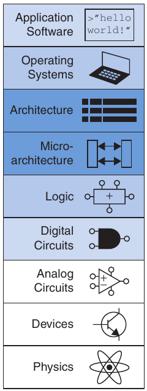

Processor giao tiếp với memory system qua một memory interface. Hình 8.1 cho thấy memory interface đơn giản được sử dụng trong multicycle RISC-V processor của chúng ta. Processor gửi địa chỉ qua Address bus đến memory system. Khi đọc, MemWrite bằng 0 và bộ nhớ trả dữ liệu trên ReadData bus. Khi ghi, MemWrite bằng 1 và processor gửi dữ liệu đến bộ nhớ trên WriteData bus.

Các vấn đề chính trong thiết kế memory system có thể được giải thích khái quát bằng hình ảnh ẩn dụ về sách trong thư viện. Thư viện có nhiều sách trên các kệ. Nếu đang viết tiểu luận về ý nghĩa của giấc mơ, bạn có thể đến thư viện[^1], lấy cuốn The Interpretation of Dreams của Freud từ kệ rồi mang về chỗ ngồi riêng. Đọc lướt xong, bạn có thể trả lại và lấy cuốn The Psychology of the Unconscious của Jung. Sau đó bạn có thể quay lại để tìm một trích dẫn khác trong Interpretation of Dreams, rồi lại đến các kệ để lấy The Ego and the Id của Freud. Chẳng mấy chốc, bạn sẽ mệt vì đi từ chỗ ngồi đến các kệ. Nếu khéo léo, bạn sẽ tiết kiệm thời gian bằng cách giữ sách tại chỗ ngồi thay vì mang đi mang lại. Hơn nữa, khi lấy một cuốn của Freud, bạn cũng có thể lấy thêm vài cuốn khác của ông từ cùng kệ.

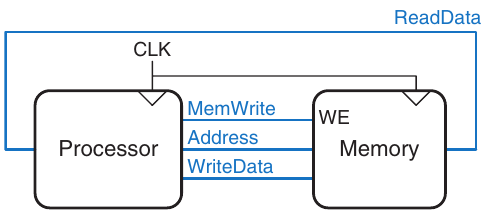

Hình 8.1 Memory interface

Ẩn dụ này nhấn mạnh nguyên tắc làm cho trường hợp thường gặp diễn ra nhanh, đã giới thiệu ở Mục 6.2.1. Bằng cách giữ những cuốn sách vừa dùng hoặc có khả năng sẽ dùng tại chỗ ngồi, bạn giảm số chuyến đi time-consuming đến các kệ. Cụ thể, bạn sử dụng nguyên tắc temporal locality và spatial locality. Temporal locality nghĩa là nếu vừa dùng một cuốn sách, bạn có khả năng sẽ sớm dùng lại nó. Spatial locality nghĩa là khi dùng một cuốn sách cụ thể, bạn có khả năng sẽ quan tâm đến các cuốn khác trên cùng kệ.

Bản thân thư viện cũng làm cho trường hợp thường gặp diễn ra nhanh bằng các nguyên tắc locality này. Thư viện không có đủ chỗ trên kệ cũng như ngân sách để chứa mọi cuốn sách trên thế giới. Thay vào đó, thư viện giữ một số sách lesser-used trong kho sâu ở tầng hầm. Thư viện cũng có thể có thỏa thuận mượn liên thư viện với các thư viện gần đó, nhờ vậy cung cấp nhiều sách hơn số thực sự có tại chỗ.

Tóm lại, bạn có được lợi ích của cả một bộ sưu tập lớn lẫn khả năng truy cập nhanh những cuốn thường dùng nhất thông qua một hierarchy lưu trữ. Những cuốn thường dùng nhất nằm tại chỗ ngồi của bạn. Một bộ sưu tập lớn hơn nằm trên các kệ. Và một bộ sưu tập còn lớn hơn có thể được lấy từ tầng hầm và các thư viện khác nếu báo trước. Tương tự, memory system sử dụng một hierarchy lưu trữ để truy cập nhanh dữ liệu thường dùng nhất mà vẫn có dung lượng chứa lượng dữ liệu lớn.

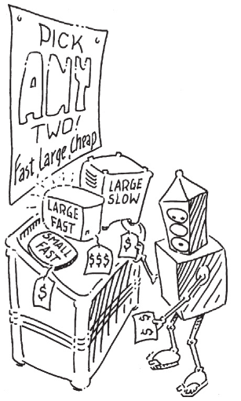

Các memory subsystem dùng để xây dựng hierarchy này đã được giới thiệu ở Mục 5.5. Bộ nhớ máy tính chủ yếu được xây dựng từ dynamic RAM (DRAM) và static RAM (SRAM). Lý tưởng nhất, memory system của máy tính phải nhanh, lớn và rẻ. Trong thực tế, một bộ nhớ đơn lẻ chỉ có hai trong ba thuộc tính này; nó hoặc chậm, hoặc nhỏ, hoặc đắt. Nhưng hệ thống máy tính có thể gần đạt lý tưởng bằng cách kết hợp một bộ nhớ nhanh, nhỏ, rẻ với một bộ nhớ chậm, lớn, rẻ. Bộ nhớ nhanh lưu dữ liệu và instruction thường dùng nhất; vì vậy, tính trung bình, memory system có vẻ nhanh. Bộ nhớ lớn lưu phần dữ liệu và instruction còn lại; vì vậy, tổng dung lượng lớn. Kết hợp hai bộ nhớ rẻ ít tốn kém hơn nhiều so với một bộ nhớ vừa lớn vừa nhanh. Các nguyên tắc này mở rộng thành việc sử dụng cả một hierarchy bộ nhớ có dung lượng tăng dần và tốc độ giảm dần.

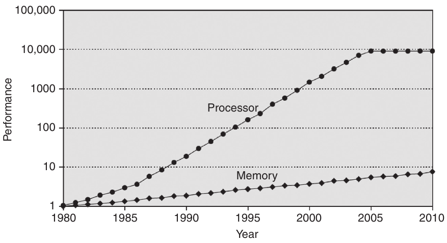

Hình 8.2 Hiệu năng processor và bộ nhớ ngày càng cách xa nhau. Phỏng theo với sự cho phép từ Hennessy và Patterson, Computer Architecture: A Quantitative Approach, ấn bản thứ 5, Morgan Kaufmann, 2011

Hãy nhớ rằng tốc độ được đặc trưng bởi cả latency và throughput. Memory latency là thời gian truy cập byte thông tin đầu tiên. Throughput là số byte mỗi giây có thể được cung cấp. Nhiều bộ nhớ có throughput tốt nhưng latency dài.

Bộ nhớ máy tính thường được xây dựng từ các chip DRAM. Năm 2021, một PC điển hình có main memory gồm 8 đến 32 GiB DRAM, và DRAM có giá khoảng \$3 mỗi gibibyte (GiB). Giá DRAM đã giảm 15% đến 25% mỗi năm trong ba thập kỷ qua và dung lượng bộ nhớ tăng cùng tốc độ, nên tổng chi phí bộ nhớ trong một PC gần như không đổi. Đáng tiếc, tốc độ DRAM chỉ cải thiện khoảng 7% mỗi năm, trong khi hiệu năng processor cải thiện 25% đến 50% mỗi năm, như Hình 8.2. Đồ thị biểu diễn tốc độ bộ nhớ (DRAM) và processor với tốc độ năm 1980 làm mốc. Khoảng năm 1980, tốc độ processor và bộ nhớ ngang nhau. Tuy nhiên, hiệu năng đã tách xa kể từ đó, và bộ nhớ tụt lại nghiêm trọng.[^2]

DRAM có thể theo kịp processor trong thập niên 1970 và đầu thập niên 1980, nhưng hiện nay nó quá chậm. Thời gian truy cập DRAM dài hơn processor cycle time từ một đến hai bậc độ lớn (hàng chục nanosecond so với dưới một nanosecond). Throughput của DRAM tốt, vào khoảng 30 GB/s.

Để đối phó với xu hướng này, máy tính lưu các instruction và dữ liệu thường dùng nhất trong một bộ nhớ nhanh hơn nhưng nhỏ hơn, gọi là cache. Cache thường được xây dựng bằng SRAM trên cùng chip với processor. Tốc độ cache tương đương tốc độ processor vì SRAM vốn nhanh hơn DRAM và vì bộ nhớ on-chip loại bỏ độ trễ dài do phải truyền đến và về từ một chip riêng. Năm 2021, chi phí SRAM on-chip vào khoảng \$100/GiB, nhưng cache tương đối nhỏ (từ kibibyte đến vài mebibyte), nên tổng chi phí thấp. Cache có thể lưu cả instruction và dữ liệu, nhưng chúng ta sẽ gọi chung nội dung của nó là “dữ liệu”. SRAM latency dao động từ vài phần mười nanosecond đối với cache 16 KiB đến vài nanosecond đối với cache 4 MiB. Throughput có thể đạt hàng trăm GB/s.

Nếu processor yêu cầu dữ liệu có sẵn trong cache, dữ liệu được trả về nhanh chóng. Đây được gọi là cache hit. Ngược lại, processor lấy dữ liệu từ main memory (DRAM). Đây được gọi là cache miss. Nếu phần lớn lần truy cập đều cache hit, processor hiếm khi phải chờ main memory chậm, và thời gian truy cập trung bình thấp.

Tầng thứ ba trong memory hierarchy là hard drive. Tương tự việc thư viện dùng tầng hầm để chứa sách không còn chỗ trên kệ, hệ thống máy tính dùng hard drive để lưu dữ liệu không vừa main memory. Năm 2021, hard disk drive (HDD), được xây dựng bằng công nghệ lưu trữ từ tính, có giá dưới \$0.03/GB và thời gian truy cập khoảng 5 đến 10 ms. Throughput vào khoảng 100 MB/s đối với file lớn và giảm xuống 1 MB/s khi truy cập ngẫu nhiên các file nhỏ (4 KiB). Chi phí hard disk đã giảm 60% mỗi năm nhưng thời gian truy cập hầu như không cải thiện. Solid state drive (SSD), được xây dựng bằng công nghệ flash memory, ngày càng phổ biến như một lựa chọn thay thế HDD. SSD đã được dùng trong các thị trường ngách hơn hai thập kỷ và được đưa vào thị trường đại chúng năm 2007. SSD khắc phục một số hỏng hóc cơ học của HDD, nhưng đắt gấp 3 đến 4 lần, ở mức \$0.10/GB. Từ khi SSD xuất hiện trên thị trường, chênh lệch giá với HDD đã thu hẹp, và mức độ phổ biến của SSD so với HDD cũng tăng tương ứng. SSD có thời gian truy cập dưới 0.1 ms. Throughput có thể đạt 500 đến 3,000 MB/s với file lớn và giảm xuống 50 đến 250 MB/s với file 4 KiB.

Hard drive tạo ảo giác rằng dung lượng lớn hơn dung lượng thực có trong main memory. Vì vậy, nó được gọi là virtual memory. Giống sách ở tầng hầm, dữ liệu trong virtual memory mất nhiều thời gian để truy cập. Main memory, còn gọi là physical memory, chứa một tập con của virtual memory. Do đó, có thể xem main memory là cache cho dữ liệu thường dùng nhất từ hard drive.

Hình 8.3 tóm tắt memory hierarchy của hệ thống máy tính được thảo luận trong phần còn lại của chương này. Trước tiên processor tìm dữ liệu trong cache nhỏ nhưng nhanh, thường nằm trên cùng chip. Nếu dữ liệu không có trong cache, processor tìm trong main memory. Nếu ở đó cũng không có, processor lấy dữ liệu từ virtual memory trên hard disk lớn nhưng chậm. Hình 8.4 minh họa trade-off giữa dung lượng và tốc độ này trong memory hierarchy, đồng thời liệt kê chi phí, thời gian truy cập và bandwidth điển hình của công nghệ năm 2021. Khi thời gian truy cập giảm, tốc độ tăng.

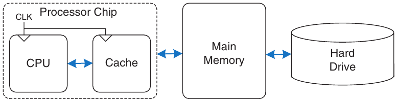

Hình 8.3 Một memory hierarchy điển hình

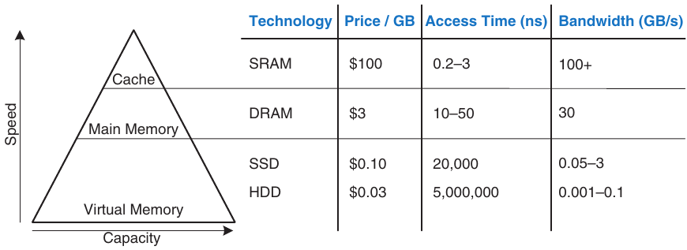

Hình 8.4 Các thành phần memory hierarchy, với đặc điểm điển hình năm 2021

Mục 8.2 giới thiệu phân tích hiệu năng memory system. Mục 8.3 khảo sát một số cách tổ chức cache, và Mục 8.4 tìm hiểu các virtual memory system.

## 8.2 PHÂN TÍCH HIỆU NĂNG MEMORY SYSTEM

Người thiết kế (và người mua máy tính) cần những cách định lượng để đo hiệu năng memory system nhằm đánh giá các trade-offs về cost-benefit của những phương án khác nhau. Các thước đo hiệu năng memory system là miss rate hoặc hit rate và thời gian truy cập bộ nhớ trung bình. Miss rate và hit rate được tính như sau:

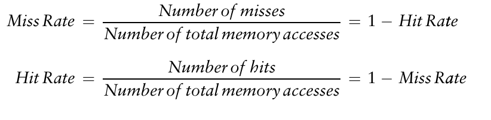 (8.1)

### Ví dụ 8.1 TÍNH HIỆU NĂNG CACHE

Giả sử một chương trình có 2,000 instruction truy cập dữ liệu (load hoặc store), và 1,250 giá trị dữ liệu được yêu cầu tìm thấy trong cache. 750 giá trị dữ liệu còn lại được main memory hoặc disk memory cung cấp cho processor. Miss rate và hit rate của cache bằng bao nhiêu?

Lời giải Miss rate là 750/2000 = 0.375 = 37.5%. Hit rate là 1250/2000 = 0.625 = 1 − 0.375 = 62.5%.

Average memory access time (AMAT) là thời gian trung bình processor phải chờ bộ nhớ cho mỗi load hoặc store instruction. Trong hệ thống máy tính điển hình ở Hình 8.3, processor trước hết tìm dữ liệu trong cache. Nếu cache miss, processor tìm trong main memory. Nếu main memory miss, processor truy cập virtual memory trên hard disk. Vì vậy, AMAT được tính như sau:

AMAT = t<sub>cache</sub> + MR<sub>cache</sub>(t<sub>MM</sub> + MR<sub>MM</sub>t<sub>VM</sub>) (8.2)

trong đó t<sub>cache</sub>, t<sub>MM</sub> và t<sub>VM</sub> lần lượt là thời gian truy cập cache, main memory và virtual memory, còn MR<sub>cache</sub> và MR<sub>MM</sub> lần lượt là miss rate của cache và main memory.

### Ví dụ 8.2 TÍNH THỜI GIAN TRUY CẬP BỘ NHỚ TRUNG BÌNH

Giả sử một hệ thống máy tính có tổ chức bộ nhớ chỉ gồm hai tầng hierarchy: cache và main memory. Thời gian truy cập bộ nhớ trung bình bằng bao nhiêu với thời gian truy cập và miss rate trong Bảng 8.1?

Lời giải Thời gian truy cập bộ nhớ trung bình là 1 + 0.1(100) = 11 cycle.

Bảng 8.1 Thời gian truy cập và miss rate

| Tầng bộ nhớ | Thời gian truy cập (Cycle) | Miss Rate |
|---|---|---|
| Cache | 1 | 10% |
| Main Memory | 100 | 0% |

> 
>
> Gene Amdahl, 1922–2015
>
> Ông nổi tiếng nhất với Amdahl’s Law, một nhận xét được đưa ra năm 1965. Khi học cao học, ông bắt đầu thiết kế máy tính trong thời gian rảnh. Công việc làm thêm này đem lại cho ông bằng tiến sĩ vật lý lý thuyết năm 1952. Ông gia nhập IBM ngay sau khi tốt nghiệp và về sau thành lập ba công ty, trong đó có Amdahl Corporation năm 1970.

### Ví dụ 8.3 CẢI THIỆN THỜI GIAN TRUY CẬP

Thời gian truy cập bộ nhớ trung bình 11-cycle nghĩa là processor dành mười cycle chờ dữ liệu cho mỗi một cycle thực sự sử dụng dữ liệu đó. Cần cache miss rate bao nhiêu để giảm thời gian truy cập bộ nhớ trung bình xuống 1.5 cycle, với thời gian truy cập trong Bảng 8.1?

Lời giải Nếu miss rate là m, thời gian truy cập trung bình là 1 + 100m. Cho thời gian này bằng 1.5 và giải tìm m, ta cần cache miss rate bằng 0.5%.

Cần lưu ý rằng những cải thiện hiệu năng không phải lúc nào cũng tốt như nghe có vẻ vậy. Ví dụ, làm memory system nhanh gấp mười lần không nhất thiết khiến chương trình máy tính chạy nhanh gấp mười. Nếu 50% instruction của một chương trình là load và store, việc cải thiện memory system gấp mười chỉ đem lại mức cải thiện hiệu năng chương trình 1.82-fold. Nguyên tắc chung này được gọi là Amdahl’s Law: công sức tăng hiệu năng một subsystem chỉ đáng giá nếu subsystem đó ảnh hưởng đến một tỷ lệ lớn của hiệu năng tổng thể.

## 8.3 CACHE

Cache chứa dữ liệu bộ nhớ thường dùng. Số data word mà nó có thể chứa gọi là dung lượng, C. Vì dung lượng cache nhỏ hơn dung lượng main memory, người thiết kế hệ thống máy tính phải chọn tập con nào của main memory được giữ trong cache.

Khi processor cố truy cập dữ liệu, trước tiên nó kiểm tra cache. Nếu cache hit, dữ liệu có sẵn ngay. Nếu cache miss, processor lấy dữ liệu từ main memory và đặt vào cache để dùng sau. Để chứa dữ liệu mới, cache phải thay thế dữ liệu cũ. Mục này khảo sát những vấn đề thiết kế cache đó bằng cách trả lời các câu hỏi: (1) Dữ liệu nào được giữ trong cache? (2) Dữ liệu được tìm như thế nào? và (3) Dữ liệu nào bị thay thế để nhường chỗ cho dữ liệu mới khi cache đầy?

> Cache: một nơi cất giấu, đặc biệt để giấu và bảo quản lương thực dự trữ hoặc dụng cụ.
>
> —Merriam Webster Online Dictionary. 2021. www.merriam-webster.com

Khi đọc các mục tiếp theo, hãy nhớ rằng cơ sở để trả lời những câu hỏi này là spatial locality và temporal locality vốn có của các lần truy cập dữ liệu trong phần lớn ứng dụng. Cache dùng spatial locality và temporal locality để dự đoán dữ liệu cần tiếp theo. Nếu một chương trình truy cập dữ liệu theo thứ tự ngẫu nhiên, nó sẽ không hưởng lợi từ cache.

Như sẽ giải thích trong các mục tiếp theo, cache được xác định bởi dung lượng (C), số set (S), block size (b), số block (B) và degree of associativity (N).

Mặc dù chúng ta tập trung vào data cache load, những nguyên tắc tương tự cũng áp dụng cho việc fetch từ instruction cache. Các data cache store operation cũng tương tự và được thảo luận thêm ở Mục 8.3.4.

### 8.3.1 Dữ liệu nào được giữ trong cache?

Một cache lý tưởng sẽ dự đoán mọi dữ liệu processor cần và lấy trước từ main memory, nhờ đó cache có miss rate bằng không. Vì không thể dự đoán tương lai chính xác hoàn toàn, cache phải đoán dữ liệu sẽ cần dựa trên pattern truy cập bộ nhớ trong quá khứ. Cụ thể, cache khai thác temporal locality và spatial locality để đạt miss rate thấp.

Hãy nhớ rằng temporal locality nghĩa là processor có khả năng sớm truy cập lại một dữ liệu nếu vừa truy cập dữ liệu đó. Vì vậy, khi processor load hoặc store dữ liệu không có trong cache, dữ liệu được sao chép từ main memory vào cache. Những yêu cầu tiếp theo đối với dữ liệu đó sẽ hit trong cache.

Hãy nhớ rằng spatial locality nghĩa là khi processor truy cập một dữ liệu, nó cũng có khả năng truy cập dữ liệu ở các vị trí bộ nhớ gần đó. Vì vậy, khi cache lấy một word từ bộ nhớ, nó cũng có thể lấy vài word liền kề. Nhóm word này được gọi là cache block hoặc cache line. Số word trong cache block, b, được gọi là block size. Một cache có dung lượng C chứa B = C / b block.

Các nguyên tắc temporal locality và spatial locality đã được kiểm chứng thực nghiệm trong chương trình thực tế. Nếu một biến được dùng trong chương trình, chính biến đó có khả năng được dùng lại, tạo temporal locality. Nếu một phần tử trong array được dùng, các phần tử khác trong cùng array cũng có khả năng được dùng, tạo spatial locality.

### 8.3.2 Dữ liệu được tìm như thế nào?

Cache được tổ chức thành S set, mỗi set chứa một hoặc nhiều data block. Quan hệ giữa địa chỉ dữ liệu trong main memory và vị trí dữ liệu đó trong cache được gọi là mapping. Mỗi memory address ánh xạ đến đúng một set trong cache. Một số address bit được dùng để xác định cache set nào chứa dữ liệu. Nếu set chứa nhiều block, dữ liệu có thể được giữ trong bất kỳ block nào của set.

Cache được phân loại dựa trên số block trong một set. Trong direct mapped cache, mỗi set chứa đúng một block, nên cache có S = B set. Vì vậy, một main memory address cụ thể ánh xạ đến một block duy nhất trong cache. Trong N-way set associative cache, mỗi set chứa N block. Địa chỉ vẫn ánh xạ đến một set duy nhất, với S = B/N set. Nhưng dữ liệu từ địa chỉ đó có thể nằm trong bất kỳ block nào trong N block của set. Fully associative cache chỉ có S = 1 set. Dữ liệu có thể nằm trong bất kỳ block nào trong B block của set. Vì thế, fully associative cache là tên gọi khác của B-way set associative cache.

Để minh họa những cách tổ chức cache này, chúng ta xét một RISC-V memory system có địa chỉ 32-bit và word 32-bit. Bộ nhớ là byte-addressable, và mỗi word có bốn byte, nên bộ nhớ gồm 2<sup>30</sup> word được căn chỉnh theo word boundary. Để đơn giản, chúng ta phân tích cache có dung lượng (C) eight-word. Ta bắt đầu với block size (b) one-word, rồi về sau khái quát thành các block lớn hơn.

Direct Mapped Cache

Direct mapped cache có một block trong mỗi set, nên được tổ chức thành S = B set. Để hiểu mapping từ memory address sang cache block, hãy hình dung main memory cũng được chia thành các block b-word, giống cache. Một địa chỉ trong block 0 của main memory ánh xạ đến set 0 của cache. Một địa chỉ trong block 1 của main memory ánh xạ đến set 1 của cache, và cứ thế cho đến khi một địa chỉ trong block B − 1 của main memory ánh xạ đến block B − 1 của cache. Cache không còn block nào nữa, nên mapping quay vòng, sao cho block B của main memory ánh xạ đến block 0 của cache.

Mapping này được minh họa ở Hình 8.5 cho direct mapped cache có dung lượng tám word và block size một word. Cache có tám set, mỗi set chứa một block one-word. Hai bit thấp nhất của địa chỉ luôn là 00, vì chúng được word aligned. log<sub>2</sub>8 = 3 bit tiếp theo chỉ set mà memory address ánh xạ đến. Vì vậy, dữ liệu tại các địa chỉ 0x00000004, 0x00000024, …, 0xFFFFFFE4 đều ánh xạ đến set 1, như thể hiện bằng màu xanh. Tương tự, dữ liệu tại các địa chỉ 0x00000010, …, 0xFFFFFFF0 đều ánh xạ đến set 4, và cứ thế. Mỗi main memory address ánh xạ đến đúng một set trong cache.

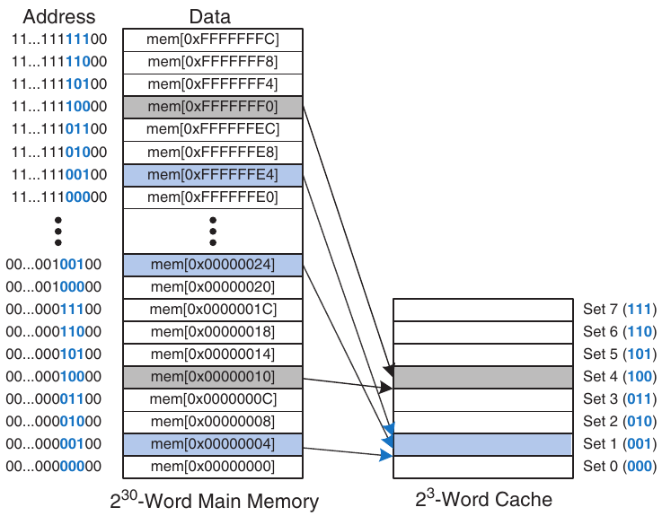

Hình 8.5 Mapping từ main memory đến direct mapped cache

#### Ví dụ 8.4 CÁC TRƯỜNG CACHE

Word tại địa chỉ 0x00000014 ánh xạ đến cache set nào trong Hình 8.5? Hãy nêu một địa chỉ khác ánh xạ đến cùng set.

Lời giải Hai bit ít quan trọng nhất của địa chỉ là 00 vì địa chỉ được word aligned. Ba bit tiếp theo là 101, nên word ánh xạ đến set 5. Các word tại địa chỉ 0x34, 0x54, 0x74, …, 0xFFFFFFF4 đều ánh xạ đến cùng set này.

Vì nhiều địa chỉ ánh xạ đến một set, cache cũng phải theo dõi địa chỉ của dữ liệu thực sự chứa trong mỗi set. Các bit ít quan trọng nhất của địa chỉ chỉ set nào giữ dữ liệu. Các bit quan trọng nhất còn lại được gọi là tag và cho biết địa chỉ nào trong số nhiều địa chỉ có thể có đang được giữ trong set đó.

Trong các ví dụ trước, hai bit ít quan trọng nhất của địa chỉ 32-bit được gọi là byte offset vì chúng chỉ byte trong word. Ba bit tiếp theo được gọi là set bit vì chúng chỉ set mà địa chỉ ánh xạ đến. (Nói chung, số set bit là log<sub>2</sub>S.) 27 tag bit còn lại chỉ memory address của dữ liệu được lưu trong một cache set nhất định. Hình 8.6 cho thấy các trường cache của địa chỉ 0xFFFFFFE4. Nó ánh xạ đến set 1 và tag của nó toàn là l.

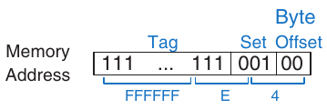

Hình 8.6 Các trường cache của địa chỉ 0xFFFFFFE4 khi ánh xạ đến cache trong Hình 8.5

#### Ví dụ 8.5 CÁC TRƯỜNG CACHE

Tìm số set bit và tag bit cho direct mapped cache có 1024 (2<sup>10</sup>) set và block size one-word. Kích thước địa chỉ là 32 bit.

Lời giải Cache có 2<sup>10</sup> set cần log<sub>2</sub>(2<sup>10</sup>) = 10 set bit. Hai bit ít quan trọng nhất của địa chỉ là byte offset, và 32 − 10 − 2 = 20 bit còn lại tạo thành tag.

Đôi khi, chẳng hạn khi máy tính mới khởi động, các cache set hoàn toàn chưa chứa dữ liệu. Cache dùng một valid bit cho mỗi set để chỉ set có giữ dữ liệu có ý nghĩa hay không. Nếu valid bit bằng 0, nội dung không có ý nghĩa.

Hình 8.7 cho thấy phần cứng của direct mapped cache trong Hình 8.5. Cache được xây dựng thành một SRAM eight-entry. Mỗi entry, hay set, chứa một line gồm 32 bit dữ liệu, 27 bit tag và 1 valid bit. Cache được truy cập bằng địa chỉ 32-bit. Hai bit ít quan trọng nhất, tức byte offset bit, được bỏ qua khi truy cập word. Ba bit tiếp theo, tức set bit, xác định entry hay set trong cache. Một load instruction đọc entry đã chỉ định từ cache rồi kiểm tra tag bit và valid bit. Nếu tag khớp với 27 bit quan trọng nhất của địa chỉ được yêu cầu và valid bit bằng 1, cache hit và dữ liệu được trả về processor. Ngược lại, cache miss và memory system phải lấy dữ liệu từ main memory.

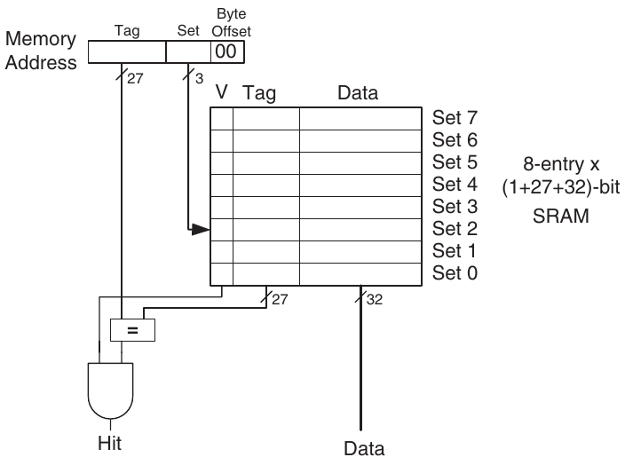

Hình 8.7 Direct mapped cache có 8 set

#### Ví dụ 8.6 TEMPORAL LOCALITY VỚI DIRECT MAPPED CACHE

Loop là một nguồn temporal locality và spatial locality phổ biến trong ứng dụng. Dùng cache eight-entry ở Hình 8.7, hãy cho biết nội dung cache sau khi thực thi loop khá ngớ ngẩn sau trong RISC-V assembly code. Giả sử cache ban đầu rỗng. Miss rate bằng bao nhiêu?

```
       addi s0, zero, 5
       addi s1, zero, 0
LOOP:  beq  s0, zero, DONE
       lw  s2, 4(s1)
       lw  s3, 12(s1)
       lw  s4, 8(s1)
       addi s0, s0, −1
       j LOOP
DONE:
```

Lời giải Chương trình chứa một loop lặp năm lần. Mỗi lần lặp có ba lần truy cập bộ nhớ (load), tạo tổng cộng 15 lần truy cập. Khi loop thực thi lần đầu, cache rỗng và dữ liệu phải được lấy từ các vị trí main memory 0x4, 0xC và 0x8 lần lượt vào cache set 1, 3 và 2. Tuy nhiên, trong bốn lần thực thi loop tiếp theo, dữ liệu được tìm thấy trong cache. Hình 8.8 cho thấy nội dung cache trong lần yêu cầu cuối cùng đến memory address 0x4. Các tag đều là 0 vì 27 bit phía trên của địa chỉ là 0. Miss rate là 3/15 = 20%.

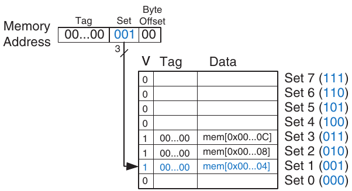

Hình 8.8 Nội dung direct mapped cache

Khi hai địa chỉ vừa được truy cập ánh xạ đến cùng cache block, conflict xảy ra, và địa chỉ được truy cập gần nhất đẩy địa chỉ trước ra khỏi block. Direct mapped cache chỉ có một block trong mỗi set, nên hai địa chỉ ánh xạ đến cùng set luôn gây conflict. Ví dụ 8.7 minh họa conflict.

#### Ví dụ 8.7 CACHE BLOCK CONFLICT

Miss rate bằng bao nhiêu khi loop sau được thực thi trên direct mapped cache eight-word ở Hình 8.7? Giả sử cache ban đầu rỗng.

```
       addi s0, zero, 5
       addi s1, zero, 0
LOOP:  beq   s0, zero, DONE
       lw    s2,  0x4(s1)
       lw    s4,  0x24(s1)
       addi s0, s0, −1
       j     LOOP
DONE:
```

Lời giải Memory address 0x4 và 0x24 đều ánh xạ đến set 1. Trong lần thực thi loop đầu tiên, dữ liệu tại địa chỉ 0x4 được load vào set 1 của cache. Sau đó, dữ liệu tại địa chỉ 0x24 được load vào set 1, đẩy dữ liệu từ địa chỉ 0x4 ra ngoài. Khi thực thi loop lần thứ hai, pattern lặp lại và cache phải lấy lại dữ liệu tại địa chỉ 0x4, đẩy dữ liệu từ địa chỉ 0x24 ra ngoài. Hai địa chỉ conflict và miss rate là 100%.

Multiway Set Associative Cache

N-way set associative cache giảm conflict bằng cách cung cấp N block trong mỗi set, nơi có thể tìm thấy dữ liệu ánh xạ đến set đó. Mỗi memory address vẫn ánh xạ đến một set cụ thể, nhưng có thể ánh xạ đến bất kỳ block nào trong N block của set. Vì vậy, direct mapped cache là tên gọi khác của one-way set associative cache. N còn được gọi là degree of associativity của cache.

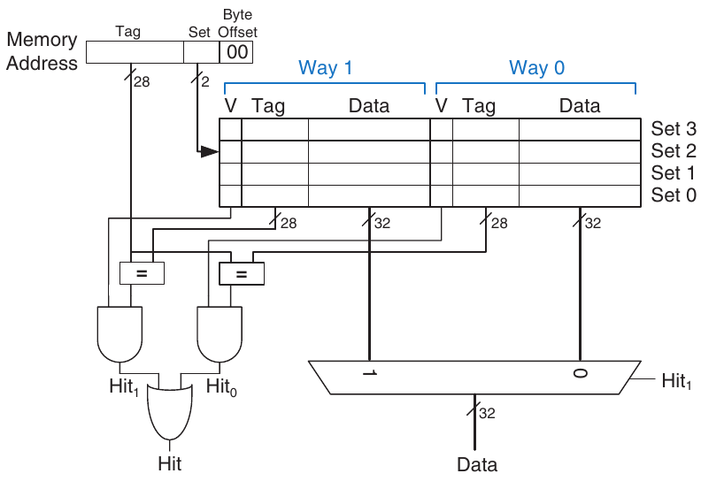

Hình 8.9 Two-way set associative cache

Hình 8.9 cho thấy phần cứng của set associative cache C = 8-word, N = 2-way. Cache giờ chỉ có S = 4 set thay vì 8. Vì vậy, chỉ log<sub>2</sub>4 = 2 set bit thay vì 3 được dùng để chọn set. Tag tăng từ 27 lên 28 bit. Mỗi set chứa hai way, hay degree of associativity. Mỗi way gồm một data block cùng valid bit và tag bit. Cache đọc block từ cả hai way trong set được chọn và kiểm tra tag cùng valid bit để tìm hit. Nếu hit xảy ra ở một trong hai way, multiplexer chọn dữ liệu từ way đó.

Set associative cache thường có miss rate thấp hơn direct mapped cache cùng dung lượng vì ít conflict hơn. Tuy nhiên, set associative cache thường chậm hơn và có chi phí xây dựng cao hơn đôi chút do có output multiplexer và các comparator bổ sung. Chúng cũng đặt ra câu hỏi nên thay thế way nào khi cả hai way đều đầy; vấn đề này được đề cập thêm ở Mục 8.3.3. Phần lớn hệ thống thương mại sử dụng set associative cache.

#### Ví dụ 8.8 MISS RATE CỦA SET ASSOCIATIVE CACHE

Lặp lại Ví dụ 8.7 với set associative cache eight-word two-way ở Hình 8.9.

Lời giải Cả hai lần truy cập bộ nhớ, đến địa chỉ 0x4 và 0x24, đều ánh xạ đến set 1. Tuy nhiên, cache có hai way, nên có thể chứa dữ liệu từ cả hai địa chỉ. Trong lần lặp đầu tiên, cache rỗng miss ở cả hai địa chỉ và load hai word dữ liệu vào hai way của set 1, như Hình 8.10. Trong bốn lần lặp tiếp theo, cache hit. Vì thế, miss rate là 2/10 = 20%. Hãy nhớ direct mapped cache cùng kích thước ở Ví dụ 8.7 có miss rate 100%.

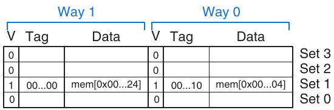

Hình 8.10 Nội dung Two-way set associative cache

Fully Associative Cache

Fully associative cache chứa một set duy nhất có B way, trong đó B là số block. Một memory address có thể ánh xạ đến một block trong bất kỳ way nào trong số này. Fully associative cache là tên gọi khác của B-way set associative cache có một set.

Hình 8.11 cho thấy SRAM array của fully associative cache có tám block. Khi có yêu cầu dữ liệu, phải thực hiện tám phép so sánh tag (không được vẽ) vì dữ liệu có thể nằm trong bất kỳ block nào. Tương tự, multiplexer 8:1 chọn dữ liệu thích hợp nếu xảy ra hit. Fully associative cache thường có ít conflict miss nhất với một dung lượng cache nhất định, nhưng cần nhiều phần cứng hơn cho các phép so sánh tag bổ sung. Chúng thích hợp nhất với cache tương đối nhỏ vì số comparator lớn.

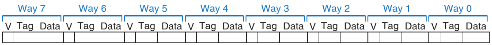

Hình 8.11 Eight-block fully associative cache

Block Size

Các ví dụ trước chỉ có thể tận dụng temporal locality vì block size là một word. Để khai thác spatial locality, cache dùng block lớn hơn để chứa vài word liên tiếp.

Ưu điểm của block size lớn hơn một là khi miss xảy ra và word được lấy vào cache, các word liền kề trong block cũng được lấy theo. Vì vậy, những lần truy cập sau có khả năng hit cao hơn nhờ spatial locality. Tuy nhiên, block size lớn nghĩa là cache fixed-size sẽ có ít block hơn. Điều này có thể dẫn đến nhiều conflict hơn, làm tăng miss rate. Hơn nữa, lấy cache block bị thiếu sau miss mất nhiều thời gian hơn vì phải lấy nhiều hơn một data word từ main memory. Thời gian cần để load block bị thiếu vào cache gọi là miss penalty. Nếu các word liền kề trong block không được truy cập sau đó, công sức lấy chúng bị lãng phí. Tuy vậy, phần lớn chương trình thực tế được lợi từ block size lớn hơn.

Hình 8.12 cho thấy phần cứng của direct mapped cache C = 8-word có block size b = 4-word. Cache giờ chỉ có B = C/b = 2 block. Direct mapped cache có một block trong mỗi set, nên cache này được tổ chức thành hai set. Vì vậy, chỉ log<sub>2</sub>2 = 1 bit được dùng để chọn set. Giờ cần một multiplexer để chọn word trong block. Multiplexer được điều khiển bởi log<sub>2</sub>4 = 2 block offset bit của địa chỉ. 27 address bit quan trọng nhất tạo thành tag. Chỉ cần một tag cho cả block, vì các word trong block có địa chỉ liên tiếp.

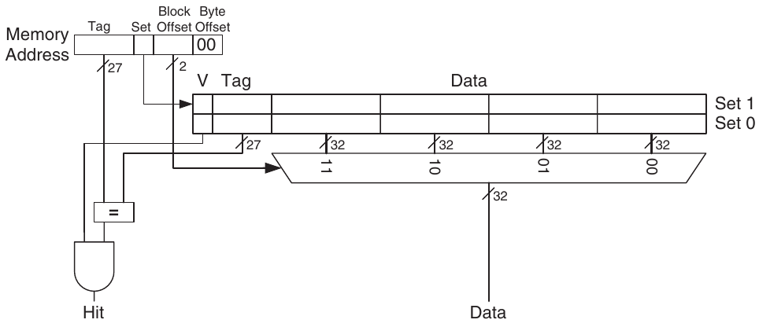

Hình 8.12 Direct mapped cache có hai set và block size four-word

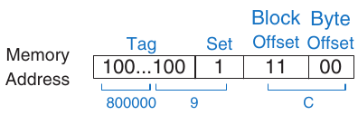

Hình 8.13 Các trường cache của địa chỉ 0x8000009C khi ánh xạ đến cache ở Hình 8.12

Hình 8.13 cho thấy các trường cache của địa chỉ 0x8000009C khi ánh xạ đến direct mapped cache ở Hình 8.12. Các byte offset bit luôn bằng 0 đối với truy cập word. log<sub>2</sub>b = 2 block offset bit tiếp theo chỉ word trong block, và bit tiếp theo chỉ set. 27 bit còn lại là tag. Vì vậy, word 0x8000009C ánh xạ đến set 1, word 3 trong cache. Nguyên tắc dùng block size lớn hơn để khai thác spatial locality cũng áp dụng cho associative cache.

#### Ví dụ 8.9 SPATIAL LOCALITY VỚI DIRECT MAPPED CACHE

Lặp lại Ví dụ 8.6 cho direct mapped cache eight-word có block size four-word.

Lời giải Hình 8.14 cho thấy nội dung cache sau lần truy cập bộ nhớ đầu tiên. Trong lần lặp đầu tiên, cache miss khi truy cập memory address 0x4. Lần truy cập này load dữ liệu tại các địa chỉ từ 0x0 đến 0xC vào cache block. Mọi lần truy cập tiếp theo (như minh họa với địa chỉ 0xC) đều hit trong cache. Vì thế, miss rate là 1/15 = 6.67%.

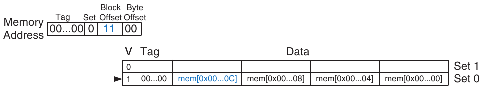

Hình 8.14 Nội dung cache có block size b bằng bốn word

Kết hợp tất cả lại

Cache được tổ chức thành array two-dimensional. Các hàng gọi là set và các cột gọi là way. Mỗi entry trong array gồm một data block và các valid bit, tag bit liên quan. Cache được đặc trưng bởi

Bảng 8.2 Các cách tổ chức cache

| Cách tổ chức | Số way (N) | Số set (S) |
|---|---|---|
| Direct Mapped | 1 | B |
| Set Associative | 1 < N < B | B/N |
| Fully Associative | B | 1 |

- dung lượng C

- block size b (và số block, B = C/b)

- số block trong một set (N)

Bảng 8.2 tóm tắt các cách tổ chức cache khác nhau. Mỗi địa chỉ trong bộ nhớ chỉ ánh xạ đến một set nhưng có thể được lưu trong bất kỳ way nào.

Dung lượng cache, associativity, set size và block size thường là lũy thừa của hai. Điều này khiến các trường cache (tag bit, set bit và block offset bit) là các tập con của address bit.

Tăng associativity N thường giảm miss rate do conflict. Nhưng associativity cao hơn cần nhiều tag comparator hơn. Tăng block size b tận dụng spatial locality để giảm miss rate. Tuy nhiên, nó làm giảm số set trong cache có kích thước cố định và vì vậy có thể dẫn đến nhiều conflict hơn. Nó cũng làm tăng miss penalty.

### 8.3.3 Dữ liệu nào bị thay thế?

Trong direct mapped cache, mỗi địa chỉ ánh xạ đến một block và set duy nhất. Nếu set đầy khi cần load dữ liệu mới, block trong set đó được thay bằng dữ liệu mới. Trong set associative cache và fully associative cache, cache phải chọn block để đẩy ra khi một cache set đầy. Nguyên tắc temporal locality gợi ý lựa chọn tốt nhất là đẩy block ít được sử dụng gần đây nhất ra ngoài vì nó ít có khả năng sớm được dùng lại nhất. Do đó, phần lớn associative cache có replacement policy least recently used (LRU).

Trong two-way set associative cache, use bit U chỉ way nào trong set ít được sử dụng gần đây nhất. Mỗi khi một way được dùng, U được điều chỉnh để chỉ way kia. Với set associative cache có nhiều hơn hai way, việc theo dõi way ít được sử dụng gần đây nhất trở nên phức tạp. Để đơn giản hóa, các way thường được chia thành hai nhóm và U chỉ nhóm way ít được sử dụng gần đây nhất. Khi thay thế, block mới thay một block ngẫu nhiên trong nhóm ít được sử dụng gần đây nhất. Policy như vậy gọi là pseudo-LRU và đủ tốt trong thực tế.

#### Ví dụ 8.10 THAY THẾ LRU

Cho biết nội dung của set associative cache eight-word two-way sau khi thực thi code dưới đây. Giả sử thay thế LRU, block size một word và cache ban đầu rỗng.

```
addi t0, zero, 0
lw  s1, 0x4(t0)
lw  s2, 0x24(t0)
lw  s3, 0x54(t0)
```

Lời giải Hai instruction đầu load dữ liệu từ memory address 0x4 và 0x24 vào set 1 của cache, như Hình 8.15(a). U = 0 chỉ rằng dữ liệu trong way 0 ít được sử dụng gần đây nhất. Lần truy cập bộ nhớ tiếp theo, đến địa chỉ 0x54, cũng ánh xạ đến set 1 và thay thế dữ liệu ít được sử dụng gần đây nhất trong way 0, như Hình 8.15(b). Use bit U được đặt thành 1 để chỉ rằng dữ liệu trong way 1 ít được sử dụng gần đây nhất.

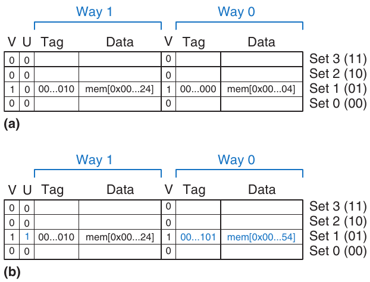

Hình 8.15 Two-way associative cache với thay thế LRU

### 8.3.4 Thiết kế cache nâng cao\*

Hệ thống hiện đại sử dụng nhiều tầng cache để giảm thời gian truy cập bộ nhớ. Mục này khảo sát hiệu năng của caching system two-level và xem xét cách block size, associativity và dung lượng cache ảnh hưởng đến miss rate. Mục này cũng mô tả cách cache xử lý store, hay ghi, bằng policy write-through hoặc write-back.

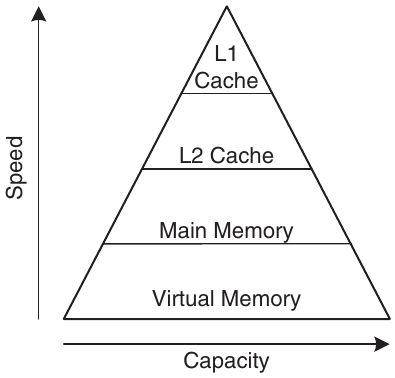

Hình 8.16 Memory hierarchy có hai tầng cache

Multiple-Level Cache

Cache lớn có lợi vì có khả năng chứa dữ liệu cần thiết cao hơn và do đó có miss rate thấp hơn. Tuy nhiên, cache lớn thường chậm hơn cache nhỏ. Hệ thống hiện đại thường dùng ít nhất hai tầng cache, như Hình 8.16. Cache first-level (L1) đủ nhỏ để có thời gian truy cập one- hoặc two-cycle. Cache second-level (L2) cũng được xây dựng từ SRAM nhưng lớn hơn—và vì vậy chậm hơn—cache L1. Processor trước hết tìm dữ liệu trong cache L1. Nếu cache L1 miss, processor tìm trong cache L2. Nếu cache L2 miss, processor lấy dữ liệu từ main memory. Nhiều hệ thống hiện đại thêm cả những tầng cache khác vào memory hierarchy vì truy cập main memory quá chậm.

#### Ví dụ 8.11 HỆ THỐNG CÓ CACHE L2

Sử dụng hệ thống ở Hình 8.16 có thời gian truy cập lần lượt là 1, 10 và 100 cycle cho cache L1, cache L2 và main memory. Giả sử cache L1 và L2 có miss rate lần lượt là 5% và 20%. Cụ thể, trong 5% số lần truy cập miss ở cache L1, 20% trong số đó cũng miss ở cache L2. Average memory access time (AMAT) bằng bao nhiêu?

Lời giải Mỗi lần truy cập bộ nhớ đều kiểm tra cache L1. Khi cache L1 miss (5% số lần), processor kiểm tra cache L2. Khi cache L2 miss (20% số lần), processor lấy dữ liệu từ main memory. Dùng Phương trình 8.2, ta tính thời gian truy cập bộ nhớ trung bình như sau: 1 cycle + 0.05[10 cycle + 0.2(100 cycle)] = 2.5 cycle.

Miss rate của L2 cao vì nó chỉ nhận những lần truy cập bộ nhớ “khó”, tức những lần miss ở cache L1. Nếu mọi lần truy cập đều đi trực tiếp đến cache L2, miss rate của L2 sẽ khoảng 1%. Giảm miss rate

Có thể giảm cache miss bằng cách thay đổi dung lượng, block size và/hoặc associativity. Bước đầu tiên để giảm miss rate là hiểu nguyên nhân miss. Miss có thể được phân loại thành compulsory, capacity và conflict. Yêu cầu đầu tiên đến một cache block được gọi là compulsory miss, vì block phải được đọc từ bộ nhớ bất kể thiết kế cache như thế nào. Capacity miss xảy ra khi cache quá nhỏ để chứa mọi dữ liệu được sử dụng đồng thời. Conflict miss xảy ra khi vài địa chỉ ánh xạ đến cùng set và đẩy những block vẫn còn cần ra ngoài.

Thay đổi tham số cache có thể ảnh hưởng đến một hoặc nhiều loại cache miss. Ví dụ, tăng dung lượng cache có thể giảm conflict miss và capacity miss nhưng không ảnh hưởng compulsory miss. Mặt khác, tăng block size có thể giảm compulsory miss (nhờ spatial locality) nhưng thực tế cũng có thể tăng conflict miss (vì nhiều địa chỉ hơn sẽ ánh xạ đến cùng set và có thể conflict).

Memory system đủ phức tạp để cách đánh giá hiệu năng tốt nhất là chạy benchmark trong khi thay đổi tham số cache. Hình 8.17 biểu diễn miss rate theo kích thước cache và degree of associativity cho benchmark SPEC2000. Benchmark này có số compulsory miss nhỏ, thể hiện bằng vùng đậm gần x-axis. Đúng như dự kiến, khi kích thước cache tăng, capacity miss giảm. Tăng associativity, đặc biệt với cache nhỏ, làm giảm số conflict miss thể hiện dọc phía trên đường cong. Tăng associativity vượt quá bốn hoặc tám way chỉ giúp giảm miss rate đôi chút.

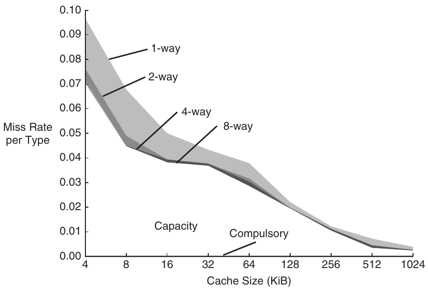

Hình 8.17 Miss rate theo kích thước cache và associativity trên benchmark SPEC2000. Phỏng theo với sự cho phép từ Hennessy và Patterson, Computer Architecture: A Quantitative Approach, ấn bản thứ 5, Morgan Kaufmann, 2012

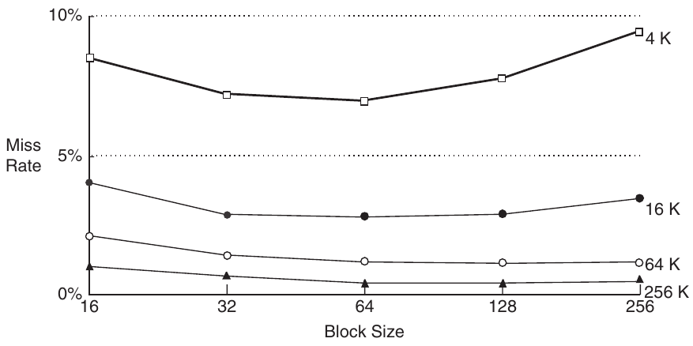

Hình 8.18 Miss rate theo block size và kích thước cache trên benchmark SPEC92

Phỏng theo với sự cho phép từ Hennessy và Patterson, Computer Architecture:

A Quantitative Approach, ấn bản thứ 5, Morgan Kaufmann, 2012

Như đã nói, cũng có thể giảm miss rate bằng block size lớn hơn để tận dụng spatial locality. Nhưng khi block size tăng, số set trong cache fixed-size giảm, làm tăng xác suất conflict. Hình 8.18 biểu diễn miss rate theo block size (tính bằng byte) cho cache có dung lượng khác nhau. Với cache nhỏ, chẳng hạn cache 4 KiB, tăng block size vượt quá 64 byte làm tăng miss rate do conflict. Với cache lớn hơn, tăng block size vượt quá 64 byte không làm thay đổi miss rate. Tuy nhiên, block size lớn vẫn có thể tăng thời gian thực thi do miss penalty lớn hơn, tức thời gian cần để lấy cache block bị thiếu từ main memory.

Write Policy

Các mục trước tập trung vào memory load. Memory store, hay ghi, tuân theo quy trình tương tự load. Khi memory store, processor kiểm tra cache. Nếu cache miss, cache block được lấy từ main memory vào cache, rồi word thích hợp trong cache block được ghi. Nếu cache hit, chỉ cần ghi word vào cache block.

Cache được phân loại là write-through hoặc write-back. Trong write-through cache, dữ liệu ghi vào cache block được đồng thời ghi vào main memory. Trong write-back cache, một dirty bit (D) gắn với mỗi cache block. D bằng 1 khi cache block đã được ghi và bằng 0 nếu chưa. Dirty cache block chỉ được ghi lại main memory khi bị đẩy khỏi cache. Cache write-through không cần dirty bit nhưng thường cần nhiều lần ghi main memory hơn write-back cache. Cache hiện đại thường là write-back vì thời gian truy cập main memory quá lớn.

#### Ví dụ 8.12 WRITE-THROUGH SO VỚI WRITE-BACK

Giả sử cache có block size bốn word. Code sau cần bao nhiêu lần truy cập main memory khi dùng từng write policy: write-through hoặc write-back?

```
addi t5, zero, 0
sw  t1, 0(t5)
sw  t2, 12(t5)
sw  t3, 8(t5)
sw  t4, 4(t5)
```

Lời giải Cả bốn store instruction đều ghi vào cùng cache block. Với write-through cache, mỗi store instruction ghi một word vào main memory, cần bốn lần ghi main memory. Policy write-back chỉ cần một lần truy cập main memory, khi dirty cache block bị đẩy ra.

## 8.4 VIRTUAL MEMORY

Phần lớn hệ thống máy tính hiện đại sử dụng hard drive với lưu trữ từ tính hoặc solid-state làm tầng thấp nhất trong memory hierarchy (xem Hình 8.4). So với bộ nhớ lý tưởng vừa lớn, nhanh vừa rẻ, hard drive lớn và rẻ nhưng cực kỳ chậm. Nó cung cấp dung lượng lớn hơn nhiều so với main memory (DRAM) cost-effective có thể đạt được. Tuy nhiên, nếu một tỷ lệ đáng kể các lần truy cập bộ nhớ liên quan đến hard drive, hiệu năng sẽ rất tệ. Bạn có thể đã gặp điều này trên PC khi chạy quá nhiều chương trình cùng lúc.

Hình 8.19 cho thấy một hard drive dùng lưu trữ từ tính, còn gọi là hard disk, đã tháo nắp vỏ. Đúng như tên gọi, hard disk chứa một hoặc nhiều đĩa cứng hay platter, mỗi đĩa có read/write head ở đầu một cánh tay dài hình tam giác. Head di chuyển đến đúng vị trí trên đĩa rồi đọc hoặc ghi dữ liệu bằng từ tính khi đĩa quay bên dưới. Head mất vài millisecond để tìm đúng vị trí trên đĩa, nhanh theo cảm nhận con người nhưng chậm hơn processor hàng triệu lần. Hard disk drive ngày càng được thay bằng solid-state drive vì tốc độ đọc nhanh hơn nhiều bậc độ lớn (xem Hình 8.4) và chúng ít bị hỏng hóc cơ học hơn.

Mục tiêu của việc thêm hard drive vào memory hierarchy là tạo ảo giác về bộ nhớ rất lớn với chi phí thấp, trong khi phần lớn lần truy cập vẫn có tốc độ của bộ nhớ nhanh hơn. Ví dụ, máy tính chỉ có 16 GiB DRAM có thể cung cấp hiệu dụng 128 GiB bộ nhớ bằng hard drive. Bộ nhớ 128 GiB lớn hơn này gọi là virtual memory, và main memory 16 GiB nhỏ hơn gọi là physical memory. Trong toàn bộ mục này, chúng ta dùng thuật ngữ physical memory để chỉ main memory.

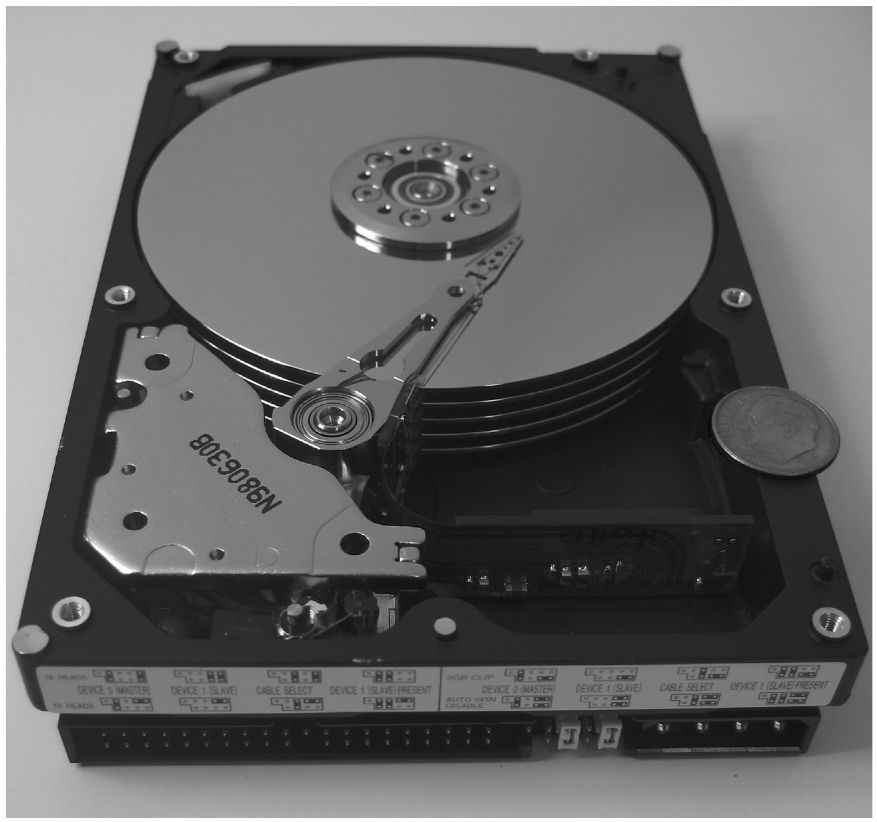

Hình 8.19 Hard disk

> Máy tính có địa chỉ 32-bit có thể truy cập tối đa 2<sup>32</sup> byte = 4 GiB bộ nhớ. Đây là một trong những động lực chuyển sang máy tính 64-bit, vốn có thể truy cập nhiều bộ nhớ hơn hẳn.

Chương trình có thể truy cập dữ liệu ở bất kỳ đâu trong virtual memory, nên phải dùng virtual address xác định vị trí trong virtual memory. Physical memory chứa một tập con của virtual memory được truy cập gần đây nhất. Theo cách này, physical memory đóng vai trò cache cho virtual memory. Do đó, phần lớn lần truy cập hit trong physical memory với tốc độ DRAM, trong khi chương trình vẫn hưởng dung lượng của virtual memory lớn hơn.

Virtual memory system dùng thuật ngữ khác cho cùng những nguyên tắc caching đã thảo luận ở Mục 8.3. Bảng 8.3 tóm tắt các thuật ngữ tương ứng. Virtual memory được chia thành virtual page, thường có kích thước 4 KiB. Tương tự, physical memory được chia thành physical page cùng kích thước. Một virtual page có thể nằm trong physical memory (DRAM) hoặc trên hard drive. Ví dụ, Hình 8.20 cho thấy virtual memory lớn hơn physical memory. Các hình chữ nhật biểu thị page. Một số virtual page có trong physical memory và một số nằm trên hard drive. Quá trình xác định physical address từ virtual address gọi là address translation. Nếu processor cố truy cập virtual address không có trong physical memory, page fault xảy ra và operating system (OS) load page từ hard drive vào physical memory.

Bảng 8.3 Các thuật ngữ tương ứng của cache và virtual memory

| Cache | Virtual Memory |
|---|---|
| Block | Page |
| Block size | Page size |
| Block offset | Page offset |
| Miss | Page fault |
| Tag | Virtual page number |

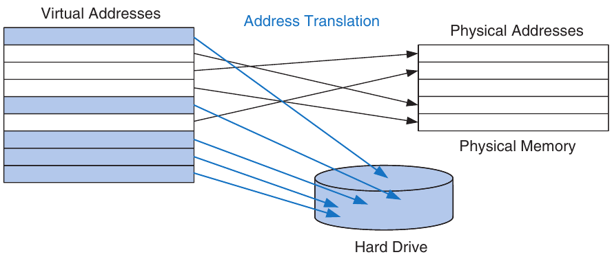

Hình 8.20 Virtual page và physical page

Để tránh page fault do conflict, bất kỳ virtual page nào cũng có thể ánh xạ đến bất kỳ physical page nào. Nói cách khác, physical memory hoạt động như fully associative cache cho virtual memory. Trong fully associative cache thông thường, mỗi cache block có một comparator kiểm tra các address bit quan trọng nhất với tag để xác định yêu cầu có hit trong block không. Trong virtual memory system tương tự, mỗi physical page sẽ cần một comparator để kiểm tra các virtual address bit quan trọng nhất với tag nhằm xác định virtual page có ánh xạ đến physical page đó hay không.

Virtual memory system thực tế có nhiều physical page đến mức việc cung cấp comparator cho mỗi page sẽ quá đắt. Thay vào đó, virtual memory system dùng page table để thực hiện address translation. Page table chứa một entry cho mỗi virtual page, cho biết vị trí của nó trong physical memory hoặc cho biết nó nằm trên hard drive. Mỗi load hoặc store instruction cần truy cập page table rồi truy cập physical memory. Lần truy cập page table dịch virtual address mà chương trình dùng thành physical address. Sau đó physical address được dùng để thực sự đọc hoặc ghi dữ liệu.

Page table thường lớn đến mức được đặt trong physical memory. Vì vậy, mỗi load hoặc store gồm hai lần truy cập physical memory: truy cập page table và truy cập dữ liệu. Để tăng tốc address translation, translation lookaside buffer (TLB) cache các page table entry thường dùng nhất.

Phần còn lại của mục này giải thích kỹ hơn về address translation, page table và TLB.

### 8.4.1 Address Translation

Trong hệ thống có virtual memory, chương trình dùng virtual address để có thể truy cập bộ nhớ lớn. Máy tính phải dịch các virtual address này để tìm địa chỉ trong physical memory hoặc chịu page fault và lấy dữ liệu từ hard drive.

Hãy nhớ virtual memory và physical memory được chia thành page. Những bit quan trọng nhất của virtual address hoặc physical address xác định virtual page number hoặc physical page number. Những bit ít quan trọng nhất xác định word trong page và được gọi là page offset.

Hình 8.21 minh họa cách tổ chức page của virtual memory system có 2 GiB virtual memory và 128 MiB physical memory, chia thành page 4 KiB. MIPS hỗ trợ địa chỉ 32-bit. Với virtual memory 2 GiB = 2<sup>31</sup>-byte, chỉ 31 virtual address bit ít quan trọng nhất được dùng; bit thứ 32 luôn bằng 0. Tương tự, với physical memory 128 MiB = 2<sup>27</sup>-byte, chỉ 27 physical address bit ít quan trọng nhất được dùng; 5 bit phía trên luôn bằng 0.

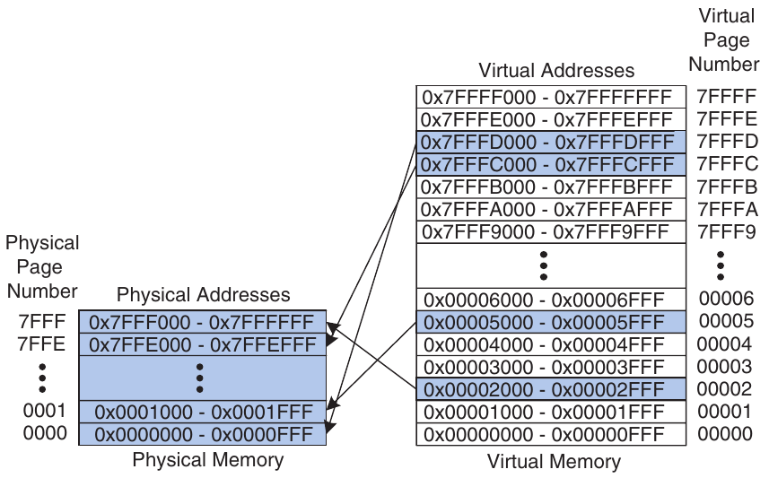

Hình 8.21 Physical page và virtual page

Vì page size là 4 KiB = 2<sup>12</sup> byte, có 2<sup>31</sup>/2<sup>12</sup> = 2<sup>19</sup> virtual page và 2<sup>27</sup>/2<sup>12</sup> = 2<sup>15</sup> physical page. Vì vậy, virtual page number và physical page number lần lượt có 19 và 15 bit. Physical memory chỉ có thể chứa tối đa 1/16 số virtual page tại bất kỳ thời điểm nào. Những virtual page còn lại được giữ trên hard drive.

Hình 8.21 cho thấy virtual page 5 ánh xạ đến physical page 1, virtual page 0x7FFFC ánh xạ đến physical page 0x7FFE, v.v. Ví dụ, virtual address 0x53F8 (offset 0x3F8 trong virtual page 5) ánh xạ đến physical address 0x13F8 (offset 0x3F8 trong physical page 1). 12 bit ít quan trọng nhất của virtual address và physical address giống nhau (0x3F8), xác định page offset trong virtual page và physical page. Chỉ cần dịch page number để thu được physical address từ virtual address.

Hình 8.22 minh họa việc dịch virtual address thành physical address. 12 bit ít quan trọng nhất chỉ page offset và không cần dịch. 19 bit phía trên của virtual address xác định virtual page number (VPN) và được dịch thành physical page number (PPN) 15-bit. Hai mục tiếp theo mô tả cách sử dụng page table và TLB để thực hiện address translation này.

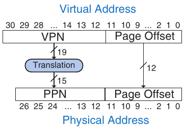

Hình 8.22 Dịch từ virtual address sang physical address

#### Ví dụ 8.13 DỊCH VIRTUAL ADDRESS SANG PHYSICAL ADDRESS

Tìm physical address của virtual address 0x247C bằng virtual memory system trong Hình 8.21.

Lời giải Page offset 12-bit (0x47C) không cần dịch. 19 bit còn lại của virtual address cho virtual page number, nên virtual address 0x247C nằm trong virtual page 0x2. Trong Hình 8.21, virtual page 0x2 ánh xạ đến physical page 0x7FFF. Vì vậy, virtual address 0x247C ánh xạ đến physical address 0x7FFF47C.

### 8.4.2 Page Table

Processor dùng page table để dịch virtual address thành physical address. Page table chứa một entry cho mỗi virtual page. Entry này chứa physical page number và valid bit. Nếu valid bit bằng 1, virtual page ánh xạ đến physical page được chỉ định trong entry. Nếu không, virtual page nằm trên hard drive.

Vì page table rất lớn, nó được lưu trong physical memory. Hiện tại hãy giả sử nó được lưu dưới dạng array liên tục, như Hình 8.23. Page table này chứa mapping của memory system ở Hình 8.21. Page table được đánh index bằng virtual page number (VPN). Ví dụ, entry 5 chỉ rằng virtual page 5 ánh xạ đến physical page 1. Entry 6 không hợp lệ (V = 0), nên virtual page 6 nằm trên hard drive.

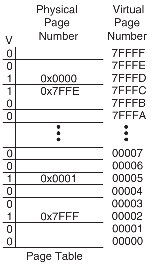

Hình 8.23 Page table cho Hình 8.21

#### Ví dụ 8.14 SỬ DỤNG PAGE TABLE ĐỂ THỰC HIỆN ADDRESS TRANSLATION

Tìm physical address của virtual address 0x247C bằng page table trong Hình 8.23.

Lời giải Hình 8.24 cho thấy việc dịch virtual address thành physical address cho virtual address 0x247C. Page offset 12-bit không cần dịch. 19 bit còn lại của virtual address là virtual page number, 0x2, và cung cấp index vào page table. Page table ánh xạ virtual page 0x2 đến physical page 0x7FFF. Vì vậy, virtual address 0x247C ánh xạ đến physical address 0x7FFF47C. 12 bit ít quan trọng nhất giống nhau trong cả physical address lẫn virtual address.

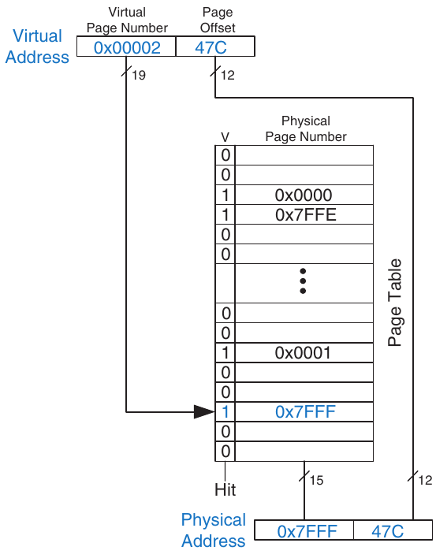

Hình 8.24 Address translation bằng page table

Page table có thể được lưu ở bất kỳ đâu trong physical memory theo quyết định của OS. Processor thường sử dụng một register chuyên dụng, gọi là page table register, để lưu base address của page table trong physical memory.

Để thực hiện load hoặc store, processor trước hết phải dịch virtual address thành physical address rồi truy cập dữ liệu tại physical address đó. Processor trích virtual page number từ virtual address và cộng với page table register để tìm physical address của page table entry. Sau đó processor đọc page table entry này từ physical memory để lấy physical page number. Nếu entry hợp lệ, nó ghép physical page number này với page offset để tạo physical address. Cuối cùng, nó đọc hoặc ghi dữ liệu tại physical address đó. Vì page table được lưu trong physical memory, mỗi load hoặc store gồm hai lần truy cập physical memory.

### 8.4.3 Translation Lookaside Buffer

Virtual memory sẽ ảnh hưởng nghiêm trọng đến hiệu năng nếu cần đọc page table trong mỗi load hoặc store, làm tăng gấp đôi độ trễ của load và store. May thay, truy cập page table có temporal locality rất tốt. Temporal locality và spatial locality của truy cập dữ liệu cùng page size lớn có nghĩa là nhiều load hoặc store liên tiếp có khả năng tham chiếu cùng page. Vì vậy, nếu processor nhớ page table entry vừa đọc, nó có thể dùng lại phép dịch này mà không đọc lại page table. Nói chung, processor có thể giữ vài page table entry cuối trong một cache nhỏ gọi là translation lookaside buffer (TLB). Processor “nhìn sang bên” để tìm phép dịch trong TLB trước khi phải truy cập page table trong physical memory. Trong chương trình thực tế, đại đa số lần truy cập hit trong TLB, tránh những lần đọc page table time-consuming từ physical memory.

TLB được tổ chức như fully associative cache và thường chứa 16 đến 512 entry. Mỗi TLB entry giữ một virtual page number và physical page number tương ứng. TLB được truy cập bằng virtual page number. Nếu TLB hit, nó trả về physical page number tương ứng. Nếu không, processor phải đọc page table trong physical memory. TLB được thiết kế đủ nhỏ để có thể truy cập trong chưa đến một cycle. Dù vậy, TLB thường có hit rate lớn hơn 99%. TLB giảm số lần truy cập bộ nhớ cần cho phần lớn load hoặc store instruction từ hai xuống một.

#### Ví dụ 8.15 SỬ DỤNG TLB ĐỂ THỰC HIỆN ADDRESS TRANSLATION

Xét virtual memory system ở Hình 8.21. Dùng TLB two-entry hoặc giải thích tại sao cần truy cập page table để dịch virtual address 0x247C và 0x5FB0 thành physical address. Giả sử TLB hiện chứa các phép dịch hợp lệ của virtual page 0x2 và 0x7FFFD.

Lời giải Hình 8.25 cho thấy TLB two-entry với yêu cầu cho virtual address 0x247C. TLB nhận virtual page number của địa chỉ đi vào, 0x2, và so sánh với virtual page number của mỗi entry. Entry 0 khớp và hợp lệ, nên yêu cầu hit. Physical address sau khi dịch là physical page number của entry khớp, 0x7FFF, nối với page offset của virtual address. Như mọi khi, page offset không cần dịch.

Yêu cầu cho virtual address 0x5FB0 miss trong TLB. Vì vậy, yêu cầu được chuyển đến page table để dịch.

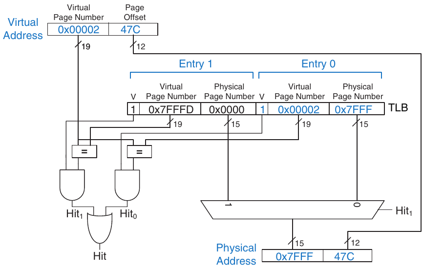

Hình 8.25 Address translation bằng TLB two-entry

### 8.4.4 Memory Protection

Cho đến đây, mục này tập trung vào việc dùng virtual memory để cung cấp bộ nhớ nhanh, rẻ và lớn. Một lý do cũng quan trọng không kém để dùng virtual memory là bảo vệ giữa các chương trình đang chạy đồng thời.

Như bạn có lẽ đã biết, máy tính hiện đại thường chạy vài chương trình hay process cùng lúc. Mọi chương trình cùng hiện diện trong physical memory. Trong hệ thống máy tính well-designed, các chương trình nên được bảo vệ khỏi nhau để không chương trình nào có thể làm crash hoặc chiếm quyền một chương trình khác. Cụ thể, không chương trình nào được truy cập bộ nhớ của chương trình khác khi chưa được cho phép. Đây gọi là memory protection.

Virtual memory system cung cấp memory protection bằng cách cấp cho mỗi chương trình một virtual address space riêng. Mỗi chương trình có thể dùng bộ nhớ tùy nhu cầu trong virtual address space đó, nhưng chỉ một phần virtual address space nằm trong physical memory tại bất kỳ thời điểm nào. Mỗi chương trình có thể dùng toàn bộ virtual address space mà không cần lo chương trình khác thực sự nằm ở đâu. Tuy nhiên, chương trình chỉ có thể truy cập những physical page được ánh xạ trong page table của nó. Theo cách này, chương trình không thể vô tình hoặc cố ý truy cập physical page của chương trình khác vì chúng không được ánh xạ trong page table của nó. Trong một số trường hợp, nhiều chương trình truy cập instruction hoặc dữ liệu chung. OS thêm control bit vào mỗi page table entry để quyết định chương trình nào, nếu có, được ghi vào các physical page dùng chung.

### 8.4.5 Replacement Policy\*

Virtual memory system sử dụng write-back và replacement policy least recently used (LRU) xấp xỉ. Policy write-through, trong đó mỗi lần ghi physical memory khởi tạo một lần ghi hard drive, sẽ không thực tế. Store instruction sẽ hoạt động ở tốc độ hard drive thay vì processor (millisecond thay vì nanosecond). Theo policy writeback, physical page chỉ được ghi lại hard drive khi bị đẩy khỏi physical memory. Việc ghi physical page lại hard drive rồi load một virtual page khác vào đó gọi là paging, và hard drive trong virtual memory system đôi khi gọi là swap space. Processor page out một trong những physical page ít được sử dụng gần đây nhất khi page fault xảy ra, rồi thay page đó bằng virtual page đang thiếu. Để hỗ trợ những replacement policy này, mỗi page table entry chứa thêm hai status bit: dirty bit D và use bit U.

Dirty bit bằng 1 nếu bất kỳ store instruction nào đã thay đổi physical page kể từ khi nó được đọc từ hard drive. Khi physical page được page out, chỉ cần ghi lại hard drive nếu dirty bit bằng 1; nếu không, hard drive đã giữ một bản sao chính xác của page.

Use bit bằng 1 nếu physical page được truy cập gần đây. Giống cache system, thay thế LRU chính xác sẽ phức tạp đến mức không thực tế. Thay vào đó, OS xấp xỉ thay thế LRU bằng cách định kỳ reset mọi use bit trong page table. Khi page được truy cập, use bit được đặt thành 1. Khi page fault, OS tìm page có U = 0 để page out khỏi physical memory. Vì vậy, nó không nhất thiết thay page ít được sử dụng gần đây nhất, mà chỉ thay một trong những page ít được sử dụng gần đây nhất.

### 8.4.6 Multilevel Page Table\*

Page table có thể chiếm lượng physical memory lớn. Ví dụ, page table từ các mục trước cho virtual memory 2 GiB có page 4 KiB sẽ cần 2<sup>19</sup> entry. Nếu mỗi entry có 4 byte, page table có kích thước 2<sup>19</sup> × 2<sup>2</sup> byte = 2<sup>21</sup> byte = 2 MiB.

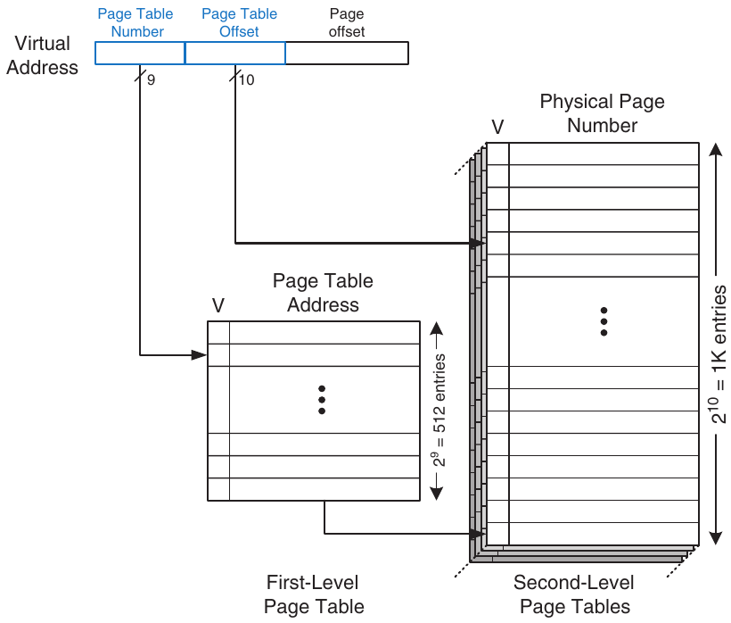

Hình 8.26 Hierarchical page table

Để tiết kiệm physical memory, có thể chia page table thành nhiều tầng (thường là hai). Page table first-level luôn được giữ trong physical memory. Nó chỉ vị trí lưu các page table second-level nhỏ trong virtual memory. Mỗi page table second-level chứa những phép dịch thực tế cho một dải virtual page. Nếu một dải phép dịch cụ thể không được sử dụng tích cực, page table second-level tương ứng có thể được page out ra hard drive để không lãng phí physical memory.

Trong page table two-level, virtual page number được chia thành hai phần: page table number và page table offset, như Hình 8.26. Page table number đánh index vào page table first-level, vốn phải nằm trong physical memory. Page table entry first-level cho base address của page table second-level hoặc chỉ rằng nó phải được lấy từ hard drive khi V bằng 0. Page table offset đánh index vào page table second-level. 12 bit còn lại của virtual address là page offset, như trước, cho page size 2<sup>12</sup> = 4 KiB.

Trong Hình 8.26, virtual page number 19-bit được chia thành 9 và 10 bit để lần lượt chỉ page table number và page table offset. Vì vậy, page table first-level có 2<sup>9</sup> = 512 entry. Mỗi page table trong 512 page table second-level này có 2<sup>10</sup> = 1 Ki entry. Nếu mỗi page table entry first- và second-level có 32 bit (4 byte) và chỉ hai page table second-level có mặt trong physical memory cùng lúc, hierarchical page table chỉ dùng (512 × 4 byte) + 2 × (1 Ki × 4 byte) = 10 KiB physical memory. Page table two-level chỉ cần một phần nhỏ physical memory so với việc lưu toàn bộ page table (2 MiB). Nhược điểm của page table two-level là thêm một lần truy cập bộ nhớ nữa cho phép dịch khi TLB miss.

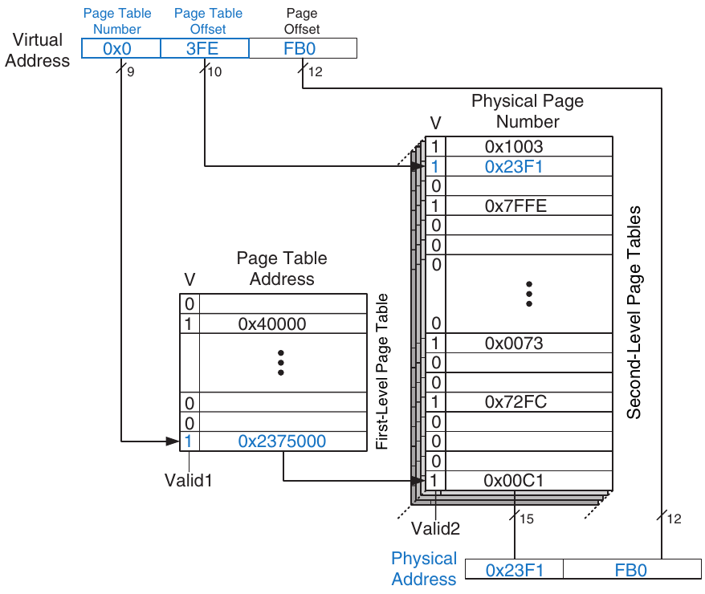

Hình 8.27 Address translation bằng page table two-level

#### Ví dụ 8.16 SỬ DỤNG MULTILEVEL PAGE TABLE ĐỂ THỰC HIỆN ADDRESS TRANSLATION

Hình 8.27 cho thấy nội dung có thể có của page table two-level ở Hình 8.26. Chỉ nội dung của một page table second-level được thể hiện. Dùng page table two-level này, hãy mô tả điều gì xảy ra khi truy cập virtual address 0x003FEFB0.

Lời giải Như mọi khi, chỉ virtual page number cần dịch. Chín bit quan trọng nhất của virtual address, 0x0, cho page table number, tức index vào page table first-level. Page table first-level tại entry 0x0 chỉ rằng page table second-level đang nằm trong bộ nhớ (V = 1) và physical address của nó là 0x2375000. Mười bit tiếp theo của virtual address, 0x3FE, là page table offset, cung cấp index vào page table second-level. Entry 0 nằm dưới cùng của page table second-level, và entry 0x3FF ở trên cùng. Entry 0x3FE trong page table second-level chỉ rằng virtual page đang nằm trong physical memory (V = 1) và physical page number là 0x23F1. Physical page number được nối với page offset để tạo physical address, 0x23F1FB0.

## 8.5 TỔNG KẾT

Cách tổ chức memory system là yếu tố chính quyết định hiệu năng máy tính. Những công nghệ bộ nhớ khác nhau—như DRAM, SRAM và hard drive—đưa ra các trade-offs về dung lượng, tốc độ và chi phí. Chương này đã giới thiệu cách tổ chức cache và virtual memory sử dụng memory hierarchy để gần đạt bộ nhớ lý tưởng vừa lớn, nhanh vừa rẻ. Main memory thường được xây dựng từ DRAM, chậm hơn đáng kể so với processor. Cache giảm thời gian truy cập bằng cách giữ dữ liệu thường dùng trong SRAM nhanh. Virtual memory tăng dung lượng bộ nhớ bằng cách dùng hard drive để lưu dữ liệu không vừa main memory. Cache và virtual memory làm tăng độ phức tạp và phần cứng của hệ thống máy tính, nhưng lợi ích thường lớn hơn chi phí. Mọi máy tính cá nhân hiện đại đều sử dụng cache và virtual memory. Phần lớn processor cũng dùng memory interface để giao tiếp với thiết bị input/output (I/O). Đây gọi là memory-mapped I/O. Chương trình dùng load và store operation để truy cập thiết bị I/O, được thảo luận trong Chương 9, chương bổ sung trực tuyến có trên website đồng hành của sách này (xem Lời nói đầu).

## LỜI KẾT

Chương này đưa chúng ta đến cuối hành trình cùng nhau khám phá thế giới digital system. Chúng tôi hy vọng cuốn sách đã truyền tải vẻ đẹp và sự hứng khởi của lĩnh vực này cũng như kiến thức kỹ thuật. Bạn đã học cách thiết kế combinational logic và sequential logic bằng schematic và hardware description language. Bạn đã quen với các building block lớn hơn như multiplexer, ALU và bộ nhớ. Máy tính là một trong những ứng dụng hấp dẫn nhất của digital system. Bạn đã học cách lập trình RISC-V processor bằng assembly language gốc và cách xây dựng processor cùng memory system bằng các digital building block. Xuyên suốt sách, bạn đã thấy ứng dụng của abstraction, discipline, hierarchy, modularity và regularity. Với những kỹ thuật này, chúng ta đã ghép lại các mảnh ghép về hoạt động bên trong microprocessor. Từ điện thoại di động đến truyền hình kỹ thuật số, xe tự hành trên Sao Hỏa và hệ thống chụp ảnh y khoa, thế giới của chúng ta ngày càng trở nên kỹ thuật số.

Hãy hình dung Charles Babbage hẳn đã chấp nhận sự đánh đổi kiểu Faust nào để được trải qua hành trình tương tự một thế kỷ rưỡi trước. Ông chỉ mong tính các bảng toán học với độ chính xác cơ học. Digital system ngày nay là khoa học viễn tưởng của ngày hôm qua. Liệu Dick Tracy có thể đã nghe iTunes trên điện thoại di động? Liệu Jules Verne có thể đã phóng một chòm vệ tinh định vị toàn cầu vào không gian? Liệu Hippocrates có thể đã chữa bệnh bằng ảnh não kỹ thuật số high-resolution? Nhưng đồng thời, cơn ác mộng của George Orwell về sự giám sát khắp nơi của chính phủ mỗi ngày lại gần hiện thực hơn. Hacker và các chính phủ tiến hành chiến tranh mạng không tuyên bố, tấn công hạ tầng công nghiệp và mạng tài chính. Và các quốc gia bất hảo phát triển vũ khí hạt nhân bằng laptop mạnh hơn các supercomputer room-sized từng mô phỏng bom thời Chiến tranh Lạnh. Cuộc cách mạng microprocessor tiếp tục tăng tốc. Những thay đổi trong các thập kỷ tới sẽ vượt qua những thay đổi của quá khứ. Giờ đây bạn có công cụ để thiết kế và xây dựng những hệ thống mới sẽ định hình tương lai chúng ta. Quyền năng mới này đi cùng trách nhiệm sâu sắc. Chúng tôi hy vọng bạn sử dụng nó không chỉ vì niềm vui và sự giàu có mà còn vì lợi ích nhân loại.

## Bài tập

Bài tập 8.1 Trong chưa đến một trang, hãy mô tả bốn hoạt động hằng ngày thể hiện temporal locality hoặc spatial locality. Liệt kê hai hoạt động cho mỗi loại locality và trình bày cụ thể.

Bài tập 8.2 Trong một đoạn văn, hãy mô tả hai ứng dụng máy tính ngắn thể hiện temporal locality và/hoặc spatial locality. Mô tả cách chúng thể hiện điều đó. Hãy trình bày cụ thể.

Bài tập 8.3 Hãy đưa ra một chuỗi địa chỉ mà direct mapped cache có kích thước (dung lượng) 16 word và block size 4 word hoạt động tốt hơn fully associative cache dùng thay thế least recently used (LRU), có cùng dung lượng và block size.

Bài tập 8.4 Lặp lại Bài tập 8.3 cho trường hợp fully associative cache hoạt động tốt hơn direct mapped cache.

Bài tập 8.5 Mô tả các trade-offs khi tăng từng tham số cache sau trong khi giữ nguyên các tham số còn lại:

(a) block size

(b) associativity

(c) kích thước cache

Bài tập 8.6 Miss rate của two-way set associative cache luôn luôn, thường xuyên, đôi khi hay không bao giờ tốt hơn direct mapped cache có cùng dung lượng và block size? Giải thích.

Bài tập 8.7 Mỗi phát biểu sau liên quan đến miss rate của cache. Đánh dấu mỗi phát biểu là đúng hoặc sai. Giải thích ngắn gọn lập luận; đưa ra phản ví dụ nếu phát biểu sai.

(a) Cache two-way set associative luôn có miss rate thấp hơn direct mapped cache có cùng block size và tổng dung lượng.

(b) Direct mapped cache 16 KiB luôn có miss rate thấp hơn direct mapped cache 8 KiB có cùng block size.

(c) Instruction cache có block size 32-byte thường có miss rate thấp hơn instruction cache có block size 8-byte, khi cùng degree of associativity và tổng dung lượng.

Bài tập 8.8 Cache có các tham số sau: b, block size tính bằng số word; S, số set; N, số way; và A, số address bit.

(a) Theo các tham số đã mô tả, dung lượng cache C bằng bao nhiêu?

(b) Theo các tham số đã mô tả, tổng số bit cần để lưu các tag bằng bao nhiêu?

(c) S và N bằng bao nhiêu với fully associative cache có dung lượng C word và block size b?

(d) S bằng bao nhiêu với direct mapped cache có kích thước C word và block size b?

Bài tập 8.9 Cache 16-word có các tham số trong Bài tập 8.8. Xét chuỗi địa chỉ `lw` lặp lại sau (biểu diễn ở hệ hexadecimal):

40 44 48 4C 70 74 78 7C 80 84 88 8C 90 94 98 9C 0 48 C 10 14 18 1C 20

Giả sử associative cache dùng thay thế least recently used (LRU), hãy xác định miss rate hiệu dụng khi chuỗi được đưa vào các cache sau, bỏ qua ảnh hưởng start-up (tức compulsory miss).

(a) direct mapped cache, b = 1 word

(b) fully associative cache, b = 1 word

(c) two-way set associative cache, b = 1 word

(d) direct mapped cache, b = 2 word

Bài tập 8.10 Lặp lại Bài tập 8.9 cho chuỗi địa chỉ `lw` lặp lại sau (biểu diễn ở hệ hexadecimal) và các cấu hình cache. Dung lượng cache vẫn là 16 word.

74 A0 78 38C AC 84 88 8C 7C 34 38 13C 388 18C

(a) direct mapped cache, b = 1 word

(b) fully associative cache, b = 2 word

(c) two-way set associative cache, b = 2 word

(d) direct mapped cache, b = 4 word

Bài tập 8.11 Giả sử bạn chạy một chương trình có data access pattern sau (biểu diễn ở hệ hexadecimal). Pattern chỉ được thực thi một lần.

0 8 10 18 20 28

(a) Nếu dùng direct mapped cache có kích thước cache 1 KiB và block size 8 byte (2 word), cache có bao nhiêu set?

(b) Với cùng cache và block size ở phần (a), miss rate của direct mapped cache đối với memory access pattern đã cho bằng bao nhiêu?

(c) Với memory access pattern đã cho, phương án nào sau đây sẽ giảm miss rate nhiều nhất? (Dung lượng cache được giữ nguyên.) Khoanh một lựa chọn.

(i) Tăng degree of associativity lên 2.

(ii) Tăng block size lên 16 byte.

(iii) (i) hoặc (ii) đều được.

(iv) Cả (i) lẫn (ii) đều không.

Bài tập 8.12 Bạn đang xây dựng instruction cache cho RISC-V processor. Nó có tổng dung lượng 4C = 2<sup>c+2</sup> byte. Nó là set associative N = 2<sup>n</sup>-way (N ≥ 8), với block size b = 2<sup>b′</sup> byte (b ≥ 8). Hãy trả lời các câu hỏi sau theo các tham số này.

(a) Những bit nào của địa chỉ được dùng để chọn một word trong block?

(b) Những bit nào của địa chỉ được dùng để chọn set trong cache?

(c) Mỗi tag có bao nhiêu bit?

(d) Toàn bộ cache có bao nhiêu tag bit?

Bài tập 8.13 Xét cache có các tham số sau: N (associativity) = 2, b (block size) = 2 word, W (word size) = 32 bit, C (kích thước cache) = 32 Ki word, A (kích thước địa chỉ) = 32 bit. Bạn chỉ cần xét word address.

(a) Chỉ ra các tag bit, set bit, block offset bit và byte offset bit của địa chỉ. Nêu số bit cần cho mỗi trường.

(b) Kích thước của toàn bộ cache tag tính bằng bit bằng bao nhiêu?

(c) Giả sử mỗi cache block còn có valid bit (V) và dirty bit (D). Kích thước mỗi cache set, bao gồm data bit, tag bit và status bit, bằng bao nhiêu?

(d) Thiết kế cache bằng các building block ở Hình 8.28 và một số ít logic gate two-input. Thiết kế cache phải bao gồm phần lưu trữ tag, phần lưu trữ

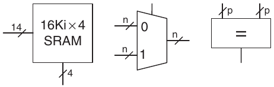

Hình 8.28 Building block

dữ liệu, so sánh địa chỉ, lựa chọn data output và mọi thành phần khác mà bạn thấy liên quan. Lưu ý rằng các block multiplexer và comparator có thể có kích thước bất kỳ (độ rộng lần lượt n hoặc p bit), nhưng các block SRAM phải có

kích thước 16Ki × 4 bit. Nhớ kèm theo block diagram được ghi nhãn rõ ràng. Bạn chỉ cần thiết kế cache cho thao tác đọc.

Bài tập 8.14 Bạn vừa gia nhập một Internet start-up đầy triển vọng để chế tạo đồng hồ đeo tay có pager built-in và Web browser. Nó dùng embedded processor có sơ đồ multilevel cache ở Hình 8.29. Processor có cache on-chip nhỏ cùng với cache second-level off-chip lớn. (Đúng vậy, chiếc đồng hồ nặng 3 pound, nhưng bạn phải xem nó lướt Web mới hiểu!)

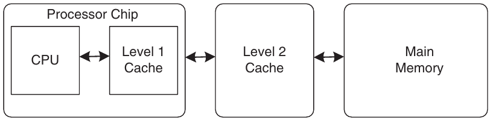

Hình 8.29 Hệ thống máy tính

Giả sử processor dùng physical address 32-bit nhưng chỉ truy cập dữ liệu tại word boundary. Các cache có đặc điểm trong Bảng 8.4. DRAM có thời gian truy cập t<sub>m</sub> và kích thước 512 MiB.

Bảng 8.4 Đặc điểm bộ nhớ

| Đặc điểm | Cache On-chip | Cache Off-chip |
|---|---|---|
| Cách tổ chức | Four-way set associative | Direct mapped |
| Hit rate | A | B |
| Thời gian truy cập | t<sub>a</sub> | t<sub>b</sub> |
| Block size | 16 byte | 16 byte |
| Số block | 512 | 256 Ki |

(a) Với một word nhất định trong bộ nhớ, tổng số vị trí có thể tìm thấy nó trong cache on-chip và cache second-level bằng bao nhiêu?

(b) Kích thước tính bằng bit của mỗi tag cho cache on-chip và cache second-level bằng bao nhiêu?

(c) Đưa ra biểu thức cho thời gian truy cập đọc bộ nhớ trung bình. Các cache được truy cập tuần tự.

(d) Phép đo cho thấy với một bài toán cụ thể đang quan tâm, hit rate của cache on-chip là 85% và hit rate của cache second-level là 90%. Tuy nhiên, khi tắt cache on-chip, hit rate của cache second-level tăng vọt lên 98.5%. Hãy giải thích ngắn gọn hiện tượng này.

Bài tập 8.15 Chương này đã mô tả replacement policy least recently used (LRU) cho multiway associative cache. Những replacement policy khác ít phổ biến hơn gồm first-in-first-out (FIFO) và ngẫu nhiên. Thay thế FIFO đẩy block đã ở trong cache lâu nhất ra ngoài, bất kể nó được truy cập gần đây đến mức nào. Thay thế ngẫu nhiên chọn ngẫu nhiên một block để đẩy ra.

(a) Thảo luận ưu điểm và nhược điểm của từng replacement policy này.

(b) Mô tả data access pattern mà FIFO sẽ hoạt động tốt hơn LRU.

Bài tập 8.16 Bạn đang xây dựng máy tính có hierarchical memory system gồm instruction cache và data cache riêng, tiếp theo là main memory. Bạn dùng RISC-V multicycle processor ở Hình 7.44 chạy ở 1 GHz.

(a) Giả sử instruction cache hoàn hảo (tức luôn hit) nhưng data cache có miss rate 5%. Khi cache miss, processor stall 60 ns để truy cập main memory rồi tiếp tục hoạt động bình thường. Tính cả cache miss, thời gian truy cập bộ nhớ trung bình bằng bao nhiêu?

(b) Trung bình cần bao nhiêu clock cycle mỗi instruction (CPI) cho load word instruction và store word instruction khi tính đến memory system không lý tưởng?

(c) Xét ứng dụng benchmark ở Ví dụ 7.7 có 25% load, 10% store, 11% branch, 2% jump và 52% instruction R-type[^3]. Tính đến memory system non-ideal, CPI trung bình của benchmark này bằng bao nhiêu?

(d) Giờ giả sử instruction cache cũng non-ideal và có miss rate 7%. CPI trung bình của benchmark ở phần (c) bằng bao nhiêu? Hãy tính cả instruction cache miss và data cache miss.

Bài tập 8.17 Lặp lại Bài tập 8.16 với các tham số sau.

(a) Instruction cache hoàn hảo (tức luôn hit) nhưng data cache có miss rate 15%. Khi cache miss, processor stall 200 ns để truy cập main memory rồi tiếp tục hoạt động bình thường. Tính cả cache miss, thời gian truy cập bộ nhớ trung bình bằng bao nhiêu?

(b) Trung bình cần bao nhiêu clock cycle mỗi instruction (CPI) cho load word instruction và store word instruction khi tính đến memory system non-ideal?

(c) Xét ứng dụng benchmark ở Ví dụ 7.7 có 25% load, 10% store, 11% branch, 2% jump và 52% instruction R-type. Tính đến memory system không lý tưởng, CPI trung bình của benchmark này bằng bao nhiêu?

(d) Giờ giả sử instruction cache cũng không lý tưởng và có miss rate 10%. CPI trung bình của benchmark ở phần (c) bằng bao nhiêu? Hãy tính cả instruction cache miss và data cache miss.

Bài tập 8.18 Nếu máy tính dùng virtual address 64-bit, nó có thể truy cập bao nhiêu virtual memory? Lưu ý rằng 2<sup>40</sup> byte = 1 terabyte (tebibyte), 2<sup>50</sup> byte = 1 petabyte (pebibyte), và 2<sup>60</sup> byte = 1 exabyte (exbibyte).

Bài tập 8.19 Người thiết kế supercomputer chọn chi \$1 triệu cho DRAM và cùng số tiền đó cho hard disk làm virtual memory. Dùng giá ở Hình 8.4, máy tính sẽ có bao nhiêu physical memory và virtual memory? Cần bao nhiêu bit physical address và virtual address để truy cập bộ nhớ này?

Bài tập 8.20 Xét virtual memory system có thể đánh địa chỉ tổng cộng 2<sup>32</sup> byte. Bạn có không gian hard drive không giới hạn nhưng chỉ có 8 MiB bộ nhớ bán dẫn (physical). Giả sử virtual page và physical page đều có kích thước 4 KiB.

(a) Physical address có bao nhiêu bit?

(b) Số virtual page tối đa trong hệ thống bằng bao nhiêu?

(c) Có bao nhiêu physical page trong hệ thống?

(d) Virtual page number và physical page number có bao nhiêu bit?

(e) Giả sử bạn đề xuất sơ đồ direct mapped ánh xạ virtual page sang physical page. Mapping dùng các bit ít quan trọng nhất của virtual page number để xác định physical page number. Có bao nhiêu virtual page ánh xạ đến mỗi physical page? Tại sao “direct mapping” này là phương án tồi?

(f) Rõ ràng, cần một phương pháp linh hoạt hơn và có tính động hơn phương pháp được mô tả trong phần (e) để chuyển đổi virtual address thành physical address. Giả sử bạn sử dụng page table để lưu các mapping (phép chuyển đổi từ virtual page number sang physical page number). Page table sẽ chứa bao nhiêu page table entry?

(g) Giả sử ngoài physical page number, mỗi page table entry còn chứa một số thông tin trạng thái dưới dạng valid bit (V) và dirty bit (D). Mỗi page table entry dài bao nhiêu byte? (Làm tròn lên số byte nguyên.)

(h) Phác họa bố cục page table. Tổng kích thước page table tính bằng byte bằng bao nhiêu?

Bài tập 8.21 Xét virtual memory system có thể đánh địa chỉ tổng cộng 2<sup>50</sup> byte. Bạn có không gian hard drive không giới hạn nhưng chỉ có 2 GiB bộ nhớ bán dẫn (physical). Giả sử virtual page và physical page đều có kích thước 4 KiB.

(a) Physical address có bao nhiêu bit?

(b) Số virtual page tối đa trong hệ thống bằng bao nhiêu?

(c) Có bao nhiêu physical page trong hệ thống?

(d) Virtual page number và physical page number có bao nhiêu bit?

(e) Page table sẽ chứa bao nhiêu page table entry?

(f) Giả sử ngoài physical page number, mỗi page table entry còn chứa một số thông tin trạng thái dưới dạng valid bit (V) và dirty bit (D). Mỗi page table entry dài bao nhiêu byte? (Làm tròn lên số byte nguyên.)

(g) Phác họa bố cục page table. Tổng kích thước page table tính bằng byte bằng bao nhiêu?

Bài tập 8.22 Bạn quyết định tăng tốc virtual memory system ở Bài tập 8.20 bằng translation lookaside buffer (TLB). Giả sử memory system có đặc điểm trong Bảng 8.5. Miss rate của TLB và cache chỉ tần suất không tìm thấy entry được yêu cầu. Miss rate của main memory chỉ tần suất xảy ra page fault.

Bảng 8.5 Đặc điểm bộ nhớ

| Đơn vị bộ nhớ | Thời gian truy cập (Cycle) | Miss Rate |
|---|---|---|
| TLB | 1 | 0.05% |
| Cache | 1 | 2% |
| Main memory | 100 | 0.0003% |
| Hard drive | 1,000,000 | 0% |

(a) Thời gian truy cập bộ nhớ trung bình của virtual memory system trước và sau khi thêm TLB bằng bao nhiêu? Giả sử page table luôn nằm trong physical memory và không bao giờ được giữ trong data cache.

(b) Nếu TLB có 64 entry, TLB lớn bao nhiêu (tính bằng bit)? Cho số bit dữ liệu (physical page number), tag (virtual page number) và valid bit của mỗi entry. Trình bày rõ cách làm.

(c) Phác họa TLB. Ghi nhãn rõ mọi trường và kích thước.

(d) Bạn cần SRAM kích thước bao nhiêu để xây dựng TLB mô tả ở phần (c)? Trả lời theo dạng độ sâu × độ rộng.

Bài tập 8.23 Bạn quyết định tăng tốc virtual memory system ở Bài tập 8.21 bằng translation lookaside buffer (TLB) có 128 entry.

(a) TLB lớn bao nhiêu (tính bằng bit)? Cho số bit dữ liệu (physical page number), tag (virtual page number) và valid bit của mỗi entry. Trình bày rõ cách làm.

(b) Phác họa TLB. Ghi nhãn rõ mọi trường và kích thước.

(c) Bạn cần SRAM kích thước bao nhiêu để xây dựng TLB mô tả ở phần (b)? Trả lời theo dạng độ sâu × độ rộng.

Bài tập 8.24 Giả sử RISC-V multicycle processor mô tả ở Mục 7.4 sử dụng virtual memory system.

(a) Phác họa vị trí TLB trong schematic của multicycle processor.

(b) Mô tả việc thêm TLB ảnh hưởng thế nào đến hiệu năng processor.

Bài tập 8.25 Virtual memory system bạn đang thiết kế dùng page table single-level được xây dựng từ phần cứng chuyên dụng (SRAM và logic liên quan). Nó hỗ trợ virtual address 25-bit, physical address 22-bit và page 2<sup>16</sup>-byte (64 KiB). Mỗi page table entry chứa một physical page number, một valid bit (V) và một dirty bit (D).

(a) Tổng kích thước page table tính bằng bit bằng bao nhiêu?

(b) Nhóm operating system đề xuất giảm page size từ 64 xuống 16 KiB, nhưng các kỹ sư phần cứng trong nhóm bạn phản đối do tăng chi phí phần cứng. Giải thích sự phản đối này.

(c) Page table sẽ được tích hợp trên processor chip cùng cache on-chip. Cache on-chip chỉ xử lý physical address (không phải virtual address). Có thể truy cập set thích hợp của cache on-chip đồng thời với truy cập page table cho một lần truy cập bộ nhớ nhất định không? Giải thích ngắn gọn mối quan hệ cần thiết để truy cập đồng thời cache set và page table entry.

(d) Có thể thực hiện so sánh tag trong cache on-chip đồng thời với truy cập page table cho một lần truy cập bộ nhớ nhất định không? Giải thích ngắn gọn.

Bài tập 8.26 Mô tả một tình huống mà virtual memory system có thể ảnh hưởng đến cách viết ứng dụng. Nhớ thảo luận cách page size và kích thước physical memory ảnh hưởng đến hiệu năng ứng dụng.

Bài tập 8.27 Giả sử bạn sở hữu một personal computer (PC) dùng virtual address 32-bit.

(a) Mỗi chương trình có thể dùng tối đa bao nhiêu virtual memory space?

(b) Kích thước hard drive của PC ảnh hưởng đến hiệu năng thế nào?

(c) Kích thước physical memory của PC ảnh hưởng đến hiệu năng thế nào?

## Câu hỏi phỏng vấn

Các bài tập sau đưa ra những câu hỏi từng được hỏi trong phỏng vấn.

Câu hỏi 8.1 Giải thích sự khác nhau giữa direct mapped cache, set associative cache và fully associative cache. Với mỗi loại cache, mô tả một ứng dụng mà loại cache đó hoạt động tốt hơn hai loại còn lại.

Câu hỏi 8.2 Giải thích cách virtual memory system hoạt động.

Câu hỏi 8.3 Giải thích ưu điểm và nhược điểm của việc dùng virtual memory system.

Câu hỏi 8.4 Giải thích cách virtual page size của memory system có thể ảnh hưởng đến hiệu năng cache.

[^1]: Chúng tôi nhận thấy sinh viên đại học ngày càng ít dùng thư viện vì Internet. Nhưng chúng tôi cũng tin rằng thư viện chứa những kho tri thức khổng lồ của con người, hard-won và không có sẵn ở dạng điện tử. Chúng tôi hy vọng tìm kiếm Web không hoàn toàn thay thế nghệ thuật nghiên cứu thư viện.

[^2]: Mặc dù hiệu năng single-processor gần đây gần như không đổi, như Hình 8.2 cho các năm 2005 đến 2010, sự gia tăng của hệ thống multicore (không thể hiện trên đồ thị) chỉ làm khoảng cách hiệu năng giữa processor và bộ nhớ tệ hơn.

[^3]: Dữ liệu từ Patterson và Hennessy, Computer Organization and Design, ấn bản thứ 4, Morgan Kaufmann, 2011. Sử dụng với sự cho phép.
