# e9 Embedded I/O system

- 9.1 Giới thiệu
- 9.2 Memory-Mapped I/O
- 9.3 Embedded I/O system
- 9.4 Peripheral microcontroller khác
- 9.5 Tóm tắt

## 9.1 GIỚI THIỆU

Input/Output (I/O) system được dùng để kết nối máy tính với thiết bị bên ngoài gọi là peripheral. Trong personal computer, các thiết bị thường gồm bàn phím, màn hình, máy in và mạng không dây. Trong embedded system, thiết bị có thể gồm bộ gia nhiệt của máy nướng bánh, speech synthesizer của búp bê, kim phun nhiên liệu của động cơ, động cơ định vị solar panel của vệ tinh, v.v. Processor truy cập I/O device bằng address bus và data bus giống như cách truy cập bộ nhớ.

Chương này cung cấp ví dụ cụ thể về I/O device. Mục 9.2 trình bày nguyên tắc cơ bản để nối I/O device với processor và truy cập nó từ chương trình. Mục 9.3 xem xét I/O trong bối cảnh embedded system. Mục này hướng dẫn dùng RED-V RedBoard của SparkFun, có RISC-V microcontroller, để truy cập peripheral on-board gồm general-purpose, serial và analog I/O, cùng timer và pulse-width modulation (PWM). Mục 9.4 đưa ra ví dụ kết nối thiết bị phổ biến khác như character LCD, VGA monitor, Bluetooth radio và động cơ.

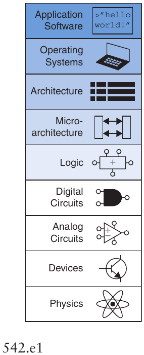

## 9.2 MEMORY-MAPPED I/O

Hãy nhớ từ Mục 6.5.1 rằng một phần address space được dành cho I/O device thay vì bộ nhớ. Ví dụ, giả sử physical address trong khoảng 0x20000000 đến 0x20FFFFFF dùng cho I/O. Mỗi I/O device được gán một hoặc nhiều memory address trong khoảng này. Store đến địa chỉ chỉ định gửi dữ liệu đến thiết bị. Load nhận dữ liệu từ thiết bị. Phương pháp giao tiếp với I/O device này gọi là memory-mapped I/O.

Trong hệ thống có memory-mapped I/O, load hoặc store có thể truy cập bộ nhớ hoặc I/O device. Hình e9.1 cho thấy phần cứng cần để hỗ trợ hai I/O device memory-mapped. Address decoder xác định thiết bị nào giao tiếp với processor. Nó dùng signal Address và MemWrite để tạo control signal cho phần cứng còn lại. Multiplexer ReadData chọn giữa bộ nhớ và các I/O device. Register Write-enabled giữ giá trị ghi vào I/O device.

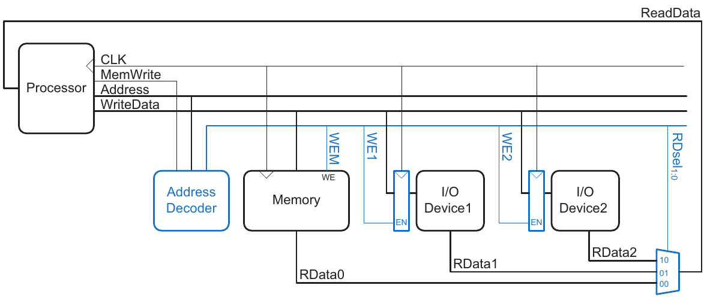

Hình e9.1 Hardware hỗ trợ memory-mapped I/O

> Embedded processor có tên như vậy vì thường được nhúng trong hệ thống lớn hơn (như đồ chơi hoặc ô tô) và có user interface hạn chế. Ngược lại, processor trong PC có interface như bàn phím và màn hình để người dùng lập trình hoặc chạy ứng dụng. Nhưng mọi loại processor về cơ bản giống nhau—đều thực thi instruction. Chỉ interface và peripheral device mà embedded processor và processor truyền thống sử dụng là khác nhau.

### Ví dụ e9.1 GIAO TIẾP I/O DEVICE

Giả sử I/O Device 1 trong Hình e9.1 được gán memory address 0x20001000. Viết code assembly RISC-V để ghi giá trị 7 tới I/O Device 1 và đọc output value từ I/O Device 1.

Lời giải RISC-V assembly code sau ghi giá trị 7 vào I/O Device 1. Assembler directive `.equ` thay symbol có tên bằng giá trị đã cho. Vì vậy, instruction `li s1,ioadr` trở thành `li s1, 0x20001000`.

```
.equ  ioadr     0x20001000
     li   s0,  7
     li   s1,  ioadr
     sw   s0,  0(s1)
```

Address decoder phát hiện địa chỉ 0x20001000 và MemWrite = 1, nên assert WE1, write enable cho register của Device 1. Tại clock edge tiếp theo, giá trị trên WriteData bus, tức 7, được ghi vào register có output nối với input pin của I/O Device 1.

Để đọc từ I/O Device 1, processor thực thi RISC-V assembly code sau.

```
lw s0, 0(s1)
```

Address decoder phát hiện địa chỉ 0x20001000 nên đặt RDsel<sub>1:0</sub> thành 01. Vì vậy, multiplexer chọn RData1, dữ liệu đọc từ Device 1, và nối nó với ReadData bus; giá trị trên bus sau đó được load vào `s0` trong processor.

Các địa chỉ gắn với I/O device thường gọi là I/O register vì có thể tương ứng với physical register trong I/O device như những register ở Hình e9.1.

Phần mềm giao tiếp với I/O device gọi là device driver. Bạn có lẽ đã tải hoặc cài device driver cho máy in hay I/O device khác. Viết device driver đòi hỏi kiến thức chi tiết về phần cứng I/O device, gồm địa chỉ và hành vi của các register memory-mapped I/O. Chương trình khác gọi function trong device driver để truy cập thiết bị mà không cần hiểu phần cứng thiết bị low-level.

> Theo IC Insights, khoảng 24 tỷ microcontroller được bán năm 2020, và thị trường được dự báo tăng 10% mỗi năm đến năm 2029. Giá trung bình của microcontroller độc lập khoảng 60 cent, và microcontroller 8-bit có thể tích hợp trên system-on-chip (SoC) với giá dưới một phần mười cent. Microcontroller đã trở nên phổ biến khắp nơi và gần như vô hình, với ước tính trung bình một ô tô mới năm 2021 có từ 100 microcontroller trở lên.
>
> Ô tô là thị trường microcontroller lớn nhất và fastest-growing, tiếp theo là điện tử tiêu dùng, hệ thống công nghiệp, thiết bị y tế và ứng dụng quân sự. Microcontroller 16-bit chiếm doanh thu lớn nhất năm 2020, nhưng microcontroller 32-bit đang tăng thị phần nhờ khả năng cao hơn.
>
> Các nhà sản xuất microcontroller hàng đầu là Infineon, Microchip, NXP, Renesas, STMicroelectronics và Texas Instruments. Architecture hàng đầu gồm 8051, AVR, PIC và ARM. ARM giữ vị thế near-monopoly với vai trò application processor cho 90% thiết bị di động. Tuy nhiên, RISC-V đang thu hút sự quan tâm lớn như một architecture mới và open-source.

## 9.3 EMBEDDED I/O SYSTEM

Embedded system dùng processor để điều khiển tương tác với môi trường vật lý. Chúng thường được xây dựng quanh microcontroller unit (MCU), kết hợp microprocessor với tập peripheral easy-to-use như digital I/O pin và analog I/O pin general-purpose, serial port, timer, v.v. Microcontroller thường rẻ và được thiết kế để giảm thiểu chi phí, kích thước hệ thống bằng cách tích hợp phần lớn thành phần cần thiết vào một chip. Phần lớn nhỏ và nhẹ hơn đồng dime, tiêu thụ công suất ở mức milliwatt, có giá từ vài dime đến vài dollar. Microcontroller được phân loại theo kích thước dữ liệu mà chúng hoạt động trên đó. Microcontroller 8-bit nhỏ nhất và rẻ nhất, trong khi microcontroller 32-bit cung cấp nhiều bộ nhớ hơn và hiệu năng cao hơn.

### 9.3.1 Board RED-V

Để trình bày cụ thể, mục này minh họa embedded system I/O trong bối cảnh một hệ thống thực. Cụ thể, chúng ta tập trung vào system-on-chip (SoC) FE310-G002 của SiFive, chứa RISC-V processor 32-bit 320 MHz triển khai RV32IMAC architecture—tức base integer instruction set 32-bit (RV32I) cùng extension multiply/divide (M), atomic memory access (A) và compressed instruction 16-bit (C). MCU này có trên development board HiFive của SiFive cũng như các development board third-party như dòng RED-V của SparkFun (có cả footprint Arduino và Thing Plus). Mỗi phần mô tả I/O interface sẽ được theo sau bởi ví dụ cụ thể chạy trên FE310. Mọi ví dụ đã được kiểm tra trên RED-V RedBoard của SparkFun và có thể dễ dàng chạy trên development board HiFive hoặc điều chỉnh cho RED-V Thing Plus Board.

> Trong toàn bộ chương này, RED-V RedBoard được gọi đơn giản là RED-V.

Hình e9.2(a) cho thấy RED-V RedBoard của SparkFun, có giá dưới \$40 và kích thước 2.7” × 2.1”. Hình cũng cho tên signal của từng pin, sẽ được mô tả xuyên suốt mục này. Development board có thể nhận điện từ nguồn USB 5 V hoặc nguồn DC 7 đến 15 V qua barrel jack. FE310-G002 trên board được cấp nguồn bởi regulator on-board 3.3V và 1.8V. FE310-G002 có L1 Instruction Cache 16-KiB và Data SRAM Scratchpad 16-KiB. Development board SparkFun còn có flash storage off-chip 32 MiB, truy cập qua serial peripheral interface (SPI), dùng lưu chương trình và dữ liệu.

> Tài liệu đồng hành của sách này (xem Lời nói đầu) gồm các bài thực hành sử dụng board RED-V.

Hình e9.2(b) cho thấy RED-V Thing Plus có khả năng tương tự RED-V RedBoard nhưng form factor nhỏ hơn (2.3” × 0.9”), vừa breadboard để kết nối thuận tiện. Các I/O pin được đánh số khác RedBoard và khó đọc trên silk screen, nhưng đã được gắn nhãn trong Hình e9.2(b).

Form factor của RED-V RedBoard được thiết kế theo footprint Arduino R3 nhằm giữ tương thích tối đa với nhiều Arduino shield dùng footprint này. Cả 19 I/O signal cấu hình được đều truy cập qua header pin và hoạt động ở 3.3 V. Header còn cung cấp 3.3 V, 5 V và ground để tiện cấp nguồn thiết bị nhỏ gắn vào RedBoard, nhưng tổng dòng tối đa là 50 mA từ nguồn 3.3 V và \~300 mA từ nguồn 5 V.

> Chú ý: Nối 5 V vào một I/O 3.3 V có thể làm hỏng I/O và có thể cả FE310. Nếu dùng voltmeter đo I/O pin, hãy cẩn thận để không vô tình tạo tiếp xúc giữa VUSB hoặc VBAT với pin gần đó!

Việc duy trì tương thích với footprint Arduino R3 dẫn đến nhiều tên cho mỗi pin: silkscreen (chữ in trên board) ghi số pin Arduino chuẩn, nhưng pinout RED-V được ghi ở Hình e9.2 cho cả số pin Arduino lẫn số pin GPIO (general-purpose I/O) tương ứng của FE310. Ví dụ, như Hình e9.2, GPIO5 (FE310 pin 5) tương ứng với D13 (Arduino pin 13). Board RED-V Thing Plus không có cách đặt tên pin Arduino-compatible, nên cũng tránh được việc một pin có nhiều số. Cũng hãy chú ý trong Hình e9.2 rằng một số GPIO pin có nhiều mục đích. Ví dụ, GPIO18 (D2) còn có thể đóng vai trò transmit line cho UART 1 (UART1_TX), như sẽ mô tả sau.

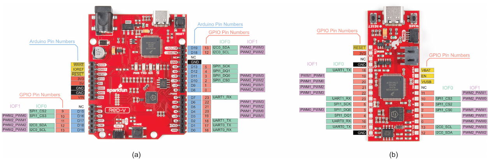

Hình e9.2 (a) RED-V RedBoard; (b) RED-V Thing Plus Board

(Ảnh SparkFun cung cấp, dùng theo CC BY 2.0)

> SiFive được thành lập năm 2015 bởi ba nhà nghiên cứu từ University of California, Berkeley: Krste Asanović, Yunsup Lee và Andrew Waterman. Tầm nhìn của SiFive là khiến việc phát triển custom silicon nhanh hơn và có chi phí dễ tiếp cận hơn bao giờ hết. Tập trung vào RISC-V instruction set architecture (ISA) mở, họ đã phát triển nền tảng cho phép system-level design của custom chip. Có thể tìm thêm thông tin, gồm datasheet FE310-G002, tại sifive.com.

Trên cả hai board, GPIO5 được nối với một LED xanh dương. Pin này có nhãn 13 (tức D13) trên RedBoard và 5 trên board Thing Plus.

Mục này bắt đầu bằng việc mô tả FE310-G002 SoC và một device driver tổng quát cho memory-mapped I/O. Phần còn lại minh họa cách embedded system thực hiện general-purpose digital I/O, analog I/O và serial I/O.

### 9.3.2 FE310-G002 System-on-Chip

FE310-G002 SoC là microcontroller chip mạnh nhưng rẻ do SiFive thiết kế. Nó gồm RISC-V microprocessor có pipeline 5-stage tương tự pipeline ở Chương 7 và nhiều I/O peripheral. FE310 được đóng gói trong package quad flat no-leads 48-lead. SiFive công bố datasheet mô tả nhiều tính năng và I/O register; chương này chỉ thảo luận một tập con của các tính năng đó.

Bảng e9.1 cho thấy FE310 memory map. Khi start-up, processor bắt đầu thực thi code từ external flash memory tại địa chỉ 0x20000000. Memory map dành chỗ cho tối đa 512 MiB external flash, dù các board RED-V hiện có ít hơn nhiều: RED-V RedBoard có 32 MiB external flash, còn RED-V Thing Plus có 4 MiB. Chip cũng có 16 KiB RAM, gọi là data tightly integrated memory (DTIM), tại địa chỉ 0x80000000. RAM này có load latency 2-cycle và được dùng giữ biến. Các peripheral được memory- mapped giữa địa chỉ 0x02000000 và 0x1FFFFFFF, sẽ được mô tả chi tiết ở các mục sau. Chúng gồm general- purpose I/O, ba block pulse-width modulation (PWM) tạo output waveform và nhiều serial port kết nối thiết bị ngoài, gồm ba serial peripheral interface (SPI), hai universal asynchronous receiver/transmitter (UART) và một interface inter-integrated circuit (I<sup>2</sup>C).

> RISC-V microcontroller của SiFive tiếp tục phát triển. Khi bạn đọc phần này, có thể đã có model mới với processor tiên tiến hơn và tập embedded I/O khác. Tuy nhiên, những nguyên tắc thảo luận ở đây vẫn áp dụng cho microcontroller đó cũng như microcontroller khác. Bạn có thể mong đợi cùng các loại I/O và peripheral. Bạn sẽ cần tra datasheet để tìm mapping giữa peripheral, pin trên chip, pin trên board, cùng memory-mapped I/O address (register) gắn với mỗi peripheral. Nhưng như mô tả ở đây, bạn vẫn ghi configuration register để khởi tạo peripheral và đọc, ghi data register để giao tiếp với peripheral.

Hình e9.3 cho thấy schematic đơn giản hóa của RED-V RedBoard. Board nhận nguồn 5 V từ nguồn USB, và regulator tạo 3.3 V, 1.8 V cho I/O, cấp nguồn core low-power always-on cùng các chức năng khác.

### 9.3.3 General-Purpose Digital I/O

Pin General-purpose I/O (GPIO) được dùng để đọc hoặc ghi digital signal. Tối thiểu, GPIO pin cần các register memory-mapped I/O

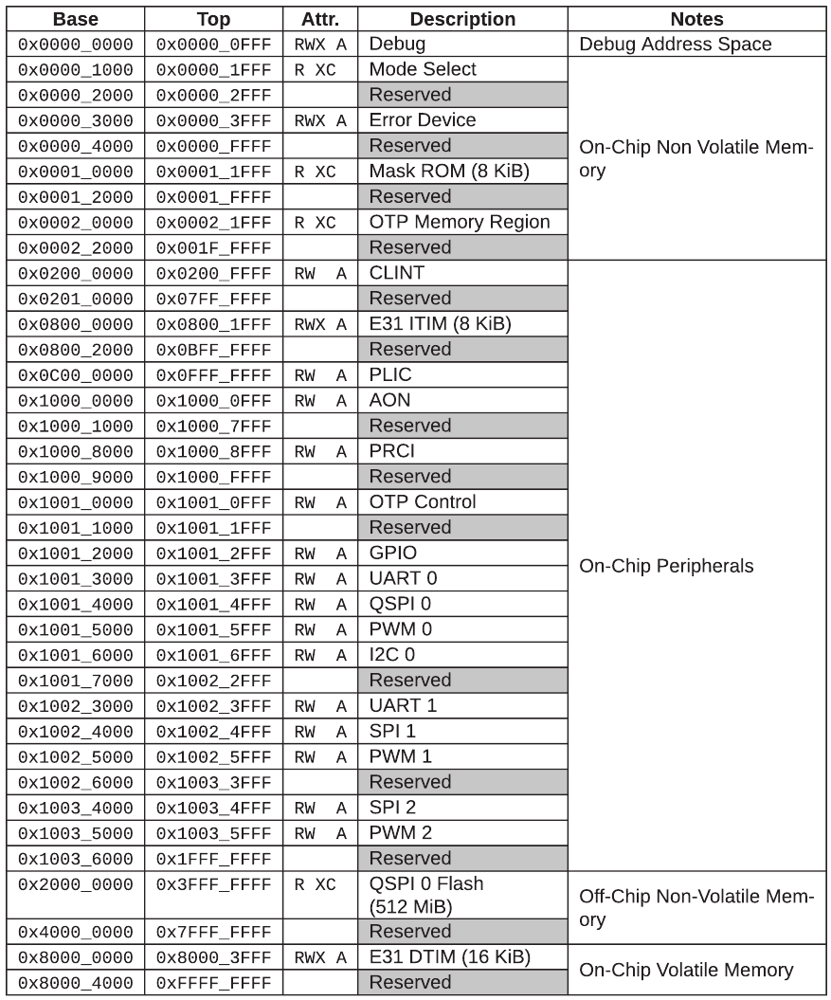

Bảng e9.1 Memory map FE310

Memory attribute: R: Đọc, W: Ghi, X: Thực thi, C: Cacheable, A: Atomics. Được phép in lại Bảng 4 FE310-G0002 Manual, © 2019 SiFive, Inc.

để đọc giá trị input pin, ghi giá trị output pin và đặt hướng của pin. Trong nhiều embedded system, GPIO pin có thể dùng chung với một hoặc nhiều peripheral special-purpose, nên cần configuration register bổ sung để xác định pin là general- hay special-purpose. Hơn nữa, processor có thể tạo interrupt khi sự kiện như rising edge hoặc falling edge xảy ra tại input pin, và configuration register có thể chỉ điều kiện cho interrupt. Hãy nhớ FE310 có 19 GPIO pin. Mục này bắt đầu bằng ví dụ cơ bản điều khiển các pin rồi xem xét một số mục đích đặc biệt của chúng.

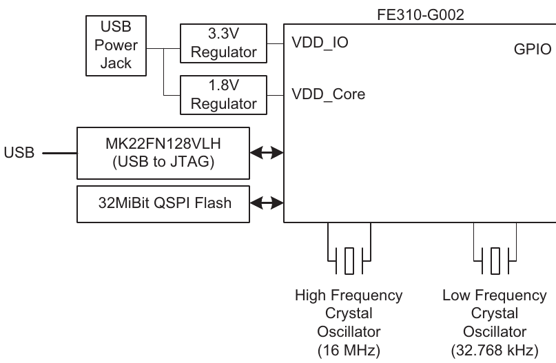

Hình e9.3 Schematic board RED-V

Hình e9.4 cho thấy ba light-emitting diode (LED) và ba switch nối với sáu GPIO pin. LED được nối để sáng khi được drive mức 1 và tắt khi drive mức 0. Resistor current-limiting (thường khoảng 300 Ω) được nối tiếp LED để đặt độ sáng và tránh vượt quá khả năng dòng của GPIO. Switch được nối để tạo 1 khi đóng và 0 khi mở. Như hình, resistor pull-down 1 kΩ kéo pin về 0 khi switch mở. Hình e9.4 chỉ cả số pin (Arduino) ghi trên board lẫn số GPIO pin.

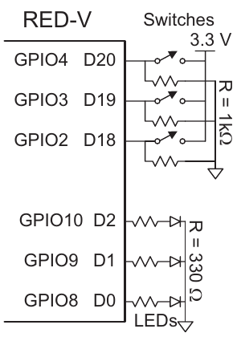

Hình e9.4 Ví dụ GPIO

Bảng e9.2 liệt kê GPIO register và address offset tương đối với GPIO base address 0x10012000, như Bảng 51 của FE310-G002 Manual. Trước tiên hãy tập trung vào bốn register đầu (tức memory-mapped I/O address). Mỗi GPIO pin được ánh xạ tới một bit của register. Đọc register `input_val` (input value) sẽ đọc giá trị GPIO pin, còn ghi register `output_val` (output value) sẽ ghi GPIO pin. Trước khi đọc hoặc ghi pin, phải đặt input enable register và output enable register (`input_en`, `output_en`) để cấu hình pin làm input hoặc output, đồng thời clear hardware-driven function enable register (`iof_en`) để cấu hình pin do GPIO điều khiển.

GPIO Memory-Mapped I/O

Chúng ta minh họa cách dùng GPIO pin bằng việc viết chương trình đọc trạng thái switch và điều khiển LED qua GPIO. Năm

Bảng e9.2 Offset register GPIO

| Offset | Tên | Mô tả |
|---|---|---|
| `0x00` | `input_val` | Giá trị pin |
| `0x04` | `input_en` | Enable input pin\* |
| `0x08` | `output_en` | Enable output pin\* |
| `0x0C` | `output_val` | Giá trị output |
| `0x10` | `pue` | Enable pull-up nội bộ\* |
| `0x14` | `ds` | Drive strength pin |
| `0x18` | `rise_ie` | Enable rising interrupt |
| `0x1C` | `rise_ip` | Rising interrupt pending |
| `0x20` | `fall_ie` | Enable falling interrupt |
| `0x24` | `fall_ip` | Falling interrupt pending |
| `0x28` | `high_ie` | Enable high interrupt |
| `0x2C` | `high_ip` | High interrupt pending |
| `0x30` | `low_ie` | Enable low interrupt |
| `0x34` | `low_ip` | Low interrupt pending |
| `0x38` | `iof_en` | Enable function HW-driven |
| `0x3C` | `iof_sel` | Chọn function HW-driven |
| `0x40` | `out_xor` | XOR output (đảo) |

Register đánh \* reset asynchronous về 0 khi start-up để GPIO inactive. Được phép in lại Bảng 52 SiFive FE310-G0002 Manual, © 2019 SiFive, Inc.

register quan trọng nhất để tương tác với GPIO pin, như mô tả trên, là `input_val`, `input_en`, `output_en`, `output_val` và `iof_en`, tại offset 0x0, 0x4, 0x8, 0xC và 0x38 từ base address. Mỗi register rộng 32 bit và có thể điều khiển tối đa 32 GPIO, nhưng thực tế chỉ có 19 GPIO trên chip này.

Để đọc GPIO `n`, chương trình set bit `n` của register `input_en` (input enable), sau đó đọc register `input_val` (input value) và xem bit `n`. Tương tự, để drive GPIO `n`, chương trình set bit `n` của register `output_en` (output enable), rồi ghi giá trị mong muốn vào bit `n` của register `output_val` (output value). Trong cả hai trường hợp, phải clear bit `n` của register `iof_en` để bảo đảm pin được GPIO controller drive thay vì phần cứng khác trên chip.

> Trong bit manipulation, “set” nghĩa ghi 1, “clear” nghĩa ghi 0.

Ví dụ code e9.1 minh họa chương trình đơn giản đọc giá trị switch nối với GPIO19, rồi bật hoặc tắt LED on-board nối với GPIO5 tương ứng. Cách bố trí phần cứng ở Hình e9.5. Để truy cập memory-mapped I/O, trước tiên chương trình khai báo pointer tới năm register tại các địa chỉ nêu trên. Mỗi pointer có type `uint32_t*` vì register chứa giá trị unsigned 32-bit. Chương trình ghi 1 vào bit 19 của register `input_en` và 1 vào bit 5 của register `output_en` để cấu hình GPIO pin 19 làm input và GPIO pin 5 làm output. Lưu ý cách dùng shift operation (`1 << 19`) để đặt 1 tại bit 19 rồi OR với nội dung hiện có của enable register, bật bit đó mà không ảnh hưởng bit khác có thể đã bật. Sau đó, chúng ta ghi 0 vào bit 5 và 19 của register `iof_` `en` để bảo đảm pin được GPIO controller drive. Để ghi 0 vào một bit, ta AND `iof_en` với 1 tại mọi vị trí trừ bit đó, ép bit mong muốn xuống low mà không ảnh hưởng bit khác. Tiếp theo, chương trình lặp lại việc đọc input pin và ghi output pin. Để đọc input pin, chương trình đọc register `input_val`, right-shifts giá trị đi 19 (chuyển giá trị pin 19 vào bit 0), rồi thực hiện bitwise `AND` với `0x1` để chỉ giữ bit 0, còn lại một giá trị 0 hoặc 1 tương ứng giá trị ban đầu ở bit 19. Để ghi giá trị high vào bit của register `output_val`, ta dùng operation `OR` như khi bật bit trong enable register. Để ghi 0 vào bit trong register `output_val`, ta dùng cùng cách đã mô tả để clear bit trong register `iof_en`.

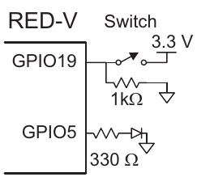

Hình e9.5 LED output GPIO 5 và switch input GPIO 19

#### Ví dụ code e9.1 ĐẶT GPIO OUTPUT THEO SWITCH INPUT

```
#include <stdint.h>
int main(void) {
    volatile uint32_t *input_val   = (uint32_t*)0x10012000;
    volatile uint32_t *input_en    = (uint32_t*)0x10012004;
    volatile uint32_t *output_en   = (uint32_t*)0x10012008;
    volatile uint32_t *output_val = (uint32_t*)0x1001200C;
    volatile uint32_t *iof_en       = (uint32_t*)0x10012038;
    int  val;

    *iof_en       &= ~(1 << 19);                // Pin 19 is a GPIO
    *input_en    |=    (1 << 19);               // Pin 19 is an input
    *iof_en       &= ~ (1 << 5);                // Pin 5 is a GPIO
    *output_en    |=    (1 << 5);               // Pin 5 is an output
    while (1)   {
        val = (*input_val >> 19) & 1;           // Read value on pin 19
        if (val) *output_val |= (1 << 5);       // Turn ON pin 5
        else        *output_val &= ~(1 << 5);   // TURN OFF pin 5
    }
}
```

Register GPIO khác

Bảng e9.2 đã liệt kê một số GPIO control register đáng chú ý khác, đặc biệt pin drive strength (`ds`), internal pull-up enable (`pue`) và I/O function (`iof_sel`, `iof_en`).

Register `ds` điều khiển output current tối đa của mỗi pin. Giá trị mặc định (0) cấu hình I<sub>OL</sub>/I<sub>OH</sub> bằng 15 đến 16 mA, trong khi đặt `ds` của pin thành 1 tăng nhẹ output current lên 21 mA, có thể hữu ích khi drive LED sáng hơn.

Register `pue` cấu hình internal pull-up resistor. Hình e9.4 cho ví dụ external pull-down resistor. Nếu đảo kết nối power và ground trên switch, resistor sẽ thành pull-up resistor drive pin lên 1 khi switch chưa nối. Trong trường hợp đó, khi nhấn switch, pin sẽ xuống 0. Để tiết kiệm tiền và diện tích circuit board, nhiều microcontroller có internal pull-up resistor có thể tùy chọn enable bằng phần mềm. Ghi 1 vào một bit của register `pue` kích hoạt internal pull-up resistor cho GPIO pin tương ứng. Theo Bảng 4.2 của FE310-G002 datasheet, pull-up current bằng 85 μA khi pin ở 0 V. Vì vậy, pull-up resistance hiệu dụng bằng 3.3 V/85 μA = 39 kΩ (V/I = R).

Như Bảng e9.3, phần lớn GPIO pin cũng có thể thực hiện special function, như đóng vai trò serial port hoặc output pulse-width modulation (PWM). Các chức năng này sẽ được thảo luận chi tiết ở phần sau của chương. Register `iof_sel` và `iof_en` cùng quyết định mỗi pin hoạt động như GPIO hay special function. Khi `iof_en` bằng 0 (mặc định), pin hoạt động như GPIO. Khi bằng 1, pin đảm nhận special function. Special function được chọn từ Bảng e9.3 dựa trên bit `iof_sel` của pin đó. Ví dụ, để dùng GPIO11 tạo waveform pulse-width modulated, đặt bit 11 của `iof_sel` và `iof_en` thành 1. Sau đó dùng PWM register điều khiển output. `iof_en` được ánh xạ tới địa chỉ 0x10012038 và `iof_sel` tới 0x1001203C. Bảng e9.3 liệt kê 32 GPIO; tuy nhiên, hãy nhớ các board RED-V chỉ có 19 GPIO: GPIO 0 đến 5, 9 đến 13 và 16 đến 23.

### 9.3.4 Device driver

Như Ví dụ code e9.1, người lập trình có thể thao tác I/O device trực tiếp bằng cách đọc hoặc ghi register memory-mapped I/O. Tuy nhiên, cách lập trình tốt hơn là gọi function truy cập memory-mapped I/O. Những function này gọi là device driver. Một số lợi ích của device driver gồm:

- Code dễ đọc hơn khi có function call được đặt tên rõ ràng thay vì ghi vào bit field tại memory address khó hiểu.

- Người hiểu sâu hoạt động bên trong I/O device có thể viết device driver, còn người dùng thông thường có thể gọi nó mà không cần hiểu chi tiết.

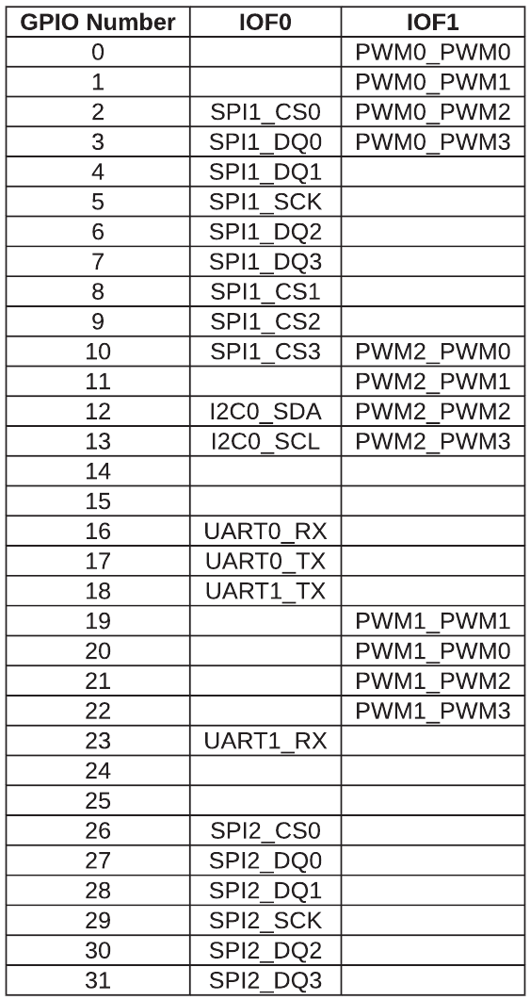

Bảng e9.3 Map special function GPIO pin

Được phép in lại Bảng 53 SiFive FE310-G0002 Manual, © 2019 SiFive, Inc.

- Code dễ port sang processor khác có memory mapping hoặc I/O device khác vì chỉ device driver cần thay đổi.

- Nếu device driver thuộc operating system (OS), OS có thể kiểm soát truy cập physical device dùng chung giữa nhiều chương trình đang chạy trên hệ thống và quản lý security (ví dụ ngăn chương trình ác ý đọc bàn phím khi bạn nhập password vào web browser).

Chương này sẽ phát triển device driver đơn giản tên EasyREDVIO để truy cập FE310 peripheral, giúp bạn hiểu hoạt động bên trong device driver. Để truy cập mọi tính năng FE310, người dùng có thể thích môi trường Freedom Metal, cung cấp software interface thuận tiện để điều khiển tính năng SiFive Core IP và peripheral device. Freedom Metal mạnh vì được viết sao cho API hoạt động trên mọi device có Freedom Metal board support package (BSP). BSP là software package chứa driver và routine thường dùng khác. SiFive cũng cung cấp Freedom E software developer kit (SDK) và Freedom Studio, cho phép người dùng phát triển phần mềm cho mọi SiFive core.

> Có thể tải EasyREDVIO và code ví dụ trong chương từ website sách (xem Lời nói đầu). Thêm thông tin và tài liệu Freedom Metal tại https://github.com/sifive/freedom-metal.

#### Ví dụ e9.2 DEVICE DRIVER TRONG C

Việc truy cập và sửa giá trị memory-mapped I/O được thực hiện bằng đọc hoặc ghi memory address. Trong assembly, việc này dùng instruction `lw` và `sw`. Như Ví dụ code e9.2, C làm được tương tự bằng pointer, nhưng khai báo pointer cho mọi register memory- mapped I/O vừa tẻ nhạt vừa error-prone. Cách tự nhiên hơn để mô tả và điều khiển memory-mapped I/O trong C là dùng structure.

Như thảo luận ở Mục C.8.5 trong phụ lục, structure trong C là cách nhóm tập hợp data type khác nhau thành một đơn vị. Dùng structure cho register memory-mapped cho phép giao tiếp với I/O device bằng tên register hoặc field thay vì memory address. Chương trình C có thể khai báo structure cho peripheral memory-mapped, liệt kê register theo thứ tự xuất hiện trong memory map. Sau đó có thể khai báo pointer tới structure đó và truy cập peripheral qua structure pointer.

Bắt đầu thư viện EasyREDVIO bằng cách viết function `pinMode`, `digitalRead` và `digitalWrite` để cấu hình hướng của pin và đọc hoặc ghi pin.

- Function `pinMode` nhận hai input: pin number và mode. Ví dụ, `pinMode(5, INPUT)` đặt GPIO pin 5 làm input, và `pinMode(17,`

`OUTPUT)` đặt GPIO pin 17 làm output.

- `digitalRead` nhận một input, pin number, và return giá trị của pin đó. Ví dụ, `digitalRead(19)` đọc giá trị GPIO19.

- `digitalWrite` nhận hai input: pin number và giá trị. Ví dụ, `digitalWrite(3, 1)` ghi 1 vào GPIO pin 3, còn `digitalWrite(5, 0)` ghi 0 vào GPIO pin 5.

Sau khi viết các function này, hãy viết chương trình C dùng chúng để đọc ba switch và bật LED tương ứng, với phần cứng ở Hình e9.4.

Lời giải EasyREDVIO code được cho dưới đây. Các function phải chọn register và bit trong register cần truy cập. Ví dụ, để cấu hình pin làm input, `pinMode` phải set bit của pin trong `input_en` và clear bit của pin trong `output_en`. `digitalWrite` xử lý việc ghi 1 hoặc 0 bằng cách ghi vào `output_val`. `digitalRead` đọc bit mong muốn của `input_val`.

GPIO structure (struct) xác định register 32-bit theo tên. Hai statement `define` sau đó chỉ GPIO base address (`GPIO0_BASE`) và tạo pointer type GPIO tại base address đó. Mỗi biến 32-bit trong structure sau đó nằm trong bộ nhớ theo thứ tự tăng dần từ base address đó.

### 9.3.5 Serial I/O

Microcontroller có thể gửi nhiều bit tới peripheral device bằng nhiều dây hoặc gửi nối tiếp nhiều bit trên một dây. Cách đầu gọi là parallel I/O, cách sau gọi là serial I/O. Serial I/O phổ biến, đặc biệt khi số pin hạn chế, vì dùng ít dây và đủ nhanh cho nhiều ứng dụng. Thực tế, nó phổ biến đến mức nhiều tiêu chuẩn serial I/O đã được thiết lập và microcontroller cung cấp phần cứng chuyên dụng để dễ dàng gửi dữ liệu theo những tiêu chuẩn này. Mục này mô tả standard serial interface SPI và UART.

#### Ví dụ code e9.2 GPIO CHO SWITCH VÀ LED

```
// EasyREDVIO.h
// Joshua Brake, David Harris, and Sarah Harris, 7 October 2020

#include <stdint.h>

#define INPUT   0
#define OUTPUT 1

// Define statements to map Arduino pin names to FE310 GPIO pin number according to Figure e9.2
#define D0    16
#define D1    17
#define D2    18
#define D3    19
#define D4    20
#define D5    21
#define D6    22
#define D7    23
#define D8    0
#define D9    1
#define D10 2
#define D11 3
#define D12 4
#define D13 5
#define D15 9
#define D16 10
#define D17 11
#define D18 12
#define D19 13

// Declare a GPIO structure defining the GPIO registers in the order they appear in Table e9.2
typedef struct {
    volatile uint32_t   input_val;   // (GPIO offset 0x00) Pin value
    volatile uint32_t   input_en;    // (GPIO offset 0x04) Pin input enable*
    volatile uint32_t   output_en;   // (GPIO offset 0x08) Pin output enable*
    volatile uint32_t   output_val;  // (GPIO offset 0x0C) Output value
    volatile uint32_t   pue;         // (GPIO offset 0x10) Internal pull-up enable*
    volatile uint32_t   ds;          // (GPIO offset 0x14) Pin drive strength
    volatile uint32_t   rise_ie;     // (GPIO offset 0x18) Rise interrupt enable
    volatile uint32_t   rise_ip;     // (GPIO offset 0x1C) Rise interrupt pending
    volatile uint32_t   fall_ie;     // (GPIO offset 0x20) Fall interrupt enable
    volatile uint32_t   fall_ip;     // (GPIO offset 0x24) Fall interrupt pending
    volatile uint32_t   high_ie;     // (GPIO offset 0x28) High interrupt enable
    volatile uint32_t   high_ip;     // (GPIO offset 0x2C) High interrupt pending
    volatile uint32_t   low_ie;      // (GPIO offset 0x30) Low interrupt enable
    volatile uint32_t   low_ip;      // (GPIO offset 0x34) Low interrupt pending
    volatile uint32_t   iof_en;      // (GPIO offset 0x38) HW-Driven functions enable
    volatile uint32_t   iof_sel;     // (GPIO offset 0x3C) HW-Driven functions selection
    volatile uint32_t   out_xor;     // (GPIO offset 0x40) Output XOR (invert)
    // Registers marked with * are asynchronously reset to 0 at startup
} GPIO;
// Define the base address of the GPIO registers (see Table e9.1) and a pointer to this
// structure
// The 0x…U notation in 0x10012000U indicates an unsigned hexadecimal number
#define GPIO0_BASE   (0x10012000U)
#define GPIO0 ((GPIO*) GPIO0_BASE)
```

`// To access the members of the structure, the member-access operator –> is used`.

```
void pinMode(int gpio_pin, int function) {
    switch(function)  {
        case  INPUT:
           GPIO0->input_en      |=    (1 << gpio_pin);   // Sets a pin as an input
           GPIO0->output_en   &= ~(1 << gpio_pin);       // Clear output_en bit
           GPIO0->iof_en        &= ~(1 << gpio_pin);     // Disable IOF
           break;
        case  OUTPUT:
           GPIO0->output_en     |=    (1 << gpio_pin);   // Set pin as an output
           GPIO0->input_en      &= ~(1 << gpio_pin);     // Clear input_en bit
           GPIO0->iof_en          &= ~(1 << gpio_pin);   // Disable IOF
           break;
    }
}

void digitalWrite(int gpio_pin, int val) {
    if (val) GPIO0->output_val |=    (1 << gpio_pin);
    else         GPIO0->output_val &= ~(1 << gpio_pin);
}

int digitalRead(int gpio_pin) {
    return (GPIO0->input_val >> gpio_pin) & 0x1;
}

// The program below reads switches and writes LEDs. It sets pins 2 to 4 as inputs (for the
// switches) and pins 7 to 9 as outputs (for the LEDs). It then continuously reads the
// switches and writes their values to the corresponding LEDs.

#include "EasyREDVIO.h"
int main(void) {
  // Set GPIO 4:2 as inputs
  pinMode(2,  INPUT);
  pinMode(3,  INPUT);
  pinMode(4,  INPUT);
  // Set GPIO 10:8 as outputs
  pinMode(8,  OUTPUT);
  pinMode(9,  OUTPUT);
  pinMode(10,  OUTPUT);
  while (1) { // Read each switch and write corresponding LED
    digitalWrite(8,      digitalRead(2));
    digitalWrite(9,      digitalRead(3));
    digitalWrite(10,  digitalRead(4));
  }
}
```

Các serial standard phổ biến khác gồm inter-integrated circuit (I<sup>2</sup>C), universal serial bus (USB) và Ethernet. I<sup>2</sup>C (đọc “I bình phương C”) là interface 2-wire có clock và data pin hai chiều; nó được dùng tương tự SPI. USB và Ethernet là tiêu chuẩn high-performance phức tạp hơn. FE310 hỗ trợ SPI, UART và I<sup>2</sup>C qua peripheral on-board chuyên dụng.

> Thuật ngữ master/slave từng phổ biến (thay cho controller/peripheral), nhưng hiện đã lỗi thời. Serial data out (SDO) hoặc controller-out peripheral-in (COPI) hiện được dùng thay master-out slave-in (MOSI). Serial data in (SDI) hoặc controller-in peripheral-out (CIPO) hiện được dùng thay master-in slave-out (MISO).

Serial Peripheral Interface (SPI)

SPI (đọc “S-P-I”) là synchronous serial protocol đơn giản, dễ dùng và tương đối nhanh. Physical interface gồm ba pin: serial clock (SCK), serial data out (SDO) và serial data in (SDI). SPI nối controller device với peripheral device, như Hình e9.6(a). Controller tạo clock. Nó khởi tạo giao tiếp bằng cách gửi clock pulse trên SCK. Controller gửi dữ liệu từ pin SDO tới pin SDI của peripheral, mỗi cycle một bit, bắt đầu bằng most significant bit. Peripheral có thể đồng thời phản hồi từ pin SDO trở lại pin SDI của controller. Hình e9.6(b) cho thấy SPI waveform cho lần truyền dữ liệu 8-bit. Bit thay đổi tại falling edge của SCK và ổn định để sample tại rising edge. SPI interface còn có thể gửi chip enable active-low để báo receiver rằng dữ liệu sắp đến.

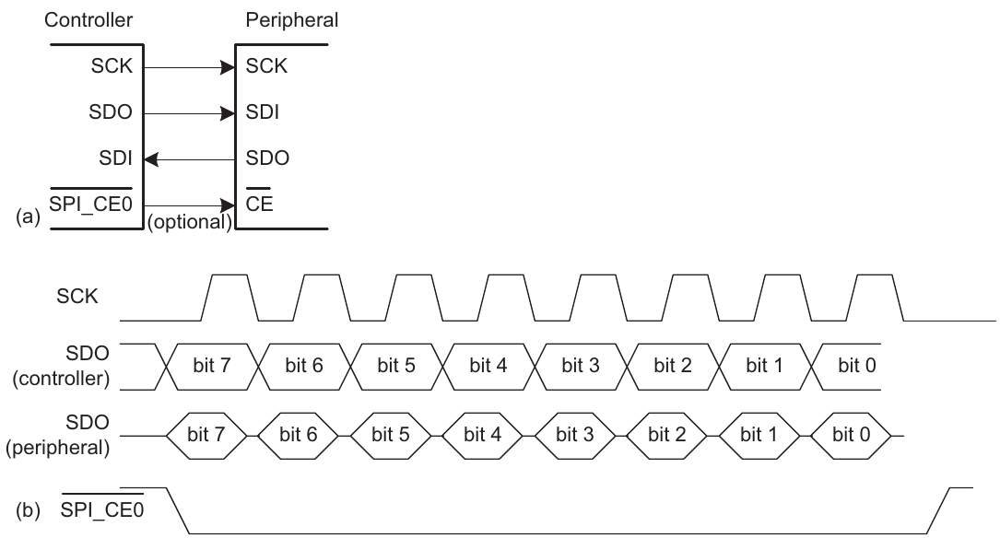

Hình e9.6 Cấu hình SPI: (a) kết nối controller-peripheral, (b) ví dụ data signal

FE310 có ba SPI controller port, nhưng chỉ hai (SPI1 và SPI2) dành cho người dùng. SPI controller port còn lại, SPI0, dùng giao tiếp với external flash memory lưu chương trình và dữ liệu. Mục này mô tả SPI1 controller port, truy cập được bằng GPIO pin 5:2. SPI2 controller port giống hệt, ngoại trừ nối với GPIO pin khác và control register nằm tại memory address khác. Để dùng pin cho SPI thay vì GPIO, đặt bit `iof_sel` thành 0 để chọn chức năng SPI1, và bit `iof_en` thành 1 để cho SPI controller truy cập pin. Khi FE310 ghi register SPI `txdata`, dữ liệu được truyền nối tiếp tới peripheral. Đồng thời, dữ liệu nhận từ peripheral được thu lại, và FE310 có thể đọc từ `rxdata` khi transfer hoàn tất.

> Port là một pin hoặc nhóm pin liên quan.

> SPI luôn gửi dữ liệu cả hai chiều trong mỗi transfer. Nếu hệ thống chỉ cần giao tiếp một chiều, có thể bỏ qua dữ liệu không cần. Ví dụ, nếu controller chỉ cần gửi dữ liệu tới peripheral, byte nhận từ peripheral có thể được bỏ qua. Nếu controller chỉ cần nhận dữ liệu từ peripheral, nó vẫn phải kích hoạt giao tiếp SPI bằng cách gửi byte tùy ý mà peripheral sẽ bỏ qua. Sau đó nó có thể đọc dữ liệu nhận từ peripheral. SPI clock (SCK) chỉ toggle khi controller đang truyền dữ liệu.

SPI port trên microcontroller thường cung cấp nhiều configuration option để đáp ứng yêu cầu của peripheral device. Khi thiết kế interface giao tiếp với peripheral device cụ thể, phải cấu hình controller đúng để bảo đảm dữ liệu truyền qua link được diễn giải đúng.

Hai configuration parameter phổ biến là clock polarity (CPOL) và clock phase (CPHA). CPOL đặt mức clock khi idle, còn CPHA đặt clock edge tại đó dữ liệu (SDO và SDI) được sample (và thay đổi). Nếu CPOL = 1, SCK giữ high (1) khi không truyền dữ liệu; nếu CPOL = 0, SCK giữ low (0) khi idle. Nếu CPHA = 0, dữ liệu được sample tại leading edge (và thay đổi tại trailing edge) của SCK; nếu CPHA = 1, dữ liệu được sample tại trailing edge (và thay đổi tại leading edge) của SCK. Edge mà dữ liệu thay đổi còn gọi là shifting edge vì phần cứng bên dưới thường là shift register. Hình e9.7 cho thấy bốn tổ hợp có thể của CPHA và CPOL. Ví dụ ở Hình e9.6 dùng CPOL = 0 và CPHA = 0.

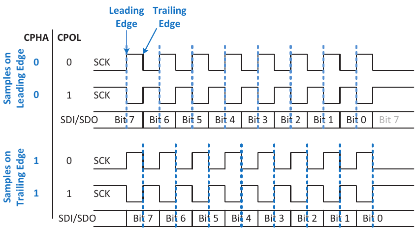

Hình e9.7 Timing diagram và cấu hình SPI peripheral

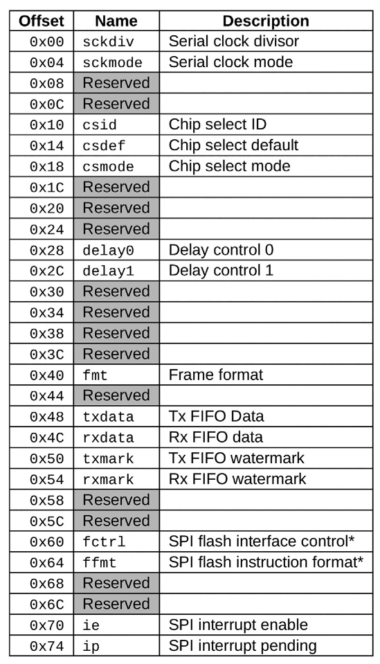

Bảng e9.4 Memory map register SPI

Được phép in lại Bảng 65 SiFive FE310-G0002 Manual, © 2019 SiFive, Inc.

Bảng e9.4 cho thấy control register gắn với SPI1, còn Bảng e9.5 cho thấy field của các register chính. `sckdiv` (xem Bảng e9.4) cấu hình SPI clock frequency bằng cách chỉ divisor (`div`) cho input peripheral clock đã chọn—trên board RED-V, tần số mặc định của peripheral clock là 16 MHz. Tần số SPI clock được cho bởi $f_{sck} = \frac{f_{in}}{2(div + 1)}$. Ví dụ, nếu `div` = 15, serial clock là $f_{sck} = \frac{16\,\text{MHz}}{2(15 + 1)}$ = 500 kHz. Nếu tần số quá cao (>\~1 MHz trên breadboard hoặc hàng chục MHz trên printed circuit board không có termination), kết nối SPI có thể trở nên không đáng tin cậy do phản xạ, crosstalk hoặc vấn đề signal integrity khác.

> Configuration register có nhiều bit không dùng hoặc “reserved”. Những bit này có thể được dùng trong phiên bản chip tương lai, nên không được ghi vào để tránh hậu quả ngoài ý muốn trong tương lai.

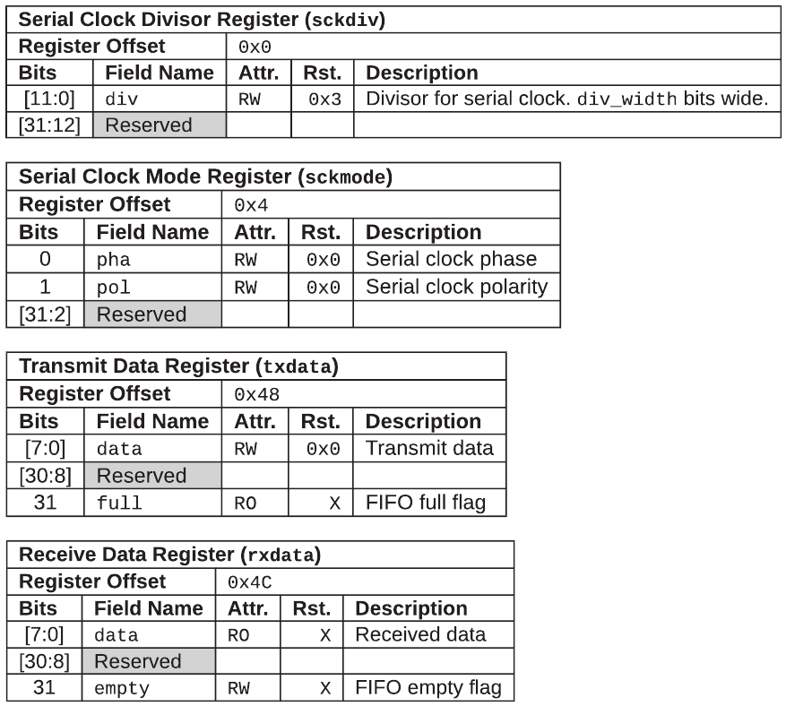

Bảng e9.5 Bitfield register SPI

Được phép in lại Bảng 66, 67, 80, 81 SiFive FE310-G0002 Manual, © 2019 SiFive, Inc.

`sckmode` điều khiển phase và polarity của clock. `sckmode` chỉ dùng hai bit ít quan trọng nhất. Bit 0 là CPHA và bit 1 là CPOL.

Ghi `txdata` để truyền byte qua SPI channel, và đọc `rxdata` để lấy byte nhận được. Chỉ least significant byte (LSB) ghi vào `txdata` được truyền đi. Các SPI instance trên FE310 có FIFO buffer first-in-first-out 8-entry ở cả transmit data register và receive data register. Điều này nghĩa là khi dữ liệu được ghi vào register `txdata`, nó được đặt trong FIFO buffer và phần cứng trong SPI peripheral lo việc gửi ra. Most significant bit (msb) của register `txdata` là flag bit tên `full`, bằng 1 khi FIFO đầy và không thể nhận thêm dữ liệu.

Cần cẩn thận khi đọc dữ liệu từ register SPI `rxdata` của FE310. SPI controller được thiết kế sao cho dữ liệu trong register bị lấy khỏi receive FIFO khi đọc register. Để kiểm tra register `rxdata` có dữ liệu hợp lệ hay không, cần đọc register một lần rồi kiểm tra bit `empty` để xác định dữ liệu có hợp lệ. Người lập trình phải tránh đọc register nhiều hơn một lần cho mỗi byte, vì sẽ làm mất dữ liệu.

Register `csid`, `csdef` và `csmode` được dùng tùy chọn để điều khiển các tham số liên quan đến điều khiển, cấu hình chip select line. Ngoài ra, chip select pin có thể cấu hình làm GPIO output pin và điều khiển bằng phần mềm qua `digitalWrite`.

Một số SPI register gói nhiều field thông tin nhỏ vào một word 32-bit. Trong C, ta có thể khai báo số bit của mỗi field bằng dấu hai chấm và một số như một phần của bitfield structure. Ví dụ e9.3 cho thấy cách dùng bitfield và structure để định nghĩa các register này.

#### Ví dụ e9.3 GỬI VÀ NHẬN BYTE QUA SPI

Thiết kế hệ thống giao tiếp giữa FE310 controller và FPGA peripheral qua SPI. Phác họa schematic của interface. Viết C code cho FE310 gửi ký tự “A” và nhận lại một ký tự. Viết HDL code cho SPI peripheral trên FPGA. Có thể đơn giản hóa peripheral thế nào nếu nó chỉ cần nhận dữ liệu?

Lời giải Hình e9.8 cho thấy kết nối giữa FE310 controller và FPGA peripheral bằng SPI1. Pin number lấy từ component datasheet (ví dụ Bảng e9.3 cho FE310). Lưu ý diagram thể hiện cả pin number và signal name để chỉ cả kết nối vật lý lẫn logic. Khi bật kết nối SPI, các pin này không thể dùng cho GPIO.

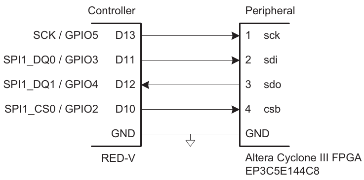

Hình e9.8 Kết nối RED-V với Altera Cyclone FPGA

Code sau từ EasyREDVIO.h được dùng khởi tạo SPI channel và gửi, nhận một ký tự. Trước tiên file khai báo SPI bitfield và memory map. Function `pinMode` được khái quát để hỗ trợ I/O function cũng như input và output. Function `spiSendReceive` hoàn tất một SPI transaction đầy đủ, gửi và nhận một byte. Ban đầu nó kiểm tra để bảo đảm transmit FIFO chưa đầy và có thể nhận entry khác. Nếu đúng, nó ghi ký tự vào transmit FIFO để shift ra. Sau khi truyền, register `rxdata` được đọc. Ở đây cần cẩn thận vì empty flag bit của register `rxdata` được cập nhật mỗi khi đọc register. Vì vậy, phải đọc toàn bộ register `rxdata` 32-bit. Sau đó, kiểm tra empty flag chưa được set (tức dữ liệu hợp lệ), rồi return byte nhận được.

C code ở Ví dụ code e9.4 khởi tạo SPI rồi gửi và nhận một ký tự. Dùng công thức f<sub>clk</sub> = 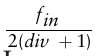 , trong đó f<sub>in</sub> là `coreclk` 16 MHz, nó đặt SPI clock thành 500 kHz.

#### Ví dụ code e9.3 FUNCTION SPI

```
///////////////////////////////////////////////////////////////////////////////
//  SPI Registers
///////////////////////////////////////////////////////////////////////////////
typedef struct {
    volatile  uint32_t     div               :     12; //  Clock  divisor
    volatile  uint32_t                       :     20;
} sckdiv_bits;

typedef struct {
    volatile  uint32_t     pha               :     1;  //  Serial  clock  phase
    volatile  uint32_t     pol               :     1;  //  Serial  clock  polarity
    volatile  uint32_t                       :     30;
} sckmode_bits;

...

typedef struct {
    volatile  uint32_t     data              :     8;  //  Transmit  data
    volatile  uint32_t                       :     23;
    volatile  uint32_t     full              :     1;  //  FIFO  full  flag
} txdata_bits;

typedef struct {
    volatile  uint32_t     data              :     8;  //  Received  data
    volatile  uint32_t                       :     23;
    volatile  uint32_t     empty             :     1;  //  FIFO  empty  flag
} rxdata_bits;

//  Pin modes
#define INPUT    0
#define OUTPUT 1
#define GPIO_IOF0 2
#define GPIO_IOF1 3

void pinMode(int gpio_pin, int function) {
    switch(function)  {
        case  INPUT:
            GPIO0->input_en     |=   (1 << gpio_pin);   // Set a pin as an input
            GPIO0->iof_en       &= ~(1 << gpio_pin);    // Disable IOF
            break;
        case  OUTPUT:
            GPIO0->output_en   |=    (1 << gpio_pin);   // Set pin as an output
            GPIO0->iof_en       &= ~(1 << gpio_pin);    // Disable IOF
            break;
        case  GPIO_IOF0:
            GPIO0->iof_en       |=    (1 << gpio_pin);  // Enable IOF
            GPIO0->iof_sel      &= ~(1 << gpio_pin);    // IO Function 0
            break;
        case  GPIO_IOF1:
            GPIO0->iof_en       |=  (1 << gpio_pin);    // Enable IOF
            GPIO0->iof_sel      |=  (1 << gpio_pin);    // IO Function 1
            break;
    }
}
void spiInit(uint32_t clkdivide, uint32_t cpol, uint32_t cpha) {

    // Initially assigning SPI pins (GPIO 2-5) to HW I/O function 0
    pinMode(3, GPIO_IOF0); // SDO
    pinMode(4, GPIO_IOF0); // SDI
    pinMode(5, GPIO_IOF0); // SCK

    digitalWrite(2, 1);    // make sure CS0 doesn’t pulse low
    pinMode(2, OUTPUT);    // CS0 is manually controlled

    SPI1->sckdiv.div = clkdivide; // Set the clock divisor

    SPI1->sckmode.pol = cpol;     // Set the polarity
    SPI1->sckmode.pha = cpha;     // Set the phase
}

/* Transmits a character (1 byte) over SPI and returns the received character.
 *    send: the character to send over SPI
 *    return value: the character received over SPI */
uint8_t spiSendReceive(uint8_t send) {
    while(SPI1->txdata.full);   // Wait until transmit FIFO is ready for new data
    SPI1->txdata.data = send;   // Transmit the character over SPI

    rxdata_bits  rxdata;
    while (1) {
        rxdata = SPI1->rxdata;  // Read the rxdata register EXACTLY once
        if (!rxdata.empty) {    // If the empty bit was not set, return the data
            return  (uint8_t)rxdata.data;
        }
    }
}
```

#### Ví dụ code e9.4 FUNCTION SPI

```
#include "EasyREDVIO.h"
int main(void) {
  uint8_t volatile received;
  // Initialize the SPI
  // Clock divisor of div = 15, CPOL = 0, CPHA = 0
  spiInit(15, 0, 0);
  digitalWrite(2, 0);                     // enable the peripheral (chip select = 0), if necessary
  received = spiSendReceive('A'); // Send letter A and receive byte
  digitalWrite(2, 1);                     // turn off chip enable
}
```

Nếu peripheral chỉ cần nhận dữ liệu từ controller, nó là shift register đơn giản, như Ví dụ HDL e9.1. Tại mỗi rising edge của `sck`, một bit `sdi` mới được shift vào shift register, bắt đầu bằng most significant bit của dữ liệu. Sau tám clock cycle, toàn bộ byte đã được đọc vào shift register.

Ví dụ HDL e9.2 cung cấp SystemVerilog code cho SPI peripheral có thể vừa gửi vừa nhận dữ liệu (tức SPI transceiver), và Hình e9.9 cho block diagram cùng timing với CPHA = CPOL = 0. Thành phần chính vẫn là shift register, ở bên phải Hình e9.9. Shift register parallel load byte cần gửi (`d[7:0]`) vào nó rồi shift dữ liệu này ra trên `sdo`, đồng thời shift dữ liệu controller truyền (`t[7:0]`) vào trên `sdi`. Counter `cnt` theo dõi số bit đã gửi/nhận. Khi `sck` idle, `cnt` = 0 và most significant bit của `d` (`d[7]`) nằm trên dây `sdo`. Một điểm tinh tế là `sdo` chỉ có thể thay đổi tại falling clock edge, nên output `sdo` (là most significant bit của shift register, `q[7]`, được làm trễ nửa clock cycle bởi register qdelayed negative-edge triggered ở góc dưới trái Hình e9.9.

#### Ví dụ HDL e9.1 HDL CHO SPI PERIPHERAL (CHỈ RECEIVER)

```
module spi_peripheral_receive_only(input    logic           sck,  // From controller
                                   input    logic           sdi,  // From controller
                                   output  logic [7:0] q);        // Data received
  always_ff @(posedge sck)
    q < = {q[6:0], sdi}; // shift register
endmodule
```

#### Ví dụ HDL e9.2 HDL CHO SPI PERIPHERAL

```
module spi_peripheral(input    logic           sck,     // From controller
                    input    logic           sdi,       // From controller
                    output logic           sdo,         // To controller
                    input    logic            reset, // System reset
                    input    logic [7:0] d,             // Data to send
                    output logic [7:0] q);              // Data received
  logic [2:0] cnt;
  logic   qdelayed;

  // 3-bit counter tracks when full byte is transmitted
  always_ff @(negedge sck, posedge reset)
    if (reset) cnt = 0;
    else           cnt = cnt + 3’b1;
```

```
  // Loadable shift register
  // Loads d at the start, shifts sdi into bottom on each step
  always_ff @(posedge sck)
    q < = (cnt = = 0) ? {d[6:0], sdi} : {q[6:0], sdi};

  // Align sdo to falling edge of sck
  // Load d at the start
  always_ff @(negedge sck)
    qdelayed = q[7];

  assign sdo = (cnt = = 0) ? d[7] : qdelayed;
endmodule
```

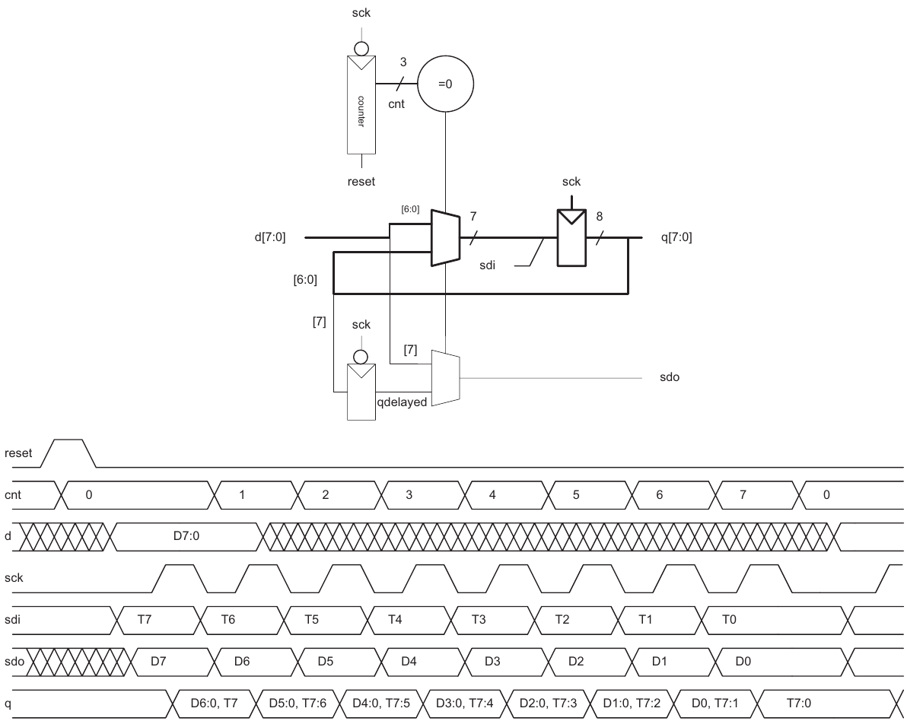

Hình e9.9 Block/timing diagram SPI peripheral FPGA

Universal Asynchronous Receiver/Transmitter (UART)

UART (đọc “you-art”) là serial I/O peripheral giao tiếp giữa hai hệ thống mà không gửi clock. Thay vào đó, các hệ thống phải thống nhất trước data rate và tự tạo clock cục bộ. Vì vậy, việc truyền là asynchronous vì clock không được đồng bộ. Dù system clock có thể có sai số tần số nhỏ và quan hệ phase chưa biết, UART vẫn thực hiện giao tiếp asynchronous đáng tin cậy. UART được dùng trong protocol như RS-232 và RS-485. Ví dụ, serial port máy tính cũ dùng tiêu chuẩn RS-232C, được Electronics Industries Associations giới thiệu năm 1969. Ban đầu tiêu chuẩn hình dung việc nối data terminal equipment (DTE), như mainframe computer, với data communication equipment (DCE), như modem. Dù UART tương đối chậm so với SPI và dễ gặp vấn đề cấu hình sai, các tiêu chuẩn đã tồn tại lâu đến mức vẫn quan trọng ngày nay.

Hình e9.10(a) cho thấy asynchronous serial link. DTE gửi dữ liệu tới DCE qua TX line và nhận dữ liệu trở lại qua RX line. Hình e9.10(b) cho thấy một line gửi ký tự ở data rate 9600 baud. Các line idle ở logic “1” khi không dùng. Mỗi ký tự được gửi thành start bit (0), 7 hoặc 8 data bit, parity bit tùy chọn và một hoặc nhiều stop bit (1). Thông thường nhất, start bit, stop bit và 8 bit dữ liệu được gửi. UART phát hiện chuyển mức xuống từ idle sang start để bắt đúng thời điểm truyền. Dù bảy data bit đủ gửi ký tự ASCII, tám bit thường được dùng vì có thể truyền byte dữ liệu bất kỳ.

> Baud rate cho signaling rate, đo bằng symbol mỗi giây, còn bit rate cho data rate, đo bằng bit mỗi giây. Trong hệ thống đơn giản như SPI, mỗi symbol là một data bit nên baud rate bằng bit rate. UART và một số quy ước signaling khác cần overhead bit ngoài dữ liệu. Ví dụ, UART thêm start bit và stop bit cho mỗi 8 bit dữ liệu (tức 10 symbol cho 8 bit dữ liệu), hoạt động ở baud rate 9600, có bit rate bằng (9600 symbol/giây) × (8 bit/10 symbol) = 7680 bit/giây = 960 ký tự/giây.

Parity bit tùy chọn cho phép hệ thống phát hiện bit bị hỏng trong quá trình truyền. Có thể cấu hình even hoặc odd; even parity nghĩa là chọn parity bit sao cho tổng tập hợp data và parity có số bit 1 chẵn. Nói cách khác, parity bit là XOR của data bit. Receiver sau đó kiểm tra đã nhận số bit 1 chẵn hay chưa và báo lỗi nếu không. Odd parity thì ngược lại.

Lựa chọn phổ biến là 1 start bit, 8 data bit, không parity và 1 stop bit, tạo tổng cộng 10 symbol để truyền ký tự thông tin 8-bit. Vì vậy, signaling rate được nói theo đơn vị baud thay vì bit/giây. Ví dụ, 9600 baud chỉ 9600 symbol/giây, hay 960 ký tự/giây. Cả transmitter lẫn receiver phải được cấu hình baud rate và số data bit, parity bit, stop bit thích hợp, nếu không dữ liệu sẽ sai lệch. Điều này gây phiền toái, đặc biệt cho người dùng không chuyên kỹ thuật, là một lý do USB thay UART trong hệ thống máy tính cá nhân.

Baud rate điển hình gồm 300, 1200, 2400, 9600, 14400, 19200, 38400, 57600 và 115200. Tốc độ thấp được dùng trong thập niên 1970 và 1980 cho modem gửi dữ liệu qua đường điện thoại bằng chuỗi âm. Trong hệ thống hiện nay, 9600 và 115200 là hai baud rate phổ biến nhất; 9600 được gặp khi tốc độ không quan trọng, còn 115200 là tốc độ chuẩn nhanh nhất, dù vẫn chậm so với standard serial I/O hiện đại khác.

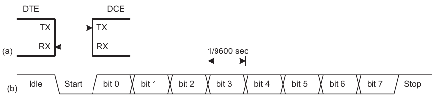

Hình e9.10 Asynchronous serial link

> Từ thập niên 1950 đến 1970, hacker thời đầu tự gọi là phone phreak đã học cách điều khiển switch của công ty điện thoại bằng cách huýt đúng âm. Âm 2600 Hz từ chiếc còi đồ chơi trong hộp ngũ cốc Cap’n Crunch (Hình e9.11). có thể bị lợi dụng để gọi long-distance và quốc tế miễn phí.
>
> 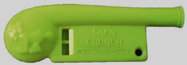
>
> Hình e9.11 Cap’n Crunch Bosun Whistle
>
> (Ảnh Evrim Sen, được phép in lại.)

Tiêu chuẩn RS-232 định nghĩa một số signal bổ sung. Signal request to send (RTS) và clear to send (CTS) có thể dùng cho hardware handshaking. Chúng có thể hoạt động theo một trong hai mode: flow control hoặc simplex. Trong flow control mode, DTE clear RTS về 0 khi sẵn sàng nhận dữ liệu từ DCE. Tương tự, DCE clear CTS về 0 khi sẵn sàng nhận dữ liệu từ DTE. Một số datasheet dùng gạch trên để chỉ chúng active-low. Trong simplex mode cũ hơn, DTE clear RTS về 0 khi sẵn sàng truyền. DCE phản hồi bằng clear CTS khi sẵn sàng nhận dữ liệu truyền.

Một số hệ thống, đặc biệt hệ thống nối qua đường điện thoại, còn dùng signal data terminal ready (DTR), data carrier detect (DCD), data set ready (DSR) và ring indicator (RI) để chỉ khi thiết bị được nối vào đường dây. Các signal này vẫn xuất hiện ở một số connector.

Tiêu chuẩn RS-232 gốc khuyến nghị connector DB-25 25-pin rất lớn, nhưng PC tinh giản thành connector đực DE-9 9-pin có pinout ở Hình e9.12(a). Dây cáp thường nối thẳng như Hình e9.12(b). Tuy nhiên, khi nối trực tiếp hai DTE, có thể cần null modem cable ở Hình e9.12(c) để đổi RX với TX và hoàn tất handshaking. Chưa hết, một số connector là đực, số khác là cái. Tóm lại, có thể phải cần hộp cáp lớn và chút phỏng đoán để nối hai hệ thống qua RS-232, một lần nữa giải thích việc chuyển sang USB. May thay, embedded system thường dùng cách nối đơn giản 3- hoặc 5-wire gồm GND, TX, RX và có thể RTS, CTS.

> Handshaking chỉ sự thương lượng giữa hai hệ thống. Thông thường, một hệ thống báo sẵn sàng gửi hoặc nhận dữ liệu, và hệ thống kia xác nhận yêu cầu.

RS-232 biểu diễn 0 bằng điện áp 3 đến 15 V và 1 bằng −3 đến −15 V; đây gọi là bipolar signaling. Transceiver chuyển digital logic level của UART sang mức dương và âm mà RS-232 yêu cầu, đồng thời cung cấp electrostatic discharge protection để bảo vệ serial port khỏi phóng điện khi người dùng cắm cáp. MAX3232E là transceiver phổ biến tương thích digital logic cả 3.3 và 5 V. Nó có charge pump kết hợp external capacitor tạo output ±5 V từ một nguồn low-voltage. Một số serial peripheral dành cho embedded system bỏ transceiver, chỉ dùng 0 V cho 0 và 3.3 hoặc 5 V cho 1; hãy kiểm tra datasheet!

FE310 có hai UART, tên UART0 và UART1. UART0 có thể được cấu hình hoạt động trên pin 16 và 17; UART1 hoạt động trên pin 18 và 23. Để dùng các pin này làm UART thay vì GPIO, đặt bit `iof_sel` tương ứng thành 0 (chọn `IOF0`) và bit `iof_en` thành 1 để cho peripheral điều khiển. Giống SPI, FE310 trước tiên phải cấu hình port. Khác SPI, đọc và ghi có thể diễn ra độc lập vì mỗi hệ thống có thể truyền mà không nhận, và ngược lại. Register UART0 được cho trong Bảng e9.6.

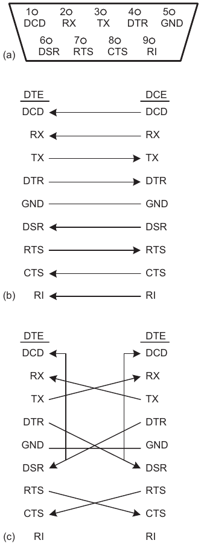

Hình e9.12 Cáp male DE-9: (a) pinout, (b) nối chuẩn, (c) null modem

Để cấu hình UART, trước tiên đặt baud rate. UART dùng TileLink bus clock on-board, tlclk, làm clock source. Với FE310-G002, bus clock này mặc định được cấu hình bằng processor clock, coreclk, ở 16 MHz. Clock signal này phải được chia xuống để tạo baud rate mong muốn. Baud rate cuối được cho bởi Phương trình 9.1:

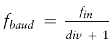 (e9.1)

UART peripheral của FE310 chỉ hỗ trợ cấu hình protocol 8-N-1 và 8-N-2. Cả hai protocol hỗ trợ 8 data bit và không parity bit; packet có thể được cấu hình một stop bit (trong 8-N-1) hoặc hai stop bit (trong 8-N-2). Cấu hình stop bit được đặt trong register `txctrl` bằng field `nstop`. Mặc định, `nstop = 0`, đặt peripheral dùng một stop bit.

Dữ liệu được truyền và nhận lần lượt bằng register `txdata` và `rxdata`. Cả transmit register lẫn receive register đều có FIFO buffer 8-entry. Để truyền dữ liệu, kiểm tra full bit của register `txdata` bằng 0, cho biết FIFO buffer còn chỗ ghi dữ liệu mới. Sau đó ghi byte vào data field trong `txdata`. Để đọc dữ liệu, đọc register `rxdata` và kiểm tra empty bit bằng 0 để xác nhận byte trong data field hợp lệ.

#### Ví dụ e9.4 SERIAL COMMUNICATION VỚI PC

Phát triển circuit và chương trình C cho FE310 giao tiếp với PC qua serial port ở 115200 baud, với 8 data bit, 1 stop bit và không parity. PC cần chạy console program như PuTTY[^1] để đọc và ghi qua serial port. Chương trình cần yêu cầu người dùng nhập string. Sau đó nó phải cho biết người dùng đã nhập gì.

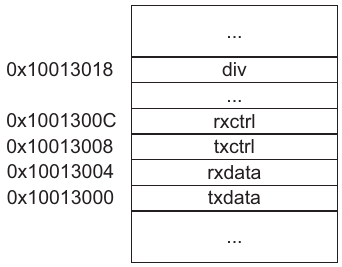

Bảng e9.6 Memory mapped register UART

Điều chỉnh và in với phép từ Bảng 55 SiFive FE310-G002 Manual, © 2019 SiFive, Inc.

Lời giải Hình e9.13(a) cho schematic cơ bản của serial link, minh họa vấn đề level conversion và cáp. Vì ít PC còn physical serial port, ta dùng Plugable USB to RS-232 DB9 Serial Adapter từ plugable.com, như Hình e9.14, để tạo serial connection tới PC. Adapter nối với connector cái DE-9 được hàn vào dây dẫn tới transceiver, chuyển điện áp bipolar RS-232 sang mức 3.3 V của FE310. FE310 và PC đều là DTE, nên TX pin và RX pin phải được cross-con-nected trong circuit. Không dùng RTS/CTS handshaking từ FE310, còn RTS và CTS trên connector DE9 được nối với nhau để PC tự handshaking với chính nó.

Hình e9.13(b) cho cách dễ hơn với Adafruit 954 USB to TTL serial cable. Cáp tương thích trực tiếp với mức 3.3 V.

Để cấu hình PuTTY hoạt động với serial link, đặt Connection type thành Serial và Speed thành 115200. Đặt Serial line thành COM port do operating system gán cho Serial to USB Adapter. Trong Windows, có thể tìm thông tin này trong Device Manager; ví dụ COM3. Trong tab Connection `→` Serial, đặt flow control thành NONE hoặc RTS/CTS. Trong tab Terminal, đặt Local Echo thành Force On để ký tự xuất hiện trong terminal khi bạn gõ.

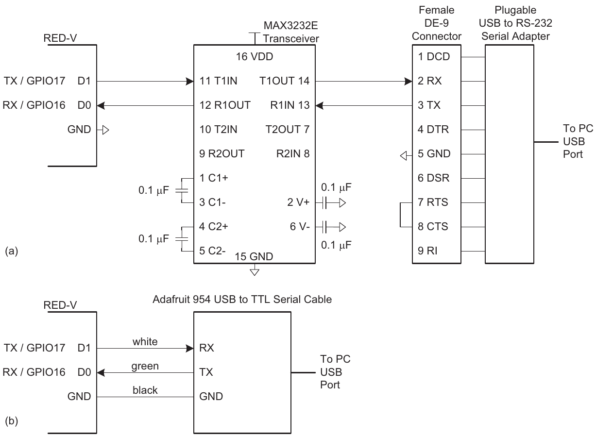

Hình e9.13 Schematic serial link: (a) RS-232, (b) USB to TTL serial cable

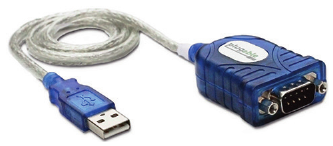

Hình e9.14 Plugable USB to RS-232 DB9 serial adapter

Serial port device driver code trong `EasyREDVIO.h` được cho ở Ví dụ code e9.5. Phím Enter trong terminal program tương ứng carriage return character, được biểu diễn bằng `\r` trong C với ASCII code 0x0D. Để chuyển tới đầu dòng kế tiếp khi in, gửi cả ký tự `\n` và `\r` (new line và carriage return).[^2] Function uartInit cấu hình UART như mô tả trên. `getCharSerial` và `putCharSerial` lần lượt đọc và ghi ký tự tới terminal qua UART (Ví dụ code e9.5).

Function `main` trong Ví dụ code e9.6 minh họa việc in ra console và đọc từ console bằng function `putStrSerial` và `getStrSerial`.

#### Ví dụ code e9.5 ĐỌC VÀ GHI CHARACTER (CHAR) TỚI TERMINAL BẰNG UART

```
void uartInit(uint32_t baud) {
    uint32_t div = 16000000/baud-1;                 // 16 MHz tileclock
    pinMode(16,  GPIO_IOF0);
    pinMode(17,  GPIO_IOF0);

    UART0->div.div = div;                           // Set clock divisor
    UART0->txctrl.txen = 1;                         // Enable transmitter
    UART0->txctrl.nstop = 1;                        // Set one stop bit
    UART0->rxctrl.rxen = 1;                         // Enable receiver
}

uint8_t getCharSerial(void) {
    uart_rxdata_bits rxdata;                        // Create temporary variable to store register

    while(1)  {
        rxdata = UART0->rxdata;                     // Read register exactly once
        if(!rxdata.empty)  {
            return (uint8_t)rxdata.data; // Check to see if the data is valid
        }
    }
}

void putCharSerial(uint8_t c) {
    while(UART0->txdata.full);                      // Wait until ready to transmit
    UART0->txdata.data = c;
}
```

Giao tiếp với serial port từ chương trình C trên PC hơi phiền toái vì serial port driver library không được chuẩn hóa giữa các operating system. Môi trường lập trình khác như Python, MATLAB hoặc LabVIEW giúp giao tiếp serial dễ dàng.

### 9.3.6 Timer

Embedded system thường cần đo thời gian. Ví dụ, lò vi sóng cần timer theo dõi giờ trong ngày và timer khác đo thời gian nấu. Nó có thể dùng timer nữa tạo pulse tới động cơ quay đĩa và timer thứ tư điều khiển mức công suất bằng cách chỉ kích hoạt năng lượng vi sóng trong một phần của mỗi giây.

FE310 có system timer với counter free-running 64-bit tăng theo clock signal được cung cấp từ ngoài. Trên RED-V, clock source này là oscillator 32.768 kHz (thuận tiện bằng 2<sup>15</sup> Hz). Hình e9.16 cho memory map của system timer. Nó nằm trong block core-local interruptor (CLINT). `mtime` chứa giá trị hiện tại 64-bit của counter. Có thể đọc hoặc ghi nó; vì vậy, để khởi động lại timer, có thể ghi không vào đó. `mtimecmp` là register 64-bit chứa timer comparison value, và `msip` là machine-mode software interrupt register. Khi counter đạt giá trị trong `mtimecmp`, least significant bit của register `msip` được set thành 1. Dùng register `msip` và `mtimecmp` là cách hiệu quả để kiểm tra delay đã diễn ra. Bảng e9.7 cho memory address của các register này.

#### Ví dụ code e9.6 ĐỌC VÀ GHI STRING TỚI TERMINAL BẰNG UART

```
#include "EasyREDVIO.h"
#define MAX_STR_LEN 80
void getStrSerial(char *str) {
    int i = 0;
    do {                          // Read an entire string until detecting
       str[i] = getCharSerial();  // Carriage return
    } while ((str[i++] != '\r') && (i < MAX_STR_LEN));   // Look for carriage return
    str[i−1] = 0;                 // Null-terminate the string
}
void putStrSerial(char *str) {
    int i = 0;
    while (str[i] != 0) {         // Iterate over string
        putCharSerial(str[i++]); // Send each character
    }
}
int main(void) {
   char str[MAX_STR_LEN];
   uartInit(115200); // initialize UART with baud rate
   while(1) {
       putStrSerial("Please type something: \r\n");
       getStrSerial(str);
       putStrSerial("You typed: ");
       putStrSerial(str);
       putStrSerial("\r\n");
   }
}
```

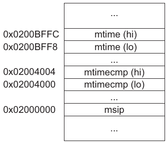

Bảng e9.7 System timer register

Điều chỉnh và in với phép từ Bảng 24 SiFive FE310-G002 Manual, © 2019 SiFive, Inc.

Nếu cần thêm timer, PWM module (xem Mục 9.3.7.2) cung cấp counter bổ sung có thể dùng đo delay chính xác.

#### Ví dụ e9.5 LED NHẤP NHÁY

Viết chương trình nhấp nháy status LED trên RED-V 5 lần mỗi giây trong 4 giây.

Lời giải Delay function trong EasyREDVIO (xem Ví dụ code e9.7) tạo delay theo số millisecond chỉ định bằng timer compare channel.

#### Ví dụ code e9.7 FUNCTION DELAY

```
#define MTIME_CLK_FREQ 32768                     // RTC frequency in Hz
volatile uint64_t *mtime = (uint32_t*) 0x0200BFF8;
void delay(int ms) {
    uint64_t doneTime = *mtime + (ms*MTIME_CLK_FREQ)/1000;
    while (*mtime < doneTime);                   // Wait until time is reached
}
```

GPIO5 (D13) drive activity LED trên board RED-V. Chương trình ở Ví dụ code e9.8 đặt pin này làm output. Sau đó nó tắt và bật LED bằng chuỗi digital write với chu kỳ lặp 200 ms (5 Hz).

### 9.3.7 Analog I/O

Thế giới thực là thế giới analog. Nhiều embedded system cần analog input và output để giao tiếp với thế giới. Chúng dùng analog-to-digital converter (ADC) để lượng tử hóa analog signal thành digital value, và digital-to-analog-converters (DAC) để làm ngược lại. Hình e9.15 cho ký hiệu của các thành phần này. Converter như vậy được đặc trưng bởi resolution, dynamic range, sampling rate và accuracy. Ví dụ, ADC có thể có resolution N = 12-bit trên dải V<sub>ref</sub><sup>−</sup> đến V<sub>ref</sub><sup>+</sup> từ 0 đến 5 V, với sampling rate f<sub>s</sub> = 44 kHz và accuracy ±3 least significant bit (lsb). Sampling rate cũng được ghi bằng sample mỗi giây (sps), trong đó 1 sps = 1 Hz. Quan hệ giữa analog input voltage V<sub>in</sub>(t) và digital sample X[n = t / f<sub>s</sub>] là

#### Ví dụ code e9.8 NHẤP NHÁY ACTIVITY LED

```
#include "EasyREDVIO.h"
void main(void) {
    uint32_t  i;
    pinMode(D13, OUTPUT);      // status led as output
    for(i = 0; i < 20; i++) {
        delay(100);
        digitalWrite(D13, 0);  // turn led off
        delay(100);
        digitalWrite(D13, 1);  // turn led on
    }
}
```

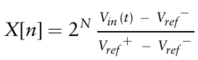 (e9.2)

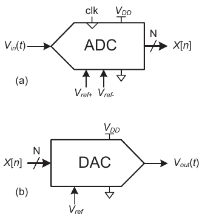

Hình e9.15 Symbol ADC/DAC

Ví dụ, input voltage 2.5 V (một nửa full scale) tương ứng với 2<sup>12</sup>/2 (một nửa giá trị tối đa), tức output 100000000000<sub>2</sub> = 0x800 = 2<sup>11</sup> = 2048, với độ bất định tối đa 3 lsb.

Tương tự, DAC có thể có resolution N = 16-bit trên dải output full-scale V<sub>ref</sub> = 2.56 V. Nó tạo output

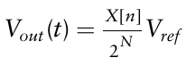 (e9.3)

Nhiều microcontroller có ADC built-in với hiệu năng vừa phải. Để có hiệu năng cao hơn (ví dụ resolution 16-bit hoặc sampling rate vượt 1 MHz), thường phải dùng ADC riêng nối với microcontroller. Ít microcontroller có DAC built-in hơn, nên phải dùng chip riêng để chuyển digital value thành analog voltage. Tuy nhiên, microcontroller thường tạo analog output bằng kỹ thuật gọi là pulse-width modulation (PWM).

Chuyển đổi D/A

FE310 không có DAC general-purpose. Mục này mô tả D/A conversion bằng external DAC và minh họa kết nối FE310 với chip khác qua parallel port và serial port. Mục kế tiếp đạt cùng kết quả bằng PWM.

Một số DAC nhận digital input N-bit trên parallel interface có N dây, trong khi số khác nhận qua serial interface như SPI. Một số DAC cần power supply voltage cả dương lẫn âm, trong khi số khác hoạt động với một nguồn. Một số hỗ trợ dải supply voltage linh hoạt, số khác yêu cầu điện áp cụ thể. Input logic level phải tương thích với digital source. Một số DAC tạo voltage output tỷ lệ với digital input, số khác tạo current output; có thể cần operational amplifier chuyển dòng này thành điện áp trong dải mong muốn.

Trong mục này, ta dùng parallel DAC Linear Technology LTC1450 12-bit và serial DAC Microchip MCP4801 8-bit. Cả hai tạo voltage output, hoạt động từ một nguồn 5 đến 15 V, dùng V<sub>IH</sub> = 2.4 V nên tương thích I/O 3.3 V, có DIP package dễ lắp breadboard và dễ sử dụng. LTC1450 tạo output trên thang 0 đến 2.048 V hoặc 0 đến 4.095 V tùy gain setting, tiêu thụ 2 mW, có package 24-pin và settling time 4 µs, cho phép output rate 250 ksample/giây. Datasheet tại analog.com. MCP4801 tạo output trên thang 0 đến 2.048 V hoặc 0 đến 4.096 V, tiêu thụ dưới 2 mW, có package 8-pin và settling time 4.5 µs. SPI của nó hoạt động tối đa 20 MHz. Datasheet tại microchip.com.

#### Ví dụ e9.6 ANALOG OUTPUT BẰNG DAC NGOÀI

Phác họa circuit và viết phần mềm cho signal generator đơn giản tạo sóng sine và triangle bằng RED-V, LTC1450 và MCP4801.

Lời giải Circuit ở Hình e9.16. Ví dụ này dùng hai DAC chip. Cả hai DAC dùng nguồn 5 V và có decoupling capacitor 0.1 µF để giảm power supply noise.

DAC LTC1450 có 12 data input, D0 đến D11, chỉ analog voltage cần tạo trên VOUT. Trong ví dụ, ta chỉ dùng precision 8-bit nên nối bốn least significant bit, D0 đến D3, xuống ground. Để load dữ liệu vào DAC, RED-V đặt giá trị mong muốn trên D4 đến D11. Sau đó RED-V drive pin write active-low (WR) xuống low để ghi dữ liệu vào DAC. CLR được nối VCC vì không cần clear input data latch. LDAC, load DAC signal low-asserted, được nối GND để load dữ liệu mỗi khi WR xuống low.

MCP4801 nối RED-V qua SPI1. Ngoài SPI signal chuẩn, MCP4801 có analog output voltage pin (VOUT) và hai control input active-low: hardware shutdown (SHDN) và latch DAC (LDAC). SHDN dùng tắt output driving circuitry và tiết kiệm điện khi không cần output value. LDAC latch input value khi low. Để gửi dữ liệu tới MCP4801, giá trị 16-bit được gửi qua SPI: bit 11 đến 4 giữ D7 đến D0; bit 13 chọn gain (1x nếu đặt 1, 2x nếu đặt 0); bit 12 điều khiển SHDN (0 tắt output, 1 cho VOUT drive analog value). Ở đây, SHDN được điều khiển bằng phần mềm nên để floating (không drive) trong circuit.

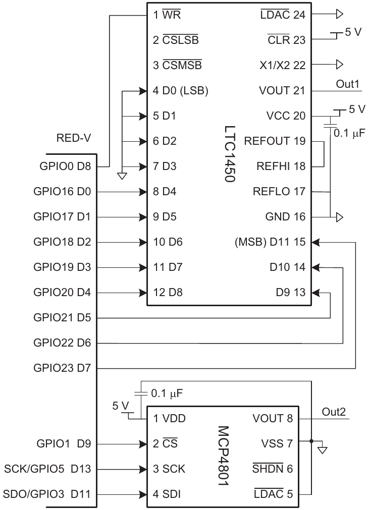

Hình e9.16 Interface DAC parallel/serial với RED-V

Chương trình drive cả hai DAC ở Ví dụ code e9.9. Chương trình cấu hình 8 parallel port pin làm output, đồng thời cấu hình GPIO0 làm output drive signal `WR` trên LTC1450 và GPIO1 drive chip select signal trên MCP4801. Nó khởi tạo SPI ở 500 kHz. `initWaveTables` tính trước array chứa sample value cho sóng sine và triangle. Sau đó nó cập nhật serial DAC. Tiếp theo, chương trình delay đến khi timer cho biết đã tới lúc tạo sample tiếp theo. Tần số tối đa của waveform được tạo được quyết định bởi thời gian gửi mỗi điểm trong function `genWaves`, bị giới hạn bởi thời gian truyền SPI.

Pulse-Width Modulation

Một cách khác để digital system tạo analog output là dùng pulse-width modulation (PWM), trong đó periodic output được tạo pulse high trong một phần chu kỳ và low trong phần còn lại. Duty cycle là phần của chu kỳ mà pulse high (pulse width/period), như Hình e9.17. Giá trị trung bình của output tỷ lệ với duty cycle. Ví dụ, nếu output dao động giữa 0 và 3.3 V với duty cycle 25%, giá trị trung bình bằng 0.25 × 3.3 = 0.825 V. Lọc Low-pass PWM signal loại bỏ dao động và để lại signal có giá trị trung bình mong muốn. Vì vậy, PWM là cách hiệu quả để tạo analog output nếu pulse rate cao hơn nhiều tần số analog output cần quan tâm. Ứng dụng PWM khác gồm tạo square wave audio tone và điều khiển digital động cơ hoặc đèn ở một phần công suất hay độ sáng.

#### Ví dụ code e9.9 TẠO SINE WAVE BẰNG DAC

```
#include "EasyREDVIO.h"
#include <math.h> // required to use the sine function

#define NUMPTS 64
int sine[NUMPTS], triangle[NUMPTS];

#define SHDNn_Pos 12
#define  Gain_Pos   13

int parallelPins[8] = {D0, D1, D2, D3, D4, D5, D6, D7};

void initWaveTables(void) {
  int  i;
  for (i = 0; i<NUMPTS; i++) {
    sine[i] = 127*(sin(2*3.14159*i/NUMPTS) + 1);   // 8-bit scale
    if (i < NUMPTS/2) triangle[i] = i*255/NUMPTS;  // 8-bit scale
    else triangle[i] = 254 – i*255/NUMPTS;
  }
}

void genWaves(int freq) {
  int i, j;
  int delay_cycles = MTIME_CLK_FREQ/(NUMPTS*freq);

  for (i = 0; i < 2000; i++){
    for (j = 0; j < NUMPTS; j++) {
      uint64_t doneTime = *mtime + delay_cycles; // Set sample period

      // Load serial DAC
      digitalWrite(1, 0);       //  enable chip (chip select: CS = 0)
      // Set SHDNn to active (bit 12) and gain to 1 (bit 13)
      volatile uint16_t sine_samp_dac = ((uint16_t) sine[j] << 4) \
                                        |(1 << SHDNn_Pos) | (1 << Gain_Pos);
      spiSendReceive16(sine_samp_dac);
      digitalWrite(1, 1);       // disable chip (chip select: CS = 1)

      // Load parallel DAC
      digitalWrite(0, 1);       // No load while changing inputs
      digitalWrites(parallelPins, 8, triangle[j]);
      digitalWrite(0, 0);       // Load new points into DACs
      while(*mtime < doneTime); // Wait for mtime_cmp to hit
     }
  }
}

int main(void) {
  pinsMode(parallelPins, 8, OUTPUT); // Set pins connected to the AD558 as outputs
  pinMode(0, OUTPUT);                           // Make pin 0 an output to control LOAD
  pinMode(1, OUTPUT);                           // Make pin 1 an output to control CE
  spiInit(15, 0, 0);                            // Initialize the SPI
  initWaveTables();
  genWaves(100);
}
```

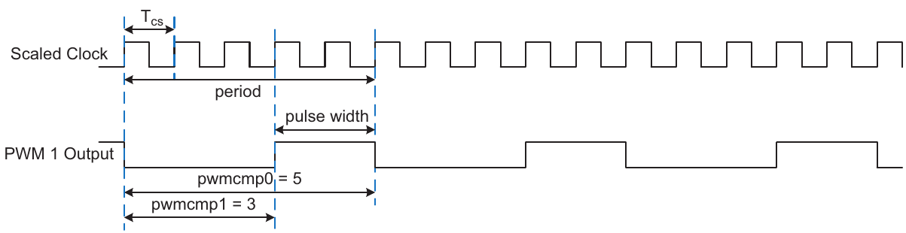

Hình e9.17 Signal Pulse-width modulated PWM

FE310 có ba PWM peripheral; như Bảng e9.3, mỗi PWM có bốn PWM output, tổng cộng 12 PWM output có thể dùng. Output trên PWM0 có precision 8-bit, còn PWM1 và PWM2 có precision 16-bit. Trong mục này, ta chỉ cách dùng PWM2, nhưng cấu hình và sử dụng hai PWM peripheral còn lại theo các bước tương tự. PWM2 có bốn output (PWM2_PWM0, PWM2_PWM1, PWM2_PWM2, PWM2_PWM3) trên pin GPIO10-13 bằng pin function IOF1.

PWM có vài waveform generation mode, nhưng ta tập trung tạo PWM waveform như Hình e9.17. Để làm vậy, peripheral được cấu hình repeating mode, trong đó comparator 0 (`pwmcmp0`) đặt chu kỳ và comparator 1 (`pwmcmp1`) đặt thời gian low. Các thời gian này tính theo đơn vị scaled clock period T<sub>cs</sub>. Ví dụ, như Hình e9.17, nếu scaled clock period bằng 0.5 μs (2 MHz) và `pwmcmp0` = 5 thì PWM2_PWM1 (pin 11) dao động với chu kỳ 5 × 0.5 μs = 2.5 μs (400 kHz). Nếu `pwmcmp1` = 3 thì duty cycle bằng 1−(3/5) = 40%.

Bảng e9.8 Configuration register PWM2

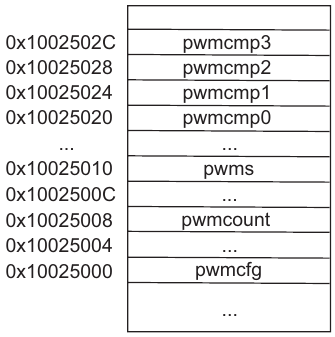

Điều chỉnh/in với phép Bảng 89 SiFive FE310-G002 Manual, ©2019 SiFive, Inc.

Bảng e9.8 cho memory map của các register PWM2. Trong mục này, ta mô tả các bước cần để cấu hình output PWM1_PWM1; PWM khác và output của chúng được cấu hình theo quy trình tương tự.

Bảng e9.9 cho bitfield trong PWM configuration register `pwmcfg`. Lưu ý phần lớn bit không được clear khi system reset,

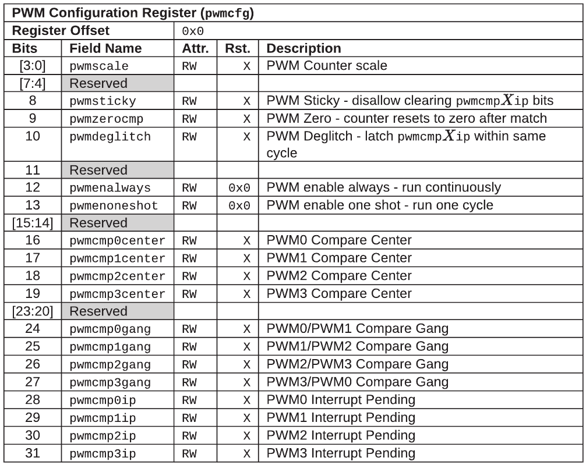

Bảng e9.9 Field PWM configuration register

Được phép in lại Bảng 91 SiFive FE310-G0002 Manual, ©2019 SiFive, Inc.

nên thận trọng nhất là bắt đầu bằng reset mọi bit về 0, rồi ghi 1 vào `pwmenalways` và `pwmzerocmp` để cấu hình PWM tạo waveform lặp có chu kỳ do `pwmcmp0` đặt.

Scaled clock frequency f<sub>scaled</sub> bằng base bus clock frequency f<sub>base</sub> = 16 MHz chia cho 2<sup>`pwmscale`</sup>, trong đó `pwmscale` là số 4-bit trong khoảng 0 đến 15 ở register `pwmcfg`. PWM frequency là f<sub>pwm</sub> = f<sub>scaled</sub>/`pwmcmp0` = f<sub>base</sub>/(`pwmcmp0` × 2<sup>`pwmscale`</sup>). Như mô tả trên, duty cycle bằng 1−(`pwmcmp1/pwmcmp0`). Có nhiều lựa chọn `pwmscale` và `pwmcmp0` để tạo PMW frequency mong muốn. Tuy nhiên, PWM frequency resolution (sai số giữa tần số mong muốn và thực tế) tốt nhất khi `pwmscale` nhỏ nhất có thể và `pwmcmp0` lớn nhất có thể, với ràng buộc `pwmcmp0` là số unsigned 16-bit (tức không vượt 65,535).

#### Ví dụ e9.7 PULSE-WIDTH MODULATION (PWM)

Chọn `pwmscale` và `pwmcmp0` để nhấp nháy LED ở 1.2 Hz. Lặp lại câu hỏi để tạo tone 1190 Hz.

Lời giải Để minh họa, giả sử ta muốn nhấp nháy LED ở f<sub>pwm</sub> = 1.2 Hz. f<sub>pwm</sub> = f<sub>base</sub>/(`pwmcmp0` × 2<sup>`pwmscale`</sup>). Vì vậy, chọn `pwmscale` = 8 và `pwmcmp0` = 52083.33 để có tần số mong muốn với f<sub>scaled</sub> = 16 MHz/2<sup>8</sup> = 62.5 KHz. `pwmcmp0` là register 16-bit nên phải làm tròn thành 52083, cho f<sub>pwm</sub> thực tế = 16 MHz/(52083 × 2<sup>8</sup>) = 1.20000768 Hz, rất gần tần số mong muốn và tương đương accuracy 10 phần triệu của quartz crystal clock reference điển hình.

Mặt khác, giả sử ta muốn output 1190 Hz. Nếu không đổi `pwmscale`, `pwmcmp0` phải bằng 52.521. Làm tròn thành 53 cho f<sub>pwm</sub> thực tế = 16 MHz/(53 × 2<sup>8</sup>) = 1179.2 Hz, sai số khoảng 10 Hz, hay 0.91%. Nếu cần output frequency chính xác hơn, ta có thể giảm `pwmscale` về 0 và tăng `pwmcmp0` lên 13445, thu được f<sub>pwm</sub> = 16 MHz/(13445 × 2<sup>0</sup>) = 1190.03 Hz.

PWM device driver có thể có function `pwmInit()` và `pwm(int freq,` `float duty)`. `pwmInit` đặt pin thích hợp cho PWM peripheral và đặt bit trong register `pwmcfg`. Function `pwm` sẽ chọn `pwmscale`, `pwmcmp0` và `pwmcmp1` thích hợp để tạo waveform có frequency và duty cycle chỉ định. Viết các function này tương tự viết SPI device driver hoặc UART device driver; chi tiết dành làm bài tập cho người đọc.

Chuyển đổi A/D

Nhiều microcontroller có ít nhất một ADC built-in, nhưng FE310 không có. Mục này mô tả A/D conversion bằng external converter tương tự external DAC đã mô tả ở mục trước.

#### Ví dụ e9.8 ANALOG INPUT BẰNG ADC NGOÀI

Kết nối A/D converter MCP3002 10-bit với FE310 bằng SPI và in input value. Đặt điện áp full-scale bằng 3.3 V. Tìm datasheet trên web để có đầy đủ chi tiết hoạt động.

Lời giải Hình e9.18 cho schematic kết nối FE310 với ADC MCP3002, và Ví dụ code e9.10 cho driver code. MCP3002 dùng VDD làm full-scale reference: tức VDD (Pin 8) nối với 3.3 V. Nó nhận nguồn từ 3.3 đến 5.5 V; ta chọn 3.3 V. ADC có hai input channel, CH0 và CH1. Ta nối channel 0 với potentiometer (không vẽ trong hình), xoay để điều chỉnh input voltage từ 0 đến 3.3 V.

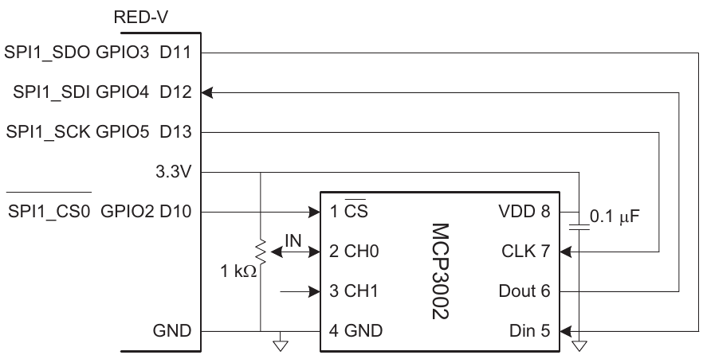

Hình e9.18 Đọc analog input qua external ADC

FE310 code (xem Ví dụ code e9.10) khởi tạo SPI rồi lặp lại việc đọc và in sample. Theo datasheet, FE310 phải gửi giá trị 16-bit 0x6000 qua SPI để đọc CH0 và sẽ nhận lại kết quả 10-bit trong 10 bit dưới của kết quả 16-bit. Vì không thể trực tiếp đặt FE310 truyền frame 16-bit, ta có thể ghép hai packet 8-bit mà không nâng chip select line giữa hai packet. Dù SPI peripheral có tùy chọn tự động điều khiển chip select line, ở đây ta tự cấu hình GPIO2 làm output và toggle thích hợp tại đầu quá trình truyền (ghi chip select line thành 0) và cuối quá trình truyền (ghi chip select line thành 1).

#### Ví dụ code e9.10 CODE NỐI ADC

```
#include "EasyREDVIO.h"
int main(void) {
  uint8_t  sample;
  spiInit(15, 0, 0);    // Initialize the SPI
                        // Clock divisor of div = 15, CPOL = 0, CPHA = 0
  pinMode(D10,    OUTPUT);
  while(1)  {
    digitalWrite(D10,  0);
    spiSendReceive('0x60');
    sample = spiSendReceive('0x00');
    digitalWrite(D10,  1);
    printf("Read %d\n", sample);
    delay(200);
   }
}
```

### 9.3.8 Interrupt

Đến đây, chúng ta dựa vào polling, trong đó chương trình liên tục kiểm tra giá trị đến khi sự kiện xảy ra, như dữ liệu tới UART hoặc timer đạt compare value. Điều này có thể lãng phí năng lực processor và khiến khó viết chương trình vừa làm công việc hữu ích vừa chờ sự kiện xảy ra.

Phần lớn microcontroller hỗ trợ interrupt. Khi sự kiện xảy ra, microcontroller dừng chương trình đang thực thi và nhảy đến interrupt handler phản hồi interrupt. Sau khi xử lý interrupt, processor return về user program và tiếp tục liền mạch tại nơi bị interrupt. Interrupt là hardware exception đã thảo luận ở Mục 6.6.2.

FE310 có core-local interruptor (CLINT) xử lý timer interrupt và software interrupt. Software interrupt dùng cho interprocessor communication và debug. FE310 còn có platform-level interrupt controller (PLIC) thu interrupt từ peripheral khác. Trong multiprocessor system, PLIC định tuyến peripheral interrupt tới processor thích hợp để xử lý.

Ví dụ e9.9 nháy LED bằng interrupt thay polling.

#### Ví dụ e9.9 NHẤP NHÁY LED BẰNG TIMER INTERRUPT

Ta cấu hình local interrupt trên FE310 bằng CLINT. Với chip FE310-G002 dùng trên RED-V RedBoard và RED-V Thing Plus, thông tin sử dụng interrupt có trong Chương 8 đến 10 của FE310-G002 Manual. Quy trình cấu hình local interrupt cơ bản qua CLINT được phác thảo dưới đây.

1\. Viết trap handler xử lý thực thi mỗi khi interrupt hoặc exception được kích hoạt. Mục đích chính của trap handler là xác định interrupt hoặc exception nào được kích hoạt rồi thực hiện operation phản hồi mong muốn.

2\. Cấu hình `mtvec`, một control and status register (CSR), với địa chỉ trap handler và mode (direct hoặc vectored).

3\. Enable interrupt cụ thể (ví dụ từ timer)

4\. Enable toàn bộ interrupt ở mức global.

Sau khi định nghĩa hằng số và function pointer array, code khai báo global trap handler function `handle_trap(),` như Ví dụ code e9.11. Function này được gọi mỗi khi kích hoạt trap (interrupt hoặc exception). Nhiệm vụ của nó là xác định trap nào kích hoạt call và nhảy đến interrupt handler hoặc exception handler đúng. Trap handler thực hiện hai việc. Trước tiên, nó dùng mask (`MCAUSE_INT_MASK`) kiểm tra most significant bit của register `mcause`, cho biết trap là interrupt (tạo từ thiết bị ngoài core) hay exception (tạo bên trong core). Cấu trúc `mcause` ở Bảng e9.10, còn danh sách interrupt code và exception code ở Bảng 6.6. Sau đó, nó dùng mask bổ sung (`MCAUSE_CODE_` `MASK`) để xác định trap code và nhảy đến interrupt handler hoặc exception handler thích hợp dựa trên index của function pointer array `interrupt_handler` hoặc `excep-` `tion_handler`.

Tiếp theo, ta định nghĩa interrupt service routine (ISR) cho timer. Đây là function chứa instruction muốn thực thi mỗi khi có timer interrupt. Trong ví dụ, function được gọi là `timer_handler()`. Nó đọc giá trị hiện tại của GPIO pin drive LED on-board (D13/GPIO5), rồi toggle state bằng `digitalWrite()`.

Bảng e9.10 Field register `mcause`

| Bit | Tên field | Mô tả |
|---|---|---|
| [9:0] | Exception Code | Code xác định exception gần nhất |
| [30:10] | Reserved |  |
| 31 | Interrupt | 1 nếu trap do interrupt; còn lại 0 |

Được phép in lại Bảng 22 SiFive FE310-G0002 Manual, ©2019 SiFive, Inc.

#### Ví dụ code e9.11 THIẾT LẬP TRAP HANDLER

```
// Function pointer arrays for interrupt and exception handlers
#define MAX_INTERRUPTS 16
void (*interrupt_handler[MAX_INTERRUPTS])();
void (*exception_handler[MAX_INTERRUPTS])();

// Masks for isolating interrupt vs. exception and the relevant code
#define MCAUSE_INT_MASK 0x80000000    // If [31] = 1 interrupt, else exception
#define MCAUSE_CODE_MASK 0x7FFFFFFF // low bits show code

// Declaration for interrupt handler. Declared with attribute interrupt which
// maps to GCC helper function.
void handle_trap(void) __attribute((interrupt));

// Define trap handler
void handle_trap() {
    unsigned long mcause_value = read_csr(mcause);
    if (mcause_value & MCAUSE_INT_MASK) {
       // Branch to interrupt handler here
       // Index into 32-bit array containing addresses of functions
       interrupt_handler[mcause_value & MCAUSE_CODE_MASK]();
    }
    else  {
       // Branch to exception handler here
       exception_handler[mcause_value & MCAUSE_CODE_MASK]();
    }
}
```

Sau đó, nó reset timer bằng cách gọi `reset_timer()`, đặt count hiện tại trong register `mtime` về 0 và reset count value mà tại đó interrupt tiếp theo cần được kích hoạt.

Khác các register đã dùng trong chương, phần lớn register liên quan CLINT—như `mtvec`, `mie` và `mstatus`—không được memory mapped. Chúng gọi là control and status register (CSR). Để thao tác CSR, phải dùng RISC-V assembly instruction CSR read (`csrr`) và CSR write (`csrw`). Các instruction này có thể được bọc thuận tiện trong C macro để dễ tương tác hơn.

#### Ví dụ code e9.12 TIMER ISR VÀ FUNCTION RESET TIMER

```
void timer_handler() {
    volatile int pin_val = (GPIO0->output_val >> D13) & 1; // Read the current output state
    if(pin_val) digitalWrite(D13, LOW);
    else digitalWrite(D13, HIGH);
    reset_timer(MTIME_CLK_FREQ / (2 * BLINK_FREQ));
}

void reset_timer(int count_val) {
    *MTIME = 0;
    *MTIMECMP = count_val;
}
```

Sau khi thiết lập trap handler, ta đăng ký bằng cách đặt địa chỉ vào register `mtvec`. Cấu trúc của nó ở Bảng e9.11. `mtvec` là register 32-bit, trong đó bit [31:2] giữ bit [31:2] của địa chỉ trap handler function (bit [1:0] tự động được coi là 0 vì instruction phải word aligned trong bộ nhớ). Bit [1:0] của `mtvec` được dùng thay vào đó để cấu hình exception được xử lý ở direct hay vector mode. Trong direct mode, bất kể interrupt hay exception nào xảy ra, ta nhảy tới function address do `mtvec[31:2]` chỉ định. Đây là mode dùng ở đây. Trong vectored mode, ta nhảy tới memory address khác nhau tùy interrupt được kích hoạt.

Sau khi cấu hình trap handler và thiết lập timer interrupt service routine, ta hoàn tất bằng cách enable machine timer interrupt qua việc set bit 7, machine timer interrupt enable (`MTIE`), trong machine interrupt enable register `mie`, và enable interrupt toàn cục bằng cách

#### Ví dụ code e9.13 MACRO GHI VÀ ĐỌC CSR

```
// Macros for reading and writing the control and status registers (CSRs)
#define read_csr(reg) ({ unsigned long __tmp; \
 asm volatile ("csrr %0, " #reg : " = r"(__tmp)); \
 __tmp; })

#define write_csr(reg, val) ({ \
 asm volatile ("csrw " #reg ", %0" :: "rK"(val)); })
```

Bảng e9.11 Field register `mtvec`

| Bit | Tên field | Mô tả |
|---|---|---|
| [1:0] | MODE | Đặt mode xử lý direct (`00`) hoặc vectored (`10`) |
| [31:2] | BASE[31:2] | Base address của `trap_handler` |

Điều chỉnh/in với phép Bảng 18 SiFive FE310-G0002 Manual, ©2019 SiFive, Inc.

set bit 3, machine interrupt enable (`MIE`), trong machine status register (`mstatus`). Helper function đơn giản để enable và disable interrupt toàn cục ở Ví dụ code e9.15. Chi tiết đầy đủ về cấu trúc `mstatus` và `mie` có trong Bảng 17 và 20 của SiFive FE310-G002 Manual.

#### Ví dụ code e9.14 FUNCTION ĐĂNG KÝ TRAP HANDLER BẰNG

GHI `mtvec`

```
void register_trap_handler(void *func) {
    // Set mtvec[31:2] to interrupt handler function address
    // The two lsbs are not meaningful because instructions are aligned to 4 bytes
    // Set mtvec[1:0] to 00 for direct mode.
    write_csr(mtvec, ((unsigned long) func) & ~(0b11));
}
```

Cuối cùng, ta kết hợp mọi phần và gọi các function đã xây dựng trong main function, như Ví dụ code e9.16. Ở đây, vì ứng dụng là interrupt driven, ta không làm gì trong main loop `while`.

Cần cẩn thận khi phát triển ứng dụng safety- hoặc timing-critical dùng interrupt, vì đây là sự kiện asynchronous có thể kích hoạt bất kỳ lúc nào trong quá trình thực thi. Là người lập trình, bạn cần cân nhắc bug nào có thể xuất hiện nếu interrupt kích hoạt vào thời điểm không thích hợp. Nếu có đoạn code cần tránh bị interrupt, có thể disable interrupt (tức clear `MIE` trong `mstatus`) khi thực thi các instruction, rồi re-enable interrupt khi hoàn tất (tức set `MIE` trong `mstatus`).

#### Ví dụ code e9.15 ENABLE/DISABLE INTERRUPT TOÀN CỤC

```
void enable_interrupts() {
    // Set bit 3 in mstatus (MIE) to enable machine interrupts
    write_csr(mstatus, read_csr(mstatus) | (1 << 3));

void disable_interrupts() {
    // Clear bit 3 in mstatus (MIE) to disable machine interrupts
    write_csr(mstatus, read_csr(mstatus) & ~(1 << 3));
}
```

## 9.4 MICROCONTROLLER PERIPHERAL KHÁC

Microcontroller thường kết nối với external peripheral khác. Mục này mô tả nhiều ví dụ phổ biến, gồm liquid crystal display (LCD) character- mode, VGA monitor, Bluetooth wireless link và motor controller.

### 9.4.1 Character LCD

Character LCD là liquid crystal display nhỏ có thể hiển thị một hoặc vài dòng văn bản. Chúng thường dùng ở mặt trước thiết bị như máy tính tiền, máy in laser và máy fax cần hiển thị lượng thông tin hạn chế. Chúng dễ kết nối với microcontroller qua parallel interface, RS-232 hoặc SPI. Crystalfontz America bán nhiều character LCD từ 8 cột × 1 hàng đến 40 cột × 4 hàng với lựa chọn màu, backlight, hoạt động 3.3 hoặc 5 V và khả năng nhìn dưới ánh sáng ban ngày. LCD có thể có giá \$20 trở lên khi mua ít, nhưng giảm xuống dưới \$5 khi mua số lượng lớn.

#### Ví dụ code e9.16 NHÁY LED BẰNG TIMER INTERRUPT

```
#include "EasyREDVIO.h"
// CLINT memory map pointers
#define MTIMECMP ((uint64_t *) 0x02004000UL)
#define MTIME ((uint64_t *) 0x0200BFF8UL)
#define BLINK_FREQ 4 // This is an arbitrary constant used to specify the LED blink
frequency

int main(void) {

    // Set LED pin as an output
    pinMode(D13,  OUTPUT);

    // Register interrupt handler.
    // The machine timer interrupt is exception code 7 as shown in   so we put the
    // timer_handler() function at index 7 of the array.
    interrupt_handler[7] = timer_handler;

    // Set up interrupt by configuring mtvec
    register_trap_handler(handle_trap);

    // Reset timer
    reset_timer(MTIME_CLK_FREQ / (2 * BLINK_FREQ));

    // Enable timer interrupt
    write_csr(mie, read_csr(mie) | (1 << 7));

    enable_interrupts();

    while(1)  {
    };

    return  0;
}
```

Mục này chỉ cách kết nối board RED-V với parallel LCD Crystalfontz CFAH2002A-TMI-JT 20 × 2 ở Hình e9.19. Interface là parallel interface 8-bit, tương thích với LCD controller HD44780 industry-standard ban đầu do Hitachi phát triển.

Hình e9.20 cho thấy LCD nối với board RED-V qua parallel interface 8-bit (input D0-D7 trên LCD). LCD logic hoạt động ở 5 V nhưng tương thích input 3.3 V từ board RED-V. LCD contrast được đặt bằng điện áp thứ hai (đưa vào pin 3, VO) tạo bởi potentiometer; màn hình thường dễ đọc nhất ở mức 4.2 đến 4.8 V. LCD nhận ba control signal: RS (1 cho ký tự, 0 cho instruction), R/$\overline{W}$ (1 đọc display, 0 ghi) và E (pulse high ít nhất 250 ns để enable LCD khi data byte tiếp theo sẵn sàng được ghi). Ngoài gửi data bit, data line (D0–D7) còn dùng đặt cấu hình LCD khi RS = 0 (tức instruction mode). Khi đọc, LCD port D7 trả busy flag, bằng 1 khi LCD bận và 0 khi sẵn sàng nhận instruction hoặc data byte khác.

Để khởi tạo LCD, board RED-V phải ghi chuỗi instruction vào LCD theo Bảng e9.12. Ghi instruction bằng cách đặt RS = 0 và R/$\overline{W}$ = 0, đặt giá trị trên tám data line rồi pulse E ít nhất 250 ns. Ghi data byte tương tự, ngoại trừ đặt RS = 1. Sau khi gửi instruction hoặc data byte, processor phải đợi ít nhất khoảng thời gian chỉ định (hoặc đôi khi tới khi busy flag được clear) trước khi gửi instruction hoặc data byte khác. Đọc busy flag (D7) bằng cách đặt RS = 0 và R/$\overline{W}$ = 1, pulse E ít nhất 250 ns. Hãy nhớ cũng phải tạm đặt GPIO23 làm input khi đọc busy flag (D7).

Sau khi cấu hình xong, LCD sẵn sàng nhận văn bản hiển thị. Ghi văn bản vào LCD bằng cách đặt RS = 1 và R/$\overline{W}$ = 0, đặt

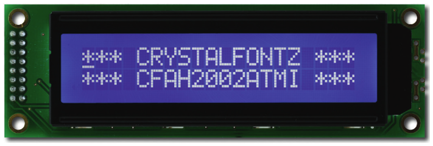

Hình e9.19 Character LCD Crystalfontz CFAH2002A-TMI 20 × 2

©2012 Crystalfontz America; được phép in lại.

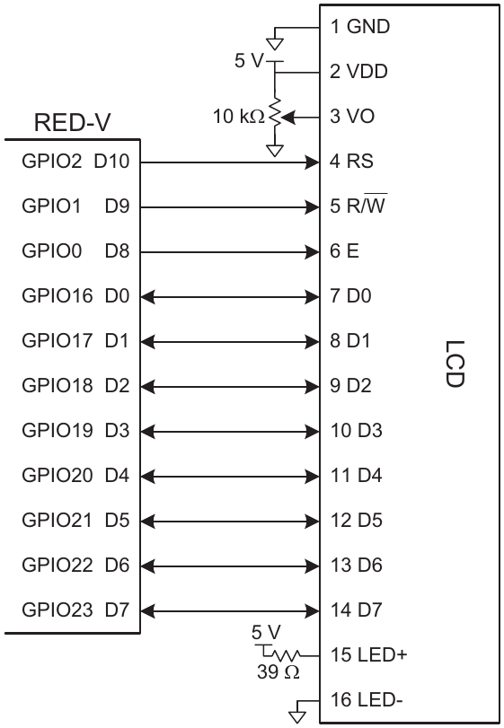

Hình e9.20 Interface parallel LCD

giá trị trên tám data line và pulse E ít nhất 250 ns. Sau mỗi ký tự, RED-V phải đợi busy bit được clear trước khi gửi ký tự khác. Nó cũng có thể gửi instruction 0x01 để xóa display hoặc 0x02 để return về home position ở góc trên trái.

#### Ví dụ e9.10 ĐIỀU KHIỂN LCD

Viết program in “I love LCDs” lên Crystalfontz CFAH2002A-TMI.

Lời giải Ví dụ code e9.17 khởi tạo display rồi gửi character in “I love LCDs”.

### 9.4.2 VGA monitor

Lựa chọn hiển thị linh hoạt hơn là drive computer monitor. Mục này giải thích chi tiết low-level để drive VGA (video graphics array) monitor trực tiếp từ FPGA.

#### Ví dụ code e9.17 GHI “I LOVE LCDS” LÊN LCD

```
#include "EasyREDVIO.h"
int LCD_IO_Pins[] = {D0, D1, D2, D3, D4, D5, D6, D7};
typedef enum {INSTR, DATA} mode;
#define RS D10
#define RW D9
#define E    D8
char lcdRead(mode md) {
    char c;
    pinsMode(LCD_IO_Pins, 8, INPUT);
    digitalWrite(RS,(md = = DATA));         // set instr/data mode
    digitalWrite(RW, 1);                    // RWbar = read mode
    digitalWrite(E, 1);                     // pulse enable
    delay(1);                               // wait for LCD response
    c = digitalReads(LCD_IO_Pins, 8);       // read a byte from parallel port
    digitalWrite(E, 0);                     // turn off enable
    delay(1);
    return c;
}
void lcdBusyWait(void) {
    char state;
    do {
        state = lcdRead(INSTR);
    } while(state & 0x80);
}
void lcdWrite(char val, mode md) {
    pinsMode(LCD_IO_Pins, 8, OUTPUT);
    digitalWrite(RS, (md = = DATA));        // set instr/data mode. OUTPUT = 1, INPUT = 0
    digitalWrite(RW, 0);                    // set RW pin to write   (RW = 0)
    digitalWrites(LCD_IO_Pins, 8, val);     // write the char to the parallel port
    digitalWrite(E, 1); delay(1);           // pulse E
    digitalWrite(E, 0); delay(1);
}
void lcdClear(void) {
    lcdWrite(0x01, INSTR); delay(1);
}
void lcdPrintString(char* str) {
    while (*str ! = 0) {
        lcdWrite(*str, DATA); lcdBusyWait();
        str++;
    }
}
void lcdInit(void) {
    pinMode(RS, OUTPUT); pinMode(RW, OUTPUT); pinMode(E,OUTPUT);
    // send initialization routine:
    delay(15);
    lcdWrite(0x30, INSTR); delay(1);
    lcdWrite(0x30, INSTR); delay(1);
    lcdWrite(0x30, INSTR); lcdBusyWait();
    lcdWrite(0x3C, INSTR); lcdBusyWait();
    lcdWrite(0x08, INSTR); lcdBusyWait();
    lcdClear();
    lcdWrite(0x06, INSTR); lcdBusyWait();
    lcdWrite(0x0C, INSTR); lcdBusyWait();
}
int main(void) {
    lcdInit();
    lcdPrintString("I love LCDs!");
}
```

Bảng e9.12 Chuỗi khởi tạo LCD

| Code (D7-D0) | Mục đích | Đợi (µs) |
|---|---|---|
| (cấp VDD) | Để thiết bị bật lên | 15000 |
| `0x30` | Đặt mode 8-bit | 4100 |
| `0x30` | Đặt lại mode 8-bit | 100 |
| `0x30` | Đặt mode 8-bit lần nữa | Đến khi busy flag clear |
| `0x3C` | Cấu hình 2 dòng và dot font 5 × 8 | Đến khi busy flag clear |
| `0x08` | Tắt display | Đến khi busy flag clear |
| `0x01` | Clear display | 1530 |
| `0x06` | Đặt entry mode tăng cursor sau từng character | Đến khi busy flag clear |
| `0x0C` | Bật display không cursor |  |

(Đây là instruction: RS = 0 và R/$\overline{W}$ = 0.)

Chuẩn VGA monitor được giới thiệu năm 1987 cho máy IBM PS/2, với resolution 640 × 480 pixel trên cathode ray tube (CRT) và connector 15-pin truyền thông tin màu bằng analog voltage. LCD monitor hiện đại có resolution cao hơn nhưng vẫn tương thích ngược chuẩn VGA.

Trong CRT, electron gun quét màn hình từ trái sang phải, kích thích vật liệu huỳnh quang để hiển thị ảnh. CRT màu dùng ba phosphor khác nhau cho đỏ, xanh lá, xanh dương và ba electron beam. Cường độ mỗi beam quyết định độ sáng màu tương ứng trong pixel. Cuối mỗi scan line, gun phải tắt trong horizontal blanking interval để trở lại đầu dòng tiếp. Khi hoàn tất mọi scan line, gun lại tắt trong vertical blanking interval để về góc trái trên. Toàn bộ quá trình lặp khoảng 60–75 lần/giây, làm mới huỳnh quang và tạo ảo giác ảnh ổn định. Display hiện đại thường dùng LCD, không cần electron gun như vậy nhưng vẫn dùng cùng VGA interface timing để tương thích.

Trong VGA monitor 640 × 480 pixel, toàn frame thực sự gồm 800 pixel × 525 horizontal scan line như Hình e9.21, nhưng chỉ 480 scan line và 640 pixel mỗi dòng mang ảnh; phần còn lại màu đen. Một scan line bắt đầu bằng back porch 48-pixel, vùng trống ở mép trái. Tiếp theo là 640 active pixel, front porch trống 16-pixel bên phải và pulse horizontal sync (hsync) dài 96-pixel clock để nhanh chóng đưa gun về trái. Theo chiều dọc, màn hình bắt đầu bằng back porch 32-scan line trên cùng, rồi 480 active scan line, front porch 11 scan line phía dưới và pulse vertical sync (vsync) 2-scan line để trở lại trên, bắt đầu frame tiếp. Với VGA 640 × 480 refresh ở 59.52 Hz, pixel clock là 800 × 525 × 59.52 = 25 MHz, nên mỗi pixel rộng 40 ns.

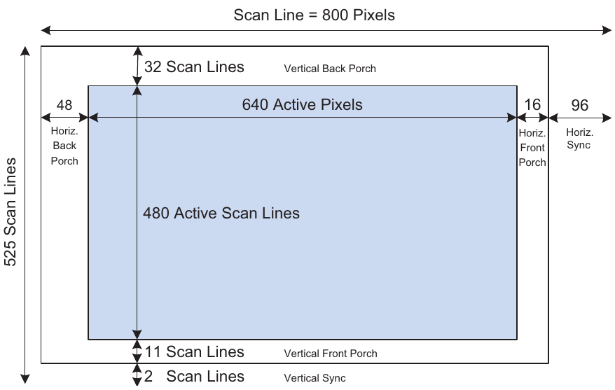

Hình e9.21 VGA frame

Hình e9.22(a) cho timing từng scan line. Toàn dòng dài 32 μs. Hình e9.22(b) cho vertical timing; lưu ý đơn vị thời gian nay là scan line thay vì pixel clock. Frame mới được vẽ khoảng 60 lần/giây. Resolution cao hơn dùng pixel clock nhanh hơn, tới 388 MHz cho 2048 × 1536 refresh ở 85 Hz. Ví dụ display 1024 × 768 refresh 60 Hz có thể thực hiện bằng pixel clock 65 MHz.

Hình e9.23 cho pinout của female connector từ video source. Thông tin pixel được truyền bằng ba analog voltage cho đỏ, xanh lá và xanh dương. Mỗi voltage từ 0 đến 0.7 V; dương hơn nghĩa là sáng hơn. Voltage phải bằng 0 trong front porch và back porch. Video signal phải tạo theo real time với tốc độ cao, khó thực hiện trên microcontroller nhưng dễ trên FPGA. Display black-and-white đơn giản có thể tạo bằng lái cả ba color pin tới 0 hoặc 0.7 V, dùng voltage divider nối digital output pin. Ngược lại, color monitor dùng video DAC có ba D/A converter riêng để lái độc lập ba color pin.

Hình e9.24 cho FPGA lái VGA monitor qua triple video DAC 8-bit ADV7125. DAC nhận 8 bit R, G, B từ FPGA. Nó cũng nhận signal SYNC_b được lái active low bất cứ khi nào HSYNC hoặc VSYNC assert. Video DAC tạo ba output current lái các đường analog đỏ, xanh lá, xanh dương, thường là transmission line 75 Ω có parallel termination ở cả video DAC lẫn monitor. Resistor R<sub>SET</sub> đặt scale output current để đạt toàn dải màu. Clock rate tùy resolution và refresh rate; có thể tới 330 MHz với model DAC fast-grade ADV7125JSTZ330.

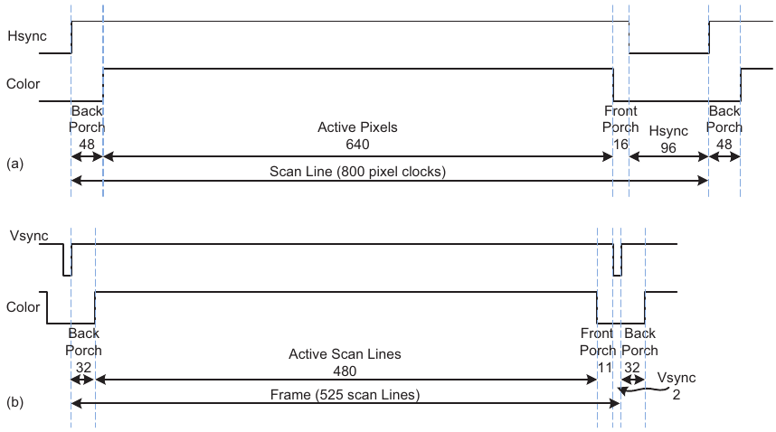

Hình e9.22 VGA timing: (a) ngang, (b) dọc

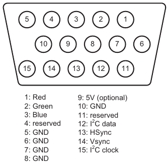

Hình e9.23 Pinout VGA connector

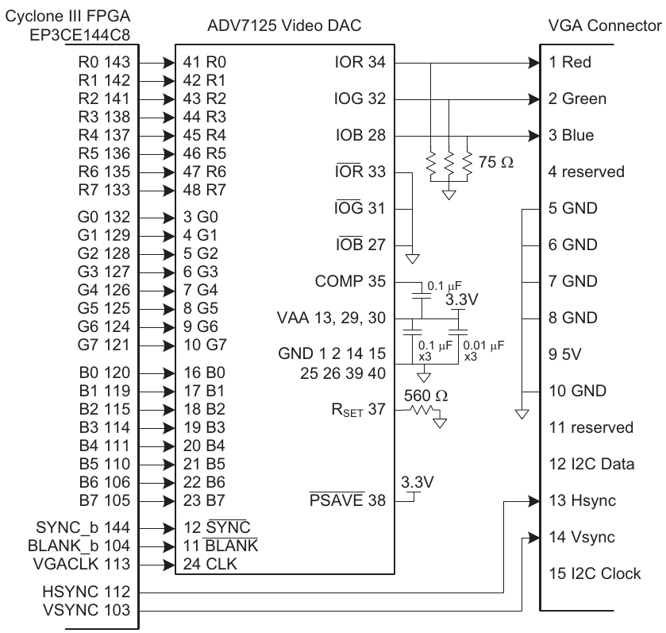

Hình e9.24 FPGA lái cáp VGA qua video DAC

#### Ví dụ e9.11 VGA MONITOR DISPLAY

Viết HDL code để hiển thị văn bản và hộp xanh lá trên VGA monitor bằng circuit trong Hình e9.24.

Lời giải Code giả định system clock 50 MHz và dùng clock divider tạo VGA clock 25 MHz. Cũng có thể dùng PLL tạo clock. Cấu hình PLL khác nhau giữa FPGA; với Cyclone III, frequency được chỉ định bằng megafunction wizard của Altera. Hoặc có thể cấp VGA clock trực tiếp từ signal generator.

VGA controller đếm qua các column và row màn hình, tạo signal `hsync` và `vsync` vào thời điểm thích hợp. Nó còn tạo signal `blank_b`, assert low để vẽ màu đen khi tọa độ nằm ngoài vùng active 640 × 480.

Video generator tạo giá trị màu đỏ, xanh lá và xanh dương dựa trên vị trí pixel (x, y) hiện tại. (0, 0) biểu diễn góc trái trên. Generator vẽ một tập character cùng rectangle xanh lá. Character generator vẽ character 8 × 8-pixel, cho màn hình 80 × 60 character. Nó tra character từ ROM, nơi character được encode binary thành 6 column × 8 row. Hai column còn lại để trống. SystemVerilog code đảo thứ tự bit vì column ngoài cùng bên trái file ROM là most significant bit, nhưng phải được vẽ tại least significant x-position.

Hình e9.25c là ảnh VGA monitor đang chạy chương trình. Các row chữ xen kẽ đỏ và xanh dương. Hộp xanh lá phủ lên một phần ảnh.

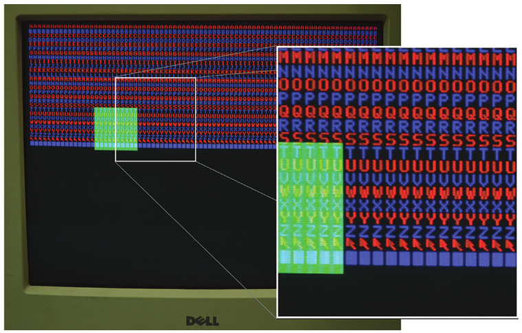

Hình e9.25 VGA output

#### Ví dụ HDL e9.3 `vga.sv`

```
module vga(input   logic clk, reset,
           output logic vgaclk,           // 25 MHz VGA clock
           output logic hsync, vsync,
           output logic sync_b, blank_b,  // to monitor & DAC
           output logic [7:0] r, g, b);   // to video DAC

  logic [9:0] x, y;

  // divide 50 MHz input clock by 2 to get 25 MHz clock
  always_ff @(posedge clk, posedge reset)
    if (reset) vgaclk = 1'b0;
    else           vgaclk = ~vgaclk;

  // generate monitor timing signals
  vgaController vgaCont(vgaclk, reset, hsync, vsync, sync_b, blank_b, x, y);

  // user–defined module to determine pixel color
  videoGen videoGen(x, y, r, g, b);

endmodule

module vgaController #(parameter HBP         = 10'd48,     // horizontal back porch
                                HACTIVE = 10'd640,         // number of pixels per line
                                HFP        = 10'd16,       // horizontal front porch
                                HSYN      = 10'd96,        // horizontal sync pulse = 60 to move
                                                           // electron gun back to left
                                // number of horizontal pixels (i.e., clock cycles)
                                HMAX      = HBP + HACTIVE + HFP + HSYN,  //48+640+16+96=800:
                                VBP         = 10'd32,      // vertical back porch
                                VACTIVE = 10'd480,         // number of lines
                                VFP        = 10'd11,       // vertical front porch
                                VSYN      = 10'd2,         // vertical sync pulse = 2 to move
                                                           // electron gun back to top
                                // number of vertical pixels (i.e., clock cycles)
                                VMAX      = VBP + VACTIVE + VFP  + VSYN) //32+480+11+2=525:

    (input   logic vgaclk, reset,
     output logic hsync, vsync, sync_b, blank_b,
     output logic [9:0] hcnt, vcnt);

     // counters for horizontal and vertical positions
     always @(posedge vgaclk, posedge reset) begin
       if (reset) begin
         hcnt <= 0;
         vcnt <= 0;
       end
       else   begin
          hcnt++;
           if (hcnt = = HMAX) begin
            hcnt <= 0;
               vcnt++;
               if (vcnt = = VMAX)
                 vcnt <= 0;
           end
       end
     end

     // compute sync signals (active low)
     assign hsync   = ~( (hcnt >= (HACTIVE + HFP)) & (hcnt < (HACTIVE + HFP + HSYN)) );
     assign vsync   = ~( (vcnt >= (VACTIVE + VFP)) & (vcnt < (VACTIVE + VFP + VSYN)) );
     assign sync_b = 1'b0;    // this should be 0 for newer monitors
                              // for older monitors, use: assign sync_b = hsync & vsync;
     // force outputs to black when not writing pixels
     assign blank_b = (hcnt < HACTIVE) & (vcnt < VACTIVE);
endmodule
module videoGen(input logic [9:0] x, y, output logic [7:0] r, g, b);
  logic pixel, inrect;
  // given y position, choose a character to display
  // then look up the pixel value from the character ROM
  // and display it in red or blue. Also draw a green rectangle.
  chargenrom chargenromb(y[8:3]+8'd65, x[2:0], y[2:0], pixel);
  rectgen rectgen(x, y, 10'd120, 10'd150, 10'd200, 10'd230, inrect);
  assign {r, b} = (y[3]= =0) ? {{8{pixel}},8'h00} : {8'h00, {8{pixel}}};
  assign g         = inrect    ? 8'hFF : 8'h00;
endmodule

module chargenrom(input   logic [7:0] ch,
                  input   logic [2:0] xoff, yoff,
                  output logic           pixel);
  logic [5:0] charrom[2047:0]; // character generator ROM
  logic [7:0] line;                    // a line read from the ROM
  // initialize ROM with characters from text file
  initial $readmemb("charrom.txt", charrom);
  // index into ROM to find line of character
  assign line = charrom[yoff+{ch–65, 3'b000}];  // subtract 65 because A
                                                // is entry 0
  // reverse order of bits
  assign pixel = line[3'd7-xoff];
endmodule
module rectgen(input   logic [9:0] x, y, left, top, right, bot,
               output logic inrect);
  assign inrect = (x >= left & x < right & y >= top & y < bot);
endmodule
```

#### Ví dụ HDL e9.4 charrom.txt: NỘI DUNG CHARACTER ROM

```
// A ASCII 65
011100
100010
100010
111110
100010
100010
100010
000000
//B ASCII 66
111100
100010
100010
111100
100010
100010
111100
000000
//C ASCII 67
011100
100010
100000
100000
100000
100010
011100
000000
...
```

### 9.4.3 Bluetooth wireless communication

> 
>
> Vua Bluetooth
>
> (Thực ra đây là Olof Kindgren, nhưng chúng tôi tưởng tượng vua Bluetooth trông tương tự. Ảnh được phép in lại.) Chuẩn Bluetooth mang tên vua Harald Bluetooth của Đan Mạch, vị vua thế kỷ 10 thống nhất các bộ tộc Đan Mạch đang giao tranh. Chuẩn không dây này chỉ thành công phần nào trong việc thống nhất vô số wireless protocol cạnh tranh!

Hiện có nhiều chuẩn wireless communication, gồm Wi-Fi, ZigBee và Bluetooth. Các chuẩn phức tạp và cần integrated circuit tinh vi, nhưng ngày càng nhiều module giấu độ phức tạp và cung cấp interface đơn giản cho người dùng. Một module là BlueSMiRF, interface Bluetooth wireless easy-to-use có thể dùng thay serial cable.

Bluetooth là wireless standard do Ericsson phát triển ban đầu năm 1994 để giao tiếp low-power, moderate-speed trong khoảng 5–100 mét, tùy transmitter power. Nó thường nối tai nghe với điện thoại hoặc bàn phím với máy tính. Khác infrared communication link, nó không đòi hỏi đường nhìn thẳng giữa thiết bị.

Bluetooth hoạt động trong băng industrial-scientific- medical (ISM) 2.4 GHz không cần cấp phép. Nó định nghĩa 79 radio channel cách nhau 1 MHz, bắt đầu tại 2402 MHz. Nó nhảy qua channel theo pattern pseudo- random để tránh interference liên tục với thiết bị khác như wireless router cùng băng. Như Bảng e9.13, transmitter được phân ba power level, quyết định range và công suất tiêu thụ. Trong basic rate mode, nó chạy 1 Mbit/giây bằng Gaussian frequency shift keying (FSK). FSK thường truyền mỗi bit tại frequency f<sub>c</sub> ± f<sub>d</sub>, với f<sub>c</sub> là center frequency của channel và f<sub>d</sub> là offset ít nhất 115 kHz. Chuyển frequency đột ngột giữa bit tốn thêm bandwidth. Gaussian FSK làm trơn thay đổi frequency để dùng spectrum tốt hơn. Hình e9.26 cho frequency được truyền với chuỗi 0 và 1 trên channel 2402 MHz bằng FSK và GFSK.

Bảng e9.13 Bluetooth class

| Class | Transmitter power (mW) | Range (m) |
|---|---|---|
| 1 | 100 | 100 |
| 2 | 2.5 | 10 |
| 3 | 1 | 5 |

Module BlueSMiRF Silver trong Hình e9.27(a) chứa Bluetooth radio Class 2, modem và interface circuit trên card nhỏ có serial interface. Nó giao tiếp với Bluetooth device khác như laptop có Bluetooth built-in hoặc USB dongle nối PC. Vì vậy nó cung cấp wireless serial link giữa RED-V và PC tương tự Hình e9.13 nhưng không có cable. Wireless link tương thích cùng software với wired link.

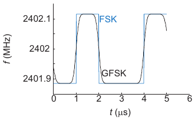

Hình e9.26 Waveform FSK/GFSK

Hình e9.28 minh họa schematic cho một kết nối như vậy. Pin TX của BlueSMiRF được nối với pin RX của RED-V và ngược lại. Các pin RTS và CTS được nối với nhau để BlueSMiRF tự thực hiện handshake với chính nó.

BlueSMiRF mặc định 115.2 kbaud với 8 data bit, 1 stop bit, không parity hoặc flow control. Nó dùng digital logic level 3.3 V, nên không cần RS-232 transceiver để nối device 3.3 V khác.

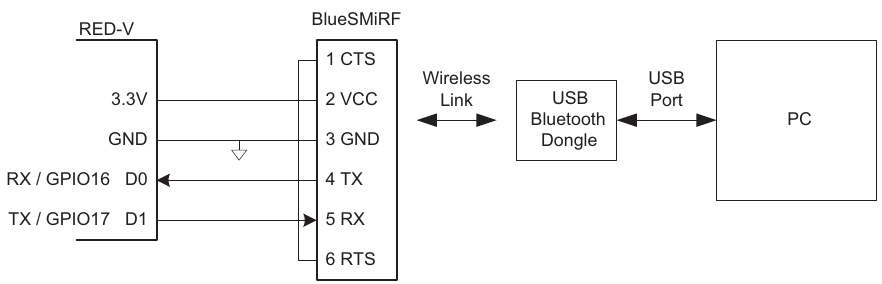

Hình e9.28 Link BlueSMiRF RED-V–PC

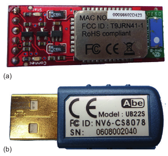

Hình e9.27 (a) Module BlueSMiRF, (b) USB dongle

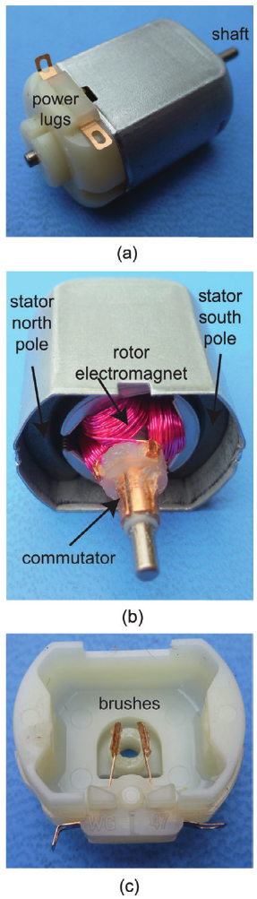

Hình e9.29 DC motor

Để sử dụng interface này, hãy cắm một USB Bluetooth dongle vào PC. Cấp nguồn cho RED-V và BlueSMiRF. Đèn STAT màu đỏ trên BlueSMiRF sẽ nhấp nháy, cho biết thiết bị đang chờ thiết lập kết nối. Mở biểu tượng Bluetooth trong system tray của PC và sử dụng Add Bluetooth Device Wizard để ghép đôi dongle với BlueSMiRF. Passkey mặc định của BlueSMiRF là 1234. Ghi lại COM port được gán cho dongle. Sau đó, việc giao tiếp có thể diễn ra giống như qua serial cable. Lưu ý rằng dongle thường hoạt động ở 9600 baud và phải cấu hình PuTTY tương ứng.

### 9.4.4 Điều khiển motor

Một ứng dụng quan trọng khác của microcontroller là điều khiển các actuator như motor. Mục này mô tả ba loại motor: DC motor, servo motor và stepper motor. DC motor cần drive current lớn, thường ở mức khoảng 1 A. Vì vậy, GPIO của microcontroller không thể điều khiển chúng trực tiếp, và phải nối một driver mạnh như H-bridge giữa microcontroller và motor. Motor cũng cần shaft encoder nếu người dùng muốn biết vị trí hiện tại của motor. Servo motor nhận một signal pulse-width modulated để chỉ định vị trí trong một khoảng góc giới hạn. Chúng rất dễ giao tiếp, nhưng công suất không lớn bằng và không phù hợp để quay liên tục. Stepper motor nhận một chuỗi pulse, mỗi pulse làm motor quay một góc cố định được gọi là step. Chúng đắt hơn và vẫn cần H-bridge để điều khiển dòng điện lớn, nhưng có thể điều khiển chính xác vị trí.

Motor có thể dùng dòng đáng kể và gây glitch trên power supply, ảnh hưởng digital logic. Một cách giảm vấn đề là dùng power supply hoặc battery cho motor riêng với digital logic.

DC motor

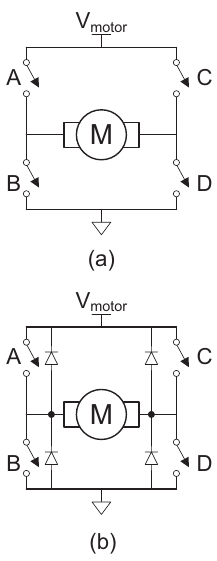

Hình e9.30 H-bridge

Hình e9.29 minh họa cấu trúc của một brushed DC motor. Motor là thiết bị two-terminal. Nó chứa các nam châm vĩnh cửu đứng yên gọi là stator và một nam châm điện quay gọi là rotor hoặc armature được nối với trục. Đầu trước của rotor nối với một vòng kim loại chia đôi gọi là commutator. Các chổi kim loại gắn với đầu nối nguồn (input terminal) cọ vào commutator, cung cấp dòng điện cho nam châm điện của rotor. Điều này tạo ra từ trường trong rotor khiến rotor quay để thẳng hàng với từ trường của stator. Khi rotor đã quay được một phần vòng và gần thẳng hàng với stator, các chổi chạm vào những phía đối diện của commutator, đảo chiều dòng điện và từ trường, khiến rotor tiếp tục quay liên tục.

DC motor thường quay hàng nghìn vòng/phút (RPM) với torque rất thấp. Phần lớn hệ thêm gear train để giảm tốc xuống mức hợp lý và tăng torque. Hãy tìm gear train được thiết kế phù hợp motor. Pittman sản xuất nhiều DC motor high-quality cùng accessory, còn toy motor rẻ phổ biến trong giới hobbyist.

Một DC motor cần dòng điện và điện áp đáng kể để cung cấp công suất lớn cho tải. Dòng điện cũng phải đảo chiều được để motor có thể quay theo cả hai hướng. Phần lớn microcontroller không thể cung cấp đủ dòng điện để điều khiển trực tiếp một DC motor. Thay vào đó, chúng sử dụng một H-bridge, về nguyên lý gồm bốn switch được điều khiển bằng điện, như trong Hình e9.30(a). Nó được gọi là H-bridge vì cách bố trí các switch giống chữ H. Nếu các switch A và D đóng, dòng điện chạy từ trái sang phải qua motor và motor quay theo một hướng. Nếu B và C đóng, dòng điện chạy từ phải sang trái qua motor và motor quay theo hướng ngược lại. Nếu A và C hoặc B và D đóng, điện áp hai đầu motor bị ép về 0, khiến motor chủ động hãm lại. Nếu không có switch nào đóng, motor sẽ tiếp tục quay theo quán tính cho đến khi dừng. Các switch trong H-bridge là power transistor, tức là chúng chịu được dòng điện lớn từ một ampere trở lên. H-bridge cũng chứa một số digital logic để điều khiển các switch một cách thuận tiện. Microcontroller cung cấp digital input low-current để điều khiển output high-current của H-bridge.

Khi dòng motor đổi đột ngột, inductance của electromagnet tạo voltage spike lớn có thể làm hỏng power transistor. Vì vậy nhiều H-bridges còn có protection diode song song switch, như Hình e9.30(b). Nếu inductive kick đẩy một terminal motor trên V<sub>motor</sub> hoặc dưới ground, diode ON và clamp voltage ở mức an toàn. H-bridges có thể tỏa công suất lớn, nên cần heat sink để giữ mát.

#### Ví dụ e9.12 XE TỰ HÀNH

Thiết kế hệ thống trong đó board RED-V điều khiển hai drive motor của xe robot. Viết library function khởi tạo motor driver, cho xe tiến, lùi, rẽ trái/phải và dừng. Dùng PWM thay đổi output voltage để điều khiển tốc độ motor.

Lời giải Hình e9.31 cho cặp DC motor do RED-V điều khiển qua Texas Instruments SN754410 dual H-bridge. H-bridge cần logic supply V<sub>CC1</sub> 5 V và motor supply V<sub>CC2</sub> 4.5–36 V; V<sub>IH</sub> = 2 V nên tương thích I/O 3.3 V RED-V. Nó cấp tối đa 1 A cho mỗi trong hai motor. V<sub>motor</sub> nên lấy từ battery pack riêng; output 5 V RED-V không đủ dòng lái phần lớn motor, và RED-V có thể bị hỏng.

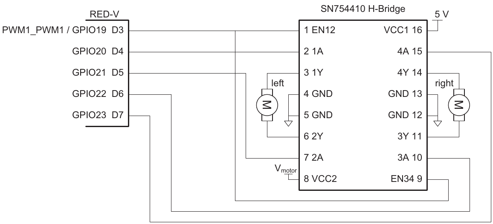

Hình e9.31 Điều khiển motor với dual H-bridge

Bảng e9.14 mô tả cách các input của từng H-bridge điều khiển một motor. Microcontroller điều khiển các signal enable bằng một signal PWM để điều chỉnh tốc độ của các motor. Nó điều khiển bốn pin còn lại để xác định hướng quay của từng motor.

PWM được cấu hình khoảng 5 kHz, duty cycle từ 0% đến 100%. Bất kỳ PWM frequency cao hơn nhiều bandwidth motor đều cho hiệu ứng chuyển động mượt. Quan hệ duty cycle với tốc độ là nonlinear; dưới một duty cycle nào đó motor hoàn toàn không chuyển động.

Ví dụ code e9.18 cho cách dùng PWM với cấu hình dual H-bridge Hình e9.31 để lái hai DC motor.

Bảng e9.14 Điều khiển H-Bridge

| EN12 | 1A | 2A | Motor |
|---|---|---|---|
| 0 | X | X | Quay trớn |
| 1 | 0 | 0 | Phanh |
| 1 | 0 | 1 | Lùi |
| 1 | 1 | 0 | Tiến |
| 1 | 1 | 1 | Phanh |

#### Ví dụ code e9.18 DRIVER DC MOTOR

```
#include "EasyREDVIO.h"
// Motor Constants
#define EN D3
#define MOTOR_1A D4
#define MOTOR_2A D5
#define MOTOR_3A D6
#define MOTOR_4A D7
void setMotorLeft(int dir)  {   // dir of 1 = forward, 0 = backward
    digitalWrite(MOTOR_1A, dir);
    digitalWrite(MOTOR_2A, !dir);
}
void setMotorRight(int dir) {   // dir of 1 = forward, 0 = backward
    digitalWrite(MOTOR_3A, dir);
    digitalWrite(MOTOR_4A, !dir);
}
void forward(void) {
    setMotorLeft(1); setMotorRight(1); // both motors drive forward
}
void backward(void) {
    setMotorLeft(0); setMotorRight(0); // both motors drive backward
}
void left(void) {
    setMotorLeft(0); setMotorRight(1); // left back, right forward
}
void right(void) {
    setMotorLeft(1); setMotorRight(0); // right back, left forward
}
void halt(void) {   // turn both motors off
    digitalWrite(MOTOR_1A, 0);
    digitalWrite(MOTOR_2A, 0);
    digitalWrite(MOTOR_3A, 0);
    digitalWrite(MOTOR_4A, 0);
}
void initMotors(void) {
    pinMode(MOTOR_1A, OUTPUT);
    pinMode(MOTOR_2A, OUTPUT);
    pinMode(MOTOR_3A, OUTPUT);
    pinMode(MOTOR_4A, OUTPUT);
    halt();               // ensure motors are not spinning
    pwmInit(EN, 1, 255);  // turn on PWM
    analogWrite(200);     // default to partial power
}
int  main(void) {
    initMotors();
    while(1)
    {
        forward();
        delay(5000);
        backward();
        delay(5000);
        left();
        delay(5000);
        right();
        delay(5000);
        halt();
   }
}
```

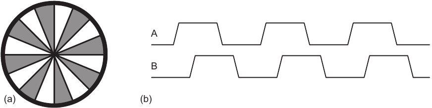

Hình e9.32 Shaft encoder: (a) đĩa, (b) quadrature output

Trong ví dụ trước, không có cách nào đo vị trí của từng motor. Hai motor khó có thể hoàn toàn giống nhau, nên một motor có khả năng quay nhanh hơn motor còn lại một chút, khiến robot lệch khỏi hướng di chuyển. Để giải quyết vấn đề này, một số hệ thống bổ sung shaft encoder. Hình e9.32(a) minh họa một shaft encoder đơn giản gồm một đĩa có các khe, được gắn vào trục motor. Một LED được đặt ở một bên và một cảm biến ánh sáng được đặt ở bên còn lại. Shaft encoder tạo ra một pulse mỗi khi một khe quay qua LED. Microcontroller có thể đếm những pulse này để đo tổng góc mà trục đã quay. Bằng cách sử dụng hai cặp LED/cảm biến đặt cách nhau nửa độ rộng của một khe, một shaft encoder cải tiến có thể tạo ra các quadrature output như trong Hình e9.32(b), cho biết cả hướng quay lẫn góc quay của trục. Đôi khi, shaft encoder có thêm một lỗ để chỉ báo khi trục ở một index position.

Servo motor

Servo motor là một DC motor được tích hợp với gear train, shaft encoder và một số control logic để dễ sử dụng hơn. Nó có phạm vi quay giới hạn, thường là 180°. Hình e9.33 minh họa một servo đã tháo nắp để thấy các bánh răng. Servo motor có interface 3-pin gồm nguồn điện (thường là 5 V), ground và một control input. Control input thường là một signal pulse-width modulated 50 Hz. Control logic của servo điều khiển trục đến vị trí được xác định bởi duty cycle của control input. Shaft encoder của servo thường là một potentiometer xoay tạo ra điện áp phụ thuộc vào vị trí của trục.

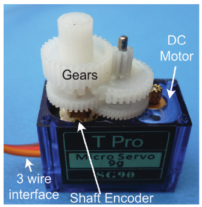

Hình e9.33 Servo motor SG90

Trong một servo motor điển hình có phạm vi quay 180 độ, pulse width 1 ms đưa trục đến 0°, 1.5 ms đưa trục đến 90° và 2 ms đưa trục đến 180°. Ví dụ, Hình e9.34 minh họa một control signal có pulse width 1.5 ms. Điều khiển servo vượt khỏi phạm vi của nó có thể khiến nó va vào các điểm chặn cơ khí và bị hỏng. Nguồn điện của servo đến từ power pin thay vì control pin, nên đường điều khiển có thể nối trực tiếp với microcontroller mà không cần H-bridge. Servo motor thường được sử dụng trong mô hình máy bay remote-control và robot nhỏ vì chúng nhỏ, nhẹ và thuận tiện. Việc tìm một motor có datasheet đầy đủ có thể khó khăn. Pin ở giữa có dây màu đỏ thường là nguồn điện, còn dây màu đen hoặc nâu thường là ground.

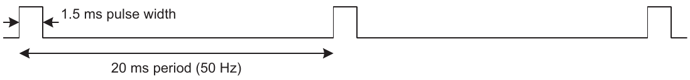

Hình e9.34 Servo control waveform

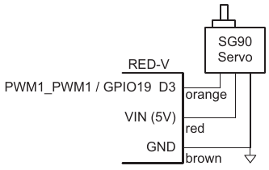

Hình e9.35 Điều khiển servo motor

#### Ví dụ e9.13 SERVO MOTOR

Thiết kế hệ thống trong đó RED-V lái servo motor đến góc mong muốn.

Lời giải Hình e9.35 minh họa sơ đồ kết nối với một servo motor SG90, bao gồm màu của các dây trên cáp servo. Servo hoạt động với nguồn điện từ 4.0 đến 7.2 V. Nó có thể tiêu thụ dòng điện đến 0.5 A nếu phải tạo ra lực lớn, nhưng có thể hoạt động trực tiếp từ nguồn điện của RED-V nếu tải nhẹ. Một dây duy nhất mang signal PWM, có thể được cung cấp ở logic level 5 hoặc 3.3 V. Code cấu hình việc tạo PWM và tính duty cycle phù hợp với góc mong muốn. Nó lần lượt đặt servo ở các vị trí 0°, 90° và 180°.

#### Ví dụ code e9.19 DRIVER SERVO MOTOR

```
#include "EasyREDVIO.h"
void genPulseMicroseconds(uint16_t pulse_len_us) {
    PWM1->pwmcmp1.pwmcmp = pulse_len_us;
}
void setServo(float angle) {
    volatile uint16_t pulse_len_us = (uint16_t) (1000 + (angle / 180) * 1000);
    genPulseMicroseconds(pulse_len_us);
}
int main(void) {
    uint32_t scale = 4; // Set scale to get 16e6/2^4 = 1 MHz count speed for 1 us accuracy
    float freq = 50.0;
    volatile uint32_t pwm_period_count = (uint32_t) (1/freq * 1e6); // Period for PWM in
                                                                    // microseconds
    pwmInit(D3, scale, pwm_period_count);
    while(1) {
        setServo(0.0);
        delay(1000);
        setServo(90.0);
        delay(1000);
        setServo(180.0);
        delay(1000);
    }
}
```

Cũng có thể chuyển một servo thông thường thành continuous rotation servo bằng cách cẩn thận tháo nó ra, loại bỏ điểm chặn cơ khí và thay potentiometer bằng một bộ chia điện áp cố định. Nhiều website cung cấp hướng dẫn chi tiết cho các servo cụ thể. Khi đó, PWM sẽ điều khiển vận tốc thay vì vị trí, với 1.5 ms biểu thị dừng, 2 ms biểu thị quay tiến ở tốc độ tối đa và 1 ms biểu thị quay lùi ở tốc độ tối đa. Continuous rotation servo có thể thuận tiện hơn và ít tốn kém hơn một DC motor đơn giản kết hợp với H-bridge và gear train.

Stepper motor

Stepper motor chuyển động theo các step rời rạc khi các pulse được đưa luân phiên vào các input. Kích thước mỗi step thường là vài độ, cho phép định vị chính xác và quay liên tục. Các stepper motor nhỏ thường có hai bộ cuộn dây gọi là phase, được nối theo cấu hình bipolar hoặc unipolar. Với cùng kích thước, bipolar motor có công suất lớn hơn và giá rẻ hơn, nhưng cần driver H-bridge, còn unipolar motor có thể được điều khiển bằng các transistor hoạt động như switch. Mục này tập trung vào bipolar stepper motor, là loại hiệu quả hơn.

Hình e9.36(a) là bipolar motor two-phase đơn giản, step 90-degree. Rotor là permanent magnet một cực bắc, một cực nam. Stator là electromagnet gồm hai cặp coil tạo hai phase. Vì vậy motor Two-phase bipolar có bốn terminal. Hình e9.36(b) cho symbol stepper, mô hình hai coil như inductor. Motor thực thêm gearing để giảm output step, tăng torque.

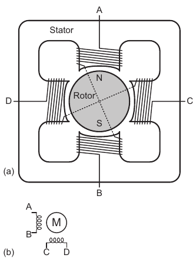

Hình e9.36 Motor bipolar Two-phase: (a) sơ đồ đơn giản, (b) symbol

Hình e9.37 minh họa ba drive sequence phổ biến cho một bipolar motor two-phase. Hình e9.37(a) minh họa wave drive, trong đó các cuộn dây được cấp điện theo trình tự AB–CD–BA–DC. Lưu ý rằng BA có nghĩa là cuộn dây AB được cấp điện với dòng điện chạy theo hướng ngược lại; đây là nguồn gốc của tên gọi bipolar. Rotor quay 90 độ ở mỗi step. Hình e9.37(b) minh họa two-phase-on drive theo mẫu (AB, CD)–(BA, CD)–(BA, DC)–(AB, DC). (AB, CD) biểu thị rằng cả hai cuộn dây AB và CD được cấp điện đồng thời. Rotor vẫn quay 90 độ ở mỗi step, nhưng tự căn chỉnh vào vị trí nằm giữa hai pole position. Cách này tạo ra torque cao nhất vì cả hai cuộn dây đều cung cấp công suất cùng lúc. Hình e9.37(c) minh họa half-step drive theo mẫu (AB, CD)–CD–(BA, CD)–BA–(BA, DC)– DC–(AB, DC)–AB. Rotor quay 45 độ ở mỗi half-step. Tốc độ chuyển tiếp giữa các phần của mẫu quyết định tốc độ motor. Để đảo hướng quay của motor, các drive sequence tương tự được áp dụng theo thứ tự ngược lại.

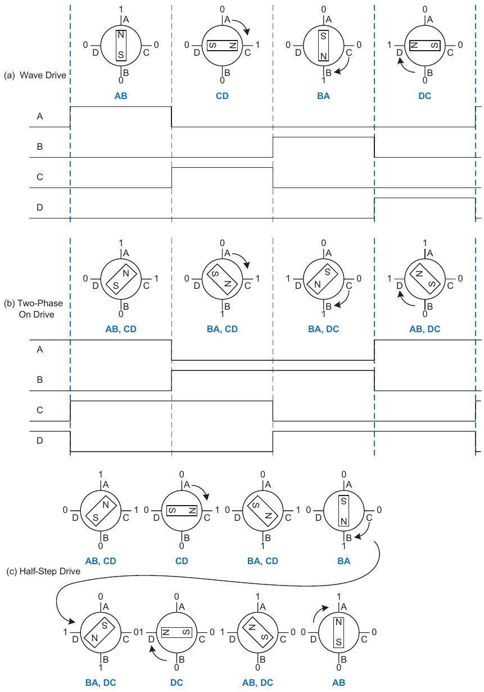

Hình e9.37 Bipolar motor drive

Trong motor thực, rotor có nhiều pole để góc giữa các step nhỏ hơn nhiều. Ví dụ Hình e9.39 là bipolar stepper AIRPAX LB82773-M1 có step 7.5-degree. Motor dùng 5 V, dòng 0.8 A qua mỗi coil.


Hình e9.38 Dòng bipolar stepper direct drive: (a) chậm, (b) nhanh, (c) nhanh với chopper drive

Torque của motor tỷ lệ thuận với dòng điện qua cuộn dây. Dòng điện này được xác định bởi điện áp đặt vào, inductance L và resistance R của cuộn dây. Chế độ hoạt động đơn giản nhất được gọi là direct voltage drive hoặc L/R drive, trong đó điện áp V được đặt trực tiếp lên cuộn dây. Dòng điện tăng dần đến I = V/R với time constant được xác định bởi L/R, như trong Hình e9.38(a). Cách này hoạt động tốt ở tốc độ thấp. Tuy nhiên, ở tốc độ cao hơn, dòng điện không có đủ thời gian để tăng đến mức đầy đủ, như trong Hình e9.38(b), và torque giảm xuống.


Hình e9.39 Bipolar stepper AIRPAX LB82773-M1

Một cách hiệu quả hơn để điều khiển stepper motor là áp dụng điều chế pulse-width cho một điện áp cao hơn. Điện áp cao khiến dòng điện tăng đến mức đầy đủ nhanh hơn; sau đó, điện áp được tắt (trong phần off của duty cycle PWM) để tránh làm motor quá tải. Tiếp theo, điện áp được điều chế hoặc ngắt theo xung để duy trì dòng điện gần mức mong muốn. Cách này được gọi là chopper constant current drive và được minh họa trong Hình e9.38(c). Controller sử dụng một resistor nhỏ mắc nối tiếp với motor để đo dòng điện đang được cấp thông qua sụt áp, và đưa signal enable đến H-bridge để ngắt drive khi dòng điện đạt mức mong muốn. Về nguyên tắc, microcontroller có thể tạo ra các waveform thích hợp, nhưng sử dụng stepper motor controller sẽ dễ hơn. Controller L297 của ST Microelectronics là một lựa chọn thuận tiện, đặc biệt khi kết hợp với dual H-bridge L298 có các pin cảm biến dòng điện và khả năng chịu dòng đỉnh 2 A. Đáng tiếc, L298 không có package DIP nên khó lắp trên breadboard hơn. Các application note AN460 và AN470 của ST là những tài liệu tham khảo có giá trị cho người thiết kế stepper motor.

#### Ví dụ e9.14 BIPOLAR STEPPER MOTOR DIRECT WAVE DRIVE

Thiết kế hệ thống lái AIRPAX bipolar stepper ở tốc độ và hướng chỉ định bằng direct wave drive.

Lời giải Hình e9.40 cho bipolar stepper do H-bridge lái trực tiếp, cùng interface như DC motor. VCC2 phải cấp đủ voltage và current đáp ứng motor, nếu không motor có thể bỏ step khi tốc độ quay tăng.


Hình e9.40 Bipolar stepper direct drive với H-bridge

## 9.5 TÓM TẮT

Phần lớn processor dùng memory-mapped I/O giao tiếp thế giới thực. MCU cung cấp các peripheral cơ bản gồm general-purpose, serial, analog I/O và timer.

Chương này đã cung cấp nhiều ví dụ cụ thể về I/O sử dụng microcontroller FE310 RISC-V trên SparkFun RED-V RedBoard. Các nhà thiết kế embedded system liên tục gặp những processor và peripheral mới. Nguyên tắc chung để tích hợp embedded I/O đơn giản là tham khảo datasheet để xác định những peripheral sẵn có, cùng các pin và register memory-mapped I/O liên quan. Sau đó, thường có thể dễ dàng viết một device driver đơn giản để khởi tạo các register của peripheral và truyền hoặc nhận data.

Với chuẩn phức tạp như USB, viết device driver là công việc rất chuyên biệt, tốt nhất do chuyên gia hiểu chi tiết device và USB protocol stack thực hiện. Designer không chuyên nên chọn processor có device driver đã được kiểm chứng và code ví dụ cho device mình quan tâm.

### Ví dụ code e9.20 DRIVER STEPPER MOTOR

```
#include "EasyREDVIO.h"
#define STEPSIZE 7.5
#define SECS_PER_MIN 60
#define MILLIS_PER_SEC 1000
#define DEG_PER_REV 360
int stepperPins[] = {19, 22, 23, 20, 21};
int curStepState; // Keep track of the current position of stepper motor
void stepperInit(void) {
  pinsMode(stepperPins, 5, OUTPUT);
  curStepState = 0;
}
void stepperSpin(int dir, int steps, float rpm) {
  int sequence[4] = {0b00011, 0b01001, 0b00101, 0b10001}; //{2A, 1A, 4A, 3A, EN}
  int step = 0;
  unsigned int millisPerStep = (SECS_PER_MIN * MILLIS_PER_SEC * STEPSIZE) /
                               (rpm * DEG_PER_REV);
  for (step = 0; step < steps; step++) {
   digitalWrites(stepperPins, 5, sequence[curStepState]);
   if (dir = = 0) curStepState = (curStepState + 1) % 4;
   else   curStepState = (curStepState + 3) % 4;
   delay(millisPerStep);
  }
}
int main(void) {
  stepperInit();
  stepperSpin(1, 12000, 120); // Spin 60 revolutions at 120 rpm
}
```

[^1]: PuTTY tải miễn phí tại www.putty.org.

[^2]: PuTTY in đúng dù bỏ `\r`.
