# eA Triển khai hệ thống số

- A.1 Giới thiệu
- A.2 Logic 74xx
- A.3 Programmable logic
- A.4 Các Application-Specific Integrated Circuit
- A.5 Datasheet
- A.6 Các họ logic
- A.7 Switch và Light-Emitting Diode
- A.8 Đóng gói và lắp ráp
- A.9 Transmission line
- A.10 Kinh tế học

## A.1 GIỚI THIỆU

Phụ lục này giới thiệu những vấn đề thực tiễn trong thiết kế hệ thống số. Nội dung không cần thiết để hiểu phần còn lại của sách; tuy nhiên, nó nhằm làm sáng tỏ quy trình xây dựng các hệ thống số thực tế. Hơn nữa, chúng tôi tin rằng cách tốt nhất để hiểu hệ thống số là tự xây dựng và debug chúng trong phòng thí nghiệm.

Hệ thống số thường được xây dựng bằng một hoặc nhiều chip. Một chiến lược là kết nối nhiều chip chứa từng logic gate hoặc những phần tử lớn hơn, như arithmetic/logical unit (ALU) hay bộ nhớ. Chiến lược khác là dùng programmable logic, chứa các array mạch tổng quát có thể được lập trình để thực hiện các hàm logic cụ thể. Chiến lược thứ ba là thiết kế integrated circuit tùy chỉnh chứa logic cụ thể cần cho hệ thống. Ba chiến lược này có những trade-offs về chi phí, tốc độ, công suất tiêu thụ và thời gian thiết kế được tìm hiểu trong các phần sau. Phụ lục cũng xem xét việc đóng gói vật lý và lắp ráp mạch, các transmission line nối chip, cùng khía cạnh kinh tế của hệ thống số.

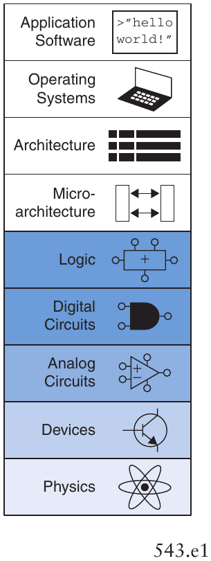

## A.2 LOGIC 74xx

Trong những năm 1970 và 1980, nhiều hệ thống số được xây dựng từ chip đơn giản, mỗi chip chứa một vài logic gate. Chẳng hạn, chip 7404 chứa sáu gate NOT, 7408 chứa bốn gate AND, và 7474 chứa hai flip-flops. Những chip này được gọi chung là logic 74xx-series. Nhiều nhà sản xuất bán chúng, thường với giá 10 đến 25 cent mỗi chip. Nay chúng phần lớn đã lỗi thời, nhưng vẫn tiện dụng cho hệ thống số đơn giản hoặc đồ án lớp học vì rẻ và dễ dùng. Các chip 74xx-series thường được bán trong vỏ 14-pin dual inline package (DIP).

### A.2.1 Logic gate

> 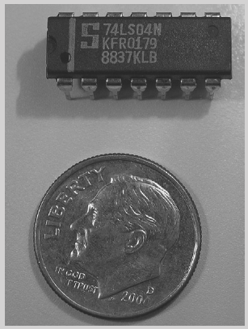
>
> Chip inverter 74LS04 trong package dual inline 14-pin. Part number nằm trên dòng đầu tiên. LS biểu thị logic family (xem Mục A.6). Hậu tố N biểu thị package DIP. Chữ S lớn là logo của nhà sản xuất Signetics. Hai dòng ký tự khó hiểu phía dưới là các code chỉ lô sản xuất của chip.

Hình eA.1 trình bày sơ đồ pinout của nhiều chip 74xx-series phổ biến chứa logic gate cơ bản. Đôi khi chúng được gọi là chip small-scale integration (SSI) vì được xây dựng từ vài transistor. Các vỏ 14-pin thường có rãnh ở phía trên hoặc chấm ở góc trên trái để chỉ hướng. Pin được đánh số từ 1 ở góc trên trái rồi ngược chiều kim đồng hồ quanh vỏ. Chip cần nhận nguồn (VDD = 5 V) và ground (GND = 0 V) lần lượt tại pin 14 và 7. Số logic gate trên chip do số pin quyết định. Lưu ý pin 3 và 11 của chip 7421 không nối (NC) với gì cả. flip-flop 7474 có các chân D, CLK và Q thông thường. Nó còn có output bù, $\overline{Q}$. Hơn nữa, nó nhận các tín hiệu set bất đồng bộ (còn gọi là preset, hoặc PRE) và reset (còn gọi là clear, hoặc CLR). Các tín hiệu này là active low; nói cách khác, flop set khi $\overline{PRE}$ = 0, reset khi $\overline{CLR}$ = 0, và hoạt động bình thường khi $\overline{PRE}$ = $\overline{CLR}$ = 1. Các tín hiệu low-asserted thường được viết trong văn bản là CLRb hoặc CLRbar.

### A.2.2 Các chức năng khác

Họ 74xx còn bao gồm các hàm logic phức tạp hơn đôi chút, trong đó có các hàm ở Hình eA.2 và eA.3. Chúng được gọi là chip medium- scale integration (MSI). Đa số sử dụng vỏ lớn hơn để có thêm input và output. Nguồn và ground vẫn lần lượt được cung cấp ở góc trên phải và dưới trái mỗi chip. Mỗi chip đều có mô tả chức năng tổng quát. Xem datasheet của nhà sản xuất để có mô tả đầy đủ.

## A.3 PROGRAMMABLE LOGIC

Programmable logic gồm các array mạch có thể cấu hình để thực hiện hàm logic cụ thể. Chúng ta đã giới thiệu ba dạng: programmable read-only memory (PROM), programmable logic array (PLA) và field-programmable gate array (FPGA). Phần này trình bày triển khai chip cho từng dạng. Có thể cấu hình các chip này bằng cách làm đứt fuse on-chip để nối hoặc ngắt các phần tử mạch. Đây gọi là logic one-time programmable (OTP) vì fuse đã đứt không thể phục hồi. Hoặc có thể lưu cấu hình trong bộ nhớ có thể lập trình lại tùy ý. Logic có thể lập trình lại tiện lợi trong phòng thí nghiệm vì có thể tái sử dụng cùng chip trong quá trình phát triển.

### A.3.1 PROM

Như thảo luận trong Phần 5.5.7, PROM có thể được dùng làm lookup table. Một PROM 2N-word × M-bit có thể được lập trình để thực hiện bất kỳ hàm tổ hợp nào có N input và M output. Thay đổi thiết kế chỉ cần thay nội dung PROM thay vì đi lại dây giữa các chip. Lookup table hữu ích cho hàm nhỏ nhưng trở nên quá đắt khi số input tăng.

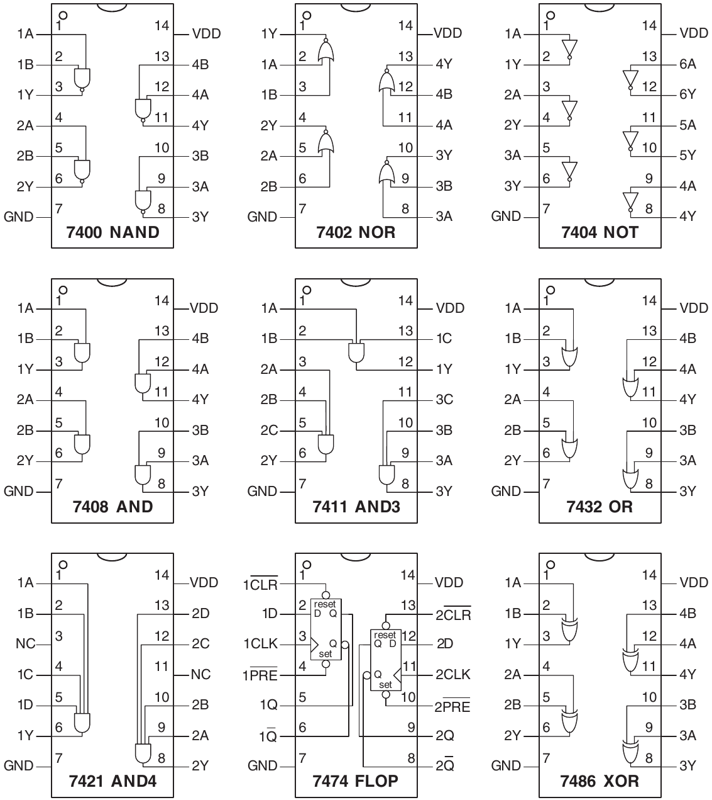

Hình eA.1 Các logic gate 74xx-series thông dụng

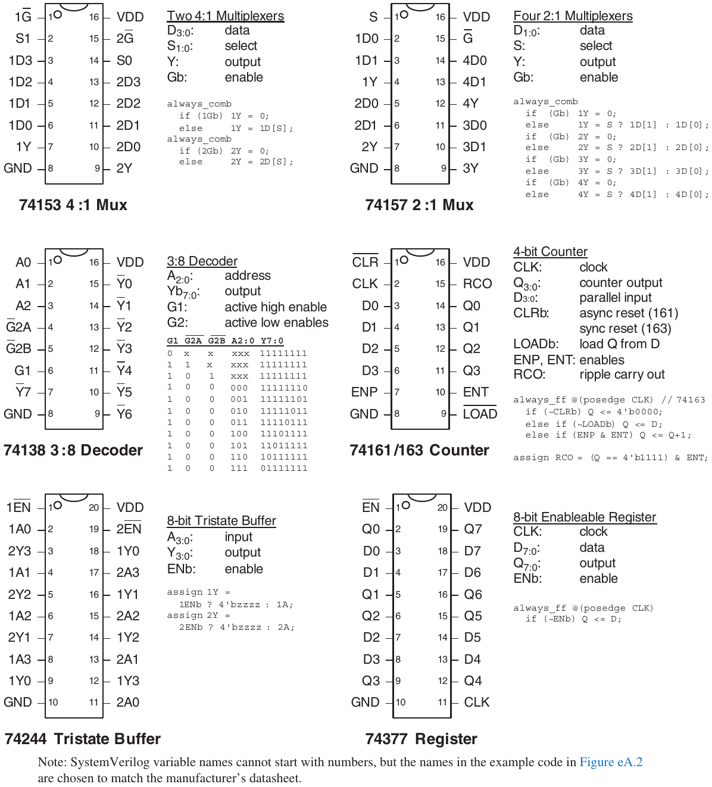

Hình eA.2 Các chip Medium-scale integration

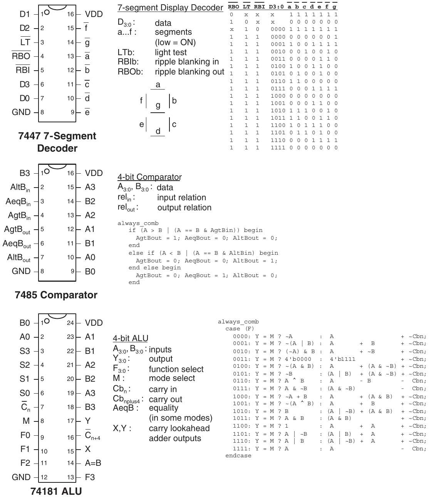

Hình eA.3 Thêm các chip medium-scale integration (MSI)

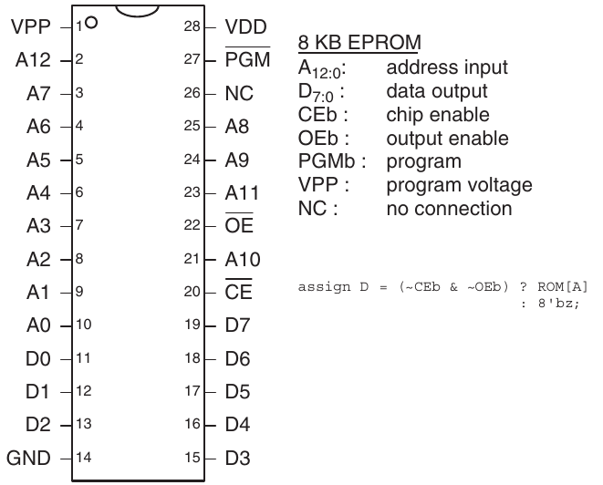

Hình eA.4 EPROM 2764 8 KiB

Chẳng hạn, PROM xóa được (EPROM) 2764 8-KiB (64-kib) kinh điển ở Hình eA.4. EPROM có 13 đường địa chỉ để chỉ một trong 8 Ki word và 8 đường dữ liệu để đọc byte dữ liệu tại word đó. Cả chip enable và output enable đều phải được asserted để đọc dữ liệu. Propagation delay tối đa là 200 ps. Khi hoạt động bình thường, $\overline{PGM}$ = 1 và VPP không được sử dụng. EPROM thường được lập trình bằng bộ lập trình chuyên dụng đặt $\overline{PGM}$ = 0, cấp 13 V cho VPP và dùng chuỗi input đặc biệt để cấu hình bộ nhớ.

PROM hiện đại tương tự về khái niệm nhưng có dung lượng lớn hơn nhiều và nhiều pin hơn. Flash memory là loại PROM rẻ nhất, bán khoảng \$0.10 mỗi gigabyte năm 2021. Theo lịch sử, giá giảm 30% đến 40% mỗi năm.

### A.3.2 PLA

Như thảo luận trong Phần 5.6.1, PLA chứa các plane AND và OR để tính bất kỳ hàm tổ hợp nào viết ở dạng sum-of-products. Các plane AND và OR có thể được lập trình bằng những kỹ thuật giống PROM. PLA có hai cột cho mỗi input và một cột cho mỗi output. Nó có một hàng cho mỗi minterm. Cách tổ chức này hiệu quả hơn PROM đối với nhiều hàm, nhưng array vẫn tăng quá lớn với những hàm có nhiều I/O và minterm.

Nhiều nhà sản xuất đã mở rộng khái niệm PLA cơ bản để xây dựng programmable logic device (PLD) có register. 22V10 là một trong những PLD kinh điển phổ biến nhất. Nó có 12 pin input chuyên dụng và 10 output. Output có thể đến trực tiếp từ PLA hoặc từ register được clock trên chip. Output cũng có thể được đưa hồi tiếp vào PLA. Vì vậy, 22V10 có thể triển khai trực tiếp finite state machine (FSM) với tối đa 12 input, 10 output và 10 bit trạng thái. 22V10 giá khoảng \$1.35 khi mua số lượng 100. PLD phần lớn đã trở nên lỗi thời do dung lượng và chi phí FPGA cải thiện nhanh chóng.

### A.3.3 FPGA

Như thảo luận trong Phần 5.6.2, FPGA gồm array các logic element (LE) có thể cấu hình, còn gọi là configurable logic block (CLB), được nối bằng dây có thể lập trình. LE chứa lookup table nhỏ và flip-flops. FPGA mở rộng tốt đến dung lượng cực lớn, với hàng nghìn lookup table. Xilinx và Intel FPGAs (trước là Altera) là hai nhà sản xuất FPGA hàng đầu.

Lookup table và dây có thể lập trình đủ linh hoạt để triển khai bất kỳ hàm logic nào. Tuy nhiên, về tốc độ và chi phí (diện tích chip), chúng kém hiệu quả khoảng một bậc độ lớn so với phiên bản hard-wired của cùng hàm. Vì vậy, FPGA thường có các block chuyên biệt như bộ nhớ, multiplier và thậm chí toàn bộ microprocessor.

Hình eA.5 thể hiện quy trình thiết kế hệ thống số trên FPGA. Thiết kế thường được mô tả bằng hardware description language (HDL), dù một số công cụ FPGA cũng hỗ trợ schematic. Thiết kế sau đó được mô phỏng. Các input được áp dụng và so sánh với output mong đợi để xác minh logic đúng. Thông thường cần debug đôi chút. Tiếp theo, logic synthesis chuyển HDL thành các hàm Boolean. Công cụ synthesis tốt tạo schematic của các hàm. Người thiết kế cẩn trọng xem các schematic và mọi cảnh báo sinh ra trong synthesis để bảo đảm đã tạo đúng logic mong muốn. Đôi khi viết code cẩu thả dẫn tới mạch lớn hơn nhiều dự định hoặc mạch có logic bất đồng bộ. Khi synthesis hoàn tất thành công, công cụ FPGA ánh xạ các hàm lên LE của chip cụ thể. Công cụ place and route xác định hàm nào vào lookup table nào và chúng được nối với nhau ra sao. Wire delay tăng theo chiều dài, vì vậy các mạch critical nên đặt gần nhau. Nếu thiết kế quá lớn để vừa chip, phải thiết kế lại. Timing analysis so sánh ràng buộc timing (ví dụ clock speed dự định 100 MHz) với delay thực của mạch và báo lỗi. Nếu logic quá chậm, có thể phải thiết kế lại hoặc pipeline theo cách khác. Khi thiết kế đúng, một file được tạo ra chỉ định nội dung mọi LE và cách lập trình mọi dây trên FPGA. Nhiều FPGA lưu thông tin cấu hình này trong static RAM, phải nạp lại mỗi lần bật FPGA. FPGA có thể tải thông tin từ máy tính trong phòng thí nghiệm hoặc đọc từ ROM nonvolatile khi mới cấp nguồn.

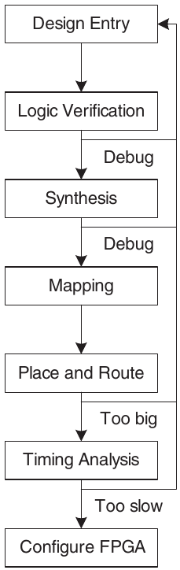

Hình eA.5 Quy trình thiết kế FPGA

#### Ví dụ eA.1 TIMING ANALYSIS CHO FPGA

Alyssa P. Hacker dùng FPGA triển khai máy phân loại M\&M với cảm biến màu và motor để cho kẹo đỏ vào một lọ và kẹo xanh vào lọ khác. Thiết kế được triển khai dưới dạng FSM, dùng FPGA Cyclone IV. Theo datasheet, FPGA có các đặc tính timing trong Bảng eA.1.

Alyssa muốn FSM chạy ở 100 MHz. Số LE tối đa trên critical path là bao nhiêu? Tốc độ nhanh nhất FSM của cô có thể chạy là bao nhiêu?

Lời giải Ở 100 MHz, cycle time, Tc, là 10 ns. Alyssa dùng Phương trình eA.1 để tính combinational propagation delay tối thiểu, tpd, tại cycle time này:

tpd ≤ 10ns − (0.199ns + 0.076 ns) = 9.725ns (eA.1)

Với LE delay và wire delay kết hợp là 381 ps + 246 ps = 627 ps, FSM của Alyssa có thể dùng tối đa 15 LE liên tiếp (9.725/0.627) để triển khai logic next-state.

Tốc độ nhanh nhất của FSM trên FPGA Cyclone IV này đạt được khi nó dùng một LE duy nhất cho logic next-state. Cycle time tối thiểu là

Tc ≥ 381ps + 199ps + 76 ps = 656 ps (eA.2)

Vì vậy, tần số tối đa là 1.5 GHz.

Altera quảng cáo FPGA Cyclone IV với 14,400 LE giá \$25 năm 2021. Với số lượng lớn, FPGA medium-sized thường giá vài đô la. FPGA lớn nhất có giá hàng trăm hoặc thậm chí hàng nghìn đô la. Chi phí giảm khoảng 30% mỗi năm, nên FPGA đang trở nên cực kỳ phổ biến.

Bảng eA.1 Timing của Cyclone IV

| Tên | Giá trị (ps) |
|---|---|
| tpcq | 199 |
| tsetup | 76 |
| thold | 0 |
| tpd (mỗi LE) | 381 |
| twire (giữa các LE) | 246 |
| tskew | 0 |

## A.4 CÁC APPLICATION-SPECIFIC INTEGRATED CIRCUIT

Application-specific integrated circuit (ASIC) là chip được thiết kế cho mục đích cụ thể. Graphics accelerator, chip network interface và chip điện thoại di động là các ví dụ ASIC phổ biến. Người thiết kế ASIC bố trí transistor để tạo logic gate và nối các gate lại với nhau. Vì ASIC được nối cứng cho chức năng cụ thể, nó thường nhanh hơn FPGA vài lần và chiếm diện tích chip (do đó chi phí) ít hơn một bậc độ lớn so với FPGA cùng chức năng. Tuy nhiên, các mask chỉ định vị trí transistor và dây trên chip tốn hàng trăm nghìn đô la để sản xuất. Quá trình chế tạo thường cần 6 đến 12 tuần để sản xuất, đóng gói và kiểm tra ASIC. Nếu phát hiện lỗi sau khi ASIC đã được sản xuất, người thiết kế phải sửa vấn đề, tạo mask mới và chờ chế tạo lô chip khác. Vì vậy, ASIC chỉ phù hợp cho sản phẩm được sản xuất số lượng lớn và chức năng đã xác định rõ từ trước.

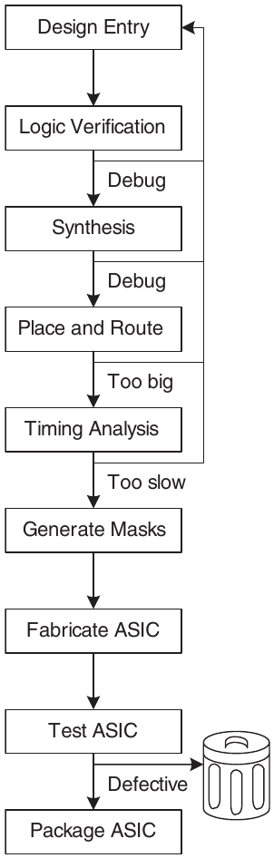

Hình eA.6 Quy trình thiết kế ASIC

Hình eA.6 thể hiện quy trình thiết kế ASIC, tương tự quy trình thiết kế FPGA ở Hình eA.5. Logic verification đặc biệt quan trọng vì sửa lỗi sau khi sản xuất mask rất đắt. Synthesis tạo netlist gồm logic gate và các kết nối giữa gate. Các gate trong netlist được bố trí và các dây được đi giữa chúng. Khi thiết kế đạt yêu cầu, mask được tạo ra và dùng chế tạo ASIC. Một hạt bụi cũng có thể làm hỏng ASIC, nên chip phải được kiểm tra sau khi chế tạo. Tỷ lệ chip sản xuất hoạt động được gọi là yield. Nó thường từ 50% đến 90% tùy kích thước chip và độ trưởng thành của quy trình sản xuất. Cuối cùng, chip hoạt động được đưa vào vỏ, như sẽ thảo luận trong Phần A.7.

## A.5 DATASHEET

Nhà sản xuất integrated circuit công bố datasheet mô tả chức năng và hiệu năng chip. Đọc và hiểu datasheet là thiết yếu. Một trong những nguồn lỗi hàng đầu của hệ thống số là hiểu sai hoạt động của chip.

Datasheet thường có trên website nhà sản xuất. Nếu không tìm được datasheet của linh kiện và không có tài liệu rõ ràng từ nguồn khác, đừng dùng linh kiện đó. Một số mục trong datasheet có thể khó hiểu. Nhà sản xuất thường xuất bản databooks chứa datasheet của nhiều linh kiện liên quan. Đầu data book có thêm thông tin giải thích. Thường có thể tìm được thông tin này trên Web bằng cách tìm kiếm kỹ.

Phần này phân tích datasheet Texas Instruments (TI) cho chip inverter 74HC04. Datasheet tương đối đơn giản nhưng minh họa nhiều thành phần chính. TI vẫn sản xuất nhiều chip 74xx-series khác nhau. Trước đây nhiều công ty khác cũng làm chúng, nhưng thị trường đang hợp nhất khi doanh số giảm.

Hình eA.7 thể hiện trang đầu datasheet. Một số mục chính được tô xanh. Tiêu đề là SN54HC04, SN74HC04 HEX INVERTERS. HEX INVERTERS nghĩa là chip chứa sáu inverter. SN cho biết TI là nhà sản xuất. Các code nhà sản xuất khác gồm MC của Motorola và DM của National Semiconductor. Nhìn chung có thể bỏ qua chúng vì mọi nhà sản xuất đều làm logic 74xx-series tương thích. HC là họ logic (high-speed CMOS). Họ logic quyết định tốc độ và công suất tiêu thụ của chip, nhưng không quyết định chức năng. Chẳng hạn, 7404, 74HC04 và 74LS04 đều chứa sáu inverter nhưng khác hiệu năng và chi phí. Các họ logic khác được thảo luận ở Phần A.6. Chip 74xx hoạt động trong khoảng nhiệt độ thương mại hoặc công nghiệp (lần lượt 0°C đến 70°C hoặc −40°C đến 85°C), còn chip 54xx hoạt động trong khoảng nhiệt độ quân sự (−55° đến 125°C), được bán giá cao hơn nhưng ngoài ra vẫn tương thích.

7404 có nhiều loại vỏ; quan trọng là đặt đúng loại bạn định dùng khi mua. Các vỏ được phân biệt bằng hậu tố trong mã linh kiện. N chỉ plastic dual inline package (PDIP), vừa breadboard hoặc có thể hàn vào through-holes trong printed circuit board. Các vỏ khác được thảo luận trong Phần A.7.

Bảng chức năng cho thấy mỗi gate đảo input của nó. Nếu A là HIGH (H), Y là LOW (L) và ngược lại. Bảng ở đây đơn giản nhưng thú vị hơn với chip phức tạp.

Hình eA.8 thể hiện trang thứ hai datasheet. Logic diagram cho biết chip chứa inverter. Mục absolute maximum chỉ ra các điều kiện mà vượt quá chúng chip có thể bị phá hủy. Cụ thể, điện áp nguồn (VCC, cũng gọi là VDD trong sách này) không nên vượt 7 V. Dòng output liên tục không nên vượt 25 mA. Thermal resistance hay impedance, θJA, dùng để tính độ tăng nhiệt do công suất chip tiêu tán. Nếu nhiệt độ môi trường quanh chip là TA và chip tiêu tán Pchip, thì nhiệt độ trên chính chip tại junction với vỏ là

TJ = TA + Pchip θJA (eA.3)

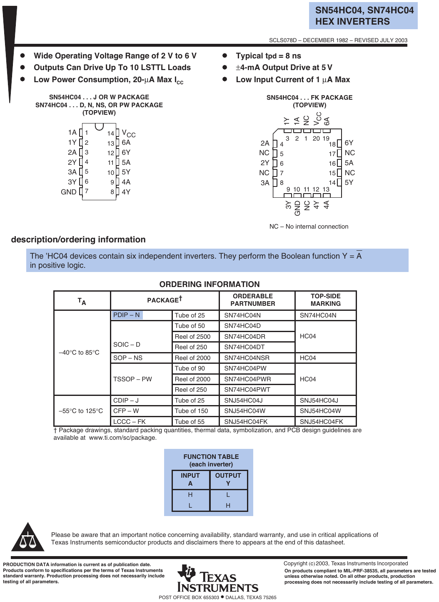

Hình eA.7 Trang 1 datasheet 7404

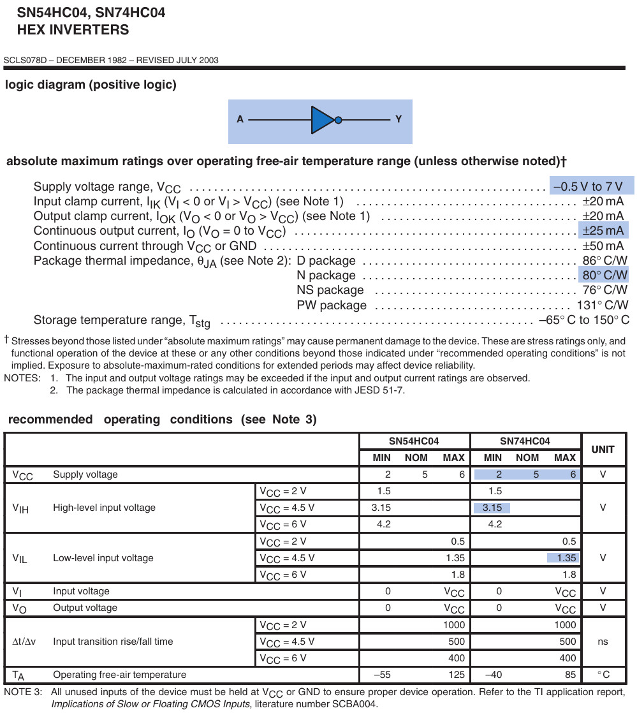

Chẳng hạn, nếu chip 7404 trong vỏ plastic DIP hoạt động trong hộp nóng ở 50°C và tiêu thụ 20 mW, junction temperature tăng lên 50°C + 0.02 W × 80°C/W = 51.6°C. Công suất tiêu tán nội bộ ít khi quan trọng với chip 74xx-series, nhưng trở nên quan trọng với chip hiện đại tiêu tán hàng chục watt trở lên.

Các điều kiện hoạt động khuyến nghị xác định môi trường nên dùng chip. Trong những điều kiện này, chip phải đáp ứng thông số. Những điều kiện này chặt chẽ hơn absolute maximum. Chẳng hạn điện áp nguồn phải từ 2 đến 6 V. Các input logic level của họ HC phụ thuộc VDD. Dùng các mục 4.5 V khi VDD = 5 V để cho phép sụt nguồn 10% do nhiễu trong hệ thống.

Hình eA.9 thể hiện trang thứ ba datasheet. Electrical characteristic mô tả hiệu năng thiết bị trong điều kiện hoạt động khuyến nghị khi input được giữ không đổi. Chẳng hạn, nếu VCC = 5 V (và sụt xuống 4.5 V) và dòng output IOH/IOL không vượt 20 μA, VOH = 4.4 V và VOL = 0.1 V trong trường hợp xấu nhất. Nếu dòng output tăng, điện áp output kém lý tưởng hơn vì transistor trên chip khó cung cấp dòng. Họ logic HC dùng transistor CMOS hút rất ít dòng. Dòng vào mỗi input được bảo đảm dưới 1000 nA và thường chỉ 0.1 nA ở nhiệt độ phòng. Dòng nguồn tĩnh (IDD) khi chip nhàn rỗi dưới 20 μA. Mỗi input có điện dung dưới 10 pF.

Switching characteristic xác định hiệu năng thiết bị trong điều kiện hoạt động khuyến nghị khi input thay đổi. Propagation delay, tpd, được đo từ khi input đi qua 0.5 VCC đến khi output đi qua 0.5 VCC. Nếu VCC danh định là 5 V và chip lái điện dung dưới 50 pF, propagation delay không vượt 24 ns (và thường nhanh hơn nhiều). Nhớ rằng mỗi input có thể có 10 pF, nên chip không thể lái hơn năm chip giống hệt ở tốc độ tối đa. Thực tế, điện dung ký sinh của dây nối chip còn giảm tải hữu ích. Transition time, còn gọi là rise/fall time, được đo khi output chuyển giữa 0.1 VCC và 0.9 VCC.

Hãy nhớ lại từ Phần 1.8 rằng chip tiêu thụ cả công suất tĩnh và động. Công suất tĩnh của mạch HC thấp. Ở 85°C, dòng nguồn tĩnh tối đa là 20 μA. Ở 5 V, tương ứng công suất tĩnh 0.1 mW. Công suất động phụ thuộc điện dung được lái và tần số chuyển mạch. 7404 có điện dung tiêu tán công suất nội bộ 20 pF mỗi inverter. Nếu cả sáu inverter trên 7404 chuyển ở 10 MHz và lái tải ngoài 25 pF, công suất động theo Phương trình 1.4 là 1/2(6)(20 pF + 25 pF)(52)(10 MHz) = 33.75 mW, và tổng công suất tối đa là 33.85 mW.

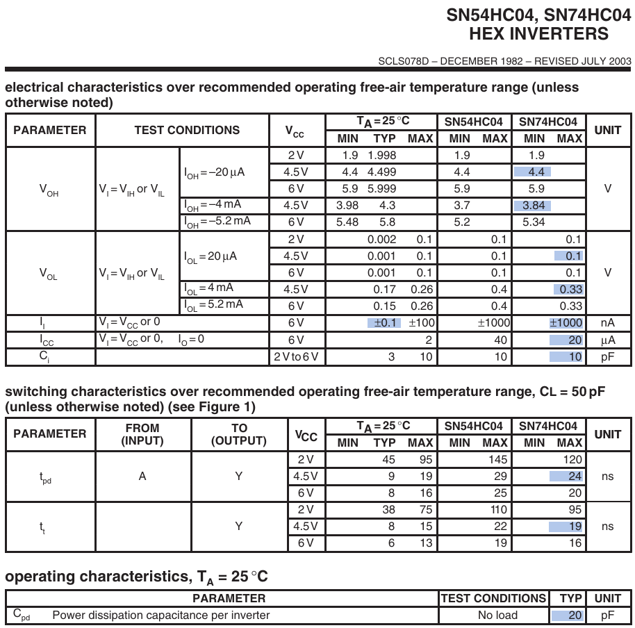

Hình eA.9 Trang 3 datasheet 7404

## A.6 CÁC HỌ LOGIC

Các chip logic 74xx-series đã được sản xuất bằng nhiều công nghệ khác nhau, gọi là họ logic, cung cấp các trade-offs về tốc độ, công suất và logic level. Các chip khác thường được thiết kế tương thích với một số họ này. Những chip ban đầu, như 7404, được xây dựng bằng transistor lưỡng cực trong công nghệ gọi là transistor- transistor logic (TTL). Các công nghệ mới thêm một hoặc nhiều chữ cái sau 74 để chỉ họ logic, như 74LS04, 74HC04 hoặc 74AHCT04. Bảng eA.2 tóm tắt các họ logic 5-V thông dụng nhất.

Tiến bộ về mạch lưỡng cực và công nghệ chế tạo dẫn đến họ Schottky (S) và Low-Power Schottky (LS). Cả hai nhanh hơn TTL. Schottky hút nhiều công suất hơn, còn Low-Power Schottky hút ít hơn. Advanced Schottky (AS) và Advanced Low-Power Schottky (ALS) cải thiện tốc độ và công suất so với S và LS. Logic Fast (F) nhanh hơn và hút ít công suất hơn AS. Tất cả các họ này cung cấp dòng cho output LOW lớn hơn output HIGH, vì thế có

Bảng eA.2 Các thông số điển hình cho họ logic 5-V

|  |  |  | Lưỡng cực/TTL |  |  |  | CMOS |  | Tương thích CMOS / TTL |  |
|---|---|---|---|---|---|---|---|---|---|---|
| Đặc tính | TTL | S | LS | AS | ALS | F | HC | AHC | HCT | AHCT |
| tpd (ns) | 22 | 9 | 12 | 7.5 | 10 | 6 | 21 | 7.5 | 30 | 7.7 |
| VIH (V) | 2 | 2 | 2 | 2 | 2 | 2 | 3.15 | 3.15 | 2 | 2 |
| VIL (V) | 0.8 | 0.8 | 0.8 | 0.8 | 0.8 | 0.8 | 1.35 | 1.35 | 0.8 | 0.8 |
| VOH (V) | 2.4 | 2.7 | 2.7 | 2.5 | 2.5 | 2.5 | 3.84 | 3.8 | 3.84 | 3.8 |
| VOL (V) | 0.4 | 0.5 | 0.5 | 0.5 | 0.5 | 0.5 | 0.33 | 0.44 | 0.33 | 0.44 |
| IOH (mA) | 0.4 | 1 | 0.4 | 2 | 0.4 | 1 | 4 | 8 | 4 | 8 |
| IOL (mA) | 16 | 20 | 8 | 20 | 8 | 20 | 4 | 8 | 4 | 8 |
| IIL (mA) | 1.6 | 2 | 0.4 | 0.5 | 0.1 | 0.6 | 0.001 | 0.001 | 0.001 | 0.001 |
| IIH (mA) | 0.04 | 0.05 | 0.02 | 0.02 | 0.02 | 0.02 | 0.001 | 0.001 | 0.001 | 0.001 |
| IDD (mA) | 33 | 54 | 6.6 | 26 | 4.2 | 15 | 0.02 | 0.02 | 0.02 | 0.02 |
| CPd (pF) |  |  | n/a |  |  |  | 20 | 12 | 20 | 14 |
| chi phí\* (US \$) | lỗi thời | 0.63 | 0.25 | 0.53 | 0.32 | 0.22 | 0.12 | 0.12 | 0.12 | 0.12 |

\*Giá mỗi chiếc khi mua 1000 chip 7408 của Texas Instruments năm 2012.

logic level bất đối xứng. Chúng tuân theo logic level “TTL”: VIH = 2 V, VIL = 0.8 V, VOH > 2.4 V và VOL < 0.5 V.

Khi mạch CMOS trưởng thành trong những năm 1980 và 1990, chúng trở nên phổ biến vì hút rất ít dòng nguồn hoặc dòng input. Các họ High-Speed CMOS (HC) và Advanced High-Speed CMOS (AHC) hầu như không tiêu thụ công suất tĩnh. Chúng còn cung cấp cùng dòng cho output HIGH và LOW. Chúng tuân theo logic level “CMOS”: VIH = 3.15 V, VIL = 1.35 V, VOH > 3.8 V và VOL < 0.44 V. Đáng tiếc các mức này không tương thích mạch TTL vì output HIGH 2.4 V của TTL có thể không được nhận là input HIGH CMOS hợp lệ. Điều này thúc đẩy sử dụng High-Speed TTL-compatible CMOS (HCT) và Advanced High-Speed TTL-compatible CMOS (AHCT), nhận input logic level TTL và sinh output logic level CMOS hợp lệ. Những họ này chậm hơn đôi chút so với phiên bản CMOS thuần. Mọi chip CMOS nhạy với electrostatic discharge (ESD) do tĩnh điện. Hãy nối đất cơ thể bằng cách chạm vật kim loại lớn trước khi cầm chip CMOS, kẻo bạn làm hỏng chúng do phóng điện.

Logic 74xx-series rẻ. Các họ logic mới thường rẻ hơn các họ lỗi thời. Họ LS sẵn có rộng rãi và bền, là lựa chọn phổ biến cho đồ án phòng thí nghiệm hay dự án sở thích không có yêu cầu hiệu năng đặc biệt.

Chuẩn 5-V mất vị thế vào mid-1990 khi transistor trở nên quá nhỏ để chịu được điện áp đó. Hơn nữa, điện áp thấp mang lại công suất tiêu thụ thấp hơn. Nay thường dùng 3.3, 2.5, 1.8, 1.2 V và thấp hơn nữa. Vô số điện áp gây thách thức khi giao tiếp giữa chip có nguồn khác nhau. Bảng eA.3 liệt kê một số họ logic low-voltage. Không phải mọi linh kiện 74xx đều có trong mọi họ này.

Mọi họ logic low-voltage dùng transistor CMOS, thành phần chủ lực của integrated circuit hiện đại. Chúng hoạt động trên khoảng VDD rộng nhưng tốc độ giảm ở điện áp thấp. Logic Low-Voltage CMOS (LVC) và Advanced Low-Voltage CMOS (ALVC) thường dùng ở 3.3, 2.5 hoặc 1.8 V. LVC chịu input đến 5.5 V, nên nhận được input từ mạch CMOS 5-V hoặc TTL. Advanced Ultra-Low-Voltage CMOS (AUC) thường dùng ở 2.5, 1.8 hoặc 1.2 V và cực nhanh. Cả ALVC và AUC chịu input đến 3.6 V, nên nhận được input từ mạch 3.3 V.

FPGA thường có nguồn điện áp riêng cho logic nội bộ, gọi là core, và cho các pin input/output (I/O). Khi FPGA tiến bộ, điện áp core giảm từ 5 xuống 3.3, 2.5, 1.8 và 1.2 V để tiết kiệm công suất và tránh làm hỏng transistor rất nhỏ. FPGA có I/O cấu hình được, hoạt động ở nhiều điện áp để tương thích phần còn lại của hệ thống.

Bảng eA.3 Các thông số điển hình của các họ logic low-voltage

|  |  | LVC |  |  | ALVC |  |  | AUC |  |
|---|---|---|---|---|---|---|---|---|---|
| Vdd (V) | 3.3 | 2.5 | 1.8 | 3.3 | 2.5 | 1.8 | 2.5 | 1.8 | 1.2 |
| tpd (ns) | 4.1 | 6.9 | 9.8 | 2.8 | 3 | ?\* | 1.8 | 2.3 | 3.4 |
| VIH (V) | 2 | 1.7 | 1.17 | 2 | 1.7 | 1.17 | 1.7 | 1.17 | 0.78 |
| VIL (V) | 0.8 | 0.7 | 0.63 | 0.8 | 0.7 | 0.63 | 0.7 | 0.63 | 0.42 |
| VOH (V) | 2.2 | 1.7 | 1.2 | 2 | 1.7 | 1.2 | 1.8 | 1.2 | 0.8 |
| VOL (V) | 0.55 | 0.7 | 0.45 | 0.55 | 0.7 | 0.45 | 0.6 | 0.45 | 0.3 |
| IO (mA) | 24 | 8 | 4 | 24 | 12 | 12 | 9 | 8 | 3 |
| II (mA) |  | 0.02 |  |  | 0.005 |  |  | 0.005 |  |
| IDD (mA) |  | 0.01 |  |  | 0.01 |  |  | 0.01 |  |
| Cpd (pF) | 10 | 9.8 | 7 | 27.5 | 23 | ?\* | 17 | 14 | 14 |
| chi phí (US \$) |  | 0.17 |  |  | 0.20 |  |  | không có |  |

\*Delay và điện dung chưa có tại thời điểm viết sách.

## A.7 SWITCH VÀ LIGHT-EMITTING DIODE

Mạch số cần input và output. Cách cơ bản nhất cung cấp input là nối thẳng tới nguồn hoặc ground, nhưng thú vị hơn là dùng switch để người dùng điều khiển. Cách cơ bản nhất kiểm tra output là dùng voltmeter, nhưng thú vị hơn là dùng light-emitting diode (LED) phát sáng nếu output là TRUE. Switch và LED là linh kiện analog dùng trong ứng dụng số này. Phần này mô tả cách chúng hoạt động.

### A.7.1 Switch

Hình eA.10 minh họa ký hiệu switch single-pole single-throw (SPST) và single-pole double-throw (SPDT). Single-pole cho biết switch có một output, và single-throw nghĩa là switch có thể nối đến một đầu nối. Double-throw cho biết output có thể nối với một trong hai đầu nối.

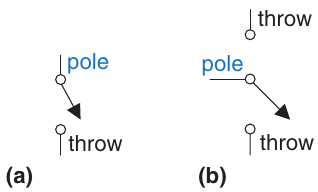

Hình eA.10 Switch (a) SPST và (b) SPDT

Switch hoặc nút SPST mặc định hoặc hở hoặc đóng, lần lượt ngăn hoặc cho dòng chảy qua. Để tạo digital logic level, switch thường được mắc nối tiếp với điện trở R như Hình eA.11(a). Khi switch hở, điện trở kéo Y xuống ground (logic 0). Nếu mạch nối với pin Y có dòng tải nhỏ Iload, điện áp thực tại node Y là VY = IloadR. Khi switch đóng, đầu trên điện trở nối với VDD nên kéo Y lên VDD (logic 1). Dòng VDD/R chạy qua điện trở, gây công suất tĩnh P = VDD2/R. Nên chọn điện trở theo nguyên tắc Goldilocks: không quá lớn, không quá nhỏ, mà vừa đủ. Nếu điện trở quá lớn, điện áp tại Y, VY, có thể không xuống đủ thấp khi switch hở (và mạch nối Y hút dòng). Nếu điện trở quá nhỏ, mạch tiêu tán công suất quá mức và lãng phí (thậm chí có thể nóng chảy). Thực tế thường chọn điện trở trong khoảng 1- đến 10-kΩ để công suất nhỏ và dòng rò gây nhiễu không đáng kể cho điện áp output. Tuy nhiên, nếu cần hoạt động cực kỳ low-power, điện trở lớn hơn sẽ phù hợp và phải xem xét kỹ hơn dòng rò do tải (nối Y) hút để điện áp output vẫn là logic level thấp hợp lệ.

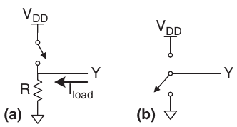

Hình eA.11 Input số từ switch: (a) SPST và điện trở, (b) SPDT không có điện trở

Một lựa chọn thay switch SPST và điện trở là switch single-pole, double-throw (SPDT). Hình eA.11(b) thể hiện switch SPDT có output nối với VDD hoặc GND để tạo giá trị high hoặc low mạnh mà không cần điện trở và không tiêu thụ công suất tĩnh (giả sử Y nối với input của gate CMOS). Tuy nhiên, switch SPDT thường đắt hơn.

### A.7.2 LED

Có thể xấp xỉ LED là OFF khi điện áp hai đầu diode nhỏ hơn một điện áp VD nào đó, và ON khi điện áp lớn hơn VD. VD thay đổi khoảng 1.7 đến 2.3 V tùy màu diode và nhiệt độ môi trường, nhưng 2.0 V là giá trị trung bình hợp lý để tính gần đúng. Khi diode tắt, nó hút dòng không đáng kể. Khi ON, nó hút dòng ID nhiều nhất có thể, và độ sáng tỷ lệ với dòng. Tuy nhiên, nếu dòng quá lớn, diode hoặc thiết bị cấp dòng sẽ cháy. Vì vậy, diode thường được dùng với điện trở current-limiting, như Hình eA.12. Diode nhỏ thông thường nhìn thấy được dưới ánh sáng trong nhà khi dòng lớn hơn 1 mA và sáng đẹp ở 5 đến 10 mA. LED siêu sáng có thể hút 100 mA trở lên.

Hình eA.12 thể hiện LED được lái bằng điện áp Vin qua điện trở R. Thứ tự điện trở và LED không quan trọng vì cùng dòng chạy qua hai linh kiện nối tiếp. Trong ứng dụng số, Vin thường đến từ output logic gate, có thể nằm trong khoảng VOH đến VDD. Điện áp hai đầu điện trở là Vin – VD (trong đó VD là sụt áp qua diode), đồng thời bằng R × ID vì dòng qua diode cũng qua điện trở. Cho hai biểu thức bằng nhau, ta có ID = (Vin – VD)/R. Nếu R quá lớn, dòng không đủ và diode quá tối. Nếu R quá nhỏ, diode cháy hoặc hút quá nhiều dòng từ linh kiện lái Vin. Vì thế, điện trở vài trăm ohm thường được dùng trong mạch số lái LED. Kiểm tra thông số dòng output IO trên datasheet để biết output số có thể cấp bao nhiêu dòng. Chẳng hạn, nếu logic gate hoạt động ở 3.3 V và dòng output tối đa 5 mA trong điều kiện bình thường, chọn R = (3.3 – 2) V / 0.005 A = 260 Ω để có ánh sáng mạnh nhất driver có thể cung cấp.

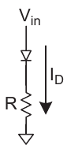

Hình eA.12 LED với điện trở current-limiting

Nhớ rằng thông số absolute maximum là giới hạn mà vượt quá linh kiện có thể hỏng vĩnh viễn, không phải điều kiện linh kiện hoạt động đúng. Hãy dùng dữ liệu điều kiện hoạt động khuyến nghị.

## A.8 ĐÓNG GÓI VÀ LẮP RÁP

Integrated circuit thường được đặt trong vỏ nhựa hoặc gốm. Vỏ thực hiện nhiều chức năng, gồm nối các I/O pad kim loại nhỏ của chip với pin lớn hơn trên vỏ để dễ kết nối, bảo vệ chip khỏi hư hỏng vật lý, và phân tán nhiệt do chip sinh ra trên diện tích lớn hơn để hỗ trợ làm mát. Vỏ được đặt trên breadboard hoặc printed circuit board (PCB) rồi nối dây với nhau để lắp ráp hệ thống.

### A.8.1 Các loại vỏ

Hình eA.13 thể hiện nhiều loại vỏ integrated circuit. Nhìn chung có thể phân loại là through-hole hoặc surface mount (SMT). Vỏ Through-hole, đúng như tên, có pin có thể cắm qua lỗ PCB hoặc vào socket. Dual inline package (DIP) có hai hàng pin với khoảng cách 0.1-inch giữa các pin. Pin grid array (PGA) hỗ trợ nhiều pin hơn trong vỏ nhỏ hơn bằng cách bố trí pin dưới vỏ. Vỏ SMT được hàn trực tiếp lên bề mặt PCB mà không dùng lỗ. Pin trên linh kiện SMT gọi là lead. Thin small outline package (TSOP) có hai hàng lead sát nhau (thường cách 0.02-inch). Plastic leaded chip carrier (PLCC) có lead J-shaped trên cả bốn cạnh, cách nhau 0.05-inch. Có thể hàn thẳng lên board hoặc đặt trong socket đặc biệt. Quad flat pack (QFP) chứa nhiều pin, dùng chân sát nhau trên cả bốn cạnh. Ball grid array (BGA) loại bỏ hoàn toàn chân. Thay vào đó, chúng có hàng trăm bi hàn nhỏ dưới vỏ. Chúng được đặt cẩn thận trên pad tương ứng của PCB rồi gia nhiệt để thiếc hàn chảy và gắn vỏ với board bên dưới. Dual và quad flat pack không lead (DFN và QFN) có pin lần lượt trên hai hoặc bốn cạnh chip, nhưng lead nằm dưới thay vì ngoài vỏ; cách này tiết kiệm diện tích PCB nhưng cũng đòi hỏi hàn khéo hơn.

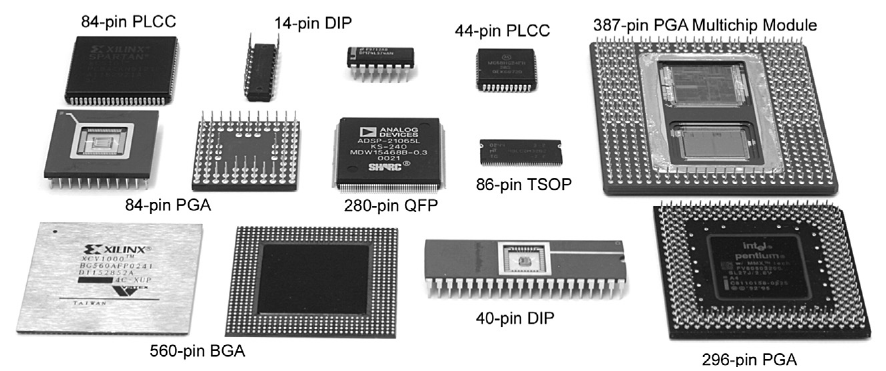

Hình eA.13 Các loại vỏ integrated circuit

### A.8.2 Breadboard

DIP dễ dùng cho tạo prototype vì có thể đặt trên breadboard. Breadboard là bảng nhựa chứa các hàng socket như Hình eA.14. Cả năm lỗ trong một hàng nối với nhau. Mỗi pin của vỏ được đặt vào lỗ ở hàng riêng. Có thể cắm dây vào các lỗ lân cận cùng hàng để nối với pin. Breadboard thường có các cột lỗ nối nhau riêng chạy dọc bảng để phân phối nguồn và ground.

Hình eA.14 thể hiện breadboard chứa majority gate xây dựng bằng chip AND 74LS08 và chip OR 74LS32. Schematic của mạch ở Hình eA.15. Mỗi gate trong schematic được gắn nhãn chip (08 hoặc 32) và số pin input, output (xem Hình eA.1). Quan sát thấy các kết nối tương tự trên breadboard. Input nối pin 1, 2 và 5 của chip 08, và output được đo tại pin 6 của chip 32. Nguồn và ground nối lần lượt pin 14 và 7 của mỗi chip, từ các cột nguồn và ground dọc nối với ổ banana plug Vb và Va. Gắn nhãn schematic theo cách này và đánh dấu từng kết nối khi làm là cách tốt giảm lỗi khi đi dây breadboard.

Đáng tiếc, rất dễ vô tình cắm dây sai lỗ hoặc dây tuột ra, nên đi dây breadboard đòi hỏi hết sức cẩn thận (và thường cần debug trong phòng thí nghiệm). Breadboard chỉ thích hợp tạo prototype, không dành cho sản xuất.

### A.8.3 Printed Circuit Board

Thay vì breadboard, có thể hàn vỏ chip lên printed circuit board (PCB). PCB được tạo từ các lớp đồng dẫn điện xen kẽ epoxy cách điện. Đồng được khắc để tạo dây gọi là trace. Các lỗ gọi là via được khoan xuyên board và mạ kim loại để nối giữa các lớp. PCB thường được thiết kế bằng công cụ computer-aided design (CAD). Bạn có thể tự khắc và khoan board đơn giản trong phòng thí nghiệm, hoặc gửi thiết kế đến nhà máy chuyên dụng để sản xuất hàng loạt với chi phí thấp. Nhà máy có thời gian hoàn thành vài ngày (hoặc vài tuần cho đợt sản xuất hàng loạt giá rẻ), thường tính vài trăm đô la phí thiết lập và vài đô la mỗi board cho board phức tạp vừa phải được sản xuất số lượng lớn.

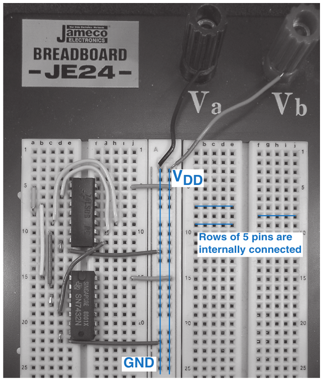

Hình eA.14 Mạch majority trên breadboard

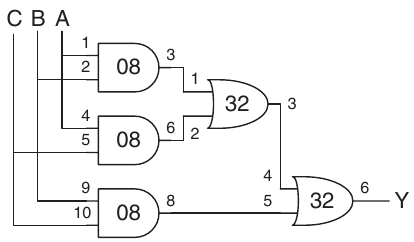

Hình eA.15 Schematic majority gate có chỉ rõ chip và pin

Trace PCB thường bằng đồng vì điện trở thấp. Trace được nhúng trong vật liệu cách điện, thường là nhựa fire-resistant màu xanh gọi là FR4. PCB cũng thường có các lớp nguồn và ground bằng đồng, gọi là plane, giữa các lớp tín hiệu. Hình eA.16 thể hiện cross-section của PCB. Các lớp tín hiệu nằm trên và dưới; plane nguồn và ground nằm giữa board. Plane nguồn và ground có điện trở thấp nên phân phối nguồn ổn định cho linh kiện. Chúng còn khiến điện dung và điện cảm của trace đồng nhất và dự đoán được.

Hình eA.17 thể hiện PCB của máy tính Apple II+ từ thập niên 1970. Trên cùng là microprocessor 6502. Bên dưới là sáu chip ROM 16-kib tạo 12 KiB ROM chứa hệ điều hành. Ba hàng, mỗi hàng tám chip DRAM 16-kib, cung cấp 48 KiB RAM. Bên phải là vài hàng logic 74xx-series để giải mã địa chỉ bộ nhớ và các chức năng khác. Các đường giữa chip là trace nối chip với nhau. Các chấm ở đầu một số trace là via được lấp kim loại.

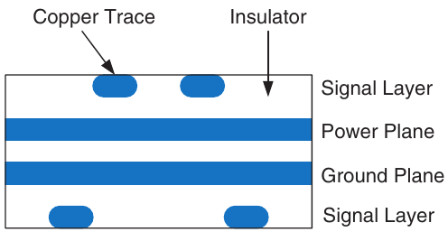

Hình eA.16 cross-section của printed circuit board

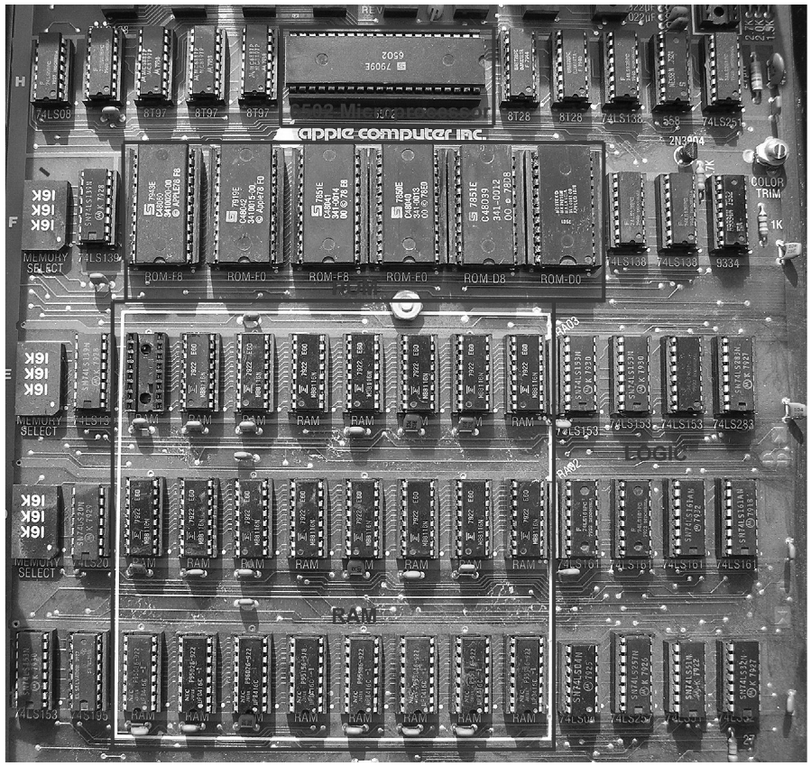

Hình eA.17 Circuit board Apple II+

### A.8.4 Kết hợp mọi thứ

Đa số chip hiện đại có nhiều input và output dùng vỏ SMT, đặc biệt QFP và BGA. Những vỏ này cần PCB thay vì breadboard. Làm việc với BGA đặc biệt khó vì cần thiết bị lắp ráp chuyên dụng. Hơn nữa, không thể đo các bi bằng voltmeter hoặc oscilloscope khi debug trong phòng thí nghiệm vì chúng bị che dưới vỏ.

Tóm lại, người thiết kế cần xem xét việc đóng gói từ sớm để quyết định có dùng được breadboard khi tạo prototype không và có cần linh kiện BGA không. Kỹ sư chuyên nghiệp hiếm khi dùng breadboard khi họ tự tin nối chip đúng mà không cần thử nghiệm.

## A.9 TRANSMISSION LINE

Đến nay chúng ta giả định dây là kết nối đẳng thế, có cùng điện áp trên toàn chiều dài. Tín hiệu thực ra lan truyền dọc dây với tốc độ ánh sáng dưới dạng sóng điện từ. Nếu dây đủ ngắn hoặc tín hiệu đổi chậm, giả định đẳng thế đủ tốt. Khi dây dài hoặc tín hiệu rất nhanh, thời gian truyền trên dây trở nên quan trọng để xác định chính xác delay mạch. Phải mô hình hóa những dây này thành transmission line, trong đó sóng điện áp và dòng lan truyền với tốc độ ánh sáng. Khi sóng tới cuối đường, nó có thể phản xạ ngược lại. Phản xạ có thể gây nhiễu và hành vi bất thường nếu không hạn chế. Vì vậy, người thiết kế số phải xem xét hành vi transmission line để tính chính xác hiệu ứng delay và nhiễu trên dây dài.

Sóng điện từ truyền với tốc độ ánh sáng trong môi trường cho trước, rất nhanh nhưng không tức thời. Tốc độ ánh sáng, ν, phụ thuộc permittivity, ε, và permeability, μ, của môi trường[^1]:

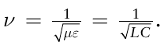

Tốc độ ánh sáng trong chân không là v = c = 3 × 108 m/s. Tín hiệu trên PCB truyền khoảng nửa tốc độ này vì vật liệu cách điện FR4 có permittivity gấp bốn lần không khí. Vì vậy, tín hiệu PCB truyền khoảng 1.5 × 108 m/s, hay 15 cm/ns. Time delay của tín hiệu truyền dọc transmission line dài l là

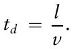 (eA.4)

Characteristic impedance của transmission line, Z0 (đọc là “Z-naught”), là tỷ số điện áp trên dòng của sóng truyền dọc đường: Z0 = V/I. Nó không phải điện trở dây (transmission line tốt trong hệ thống số thường có điện trở không đáng kể). Z0 phụ thuộc điện cảm và điện dung đường (xem chứng minh trong Phần A.9.7) và thường có giá trị từ 50 đến 75 Ω.

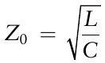 (eA.5)

Hình eA.18 thể hiện ký hiệu transmission line. Ký hiệu giống cáp đồng trục với dây tín hiệu bên trong và dây nối ground bên ngoài như cáp truyền hình.

Chìa khóa hiểu hành vi transmission line là hình dung sóng điện áp lan dọc đường với tốc độ ánh sáng. Khi sóng tới cuối đường, nó có thể bị hấp thụ hoặc phản xạ, tùy termination hoặc tải ở cuối. Phản xạ truyền ngược lại, cộng vào điện áp đã có trên đường. Termination được phân loại thành matched, open, short hoặc mismatched. Các phần sau tìm hiểu cách sóng truyền trên đường và điều xảy ra khi nó đến termination.

### A.9.1 Matched Termination

Hình eA.19 thể hiện transmission line dài l với matched termination, nghĩa là load impedance, ZL, bằng characteristic impedance, Z0. Transmission line có characteristic impedance 50 Ω. Một đầu nối với nguồn điện áp qua switch đóng tại t = 0. Đầu kia nối

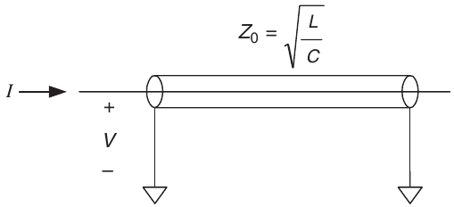

Hình eA.18 Ký hiệu transmission line

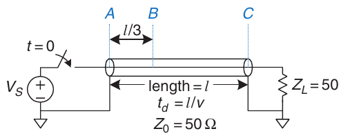

Hình eA.19 Transmission line với matched termination

với tải matched 50 Ω. Mục này phân tích điện áp và dòng điện tại các điểm A, B và C, lần lượt ở đầu đường truyền, tại vị trí one-third chiều dài đường truyền và ở cuối đường truyền.

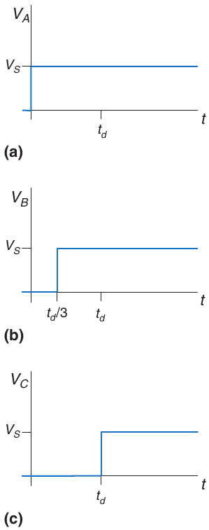

Hình eA.20 Dạng sóng điện áp của Hình eA.19 tại A, B và C

Hình eA.20 thể hiện điện áp tại A, B và C theo thời gian. Ban đầu không có điện áp hay dòng trong transmission line vì switch hở. Tại t = 0, switch đóng và nguồn phát một sóng có điện áp V = VS dọc đường. Đây gọi là incident wave. Vì characteristic impedance là Z0, sóng có dòng I = VS /Z0. Điện áp tới đầu đường (A) ngay lập tức như Hình eA.20(a). Sóng truyền dọc đường với tốc độ ánh sáng. Tại td /3, sóng tới B. Điện áp ở đó tăng đột ngột từ 0 lên VS, như Hình eA.20(b). Tại td, incident wave đến C ở cuối đường và điện áp ở đó cũng tăng. Toàn bộ dòng I đi vào điện trở ZL, tạo điện áp hai đầu VR = ZLI = ZL (VS /Z0) = VS vì ZL = Z0. Điện áp này nhất quán với sóng truyền dọc transmission line. Vì vậy, sóng bị load impedance hấp thụ và transmission line đạt steady state.

Ở steady state, transmission line giống dây đẳng thế lý tưởng vì suy cho cùng nó chỉ là dây. Điện áp ở mọi điểm dọc đường phải giống nhau. Hình eA.21 thể hiện mô hình tương đương steady-state của mạch Hình eA.19. Điện áp là VS ở mọi điểm dọc dây.

#### Ví dụ eA.2 TRANSMISSION LINE VỚI SOURCE VÀ LOAD TERMINATION MATCHED

Hình eA.22 thể hiện transmission line với source và load impedance matched ZS, ZL. Vẽ điện áp tại node A, B và C theo thời gian. Khi nào hệ thống đạt steady state và mạch tương đương ở steady state là gì?

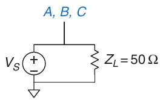

Hình eA.21 Mạch tương đương của Hình eA.19 ở steady state

Lời giải Khi nguồn điện áp có source impedance ZS nối tiếp transmission line, một phần điện áp rơi trên ZS, phần còn lại truyền dọc transmission line. Ban đầu, transmission line giống impedance Z0, vì tải ở cuối không thể ảnh hưởng hành vi đường cho tới khi qua một delay speed-of-light—tức tín hiệu ở đầu nguồn thậm chí chưa thể biết đầu tải có gì cho đến khi nó tới đó. Vì vậy, theo phương trình chia áp, điện áp incident truyền dọc đường là

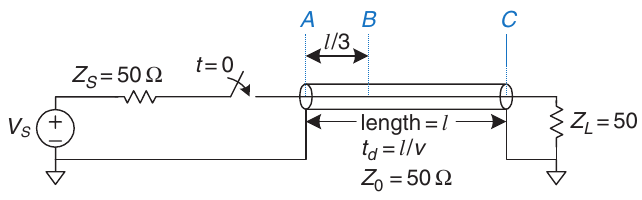

Hình eA.22 Transmission line có source và load impedance matched

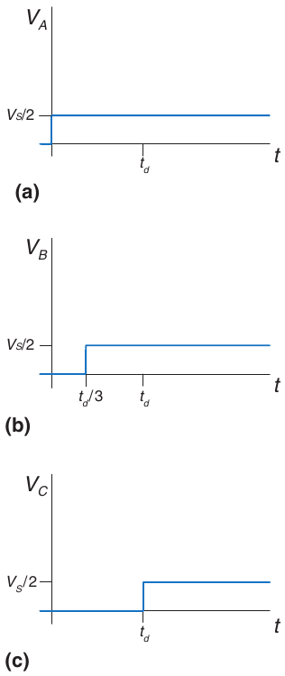

Hình eA.23 Dạng sóng điện áp của Hình eA.22 tại A, B và C

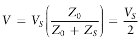 (eA.6)

Vì thế tại t = 0, sóng điện áp V = VS/2 được truyền từ A dọc đường. Một lần nữa, tín hiệu tới B tại td /3 và C tại td, như Hình eA.23. Toàn bộ dòng bị load impedance ZL hấp thụ, nên mạch vào steady state tại t = td. Ở steady state, cả đường ở VS /2, đúng như mạch tương đương steady-state trong Hình eA.24 dự đoán.

### A.9.2 Open Termination

Khi load impedance không bằng Z0, termination không hấp thụ được toàn bộ dòng và một phần sóng phải phản xạ. Hình eA.25 thể hiện transmission line có open load termination. Không dòng nào qua open termination, nên dòng tại C phải luôn bằng 0.

Điện áp ban đầu trên đường bằng không. Tại t = 0, switch đóng và một sóng điện áp, V = VS Z0/(Z0 + ZS) = VS/2, bắt đầu lan truyền dọc đường. Lưu ý sóng ban đầu giống Ví dụ eA.2 và độc lập termination vì tải ở cuối không thể ảnh hưởng hành vi ở đầu cho tới khi ít nhất 2td trôi qua. Sóng tới B tại td /3 và C tại td, như Hình eA.26.

Khi incident wave tới C, nó không thể đi tiếp vì dây hở. Thay vào đó, nó phải phản xạ về nguồn. Sóng phản xạ cũng có điện áp V = VS/2 vì open termination phản xạ toàn bộ sóng.

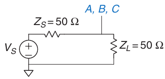

Hình eA.24 Mạch tương đương của Hình eA.22 ở steady state

Điện áp ở mọi điểm là tổng của incident wave và reflected wave. Tại thời điểm t = td, điện áp tại điểm C là V = VS/2 + VS/2 = VS. Sóng phản xạ tới điểm B tại 5td/3 và điểm A tại 2td. Khi tới A, sóng bị source termination impedance hấp thụ vì impedance này bằng characteristic impedance của đường. Vì vậy hệ thống đạt steady state tại t = 2td, và transmission line tương đương dây đẳng thế với điện áp VS và dòng I = 0.

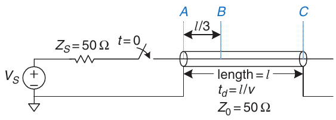

Hình eA.25 Transmission line với open load termination

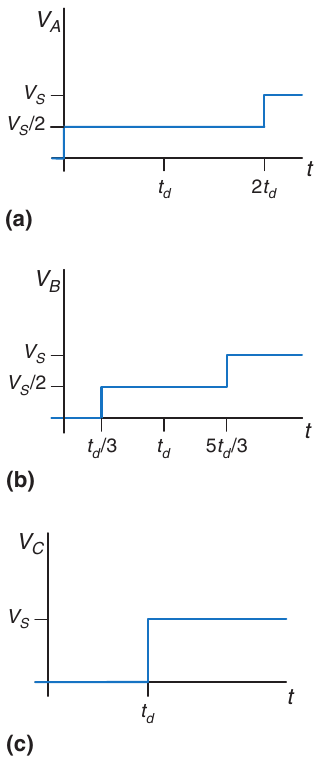

Hình eA.26 Dạng sóng điện áp của Hình eA.25 tại A, B và C

### A.9.3 Short Termination

Hình eA.27 thể hiện transmission line được terminate bằng short circuit xuống ground. Vì thế điện áp tại C phải luôn bằng 0.

Như các ví dụ trước, điện áp ban đầu trên đường bằng 0. Khi switch đóng, sóng điện áp V = VS/2 bắt đầu lan truyền dọc đường (Hình eA.28). Khi đến cuối đường, nó phải phản xạ với cực tính ngược lại. Sóng phản xạ, với điện áp V = −VS/2, cộng vào incident wave, bảo đảm điện áp tại điểm C vẫn bằng 0. Sóng phản xạ tới nguồn tại t = 2td và bị source impedance hấp thụ. Tại đây, hệ thống đạt steady state và transmission line tương đương dây đẳng thế với điện áp V = 0.

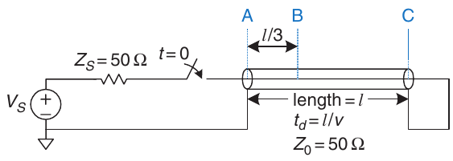

Hình eA.27 Transmission line với short termination

### A.9.4 Mismatched Termination

Termination impedance được gọi là mismatched khi không bằng characteristic impedance của đường. Nói chung, khi incident wave tới mismatched termination, một phần sóng bị hấp thụ và một phần phản xạ. Reflection coefficient kr cho biết tỷ phần của incident wave Vi bị phản xạ: Vr = krVi.

Phần A.9.8 suy ra reflection coefficient bằng lập luận bảo toàn dòng. Nó cho thấy khi incident wave trên transmission line có characteristic impedance Z0 tới termination impedance ZT ở cuối đường, reflection coefficient là

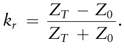 (eA.7)

Lưu ý vài trường hợp đặc biệt. Nếu termination là mạch hở (ZT = ∞), kr = 1 vì incident wave bị phản xạ toàn bộ (do đó dòng ra cuối đường vẫn bằng không). Nếu termination là short circuit (ZT = 0), kr = –1 vì incident wave bị phản xạ với cực tính âm (do đó điện áp cuối đường vẫn bằng không). Nếu termination là matched load (ZT = Z0), kr = 0 vì incident wave bị hấp thụ hoàn toàn.

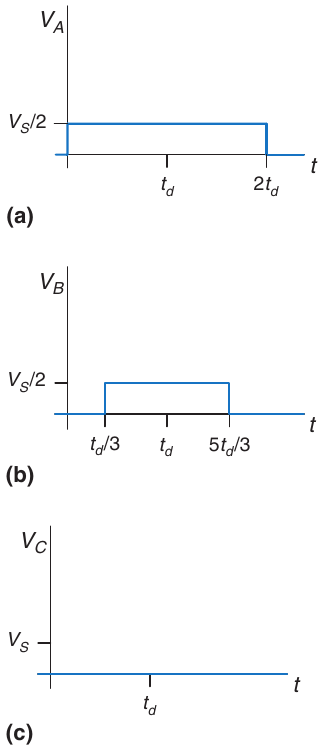

Hình eA.28 Dạng sóng điện áp của Hình eA.27 tại A, B và C

Hình eA.29 minh họa phản xạ trong transmission line có mismatched load termination 75 Ω. ZT = ZL = 75 Ω và Z0 = 50 Ω, nên kr = 1/5. Như các ví dụ trước, điện áp ban đầu trên đường bằng 0. Khi switch đóng, sóng điện áp V = VS/2 truyền dọc đường, đến cuối tại t = td. Khi incident wave tới termination cuối đường, one-fifth sóng phản xạ, còn four-fifths đi vào load impedance. Vì vậy, reflected wave có điện áp V = VS/2 × 1/5 = VS/10. Tổng điện áp tại điểm C là tổng của điện áp tới và điện áp phản xạ, VC = VS/2 + VS/10 = 3VS/5. Tại t = 2td, reflected wave tới điểm A, nơi nó bị hấp thụ bởi matched termination 50 Ω, ZS. Hình eA.30 vẽ điện áp và dòng dọc đường. Một lần nữa, lưu ý ở steady state (ở đây tại t > 2td), transmission line tương đương dây đẳng thế, như Hình eA.31. Ở steady state, hệ thống giống bộ chia áp, nên

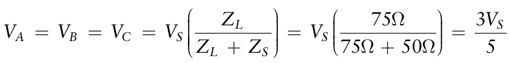.

Phản xạ có thể xảy ra ở cả hai đầu transmission line. Hình eA.32 thể hiện transmission line với source impedance ZS là 450 Ω và open termination tại tải. Reflection coefficient ở tải và nguồn, krL và krS, lần lượt là 1 và 4/5. Trong trường hợp này, sóng phản xạ ở cả hai đầu đến khi đạt steady state.

Bounce diagram trong Hình eA.33 giúp hình dung phản xạ ở cả hai đầu transmission line. Trục ngang biểu diễn khoảng cách dọc đường, trục dọc biểu diễn thời gian tăng xuống dưới. Hai phía của bounce diagram biểu diễn đầu nguồn và đầu tải của transmission line, các điểm A và C. Sóng tín hiệu tới và phản xạ được vẽ bằng các đường chéo giữa A và C. Tại t = 0, source impedance và transmission line giống bộ chia áp, phát sóng điện áp VS/10 từ A về C. Tại t = td, tín hiệu tới C và phản xạ hoàn toàn (krL = 1). Tại t = 2td, sóng phản xạ VS/10 tới A và phản xạ với reflection coefficient krS = 4/5, tạo sóng 2VS/25 đi về C, rồi cứ thế tiếp tục.

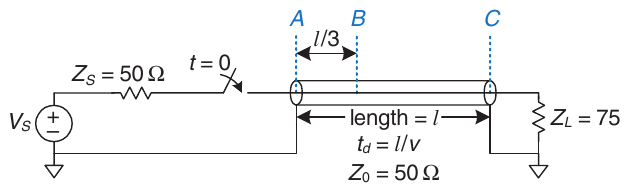

Hình eA.29 Transmission line với mismatched termination

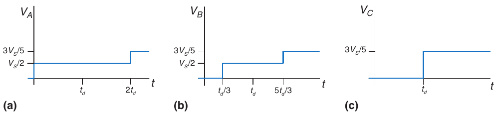

Hình eA.30 Dạng sóng điện áp của Hình eA.29 tại A, B và C

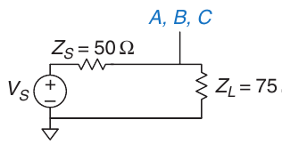

Hình eA.31 Mạch tương đương của Hình eA.29 ở steady state

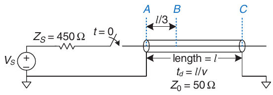

Hình eA.32 Transmission line có source và load termination mismatched

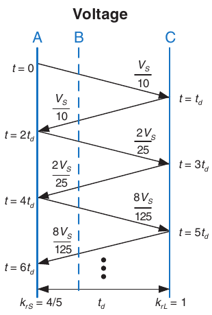

Hình eA.33 Bounce diagram của Hình eA.32

Điện áp tại thời điểm cho trước ở mọi điểm trên transmission line là tổng của mọi incident wave và reflected wave. Vì vậy, tại t = 1.1td, điện áp tại điểm C là VS/10 + VS/10 = VS/5. Tại t = 3.1td, điện áp tại điểm C là VS/10 + VS/10 + 2VS/25 + 2VS/25 = 9VS/25, và cứ thế tiếp tục. Hình eA.34 vẽ các điện áp theo thời gian. Khi t tới vô hạn, điện áp tiến tới steady state với VA = VB = VC = VS.

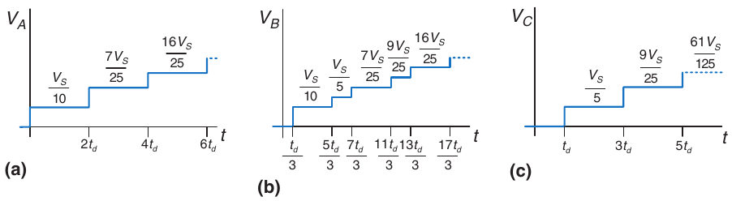

Hình eA.34 Các dạng sóng điện áp và dòng của Hình eA.32

### A.9.5 Khi nào dùng mô hình transmission line

Cần mô hình transmission line cho dây bất cứ khi nào wire delay, td, dài hơn một phần, thường 20%, của edge rate (rise hoặc fall time) tín hiệu. Nếu wire delay ngắn hơn, ảnh hưởng lên propagation delay không đáng kể và phản xạ tiêu tán khi tín hiệu đang chuyển. Nếu wire delay dài hơn, phải xem xét nó để dự đoán chính xác propagation delay và dạng sóng tín hiệu. Đặc biệt, phản xạ có thể làm méo đặc tính số của dạng sóng, dẫn tới thao tác logic sai.

Nhớ rằng tín hiệu trên PCB truyền khoảng 15 cm/ns. Với logic TTL có edge rate 10 ns, chỉ phải mô hình dây thành transmission line nếu dài hơn 30 cm (10 ns × 15 cm/ns × 20%). Trace PCB thường ngắn hơn 30 cm nên đa số có thể được mô hình thành dây đẳng thế lý tưởng. Ngược lại, nhiều chip hiện đại có edge rate 2 ns trở xuống, nên trace dài hơn khoảng 6 cm (khoảng 2.5 inch) phải được mô hình thành transmission line. Rõ ràng, dùng edge rate sắc hơn cần thiết chỉ gây khó khăn cho người thiết kế.

Breadboard thiếu ground plane nên trường điện từ mỗi tín hiệu không đồng nhất và khó mô hình. Hơn nữa, các trường tương tác với tín hiệu khác. Điều này gây phản xạ lạ và crosstalk giữa tín hiệu. Vì vậy breadboard không đáng tin trên vài megahertz.

Ngược lại, PCB có transmission line tốt với characteristic impedance và vận tốc nhất quán trên toàn chiều dài. Chừng nào được terminate bằng source hoặc load impedance bằng impedance đường, trace PCB không chịu phản xạ.

### A.9.6 Termination đúng cho transmission line

Có hai cách phổ biến để terminate transmission line đúng, như Hình eA.35. Trong parallel termination, driver có impedance thấp (ZS ≈ 0). Điện trở tải ZL có impedance Z0 được đặt song song tải (giữa input receiver gate và ground). Khi driver chuyển từ 0 sang VDD, nó gửi sóng điện áp VDD dọc đường. Sóng bị matched load termination hấp thụ, không có phản xạ. Trong series termination, điện trở nguồn ZS nối tiếp driver nâng source impedance lên Z0. Tải có impedance cao (ZL ≈ ∞). Khi driver chuyển, nó gửi sóng điện áp VDD/2 dọc đường. Sóng phản xạ tại tải mạch hở rồi quay lại, nâng điện áp đường lên VDD. Sóng bị hấp thụ tại source termination. Hai cách tương tự ở chỗ điện áp tại receiver chuyển từ 0 sang VDD tại t = td, đúng như mong muốn. Chúng khác về công suất tiêu thụ và dạng sóng ở nơi khác dọc đường. Parallel termination liên tục tiêu tán công suất qua điện trở tải khi đường có điện áp high. Series termination không tiêu tán công suất DC vì tải là mạch hở. Tuy nhiên, với đường series terminated, các điểm gần giữa đường ban đầu thấy điện áp VDD/2 cho đến khi phản xạ quay về. Nếu gate khác nối giữa đường, chúng thấy logic level không hợp lệ trong chốc lát. Vì vậy series termination phù hợp nhất cho giao tiếp point-to-point với một driver và một receiver. Parallel termination tốt hơn cho bus nhiều receiver vì receiver ở giữa đường không bao giờ thấy logic level không hợp lệ.

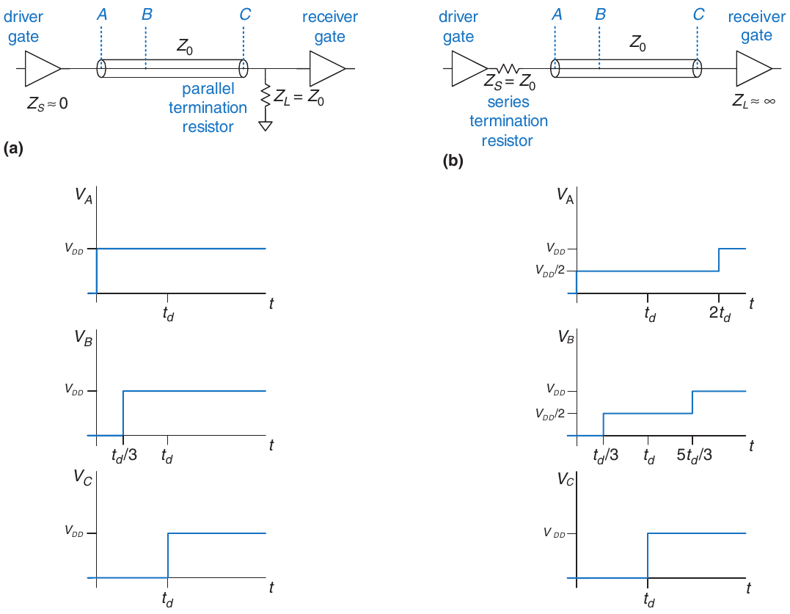

Hình eA.35 Các cách termination: (a) parallel, (b) series

### A.9.7 Suy ra Z0\*

Z0 là tỷ số điện áp trên dòng trong sóng truyền dọc transmission line. Phần này suy ra Z0; giả định người đọc đã biết một ít phân tích mạch resistor-inductor-capacitor (RLC).

Hãy hình dung áp điện áp step vào input transmission line semi-infinite (để không có phản xạ). Hình eA.36 thể hiện đường semi-infinite và mô hình đoạn dài dx. R, L, C là giá trị điện trở, điện cảm và điện dung trên đơn vị chiều dài. Hình eA.36(b) thể hiện mô hình transmission line với thành phần điện trở R. Đây gọi là mô hình transmission line có tổn hao vì năng lượng bị tiêu tán, hay mất, trong điện trở dây. Tuy nhiên, tổn hao thường không đáng kể và có thể đơn giản phân tích bằng cách bỏ qua điện trở, coi transmission line là lý tưởng, như Hình eA.36(c).

Điện áp và dòng là hàm của thời gian và không gian trên toàn transmission line như các Phương trình eA.8 và eA.9.

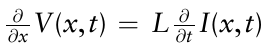 (eA.8)

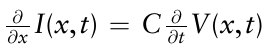 (eA.9)

Lấy đạo hàm theo không gian của Phương trình eA.8 và đạo hàm theo thời gian của Phương trình eA.9 rồi thế vào nhau, ta có Phương trình eA.10, phương trình sóng.

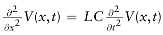 (eA.10)

Z0 là tỷ số điện áp trên dòng trong transmission line, như Hình eA.37(a). Z0 phải độc lập chiều dài đường vì hành vi sóng không thể phụ thuộc những thứ ở xa. Vì độc lập chiều dài, impedance vẫn phải bằng Z0 sau khi thêm một đoạn transmission line nhỏ dx, như Hình eA.37(b).

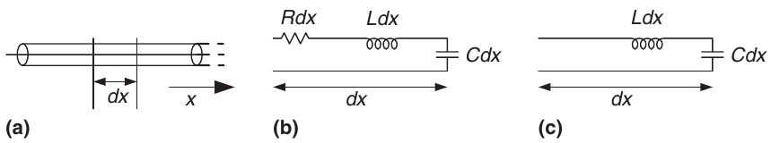

Hình eA.36 Các mô hình transmission line: (a) cáp semi-infinite, (b) có tổn hao, (c) lý tưởng

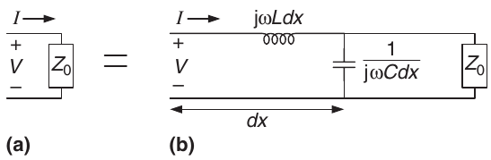

Hình eA.37 Mô hình transmission line: (a) cho cả đường và (b) có thêm chiều dài dx

Dùng impedance cuộn cảm và tụ điện, ta viết lại quan hệ trong Hình eA.37 thành phương trình:

Z0 = jωLdx + [Z0\|\|(1 / (jωCdx))] (eA.11)

Sắp xếp lại, ta có

Z02 (jωC) − jωL + ω2Z0LCdx = 0 (eA.12)

Lấy giới hạn khi dx tới 0, số hạng cuối biến mất và ta được

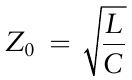 (eA.13)

### A.9.8 Suy ra Reflection Coefficient\*

Reflection coefficient kr được suy ra bằng bảo toàn dòng. Hình eA.38 thể hiện transmission line có characteristic impedance Z0 và load impedance ZL. Hình dung incident wave với điện áp Vi và dòng Ii. Khi sóng đến termination, một phần dòng IL đi qua load impedance, gây sụt áp VL. Phần còn lại của dòng phản xạ ngược về dọc đường thành sóng có điện áp Vr và dòng Ir. Z0 là tỉ số điện áp trên dòng của các sóng lan truyền dọc đường, nên Vi/Ii = Vr/Ir = Z0.

Điện áp trên đường truyền là tổng điện áp của incident wave và reflected wave. Dòng điện chạy theo chiều dương trên đường truyền là hiệu giữa dòng điện của incident wave và dòng điện của reflected wave.

VL = Vi + Vr (eA.14)

IL = Ii – Ir (eA.15)

Dùng định luật Ohm và thế cho IL, Ii và Ir trong Phương trình eA.15, ta có

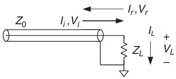

Hình eA.38 Transmission line thể hiện điện áp và dòng tới, phản xạ và tải

 (eA.16)

Sắp xếp lại, ta tìm được reflection coefficient, kr:

 (eA.17)

### A.9.9 Kết hợp mọi thứ

Transmission line mô hình hóa thực tế tín hiệu cần thời gian lan dọc dây dài vì tốc độ ánh sáng hữu hạn. Transmission line lý tưởng có điện cảm L và điện dung C đồng nhất trên đơn vị chiều dài và điện trở bằng không. Transmission line được đặc trưng bởi characteristic impedance Z0 và delay td, có thể suy ra từ điện cảm, điện dung và chiều dài dây. Transmission line có hiệu ứng delay và nhiễu đáng kể lên tín hiệu có rise/fall time nhỏ hơn khoảng 5td. Điều này nghĩa là với hệ thống có rise/fall time 2 ns, phải phân tích trace PCB dài hơn khoảng 6 cm như transmission line để hiểu chính xác hành vi của chúng.

Hệ thống số gồm một gate lái dây dài nối input gate thứ hai có thể được mô hình bằng transmission line như Hình eA.39. Nguồn điện áp, source impedance ZS và switch mô hình gate đầu chuyển từ 0 sang 1 tại thời điểm 0. Driver gate không thể cấp dòng vô hạn; ZS mô hình điều này. ZS thường nhỏ với logic gate nhưng người thiết kế có thể thêm điện trở nối tiếp gate để tăng ZS cho bằng impedance đường. Input gate thứ hai được mô hình bằng ZL. Mạch CMOS thường có dòng input nhỏ nên ZL có thể gần vô hạn. Người thiết kế cũng có thể thêm điện trở song song gate thứ hai, giữa input gate và ground, để ZL bằng impedance đường.

Hình eA.39 Hệ thống số được mô hình bằng transmission line

Khi gate đầu chuyển, sóng điện áp được lái lên transmission line. Source impedance và transmission line tạo bộ chia áp, nên điện áp incident wave là

 (eA.18)

Tại td, sóng đến cuối đường. Một phần bị load impedance hấp thụ và một phần phản xạ. Reflection coefficient kr cho biết tỷ phần phản xạ: kr = Vr /Vi, trong đó Vr là điện áp reflected wave và Vi là điện áp incident wave.

 (eA.19)

Reflected wave cộng vào điện áp đã có trên đường. Nó tới nguồn tại 2td, tại đó một phần bị hấp thụ và một phần lại phản xạ. Phản xạ tiếp tục qua lại, và điện áp đường cuối cùng tiến gần giá trị dự đoán nếu đường là dây đẳng thế đơn giản.

## A.10 KINH TẾ HỌC

Dù thiết kế số thú vị đến mức một số người trong chúng tôi sẵn lòng làm miễn phí, đa số người thiết kế và công ty có ý định kiếm tiền. Vì vậy, cân nhắc kinh tế là yếu tố lớn trong quyết định thiết kế.

Chi phí hệ thống số chia thành nonrecurring engineering (NRE) và recurring cost. NRE là chi phí thiết kế hệ thống. Nó bao gồm lương nhóm thiết kế, chi phí máy tính, phần mềm và chi phí sản xuất đơn vị đầu tiên hoạt động được. Tổng chi phí cho một người thiết kế tại Hoa Kỳ năm 2021 (gồm lương, bảo hiểm y tế, kế hoạch hưu trí và máy tính có công cụ thiết kế) khoảng \$200,000 mỗi năm, nên chi phí thiết kế có thể đáng kể. Recurring cost là chi phí cho mỗi đơn vị bổ sung; gồm linh kiện, sản xuất, tiếp thị, hỗ trợ kỹ thuật và vận chuyển.

Giá bán phải trang trải không chỉ chi phí hệ thống mà còn các chi phí khác như thuê văn phòng, thuế và lương nhân viên không trực tiếp đóng góp vào thiết kế (như người lao công và CEO). Sau mọi chi phí đó, công ty vẫn phải có lợi nhuận.

### Ví dụ eA.3 BEN THỬ KIẾM TIỀN

Ben Bitdiddle thiết kế mạch khéo léo để đếm giọt mưa. Anh quyết định bán thiết bị để kiếm tiền nhưng cần giúp chọn cách triển khai. Anh quyết định dùng FPGA hoặc ASIC. Development kit để thiết kế và kiểm tra FPGA giá \$1500. Mỗi FPGA giá \$17. ASIC tốn \$600,000 cho bộ mask và \$4 mỗi chip.

Bất kể chọn cách triển khai chip nào, Ben phải gắn chip đã đóng gói lên printed circuit board (PCB), giá \$1.50 mỗi board. Anh nghĩ có thể bán 1,000 thiết bị mỗi tháng. Ben ép được một nhóm sinh viên đại học sáng dạ thiết kế chip làm đồ án tốt nghiệp nên không tốn chi phí thiết kế.

Nếu giá bán phải gấp hai chi phí (biên lợi nhuận 100%) và vòng đời sản phẩm là 2 năm, cách triển khai nào tốt hơn?

Lời giải Ben tính tổng chi phí từng cách triển khai trong 2 năm như Bảng eA.4. Trong 2 năm, Ben dự định bán 24,000 thiết bị; tổng chi phí cho mỗi lựa chọn trong Bảng eA.4. Nếu vòng đời chỉ hai năm, FPGA rõ ràng tốt hơn. Chi phí per-unit là \$445,500/24,000 = \$18.56, và giá bán \$37.13 mỗi đơn vị mang lại biên lợi nhuận 100%. Lựa chọn ASIC tốn \$732,000/24,000 = \$30.50 và phải bán \$61 mỗi đơn vị.

Bảng eA.4 Chi phí ASIC so với FPGA

| Chi phí | ASIC | FPGA |
|---|---|---|
| NRE | \$600,000 | \$1500 |
| Chip | \$4 | \$17 |
| PCB | \$1.50 | \$1.50 |
| TỔNG | \$600,000 + (24,000 × \$5.50) = \$732,000 | \$1500 + (24,000 × \$18.50) = \$445,500 |
| Mỗi đơn vị | \$30.50 | \$18.56 |

### Ví dụ eA.4 BEN TRỞ NÊN THAM LAM

Sau khi xem các quảng cáo tiếp thị cho sản phẩm của mình, Ben nghĩ rằng anh có thể bán được nhiều chip hơn mỗi tháng so với dự kiến ban đầu. Nếu chọn phương án ASIC, anh phải bán bao nhiêu thiết bị mỗi tháng để phương án ASIC mang lại lợi nhuận cao hơn phương án FPGA?

Lời giải Ben tìm số đơn vị tối thiểu N cần bán trong 2 năm:

\$600,000 + (N × \$5.50) = \$1500 + (N × \$18.50)

Giải phương trình cho N = 46,039 đơn vị, hay 1,919 đơn vị mỗi tháng. Anh cần gần gấp đôi doanh số hàng tháng để hưởng lợi từ giải pháp ASIC.

### Ví dụ eA.5 BEN BỚT THAM LAM

Ben nhận ra mình đã quá tham vọng và không nghĩ rằng anh có thể bán hơn 1,000 thiết bị mỗi tháng. Tuy nhiên, anh cho rằng vòng đời sản phẩm có thể dài hơn 2 năm. Với doanh số 1,000 thiết bị mỗi tháng, vòng đời sản phẩm phải dài bao lâu để phương án ASIC trở nên đáng lựa chọn?

Lời giải Nếu Ben bán tổng cộng hơn 46,039 đơn vị, ASIC là lựa chọn tốt nhất. Vậy anh cần bán với tốc độ 1,000 mỗi tháng trong ít nhất 47 tháng (làm tròn lên), gần 4 năm. Lúc đó sản phẩm có lẽ đã lỗi thời.

Chip thường được mua từ nhà phân phối thay vì trực tiếp từ nhà sản xuất (trừ khi đặt hàng chục nghìn đơn vị). Digikey (`www.digikey.com`) và Arrow (`www.arrow.com`) là nhà phân phối hàng đầu bán đa dạng linh kiện điện tử. Jameco (`www.jameco.com`) và All Electronics (`www.allelectronics.com`) có catalog đa dạng giá cạnh tranh, phù hợp người làm theo sở thích.

[^1]: Điện dung C và điện cảm L của dây liên quan đến permittivity và permeability của môi trường vật lý chứa dây.
