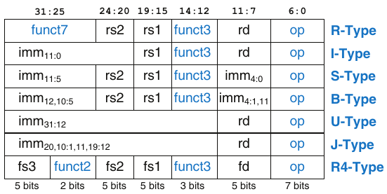
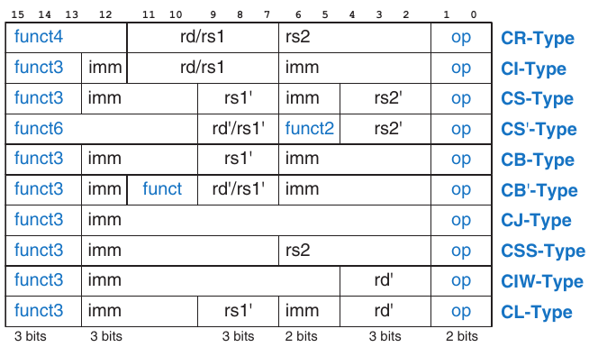

# B Tóm tắt instruction set RISC-V

Các mặt trong bìa của giáo trình có phần tóm tắt tiện dụng về toàn bộ instruction set RISC-V.

## Tóm tắt instruction set RISC-V

- `imm`: immediate có dấu trong imm11:0

Hình B.1 Các định dạng instruction RISC-V 32-bit

- `uimm`: immediate không dấu 5-bit trong imm4:0

- `upimm`: 20 bit phía trên của một immediate 32-bit, trong imm31:12

- `Address`: địa chỉ bộ nhớ: rs1 + SignExt(imm11:0)

- `[Address]`: dữ liệu tại vị trí bộ nhớ Address

- `BTA`: địa chỉ đích branch: PC + SignExt({imm12:1,1'b0})

- `JTA`: địa chỉ đích jump: PC + SignExt({imm20:1,1'b0})

- `label`: văn bản chỉ địa chỉ instruction

- `SignExt`: giá trị được sign-extended thành 32 bit

- `ZeroExt`: giá trị được zero-extended thành 32 bit

- `csr:` control and status register

Bảng B.1 RV32I: Các instruction số nguyên RISC-V

| op | funct3 | funct7 | Loại | Instruction | Mô tả | Thao tác |
|---|---|---|---|---|---|---|
| 0000011 (3) | 000 | – | I | `lb rd, imm(rs1)` | Nạp byte | `rd = SignExt([Address]``7:0``)` |
| 0000011 (3) | 001 | – | I | `lh rd, imm(rs1)` | Nạp half | `rd = SignExt([Address]``15:0``)` |
| 0000011 (3) | 010 | – | I | `lw rd, imm(rs1)` | Nạp word | `rd = [Address]``31:0` |
| 0000011 (3) | 100 | – | I | `lbu rd, imm(rs1)` | Nạp byte không dấu | `rd = ZeroExt([Address]``7:0``)` |
| 0000011 (3) | 101 | – | I | `lhu rd, imm(rs1)` | Nạp half không dấu | `rd = ZeroExt([Address]``15:0``)` |
| 0010011 (19) | 000 | – | I | `addi rd, rs1, imm` | Cộng immediate | `rd = rs1 + SignExt(imm)` |
| 0010011 (19) | 001 | 0000000\* | I | `slli rd, rs1, uimm` | Dịch trái logic theo immediate | `rd = rs1 << uimm` |
| 0010011 (19) | 010 | – | I | `slti rd, rs1, imm` | Đặt nếu nhỏ hơn immediate | `rd = (rs1` < `SignExt(imm))` |
| 0010011 (19) | 011 | – | I | `sltiu rd, rs1, imm` | Đặt nếu nhỏ hơn imm. không dấu | `rd = (rs1` < `SignExt(imm))` |
| 0010011 (19) | 100 | – | I | `xori rd, rs1, imm` | XOR với immediate | `rd = rs1 ^ SignExt(imm)` |
| 0010011 (19) | 101 | 0000000\* | I | `srli rd, rs1, uimm` | Dịch phải logic theo immediate | `rd = rs1 >> uimm` |
| 0010011 (19) | 101 | 0100000\* | I | `srai rd, rs1, uimm` | Dịch phải số học theo imm. | `rd = rs1 >>> uimm` |
| 0010011 (19) | 110 | – | I | `ori rd, rs1, imm` | OR với immediate | `rd = rs1 \| SignExt(imm)` |
| 0010011 (19) | 111 | – | I | `andi rd, rs1, imm` | AND với immediate | `rd = rs1 & SignExt(imm)` |
| 0010111 (23) | – | – | U | `auipc rd, upimm` | Cộng upper immediate vào PC | `rd = {upimm, 12`'`b0} + PC` |
| 0100011 (35) | 000 | – | S | `sb rs2, imm(rs1)` | Lưu byte | `[Address]``7:0` `= rs2``7:0` |
| 0100011 (35) | 001 | – | S | `sh rs2, imm(rs1)` | Lưu half | `[Address]``15:0``= rs2``15:0` |
| 0100011 (35) | 010 | – | S | `sw rs2, imm(rs1)` | Lưu word | `[Address]``31:0``= rs2` |
| 0110011 (51) | 000 | 0000000 | R | `add rd, rs1, rs2` | Cộng | `rd = rs1 + rs2` |
| 0110011 (51) | 000 | 0100000 | R | `sub rd, rs1, rs2` | Trừ | `rd = rs1 — rs2` |
| 0110011 (51) | 001 | 0000000 | R | `sll rd, rs1, rs2` | Dịch trái logic | `rd = rs1 << rs2``4:0` |
| 0110011 (51) | 010 | 0000000 | R | `slt rd, rs1, rs2` | Đặt nếu nhỏ hơn | `rd = (rs1` < `rs2)` |
| 0110011 (51) | 011 | 0000000 | R | `sltu rd, rs1, rs2` | Đặt nếu nhỏ hơn không dấu | `rd = (rs1` < `rs2)` |
| 0110011 (51) | 100 | 0000000 | R | `xor rd, rs1, rs2` | XOR | `rd = rs1 ^ rs2` |
| 0110011 (51) | 101 | 0000000 | R | `srl rd, rs1, rs2` | Dịch phải logic | `rd = rs1 >> rs2``4:0` |
| 0110011 (51) | 101 | 0100000 | R | `sra rd, rs1, rs2` | Dịch phải số học | `rd = rs1 >>> rs2``4:0` |
| 0110011 (51) | 110 | 0000000 | R | `or rd, rs1, rs2` | OR | `rd = rs1 \| rs2` |
| 0110011 (51) | 111 | 0000000 | R | `and rd, rs1, rs2` | AND | `rd = rs1 & rs2` |
| 0110111 (55) | – | – | U | `lui rd, upimm` | Nạp upper immediate | `rd = {upimm, 12’b0}` |
| 1100011 (99) | 000 | – | B | `beq rs1, rs2, label` | Branch nếu = | `if (rs1 == rs2) PC = BTA` |
| 1100011 (99) | 001 | – | B | `bne rs1, rs2, label` | Branch nếu ≠ | `if (rs1 ≠ rs2) PC = BTA` |
| 1100011 (99) | 100 | – | B | `blt rs1, rs2, label` | Branch nếu < | `if (rs1` < `rs2) PC = BTA` |
| 1100011 (99) | 101 | – | B | `bge rs1, rs2, label` | Branch nếu ≥ | `if (rs1` ≥ `rs2) PC = BTA` |
| 1100011 (99) | 110 | – | B | `bltu rs1, rs2, label` | Branch nếu < không dấu | `if (rs1` < `rs2) PC = BTA` |
| 1100011 (99) | 111 | – | B | `bgeu rs1, rs2, label` | Branch nếu ≥ không dấu | `if (rs1` ≥ `rs2) PC = BTA` |
| 1100111 (103) | 000 | – | I | `jalr rd, rs1, imm` | Jump và link qua register | `PC = rs1 + SignExt(imm), rd = PC + 4` |
| 1101111 (111) | – | – | J | `jal rd, label` | Jump và link | `PC = JTA, rd = PC + 4` |

\*Được mã hóa trong instr31:25, bảy bit phía trên của trường immediate

Bảng B.2 RV64I: Các instruction số nguyên bổ sung

| op | funct3 | funct7 | Loại | Instruction | Mô tả | Thao tác |
|---|---|---|---|---|---|---|
| 0000011 (3) | 011 | – | I | `ld rd, imm(rs1)` | Nạp double word | `rd=[Address]``63:0` |
| 0000011 (3) | 110 | – | I | `lwu rd, imm(rs1)` | Nạp word không dấu | `rd=ZeroExt([Address]``31:0``)` |
| 0011011 (27) | 000 | – | I | `addiw rd, rs1, imm` | Cộng immediate word | `rd=SignExt((rs1 + SignExt(imm))``31:0``)` |
| 0011011 (27) | 001 | 0000000 | I | `slliw rd, rs1, uimm` | Dịch trái logic word theo immediate | `rd=SignExt((rs1``31:0` `<< uimm)``31:0``)` |
| 0011011 (27) | 101 | 0000000 | I | `srliw rd, rs1, uimm` | Dịch phải logic word theo immediate | `rd=SignExt((rs1``31:0` `>> uimm)``31:0``)` |
| 0011011 (27) | 101 | 0100000 | I | `sraiw rd, rs1, uimm` | Dịch phải số học word theo immediate | `rd=SignExt((rs1``31:0` `>>> uimm)``31:0``)` |
| 0100011 (35) | 011 | – | S | `sd rs2, imm(rs1)` | Lưu double word | `[Address]``63:0` `=rs2` |
| 0111011 (59) | 000 | 0000000 | R | `addw rd, rs1, rs2` | Cộng word | `rd=SignExt((rs1 + rs2)``31:0``)` |
| 0111011 (59) | 000 | 0100000 | R | `subw rd, rs1, rs2` | Trừ word | `rd=SignExt((rs1 — rs2)``31:0``)` |
| 0111011 (59) | 001 | 0000000 | R | `sllw rd, rs1, rs2` | Dịch trái logic word | `rd=SignExt((rs1``31:0` `<< rs2``4:0``)``31:0``)` |
| 0111011 (59) | 101 | 0000000 | R | `srlw rd, rs1, rs2` | Dịch phải logic word | `rd=SignExt((rs1``31:0` `>> rs2``4:0``)``31:0``)` |
| 0111011 (59) | 101 | 0100000 | R | `sraw rd, rs1, rs2` | Dịch phải số học word | `rd=SignExt((rs1``31:0` `>>> rs2``4:0``)``31:0``)` |

Trong RV64I, các register có độ rộng 64 bit nhưng các instruction vẫn có độ rộng 32 bit. Thuật ngữ “word” thường chỉ một giá trị 32-bit. Trong RV64I, các instruction dịch immediate dùng immediate 6-bit: uimm5:0; tuy nhiên với phép dịch word, bit có trọng số cao nhất của số lượng dịch (uimm5) phải bằng 0. Các instruction kết thúc bằng “w” (viết tắt của “word”) thao tác trên nửa dưới của các register 64-bit. Sign- hoặc zero-extension tạo ra kết quả 64-bit.

Bảng B.3 RVF/D: Các instruction floating-point single- và double-precision của RISC-V

| op | funct3 | funct7 | rs2 | Loại | Instruction | Mô tả | Thao tác |
|---|---|---|---|---|---|---|---|
| 1000011 (67) | rm | fs3, fmt | – | R4 | `fmadd fd,fs1,fs2,fs3` | multiply-add | `fd = fs1` \* `fs2 + fs3` |
| 1000111 (71) | rm | fs3, fmt | – | R4 | `fmsub fd,fs1,fs2,fs3` | multiply-subtract | `fd = fs1` \* `fs2 — fs3` |
| 1001011 (75) | rm | fs3, fmt | – | R4 | `fnmsub fd,fs1,fs2,fs3` | Lấy số đối của multiply-add | `fd = —(fs1` \* `fs2 + fs3)` |
| 1001111 (79) | rm | fs3, fmt | – | R4 | `fnmadd fd,fs1,fs2,fs3` | Lấy số đối của multiply-subtract | `fd = —(fs1` \* `fs2 – fs3)` |
| 1010011 (83) | rm | 00000, fmt | – | R | `fadd fd,fs1,fs2` | Cộng | `fd = fs1 + fs2` |
| 1010011 (83) | rm | 00001, fmt | – | R | `fsub fd,fs1,fs2` | Trừ | `fd = fs1 — fs2` |
| 1010011 (83) | rm | 00010, fmt | – | R | `fmul fd,fs1,fs2` | Nhân | `fd = fs1` \* `fs2` |
| 1010011 (83) | rm | 00011, fmt | – | R | `fdiv fd,fs1,fs2` | Chia | `fd = fs1 / fs2` |
| 1010011 (83) | rm | 01011, fmt | 00000 | R | `fsqrt fd,fs1` | Căn bậc hai | `fd = sqrt(fs1)` |
| 1010011 (83) | 000 | 00100, fmt | – | R | `fsgnj fd,fs1,fs2` | Chèn dấu | `fd = fs1, sign = sign(fs2)` |
| 1010011 (83) | 001 | 00100, fmt | – | R | `fsgnjn fd,fs1,fs2` | Chèn dấu đảo | `fd = fs1, sign = —sign(fs2)` |
| 1010011 (83) | 010 | 00100, fmt | – | R | `fsgnjx fd,fs1,fs2` | Chèn dấu XOR | `fd = fs1,` `sign = sign(fs2)` ^ `sign(fs1)` |
| 1010011 (83) | 000 | 00101, fmt | – | R | `fmin fd,fs1,fs2` | Nhỏ nhất | `fd = min(fs1, fs2)` |
| 1010011 (83) | 001 | 00101, fmt | – | R | `fmax fd,fs1,fs2` | Lớn nhất | `fd = max(fs1, fs2)` |
| 1010011 (83) | 010 | 10100, fmt | – | R | `feq rd,fs1,fs2` | So sánh = | `rd = (fs1 == fs2)` |
| 1010011 (83) | 001 | 10100, fmt | – | R | `flt rd,fs1,fs2` | So sánh < | `rd = (fs1` < `fs2)` |
| 1010011 (83) | 000 | 10100, fmt | – | R | `fle rd,fs1,fs2` | So sánh ≤ | `rd = (fs1` ≤ `fs2)` |
| 1010011 (83) | 001 | 11100, fmt | 00000 | R | `fclass rd,fs1` | Phân loại | `rd = classification of fs1` |
|  |  |  |  |  | Chỉ RVF |  |  |
| 0000111 (7) | 010 | – | – | I | `flw fd, imm(rs1)` | Nạp float | `fd = [Address]``31:0` |
| 0100111 (39) | 010 | – | – | S | `fsw fs2,imm(rs1)` | Lưu float | `[Address]``31:0` `= fd` |
| 1010011 (83) | rm | 1100000 | 00000 | R | `fcvt.w.s rd, fs1` | Chuyển sang số nguyên | `rd = integer(fs1)` |
| 1010011 (83) | rm | 1100000 | 00001 | R | `fcvt.wu.s rd, fs1` | Chuyển sang số nguyên không dấu | `rd = unsigned(fs1)` |
| 1010011 (83) | rm | 1101000 | 00000 | R | `fcvt.s.w fd, rs1` | Chuyển int sang float | `fd = float(rs1)` |
| 1010011 (83) | rm | 1101000 | 00001 | R | `fcvt.s.wu fd, rs1` | Chuyển số không dấu sang float | `fd = float(rs1)` |
| 1010011 (83) | 000 | 1110000 | 00000 | R | `fmv.x.w rd, fs1` | Chuyển vào register số nguyên | `rd = fs1` |
| 1010011 (83) | 000 | 1111000 | 00000 | R | `fmv.w.x fd, rs1` | Chuyển vào register f.p. | `fd = rs1` |
|  |  |  |  |  | Chỉ RVD |  |  |
| 0000111 (7) | 011 | - | – | I | `fld fd, imm(rs1)` | Nạp double | `fd = [Address]``63:0` |
| 0100111 (39) | 011 | – | – | S | `fsd fs2,imm(rs1)` | Lưu double | `[Address]``63:0` `= fd` |
| 1010011 (83) | rm | 1100001 | 00000 | R | `fcvt.w.d rd, fs1` | Chuyển sang số nguyên | `rd = integer(fs1)` |
| 1010011 (83) | rm | 1100001 | 00001 | R | `fcvt.wu.d rd, fs1` | Chuyển sang số nguyên không dấu | `rd = unsigned(fs1)` |
| 1010011 (83) | rm | 1101001 | 00000 | R | `fcvt.d.w fd, rs1` | Chuyển int sang double | `fd = double(rs1)` |
| 1010011 (83) | rm | 1101001 | 00001 | R | `fcvt.d.wu fd, rs1` | Chuyển số không dấu sang double | `fd = double(rs1)` |
| 1010011 (83) | rm | 0100000 | 00001 | R | `fcvt.s.d fd, fs1` | Chuyển double sang float | `fd = float(fs1)` |
| 1010011 (83) | rm | 0100001 | 00000 | R | `fcvt.d.s fd, fs1` | Chuyển float sang double | `fd = double(fs1)` |

fs1, fs2, fs3, fd: các floating-point register. fs1, fs2 và fd được mã hóa trong các trường rs1, rs2 và rd; chỉ R4-type mã hóa thêm fs3. fmt: độ chính xác của instruction tính toán (single=002, double=012, quad=112). rm: chế độ làm tròn (0=gần nhất, 1=về không, 2=xuống, 3=lên, 4=gần nhất (độ lớn tối đa), 7=động). sign(fs1): dấu của fs1.

Hình B.2 Các định dạng instruction nén (16-bit) RISC-V

Bảng B.4 Tên và số hiệu register

| Tên | Số hiệu register | Công dụng |
|---|---|---|
| zero | x0 | Giá trị hằng 0 |
| ra | x1 | Địa chỉ trả về |
| sp | x2 | Stack pointer |
| gp | x3 | Global pointer |
| tp | x4 | Thread pointer |
| t0–2 | x5–7 | Các register tạm |
| s0/fp | x8 | Register được lưu / Frame pointer |
| s1 | x9 | Register được lưu |
| a0–1 | x10–11 | Đối số hàm / Giá trị trả về |
| a2–7 | x12–17 | Đối số hàm |
| s2–11 | x18–27 | Các register được lưu |
| t3-6 | x28–31 | Các register tạm |

Bảng B.5 RVM: Các instruction nhân và chia RISC-V

| op | funct3 | funct7 | Loại | Instruction | Mô tả | Thao tác |
|---|---|---|---|---|---|---|
| 0110011 (51) | 000 | 0000001 | R | `mul rd, rs1, rs2` | Nhân | `rd = (rs1` \* `rs2)``31:0` |
| 0110011 (51) | 001 | 0000001 | R | `mulh rd, rs1, rs2` | Nhân lấy phần cao, có dấu với có dấu | `rd = (rs1` \* `rs2)``63:32` |
| 0110011 (51) | 010 | 0000001 | R | `mulhsu rd, rs1, rs2` | Nhân lấy phần cao, có dấu với không dấu | `rd = (rs1` \* `rs2)``63:32` |
| 0110011 (51) | 011 | 0000001 | R | `mulhu rd, rs1, rs2` | Nhân lấy phần cao, không dấu với không dấu | `rd = (rs1` \* `rs2)``63:32` |
| 0110011 (51) | 100 | 0000001 | R | `div rd, rs1, rs2` | Chia (có dấu) | `rd = rs1 / rs2` |
| 0110011 (51) | 101 | 0000001 | R | `divu rd, rs1, rs2` | Chia không dấu | `rd = rs1 / rs2` |
| 0110011 (51) | 110 | 0000001 | R | `rem rd, rs1, rs2` | Phần dư (có dấu) | `rd = rs1 % rs2` |
| 0110011 (51) | 111 | 0000001 | R | `remu rd, rs1, rs2` | Phần dư không dấu | `rd = rs1 % rs2` |

Bảng B.6 RVC: Các instruction nén (16-bit) RISC-V

| op | instr15:10 | funct2 | Loại | Instruction RVC | Tương đương 32-Bit |
|---|---|---|---|---|---|
| 00 (0) | 000––– | – | CIW | `c.addi4spn rd',` `sp, imm` | `addi rd', sp, ZeroExt(imm)`\*`4` |
| 00 (0) | 001––– | – | CL | `c.fld fd',` `imm(rs1')` | `fld fd', (ZeroExt(imm)`\*`8)(rs1')` |
| 00 (0) | 010––– | – | CL | `c.lw rd',` `imm(rs1')` | `lw rd', (ZeroExt(imm)`\*`4)(rs1')` |
| 00 (0) | 011––– | – | CL | `c.flw fd',` `imm(rs1')` | `flw fd', (ZeroExt(imm)`\*`4)(rs1')` |
| 00 (0) | 101––– | – | CS | `c.fsd fs2',` `imm(rs1')` | `fsd fs2', (ZeroExt(imm)`\*`8)(rs1')` |
| 00 (0) | 110––– | – | CS | `c.sw rs2',` `imm(rs1')` | `sw rs2', (ZeroExt(imm)`\*`4)(rs1')` |
| 00 (0) | 111––– | – | CS | `c.fsw fs2',` `imm(rs1')` | `fsw fs2', (ZeroExt(imm)`\*`4)(rs1')` |
| 01 (1) | 000000 | – | CI | `c.nop` `(rs1=0,imm=0)` | `nop` |
| 01 (1) | 000––– | – | CI | `c.addi rd,` `imm` | `addi rd, rd, SignExt(imm)` |
| 01 (1) | 001––– | – | CJ | `c.jal label` | `jal ra, label` |
| 01 (1) | 010––– | – | CI | `c.li rd,` `imm` | `addi rd, x0, SignExt(imm)` |
| 01 (1) | 011––– | – | CI | `c.lui rd,` `imm` | `lui rd, {14{imm``5``}, imm}` |
| 01 (1) | 011––– | – | CI | `c.addi16sp sp,` `imm` | `addi sp, sp, SignExt(imm)`\*`16` |
| 01 (1) | 100–00 | – | CB' | `c.srli rd',` `imm` | `srli rd', rd', imm` |
| 01 (1) | 100–01 | – | CB' | `c.srai rd',` `imm` | `srai rd', rd', imm` |
| 01 (1) | 100–10 | – | CB' | `c.andi rd',` `imm` | `andi rd', rd', SignExt(imm)` |
| 01 (1) | 100011 | 00 | CS' | `c.sub rd',` `rs2'` | `sub rd', rd', rs2'` |
| 01 (1) | 100011 | 01 | CS' | `c.xor rd',` `rs2'` | `xor rd', rd', rs2'` |
| 01 (1) | 100011 | 10 | CS' | `c.or rd',` `rs2'` | `or rd', rd', rs2'` |
| 01 (1) | 100011 | 11 | CS' | `c.and rd',` `rs2'` | `and rd', rd', rs2'` |
| 01 (1) | 101––– | – | CJ | `c.j label` | `jal x0, label` |
| 01 (1) | 110––– | – | CB | `c.beqz rs1',` `label` | `beq rs1', x0, label` |
| 01 (1) | 111––– | – | CB | `c.bnez rs1',` `label` | `bne rs1', x0, label` |
| 10 (2) | 000––– | – | CI | `c.slli rd,` `imm` | `slli rd, rd, imm` |
| 10 (2) | 001––– | – | CI | `c.fldsp fd,` `imm` | `fld fd, (ZeroExt(imm)`\*`8)(sp)` |
| 10 (2) | 010––– | – | CI | `c.lwsp rd,` `imm` | `lw rd, (ZeroExt(imm)`\*`4)(sp)` |
| 10 (2) | 011––– | – | CI | `c.flwsp fd,` `imm` | `flw fd, (ZeroExt(imm)`\*`4)(sp)` |
| 10 (2) | 1000–– | – | CR | `c.jr rs1` `(rs1≠0,rs2=0)` | `jalr x0, rs1, 0` |
| 10 (2) | 1000–– | – | CR | `c.mv rd,` `rs2 (rd ≠0,rs2≠0)` | `add rd, x0, rs2` |
| 10 (2) | 1001–– | – | CR | `c.ebreak` `(rs1=0,rs2=0)` | `ebreak` |
| 10 (2) | 1001–– | – | CR | `c.jalr rs1` `(rs1≠0,rs2=0)` | `jalr ra, rs1, 0` |
| 10 (2) | 1001–– | – | CR | `c.add rd,` `rs2 (rs1≠0,rs2≠0)` | `add rd, rd, rs2` |
| 10 (2) | 101––– | – | CSS | `c.fsdsp fs2,` `imm` | `fsd fs2, (ZeroExt(imm)`\*`8)(sp)` |
| 10 (2) | 110––– | – | CSS | `c.swsp rs2,` `imm` | `sw rs2, (ZeroExt(imm)`\*`4)(sp)` |
| 10 (2) | 111––– | – | CSS | `c.fswsp fs2,` `imm` | `fsw fs2, (ZeroExt(imm)`\*`4)(sp)` |

rs1', rs2', rd': chỉ định register bằng 3-bit cho các register 8–15: 0002 = `x8` hoặc `f8`, 0012 = `x9` hoặc `f9`, v.v.

Bảng B.7 Các pseudoinstruction RISC-V

| Pseudoinstruction | Các instruction RISC-V | Mô tả | Thao tác |
|---|---|---|---|
| `nop` | `addi x0, x0, 0` | Không thực hiện thao tác |  |
| `li rd, imm``11:0` | `addi rd, x0, imm``11:0` | Nạp immediate 12-bit | `rd = SignExtend(imm``11:0``)` |
| `li rd, imm``31:0` | `lui rd, imm``31:12``*` `addi rd, rd, imm``11:0` | Nạp immediate 32-bit | `rd = imm``31:0` |
| `mv rd, rs1` | `addi rd, rs1, 0` | Chuyển (còn gọi là “sao chép register”) | `rd = rs1` |
| `not rd, rs1` | `xori rd, rs1, —1` | Bù một | `rd = ~rs1` |
| `neg rd, rs1` | `sub rd, x0, rs1` | Bù hai | `rd = —rs1` |
| `seqz rd, rs1` | `sltiu rd, rs1, 1` | Đặt nếu = 0 | `rd = (rs1 == 0)` |
| `snez rd, rs1` | `sltu rd, x0, rs1` | Đặt nếu ≠ 0 | `rd = (rs1 ≠ 0)` |
| `sltz rd, rs1` | `slt rd, rs1, x0` | Đặt nếu < 0 | `rd = (rs1` < `0)` |
| `sgtz rd, rs1` | `slt rd, x0, rs1` | Đặt nếu > 0 | `rd = (rs1` > `0)` |
| `beqz rs1, label` | `beq rs1, x0, label` | Branch nếu = 0 | `if (rs1 == 0) PC = label` |
| `bnez rs1, label` | `bne rs1, x0, label` | Branch nếu ≠ 0 | `if (rs1 ≠ 0) PC = label` |
| `blez rs1, label` | `bge x0, rs1, label` | Branch nếu ≤ 0 | `if (rs1` ≤ `0) PC = label` |
| `bgez rs1, label` | `bge rs1, x0, label` | Branch nếu ≥ 0 | `if (rs1` ≥ `0) PC = label` |
| `bltz rs1, label` | `blt rs1, x0, label` | Branch nếu < 0 | `if (rs1` < `0) PC = label` |
| `bgtz rs1, label` | `blt x0, rs1, label` | Branch nếu > 0 | `if (rs1` > `0) PC = label` |
| `ble rs1, rs2, label` | `bge rs2, rs1, label` | Branch nếu ≤ | `if (rs1` ≤ `rs2) PC = label` |
| `bgt rs1, rs2, label` | `blt rs2, rs1, label` | Branch nếu > | `if (rs1` > `rs2) PC = label` |
| `bleu rs1, rs2, label` | `bgeu rs2, rs1, label` | Branch nếu ≤ (không dấu) | `if (rs1` ≤ `rs2) PC = label` |
| `bgtu rs1, rs2, label` | `bltu rs2, rs1, offset` *(ghi chú: sách in offset; các dòng khác dùng `label`: `bltu rs2, rs1, label`)* | Branch nếu > (không dấu) | `if (rs1` > `rs2) PC = label` |
| `j label` | `jal x0, label` | Jump | `PC = label` |
| `jal label` | `jal ra, label` | Jump và link | `PC = label, ra = PC + 4` |
| `jr rs1` | `jalr x0, rs1, 0` | Jump qua register | `PC = rs1` |
| `jalr rs1` | `jalr ra, rs1, 0` | Jump và link qua register | `PC = rs1, ra = PC + 4` |
| `ret` | `jalr x0, ra, 0` | Trở về từ hàm | `PC = ra` |
| `call label` | `jal ra, label` | Gọi hàm ở gần | `PC = label, ra = PC + 4` |
| `call label` | `auipc ra, offset``31:12``*` `jalr ra, ra, offset``11:0` | Gọi hàm ở xa | `PC = PC + offset, ra = PC + 4` |
| `la rd, symbol` | `auipc rd, symbol``31:12``*` `addi rd, rd, symbol``11:0` | Nạp địa chỉ biến toàn cục | `rd = PC + symbol` |
| `l{b\|h\|w} rd, symbol` | `auipc rd, symbol``31:12``*` `l{b\|h\|w} rd, symbol``11:0``(rd)` | Nạp biến toàn cục | `rd = [PC + symbol]` |
| `s{b\|h\|w} rs2, symbol, rs1` | `auipc rs1, symbol``31:12``*` `s{b\|h\|w} rs2, symbol``11:0``(rs1)` | Lưu biến toàn cục | `[PC + symbol] = rs2` |
| `csrr rd, csr` | `csrrs rd, csr, x0` | Đọc CSR | `rd = csr` |
| `csrw csr, rs1` | `csrrw x0, csr, rs1` | Ghi CSR | `csr = rs1` |

\* Nếu bit 11 của immediate / offset / symbol bằng 1, upper immediate được tăng thêm 1. `symbol` và `offset` lần lượt là các địa chỉ 32-bit PC-relative của một label và một biến toàn cục.

Bảng B.8 Các instruction đặc quyền / CSR

| op | funct3 | Loại | Instruction | Mô tả | Thao tác |
|---|---|---|---|---|---|
| 1110011 (115) | 000 | I | `ecall` | Chuyển điều khiển cho OS (imm=0) |  |
| 1110011 (115) | 000 | I | `ebreak` | Chuyển điều khiển cho debugger (imm=1) |  |
| 1110011 (115) | 000 | I | `uret` | Trở về từ user exception (rs1=0,rd=0,imm=2) | `PC = uepc` |
| 1110011 (115) | 000 | I | `sret` | Trở về từ supervisor exception (rs1=0,rd=0,imm=258) | `PC = sepc` |
| 1110011 (115) | 000 | I | `mret` | Trở về từ machine exception (rs1=0,rd=0,imm=770) | `PC = mepc` |
| 1110011 (115) | 001 | I | `csrrw rd,csr,rs1` | Đọc/ghi CSR (imm=số hiệu CSR) | `rd = csr,csr = rs1` |
| 1110011 (115) | 010 | I | `csrrs rd,csr,rs1` | Đọc/đặt CSR (imm=số hiệu CSR) | `rd = csr,csr = csr \| rs1` |
| 1110011 (115) | 011 | I | `csrrc rd,csr,rs1` | Đọc/xóa CSR (imm=số hiệu CSR) | `rd = csr,csr = csr & ~rs1` |
| 1110011 (115) | 101 | I | `csrrwi rd,csr,uimm` | Đọc/ghi CSR với immediate (imm=số hiệu CSR) | `rd = csr,csr = ZeroExt(uimm)` |
| 1110011 (115) | 110 | I | `csrrsi rd,csr,uimm` | Đọc/đặt CSR với immediate (imm=số hiệu CSR) | `rd = csr,` `csr = csr \| ZeroExt(uimm)` |
| 1110011 (115) | 111 | I | `csrrci rd,csr,uimm` | Đọc/xóa CSR với immediate (imm=số hiệu CSR) | `rd = csr,` `csr = csr & ~ZeroExt(uimm)` |

Với các instruction đặc quyền / CSR, immediate không dấu 5-bit, uimm, được mã hóa trong trường rs1.
