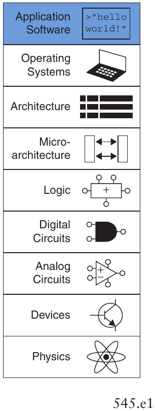
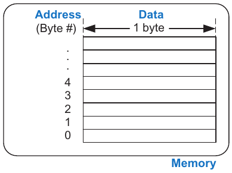
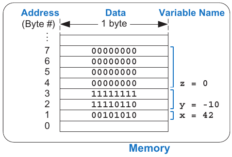
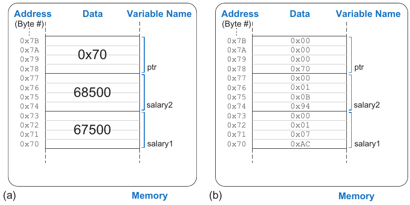
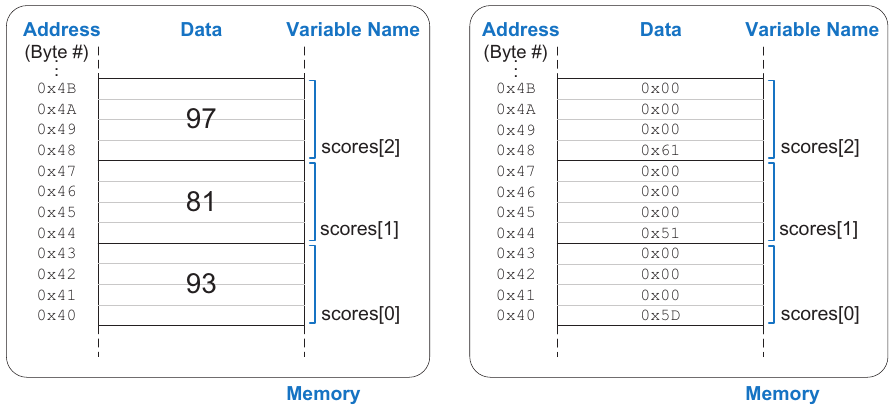
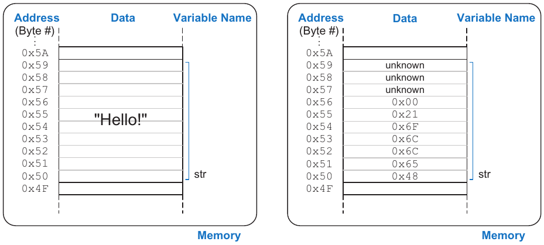

# eC Lập trình C

- C.1 Giới thiệu
- C.2 Chào mừng đến với C
- C.3 Biên dịch
- C.4 Biến
- C.5 Toán tử
- C.6 Lời gọi hàm
- C.7 Các câu lệnh Control-Flow
- C.8 Thêm các kiểu dữ liệu
- C.9 Các thư viện chuẩn
- C.10 Các tùy chọn compiler và command line
- C.11 Các lỗi thường gặp

## C.1 GIỚI THIỆU

Mục tiêu tổng quát của cuốn sách này là cung cấp một bức tranh về cách máy tính hoạt động ở nhiều cấp độ, từ các transistor cấu thành chúng đến tận phần mềm chúng chạy. Năm chương đầu tiên đi dần qua các cấp độ trừu tượng thấp, từ transistor đến gate rồi đến thiết kế logic. Chương 6 đến 8 chuyển lên architecture rồi đi ngược xuống microarchitecture để kết nối phần cứng với phần mềm. Phụ lục lập trình C này về mặt logic nằm giữa Chương 5 và 6, trình bày lập trình C ở cấp độ trừu tượng cao nhất trong sách. Nó tạo động lực cho nội dung architecture và kết nối sách với kinh nghiệm lập trình mà người đọc có thể đã quen thuộc. Nội dung này được đặt trong phụ lục để người đọc dễ dàng học hoặc bỏ qua tùy kinh nghiệm trước đó.



Lập trình viên dùng nhiều ngôn ngữ khác nhau để chỉ cho máy tính phải làm gì. Về căn bản, máy tính xử lý các instruction bằng machine language gồm các bit 1 và 0, như được tìm hiểu trong Chương 6. Nhưng lập trình bằng machine language rất tẻ nhạt và chậm, khiến lập trình viên dùng các ngôn ngữ trừu tượng hơn để truyền đạt ý định hiệu quả hơn. Bảng eC.1 liệt kê một số ngôn ngữ ở các cấp độ trừu tượng khác nhau.

Một trong những ngôn ngữ lập trình phổ biến nhất từng được phát triển có tên là C. Một nhóm gồm Dennis Ritchie và Brian Kernighan tại Bell Laboratories đã tạo ra nó trong khoảng 1969 đến 1973 để viết lại hệ điều hành UNIX từ assembly language ban đầu. Theo nhiều thước đo, C (gồm họ ngôn ngữ liên quan chặt chẽ như C++, C# và Objective C) là ngôn ngữ được sử dụng rộng rãi nhất hiện nay. Sự phổ biến đó bắt nguồn từ nhiều yếu tố, bao gồm:

- Có trên vô số nền tảng, từ supercomputer xuống đến embedded microcontroller

- Tương đối dễ sử dụng, với cộng đồng người dùng rất lớn

Bảng eC.1 Các ngôn ngữ theo cấp độ trừu tượng giảm dần một cách tương đối

| Ngôn ngữ | Mô tả |
|---|---|
| MATLAB | Được thiết kế để thuận tiện cho việc sử dụng nhiều hàm toán học |
| Perl | Được thiết kế cho scripting |
| Python | Được thiết kế để chú trọng khả năng đọc code |
| Java | Được thiết kế để chạy an toàn trên mọi máy tính |
| C | Được thiết kế để có tính linh hoạt và truy cập toàn hệ thống, bao gồm device driver |
| Assembly Language | Machine language ở dạng Human-readable |
| Machine Language | Biểu diễn nhị phân của chương trình |

> 
>
> Dennis Ritchie, 1941–2011
>
> 
>
> Brian Kernighan, 1942–
>
> C được chính thức giới thiệu năm 1978 qua cuốn sách kinh điển The C Programming Language của Brian Kernighan và Dennis Ritchie. Năm 1989, American National Standards Institute (ANSI) mở rộng và chuẩn hóa ngôn ngữ; phiên bản này được gọi là ANSI C, Standard C hoặc C89. Ngay sau đó, năm 1990, International Organization for Standardization (ISO) và International Electrotechnical Commission (IEC) thông qua chuẩn này. ISO/IEC cập nhật chuẩn năm 1999 thành phiên bản gọi là C99 mà chúng ta sẽ thảo luận trong sách.

- Cấp độ trừu tượng vừa phải, mang lại năng suất cao hơn assembly language nhưng vẫn giúp lập trình viên hiểu rõ code sẽ được thực thi như thế nào

- Phù hợp để tạo ra các chương trình high-performance

- Khả năng tương tác trực tiếp với phần cứng

Chương này dành cho lập trình C vì nhiều lý do. Quan trọng nhất, C cho phép lập trình viên truy cập trực tiếp các địa chỉ trong bộ nhớ, minh họa sự kết nối giữa phần cứng và phần mềm được nhấn mạnh trong cuốn sách. C là một ngôn ngữ thực dụng mà mọi kỹ sư và nhà khoa học máy tính đều nên biết. Các ứng dụng của nó trong nhiều khía cạnh triển khai và thiết kế—chẳng hạn phát triển phần mềm, lập trình embedded system và mô phỏng—khiến việc thành thạo C trở thành kỹ năng thiết yếu và có giá trị trên thị trường lao động.

Các phần sau mô tả cú pháp tổng thể của chương trình C, thảo luận từng phần—bao gồm header, khai báo hàm và biến, kiểu dữ liệu, cùng các hàm thông dụng được cung cấp trong thư viện. Chương 9 (có dưới dạng tài liệu bổ sung trên web—xem Lời nói đầu) mô tả một ứng dụng hands-on, dùng C để lập trình RED-V RedBoard của SparkFun, chứa một microcontroller RISC-V.

## TÓM TẮT

- Lập trình High-level: Lập trình High-level hữu ích ở nhiều cấp độ thiết kế, từ viết phần mềm phân tích hoặc mô phỏng đến lập trình microcontroller tương tác với phần cứng.

- Truy cập Low-level: Code C mạnh mẽ vì ngoài các cấu trúc high-level, nó còn cung cấp khả năng truy cập phần cứng và bộ nhớ low-level.

> C là ngôn ngữ được dùng để lập trình các hệ thống phổ biến khắp nơi như Linux, Windows và iOS. C mạnh mẽ nhờ khả năng truy cập phần cứng trực tiếp. So với các ngôn ngữ high-level khác—chẳng hạn Perl và MATLAB—C không có nhiều hỗ trợ built-in cho các thao tác chuyên biệt như xử lý file, pattern matching, thao tác ma trận và giao diện người dùng đồ họa. Nó cũng thiếu các tính năng bảo vệ lập trình viên khỏi những lỗi thường gặp, chẳng hạn ghi dữ liệu vượt quá cuối array. Sức mạnh kết hợp với việc thiếu cơ chế bảo vệ đã giúp các hacker khai thác phần mềm viết kém để xâm nhập hệ thống máy tính.

## C.2 CHÀO MỪNG ĐẾN VỚI C

Một chương trình C là một file văn bản mô tả các thao tác để máy tính thực hiện. File văn bản được biên dịch, chuyển sang định dạng machine-readable, rồi được chạy hay thực thi trên máy tính. Ví dụ code C eC.1 là một chương trình C đơn giản in cụm từ “Hello world!” lên console, tức màn hình máy tính. Chương trình C thường nằm trong một hoặc nhiều file văn bản có đuôi “.c.” Phong cách lập trình tốt yêu cầu tên file thể hiện nội dung chương trình—chẳng hạn file này có thể được đặt tên hello.c.

### C.2.1 Phân tích một chương trình C

> Dù chương này cung cấp hiểu biết cơ bản về lập trình C, có những cuốn sách hoàn chỉnh trình bày C chuyên sâu. Một cuốn chúng tôi yêu thích là giáo trình kinh điển The C Programming Language của Brian Kernighan và Dennis Ritchie, những người phát triển C. Sách trình bày súc tích các yếu tố thiết yếu của C. Một cuốn tốt khác là A Book on C của Al Kelley và Ira Pohl.

Nhìn chung, một chương trình C được tổ chức thành một hoặc nhiều hàm. Mọi chương trình phải có hàm `main`, là nơi chương trình bắt đầu thực thi. Đa số chương trình sử dụng các hàm khác được định nghĩa ở nơi khác trong code C và/hoặc trong thư viện. Các phần tổng thể của chương trình `hello,c` *(ghi chú: sách in dấu phẩy; tên file là `hello.c`)* là header, hàm `main` và body.

Header: `#include <stdio.h>`

Header đưa vào các hàm thư viện mà chương trình cần. Trong trường hợp này, chương trình dùng hàm `printf`, thuộc thư viện I/O chuẩn, `stdio.h`. Xem Phần C.9 để biết thêm về các thư viện built-in của C.

Hàm main: `int main(void)`

Mọi chương trình C phải chứa đúng một hàm `main`. Chương trình được thực thi bằng cách chạy code bên trong `main`, gọi là body của `main`. Cú pháp hàm được mô tả trong Phần C.6. Body của một hàm chứa một chuỗi câu lệnh. Mỗi câu lệnh kết thúc bằng dấu chấm phẩy. `int` chỉ ra rằng hàm `main` xuất ra, hay trả về, một kết quả số nguyên cho biết chương trình có chạy thành công hay không.

#### Ví dụ code C eC.1 CHƯƠNG TRÌNH C ĐƠN GIẢN

```
// Write "Hello world!" to the console
#include <stdio.h>
int main(void) {
  printf("Hello world!\n");
}
```

Kết quả trên console

```
Hello world!
```

Body: `printf(“Hello world!\n”);`

Body của hàm `main` này chứa một câu lệnh, là lời gọi hàm `printf`, in cụm từ “Hello world!” rồi đến ký tự xuống dòng được biểu thị bằng chuỗi đặc biệt “`\n`”. Các chi tiết khác về hàm I/O (input/output) được mô tả trong Phần C.9.1.

Mọi chương trình đều tuân theo định dạng tổng quát của chương trình `hello.c` đơn giản. Tất nhiên, các chương trình rất phức tạp có thể chứa hàng triệu dòng code và trải trên hàng trăm file.

### C.2.2 Chạy chương trình C

Chương trình C có thể chạy trên nhiều máy khác nhau. Tính khả chuyển này là một ưu điểm nữa của C. Trước tiên, chương trình được biên dịch trên máy mong muốn bằng compiler C. Có các phiên bản compiler C hơi khác nhau, gồm cc (C compiler), hoặc gcc (GNU C compiler). Ở đây, chúng tôi trình bày cách biên dịch và chạy chương trình C bằng gcc, có thể tải xuống miễn phí. Nó chạy trực tiếp trên các máy Linux và có thể sử dụng trong môi trường Cygwin trên máy Windows. Nó cũng có cho nhiều embedded system, như RED-V RedBoard của SparkFun chứa một microcontroller RISC-V. Quy trình tổng quát về tạo file C, biên dịch và thực thi được mô tả dưới đây là giống nhau cho mọi chương trình C.

1\. Tạo file văn bản, chẳng hạn `hello.c`.

2\. Trong cửa sổ terminal, chuyển đến thư mục chứa file `hello.c` và gõ `gcc hello.c` tại command prompt.

3\. Compiler tạo một file executable. Mặc định, executable có tên `a.out` (hoặc `a.exe` trên máy Windows).

4\. Tại command prompt, gõ `./a.out` (hoặc `./a.exe` trên Windows) rồi nhấn return.

5\. “Hello world!” sẽ xuất hiện trên màn hình.

## TÓM TẮT

- `filename.c:` Các file chương trình C thường được đặt tên với phần mở rộng .c.

- `main:` Mỗi chương trình C phải có đúng một hàm `main`.

- `#include:` Đa số chương trình C dùng các hàm do thư viện built-in cung cấp. Để sử dụng các hàm này, viết `#include <library.h>` ở đầu file C.

- `gcc filename.c:` Các file C được chuyển thành executable bằng compiler như GNU compiler (gcc) hoặc C compiler (cc).

- Thực thi: Sau khi biên dịch, chạy chương trình C bằng cách gõ `./a.out` (hoặc `./a.exe`) tại command line prompt.

## C.3 BIÊN DỊCH

Compiler là phần mềm đọc chương trình viết bằng ngôn ngữ high-level rồi chuyển nó thành một file machine code gọi là executable. Có những giáo trình hoàn chỉnh viết về compiler, nhưng ở đây chúng tôi chỉ mô tả ngắn gọn. Hoạt động tổng quát của compiler là (1) tiền xử lý file bằng cách đưa vào các thư viện được tham chiếu và mở rộng các định nghĩa macro, (2) bỏ qua mọi thông tin không cần thiết như comment, (3) dịch code high-level thành các instruction đơn giản thuộc tập lệnh gốc của processor, được biểu diễn bằng nhị phân, gọi là machine language, và (4) biên dịch tất cả instruction thành một executable nhị phân duy nhất mà máy tính có thể đọc và thực thi. Mỗi machine language dành riêng cho một processor, vì vậy một chương trình phải được biên dịch riêng cho hệ thống mà nó sẽ chạy. Chẳng hạn, machine language RISC-V được trình bày chi tiết trong Chương 6.

### C.3.1 Comment

Lập trình viên sử dụng comment để mô tả code ở mức khái quát và làm rõ chức năng của code. Bất kỳ ai từng đọc code không có comment đều có thể xác nhận tầm quan trọng của nó. Chương trình C dùng hai loại comment: comment Single-line bắt đầu bằng `//` và kết thúc ở cuối dòng; comment multiple-line bắt đầu bằng `/*` và kết thúc bằng `*/`. Mặc dù comment rất quan trọng đối với cách tổ chức và tính rõ ràng của chương trình, compiler bỏ qua chúng.

```
// This is an example of a one-line comment.
/* This is an example
  of a multi-line comment. */
```

Một comment ở đầu mỗi file C hữu ích để mô tả tác giả, ngày tạo và sửa đổi, cùng mục đích của file. Comment bên dưới có thể được đặt ở đầu file `hello.c`.

```
// hello.c
// 15 Jan 2021 Sarah.Harris@unlv.edu, David_Harris@hmc.edu
//
// This program prints "Hello world!" to the screen
```

### C.3.2 `#define`

Các hằng được đặt tên bằng directive `#define` rồi được dùng qua tên đó trong toàn bộ chương trình. Các hằng được định nghĩa toàn cục này còn được gọi là macro. Chẳng hạn, giả sử bạn viết chương trình cho phép người dùng đoán tối đa 5 lần. Bạn có thể dùng `#define` để đặt tên cho con số đó.

```
#define MAXGUESSES 5
```

Dấu `#` chỉ ra rằng dòng này trong chương trình sẽ được preprocessor xử lý. Trước khi biên dịch, preprocessor thay thế mọi lần xuất hiện của identifier `MAXGUESSES` trong chương trình bằng `5`. Theo quy ước, các dòng `#define` nằm ở đầu file và identifier được viết toàn bộ bằng chữ hoa. Việc định nghĩa hằng ở một nơi rồi dùng identifier trong chương trình giúp chương trình nhất quán và giá trị dễ sửa đổi—chỉ cần sửa tại dòng `#define` thay vì từng dòng code sử dụng giá trị đó.

> Hằng số trong C mặc định là thập phân nhưng cũng có thể là hexadecimal (tiền tố `"0x"`) hoặc octal (tiền tố `"0"`)[^1]. Hằng nhị phân không được định nghĩa trong C99 nhưng được một số compiler hỗ trợ (tiền tố `"0b"`). Chẳng hạn, các phép gán sau là tương đương:
>
> ```
> char x = 37;
> char x = 0x25;
> char x = 045;
> char x = 0b100101;
> ```

Ví dụ code C eC.2 cho thấy cách dùng directive `#define` để đổi inch sang centimet. Các biến `inch` và `cm` được khai báo là `float`, nghĩa là chúng biểu diễn các số floating-point single-precision. Nếu hệ số chuyển đổi (`INCH2CM`) được dùng khắp một chương trình lớn, việc khai báo bằng `#define` ngăn các lỗi gõ nhầm (ví dụ gõ 2.53 thay vì 2.54) và giúp dễ tìm và sửa nó (ví dụ khi cần thêm chữ số có nghĩa).

> Các hằng được định nghĩa toàn cục loại bỏ magic number khỏi chương trình. Magic number là hằng xuất hiện trong chương trình mà không có tên. Sự hiện diện của magic number thường gây ra những bug khó xử lý—chẳng hạn khi số đó được thay đổi ở một chỗ nhưng không được thay ở chỗ khác.

### C.3.3 `#include`

Tính module khuyến khích chúng ta chia chương trình thành các file và hàm riêng biệt. Các hàm thường dùng có thể được nhóm lại để dễ tái sử dụng. Khai báo biến, các giá trị được định nghĩa và định nghĩa hàm nằm trong một header file có thể được file khác sử dụng bằng cách thêm directive tiền xử lý `#include`. Các thư viện chuẩn cung cấp các hàm thông dụng được truy cập theo cách này. Chẳng hạn, dòng sau cần thiết để dùng các hàm được định nghĩa trong thư viện input/output (I/O) chuẩn, như `printf`.

```
#include <stdio.h>
```

Hậu tố “`.h`” của file `include` cho biết đó là header file. Dù có thể đặt directive `#include` ở bất kỳ đâu trong file trước nơi cần dùng các hàm, biến hoặc identifier được include, theo quy ước chúng được đặt ở đầu file C.

#### Ví dụ code C eC.2 DÙNG #`define` ĐỂ KHAI BÁO HẰNG

```
// Convert inches to centimeters
#include <stdio.h>
#define INCH2CM 2.54
int main(void) {
  float inch = 5.5;       // 5.5 inches
  float cm;
  cm = inch * INCH2CM;
  printf("%f inches = %f cm\n", inch, cm);
}
```

Kết quả trên console

```
5.500000 inches = 13.970000 cm
```

Các header file Programmer-created cũng có thể được include nhưng phải dùng dấu ngoặc kép (`" "`) bao quanh tên file thay vì dấu ngoặc (\< \>). Chẳng hạn, một header file user-created tên `myfunctions.h` được include bằng dòng sau.

```
#include "myfunctions.h"
```

Khi biên dịch, các file được đặt trong dấu ngoặc được tìm trong thư mục hệ thống. Các file đặt trong dấu ngoặc kép được tìm trong cùng thư mục cục bộ chứa file C. Nếu header file user-created nằm trong một thư mục khác, phải đưa vào đường dẫn của file tương đối so với thư mục hiện tại.

## TÓM TẮT

- Comment: C cung cấp comment single-line (`//`) và comment multi-line (`/* */`).

- `#define NAME val:` directive `#define` cho phép dùng identifier (`NAME`) trong toàn bộ chương trình. Trước khi biên dịch, mọi lần xuất hiện của `NAME` được thay bằng `val`.

- `#include: #include` cho phép sử dụng các hàm chung trong chương trình. Với các thư viện built-in, thêm dòng sau ở đầu code: `#include <library.h>`. Để include một header file user-defined, tên phải nằm trong dấu ngoặc kép, ghi đường dẫn tương đối so với thư mục hiện tại nếu cần: tức là `#include "other/myFuncs.h"`.

## C.4 BIẾN

Biến trong chương trình C có kiểu, tên, giá trị và vị trí bộ nhớ. Khai báo biến chỉ ra kiểu và tên biến. Chẳng hạn, khai báo sau chỉ ra biến có kiểu `char` (là kiểu 1-byte), và tên biến là `x`. Compiler quyết định vị trí đặt biến 1-byte này trong bộ nhớ.

> Tên biến phân biệt chữ hoa chữ thường và bạn có thể tự chọn. Tuy nhiên, tên không được là từ dành riêng của C (ví dụ `int`, `while`, v.v.), không được bắt đầu bằng chữ số (tức `int 1x;` không phải khai báo hợp lệ), và không được chứa ký tự đặc biệt như `\, *, ?,` hoặc `-`. Dấu gạch dưới (`_`) được cho phép.

```
char x;
```

C xem bộ nhớ như một nhóm byte liên tiếp, trong đó mỗi byte được gán một số duy nhất chỉ vị trí hay địa chỉ của nó, như Hình eC.1. Một biến chiếm một hoặc nhiều byte bộ nhớ; địa chỉ của biến multiple-byte được chỉ bằng byte có số nhỏ nhất. Kiểu của biến cho biết phải diễn giải các byte là số nguyên, số floating-point hay kiểu khác. Phần còn lại của mục này mô tả các kiểu dữ liệu nguyên thủy của C, khai báo biến toàn cục và cục bộ, và khởi tạo biến.



Hình eC.1 Cách C nhìn bộ nhớ

### C.4.1 Các kiểu dữ liệu nguyên thủy

C có một số kiểu dữ liệu nguyên thủy, hay built-in. Có thể phân loại chúng một cách khái quát thành số nguyên, biến floating-point và ký tự. Một số nguyên biểu diễn số bù hai hoặc số không dấu trong một khoảng hữu hạn. Một biến floating-point dùng biểu diễn floating-point IEEE để mô tả số thực với khoảng giá trị và độ chính xác hữu hạn. Một ký tự có thể được xem là giá trị ASCII hoặc số nguyên 8-bit.[^2] Bảng eC.2 liệt kê kích thước và khoảng giá trị của từng kiểu nguyên thủy. Số nguyên có thể dài 16, 32 hoặc 64 bit. Chúng dùng bù hai trừ khi có bổ nghĩa `unsigned`. Kích thước kiểu `int` phụ thuộc máy và thường là kích thước word gốc của máy đó. Chẳng hạn, trên processor 32-bit, kích thước `int` hoặc `unsigned int` là 32 bit. Trên processor 16-bit, một `int` thường là 16 bit. Tuy nhiên, compiler cho processor 64-bit thường dùng 32 bit cho `int` để giảm các bug khó thấy khi chuyển code cũ vốn giả định kích thước này. Nếu quan tâm kích thước kiểu dữ liệu, hãy dùng `int16_t`, `int32_t` hoặc `int64_t` để định nghĩa kích thước một cách tường minh. (Đây là các kiểu có dấu; các kiểu không dấu tương ứng là `uint16_t`, v.v.) Số Floating-point dùng lần lượt 32 hoặc 64 bit cho single- hoặc double-precision. Ký tự dài 8 bit.

Bảng eC.2 Các kiểu dữ liệu nguyên thủy và kích thước

| Kiểu | Kích thước (bit) | Nhỏ nhất | Lớn nhất |
|---|---|---|---|
| `char` | 8 | −2<sup>−7</sup> = −128 *(ghi chú: sách in −2<sup>−7</sup>; đúng là −2<sup>7</sup> = −128)* | 2<sup>7</sup> − 1 = 127 |
| `unsigned char` | 8 | 0 | 2<sup>8</sup> − 1 = 255 |
| `int` | machine-dependent |  |  |
| `unsigned int` | machine-dependent |  |  |
| `int16_t` | 16 | −2<sup>15</sup> = −32,768 | 2<sup>15</sup> − 1 = 32,767 |
| `uint16_t` | 16 | 0 | 2<sup>16</sup> − 1 = 65,535 |
| `int32_t` | 32 | −2<sup>31</sup> = −2,147,483,648 | 2<sup>31</sup> − 1 = 2,147,483,647 |
| `uint32_t` | 32 | 0 | 2<sup>32</sup> − 1 = 4,294,967,295 |
| `int64_t` | 64 | −2<sup>63</sup> | 2<sup>63</sup> − 1 |
| `uint64_t` | 64 | 0 | 2<sup>64</sup> − 1 |
| `float` | 32 | ±2<sup>−126</sup> | ±2<sup>127</sup> |
| `double` | 64 | ±2<sup>−1023</sup> | ±2<sup>1022</sup> *(ghi chú: có thể in sai; tính như dòng float thì là ±2<sup>−1022</sup> và ±2<sup>1023</sup>)* |



Hình eC.2 Lưu trữ biến trong bộ nhớ cho Ví dụ code C eC.3

Ví dụ code C eC.3 cho thấy khai báo các biến thuộc các kiểu khác nhau. Như Hình eC.2, `x` cần một byte dữ liệu, `y` cần hai, và `z` cần bốn. Chương trình quyết định nơi lưu các byte này trong bộ nhớ, nhưng mỗi kiểu luôn cần cùng một lượng dữ liệu. Để minh họa, địa chỉ của `x`, `y` và `z` trong ví dụ này là 1, 2 và 4. Tên biến có tính case-sensitive, nên chẳng hạn biến `x` và biến `X` là hai biến khác nhau. (Nhưng dùng cả hai trong cùng chương trình sẽ rất khó hiểu!)

### C.4.2 Biến toàn cục và cục bộ

Biến toàn cục và cục bộ khác nhau ở nơi khai báo và nơi có thể nhìn thấy chúng. Một biến toàn cục được khai báo bên ngoài mọi hàm, thường ở đầu chương trình, và mọi hàm đều truy cập được. Nên dùng biến toàn cục một cách tiết chế vì chúng vi phạm nguyên lý module, khiến chương trình lớn khó đọc hơn. Tuy nhiên, một biến được nhiều hàm truy cập có thể được đặt là toàn cục.

> Scope của biến là ngữ cảnh mà nó có thể được sử dụng. Chẳng hạn, với biến cục bộ, scope của nó là hàm mà nó được khai báo. Ở mọi nơi khác, nó nằm ngoài scope.

Một biến cục bộ được khai báo bên trong hàm và chỉ hàm đó có thể sử dụng. Vì vậy, hai hàm có thể có biến cục bộ cùng tên mà không ảnh hưởng lẫn nhau. Biến cục bộ được khai báo ở đầu hàm. Chúng ngừng tồn tại khi hàm kết thúc và được tạo lại khi hàm được gọi lần nữa. Chúng không giữ giá trị từ một lần gọi hàm sang lần gọi tiếp theo.

#### Ví dụ code C eC.3 VÍ DỤ VỀ KIỂU DỮ LIỆU

```
// Examples of several data types and their binary representations
unsigned char x = 42;               // x = 00101010
int16_t y = −10;                    // y = 11111111 11110110
unit32_t z = 2;                     // z = 00000000 00000000 00000000 00000010
```

Các Ví dụ code C eC.4 và eC.5 so sánh chương trình dùng biến toàn cục với biến cục bộ. Trong Ví dụ code C eC.4, biến toàn cục `max` có thể được mọi hàm truy cập. Dùng biến cục bộ, như Ví dụ code C eC.5, là phong cách được ưu tiên vì bảo toàn giao diện well-defined của tính module.

#### Ví dụ code C eC.4 BIẾN TOÀN CỤC

```
// Use a global variable to find and print the maximum of 3 numbers
int max;                       // global variable holding the maximum value
void findMax(int a, int b, int c) {
  max = a;
  if (b > max) {
    if (c > b) max = c;
    else         max = b;
  } else if (c > max) max = c;
}
void printMax(void) {
  printf("The maximum number is: %d\n", max);
}
int main(void) {
  findMax(4, 3, 7);
  printMax();
}
```

#### Ví dụ code C eC.5 BIẾN CỤC BỘ

```
// Use local variables to find and print the maximum of 3 numbers
int getMax(int a, int b, int c) {
  int result = a;  // local variable holding the maximum value
  if (b > result) {
    if (c > b) result = c;
    else         result = b;
  } else if (c > result) result = c;
  return result;
}
void printMax(int m) {
  printf("The maximum number is: %d\n", m);
}
int main(void) {
  int max;
  max = getMax(4, 3, 7);
  printMax(max);
}
```

### C.4.3 Khởi tạo biến

Một biến cần được khởi tạo—gán giá trị—trước khi được đọc. Khi khai báo biến, đúng số byte cần thiết được dành cho biến đó trong bộ nhớ. Tuy nhiên, bộ nhớ ở các vị trí đó giữ lại bất kỳ giá trị nào nó có ở lần sử dụng trước, về cơ bản là giá trị ngẫu nhiên. Biến toàn cục và cục bộ có thể được khởi tạo khi khai báo hoặc trong body chương trình. Ví dụ code C eC.3 cho thấy các biến được khởi tạo cùng lúc khai báo. Ví dụ code C eC.4 cho thấy biến được khởi tạo trước khi sử dụng nhưng sau khi khai báo; biến toàn cục `max` được hàm `getMax` khởi tạo trước khi hàm `printMax` đọc nó. Đọc biến chưa khởi tạo là lỗi lập trình thường gặp và có thể khó debug.

## TÓM TẮT

- Biến: Mỗi biến được xác định bởi kiểu dữ liệu, tên và vị trí bộ nhớ. Biến được khai báo dưới dạng `data type name`.

- Kiểu dữ liệu: Kiểu dữ liệu mô tả kích thước (số byte) và biểu diễn (cách diễn giải các byte) của một biến. Bảng eC.2 liệt kê các kiểu dữ liệu built-in của C.

- Bộ nhớ: C xem bộ nhớ như danh sách byte. Bộ nhớ lưu biến và liên kết mỗi biến với một địa chỉ (số hiệu byte).

- Biến toàn cục: Biến toàn cục được khai báo ngoài mọi hàm và có thể được truy cập ở mọi nơi trong chương trình.

- Biến cục bộ: Biến cục bộ được khai báo trong một hàm và chỉ có thể được truy cập trong hàm đó.

- Khởi tạo biến: Mỗi biến phải được khởi tạo trước khi đọc. Việc khởi tạo có thể xảy ra khi khai báo hoặc sau đó.

## C.5 TOÁN TỬ

Loại câu lệnh phổ biến nhất trong chương trình C là biểu thức, chẳng hạn

```
y = a + 3;
```

Một biểu thức gồm các toán tử (như `+` hoặc `*`) tác động lên một hoặc nhiều toán hạng, chẳng hạn biến hoặc hằng. C hỗ trợ các toán tử trong Bảng eC.3, được liệt kê theo nhóm và theo thứ tự ưu tiên giảm dần. Chẳng hạn, các toán tử nhân/chia được ưu tiên hơn các toán tử cộng/trừ. Trong cùng một nhóm, toán tử được tính theo thứ tự xuất hiện trong chương trình.

Bảng eC.3 Các toán tử được liệt kê theo độ ưu tiên giảm dần

| Nhóm | Toán tử | Mô tả | Ví dụ |
|---|---|---|---|
| Một ngôi | `++` | post-increment | `a++; // a = a+1` |
|  | `−−` | post-decrement | `x--; // x = x−1` |
|  | `&` | Địa chỉ bộ nhớ của biến | `x = &y; // x = the memory` `// address of y` |
|  | `~` | NOT theo bit | `z = ~a;` |
|  | `!` | NOT Boolean | `!x` |
|  | `−` | Lấy số đối | `y = −a;` |
|  | `++` | pre-increment | `++a; // a = a + 1` |
|  | `−−` | pre-decrement | `−−x; // x = x − 1` |
|  | `(type)` | Ép kiểu biến sang (type) | `x = (int)c; // cast c to an int and` `// assign it to x` |
|  | `sizeof()` | Kích thước biến hoặc kiểu tính theo byte | `int32_t y;` `x = sizeof(y); // x = 4` |
| Nhân/chia | \* | Phép nhân | `y = x` \* `12;` |
|  | `/` | Phép chia | `z = 9 / 3; // z = 3` |
|  | `%` | Modulo | `z = 5 % 2; // z = 1` |
| Cộng/trừ | `+` | Phép cộng | `y = a + 2;` |
|  | `−` | Phép trừ | `y = a − 2;` |
| Dịch bit | `<<` | Dịch bit sang trái | `z = 5 << 2; // z = 0b00010100` |
|  | `>>` | Dịch bit sang phải | `x = 9 >> 3; // x = 0b00000001` |
| Quan hệ | `==` | Bằng | `y == 2` |
|  | `!=` | Không bằng | `x != 7` |
|  | `<` | Nhỏ hơn | `y < 12` |
|  | `>` | Lớn hơn | `val > max` |
|  | `<=` | Nhỏ hơn hoặc bằng | `z <= 2` |
|  | `>=` | Lớn hơn hoặc bằng | `y >= 10` |

Bảng eC.3 Các toán tử được liệt kê theo độ ưu tiên giảm dần—tiếp theo

| Nhóm | Toán tử | Mô tả | Ví dụ |
|---|---|---|---|
| Theo bit | `&` | AND theo bit | `y = a & 15;` |
|  | `^` | XOR theo bit | `y = 2 ^ 3;` |
|  | `\|` | OR theo bit | `y = a \| b;` |
| Logic | `&&` | AND Boolean | `x && y` |
|  | `\|\|` | OR Boolean | `x \|\| y` |
| Ba ngôi | `? :` | Toán tử ba ngôi | `y = x ? a : b; // if x is TRUE,` `// y = a, else y = b` |
| Gán | `=` | Phép gán | `x = 22;` |
|  | `+=` | Cộng và gán | `y += 3; // y = y + 3` |
|  | `−=` | Trừ và gán | `z −= 10; // z = z − 10` |
|  | `*=` | Nhân và gán | `x *= 4; // x = x * 4` |
|  | `/=` | Chia và gán | `y /= 10; // y = y / 10` |
|  | `%=` | Modulo và gán | `x %= 4; // x = x % 4` |
|  | `>>=` | right-shift theo bit và gán | `x >>= 5; // x = x >> 5` |
|  | `<<=` | left-shift theo bit và gán | `x <<= 2; // x = x << 2` |
|  | `&=` | AND theo bit và gán | `y &= 15; // y = y & 15` |
|  | `\|=` | OR theo bit và gán | `x \|= y; // x = x \| y` |
|  | `^=` | XOR theo bit và gán | `x ^= y; // x = x ^ y` |

> Sự thật, toàn bộ sự thật và không gì ngoài sự thật
>
> C xem một biến là TRUE nếu nó khác không và FALSE nếu nó bằng không. Các toán tử logic và toán tử ba ngôi, cũng như câu lệnh control-flow như `if` và `while`, phụ thuộc vào tính đúng của biến. Các toán tử quan hệ và logic tạo kết quả bằng 1 khi TRUE hoặc 0 khi FALSE.

Toán tử một ngôi, còn gọi là monadic operator, có một toán hạng. Toán tử ba ngôi có ba toán hạng, và mọi toán tử còn lại có hai. Toán tử ba ngôi (từ tiếng Latin ternarius, nghĩa là gồm ba) chọn toán hạng thứ hai hoặc thứ ba tùy giá trị đầu tiên lần lượt là TRUE (khác không) hay FALSE (bằng không). Ví dụ code C eC.6 cho thấy cách tính `y = max(a,b)` bằng toán tử ba ngôi, cùng câu lệnh `if/else` tương đương nhưng dài dòng hơn.

Phép gán đơn giản sử dụng toán tử `=`. Code C cũng cho phép phép gán kết hợp, tức gán sau một thao tác đơn giản như cộng (`+=`) hoặc nhân (`*=`). Trong phép gán kết hợp, biến bên trái vừa được thao tác vừa được gán kết quả. Ví dụ code C eC.7 minh họa các phép toán này và những phép toán C khác. Các giá trị nhị phân trong comment được chỉ ra bằng tiền tố “`0b`.”

### Ví dụ code C eC.6 (a) TOÁN TỬ BA NGÔI VÀ (b) CÂU LỆNH `if/else` TƯƠNG ĐƯƠNG

```
(a) y = (a > b) ? a : b; // parentheses not necessary, but makes it clearer
(b) if (a > b) y = a;
    else         y = b;
```

#### Ví dụ code C eC.7 VÍ DỤ VỀ TOÁN TỬ

| Biểu thức | Kết quả | Ghi chú |
|---|---|---|
| `53 / 14` | `3` | Phép chia số nguyên cắt bỏ phần lẻ |
| `53 % 14` | `11` | 53 mod 14 |
| `0x2C && 0xE // 0b101100 && 0b1110` | `1` | AND logic |
| `0x2C \|\| 0xE // 0b101100 \|\| 0b1110` | `1` | OR logic |
| `0x2C & 0xE // 0b101100 & 0b1110` | `0xC (0b001100)` | AND theo bit |
| `0x2C \| 0xE // 0b101100 \| 0b1110` | `0x2E (0b101110)` | OR theo bit |
| `0x2C ^ 0xE // 0b101100 ^ 0b1110` | `0x22 (0b100010)` | XOR theo bit |
| `0xE << 2 // 0b1110 << 2` | `0x38 (0b111000)` | Dịch trái 2 bit |
| `0x2C >> 3 // 0b101100 >> 3` | `0x5 (0b101)` | Dịch phải 3 bit |
| `x = 14;` `x += 2;` | `x = 16` |  |
| `y = 0x2C; // y = 0b101100` `y &= 0xF; // y = y & 0b1111` | `y = 0xC (0b001100)` |  |
| `x = 14; y = 83;` `y = y + x++;` | `x = 15, y = 97` | Tăng `x` sau khi sử dụng nó |
| `x = 14; y = 83;` `y = y + ++x;` | `x = 15, y = 98` | Tăng `x` trước khi sử dụng nó |

## C.6 LỜI GỌI HÀM

Tính module là chìa khóa để lập trình tốt. Một chương trình lớn được chia thành các phần nhỏ hơn gọi là hàm; tương tự module phần cứng, chúng có input, output và hành vi well-defined. Ví dụ code C eC.8 minh họa hàm `sum3`. Khai báo hàm bắt đầu bằng kiểu trả về, `int`, rồi đến tên, `sum3`, và các input được đặt trong dấu ngoặc đơn (`int a, int b, int c`). Dấu ngoặc nhọn `{}` bao quanh body của hàm, có thể chứa không hoặc nhiều câu lệnh. Câu lệnh return chỉ ra giá trị hàm phải trả về cho bên gọi; có thể xem đây là output của hàm. Một hàm chỉ có thể trả về một giá trị duy nhất.

> Hàm cũng được gọi là procedure.

Sau lời gọi `sum3` sau đây, `y` chứa giá trị 42.

```
int y = sum3(10, 15, 17);
```

Mặc dù một hàm có thể có input và output, không thứ nào là bắt buộc. Ví dụ code C eC.9 minh họa hàm không có input hay output. Từ khóa `void` trước tên hàm cho biết không có gì được trả về. `void` trong dấu ngoặc đơn cho biết hàm không có đối số input.

### Ví dụ code C eC.8 HÀM `sum3`

```
// Return the sum of the three input variables
int sum3(int a, int b, int c) {
  int result = a + b + c;
  return result;
}
```

> Không có gì giữa dấu ngoặc đơn cũng chỉ ra không có đối số input. Vì vậy, trong trường hợp này, chúng ta có thể viết:
>
> ```
> void printPrompt()
> ```

Một hàm phải được khai báo trong code trước khi được gọi. Có thể làm điều này bằng cách đặt hàm được gọi ở phía trước trong file. Vì vậy, `main` thường được đặt ở cuối file C, sau tất cả hàm mà nó gọi. Hoặc có thể đặt function prototype trong chương trình trước khi định nghĩa hàm. Function prototype là dòng đầu tiên của hàm; nó khai báo kiểu trả về, tên hàm và các input của hàm. Chẳng hạn, prototype cho các hàm trong Ví dụ code C eC.8 và eC.9 là:

#### Ví dụ code C eC.9 HÀM `printPrompt` KHÔNG CÓ INPUT HAY OUTPUT

```
// Print a prompt to the console
void printPrompt(void) {
   printf("Please enter a number from 1−3:\n");
}
```

> Nếu sắp xếp hàm cẩn thận, prototype có thể không cần thiết. Tuy nhiên, trong một số trường hợp không thể tránh chúng, chẳng hạn khi hàm `f1` gọi `f2` và `f2` gọi `f1`. Đặt prototype cho tất cả hàm của chương trình gần đầu file C hoặc trong header file là phong cách tốt.

```
int sum3(int a, int b, int c);
void printPrompt(void);
```

Ví dụ code C eC.10 cho thấy cách sử dụng function prototype. Dù bản thân các hàm nằm sau `main`, prototype ở đầu file cho phép dùng chúng trong `main`.

> Giống tên biến, tên hàm phân biệt chữ hoa chữ thường, không được là từ dành riêng của C, không được chứa ký tự đặc biệt (trừ dấu gạch dưới `_`), và không được bắt đầu bằng chữ số. Tên hàm thường chứa một động từ để chỉ điều chúng làm.
>
> Hãy nhất quán trong cách viết hoa tên hàm và biến để không phải liên tục tra lại cách viết hoa đúng. Hai phong cách phổ biến là camelCase, trong đó chữ cái đầu mỗi từ sau từ đầu được viết hoa như bướu lạc đà (ví dụ printPrompt), hoặc dùng dấu gạch dưới giữa các từ (ví dụ print\_prompt). Chúng tôi quan sát một cách không khoa học rằng vươn tay tới phím gạch dưới làm nặng thêm hội chứng ống cổ tay (ngón út của tôi nhói lên chỉ khi nghĩ đến dấu gạch dưới!) và vì vậy thích camelCase hơn. Nhưng điều quan trọng nhất là giữ phong cách nhất quán trong tổ chức của bạn.

Hàm `main` luôn được khai báo trả về một `int`; giá trị trả về này cho hệ điều hành biết lý do chương trình kết thúc. Số không biểu thị hoàn tất bình thường, còn giá trị khác không báo hiệu trạng thái lỗi. Nếu `main` đi đến cuối mà không gặp câu lệnh return, nó tự động trả về 0. Đa số hệ điều hành không tự động thông báo cho người dùng giá trị mà chương trình trả về.

## C.7 CÁC CÂU LỆNH CONTROL-FLOW

C cung cấp câu lệnh control-flow cho điều kiện và vòng lặp. Câu lệnh điều kiện thực thi một câu lệnh chỉ khi điều kiện được thỏa mãn. Vòng lặp thực thi lặp lại một câu lệnh chừng nào điều kiện vẫn được thỏa mãn.

### Ví dụ code C eC.10 FUNCTION PROTOTYPE

```
#include <stdio.h>
// function prototypes
int sum3(int a, int b, int c);
void printPrompt(void);
int main(void) {
  int y = sum3(10, 15, 20);
  printf("sum3 result: %d\n", y);
  printPrompt();
}
int sum3(int a, int b, int c) {
  int result = a + b + c;
  return result;
}
void printPrompt(void) {
  printf("Please enter a number from 1−3:\n");
}
```

Kết quả trên console

```
sum3 result: 45
Please enter a number from 1−3:
```

### C.7.1 Câu lệnh điều kiện

If, if/else và switch/case là các câu lệnh điều kiện thường được sử dụng trong ngôn ngữ high-level, bao gồm C.

Câu lệnh if

Câu lệnh if thực thi câu lệnh ngay sau nó khi biểu thức trong dấu ngoặc đơn là TRUE (tức khác không). Định dạng tổng quát là:

```
if (expression)
  statement
```

Ví dụ code C eC.11 cho thấy cách dùng câu lệnh if trong C. Khi biến `aintBroke` bằng 1, biến `dontFix` được đặt bằng 1. Có thể thực thi một block gồm nhiều câu lệnh bằng cách đặt dấu ngoặc nhọn `{}` bao quanh chúng, như Ví dụ code C eC.12.

> Dấu ngoặc nhọn, `{}`, được dùng để nhóm không hoặc nhiều câu lệnh thành một câu lệnh kết hợp hay block.

#### Ví dụ code C eC.11 CÂU LỆNH IF

```
int dontFix = 0;
if (aintBroke = = 1)
   dontFix = 1;
```

Câu lệnh if/else

Câu lệnh if/else thực thi một trong hai câu lệnh tùy điều kiện, như bên dưới. Khi biểu thức trong câu lệnh if là TRUE, `statement1` được thực thi. Nếu không, `statement2` được thực thi.

```
if (expression)
  statement1
else
  statement2
```

Ví dụ code C eC.6(b) minh họa một câu lệnh if/else trong C. Code đặt `y` bằng `a` nếu `a` lớn hơn `b`; nếu không thì `y` = `b`.

#### Ví dụ code C eC.12 CÂU LỆNH IF VỚI MỘT BLOCK CÂU LỆNH

```
// If amt >= $2, prompt user and dispense candy
if (amt >= 2) {
  printf("Select candy.\n");
  dispenseCandy = 1;
}
```

Câu lệnh switch/case

Câu lệnh switch/case thực thi một trong nhiều câu lệnh tùy điều kiện, như định dạng tổng quát dưới đây.

```
switch (variable) {
  case (expression1): statement1 break;
  case (expression2): statement2 break;
  case (expression3): statement3 break;
  default: statement4
}
```

Chẳng hạn, nếu `variable` bằng `expression2`, việc thực thi tiếp tục ở `statement2` cho đến khi gặp từ khóa `break`, lúc đó nó thoát khỏi câu lệnh switch/case. Nếu không có điều kiện nào được thỏa mãn, `default` được thực thi.

Nếu bỏ từ khóa `break`, việc thực thi bắt đầu tại nơi điều kiện là TRUE rồi tiếp tục thực thi các case còn lại ở bên dưới. Đây thường không phải điều bạn muốn và là lỗi phổ biến ở người mới lập trình C.

Ví dụ code C eC.13 minh họa câu lệnh switch/case, tùy biến `option`, xác định số tiền `amt` được chi ra. Câu lệnh switch/case tương đương một chuỗi câu lệnh if/else lồng nhau, như code tương đương trong Ví dụ code C eC.14.

#### Ví dụ code C eC.13 CÂU LỆNH SWITCH/CASE

```
// Assign amt depending on the value of option
switch (option) {
  case 1:    amt = 100; break;
  case 2:    amt = 50;    break;
  case 3:    amt = 20;    break;
  case 4:    amt = 10;    break;
  default:  printf("Error: unknown option.\n");
}
```

#### Ví dụ code C eC.14 CÂU LỆNH IF/ELSE LỒNG NHAU

```
// Assign amt depending on the value of option
if          (option == 1)  amt = 100;
else if (option == 2)  amt = 50;
else if (option == 3)  amt = 20;
else if (option == 4)  amt = 10;
else printf("Error: unknown option.\n");
```

### C.7.2 Vòng lặp

While, do/while và for là các cấu trúc vòng lặp thông dụng trong nhiều ngôn ngữ high-level, bao gồm C. Các vòng lặp này thực thi lặp lại một câu lệnh chừng nào điều kiện được thỏa mãn.

Vòng lặp while

Vòng lặp while thực thi lặp lại một câu lệnh cho đến khi điều kiện không được thỏa mãn, như định dạng tổng quát dưới đây.

```
while (condition)
 statement
```

Vòng lặp while trong Ví dụ code C eC.15 tính giai thừa của 9 = 9 × 8 × 7 × … × 1. Lưu ý điều kiện được kiểm tra trước khi thực thi `statement`. Trong ví dụ này, câu lệnh là câu lệnh kết hợp hay block, vì vậy cần dấu ngoặc nhọn.

Vòng lặp do/while

Vòng lặp do/while giống vòng lặp while nhưng điều kiện chỉ được kiểm tra sau khi `statement` được thực thi một lần. Định dạng tổng quát ở bên dưới. Sau `condition` là dấu semi-colon.

```
do
  statement
while (condition);
```

Vòng lặp do/while trong Ví dụ code C eC.16 yêu cầu người dùng đoán một số. Chương trình kiểm tra điều kiện (số của người dùng có bằng số đúng không) chỉ sau khi body của vòng lặp do/while đã chạy một lần. Cấu trúc này hữu ích khi, như ở đây, phải làm một việc (ví dụ lấy dự đoán từ người dùng) trước khi kiểm tra điều kiện. Hàm `scanf`, được thảo luận trong Phần C.9.1, đưa giá trị phím người dùng nhấn vào biến `guess`.

#### Ví dụ code C eC.15 VÒNG LẶP WHILE

```
// Compute 9! (the factorial of 9)
int i = 1, fact = 1;
// Multiply the numbers from 1 to 9
while (i < 10) { // while loops check the condition first
  fact *= i;
  i++;
}
```

Vòng lặp for

Vòng lặp for, giống vòng lặp while và do/while, thực thi lặp lại một `statement` cho đến khi điều kiện không còn được thỏa mãn. Tuy nhiên, vòng lặp for bổ sung hỗ trợ cho biến vòng lặp, thường để theo dõi số lần vòng lặp thực thi. Định dạng tổng quát của vòng lặp for là

```
for (initialization; condition; loop operation)
  statement
```

Code `initialization` chỉ thực thi một lần, trước khi vòng lặp for bắt đầu. `condition` được kiểm tra đầu mỗi lần lặp. Nếu điều kiện không TRUE, vòng lặp thoát. Thao tác vòng lặp thực thi cuối mỗi lần lặp. Ví dụ code C eC.17 minh họa tính giai thừa của 9 bằng vòng lặp for.

#### Ví dụ code C eC.16 VÒNG LẶP DO/WHILE

```
// Query user to guess a number and check it against the correct number.
#define MAXGUESSES 3
#define CORRECTNUM 7
int guess, numGuesses = 0;
do {
 printf("Guess a number between 0 and 9. You have %d more guesses.\n",
        (MAXGUESSES–numGuesses));
 scanf("%d", &guess);       // Read user input
 numGuesses++;
} while ( (numGuesses < MAXGUESSES) & (guess != CORRECTNUM) );
// do loop checks the condition after the first iteration
if (guess == CORRECTNUM)
 printf("You guessed the correct number!\n");
```

Trong khi các vòng lặp while và do/while ở Ví dụ code C eC.15 và eC.16 chứa code tăng và kiểm tra biến vòng lặp lần lượt là `i` và `numGuesses`, vòng lặp for tích hợp các câu lệnh đó vào định dạng của nó. Có thể biểu diễn vòng lặp for tương đương, nhưng kém thuận tiện hơn, như sau

```
initialization;
while (condition) {
  statement
  loop operation;
```

#### Ví dụ code C eC.17 VÒNG LẶP FOR

```
// Compute 9!
int i; // loop variable
int fact = 1;
for (i = 1; i < 10; i++)
  fact *= i;
```

## TÓM TẮT

- Câu lệnh Control-flow: C cung cấp câu lệnh control-flow cho câu lệnh điều kiện và vòng lặp.

- Câu lệnh điều kiện: Câu lệnh điều kiện thực thi một câu lệnh khi điều kiện là TRUE. C gồm các câu lệnh điều kiện: if, if/else và switch/case.

- Vòng lặp: Vòng lặp thực thi lặp lại một câu lệnh cho đến khi điều kiện là FALSE. C cung cấp vòng lặp while, do/while và for.

## C.8 THÊM CÁC KIỂU DỮ LIỆU

Ngoài các kích thước số nguyên và số floating-point khác nhau, C còn có các kiểu dữ liệu đặc biệt khác, gồm pointer, array, string và struct. Phần này giới thiệu các kiểu dữ liệu đó cùng dynamic memory allocation.

### C.8.1 Pointer

Pointer là địa chỉ của một biến. Ví dụ code C eC.18 minh họa cách dùng pointer. `salary1` và `salary2` là các biến có thể chứa số nguyên, còn `ptr` là biến có thể chứa địa chỉ của số nguyên. Compiler gán các vị trí tùy ý trong RAM cho những biến này, tùy môi trường runtime. Để cụ thể, giả sử chương trình được biên dịch trên hệ thống 32-bit với `salary1` ở địa chỉ 0x70–73, `salary2` ở 0x74–77, và `ptr` ở 0x78–7B. Hình eC.3 thể hiện bộ nhớ và nội dung của nó sau khi chương trình chạy.

Trong khai báo biến, dấu sao (`*`) trước tên biến chỉ ra biến là pointer đến kiểu được khai báo. Khi dùng biến pointer, toán tử `*` dereference pointer, trả về giá trị được lưu tại địa chỉ bộ nhớ mà pointer chứa. Toán tử `&` được đọc là “địa chỉ của”, tạo ra địa chỉ bộ nhớ của biến được tham chiếu.



Hình eC.3 Nội dung bộ nhớ sau khi Ví dụ code C eC.18 thực thi, hiển thị (a) theo giá trị và (b) theo byte với bộ nhớ little-endian

> Dereference một pointer đến vị trí bộ nhớ không tồn tại hoặc địa chỉ ngoài khoảng chương trình được phép truy cập thường khiến chương trình crash. Sự cố này thường gọi là segmentation fault.

Pointer đặc biệt hữu ích khi hàm cần sửa đổi biến thay vì chỉ trả về giá trị. Vì hàm không thể sửa trực tiếp input của nó, hàm có thể dùng pointer đến biến làm input. Điều này gọi là truyền biến input bằng reference thay vì bằng value như các ví dụ trước. Ví dụ code C eC.19 minh họa truyền `x` bằng reference để `quadruple` có thể sửa trực tiếp biến đó.

#### Ví dụ code C eC.18 POINTER

```
// Example pointer manipulations
int salary1, salary2; // 32-bit numbers
int *ptr;                     // a pointer specifying the address of an int variable
salary1 = 67500;              // salary1 = $67,500 = 0x000107AC
ptr = &salary1;               // ptr = 0x0070, the address of salary1
salary2 = *ptr + 1000; /* dereference ptr to give the contents of address 70 = $67,500,
                       then add $1,000 and set salary2 to $68,500 */
```

Pointer đến địa chỉ `0` được gọi là null pointer và cho biết pointer thực ra không trỏ đến dữ liệu có ý nghĩa. Trong chương trình, nó được viết là `NULL`.

#### Ví dụ code C eC.19 TRUYỀN BIẾN INPUT BẰNG REFERENCE

```
// Quadruple the value pointed to by a
#include <stdio.h>
void quadruple(int *a) {
  *a = *a * 4;
}
int main(void) {
  int x = 5;
  printf("x before: %d\n", x);
  quadruple(&x);
  printf("x after: %d\n", x);
  return 0;
}
```

Kết quả trên console

```
x before: 5
x after: 20
```

### C.8.2 Array

Array là nhóm các biến tương tự được lưu tại các địa chỉ liên tiếp trong bộ nhớ. Các phần tử được đánh số từ 0 đến N − 1, với N là độ dài array. Ví dụ code C eC.20 khai báo biến array tên `scores` chứa điểm thi cuối kỳ của ba sinh viên. Bộ nhớ được dành cho ba số nguyên 32-bit, tức 3 × 4 = 12 byte. Giả sử array `scores` bắt đầu ở địa chỉ 0x40. Địa chỉ phần tử thứ 0<sup>th</sup> (tức `scores[0]`) là 0x40, phần tử thứ nhất là 0x44 và phần tử thứ hai là 0x48, như Hình eC.4. Trong C, biến array, ở đây là `scores`, là pointer đến phần tử thứ 0<sup>th</sup>; nói cách khác, `scores` chứa địa chỉ phần tử array thứ 0<sup>th</sup>. Trách nhiệm của lập trình viên là không truy cập phần tử vượt quá cuối array. C không có kiểm tra giới hạn nội bộ, nên một chương trình ghi vượt cuối array vẫn biên dịch bình thường nhưng có thể đè lên phần bộ nhớ khác khi chạy.

> Trong cách nói thông thường, phần tử array “thứ 0” còn được gọi là phần tử array “đầu tiên”.

Các phần tử array có thể được khởi tạo khi khai báo bằng dấu ngoặc nhọn `{}`, như Ví dụ code C eC.21, hoặc từng phần tử trong body code, như Ví dụ code C eC.22. Mỗi phần tử array được truy cập bằng dấu ngoặc vuông `[]`. Nội dung bộ nhớ chứa array được thể hiện trong Hình eC.4. Khởi tạo array bằng dấu ngoặc nhọn `{}` chỉ được thực hiện lúc khai báo, không phải sau đó. Vòng lặp for thường được dùng để gán và đọc dữ liệu array, như Ví dụ code C eC.23. Khi khai báo array, độ dài phải là hằng để compiler có thể cấp phát đúng lượng bộ nhớ. Tuy nhiên, khi truyền array cho hàm làm đối số input, không cần định nghĩa độ dài vì hàm chỉ cần biết địa chỉ đầu array. Ví dụ code C eC.24 minh họa truyền array cho hàm. Đối số input `arr` đơn giản là địa chỉ phần tử thứ 0<sup>th</sup> của array. Thông thường, số phần tử trong array cũng được truyền làm đối số input. Trong hàm, đối số input kiểu `int[]` cho biết đây là array số nguyên. Array thuộc bất kỳ kiểu nào cũng có thể được truyền cho hàm. Đối số array tương đương pointer đến đầu array. Vì vậy, `getMean` cũng có thể được khai báo là

#### Ví dụ code C eC.20 KHAI BÁO ARRAY

```
int32_t scores[3];      // array of three 4-byte numbers
```



Hình eC.4 Array `scores` được lưu trong bộ nhớ

#### Ví dụ code C eC.21 KHỞI TẠO ARRAY KHI KHAI BÁO BẰNG `{}`

```
int32_t scores[3] = {93, 81, 97}; // scores[0] = 93; scores[1] = 81; scores[2] = 97;
```

#### Ví dụ code C eC.22 KHỞI TẠO ARRAY BẰNG PHÉP GÁN

```
int32_t scores[3];
scores[0] = 93;
scores[1] = 81;
scores[2] = 97;
```

#### Ví dụ code C eC.23 KHỞI TẠO ARRAY BẰNG VÒNG LẶP `for`

```
// User enters 3 student scores into an array
int32_t scores[3];
int i, entered;
printf("Please enter the student's 3 scores.\n");
for (i = 0; i < 3; i++) {
  printf("Enter a score and press enter.\n");
  scanf("%d", &entered);
  scores[i] = entered;
}
printf("Scores: %d %d %d\n", scores[0], scores[1], scores[2]);
```

```
float getMean(int *arr, int len);
```

Mặc dù tương đương về chức năng, `datatype[]` là phương thức được ưu tiên để truyền array làm đối số input vì thể hiện rõ hơn rằng đối số là array.

Một hàm bị giới hạn ở một output duy nhất, tức biến trả về. Tuy nhiên, bằng cách nhận array làm đối số input, hàm về cơ bản có thể xuất ra nhiều hơn một giá trị bằng cách thay đổi chính array. Ví dụ code C eC.25 sắp xếp array từ nhỏ đến lớn và để kết quả trong chính array đó. Ba function prototype dưới đây tương đương. Độ dài array trong khai báo hàm (tức `int vals[100]`) bị bỏ qua.

```
void sort(int *vals, int len);
void sort(int vals[], int len);
void sort(int vals[100], int len);
```

#### Ví dụ code C eC.24 TRUYỀN ARRAY LÀM ĐỐI SỐ INPUT

```
// Initialize a 5-element array, compute the mean, and print the result.
#include <stdio.h>
// Returns the mean value of an array (arr) of length len
float getMean(int arr[], int len) {
  int i;
  float mean, total = 0;
  for (i=0; i < len; i++)
    total += arr[i];
  mean = total / len;
  return mean;
}
int main(void) {
  int data[4] = {78, 14, 99, 27};
  float avg;
  avg = getMean(data, 4);
  printf("The average value is: %f.\n", avg);
}
```

Kết quả trên console

```
The average value is: 54.500000.
```

Array có thể có nhiều chiều. Ví dụ code C eC.26 sử dụng array two-dimensional để lưu điểm tám bộ bài tập của mười sinh viên. Nhớ rằng chỉ được khởi tạo giá trị array bằng `{}` lúc khai báo. Ví dụ code C eC.27 minh họa một số hàm thao tác trên array điểm 2D từ Ví dụ code C eC.26. Array nhiều chiều dùng làm đối số input của hàm phải định nghĩa mọi chiều trừ chiều đầu tiên. Vì vậy, hai function prototype sau là chấp nhận được:

#### Ví dụ code C eC.25 TRUYỀN ARRAY VÀ ĐỘ DÀI CỦA NÓ LÀM INPUT

```
// Sort the elements of the array vals of length len from lowest to highest
void sort(int vals[], int len) {
  int i, j, temp;
  for (i = 0; i < len; i++) {
    for (j = i + 1; j < len; j++) {
     if (vals[i] > vals[j]) {
        temp = vals[i];
        vals[i] = vals[j];
        vals[j] = temp;
     }
    }
  }
}
```

```
void print2dArray(int arr[10][8]);
void print2dArray(int arr[][8]);
```

#### Ví dụ code C eC.26 KHỞI TẠO ARRAY TWO-DIMENSIONAL

```
// Initialize 2D array at declaration
 int grades[10][8] = { {100,  107,  99,   101,  100,  104,  109,  117},
                     {103,  101,  94,   101,  102,  106,  105,  110},
                     {101,  102,  92,   101,  100,  107,  109,  110},
                     {114,  106,  95,    101,  100,  102,  102,  100},
                     {98,    105,  97,   101,  103,  104,  109,  109},
                     {105,  103,  99,    101,  105,  104,  101,  105},
                     {103,  101,  100,  101,  108,  105,  109,  100},
                     {100,  102,  102,  101,  102,  101,  105,  102},
                     {102,  106,  110,  101,  100,  102,  120,  103},
                     {99,    107,  98,   101,  109,  104,  110,  108} };
```

#### Ví dụ code C eC.27 THAO TÁC TRÊN ARRAY NHIỀU CHIỀU

```
#include <stdio.h>
// Print the contents of a 10  ×  8 array
void print2dArray(int arr[10][8]) {
 int i, j;
 for (i = 0; i < 10; i++) {          // for each of the 10 students
   printf("Row %d\n", i);
   for (j = 0; j < 8; j++) {
     printf("%d ", arr[i][j]);       // print scores for all 8 problem sets
   }
   printf("\n");
 }
}

// Calculate the mean score of a 10  ×  8 array
float getMean(int arr[10][8]) {
  int i, j;
  float mean, total = 0;
  // get the mean value across a 2D array
  for (i = 0; i < 10; i++) {
    for (j = 0; j < 8; j++) {
      total += arr[i][j];            // sum array values
    }
  }
  mean = total / (10 * 8);
  printf("Mean is: %f\n", mean);
  return mean;
}
```

Lưu ý vì array được biểu diễn bằng pointer đến phần tử đầu tiên, C không thể sao chép hoặc so sánh array bằng toán tử `=` hoặc `= =`. Thay vào đó, bạn phải dùng vòng lặp để sao chép hoặc so sánh từng phần tử một.

### C.8.3 Ký tự

Ký tự (`char`) là một biến 8-bit. Nó có thể được xem là số bù hai từ −128 đến 127 hoặc ASCII code cho chữ cái, chữ số hay ký hiệu. Ký tự ASCII có thể được chỉ định bằng giá trị số (dạng thập phân, hexadecimal, v.v.) hoặc ký tự có thể in đặt trong dấu nháy đơn. Chẳng hạn, chữ A có ASCII code 0x41, B = 0x42, v.v. Vì vậy “A” + 3 là 0x44, hay “D.” Bảng 6.2 liệt kê cách mã hóa ký tự ASCII, và Bảng eC.4 liệt kê các ký tự biểu thị định dạng hoặc ký tự đặc biệt. Các code định dạng gồm carriage return (`\r`), newline (`\n`), tab ngang (`\t`) và kết thúc string (`\0`). `\r` được trình bày cho đầy đủ nhưng ít được dùng trong chương trình C. `\r` đưa carriage (vị trí gõ) về đầu (bên trái) dòng, nhưng văn bản ở đó sẽ bị ghi đè. Ngược lại, `\n` chuyển vị trí gõ tới đầu dòng mới.[^3] Ký tự NULL (`'\0'`) biểu thị kết thúc string văn bản và được thảo luận tiếp trong Phần C.8.4.

### C.8.4 String

String là array ký tự dùng lưu một đoạn văn bản có độ dài thay đổi nhưng bị giới hạn. Mỗi ký tự là một byte biểu diễn ASCII code cho chữ cái, chữ số hay ký hiệu đó. Kích thước array xác định độ dài tối đa của string, nhưng độ dài thực tế có thể ngắn hơn. Trong C, độ dài string được xác định bằng cách tìm NULL terminator (giá trị ASCII 0x00) ở cuối string.

> Thuật ngữ “carriage return” bắt nguồn từ máy đánh chữ, vốn yêu cầu carriage, bộ phận giữ giấy, chuyển sang phải để có thể bắt đầu gõ ở lề trái trang. Cần carriage return, hiển thị bên trái trong hình dưới, được nhấn để carriage vừa chuyển sang phải vừa đưa giấy lên một dòng, gọi là line feed.
>
> 
>
> Một máy đánh chữ điện Remington
>
> từng được Winston Churchill sử dụng. http://cwr.iwm.org.uk/server/
>
> show/conMediaFile.71979

Bảng eC.4 Các ký tự đặc biệt

| Ký tự đặc biệt | Mã hóa hexadecimal | Mô tả |
|---|---|---|
| `\r` | 0x0D | Carriage return |
| `\n` | 0x0A | Dòng mới |
| `\t` | 0x09 | Tab |
| `\0` | 0x00 | Kết thúc string |
| `\\` | 0x5C | Dấu gạch chéo ngược |
| `\"` | 0x22 | Dấu nháy kép |
| `\'` | 0x27 | Dấu nháy đơn |
| `\a` | 0x07 | Chuông |

> String C được gọi là null terminated hay zero terminated vì độ dài được xác định bằng cách tìm số không ở cuối. Ngược lại, các ngôn ngữ như Pascal dùng byte đầu tiên để chỉ độ dài string, tối đa 255 ký tự. Byte này gọi là prefix byte và những string đó gọi là P-strings. Ưu điểm của string null-terminated là độ dài có thể lớn tùy ý. Ưu điểm của P-strings là có thể xác định độ dài ngay mà không cần kiểm tra toàn bộ ký tự của string.

Ví dụ code C eC.28 minh họa khai báo array ký tự 10-element tên `greeting` chứa string `"Hello!"` Để cụ thể, giả sử `greeting` bắt đầu ở địa chỉ bộ nhớ 0x50. Hình eC.5 thể hiện nội dung bộ nhớ từ 0x50 đến 0x59 chứa string `"Hello!"` Lưu ý string chỉ dùng bảy phần tử đầu của array dù mười phần tử được cấp phát trong bộ nhớ.

Ví dụ code C eC.29 minh họa cách khai báo khác cho string `greeting`. Pointer `greeting` chứa địa chỉ phần tử đầu của array 7-element gồm từng ký tự trong `"Hello!"` rồi đến null terminator. Code cũng minh họa cách in string bằng format code `%s` (string).

#### Ví dụ code C eC.28 KHAI BÁO STRING

```
char greeting[10] = "Hello!";
```

Khác với biến nguyên thủy, không thể đặt một string bằng string khác bằng toán tử bằng, `=`. Phải sao chép riêng từng phần tử của array ký tự từ string nguồn sang string đích. Điều này đúng với mọi array. Ví dụ code C eC.30 sao chép một string, `src`, sang string khác, `dst`. Không cần kích thước array vì kết thúc string `src` được chỉ bằng null terminator. Tuy nhiên, `dst` phải đủ lớn để không đè lên dữ liệu khác. `strcpy` và các hàm thao tác string khác có trong các thư viện built-in của C (xem Phần C.9.4).

#### Ví dụ code C eC.29 CÁCH KHAI BÁO STRING KHÁC

```
char *greeting = "Hello!";
```

Kết quả trên console

```
printf("greeting: %s", greeting);
                                             greeting: Hello!
```

#### Ví dụ code C eC.30 SAO CHÉP STRING

```
// Copy the source string, src, to the destination string, dst
void strcpy(char *dst, char *src) {
  int i = 0;

  do {
     dst[i] = src[i];         // copy characters one byte at a time
  } while (src[i++]);         // until the null terminator is found
{
```



Hình eC.5 String `"Hello!"` được lưu trong bộ nhớ

### C.8.5 Struct

Trong C, struct được dùng để lưu một tập hợp dữ liệu thuộc nhiều kiểu khác nhau. Định dạng tổng quát của khai báo struct là

```
struct name {
  type1 element1;
  type2 element2;
  ...
};
```

`struct` là từ khóa cho biết đây là struct; `name` là tên tag của struct; `element1` và `element2` là member của struct. Struct có thể có bất kỳ số member nào. Ví dụ code C eC.31 minh họa dùng struct để lưu thông tin liên hệ. Chương trình sau đó khai báo biến `c1` kiểu `struct contact`.

Giống các kiểu C built-in, bạn có thể tạo array struct và pointer đến struct. Ví dụ code C eC.32 tạo array thông tin liên hệ. Việc dùng pointer đến struct rất phổ biến. C cung cấp toán tử truy cập member `–>` để dereference pointer đến struct và truy cập member của nó. Ví dụ code C eC.33 minh họa khai báo pointer đến một `struct contact`, gán nó trỏ tới phần tử thứ 42<sup>nd</sup> của `classlist` từ Ví dụ code C eC.32, và dùng toán tử truy cập member để đặt giá trị trong phần tử đó.

#### Ví dụ code C eC.31 KHAI BÁO STRUCT

```
struct contact {
  char name[30];
  int phone;
  float height; // in meters
};
struct contact c1;
strcpy(c1.name, "Ben Bitdiddle");
c1.phone = 7226993;
c1.height = 1.82;
```

#### Ví dụ code C eC.32 ARRAY STRUCT

```
struct contact classlist[200];
classlist[0].phone = 9642025;
```

Có thể truyền struct làm input hoặc output của hàm bằng value hoặc reference. Truyền bằng value yêu cầu compiler sao chép toàn bộ struct vào bộ nhớ để hàm truy cập. Với struct lớn, việc này có thể cần nhiều bộ nhớ và thời gian. Truyền bằng reference là truyền pointer đến struct, hiệu quả hơn. Hàm cũng có thể sửa struct đang được trỏ đến thay vì phải trả về một struct khác. Ví dụ code C eC.34 minh họa hai phiên bản của hàm `stretch` làm một người liên hệ cao thêm 2 cm. `stretchByReference` tránh sao chép struct lớn hai lần.

#### Ví dụ code C eC.33 TRUY CẬP MEMBER CỦA STRUCT BẰNG POINTER VÀ `->`

```
struct contact *cptr;
cptr = &classlist[42];
cptr –> height = 1.9; // equivalent to: (*cptr).height = 1.9;
```

#### Ví dụ code C eC.34 TRUYỀN STRUCT BẰNG VALUE HOẶC NAME

```
struct contact stretchByValue(struct contact c) {
  c.height += 0.02;
  return c;
}
void stretchByReference(struct contact *cptr) {
  cptr −> height += 0.02;
}
int main(void) {
  struct contact George;
  George.height = 1.4; // poor fellow has been stooped over
  George = stretchByValue(George); // stretch for the stars
  stretchByReference(&George);       // and stretch some more
}
```

### C.8.6 `typedef`

C cũng cho phép bạn định nghĩa tên riêng cho kiểu dữ liệu bằng câu lệnh `typedef`. Chẳng hạn, viết `struct contact` trở nên tẻ nhạt khi dùng thường xuyên, nên có thể định nghĩa kiểu mới tên `contact` và sử dụng như Ví dụ code C eC.35.

Có thể dùng `typedef` để tạo kiểu mới chiếm cùng lượng bộ nhớ như một kiểu nguyên thủy. Ví dụ code C eC.36 định nghĩa `byte` và `bool` là các kiểu 8-bit. Kiểu `byte` có thể làm rõ hơn rằng mục đích của `pos` là số 8-bit thay vì ký tự ASCII. Kiểu `bool` cho biết số 8-bit biểu diễn TRUE hoặc FALSE. Các kiểu này giúp chương trình dễ đọc hơn so với chỉ dùng `char` ở mọi nơi.

#### Ví dụ code C eC.35 TẠO KIỂU TÙY CHỈNH BẰNG `typedef`

```
typedef struct contact {
  char name[30];
  int phone;
  float height;      // in meters
} contact;           // defines contact as shorthand for "struct contact"
contact c1;          // now we can declare the variable as type contact
```

Ví dụ code C eC.37 minh họa định nghĩa vector 3-element và kiểu ma trận 3 × 3 bằng array.

#### Ví dụ code C eC.36 `typedef byte` VÀ `bool`

```
typedef unsigned char byte;
typedef char bool;
#define TRUE 1
#define FALSE 0
byte pos = 0x45;
bool loveC = TRUE;
```

#### Ví dụ code C eC.37 `typedef vector` VÀ `matrix`

```
typedef double vector[3];
typedef double matrix[3][3];
vector a = {4.5, 2.3, 7.0};
matrix b = {{3.3, 4.7, 9.2}, {2.5, 4, 9}, {3.1, 99.2, 88}};
```

### C.8.7 Dynamic Memory Allocation\*

Trong tất cả ví dụ đến nay, biến được khai báo tĩnh; tức kích thước đã biết khi biên dịch. Điều này có thể gây vấn đề cho array và string có kích thước thay đổi vì array phải được khai báo đủ lớn để chứa kích thước lớn nhất mà chương trình có thể gặp. Cách thay thế là cấp phát bộ nhớ động lúc chạy khi biết kích thước thực tế.

Hàm `malloc` từ `stdlib.h` cấp phát block bộ nhớ có kích thước chỉ định và trả về pointer đến nó. Nếu không đủ bộ nhớ, nó trả về NULL pointer. Chẳng hạn, code sau cấp phát mười số nguyên 16-bit (10 × 2 = 20 byte). Toán tử `sizeof` trả về kích thước của kiểu hoặc biến tính theo byte.

```
// Dynamically allocate 20 bytes of memory
int16_t *data = malloc(10 * sizeof(int16_t));
```

Ví dụ code C eC.38 minh họa cấp phát và giải phóng động. Chương trình nhận số lượng input thay đổi, lưu chúng trong array được cấp phát động và tính trung bình. Lượng bộ nhớ cần thiết tùy thuộc số phần tử array và kích thước mỗi phần tử. Chẳng hạn, nếu một `int` là biến 4-byte và cần mười phần tử, 40 byte được cấp phát động. Hàm `free` giải phóng bộ nhớ để sau đó nó có thể dùng cho mục đích khác. Không giải phóng bộ nhớ được cấp phát động gọi là memory leak và cần tránh.

#### Ví dụ code C eC.38 CẤP PHÁT VÀ GIẢI PHÓNG BỘ NHỚ ĐỘNG

```
// Dynamically allocate and deallocate an array using malloc and free
#include <stdlib.h>
// Insert getMean function from C Code Example eC.24.
int main(void) {
  int len, i;
  int *nums;
  printf("How many numbers would you like to enter? ");
  scanf("%d", &len);
  nums = malloc(len*sizeof(int));
  if (nums = = NULL) printf("ERROR: out of memory.\n");
  else {
    for (i = 0; i < 100; i++) {
     printf("Enter number: ");
     scanf("%d", &nums[i]);
    }
    printf("The average is %f\n", getMean(nums, len));
  }
  free(nums);
}
```

### C.8.8 Linked List\*

Linked list là cấu trúc dữ liệu phổ biến để lưu số lượng phần tử thay đổi. Mỗi phần tử trong list là struct chứa một hoặc nhiều trường dữ liệu và liên kết đến phần tử tiếp theo. Phần tử đầu tiên của list gọi là head. Linked list minh họa nhiều khái niệm về struct, pointer và dynamic memory allocation.

Ví dụ code C eC.39 mô tả linked list lưu tài khoản người dùng máy tính để đáp ứng số người dùng thay đổi. Mỗi người có tên người dùng, mật khẩu, số nhận dạng người dùng duy nhất (UID) và trường cho biết họ có quyền quản trị hay không. Mỗi phần tử list thuộc kiểu `userL`, chứa toàn bộ thông tin người dùng này cùng liên kết đến phần tử tiếp theo. Pointer đến head của list được lưu trong biến toàn cục tên `users`, ban đầu được đặt là NULL để cho biết chưa có người dùng.

Chương trình định nghĩa các hàm chèn, xóa, tìm người dùng và đếm số người dùng. Hàm `insertUser` cấp phát chỗ cho phần tử list mới và thêm vào head. Hàm `deleteUser` duyệt list đến khi tìm được UID chỉ định rồi xóa phần tử đó, điều chỉnh liên kết từ phần tử trước để bỏ qua phần tử bị xóa và giải phóng bộ nhớ nó chiếm. Hàm `findUser` duyệt list đến khi tìm được UID chỉ định và trả về pointer đến phần tử đó, hoặc NULL nếu không tìm thấy UID. Hàm `numUsers` đếm số phần tử trong list.

## TÓM TẮT

- Pointer: Pointer chứa địa chỉ của biến.

- Array: Array là danh sách các phần tử tương tự được khai báo bằng dấu ngoặc vuông `[]`.

- Ký tự: Kiểu `char` có thể chứa số nguyên nhỏ hoặc code đặc biệt biểu diễn văn bản hay ký hiệu.

- String: String là array ký tự kết thúc bằng null terminator 0x00.

- Struct: Struct lưu tập hợp các biến liên quan.

- Dynamic memory allocation: `malloc` là hàm built-in trong thư viện chuẩn (`stdlib.h`) để cấp phát bộ nhớ khi chương trình chạy. `free` giải phóng bộ nhớ sau khi sử dụng.

- Linked List: Linked list là cấu trúc dữ liệu phổ biến để lưu số lượng phần tử thay đổi.

### Ví dụ code C eC.39 LINKED LIST

```
#include <stdlib.h>
#include <string.h>
typedef struct userL {
  char uname[80];             // user name
  char passwd[80];            // password
  int uid;                    // user identification number
  int admin;                  // 1 indicates administrator privileges
  struct userL *next;
} userL;

userL *users = NULL;

void insertUser(char *uname, char *passwd, int uid, int admin) {
  userL *newUser;

  newUser = malloc(sizeof(userL));           // create space for new user
  strcpy(newUser->uname, uname);             // copy values into user fields
  strcpy(newUser->passwd, passwd);
  newUser–>uid = uid;
  newUser–>admin = admin;
  newUser–>next = users;                     // insert at start of linked list
  users = newUser;
}
void deleteUser(int uid) {    // delete first user with given uid
  userL *cur = users;
  userL *prev = NULL;

  while (cur != NULL) {
    if (cur−>uid = = uid) { // found the user to delete
     if (prev = = NULL) users = cur−>next;
     else prev−>next = cur−>next;
     free(cur);
     return; // done
    }
    prev = cur;         // otherwise, keep scanning through list
    cur = cur−>next;
  }
}

userL *findUser(int uid) {
  userL *cur = users;
  while (cur != NULL) {
    if (cur->uid = = uid) return cur;
    else cur = cur−>next;
  }
  return NULL;
}

int numUsers(void) {
  userL *cur = users;
  int count = 0;
  while (cur != NULL) {
    count++;
    cur = cur−>next;
  }
  return count;
}
```

## C.9 CÁC THƯ VIỆN CHUẨN

Lập trình viên thường dùng nhiều hàm chuẩn khác nhau, như in và các phép toán lượng giác. Để mỗi người không phải tự viết các hàm này từ đầu, C cung cấp thư viện các hàm thường dùng. Mỗi thư viện có một header file và một object file tương ứng, là file C đã biên dịch một phần. Header file chứa khai báo biến, các kiểu được định nghĩa và function prototype. Object file chứa chính các hàm và được liên kết khi biên dịch để tạo executable. Vì lời gọi hàm thư viện đã được biên dịch thành object file, thời gian biên dịch giảm đi. Bảng eC.5 liệt kê một số thư viện C thường dùng nhất; từng thư viện được mô tả ngắn gọn bên dưới.

### C.9.1 stdio

Thư viện input/output chuẩn `stdio.h` chứa lệnh in ra console, đọc input bàn phím, đọc và ghi file. Để dùng các hàm này, phải include thư viện ở đầu file C:

Bảng eC.5 Các thư viện C thường dùng

| Header file thư viện C | Mô tả |
|---|---|
| `stdio.h` | Thư viện input/output chuẩn. Gồm các hàm in hoặc đọc ra/từ màn hình hoặc file (`printf`, `fprintf` và `scanf`, `fscanf`) và mở, đóng file (`fopen` và `fclose`). |
| `stdlib.h` | Thư viện chuẩn. Gồm hàm tạo số ngẫu nhiên (`rand` và `srand`), cấp phát hoặc giải phóng bộ nhớ động (`malloc` và `free`), kết thúc chương trình sớm (`exit`), chuyển đổi giữa string và số (`atoi`, `atol` và `atof`). |
| `math.h` | Thư viện toán học. Gồm các hàm toán chuẩn như `sin`, `cos`, `asin`, `acos`, `sqrt`, `log`, `log10`, `exp`, `floor` và `ceil`. |
| `string.h` | Thư viện string. Gồm các hàm so sánh, sao chép, nối và xác định độ dài string. |

```
#include <stdio.h>
```

```
printf
```

Hàm in có định dạng `printf` hiển thị văn bản trên console. Đối số input bắt buộc là string đặt trong dấu ngoặc kép `""`. String chứa văn bản và các lệnh tùy chọn để in biến. Các biến cần in được liệt kê sau string và được in bằng format code trong Bảng eC.6. Ví dụ code C eC.40 minh họa đơn giản về `printf`.

Bảng eC.6 Format code printf để in biến

| Code | Định dạng |
|---|---|
| `%d` | Thập phân |
| `%u` | Thập phân không dấu |
| `%x` | Hexadecimal |
| `%o` | Octal |
| `%f` | Số Floating-point (`float` hoặc `double`) |
| `%e` | Số Floating-point (`float` hoặc `double`) theo ký hiệu khoa học (ví dụ 1.56e7) |
| `%c` | Ký tự (`char`) |
| `%s` | String (array ký tự null-terminated) |
| Ví dụ code C | eC.40 IN RA CONSOLE BẰNG `printf` |
| `// Simple print` `#include <stdio.h>` `int num = 42;` `int main(void) {` `printf("The` `}` Kết quả trên console: `The answer is 42.` | `function` `answer is %d.\n", num);` |

Các định dạng Floating-point (`floats` và `doubles`) mặc định in sáu chữ số sau dấu thập phân. Để đổi độ chính xác, thay `%f` bằng `%w.df`, trong đó `w` là độ rộng tối thiểu của số và `d` là số chữ số thập phân cần in. Lưu ý dấu thập phân được tính trong độ rộng. Trong Ví dụ code C eC.41, `pi` được in với tổng cộng bốn ký tự, hai ký tự nằm sau dấu thập phân: 3.14. `e` được in với tổng cộng tám ký tự, ba ký tự sau dấu thập phân. Vì chỉ có một chữ số trước dấu thập phân, nó được đệm ba dấu cách phía trước để đạt độ rộng yêu cầu. `c` lẽ ra được in với năm ký tự, ba ký tự sau dấu thập phân. Nhưng nó quá rộng để vừa, nên độ rộng yêu cầu bị bỏ qua trong khi vẫn giữ ba chữ số sau dấu thập phân.

Vì `%` và `\` được dùng trong định dạng in, để in chính các ký tự này bạn phải dùng các chuỗi ký tự đặc biệt trong Ví dụ code C eC.42.

#### Ví dụ code C eC.41 CÁC ĐỊNH DẠNG IN SỐ FLOATING POINT

```
// Print floating-point numbers with different formats
float pi = 3.14159, e = 2.7182, c = 2.998e8;
printf("pi = %4.2f\ne = %8.3f\nc = %5.3f\n", pi, e, c);
```

Kết quả trên console:

```
pi = 3.14
e    = 2.718
c       =  299800000.000
```

```
scanf
```

Hàm scanf đọc văn bản gõ từ bàn phím. Nó dùng format code giống `printf`. Ví dụ code C eC.43 cho thấy cách dùng `scanf`. Khi gặp hàm `scanf`, chương trình chờ người dùng nhập một giá trị rồi mới tiếp tục thực thi. Các đối số của `scanf` là string chỉ một hoặc nhiều format code và pointer đến các biến nơi cần lưu kết quả.

#### Ví dụ code C eC.42 IN % VÀ \\ BẰNG `printf`

```
// How to print % and \ to the console
printf("Here are some special characters: %% \\ \n");
```

Kết quả trên console:

```
Here are some special characters: % \
```

Thao tác với file

Nhiều chương trình cần đọc và ghi file, để xử lý dữ liệu đã lưu trong file hoặc ghi lại lượng lớn thông tin. Trong C, trước hết phải mở file bằng hàm `fopen`. Sau đó có thể đọc hoặc ghi bằng `fscanf` hoặc `fprintf`, tương tự đọc và ghi console. Cuối cùng, nên đóng nó bằng lệnh `fclose`.

Hàm `fopen` nhận tên file và chế độ in làm đối số. Nó trả về file pointer kiểu `FILE*`. Nếu `fopen` không thể mở file, nó trả về NULL. Điều này có thể xảy ra khi cố đọc file không tồn tại hoặc ghi file đã được chương trình khác mở. Các chế độ là:

`"w"`: Ghi vào file. Nếu file tồn tại, nó bị ghi đè.

`"r"`: Đọc từ file.

`"a"`: Nối vào cuối file đã tồn tại. Nếu file chưa tồn tại, nó được tạo.

Ví dụ code C eC.44 minh họa mở, in vào và đóng file. Luôn kiểm tra file có được mở thành công không và cung cấp thông báo lỗi nếu thất bại là cách làm tốt. Hàm `exit` sẽ được thảo luận trong Phần C.9.2. Hàm `fprintf` giống `printf` nhưng nhận thêm file pointer làm đối số input để biết cần ghi file nào. `fclose` đóng file, bảo đảm mọi thông tin thực sự được ghi xuống đĩa và giải phóng tài nguyên hệ thống file. Ví dụ code C eC.45 minh họa đọc số từ file tên data.txt bằng `fscanf`. Trước tiên phải mở file để đọc. Chương trình sau đó dùng hàm `feof` để kiểm tra đã tới cuối file hay chưa. Chừng nào chưa đến cuối, nó đọc số tiếp theo và in ra màn hình. Một lần nữa, chương trình đóng file khi kết thúc để giải phóng tài nguyên.

#### Ví dụ code C eC.43 ĐỌC INPUT NGƯỜI DÙNG TỪ BÀN PHÍM BẰNG `scanf`

```
// Read variables from the command line
#include <stdio.h>
int main(void)
{
int a;
  char str[80];
  float f;
  printf("Enter an integer.\n");
  scanf("%d", &a);
  printf("Enter a floating-point number.\n");
  scanf("%f", &f);
  printf("Enter a string.\n");
  scanf("%s", str);    // note no & needed: str is a pointer
}
```

> Mở file và kiểm tra file pointer có bằng NULL không trong cùng một dòng code, như Ví dụ code C eC.44, là lối viết quen thuộc. Tuy nhiên, bạn cũng có thể dễ dàng tách chức năng thành hai dòng:
>
> ```
> fptr = fopen("result.txt", "w");
> if (fptr == NULL)
>  ...
> ```

#### Ví dụ code C eC.44 IN VÀO FILE BẰNG `fprintf`

```
// Write "Testing file write." to result.txt
#include <stdio.h>
#include <stdlib.h>
int main(void) {
  FILE *fptr;
  if((fptr = fopen("result.txt", "w")) == NULL) {
    printf("Unable to open result.txt for writing.\n");
    exit(1); // exit the program indicating unsuccessful execution
  }
  fprintf(fptr, "Testing file write.\n");
  fclose(fptr);
}
```

#### Ví dụ code C eC.45 ĐỌC INPUT TỪ FILE BẰNG `fscanf`

```
#include <stdio.h>
int main(void) {
  FILE *fptr;
  int data;
  // read in data from input file
  if ((fptr = fopen("data.txt", "r")) == NULL) {
    printf("Unable to read data.txt\n");
    exit(1);
  }
  while (!feof(fptr)) { // check that the end of the file hasn't been reached
    fscanf(fptr, "%d", &data);
    printf("Read data: %d\n", data);
  }
  fclose(fptr);
}
```

data.txt

```
25 32 14 89
```

Kết quả trên console:

```
Read data: 25
Read data: 32
Read data: 14
Read data: 89
```

Các hàm stdio tiện dụng khác

Hàm `sprintf` in ký tự vào string, còn `sscanf` đọc biến từ string. Hàm `fgetc` đọc một ký tự từ file, trong khi `fgets` đọc một dòng hoàn chỉnh vào string.

Khả năng đọc và phân tích file phức tạp của `fscanf` khá hạn chế, nên thường dễ hơn khi dùng `fgets` đọc từng dòng rồi xử lý dòng đó bằng `sscanf` hoặc bằng vòng lặp kiểm tra từng ký tự với `fgetc`.

### C.9.2 stdlib

Thư viện chuẩn `stdlib.h` cung cấp các hàm general-purpose, gồm tạo random-number (`rand` và `srand`), dynamic memory allocation (`malloc` và `free`, đã thảo luận trong Phần C.8.7), thoát chương trình sớm (`exit`) và chuyển đổi định dạng số. Để dùng các hàm này, thêm dòng sau ở đầu file C.

```
#include <stdlib.h>
```

`rand` và `srand`

`rand` trả về số nguyên pseudo-random. Các số Pseudo-random có đặc tính thống kê của số ngẫu nhiên nhưng tuân theo một mẫu xác định bắt đầu từ giá trị khởi tạo gọi là seed. Để chuyển số sang một khoảng cụ thể, dùng toán tử modulo (`%`) như Ví dụ code C eC.46 cho khoảng từ 0 đến 9. Các giá trị `x` và `y` sẽ ngẫu nhiên nhưng giống nhau mỗi lần chương trình chạy. Kết quả console mẫu được đưa bên dưới code.

Lập trình viên tạo chuỗi số ngẫu nhiên khác nhau mỗi lần chương trình chạy bằng cách đổi seed. Việc này được thực hiện bằng lời gọi hàm `srand`, nhận seed làm đối số input. Như Ví dụ code C eC.47, bản thân seed phải ngẫu nhiên, nên chương trình C điển hình gán nó bằng cách gọi hàm `time`, trả về thời gian hiện tại theo giây.

#### Ví dụ code C eC.46 TẠO SỐ NGẪU NHIÊN BẰNG `rand`

```
#include <stdlib.h>
int x, y;
x = rand();           // x = a random integer
y = rand() % 10;      // y = a random number from 0 to 9
printf("x = %d, y = %d\n", x, y);
```

Kết quả trên console:

```
x = 1481765933, y = 3
```

> Vì lý do lịch sử, hàm `time` thường trả về thời gian hiện tại theo số giây tính từ ngày 1 tháng 1 năm 1970, 00:00 UTC. UTC là viết tắt của Coordinated Universal Time, giống Greenwich Mean Time (GMT). Ngày này ngay sau khi hệ điều hành UNIX được một nhóm tại Bell Labs, gồm Dennis Ritchie và Brian Kernighan, tạo ra năm 1969. Giống tiệc đêm giao thừa, một số người yêu UNIX tổ chức tiệc mừng các giá trị có ý nghĩa do `time` trả về. Chẳng hạn, ngày 1 tháng 2 năm 2009 lúc 23:31:30 UTC, `time` trả về 1,234,567,890. Năm 2038, đồng hồ UNIX 32-bit sẽ tràn về năm 1901.

```
exit
```

Hàm `exit` kết thúc chương trình sớm. Nó nhận một đối số duy nhất được trả về cho hệ điều hành để chỉ lý do kết thúc. 0 biểu thị hoàn tất bình thường, còn khác không thể hiện trạng thái lỗi.

Chuyển đổi định dạng: `atoi, atol, atof`

Thư viện chuẩn cung cấp hàm chuyển string ASCII sang số nguyên hoặc double bằng `atoi` và `atof`, như Ví dụ code C eC.48. Điều này đặc biệt hữu ích khi đọc dữ liệu hỗn hợp (string và số) từ file hoặc khi xử lý đối số command line dạng số, như Phần C.10.3 mô tả.

#### Ví dụ code C eC.47 ĐẶT SEED CHO RANDOM NUMBER GENERATOR BẰNG `srand`

```
// Produce a different random number each run
#include <stdlib.h>
#include <time.h>            // needed to call time()
int main(void) {
  int x;
  srand(time(NULL));         // seed the random number generator
  x = rand() % 10;           // random number from 0 to 9
  printf("x = %d\n", x);
}
```

#### Ví dụ code C eC.48 CHUYỂN ĐỔI ĐỊNH DẠNG

```
// Convert ASCII strings to ints and floats
#include <stdlib.h>
int main(void) {
  int x;
  double z;
  x = atoi("42");
  z = atof("3.822");
  printf("x = %d\tz = %f\n", x, z);
}
```

Kết quả trên console:

```
x = 42 z = 3.822000
```

### C.9.3 math

Thư viện toán học `math.h` cung cấp các hàm toán thường dùng như lượng giác, căn bậc hai và logarithm. Ví dụ code C eC.49 minh họa cách dùng một số hàm đó. Để dùng hàm toán học, đặt dòng sau trong file C:

```
#include <math.h>
```

### C.9.4 string

Thư viện string `string.h` cung cấp các hàm thao tác string thông dụng. Các hàm chính gồm:

```
// Copy src into dst and return dst
char *strcpy(char *dst, char *src);
// Concatenate (append) src to the end of dst and return dst
char *strcat(char *dst, char *src);
// Compare two strings. Return 0 if equal, nonzero otherwise
int strcmp(char *s1, char *s2);
// Return the length of str, not including the null termination
int strlen(char *str);
```

#### Ví dụ code C eC.49 HÀM TOÁN HỌC

```
// Example math functions
#include <stdio.h>
#include <math.h>
int main(void) {
  float a, b, c, d, e, f, g, h;
  a = cos(0);                // a = 1, note: the input argument is in radians
  b = 2 * acos(0);           // b = pi (acos means arc cosine)
  c = sqrt(144);             // c = 12
  d = exp(2);                // d = e^2 = 7.389056
  e = log(7.389056);         // e = 2 (natural logarithm, base e)
  f = log10(1000);           // f = 3 (log base 10)
  g = floor(178.567);        // g = 178, rounds to next lowest whole number
  h = pow(2, 10);            // h = 2^10 (i.e., 2 raised to the 10th power)
  printf("a = %.0f, b = %f, c = %.0f, d = %.0f, e = %.2f, f = %.0f, g = %.2f, h = %.2f\n",
          a, b, c, d, e, f, g, h);
}
```

Kết quả trên console:

```
a = 1, b = 3.141593, c = 12, d = 7, e = 2.00, f = 3, g = 178.00, h = 1024.00
```

## C.10 CÁC TÙY CHỌN COMPILER VÀ COMMAND LINE

Dù chúng tôi đã giới thiệu các chương trình C tương đối đơn giản, chương trình real-world có thể gồm hàng chục hay thậm chí hàng nghìn file C để bảo đảm tính module, khả năng đọc và hỗ trợ nhiều lập trình viên. Phần này mô tả cách biên dịch chương trình trải trên nhiều file C và cách dùng tùy chọn compiler cùng đối số command line.

### C.10.1 Biên dịch nhiều file source C

Nhiều file C được biên dịch thành một executable duy nhất bằng cách liệt kê mọi tên file trên dòng lệnh biên dịch như dưới đây. Nhớ rằng nhóm file C vẫn phải chứa đúng một hàm `main`, theo quy ước đặt trong file tên `main.c`.

```
gcc   main.c   file2.c   file3.c
```

### C.10.2 Các tùy chọn compiler

Các tùy chọn compiler cho phép lập trình viên chỉ định tên và định dạng file output, tối ưu hóa, v.v. Tùy chọn compiler không được chuẩn hóa, nhưng Bảng eC.7 liệt kê những tùy chọn thường dùng. Trên command line, mỗi tùy chọn thường đứng sau dấu gạch ngang (`-`), như minh họa. Chẳng hạn, tùy chọn “`-o`” cho phép chỉ định tên file output khác mặc định `a.out`. Có rất nhiều tùy chọn; có thể xem bằng cách gõ `gcc --help` trên command line.

Bảng eC.7 Các tùy chọn compiler

| Tùy chọn compiler | Mô tả | Ví dụ |
|---|---|---|
| `-o outfile` | Chỉ định tên file output | `gcc -o hello hello.c` |
| `-S` | Tạo file output assembly language (không phải executable) | `gcc -S hello.c` tạo ra `hello.s` |
| `-v` | Chế độ verbose—in kết quả và các bước xử lý của compiler khi biên dịch hoàn tất | `gcc -v hello.c` |
| `-Olevel` | Chỉ định mức tối ưu (level thường từ 0 đến 3), tạo code nhanh hơn và/hoặc nhỏ hơn nhưng thời gian biên dịch dài hơn | `gcc -O3 hello.c` |
| `--version` | Liệt kê phiên bản compiler | `gcc –version` |
| `--help` | Liệt kê tất cả tùy chọn command line | `gcc --help` |
| `-Wall` | In mọi cảnh báo | `gcc -Wall hello.c` |

### C.10.3 Đối số command line

Giống các hàm khác, `main` cũng có thể nhận biến input. Tuy nhiên, khác với các hàm khác, các đối số này được chỉ định trên command line. Như Ví dụ code C eC.50, `argc` là viết tắt của argument count, chỉ số lượng đối số trên command line. `argv` là viết tắt của argument vector, là array các string xuất hiện trên command line. Chẳng hạn, giả sử chương trình trong Ví dụ code C eC.50 được biên dịch thành executable tên `testargs`. Khi gõ các dòng dưới đây trên command line, `argc` có giá trị 4 và array `argv` có các giá trị `{"./testargs", "arg1", "25",` `"lastarg!"}`. Lưu ý tên executable được tính là đối số thứ 0<sup>th</sup> (tức left-most). Kết quả console sau khi gõ lệnh này nằm bên dưới Ví dụ code C eC.50.

```
gcc -o testargs testargs.c
./testargs arg1 25 lastarg!
```

Chương trình cần đối số dạng số có thể chuyển các đối số string sang số bằng các hàm trong `stdlib.h`.

## C.11 CÁC LỖI THƯỜNG GẶP

Giống mọi ngôn ngữ lập trình, bạn gần như chắc chắn mắc lỗi khi viết các chương trình C không tầm thường. Dưới đây mô tả một số lỗi thường gặp khi lập trình C. Một số lỗi đặc biệt phiền phức vì biên dịch được nhưng không hoạt động theo ý định của lập trình viên. Phụ lục này tập trung vào dùng C trên hệ thống như máy tính cá nhân. Chương 9 (có dưới dạng tài liệu bổ sung trên web) mô tả cách dùng C để lập trình RED-V RedBoard của SparkFun—dựa trên microcontroller RISC-V—có thể sử dụng trong embedded system. Microcontroller thường được lập trình bằng C vì ngôn ngữ cung cấp mức điều khiển phần cứng low-level gần như assembly language nhưng súc tích hơn nhiều và viết nhanh hơn.

### Ví dụ code C eC.50 ĐỐI SỐ COMMAND LINE

```
// Print command line arguments
#include <stdio.h>
int main(int argc, char *argv[]) {
  int i;
  for (i = 0; i < argc; i++)
    printf("argv[%d] = %s\n", i, argv[i]);
}
```

Kết quả trên console

```
argv[0] = ./testargs
argv[1] = arg1
argv[2] = 25
argv[3] = lastarg!
```

#### Lỗi code C eC.1 THIẾU `&` TRONG `scanf`

Code có lỗi

```
int a;
printf("Enter an integer:\t");
scanf("%d", a); // missing & before a
```

Code đã sửa

```
int a;
printf("Enter an integer:\t");
scanf("%d", &a);
```

> Kỹ năng debug được rèn qua thực hành, nhưng dưới đây là vài gợi ý. <sub>●</sub> Bắt đầu sửa bug từ
>
> lỗi đầu tiên được
>
> compiler chỉ ra. Các lỗi sau
>
> có thể là hệ quả phát sinh
>
> từ lỗi này. Sau khi sửa
>
> bug đó, biên dịch lại và
>
> lặp lại đến khi mọi bug (ít
>
> nhất những bug được
>
> compiler phát hiện!) được sửa. <sub>●</sub> Khi compiler báo
>
> một dòng code hợp lệ
>
> bị lỗi, hãy kiểm tra code
>
> phía trên (ví dụ thiếu
>
> dấu chấm phẩy hoặc ngoặc nhọn). <sub>●</sub> Khi cần, chia
>
> các câu lệnh phức tạp
>
> thành nhiều dòng. <sub>●</sub> Dùng `printf` để xuất
>
> kết quả trung gian. <sub>●</sub> Khi kết quả không
>
> đúng kỳ vọng, bắt đầu
>
> debug code ở
>
> nơi đầu tiên nó lệch khỏi
>
> kỳ vọng. <sub>●</sub> Xem mọi cảnh báo
>
> của compiler. Dù một số
>
> cảnh báo có thể bỏ qua,
>
> những cảnh báo khác có thể chỉ ra
>
> các lỗi code tinh vi hơn
>
> vẫn biên dịch được nhưng không
>
> chạy như dự định.

#### Lỗi code C eC.2 DÙNG `=` THAY VÌ `= =` ĐỂ SO SÁNH

Code có lỗi

```
if (x = 1) // always evaluates as TRUE
  printf("Found!\n");
```

Code đã sửa

```
if (x = = 1)
  printf("Found!\n");
```

#### Lỗi code C eC.3 ĐÁNH CHỈ SỐ VƯỢT PHẦN TỬ CUỐI ARRAY

Code có lỗi

```
int array[10];
array[10] = 42;       // index is 0−9
```

Code đã sửa

```
int array[10];
array[9] = 42;
```

#### Lỗi code C eC.4 DÙNG `=` TRONG CÂU LỆNH `#define`

Code có lỗi

```
// replaces NUM with "= 4" in code
#define NUM = 4
```

Code đã sửa

```
#define NUM 4
```

#### Lỗi code C eC.5 DÙNG BIẾN CHƯA KHỞI TẠO

Code có lỗi

```
int i;
if (i = = 10) // i is uninitialized
  ...
```

Code đã sửa

```
int i = 10;
if (i = = 10)
  ...
```

#### Lỗi code C eC.6 KHÔNG ĐƯA VÀO ĐƯỜNG DẪN HEADER FILE USER-CREATED

Code có lỗi

```
#include "myfile.h"
```

Code đã sửa

```
#include "othercode\myfile.h"
```

#### Lỗi code C eC.7 DÙNG TOÁN TỬ LOGIC (`!, ||, &&`) THAY VÌ BITWISE (`~, |, &`)

Code có lỗi

```
char x = !5;          // logical NOT:  x = 0
char y = 5||2;        // logical OR:     y = 1
char z = 5 && 2;      // logical AND:  z = 1
```

Code đã sửa

```
char x = ~5;    // bitwise NOT:  x = 0b11111010
char y = 5|2; // bitwise OR:    y = 0b00000111
char z = 5 & 2; // logical AND:  z = 0b00000000
```

#### Lỗi code C eC.8 QUÊN `break` TRONG CÂU LỆNH `switch/case`

Code có lỗi

```
char x = 'd';
...
switch (x) {
  case 'u': direction = 1;
  case 'd': direction = 2;
  case 'l': direction = 3;
  case 'r': direction = 4;
  default:  direction = 0;
}
// direction = 0
```

Code đã sửa

```
char x = 'd';
...
switch (x) {
  case 'u': direction = 1; break;
  case 'd': direction = 2; break;
  case 'l': direction = 3; break;
  case 'r': direction = 4; break;
  default:  direction = 0;
}
// direction = 2
```

#### Lỗi code C eC.9 THIẾU DẤU NGOẶC NHỌN `{}`

Code có lỗi

```
if (ptr == NULL) // missing curly braces
  printf("Unable to open file.\n");
  exit(1);         // always executes
```

Code đã sửa

```
if (ptr == NULL) {
  printf("Unable to open file.\n");
  exit(1);
}
```

#### Lỗi code C eC.10 DÙNG HÀM TRƯỚC KHI KHAI BÁO

Code có lỗi

```
int main(void) {
  test();
}
void test(void) {
 ...
}
```

Code đã sửa

```
void test(void) {
  ...
}
int main(void) {
  test();
}
```

#### Lỗi code C eC.11 KHAI BÁO BIẾN CỤC BỘ VÀ TOÀN CỤC CÙNG TÊN

Code có lỗi

```
int x = 5;      // global declaration of x
int test(void) {
  int x = 3;    // local declaration of x
  ...
}
```

Code đã sửa

```
int x = 5;     // global declaration of x
int test(void) {
  int y = 3;   // local variable is y
  ...
}
```

#### Lỗi code C eC.12 CỐ KHỞI TẠO ARRAY BẰNG `{}` SAU KHI KHAI BÁO

Code có lỗi

```
int scores[3];
scores = {93, 81, 97}; // won't compile
```

Code đã sửa

```
int scores[3] = {93, 81, 97};
```

#### Lỗi code C eC.13 GÁN ARRAY NÀY CHO ARRAY KHÁC BẰNG `=`

Code có lỗi

```
int scores[3] = {88, 79, 93};
int scores2[3];
scores2 = scores;
```

Code đã sửa

```
int scores[3] = {88, 79, 93};
int scores2[3];
for (i = 0; i < 3; i++)
  scores2[i] = scores[i];
```

#### Lỗi code C eC.14 QUÊN SEMI-COLON SAU VÒNG LẶP `do/while`

Code có lỗi

```
int num;
do {
  num = getNum();
} while (num < 100) // missing ;
```

Code đã sửa

```
int num;
do {
  num = getNum();
} while (num < 100);
```

#### Lỗi code C eC.15 DÙNG DẤU PHẨY THAY VÌ CHẤM PHẨY TRONG VÒNG LẶP `for`

Code có lỗi

```
for (i=0, i < 200, i++)
  ...
```

Code đã sửa

```
for (i = 0; i < 200; i++)
  ...
```

#### Lỗi code C eC.16 CHIA SỐ NGUYÊN THAY VÌ CHIA FLOATING-POINT

Code có lỗi

```
// integer (truncated) division occurs when
// both arguments of division are integers
float x = 9 / 4; // x = 2.0
```

Code đã sửa

```
// at least one of the arguments of
// division must be a float to
// perform floating-point division
float x = 9.0 / 4; // x = 2.25
```

#### Lỗi code C eC.17 GHI VÀO POINTER CHƯA KHỞI TẠO

Code có lỗi

```
int *y = 77;
```

Code đã sửa

```
int x, *y = &x;
*y = 77;
```

#### Lỗi code C eC.18 KỲ VỌNG LỚN (HOẶC KHÔNG CÓ KỲ VỌNG)

Một lỗi thường gặp ở người mới là viết toàn bộ chương trình (thường ít tính module) rồi kỳ vọng nó hoạt động hoàn hảo ngay lần đầu. Với chương trình không tầm thường, viết code có tính module và kiểm tra từng hàm trong quá trình phát triển là thiết yếu. Việc debug trở nên khó hơn theo cấp số nhân và ngày càng time-consuming khi độ phức tạp tăng.

Một lỗi thường gặp khác là thiếu kỳ vọng. Khi đó, lập trình viên chỉ xác minh được code tạo ra kết quả, chứ không biết kết quả có đúng hay không. Kiểm tra chương trình bằng input đã biết và kết quả mong đợi là rất quan trọng để xác minh chức năng.

[^1]: Các tiền tố cho hexadecimal, octal và nhị phân (`0x`, `0` và `0b`) bắt đầu bằng chữ số 0, không phải chữ cái O.

[^2]: Về kỹ thuật, chuẩn C99 định nghĩa ký tự là “một biểu diễn bit vừa trong một byte”, không yêu cầu một byte phải là 8 bit. Tuy nhiên, các hệ thống hiện tại định nghĩa byte là 8 bit.

[^3]: File văn bản Windows dùng `\r\n` biểu diễn end-of-line trong khi hệ thống UNIX-based dùng `\n`, điều này có thể gây bug khó chịu khi chuyển file văn bản giữa các hệ thống.
