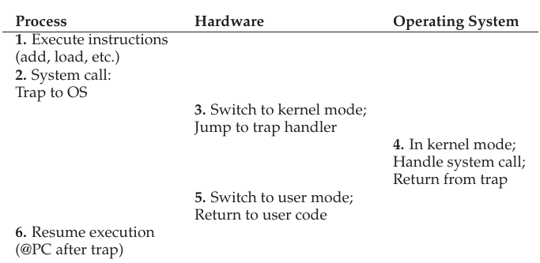
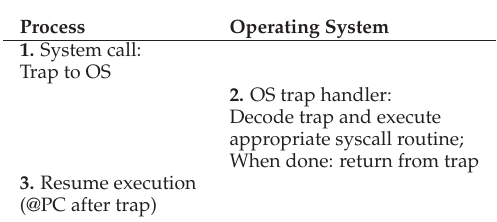
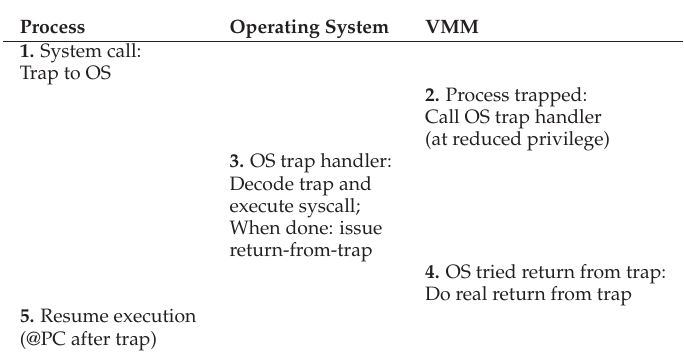
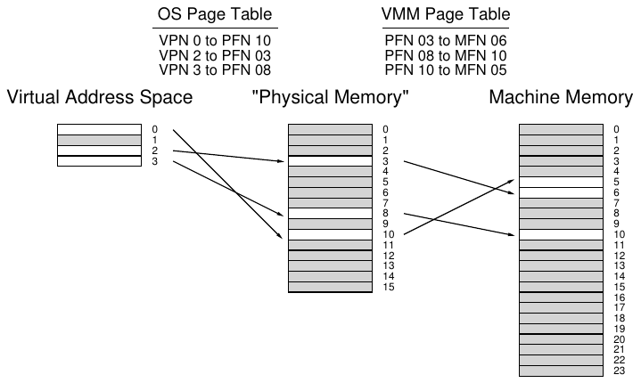
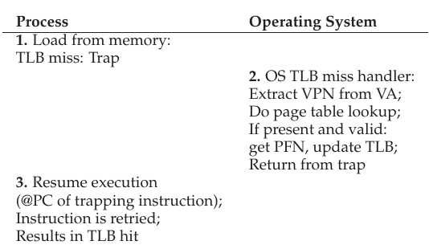
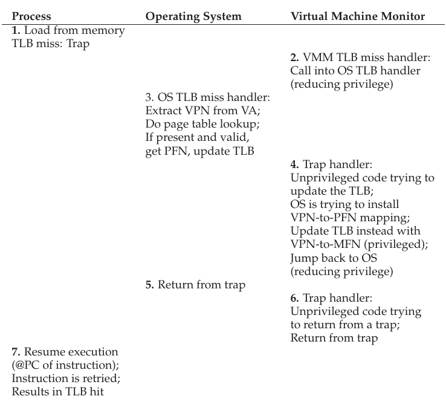

# B Virtual Machine Monitor

## B.1 Giới thiệu

Nhiều năm trước, IBM bán mainframe đắt tiền cho các tổ chức lớn và nảy sinh vấn đề: nếu tổ chức muốn chạy đồng thời những operating system khác nhau trên máy thì sao? Một số ứng dụng được phát triển trên OS này, những ứng dụng khác trên OS khác, nên vấn đề xuất hiện. Để giải quyết, IBM đưa thêm một lớp indirection dưới dạng virtual machine monitor (VMM), còn gọi là hypervisor [G74].

Cụ thể, monitor nằm giữa một hoặc nhiều operating system và hardware, khiến mỗi OS đang chạy có ảo giác rằng nó kiểm soát máy. Tuy nhiên, đằng sau, monitor mới thực sự kiểm soát hardware và phải multiplex các OS đang chạy trên tài nguyên vật lý của máy. Thực vậy, VMM đóng vai operating system cho các operating system, nhưng ở level thấp hơn nhiều; OS vẫn phải nghĩ mình đang tương tác với physical hardware. Vì vậy, transparency là mục tiêu chính của VMM.

Vì thế, ta ở tình thế thú vị: đến đây OS đóng vai nhà ảo thuật bậc thầy, khiến những ứng dụng không hay biết tin rằng chúng có CPU riêng và virtual memory lớn, trong khi bí mật chuyển đổi giữa các ứng dụng và chia sẻ memory. Giờ ta phải làm lại, nhưng lần này bên dưới OS vốn quen nắm quyền. Làm thế nào VMM tạo ảo giác này cho từng OS chạy phía trên?

> VẤN ĐỀ CỐT LÕI:
>
> CÁCH VIRTUALIZE MÁY BÊN DƯỚI OS
>
> Virtual machine monitor phải virtualize máy bên dưới OS một cách transparent; cần những kỹ thuật gì để làm điều đó?

## B.2 Động lực: Vì sao dùng VMM?

Ngày nay, VMM lại phổ biến vì nhiều lý do. Server consolidation là một lý do. Trong nhiều hoàn cảnh, người ta chạy dịch vụ trên những máy khác nhau với operating system khác nhau (hoặc thậm chí phiên bản OS khác nhau), nhưng mỗi máy chỉ được sử dụng ở mức thấp. Trong trường hợp đó, virtualization cho phép administrator hợp nhất nhiều OS trên ít nền tảng hardware hơn, giảm chi phí và giúp quản trị dễ hơn.

Virtualization cũng phổ biến trên desktop vì nhiều user muốn chạy một operating system (chẳng hạn Linux hoặc Mac OS X) nhưng vẫn truy cập được native application trên nền tảng khác (chẳng hạn Windows). Cải thiện functionality như vậy cũng là lý do chính đáng.

Một lý do khác là testing và debugging. Dù developer viết code trên một nền tảng chính, họ thường muốn debug và test trên nhiều nền tảng mà software được triển khai thực tế. Virtualization giúp việc đó dễ dàng bằng cách cho phép developer chạy nhiều loại và phiên bản operating system trên một máy.

Sự hồi sinh của virtualization thực sự bắt đầu vào giai đoạn mid-to-late những năm 1990, do nhóm nghiên cứu tại Stanford dưới sự dẫn dắt của Giáo sư Mendel Rosenblum tiên phong. Công trình Disco [B+97], virtual machine monitor cho MIPS processor, là nỗ lực sớm hồi sinh VMM, cuối cùng dẫn nhóm đến việc thành lập VMware [V98], hiện là công ty dẫn đầu thị trường công nghệ virtualization. Trong chương này, ta thảo luận công nghệ chủ yếu bên dưới Disco và qua đó tìm hiểu cách virtualization hoạt động.

## B.3 Virtualize CPU

Để chạy virtual machine (chẳng hạn OS và các ứng dụng của nó) trên virtual machine monitor, kỹ thuật cơ bản được dùng là limited direct execution, đã gặp khi thảo luận cách OS virtualize CPU. Vì vậy, khi muốn “boot” OS mới trên VMM, ta chỉ jump tới address của instruction đầu tiên rồi để OS bắt đầu chạy. Đơn giản như vậy (gần như thế).

Giả sử chạy trên một processor và muốn multiplex giữa hai virtual machine, tức hai OS và các ứng dụng tương ứng. Tương tự operating system chuyển đổi giữa những process đang chạy (context switch), virtual machine monitor phải thực hiện machine switch giữa các virtual machine đang chạy. Khi chuyển đổi, VMM phải lưu toàn bộ machine state của OS này (gồm register, PC và, khác context switch, mọi privileged hardware state), khôi phục machine state của VM to-be-run, rồi jump tới PC của VM to-be-run để hoàn tất. Lưu ý PC của VM to-be-run có thể nằm trong chính OS (tức hệ thống đang thực thi system call) hoặc trong process chạy trên OS đó (tức ứng dụng user-mode).

Một số vấn đề phức tạp hơn xuất hiện khi ứng dụng hoặc OS đang chạy cố thực hiện privileged operation nào đó. Chẳng hạn, trên hệ thống có TLB software-managed, OS dùng privileged instruction đặc biệt để cập nhật TLB với một translation trước khi khởi động lại instruction gặp TLB miss. Trong môi trường virtualized, không thể cho OS thực hiện privileged instruction, vì khi đó nó kiểm soát máy thay vì VMM bên dưới. Vì vậy, VMM phải chặn những nỗ lực thực hiện privileged operation bằng cách nào đó để giữ quyền kiểm soát máy.

Ví dụ đơn giản về việc VMM phải can thiệp vào một số operation xuất hiện khi process chạy trên một OS cố thực hiện system call. Chẳng hạn, process có thể gọi open() trên file, gọi read() để lấy data hoặc gọi fork() để tạo process mới. Trong hệ thống không virtualization, system call được thực hiện bằng instruction đặc biệt; trên MIPS là trap instruction, còn trên x86 là int (interrupt) instruction với argument 0x80. Sau đây là open library call trên FreeBSD [B00] (nhớ rằng code C trước tiên gọi thư viện C, sau đó thư viện thực hiện chuỗi assembly thích hợp để thực sự phát trap instruction và thực hiện system call):

```
open:
    push    dword mode
    push    dword flags
    push    dword path
    mov     eax, 5
    push    eax
    int     80h
```

Trên hệ thống UNIX-based, open() chỉ nhận ba argument: int open(char *path, int flags, mode_t mode). Trong code trên, bạn thấy cách triển khai open() library call: trước tiên đẩy argument lên stack (mode, flags, path), rồi đẩy 5 lên stack, sau đó gọi int 80h để chuyển quyền điều khiển cho kernel. Nếu bạn thắc mắc, 5 là quy ước pre-agreed giữa ứng dụng user-mode và kernel cho open() system call trong FreeBSD; các system call khác đặt những số khác nhau lên stack (ở cùng vị trí) trước khi gọi trap instruction int để thực hiện system call[^1].

Như đã thảo luận, khi trap instruction được thực thi, nó thường làm một số việc thú vị. Quan trọng nhất trong ví dụ là trước tiên chuyển quyền điều khiển (tức thay đổi PC) tới trap handler well-defined trong operating system. Khi mới khởi động, OS thiết lập address của routine này với hardware (cũng là privileged operation), nên ở các trap tiếp theo, hardware biết bắt đầu chạy code xử lý trap ở đâu. Đồng thời, hardware còn làm việc thiết yếu khác: chuyển processor từ user mode sang kernel mode. Trong user mode, operation bị hạn chế, và nỗ lực thực hiện privileged operation dẫn đến trap, có lẽ kết thúc process vi phạm; ngược lại, trong kernel mode có toàn bộ sức mạnh của máy nên thực hiện được mọi privileged operation. Vì vậy, trong môi trường truyền thống không virtualization, luồng điều khiển như trong Bảng B.1.



Bảng B.1: Thực thi system call

Trên nền tảng virtualized, mọi thứ thú vị hơn một chút. Khi ứng dụng chạy trên OS muốn thực hiện system call, nó làm đúng như vậy: thực thi trap instruction với argument được đặt cẩn thận lên stack (hoặc trong register). Tuy nhiên, VMM kiểm soát máy, nên chính VMM cài trap handler sẽ chạy đầu tiên trong kernel mode.

Vậy VMM nên làm gì để xử lý system call này? VMM không thực sự biết cách xử lý call; suy cho cùng, nó không biết chi tiết từng OS đang chạy, nên không biết mỗi call cần làm gì. Nhưng VMM biết trap handler của OS ở đâu. Nó biết vì lúc boot, OS cố cài trap handler riêng; khi đó OS cố làm điều có đặc quyền, nên trap vào VMM; tại thời điểm ấy VMM ghi lại thông tin cần thiết (tức vị trí trap handler của OS trong memory). Giờ khi VMM nhận trap từ user process chạy trên OS đó, nó biết chính xác cần làm gì: jump tới trap handler của OS để OS xử lý system call như bình thường. Khi xong, OS thực thi một privileged instruction để trở về từ trap (rett trên MIPS, iret trên x86), lại chuyển vào VMM; VMM nhận ra OS đang muốn trở về từ trap, thực hiện return-from-trap thật, trả quyền điều khiển cho user và đưa máy về user mode. Toàn bộ quá trình được mô tả ở Bảng B.2 và B.3, cho cả trường hợp bình thường không virtualization và trường hợp có virtualization (ta bỏ chi tiết hardware operation phía trên để tiết kiệm chỗ).



Bảng B.2: Luồng system call không virtualization



Bảng B.3: Luồng system call có virtualization

Như thấy trong hình, có nhiều việc hơn phải diễn ra khi có virtualization. Chắc chắn các bước chuyển điều khiển bổ sung có thể khiến system call chậm hơn, do đó làm giảm performance.

Có thể bạn còn nhận thấy câu hỏi chưa trả lời: OS nên chạy ở mode nào? Nó không thể chạy kernel mode, vì khi đó sẽ được truy cập hardware không hạn chế. Vì vậy, nó phải chạy ở mode ít đặc quyền hơn trước, vẫn truy cập được data structure của chính nó và đồng thời ngăn user process truy cập chúng.

Trong công trình Disco, Rosenblum và đồng nghiệp giải quyết khá gọn bằng mode đặc biệt mà MIPS hardware cung cấp, gọi là supervisor mode. Chạy trong mode này vẫn không được dùng privileged instruction nhưng truy cập được nhiều memory hơn một chút so với user mode; OS dùng memory bổ sung đó cho data structure và mọi thứ ổn. Trên hardware không có mode như vậy, phải chạy OS trong user mode và dùng memory protection (page table và TLB) để bảo vệ data structure của OS thích hợp. Nói cách khác, khi chuyển vào OS, monitor phải cho OS truy cập memory chứa data structure thông qua page-table protection; khi chuyển về ứng dụng đang chạy, phải thu hồi khả năng đọc và ghi kernel.



Hình B.1: Memory virtualization của VMM

## B.4 Virtualize memory

Giờ bạn đã có ý niệm cơ bản về cách virtualize processor: VMM đóng vai OS, schedule những virtual machine khác nhau để chạy, và có một số tương tác thú vị khi privilege level thay đổi. Nhưng ta còn thiếu phần lớn của vấn đề: VMM virtualize memory như thế nào?

Mỗi OS thường xem physical memory là array page tuyến tính, gán từng page cho chính nó hoặc user process. Dĩ nhiên, OS đã virtualize memory cho các process đang chạy để mỗi process có ảo giác về address space riêng. Giờ phải thêm một lớp virtualization để nhiều OS cùng chia sẻ physical memory thực của máy, và phải làm điều đó transparent.

Lớp virtualization bổ sung khiến memory “physical” thành một lớp virtualization trên thứ VMM gọi là machine memory, tức physical memory thực của hệ thống. Vì vậy, giờ có thêm một lớp indirection: mỗi OS ánh xạ address virtual-to-physical qua page table per-process; VMM ánh xạ các physical mapping thu được tới machine address bên dưới qua page table per-OS. Hình B.1 mô tả lớp indirection bổ sung này.

Trong hình, chỉ có một virtual address space với bốn page, ba page hợp lệ (0, 2 và 3). OS dùng page table ánh xạ chúng tới ba physical frame bên dưới (lần lượt 10, 3 và 8). Bên dưới OS, VMM thực hiện thêm một lớp indirection, ánh xạ PFN 3, 8 và 10 tới machine frame tương ứng 6, 10 và 5. Dĩ nhiên, hình này đơn giản hóa khá nhiều; hệ thống thực có V operating system đang chạy (V có lẽ lớn hơn một), nên có V page table của VMM; hơn nữa, trên mỗi operating system OS<sub>i</sub> có một số process P<sub>i</sub> đang chạy (P<sub>i</sub> có lẽ hàng chục hoặc hàng trăm), nên có P<sub>i</sub> page table per-process trong OS<sub>i</sub>.



Bảng B.4: Luồng TLB miss không virtualization

Để hiểu rõ hơn, nhớ lại address translation trong hệ thống phân trang hiện đại. Cụ thể, hãy xét điều xảy ra trên hệ thống có TLB software-managed khi dịch address. Giả sử user process tạo address (để instruction fetch hoặc load hay store tường minh); theo định nghĩa, process tạo virtual address vì address space đã được OS virtualize. Như đã biết, nhiệm vụ của OS với hỗ trợ hardware là chuyển nó thành physical address để lấy nội dung mong muốn từ physical memory.

Giả sử có virtual address space 32-bit và page size 4-KB. Address 32-bit được chia hai phần: virtual page number (VPN) 20-bit và offset 12-bit. Vai trò của OS, với hardware TLB hỗ trợ, là dịch VPN thành physical page frame number (PFN) hợp lệ, tạo physical address fully-formed có thể gửi tới physical memory để lấy data đúng. Trong trường hợp phổ biến, ta kỳ vọng TLB xử lý translation bằng hardware để nhanh. Khi TLB miss xảy ra (ít nhất trên hệ thống TLB software-managed), OS phải tham gia xử lý, như Bảng B.4.

Như bạn thấy, TLB miss gây trap vào OS; OS xử lý fault bằng cách tra VPN trong page table rồi cài translation vào TLB.

Tuy nhiên, có virtual machine monitor bên dưới OS lại khiến mọi thứ thú vị hơn. Xét lại luồng TLB miss (tóm tắt ở Bảng B.5). Khi process tạo virtual memory reference và miss trong TLB, không phải OS TLB miss handler chạy mà là VMM TLB miss handler, vì VMM mới thực sự nắm đặc quyền của máy. Tuy nhiên, thường VMM TLB handler không biết xử lý miss, nên lập tức jump vào OS TLB miss handler; VMM biết vị trí handler này vì lúc “boot”, OS cố cài trap handler riêng. Sau đó OS TLB miss handler chạy, tra page table cho VPN đang xét rồi cố cài mapping VPN-to-PFN vào TLB. Nhưng đây là privileged operation nên gây trap khác vào VMM (dĩ nhiên, VMM được báo khi code non-privileged cố làm điều có đặc quyền). Lúc này VMM thực hiện thủ thuật: thay vì cài mapping VPN-to-PFN của OS, nó cài mapping VPN-to-MFN mong muốn. Sau đó hệ thống cuối cùng trở lại code user-level, retry instruction, dẫn tới TLB hit và lấy data từ machine frame nơi data nằm.



Bảng B.5: Luồng TLB miss có virtualization

Chuỗi hành động này còn gợi ý cách VMM quản lý virtualization physical memory cho mỗi OS đang chạy; giống OS có page table cho mỗi process, VMM phải theo dõi mapping physical-to-machine cho từng virtual machine. Các page table per-machine này phải được tra trong VMM TLB miss handler để xác định một page “physical” cụ thể ánh xạ tới machine page nào, và chẳng hạn liệu hiện có trong machine memory không (tức VMM có thể đã swap nó xuống disk).

> BÊN LỀ: HYPERVISOR VÀ TLB HARDWARE-MANAGED
>
> Thảo luận tập trung vào TLB software-managed và công việc cần làm khi miss. Nhưng có thể bạn tự hỏi virtual machine monitor tham gia thế nào với TLB hardware-managed? Trong những hệ thống đó, hardware duyệt page table mỗi TLB miss rồi cập nhật TLB khi cần, nên VMM không có cơ hội chạy mỗi TLB miss để lồng translation vào hệ thống. Thay vào đó, VMM phải theo dõi sát các thay đổi OS thực hiện với từng page table (trong hệ thống hardware-managed, một loại page-table base register trỏ tới nó), và giữ shadow page table ánh xạ virtual address của mỗi process tới machine page mà VMM muốn [AA06]. VMM cài shadow page table của process mỗi khi OS cố cài page table OS-level của process; nhờ đó hardware tiếp tục dịch virtual address sang machine address bằng shadow table mà OS không hay biết.

Cuối cùng, như có thể thấy từ chuỗi operation, TLB miss trên hệ thống virtualized đắt hơn khá nhiều so với hệ thống non-virtualized. Để giảm chi phí, các nhà thiết kế Disco thêm “software TLB” VMM-level. Ý tưởng của data structure này đơn giản: VMM ghi lại mọi mapping virtual-to-physical mà nó thấy OS cố cài; sau đó, khi TLB miss, VMM tra software TLB trước để xem từng thấy mapping virtual-to-physical này chưa và mapping virtual-to-machine mong muốn của VMM là gì. Nếu tìm thấy translation trong software TLB, VMM chỉ cài mapping virtual-to-machine trực tiếp vào hardware TLB, bỏ qua mọi bước chuyển điều khiển qua lại ở trên [B+97].

## B.5 Information gap

Giống OS không biết nhiều về điều application program thực sự muốn nên thường phải đưa ra policy tổng quát với hy vọng phù hợp mọi chương trình, VMM thường không biết nhiều về điều OS đang làm hoặc muốn làm; sự thiếu hiểu biết này, đôi khi gọi là information gap giữa VMM và OS, có thể gây nhiều điểm kém hiệu quả [B+97]. Chẳng hạn, khi không có gì khác để chạy, OS đôi lúc vào idle loop, chỉ spin và chờ interrupt tiếp theo:

```
while (1)
  ; // the idle loop
```

Spin như vậy hợp lý nếu OS phụ trách toàn bộ máy và biết không có gì khác cần chạy. Tuy nhiên, khi VMM chạy bên dưới hai OS khác nhau, một OS trong idle loop còn OS kia hữu ích chạy user process, sẽ có lợi nếu VMM biết OS nào idle để cấp thêm CPU time cho OS đang làm việc hữu ích.

> BÊN LỀ: PARA-VIRTUALIZATION
>
> Trong nhiều tình huống, nên giả định không thể sửa OS để hoạt động tốt hơn với virtual machine monitor (chẳng hạn vì đang chạy VMM bên dưới operating system của đối thủ không thân thiện). Tuy nhiên, không phải lúc nào cũng vậy; khi có thể sửa OS (như ví dụ demand-zeroing page), nó có thể chạy hiệu quả hơn trên VMM. Chạy OS đã sửa để hoạt động trên VMM thường gọi là para-virtualization [WSG02], vì virtualization do VMM cung cấp không hoàn chỉnh mà chỉ một phần, đòi hỏi OS thay đổi để hoạt động hiệu quả. Nghiên cứu cho thấy hệ thống para-virtualized properly-designed với đúng những thay đổi OS cần thiết có thể hiệu quả gần bằng hệ thống không VMM [BD+03].

Ví dụ khác là demand zeroing page. Phần lớn operating system điền số không vào physical frame trước khi ánh xạ vào address space của process. Lý do đơn giản là security. Nếu OS cấp cho process page mà process khác đã dùng mà không điền số không, có thể xảy ra rò rỉ thông tin giữa các process, làm lộ thông tin nhạy cảm. Đáng tiếc là VMM cũng phải điền số không vào page cấp cho mỗi OS vì cùng lý do, nên nhiều khi page bị điền số không hai lần: một lần bởi VMM khi gán cho OS, một lần bởi OS khi gán cho process. Các tác giả Disco không có giải pháp đặc sắc: họ chỉ sửa OS (IRIX) để không điền số không vào page mà nó biết VMM bên dưới đã làm [B+97].

Có nhiều vấn đề tương tự khác. Một giải pháp là VMM dùng inference (một dạng thông tin ngầm định) để khắc phục. Chẳng hạn, VMM phát hiện idle loop nhờ nhận thấy OS chuyển sang mode low-power. Cách khác trong hệ thống para-virtualized đòi hỏi sửa OS. Cách tường minh hơn này khó triển khai nhưng có thể khá hiệu quả.

## B.6 Tổng kết

Virtualization đang hồi sinh. Vì nhiều lý do, user và administrator muốn chạy đồng thời nhiều OS trên cùng máy. Điểm then chốt là VMM thường cung cấp dịch vụ này transparent; OS phía trên hầu như không biết mình không thực sự kiểm soát hardware của máy. Phương pháp chính VMM dùng là mở rộng limited direct execution; bằng cách thiết lập hardware cho phép VMM can thiệp vào sự kiện then chốt (như trap), VMM có thể hoàn toàn kiểm soát phân bổ machine resource trong khi vẫn duy trì ảo giác OS cần.

> MẸO: SỬ DỤNG THÔNG TIN NGẦM ĐỊNH
>
> Thông tin ngầm định có thể là công cụ mạnh trong layered system khi khó đổi interface giữa các hệ thống nhưng lại cần thêm thông tin về layer khác. Chẳng hạn, thiết bị disk block-based muốn biết file system phía trên sử dụng nó thế nào; tương tự, ứng dụng muốn biết page nào đang trong file-system page cache, nhưng OS không cung cấp API để truy cập thông tin. Trong cả hai trường hợp, các nhà nghiên cứu phát triển kỹ thuật suy luận mạnh để thu thập thông tin cần thiết một cách ngầm định, không đòi hỏi interface tường minh giữa các layer [AD+01,S+03]. Những kỹ thuật này rất hữu ích trong virtual machine monitor muốn biết thêm về OS chạy phía trên mà không cần API tường minh giữa hai layer.

Có lẽ bạn nhận thấy điểm giống nhau giữa điều OS làm cho process và VMM làm cho OS. Suy cho cùng, cả hai đều virtualize hardware nên làm một số việc giống nhau. Tuy nhiên, có khác biệt then chốt: OS virtualization cung cấp nhiều abstraction mới và interface thuận tiện; virtualization VMM-level có abstraction giống hệt hardware (nên không thuận tiện lắm). Dù cả OS và VMM virtualize hardware, chúng cung cấp interface hoàn toàn khác; khác OS, VMM không đặc biệt nhằm làm hardware dễ sử dụng hơn.

Còn nhiều chủ đề để nghiên cứu nếu muốn biết thêm về virtualization. Chẳng hạn, ta chưa hề nói điều xảy ra với I/O, chủ đề có những vấn đề mới thú vị riêng trên nền tảng virtualized. Cũng chưa bàn virtualization hoạt động thế nào khi chạy “bên cạnh” OS trong cấu hình đôi khi gọi là “hosted”. Hãy đọc thêm cả hai nếu quan tâm [SVL01]. Ta cũng chưa nói điều xảy ra khi tập operating system chạy trên VMM sử dụng quá nhiều memory.

Cuối cùng, hardware support đã thay đổi cách nền tảng hỗ trợ virtualization. Các công ty như Intel và AMD giờ hỗ trợ trực tiếp một lớp virtualization bổ sung, loại bỏ nhu cầu dùng nhiều kỹ thuật software trong chương. Có lẽ trong một chương yet-to-be-written, ta sẽ thảo luận chi tiết hơn những cơ chế này.

## Tài liệu tham khảo

[AA06] “A Comparison of Software and Hardware Techniques for x86 Virtualization”

Keith Adams and Ole Agesen

ASPLOS ’06, San Jose, California

Một bài báo xuất sắc của hai kỹ sư VMware về lợi ích nhỏ đến bất ngờ của hardware support cho virtualization. Cũng là thảo luận tổng quát xuất sắc về virtualization trong VMware, gồm những thủ thuật binary-translation kỳ lạ cần dùng để virtualize nền tảng x86 difficult-to-virtualize.

[AD+01] “Information and Control in Gray-box Systems”

Andrea C. Arpaci-Dusseau and Remzi H. Arpaci-Dusseau

SOSP ’01, Banff, Canada

Công trình của chúng tôi về cách suy ra thông tin và thậm chí tác động kiểm soát OS từ application level mà không đổi OS. Ví dụ hay nhất: xác định file block nào được cache trong OS bằng kỹ thuật xác suất probe-based; điều đó giúp ứng dụng tận dụng cache tốt hơn bằng cách schedule công việc có thể hit trước.

[B00] “FreeBSD Developers’ Handbook: Chapter 11 x86 Assembly Language Programming”

http://www.freebsd.org/doc/en/books/developers-handbook/

Một hướng dẫn hay về system call và những vấn đề tương tự trong BSD developers handbook.

[BD+03] “Xen and the Art of Virtualization”

Paul Barham, Boris Dragovic, Keir Fraser, Steven Hand, Tim Harris, Alex Ho, Rolf Neugebauer, Ian Pratt, Andrew Warfield

SOSP ’03, Bolton Landing, New York

Bài báo cho thấy với hệ thống para-virtualized, overhead của hệ thống virtualized có thể thấp đến kinh ngạc. Bài báo về Xen virtual machine monitor thành công đến mức dẫn tới việc thành lập một công ty.

[B+97] “Disco: Running Commodity Operating Systems on Scalable Multiprocessors”

Edouard Bugnion, Scott Devine, Kinshuk Govil, Mendel Rosenblum

SOSP ’97

Bài báo giới thiệu lại nghiên cứu virtual machine với cộng đồng hệ thống; có lẽ nói vậy không công bằng vì Bressoud và Schneider [BS95] cũng làm thế, nhưng ở đây ta bắt đầu hiểu vì sao virtualization sẽ trở lại. Điều khiến nó rõ hơn là nhóm nhà nghiên cứu xuất sắc này thành lập VMware và kiếm được vài tỷ đô la.

[BS95] “Hypervisor-based Fault-tolerance”

Thomas C. Bressoud, Fred B. Schneider

SOSP ’95

Một trong những bài báo sớm nhất đưa hypervisor trở lại, chỉ là tên khác của virtual machine monitor. Tuy nhiên, ở đây hypervisor được dùng để cải thiện khả năng chịu lỗi hardware của hệ thống, có lẽ kém hữu ích hơn một số kịch bản thực tế trong chương; dù vậy, bản thân bài báo vẫn khá thú vị.

[G74] “Survey of Virtual Machine Research”

R.P. Goldberg

IEEE Computer, Tập 7, Số 6

Một khảo sát xuất sắc về nhiều nghiên cứu virtual machine đời đầu.

[SVL01] “Virtualizing I/O Devices on VMware Workstation’s Hosted Virtual Machine Monitor”

Jeremy Sugerman, Ganesh Venkitachalam and Beng-Hong Lim

USENIX ’01, Boston, Massachusetts

Cung cấp tổng quan tốt về I/O trong VMware sử dụng hosted architecture, tận dụng nhiều native OS feature để không phải triển khai lại bên trong VMM.

[V98] VMware corporation.

Có tại: http://www.vmware.com/

Có lẽ đây là tài liệu tham khảo vô dụng nhất cuốn sách, vì rõ ràng bạn tự tra được. Dù sao, công ty được thành lập năm 1998 và dẫn đầu lĩnh vực virtualization.

[S+03] “Semantically-Smart Disk Systems”

Muthian Sivathanu, Vijayan Prabhakaran, Florentina I. Popovici, Timothy E. Denehy, Andrea C. Arpaci-Dusseau, Remzi H. Arpaci-Dusseau

FAST ’03, San Francisco, California, tháng Ba 2003

Lại là công trình của chúng tôi, lần này cho thấy thiết bị block-based đơn giản có thể suy ra nhiều điều file system phía trên đang làm, như xóa file. Công nghệ này cho phép chức năng mới thú vị trong block device, như secure delete hoặc storage đáng tin cậy hơn.

[WSG02] “Scale and Performance in the Denali Isolation Kernel”

Andrew Whitaker, Marianne Shaw, and Steven D. Gribble

OSDI ’02, Boston, Massachusetts

Bài báo đưa ra thuật ngữ para-virtualization. Dù có thể lập luận rằng Bugnion và cộng sự

[B+97] đã đưa ý tưởng para-virtualization vào bài Disco, Whitaker và cộng sự đi xa hơn, cho thấy ý tưởng tổng quát hơn suy nghĩ trước đó.

---

[^1]: Để mọi thứ rối hơn, người Intel dùng “interrupt” cho thứ mà hầu như bất cứ người tỉnh táo nào cũng gọi là trap instruction. Như Patterson nói về Intel instruction set: “Đó là ISA chỉ người mẹ mới có thể yêu.” Nhưng thực ra chúng tôi khá thích nó, dù không phải mẹ nó.
