# I SSD Flash-based

Sau nhiều thập kỷ hard-disk drive thống trị, một dạng thiết bị persistent storage mới gần đây trở nên quan trọng. Gọi chung là solid-state storage, những thiết bị này không có bộ phận cơ học hay chuyển động như hard drive; chúng được xây từ transistor, giống memory và processor. Tuy nhiên, khác random-access memory thông thường (như DRAM), thiết bị solid-state storage (còn gọi SSD) giữ thông tin khi mất điện, nên là ứng viên lý tưởng để lưu data bền vững.

Công nghệ ta tập trung gọi là flash (cụ thể hơn NAND-based flash), do Fujio Masuoka tạo trong những năm 1980 [M+14]. Như sẽ thấy, flash có thuộc tính riêng. Chẳng hạn, để ghi một phần (flash page), trước tiên phải erase phần lớn hơn (flash block), có thể khá đắt. Ngoài ra, ghi quá thường xuyên vào page gây wear out. Hai thuộc tính khiến xây dựng SSD flash-based là thách thức thú vị:

> VẤN ĐỀ CỐT LÕI: CÁCH XÂY DỰNG SSD FLASH-BASED
>
> Làm thế nào xây SSD flash-based? Xử lý erase tốn kém ra sao? Làm thiết bị bền lâu thế nào khi ghi đè lặp lại gây mòn? Tiến bộ công nghệ có bao giờ dừng? Hay ngừng làm ta kinh ngạc?

## I.1 Lưu một bit

Flash chip được thiết kế lưu một hoặc nhiều bit trong một transistor; mức điện tích bị giữ trong transistor ánh xạ thành giá trị binary. Trong flash single-level cell (SLC), chỉ một bit được lưu mỗi transistor (1 hoặc 0); với flash multi-level cell (MLC), hai bit được mã hóa vào những mức điện tích khác nhau, như 00, 01, 10, 11 tương ứng thấp, hơi thấp, hơi cao, cao. Còn có flash triple-level cell (TLC), mã hóa 3 bit mỗi cell. Nhìn chung chip SLC có performance cao hơn và đắt hơn.

> MẸO: CẨN THẬN VỚI THUẬT NGỮ
>
> Có lẽ bạn thấy một số thuật ngữ đã dùng nhiều lần (block, page) nay dùng trong flash nhưng hơi khác trước. Không ai tạo thuật ngữ mới để làm khó bạn (dù có thể đang làm vậy); chúng xuất hiện vì không có cơ quan trung tâm quyết định thuật ngữ. Thứ bạn gọi block có thể là page với người khác và ngược lại, tùy ngữ cảnh. Nhiệm vụ đơn giản: biết đúng thuật ngữ từng lĩnh vực và dùng để người well-versed trong chuyên ngành hiểu bạn nói gì. Đây là lúc giải pháp duy nhất đơn giản nhưng đôi khi đau đớn: dùng trí nhớ.

Dĩ nhiên, có nhiều chi tiết về cách storage bit-level hoạt động chính xác ở level vật lý thiết bị. Tuy vượt phạm vi sách, bạn có thể tự đọc thêm [J10].

## I.2 Từ bit tới bank/plane

Như người Hy Lạp cổ nói, lưu một bit (hay vài bit) chưa tạo thành storage system. Vì thế, flash chip tổ chức thành bank hoặc plane gồm rất nhiều cell.

Bank được truy cập theo hai đơn vị kích thước: block (đôi khi gọi erase block), thường 128 KB hoặc 256 KB, và page cỡ vài KB (như 4KB). Mỗi bank có nhiều block; mỗi block có nhiều page. Khi nghĩ về flash, phải nhớ thuật ngữ mới này khác block trong disk, RAID và page trong virtual memory.

Hình I.1 minh họa flash plane với block và page; ví dụ đơn giản có ba block, mỗi block bốn page. Bên dưới sẽ thấy vì sao phân biệt block và page; khác biệt này thiết yếu cho operation flash như đọc, ghi, và còn quan trọng hơn với performance toàn thiết bị. Điều quan trọng nhất (và lạ) là để ghi page trong block, trước tiên phải erase toàn block; chi tiết khó này khiến xây SSD flash-based thành thách thức thú vị, đáng làm, là chủ đề second-half của chương.

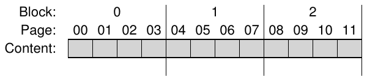

Hình I.1: Flash chip đơn giản: Page trong block

## I.3 Flash operation cơ bản

Với tổ chức flash này, flash chip hỗ trợ ba operation low-level. Command read dùng đọc page; erase và program phối hợp để ghi. Chi tiết:

• Read (một page): client của flash chip đọc bất kỳ page (như 2KB hoặc 4KB) chỉ bằng cách gửi command read và page number thích hợp. Operation thường khá nhanh, khoảng hàng chục microsecond (10s), bất kể vị trí trên thiết bị và gần như bất kể vị trí request trước (rất khác disk). Truy cập mọi vị trí nhanh đồng đều nghĩa là thiết bị random access.

• Erase (một block): trước khi ghi page, bản chất flash đòi hỏi erase toàn block chứa page. Quan trọng là erase phá hủy nội dung block (đặt mọi bit bằng 1); vì thế, phải chắc data cần giữ trong block đã được sao chép nơi khác (memory hoặc flash block khác) trước erase. Command erase khá đắt, mất vài millisecond. Khi xong, toàn block được reset và mỗi page sẵn sàng program.

• Program (một page): khi block đã erase, dùng command program đổi một số bit 1 trong page thành 0 để ghi nội dung mong muốn lên flash. Program page ít tốn kém hơn erase block nhưng đắt hơn đọc page, thường mất khoảng hàng trăm microsecond (100s) trên flash chip hiện đại.

Một cách hình dung flash chip là mỗi page có state. Page bắt đầu INVALID. Erase block chứa page đặt state của nó (và mọi page trong block) thành ERASED, reset nội dung từng page và quan trọng là cho phép program. Program page đổi state thành VALID, nghĩa là nội dung đã được thiết lập và đọc được. Read không ảnh hưởng state (dù chỉ nên đọc page đã program). Khi page đã program, cách duy nhất đổi nội dung là erase toàn block chứa nó. Đây là ví dụ chuyển state sau các operation erase, program trong block 4-page:

iiii Ban đầu: các page trong block invalid (i)

Erase() → EEEE Đặt state của page trong block thành erased (E) Program(0) → VEEE Program page 0; state thành valid (V) Program(0) → error Không thể re-program page sau khi program Program(1) → VVEE Program page 1 Erase() → EEEE Nội dung bị erase; mọi page có thể program

### Ví dụ chi tiết

Vì quá trình ghi (erase và program) khác thường, hãy đi qua ví dụ chi tiết để hiểu. Hình dung bốn page 8-bit sau trong block 4-page (cả hai kích thước đều nhỏ phi thực tế nhưng hữu ích cho ví dụ); mỗi page VALID vì đã program trước đó.

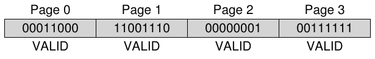

Giờ muốn ghi page 0 với nội dung mới. Muốn ghi page nào cũng phải erase toàn block trước. Giả sử làm vậy, block ở state sau:

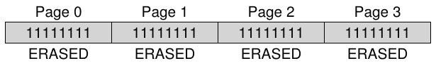

Tin tốt! Giờ có thể program page 0, chẳng hạn nội dung 00000011, ghi đè page 0 cũ (nội dung 00011000) như muốn. Sau đó block như sau:

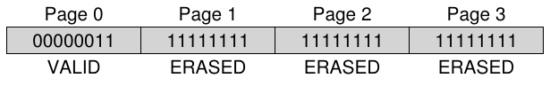

Còn tin xấu: nội dung cũ của page 1, 2, 3 mất hết! Vì thế, trước khi ghi đè page nào trong block, phải di chuyển data cần giữ tới nơi khác (như memory hoặc chỗ khác trên flash). Bản chất erase ảnh hưởng mạnh cách thiết kế SSD flash-based, như sắp học.

### Tổng kết

Tóm lại, đọc page dễ: chỉ đọc page. Flash chip làm tốt và nhanh; về performance, có tiềm năng vượt xa random read performance của disk drive hiện đại vốn chậm vì chi phí seek, rotation cơ học.

Ghi page khó hơn: phải erase toàn block trước (nhớ di chuyển data cần giữ sang nơi khác), rồi program page mong muốn. Không chỉ đắt, lặp thường xuyên chu kỳ program/erase còn dẫn tới vấn đề reliability lớn nhất của flash chip: wear out. Khi thiết kế storage system bằng flash, performance và reliability của ghi là trọng tâm. Ta sắp học cách SSD hiện đại giải quyết, mang lại performance và reliability xuất sắc dù có hạn chế.

|  | Read | Program | Erase |
|---|---|---|---|
| Thiết bị | (µs) | (µs) | (µs) |
| SLC | 25 | 200-300 | 1500-2000 |
| MLC | 50 | 600-900 | ˜3000 |
| TLC | ˜75 | ˜900-1350 | ˜4500 |

Hình I.2: Đặc điểm performance của flash thô

## I.4 Flash performance và reliability

Vì muốn xây storage device từ flash chip thô, nên hiểu đặc điểm performance cơ bản. Hình I.2 tóm tắt sơ bộ một số số liệu báo chí phổ thông [V12]. Tác giả trình bày latency cơ bản của read, program, erase trên SLC, MLC, TLC, lần lượt lưu 1, 2, 3 bit thông tin mỗi cell.

Như thấy trong bảng, read latency khá tốt, chỉ mất hàng chục microsecond (10s). Program latency cao và biến động hơn, thấp tới 200 microsecond với SLC nhưng tăng khi nhồi thêm bit vào cell; muốn write performance tốt phải dùng song song nhiều flash chip. Cuối cùng erase khá đắt, thường vài millisecond. Xử lý chi phí này là trọng tâm thiết kế flash storage hiện đại.

Giờ xét reliability flash chip. Khác disk cơ học hỏng vì đủ lý do (gồm head crash kinh khủng và thực sự vật lý, khi drive head chạm mặt ghi), flash chip thuần silicon nên ít vấn đề reliability hơn về mặt đó. Lo chính là wear out: khi flash block được erase, program, nó từ từ tích thêm điện tích dư. Theo thời gian, điện tích tích tụ làm ngày càng khó phân biệt 0 với 1. Khi không thể nữa, block không dùng được.

Tuổi thọ điển hình của block hiện chưa được biết rõ. Nhà sản xuất đánh giá block MLC-based có tuổi thọ 10,000 chu kỳ P/E (Program/Erase), tức erase và program được 10,000 lần trước khi hỏng. Chip SLC-based chỉ lưu một bit mỗi transistor nên được đánh giá bền hơn, thường 100,000 chu kỳ P/E. Tuy nhiên, nghiên cứu gần đây cho thấy tuổi thọ dài hơn kỳ vọng nhiều [BD10].

Một vấn đề reliability khác gọi là disturbance. Khi truy cập page cụ thể trong flash, một số bit ở page lân cận có thể bị lật; những lần lật này gọi read disturb hoặc program disturb, tùy page đang được đọc hay program.

> MẸO: TẦM QUAN TRỌNG CỦA BACKWARDS COMPATIBILITY
>
> Backwards compatibility luôn là mối quan tâm trong layered system. Định nghĩa interface ổn định giữa hai hệ thống cho phép đổi mới mỗi phía mà vẫn tương tác được. Cách này thành công ở nhiều lĩnh vực: operating system có API tương đối ổn định cho ứng dụng, disk cung cấp cùng interface block-based cho file system, mỗi layer IP networking stack cung cấp interface cố định cho layer trên. Không ngạc nhiên sự cứng nhắc có nhược điểm vì interface thế hệ này có thể không phù hợp thế hệ sau. Đôi khi nên nghĩ lại thiết kế toàn hệ thống. Ví dụ xuất sắc là Sun ZFS file system [B07]; xét lại tương tác file system với RAID, người tạo ZFS hình dung rồi hiện thực một tổng thể tích hợp hiệu quả hơn.

## I.5 Từ flash thô tới SSD Flash-Based

Với hiểu biết cơ bản về flash chip, nhiệm vụ tiếp theo là biến tập chip cơ bản thành thứ giống storage device điển hình. Interface storage tiêu chuẩn đơn giản là block-based, cho phép đọc/ghi block (sector) kích thước 512 byte hoặc lớn hơn khi biết block address. Nhiệm vụ của SSD flash-based là cung cấp block interface tiêu chuẩn trên flash chip thô bên trong.

Bên trong, SSD có một số flash chip để lưu bền vững. SSD còn có volatile memory (tức non-persistent) như SRAM; hữu ích để caching, buffering data và mapping table sắp học bên dưới. Cuối cùng có control logic điều phối operation. Xem Agrawal và cộng sự để biết chi tiết [A+08]; block diagram đơn giản ở Hình I.3 (trang 7).

Chức năng thiết yếu của control logic là đáp ứng client read, write bằng cách đổi thành internal flash operation khi cần. Flash translation layer (FTL) cung cấp đúng chức năng đó: nhận read/write request trên logical block (tạo thành device interface), đổi thành command read, erase, program low-level trên physical block, physical page bên dưới (tạo thành flash device thực). FTL nên làm với mục tiêu performance xuất sắc và reliability cao.

Như sẽ thấy, kết hợp nhiều kỹ thuật đạt performance xuất sắc. Then chốt là dùng nhiều flash chip song song; dù không bàn kỹ thêm, đủ biết mọi SSD hiện đại dùng nhiều chip bên trong để tăng performance. Mục tiêu khác là giảm write amplification, định nghĩa bằng tổng write traffic (byte) do FTL gửi tới chip chia tổng write traffic (byte) client gửi tới SSD. Cách xây FTL ngây thơ dẫn tới write amplification cao và performance thấp, như sẽ thấy.

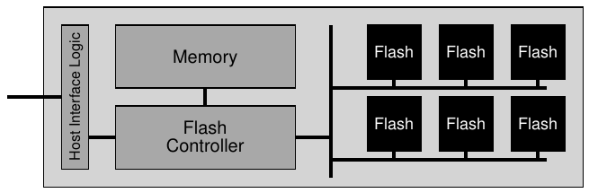

Hình I.3: SSD Flash-based: Sơ đồ logic

Reliability cao đạt được nhờ kết hợp vài cách. Mối lo chính như trên là wear out. Nếu một block bị erase, program quá thường xuyên, nó không dùng được; vì vậy FTL nên phân bố các lần ghi trên block flash đều nhất có thể để mọi block mòn gần cùng thời điểm; đó gọi wear leveling, phần thiết yếu của mọi FTL hiện đại.

Mối lo reliability khác là program disturbance. Để giảm, FTL thường program page trong block đã erase theo thứ tự từ page thấp tới cao. Cách sequential-programming giảm disturbance và được dùng rộng rãi.

## I.6 Tổ chức FTL: Cách tiếp cận tệ

Tổ chức FTL đơn giản nhất gọi direct mapped. Read logical page N ánh xạ thẳng tới read physical page N. Write logical page N phức tạp hơn: FTL phải đọc toàn block chứa page N trước, erase block, rồi program các page cũ cùng page mới.

Như có lẽ đoán được, FTL direct-mapped có nhiều vấn đề performance và reliability. Mỗi lần ghi đều phải đọc toàn block (đắt), erase (khá đắt), rồi program (đắt). Kết quả là write amplification nghiêm trọng (tỷ lệ số page trong block), khiến write performance tệ, còn chậm hơn hard drive điển hình với seek cơ học, rotational delay.

Reliability còn tệ hơn. Nếu file system metadata hoặc user file data bị ghi đè liên tục, cùng block bị erase và program lặp đi lặp lại, nhanh chóng mòn và có thể mất data. Direct mapped cho client workload quá nhiều quyền quyết định wear out; nếu workload không phân bổ write load đều trên logical block, physical block chứa data phổ biến nhanh chóng mòn. Vì cả reliability lẫn performance, FTL direct-mapped là ý tưởng tệ.

## I.7 FTL Log-Structured

Vì vậy phần lớn FTL ngày nay log structured, ý tưởng hữu ích ở cả storage device (như sẽ thấy) và file system phía trên (trong chương file system log-structured). Khi ghi logical block N, thiết bị append lần ghi vào vị trí trống kế tiếp của block currently-being-written-to; gọi kiểu ghi này là logging. Để đọc block N sau đó, thiết bị giữ mapping table (trong memory và được lưu bền vững dưới một dạng nào đó trên thiết bị); bảng chứa physical address của mỗi logical block trong hệ thống.

Hãy đi qua ví dụ để chắc đã hiểu cách log-based cơ bản. Với client, thiết bị giống disk điển hình cho đọc/ghi sector 512-byte hoặc nhóm sector. Đơn giản hóa: client đọc/ghi phần 4-KB. Giả sử SSD có rất nhiều block 16-KB, mỗi block chia bốn page 4-KB; tham số phi thực tế (flash block thường nhiều page hơn) nhưng phù hợp mục đích giảng giải.

Giả sử client gửi chuỗi operation sau:

• Write(100) với nội dung a1

• Write(101) với nội dung a2

• Write(2000) với nội dung b1

• Write(2001) với nội dung b2

Client của SSD (như file system) dùng những logical block address này (chẳng hạn 100) để nhớ thông tin ở đâu.

Bên trong, thiết bị phải đổi các lần ghi block thành operation erase, program mà hardware thô hỗ trợ, và bằng cách nào đó ghi lại physical page chứa data cho mỗi logical block address. Giả sử mọi block SSD hiện chưa hợp lệ, phải erase trước khi program page. Đây là state ban đầu, mọi page đánh dấu INVALID (i):

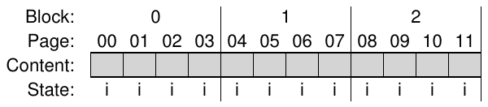

Khi SSD nhận lần ghi đầu (tới logical block 100), FTL quyết định ghi physical block 0 chứa bốn physical page: 0, 1, 2, 3. Vì block chưa erase, chưa thể ghi; thiết bị phải gửi command erase tới block 0 trước. Kết quả state:

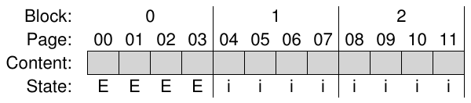

Block 0 giờ sẵn sàng program. Phần lớn SSD ghi page theo thứ tự thấp tới cao để giảm vấn đề reliability liên quan program disturbance. Sau đó SSD chuyển lần ghi logical block 100 tới physical page 0:

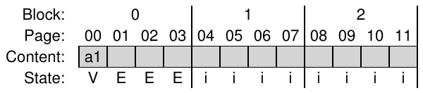

Nhưng nếu client muốn đọc logical block 100 thì tìm nó ở đâu? SSD phải đổi read logical block 100 thành read physical page 0. Để hỗ trợ, khi FTL ghi logical block 100 tới physical page 0, nó ghi lại trong mapping table in-memory. Ta cũng theo dõi state bảng trong các sơ đồ:

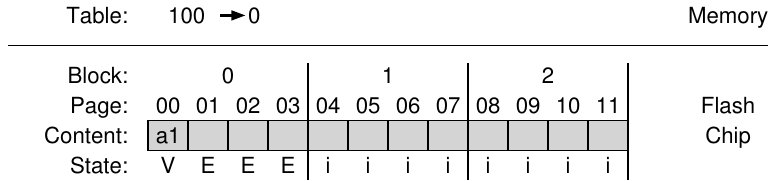

Giờ bạn thấy điều xảy ra khi client ghi SSD. SSD tìm vị trí ghi, thường chỉ chọn page trống kế tiếp; program page với nội dung block rồi ghi mapping logical-to-physical vào bảng. Các lần đọc sau chỉ dùng bảng dịch logical block address client cung cấp thành physical page number cần để đọc data.

Xét các lần ghi còn lại: 101, 2000, 2001. Sau khi ghi, state thiết bị:

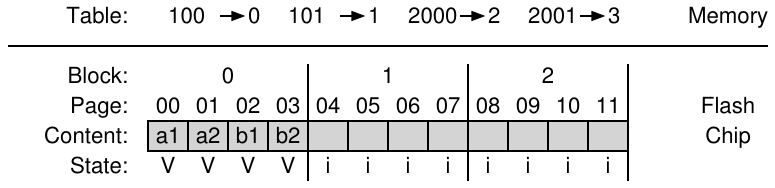

Cách log-based tự nó cải thiện performance (chỉ thỉnh thoảng cần erase, tránh hoàn toàn read-modify-write tốn kém của direct-mapped) và tăng mạnh reliability. FTL giờ phân bổ ghi trên mọi page, thực hiện wear leveling, tăng tuổi thọ; ta sẽ bàn thêm bên dưới.

> BÊN LỀ: LƯU BỀN VỮNG THÔNG TIN MAPPING FTL
>
> Có thể bạn hỏi: nếu mất điện thì sao? Mapping table in-memory biến mất? Rõ ràng không thể thực sự mất thông tin, nếu không thiết bị không hoạt động như persistent storage. SSD phải có cách phục hồi mapping. Đơn giản nhất là ghi một số thông tin mapping cùng mỗi page vào vùng out-of-band (OOB). Khi mất điện rồi khởi động lại, thiết bị phải quét OOB và tái dựng mapping table trong memory. Cách cơ bản có vấn đề: quét SSD lớn tìm mọi thông tin mapping cần thiết chậm. Để khắc phục, một số thiết bị higher-end dùng logging và checkpointing phức tạp hơn để tăng tốc recovery; ta sẽ học thêm logging khi bàn file system.

Đáng tiếc cách log structuring cơ bản có down-sides. Đầu tiên, ghi đè logical block tạo garbage, tức phiên bản data cũ chiếm không gian quanh drive. Thiết bị phải định kỳ garbage collection (GC) để tìm block và giải phóng chỗ cho lần ghi sau; GC quá nhiều tăng write amplification và giảm performance. Thứ hai là chi phí cao của mapping table in-memory; thiết bị càng lớn, bảng càng cần nhiều memory. Ta xét lần lượt.

## I.8 Garbage collection

Chi phí đầu của mọi cách log-structured như thế là tạo garbage, nên phải garbage collection (tức thu hồi dead-block). Tiếp ví dụ: nhớ logical block 100, 101, 2000, 2001 đã được ghi.

Giờ giả sử block 100, 101 được ghi lại với nội dung c1, c2. Các lần ghi đi tới page trống tiếp (physical page 4, 5), bảng mapping cập nhật tương ứng. Thiết bị phải erase block 1 trước để program được:

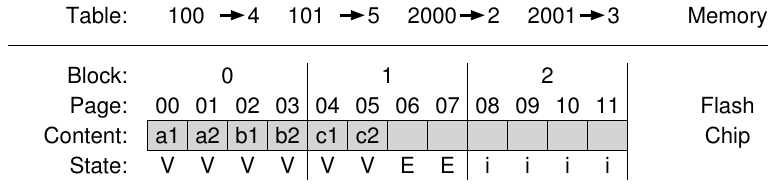

Vấn đề giờ rõ: physical page 0, 1 tuy đánh dấu VALID nhưng chứa garbage, tức phiên bản cũ của block 100, 101. Vì bản chất log-structured, ghi đè tạo garbage block, thiết bị phải thu hồi để có chỗ trống cho lần ghi mới.

Tìm garbage block (còn gọi dead block) rồi thu hồi để dùng tiếp gọi là garbage collection, component quan trọng của SSD hiện đại. Cơ bản: tìm block có ít nhất một garbage page, đọc những page live (non-garbage), ghi các page live tới log, cuối cùng thu hồi toàn block để ghi.

Hãy minh họa. Thiết bị quyết định thu hồi dead page trong block 0 ở trên. Block 0 có hai dead block (page 0, 1) và hai live block (page 2, 3, lần lượt chứa block 2000, 2001). Thiết bị sẽ:

• Đọc live data (page 2, 3) từ block 0

• Ghi live data tới cuối log

• Erase block 0, giải phóng để dùng sau

Để garbage collector hoạt động, mỗi block phải có đủ thông tin cho SSD biết từng page live hay dead. Cách tự nhiên là lưu ở một vị trí trong block thông tin logical block nào nằm trong mỗi page. Sau đó thiết bị dùng mapping table xác định từng page chứa live data không.

Trong ví dụ trước GC, block 0 giữ logical block 100, 101, 2000, 2001. Tra bảng (trước GC chứa 100->4, 101->5, 2000->2, 2001->3), thiết bị dễ xác định page nào trong SSD block giữ thông tin live. Chẳng hạn, 2000, 2001 rõ ràng vẫn được map trỏ tới; 100, 101 thì không, nên là ứng viên GC.

Khi GC hoàn tất trong ví dụ, state thiết bị:

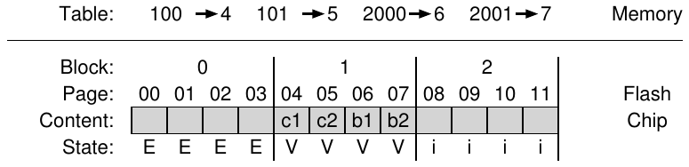

Như thấy, garbage collection có thể đắt, cần đọc và ghi lại live data. Ứng viên thu hồi lý tưởng là block chỉ chứa dead page; có thể erase ngay và dùng cho data mới, không cần data migration đắt tiền.

Để giảm GC cost, một số SSD overprovision [A+08]; thêm flash capacity cho phép trì hoãn cleaning, đẩy xuống background, có thể làm lúc thiết bị ít bận. Thêm capacity còn tăng internal bandwidth dùng cleaning mà không giảm bandwidth client cảm nhận. Nhiều drive hiện đại làm vậy, một chìa khóa đạt performance tổng thể xuất sắc.

## I.9 Kích thước mapping table

Chi phí thứ hai của log-structuring là mapping table có thể cực lớn, mỗi page 4-KB một entry. Chẳng hạn SSD 1-TB lớn với mỗi page 4-KB một entry 4-byte đã cần 1 GB memory trong thiết bị chỉ cho mapping! Vì vậy FTL page-level này không thực tế.

### Mapping Block-Based

Một cách giảm chi phí mapping là chỉ giữ pointer mỗi block thay mỗi page, giảm thông tin theo hệ số Sizeblock/Sizepage. FTL block-level giống page size lớn hơn trong virtual memory system: dùng ít bit VPN hơn, offset lớn hơn trong virtual address.

Đáng tiếc mapping block-based trong FTL log-based không tốt về performance. Vấn đề lớn nhất khi “small write” (nhỏ hơn physical block). FTL phải đọc nhiều live data từ block cũ, sao chép sang block mới cùng data ghi nhỏ. Sao chép này tăng write amplification mạnh, giảm performance.

Để rõ hơn, xét ví dụ. Client đã ghi logical block 2000, 2001, 2002, 2003 (nội dung a, b, c, d), nằm trong physical block 1 tại physical page 4, 5, 6, 7. Với mapping per-page, translation table ghi bốn mapping: 2000→4, 2001→5, 2002→6, 2003→7.

Nếu dùng mapping block-level, FTL chỉ ghi một address translation cho toàn data. Nhưng mapping hơi khác ví dụ trước. Cụ thể, xem logical address space chia thành phần có kích thước physical block trong flash. Logical block address gồm chunk number và offset. Vì giả sử bốn logical block vừa một physical block, phần offset cần 2 bit; những bit còn lại có trọng số cao tạo chunk number.

Logical block 2000, 2001, 2002, 2003 cùng chunk number (500), khác offset (lần lượt 0, 1, 2, 3). Với mapping block-level, FTL ghi chunk 500 ánh xạ tới block 1 (bắt đầu physical page 4), như sơ đồ:

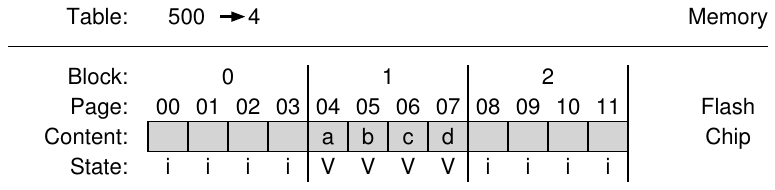

Đọc trong FTL block-based dễ. Đầu tiên trích chunk number từ logical block address client cung cấp bằng cách lấy các bit cao nhất. Sau đó tra mapping chunk-number sang physical-page trong bảng. Cuối cùng tính address flash page bằng cách cộng offset từ logical address vào physical address của block.

Chẳng hạn client gửi read logical address 2002; thiết bị trích logical chunk number (500), tra bảng translation (được 4), cộng offset logical address (2) vào translation (4). Address physical-page thu được (6) là nơi data nằm; FTL gửi read tới physical address và lấy data mong muốn (c).

Nhưng nếu client ghi logical block 2002 (nội dung c’)? FTL phải đọc 2000, 2001, 2003 rồi ghi cả bốn logical block vào vị trí mới, cập nhật mapping table tương ứng. Block 1 từng chứa data có thể erase, tái dùng như hình.

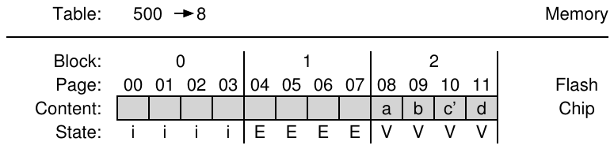

Như thấy, mapping block level giảm mạnh memory cho translation nhưng gây vấn đề performance đáng kể khi lần ghi nhỏ hơn physical block size; block thực có thể 256KB hoặc lớn hơn nên những lần ghi này khá thường xuyên. Cần giải pháp tốt hơn. Bạn cảm thấy đây là phần chương ta sắp nói giải pháp chưa? Hay hơn nữa, tự tìm được trước khi đọc tiếp không?

### Hybrid mapping

Để ghi linh hoạt mà giảm mapping cost, nhiều FTL hiện đại dùng hybrid mapping. FTL giữ vài block đã erase, chuyển mọi lần ghi tới đó; gọi log block. Vì muốn ghi page bất kỳ tới vị trí bất kỳ trong log block mà không sao chép như mapping thuần block-based, nó giữ mapping per-page cho các log block.

Vì vậy về logic FTL có hai mapping table trong memory: tập nhỏ mapping per-page trong log table và tập lớn mapping per-block trong data table. Khi tìm logical block, tra log table trước; nếu không có vị trí, tra data table rồi truy cập data yêu cầu.

Chìa khóa hybrid mapping là giữ số log block nhỏ. FTL phải định kỳ xét log block (mỗi page một pointer) rồi chuyển thành block chỉ cần một block pointer. Chuyển đổi dùng một trong ba kỹ thuật chính tùy nội dung block [KK+02].

Chẳng hạn FTL đã ghi logical page 1000, 1001, 1002, 1003 vào physical block 2 (physical page 8, 9, 10, 11); giả sử nội dung các lần ghi tới 1000, 1001, 1002, 1003 lần lượt là a, b, c, d.

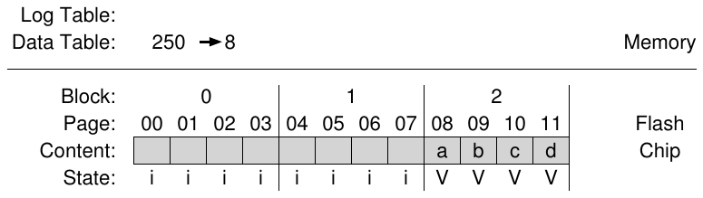

Giờ giả sử client ghi đè từng page (data a’, b’, c’, d’) đúng cùng thứ tự vào log block sẵn có, chẳng hạn physical block 0 (physical page 0, 1, 2, 3). State FTL như sau:

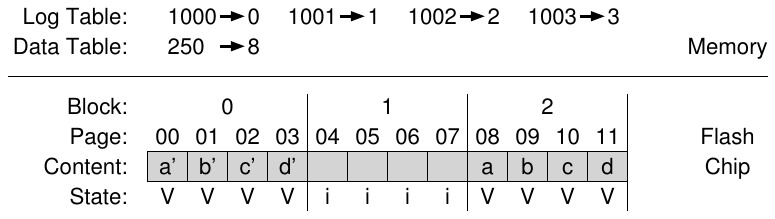

Vì các block được ghi đúng cùng cách trước, FTL làm switch merge. Log block (0) trở thành chỗ lưu page 0, 1, 2, 3, được trỏ bằng một block pointer; block cũ (2) giờ erase và dùng làm log block. Trong trường hợp tốt nhất, mọi pointer per-page cần thiết được thay bằng một block pointer.

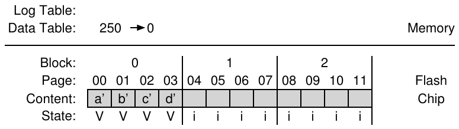

Switch merge là trường hợp tốt nhất cho hybrid FTL. Đáng tiếc không phải lúc nào cũng may. Hình dung cùng điều kiện ban đầu (logical block 0, 1, 2, 4 trong physical block 2) nhưng client chỉ ghi đè logical block 0, 1:

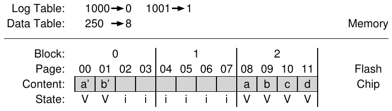

Để gom các page khác của physical block và tham chiếu chỉ bằng một block pointer, FTL làm partial merge. Trong operation này, đọc 2, 3 từ block 4 rồi append vào log. State SSD thu được giống switch merge trên; nhưng FTL phải thêm I/O để đạt mục tiêu (ở đây đọc logical block 2, 3 từ physical page 18, 19 rồi ghi tới physical page 22, 23), tăng write amplification.

Trường hợp cuối gọi full merge, cần nhiều việc hơn. FTL phải gom page từ nhiều block khác để cleaning. Chẳng hạn page 0, 4, 8, 12 được ghi vào log block A. Để chuyển thành page block-mapped, FTL trước tiên tạo data block chứa logical block 0, 1, 2, 3; phải đọc 1, 2, 3 từ nơi khác rồi ghi 0, 1, 2, 3 cùng nhau. Tiếp theo làm vậy với logical block 4, tìm 5, 6, 7 rồi hợp thành data block. Làm tương tự cho logical block 8, 12, cuối cùng giải phóng log block A. Không ngạc nhiên, full merge thường xuyên làm performance giảm nghiêm trọng [GY+09].

## I.10 Wear leveling

Cuối cùng, hoạt động nền liên quan mà FTL hiện đại phải triển khai là wear leveling đã giới thiệu. Ý tưởng đơn giản: nhiều chu kỳ erase/program làm mòn flash block nên FTL cố phân bố công việc đều trên mọi block. Nhờ vậy mọi block mòn gần cùng thời điểm thay vì vài block “phổ biến” nhanh chóng không dùng được.

Cách log-structuring cơ bản bước đầu phân bổ write load tốt, garbage collection cũng hỗ trợ. Nhưng đôi lúc block chứa data long-lived không bị over-written; GC không bao giờ thu hồi nên nó không nhận phần write load công bằng.

Để khắc phục, FTL phải định kỳ đọc mọi live data khỏi block đó rồi re-write nơi khác, cho phép block được ghi trở lại. Wear leveling làm tăng write amplification, giảm performance vì cần I/O thêm để bảo đảm mọi block mòn gần cùng tốc độ. Có nhiều thuật toán trong tài liệu [A+08, M+14]; hãy đọc thêm nếu quan tâm.

## I.11 SSD performance và chi phí

Trước khi kết thúc, xem performance và chi phí SSD hiện đại để hiểu cách dùng trong persistent storage system. Ở cả hai mặt, so sánh với hard-disk drive (HDD) cổ điển và làm rõ khác biệt lớn nhất.

### Performance

Khác hard disk drive, SSD flash-based không có thành phần cơ học, thực ra giống DRAM ở nhiều mặt vì là thiết bị “random access”. Khác biệt performance lớn nhất so với disk khi random read, write; disk điển hình chỉ vài trăm random I/O mỗi giây, SSD tốt hơn nhiều. Ở đây dùng data SSD hiện đại để thấy tốt hơn bao nhiêu, đặc biệt FTL che giấu vấn đề performance chip thô tốt tới đâu.

Bảng I.4 cho data performance của ba SSD và một hard drive top-of-the-line; data từ vài nguồn online [S13, T15]. Hai cột trái là random I/O performance, hai cột phải sequential; ba hàng đầu là ba SSD (Samsung, Seagate, Intel), hàng cuối hard disk drive (HDD), ở đây drive high-end của Seagate.

|  | Ngẫu nhiên |  | Tuần tự |  |
|---|---|---|---|---|
| Thiết bị | Đọc (MB/s) | Ghi (MB/s) | Đọc (MB/s) | Ghi (MB/s) |
| Samsung 840 Pro SSD | 103 | 287 | 421 | 384 |
| Seagate 600 SSD | 84 | 252 | 424 | 374 |
| Intel SSD 335 SSD | 39 | 222 | 344 | 354 |
| Seagate Savvio 15K.3 HDD | 2 | 2 | 223 | 223 |

Hình I.4: SSD và hard drive: So sánh performance

Bảng cho vài điều thú vị. Đầu tiên, rõ nhất là chênh lệch random I/O performance giữa SSD và hard drive duy nhất. SSD đạt hàng chục, thậm chí hàng trăm MB/s random I/O, còn hard drive “performance cao” chỉ đỉnh vài MB/s (thực ra đã làm tròn lên thành 2 MB/s). Thứ hai, sequential performance ít khác biệt hơn; SSD tốt hơn nhưng hard drive vẫn là lựa chọn tốt nếu chỉ cần sequential performance. Thứ ba, SSD random read performance không tốt bằng SSD random write performance.

Lý do random-write performance tốt bất ngờ là thiết kế log-structured của nhiều SSD, chuyển ghi ngẫu nhiên thành tuần tự và cải thiện performance. Cuối cùng, vì SSD có khác biệt giữa sequential và random I/O, nhiều kỹ thuật xây file system cho hard drive trong chương sau vẫn áp dụng; dù chênh lệch nhỏ hơn, vẫn đủ để cân nhắc thiết kế file system giảm random I/O.

### Chi phí

Như trên, SSD có performance vượt xa hard drive hiện đại, kể cả sequential I/O. Vậy sao chưa thay thế hoàn toàn hard drive làm storage medium? Đơn giản là chi phí, cụ thể chi phí mỗi đơn vị dung lượng. Hiện tại [A15], SSD 250-GB khoảng $150, tức 60 cent mỗi GB. Hard drive điển hình khoảng $50 cho 1-TB, tức 5 cent mỗi GB. Vẫn chênh hơn 10× về chi phí giữa hai phương tiện.

Khác biệt performance và chi phí quyết định cách xây storage system large-scale. Nếu performance quan trọng nhất, SSD rất tốt, đặc biệt khi cần random read. Ngược lại, nếu xây data center lớn để lưu lượng thông tin khổng lồ, chi phí chênh lớn thúc đẩy chọn hard drive. Dĩ nhiên hybrid hợp lý: một số hệ thống kết hợp cả hai, dùng ít SSD cho data “hot” phổ biến để đạt performance cao, còn data “lạnh hơn”, ít dùng nằm trên hard drive để tiết kiệm. Chừng nào giá còn chênh, hard drive còn tồn tại.

## I.12 Tổng kết

SSD Flash-based ngày càng phổ biến trong laptop, desktop và server ở data center vận hành kinh tế thế giới. Vì vậy có lẽ bạn nên biết chút ít, đúng không?

Tin xấu: chương này, như nhiều chương trong sách, chỉ là bước đầu hiểu công nghệ tiên tiến hiện tại. Nguồn tìm hiểu thêm công nghệ thô gồm nghiên cứu performance thiết bị thực (như Chen và cộng sự [CK+09], Grupp và cộng sự [GC+09]), vấn đề thiết kế FTL (Agrawal và cộng sự [A+08], Gupta và cộng sự [GY+09], Huang và cộng sự [H+14], Kim và cộng sự [KK+02], Lee và cộng sự [L+07], Zhang và cộng sự [Z+12]), thậm chí distributed system gồm flash (Gordon [CG+09], CORFU [B+12]).

Đừng chỉ đọc bài học thuật; đọc cả tiến bộ gần đây trên báo chí phổ thông (như [V12]). Bạn sẽ học thông tin thực tế hơn nhưng vẫn hữu ích, như Samsung dùng cả TLC và SLC cell trong cùng SSD để tối đa performance (SLC buffer ghi nhanh) và capacity (TLC lưu nhiều bit hơn mỗi cell). Như người ta nói, đó chỉ là đỉnh tảng băng. Hãy tự đào sâu “tảng băng” nghiên cứu, có thể bắt đầu bằng khảo sát xuất sắc gần đây của Ma và cộng sự [M+14]. Nhưng cẩn thận: băng chìm được cả tàu hùng mạnh nhất [W15].

## Tài liệu tham khảo

[A+08] “Design Tradeoffs for SSD Performance”

N. Agrawal, V. Prabhakaran, T. Wobber, J. D. Davis, M. Manasse, and R. Panigrahy

USENIX ’08, San Diego California, tháng Sáu 2008

Tổng quan xuất sắc về những yếu tố thiết kế SSD.

[A15] “Amazon Pricing Study”

Remzi Arpaci-Dusseau

Tháng Hai, 2015

Không phải bài báo thực mà là một tác giả vào Amazon xem giá hiện tại của hard drive, SSD. Bạn cũng lặp lại nghiên cứu để xem giá hôm nay. Làm đi!

[B+12] “CORFU: A Shared Log Design for Flash Clusters”

M. Balakrishnan, D. Malkhi, V. Prabhakaran, T. Wobber, M. Wei, J. D. Davis

NSDI ’12, San Jose, California, tháng Tư 2012

Cách nghĩ mới về thiết kế replicated log high-performace cho cluster dùng Flash.

[BD10] “Write Endurance in Flash Drives: Measurements and Analysis”

Simona Boboila, Peter Desnoyers

FAST ’10, San Jose, California, tháng Hai 2010

Bài thú vị dùng reverse engineering tìm hiểu tuổi thọ flash-device. Độ bền đôi khi vượt xa dự đoán nhà sản xuất, tới 100×.

[B07] “ZFS: The Last Word in File Systems”

Jeff Bonwick and Bill Moore

Có tại: http://opensolaris.org/os/community/zfs/docs/zfs_last.pdf

Đây có phải lời cuối về file system? Không, nhưng có lẽ gần rồi.

[CG+09] “Gordon: Using Flash Memory to Build Fast, Power-efficient Clusters for Data-intensive Applications”

Adrian M. Caulfield, Laura M. Grupp, Steven Swanson

ASPLOS ’09, Washington, D.C., tháng Ba 2009

Nghiên cứu sớm về ghép flash thành cluster larger-scale, chắc chắn đáng đọc.

[CK+09] “Understanding Intrinsic Characteristics and System Implications of Flash Memory based Solid State Drives”

Feng Chen, David A. Koufaty, and Xiaodong Zhang

SIGMETRICS/Performance ’09, Seattle, Washington, tháng Sáu 2009

Tổng quan xuất sắc về vấn đề SSD performance khoảng 2009, dù giờ hơi cũ.

[G14] “The SSD Endurance Experiment”

Geoff Gasior

The Tech Report, ngày 19 tháng Chín, 2014

Có tại: http://techreport.com/review/27062

Một tập thử nghiệm đơn giản hay, đo performance SSD theo thời gian. Có nhiều nghiên cứu tương tự, dùng google tìm thêm.

[GC+09] “Characterizing Flash Memory: Anomalies, Observations, and Applications”

L. M. Grupp, A. M. Caulfield, J. Coburn, S. Swanson, E. Yaakobi, P. H. Siegel, J. K. Wolf

IEEE MICRO ’09, New York, New York, tháng Mười Hai 2009

Một mô tả đặc trưng flash performance xuất sắc khác.

[GY+09] “DFTL: a Flash Translation Layer Employing Demand-Based Selective Caching of Page-Level Address Mappings”

Aayush Gupta, Youngjae Kim, Bhuvan Urgaonkar

ASPLOS ’09, Washington, D.C., tháng Ba 2009

Bài này cho tổng quan xuất sắc về những chiến lược cleaning trong hybrid SSD và cơ chế mới tiết kiệm mapping table space, tăng performance trên nhiều workload.

[H+14] “An Aggressive Worn-out Flash Block Management Scheme To Alleviate SSD Performance Degradation”

Ping Huang, Guanying Wu, Xubin He, Weijun Xiao

EuroSys ’14, 2014

Công trình gần đây cho thấy cách tận dụng thực sự tối đa flash block worn-out; rất hay!

[J10] “Failure Mechanisms and Models for Semiconductor Devices”

Báo cáo JEP122F, tháng Mười Một 2010

Có tại: http://www.jedec.org/sites/default/files/docs/JEP122F.pdf

Thảo luận rất chi tiết về điều xảy ra ở device level và cách thiết bị hỏng. Chỉ dành cho người không yếu tim. Hoặc nhà vật lý. Hoặc cả hai.

[KK+02] “A Space-Efficient Flash Translation Layer For Compact Flash Systems”

Jesung Kim, Jong Min Kim, Sam H. Noh, Sang Lyul Min, Yookun Cho

IEEE Transactions on Consumer Electronics, Tập 48, Số 2, tháng Năm 2002

Một trong những đề xuất sớm nhất về hybrid mapping.

[L+07] “A Log Buffer-Based Flash Translation Layer Using Fully-Associative Sector Translation”

Sang-won Lee, Tae-Sun Chung, Dong-Ho Lee, Sangwon Park, Ha-Joo Song

ACM Transactions on Embedded Computing Systems, Tập 6, Số 3, tháng Bảy 2007

Bài xuất sắc về cách xây hybrid log/block mapping.

[M+14] “A Survey of Address Translation Technologies for Flash Memories”

Dongzhe Ma, Jianhua Feng, Guoliang Li

ACM Computing Surveys, Tập 46, Số 3, tháng Một 2014

Có lẽ khảo sát gần đây tốt nhất về flash và công nghệ liên quan.

[S13] “The Seagate 600 and 600 Pro SSD Review”

Anand Lal Shimpi

AnandTech, ngày 7 tháng Năm, 2013

Có tại: http://www.anandtech.com/show/6935/seagate-600-ssd-review

Một trong nhiều phép đo SSD performance trên Internet. Chưa nghe về Internet? Không sao. Vào web browser, gõ “internet” vào search tool. Bạn sẽ kinh ngạc với những gì học được.

[T15] “Performance Charts Hard Drives”

Tom’s Hardware, tháng Một 2015

Có tại: http://www.tomshardware.com/charts/enterprise-hdd-charts/

Thêm một site có performance data, lần này về hard drive.

[V12] “Understanding TLC Flash”

Kristian Vatto

AnandTech, tháng Chín, 2012

Có tại: http://www.anandtech.com/show/5067/understanding-tlc-nand

Mô tả ngắn về TLC flash và đặc điểm.

[W15] “List of Ships Sunk by Icebergs”

Có tại: http://en.wikipedia.org/wiki/List_of_ships_sunk_by_icebergs

Đúng, có trang wikipedia về tàu bị tảng băng đánh chìm. Trang thực sự nhàm chán, về cơ bản ai cũng biết con tàu duy nhất nhóm iceberg-sinking-mafia quan tâm là Titanic.

[Z+12] “De-indirection for Flash-based SSDs with Nameless Writes”

Yiying Zhang, Leo Prasath Arulraj, Andrea C. Arpaci-Dusseau, Remzi H. Arpaci-Dusseau FAST ’13, San Jose, California, tháng Hai 2013

Nghiên cứu của chúng tôi về ý tưởng mới giảm mapping table space; chìa khóa là re-use pointer trong file system phía trên để lưu vị trí block thay vì thêm một lớp indirection.
