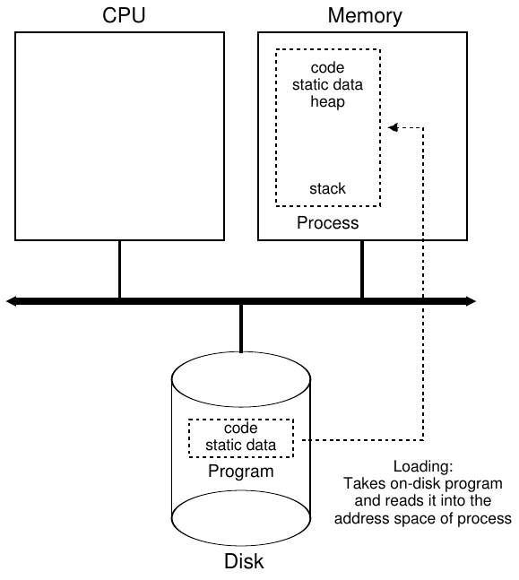
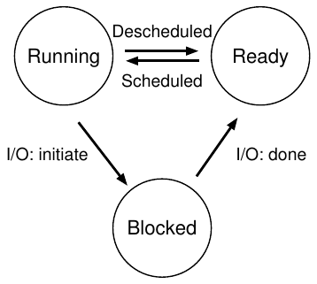

# 4 Abstraction: Process

Trong chương này, ta thảo luận một trong những abstraction cơ bản nhất mà OS cung cấp cho người dùng: process. Nói một cách không hình thức, định nghĩa process khá đơn giản: đó là một chương trình đang chạy [V+65,BH70]. Bản thân chương trình là một thứ vô tri: nó chỉ nằm trên đĩa, gồm một tập hợp instruction (và có thể một ít static data), chờ được đưa vào hoạt động. Chính operating system lấy các byte này và cho chúng chạy, biến chương trình thành thứ hữu ích.

Người ta thường muốn chạy nhiều hơn một chương trình cùng lúc; ví dụ, hãy nghĩ đến desktop hoặc laptop của bạn, nơi bạn có thể muốn chạy web browser, chương trình email, trò chơi, trình phát nhạc, v.v. Thực ra, một hệ thống điển hình có thể trông như đang chạy hàng chục, thậm chí hàng trăm process cùng lúc. Điều này làm hệ thống dễ sử dụng, vì người dùng không bao giờ phải quan tâm CPU có sẵn hay không; họ chỉ việc chạy chương trình. Vì vậy, thách thức của ta là:

> MẤU CHỐT CỦA VẤN ĐỀ:
>
> LÀM THẾ NÀO ĐỂ TẠO ẢO GIÁC CÓ NHIỀU CPU?
>
> Mặc dù chỉ có một vài CPU vật lý, làm thế nào OS tạo ra ảo giác có nguồn cung CPU nearly-endless?

OS tạo ra ảo giác này bằng cách virtualize CPU. Bằng cách chạy một process, rồi dừng nó và chạy process khác, cứ như vậy, OS có thể tạo ảo giác rằng có nhiều virtual CPU dù thực tế chỉ có một CPU vật lý (hoặc một vài). Kỹ thuật cơ bản này, được gọi là time sharing CPU, cho phép người dùng chạy bao nhiêu concurrent process tùy thích; cái giá có thể phải trả là hiệu năng, vì mỗi process sẽ chạy chậm hơn nếu phải dùng chung CPU.

Để triển khai virtualization CPU, và triển khai tốt, OS cần cả những cơ chế low-level lẫn khả năng quyết định high-level. Ta gọi các cơ chế low-level này là mechanism; mechanism là những phương pháp hoặc protocol low-level triển khai một chức năng cần thiết. Ví dụ, sau này ta sẽ học cách triển khai context switch, cho OS khả năng dừng chạy một chương trình và bắt đầu chạy chương trình khác trên một CPU nhất định; mechanism time-sharing này được mọi OS hiện đại sử dụng.

> MẸO: SỬ DỤNG TIME SHARING (VÀ SPACE SHARING)
>
> Time sharing là một trong những kỹ thuật cơ bản nhất mà OS dùng để chia sẻ tài nguyên. Bằng cách cho phép một thực thể sử dụng tài nguyên trong một khoảng thời gian ngắn, rồi đến thực thể khác, cứ như vậy, tài nguyên đang xét (ví dụ CPU hoặc network link) có thể được nhiều thực thể dùng chung. Kỹ thuật tương ứng tự nhiên với time sharing là space sharing, trong đó tài nguyên được chia (theo không gian) cho những bên muốn sử dụng. Ví dụ, disk space tự nhiên là tài nguyên space-shared, vì một khi block được gán cho một file, nó khó có thể được gán cho file khác cho đến khi người dùng xóa file đó.

Bên trên các mechanism này là một phần khả năng quyết định của OS, dưới dạng policy. Policy là những thuật toán dùng để đưa ra một loại quyết định nào đó bên trong OS. Ví dụ, với một số chương trình có thể chạy trên CPU, OS nên chạy chương trình nào? Một scheduling policy trong OS sẽ đưa ra quyết định này, có thể sử dụng thông tin lịch sử (ví dụ chương trình nào đã chạy nhiều hơn trong phút vừa qua?), hiểu biết về workload (ví dụ những loại chương trình nào được chạy) và các thước đo hiệu năng (ví dụ hệ thống đang tối ưu interactive performance hay throughput?) để quyết định.

## 4.1 Abstraction: Một process

Abstraction mà OS cung cấp cho một chương trình đang chạy là thứ ta sẽ gọi là process. Như đã nói bên trên, process đơn giản là một chương trình đang chạy; tại bất kỳ thời điểm nào, ta có thể mô tả khái quát một process bằng cách liệt kê những thành phần khác nhau của hệ thống mà nó truy cập hoặc tác động đến trong quá trình thực thi.

Vì vậy, để hiểu những gì cấu thành một process, ta phải hiểu machine state của nó: những gì chương trình có thể đọc hoặc cập nhật khi đang chạy. Tại bất kỳ thời điểm nào, những phần nào của máy quan trọng đối với việc thực thi chương trình này?

Một thành phần hiển nhiên trong machine state cấu thành process là memory của nó. Instruction nằm trong memory; dữ liệu mà chương trình đang chạy đọc và ghi cũng nằm trong memory. Vì vậy, vùng memory mà process có thể định địa chỉ (gọi là address space của nó) là một phần của process.

Register cũng thuộc machine state của process; nhiều instruction đọc hoặc cập nhật register một cách tường minh, nên rõ ràng chúng quan trọng đối với việc thực thi process.

Lưu ý rằng một số register đặc biệt quan trọng cũng là một phần của machine state này. Ví dụ, program counter (PC) (đôi khi gọi là instruction pointer hay IP) cho biết instruction nào của chương trình đang được thực thi; tương tự, stack pointer và frame pointer liên quan được dùng để quản lý stack chứa function parameter, local variable và return address.

> MẸO: TÁCH BIỆT POLICY VÀ MECHANISM
>
> Trong nhiều operating system, một mô hình thiết kế phổ biến là tách biệt các policy high-level với mechanism low-level của chúng [L+75]. Bạn có thể hình dung mechanism trả lời câu hỏi như thế nào về hệ thống; ví dụ, operating system thực hiện context switch như thế nào? Policy trả lời câu hỏi cái nào; ví dụ, operating system nên chạy process nào ngay bây giờ? Tách biệt hai phần cho phép dễ dàng thay đổi policy mà không phải suy nghĩ lại về mechanism, nên đây là một dạng modularity, một nguyên tắc thiết kế phần mềm tổng quát.

Cuối cùng, chương trình cũng thường truy cập persistent storage device. Thông tin I/O như vậy có thể bao gồm danh sách các file mà process hiện đang mở.

## 4.2 Process API

Mặc dù để dành việc thảo luận một process API thực tế cho chương sau, ở đây trước hết ta đưa ra hình dung về những gì phải có trong mọi interface của operating system. Các API này, dưới một hình thức nào đó, đều có trên mọi operating system hiện đại.

• Create: Operating system phải có phương thức nào đó để tạo process mới. Khi bạn gõ lệnh vào shell hoặc double-click vào biểu tượng ứng dụng, OS được gọi để tạo process mới nhằm chạy chương trình bạn đã chỉ định.

• Destroy: Cũng như có interface để tạo process, hệ thống cung cấp interface để cưỡng bức hủy process. Tất nhiên, nhiều process sẽ chạy rồi tự thoát khi hoàn tất; tuy nhiên, khi chúng không làm vậy, người dùng có thể muốn kill chúng, nên một interface để dừng process chạy mất kiểm soát rất hữu ích.

• Wait: Đôi khi chờ một process ngừng chạy là điều hữu ích; do đó, hệ thống thường cung cấp một loại interface chờ nào đó.

• Các điều khiển khác: Ngoài kill hoặc chờ process, đôi khi còn có những thao tác điều khiển khác. Ví dụ, phần lớn operating system cung cấp phương thức suspend process (dừng nó chạy một lúc) rồi resume (cho nó tiếp tục chạy).

• Status: Thông thường cũng có các interface lấy thông tin trạng thái của process, chẳng hạn nó đã chạy bao lâu hoặc đang ở trạng thái nào.



Hình 4.1: Loading: Từ chương trình thành process

## 4.3 Tạo process: Chi tiết hơn một chút

Một điều bí ẩn mà ta nên làm sáng tỏ phần nào là cách chương trình được biến thành process. Cụ thể, OS đưa chương trình vào hoạt động như thế nào? Việc tạo process thực sự diễn ra ra sao?

Điều đầu tiên OS phải làm để chạy chương trình là load code và mọi static data của nó (ví dụ các variable đã được khởi tạo) vào memory, trong address space của process. Ban đầu, chương trình nằm trên đĩa (hoặc trên SSD flash-based trong một số hệ thống hiện đại) dưới một dạng executable format nào đó; vì vậy, quá trình load chương trình và static data vào memory đòi hỏi OS đọc những byte đó từ đĩa và đặt chúng vào một nơi trong memory (như Hình 4.1).

Trong các operating system đời đầu (hoặc đơn giản), quá trình loading được thực hiện theo cách eager, tức là thực hiện toàn bộ cùng lúc trước khi chạy chương trình; OS hiện đại thực hiện theo cách lazy, tức là chỉ load các phần code hoặc dữ liệu khi cần trong quá trình thực thi chương trình. Để thực sự hiểu cách lazy loading các phần code và dữ liệu hoạt động, bạn cần hiểu thêm về mechanism paging và swapping, những chủ đề ta sẽ trình bày sau khi thảo luận virtualization memory. Hiện tại, chỉ cần nhớ rằng trước khi chạy bất cứ thứ gì, rõ ràng OS phải làm một số việc để đưa các phần quan trọng của chương trình từ đĩa vào memory.

Sau khi code và static data được load vào memory, OS còn cần làm vài việc trước khi chạy process. Phải cấp phát một ít memory cho run-time stack (hay chỉ gọi là stack) của chương trình. Như có lẽ bạn đã biết, chương trình C dùng stack cho local variable, function parameter và return address; OS cấp phát vùng memory này và giao cho process. OS cũng có thể khởi tạo stack bằng các argument; cụ thể, nó điền các parameter của hàm main(), tức là argc và array argv.

OS cũng có thể cấp phát một ít memory cho heap của chương trình. Trong chương trình C, heap được dùng cho dữ liệu dynamically-allocated được yêu cầu tường minh; chương trình yêu cầu vùng nhớ đó bằng cách gọi malloc() và giải phóng tường minh bằng cách gọi free(). Heap cần thiết cho các data structure như linked list, hash table, tree và những data structure thú vị khác. Ban đầu heap nhỏ; khi chương trình chạy và yêu cầu thêm memory thông qua library API malloc(), OS có thể tham gia và cấp phát thêm memory cho process để giúp đáp ứng các lời gọi đó.

OS cũng thực hiện một số tác vụ khởi tạo khác, đặc biệt liên quan đến input/output (I/O). Ví dụ, trong hệ thống UNIX, mặc định mỗi process có ba file descriptor đang mở cho standard input, output và error; các descriptor này giúp chương trình dễ đọc đầu vào từ terminal cũng như in đầu ra lên màn hình. Ta sẽ học thêm về I/O, file descriptor và những nội dung tương tự ở phần thứ ba của cuốn sách về persistence.

Bằng cách load code và static data vào memory, tạo và khởi tạo stack, cùng thực hiện các công việc khác liên quan đến thiết lập I/O, giờ đây OS (cuối cùng) đã chuẩn bị xong cho việc thực thi chương trình. Vì thế, nó còn một tác vụ cuối: bắt đầu chạy chương trình tại entry point, cụ thể là main(). Bằng cách nhảy đến routine main() (thông qua một mechanism chuyên biệt mà ta sẽ thảo luận ở chương tiếp theo), OS chuyển quyền điều khiển CPU cho process newly-created, và chương trình bắt đầu thực thi.

## 4.4 Trạng thái process

Giờ đây, khi đã hình dung phần nào process là gì (dù ta sẽ tiếp tục làm rõ khái niệm này) và cách nó được tạo ra (ở mức khái quát), hãy nói về những trạng thái khác nhau mà một process có thể ở trong tại một thời điểm. Ý tưởng rằng process có thể ở một trong các trạng thái này xuất hiện trong những hệ thống máy tính đầu tiên [DV66,V+65]. Nhìn một cách đơn giản hóa, process có thể ở một trong ba trạng thái:

• Running: Trong trạng thái running, process đang chạy trên processor. Điều này có nghĩa nó đang thực thi instruction.

• Ready: Trong trạng thái ready, process sẵn sàng chạy nhưng vì lý do nào đó OS đã chọn không chạy nó tại thời điểm hiện tại.

• Blocked: Trong trạng thái blocked, process đã thực hiện một thao tác nào đó khiến nó chưa sẵn sàng chạy cho đến khi một sự kiện khác xảy ra. Ví dụ phổ biến: khi process khởi tạo I/O request đến đĩa, nó trở thành blocked, nhờ vậy process khác có thể dùng processor.



Hình 4.2: Process: Chuyển trạng thái

Nếu ánh xạ các trạng thái này thành graph, ta sẽ có sơ đồ trong Hình 4.2. Như bạn thấy trong sơ đồ, process có thể được chuyển giữa trạng thái ready và running tùy quyết định của OS. Chuyển từ ready sang running nghĩa là process đã được schedule; chuyển từ running sang ready nghĩa là process đã được deschedule. Một khi process trở thành blocked (ví dụ bằng cách khởi tạo thao tác I/O), OS giữ nó như vậy cho đến khi một sự kiện xảy ra (ví dụ I/O hoàn tất); khi đó, process lại chuyển sang trạng thái ready (và có thể lập tức trở lại running nếu OS quyết định như vậy).

Hãy xem ví dụ về cách hai process có thể chuyển qua một số trạng thái này. Đầu tiên, tưởng tượng hai process đang chạy, mỗi process chỉ dùng CPU (không thực hiện I/O). Trong trường hợp này, trace trạng thái của mỗi process có thể như sau (Hình 4.3).

| Thời gian | Process<sub>0</sub> | Process<sub>1</sub> | Ghi chú |
|---|---|---|---|
| 1 | Running | Ready |  |
| 2 | Running | Ready |  |
| 3 | Running | Ready |  |
| 4 | Running | Ready | Process<sub>0</sub> vừa hoàn tất |
| 5 | – | Running |  |
| 6 | – | Running |  |
| 7 | – | Running |  |
| 8 | – | Running | Process<sub>1</sub> vừa hoàn tất |

Hình 4.3: Theo dõi trạng thái process: Chỉ dùng CPU

Trong ví dụ tiếp theo, process đầu tiên gửi một I/O sau khi chạy được một thời gian. Khi đó, process trở thành blocked, tạo cơ hội cho process kia chạy. Hình 4.4 cho thấy trace của tình huống này.

Cụ thể hơn, Process<sub>0</sub> khởi tạo một I/O và trở thành blocked để chờ nó hoàn tất; chẳng hạn, process trở thành blocked khi đọc từ đĩa hoặc chờ packet từ network. OS nhận ra Process<sub>0</sub> không dùng CPU và bắt đầu chạy Process<sub>1</sub>. Trong khi Process<sub>1</sub> chạy, I/O hoàn tất, đưa Process<sub>0</sub> trở lại ready. Cuối cùng, Process<sub>1</sub> kết thúc, rồi Process<sub>0</sub> chạy và hoàn tất.

| Thời gian | Process<sub>0</sub> | Process<sub>1</sub> | Ghi chú |
|---|---|---|---|
| 1 | Running | Ready |  |
| 2 | Running | Ready |  |
| 3 | Running | Ready | Process<sub>0</sub> khởi tạo I/O |
| 4 | Blocked | Running | Process<sub>0</sub> đang blocked, |
| 5 | Blocked | Running | nên Process<sub>1</sub> chạy |
| 6 | Blocked | Running |  |
| 7 | Ready | Running | I/O hoàn tất |
| 8 | Ready | Running | Process<sub>1</sub> vừa hoàn tất |
| 9 | Running | – |  |
| 10 | Running | – | Process<sub>0</sub> vừa hoàn tất |

Hình 4.4: Theo dõi trạng thái process: CPU và I/O

Lưu ý OS phải đưa ra nhiều quyết định ngay cả trong ví dụ đơn giản này. Đầu tiên, hệ thống phải quyết định chạy Process<sub>1</sub> trong khi Process<sub>0</sub> gửi I/O; điều này cải thiện resource utilization bằng cách giữ CPU bận. Thứ hai, hệ thống quyết định không chuyển lại Process<sub>0</sub> khi I/O của nó hoàn tất; chưa rõ đó có phải quyết định tốt hay không. Bạn nghĩ sao? Những quyết định kiểu này do OS scheduler đưa ra, một chủ đề ta sẽ thảo luận sau vài chương nữa.

## 4.5 Data Structure

OS là một chương trình và, giống mọi chương trình, nó có một số data structure then chốt để theo dõi các thông tin liên quan khác nhau. Ví dụ, để theo dõi trạng thái mỗi process, OS có thể giữ một dạng process list cho tất cả process ở trạng thái ready, cùng một số thông tin bổ sung để theo dõi process nào hiện đang chạy. OS cũng phải theo dõi các process blocked theo một cách nào đó; khi một I/O event hoàn tất, OS phải bảo đảm đánh thức đúng process và chuẩn bị cho nó chạy lại.

Hình 4.5 cho thấy những loại thông tin mà OS cần theo dõi về mỗi process trong kernel xv6 [CK+08]. Các process structure tương tự tồn tại trong những operating system “thực tế” như Linux, Mac OS X hoặc Windows; hãy tra cứu và xem chúng phức tạp hơn đến mức nào.

Từ hình, bạn có thể thấy một số thông tin quan trọng mà OS theo dõi về process. Với một process đã dừng, register context giữ nội dung các register của nó. Khi process dừng, các register được lưu vào vị trí memory này; bằng cách khôi phục register (tức là đặt các giá trị của chúng trở lại các physical register thực tế), OS có thể cho process tiếp tục chạy. Ta sẽ học thêm về kỹ thuật gọi là context switch này trong các chương sau.

```
// the registers xv6 will save and restore
// to stop and subsequently restart a process
struct context {
  int eip;
  int esp;
  int ebx;
  int ecx;
  int edx;
  int esi;
  int edi;
  int ebp;
};

// the different states a process can be in
enum proc_state { UNUSED, EMBRYO, SLEEPING,
                  RUNNABLE, RUNNING, ZOMBIE };

// the information xv6 tracks about each process
// including its register context and state
struct proc {
  char *mem;                  // Start of process memory
  uint sz;                    // Size of process memory
  char *kstack;               // Bottom of kernel stack
                              // for this process
  enum proc_state state;      // Process state
  int pid;                    // Process ID
  struct proc *parent;        // Parent process
  void *chan;                 // If non-zero, sleeping on chan
  int killed;                 // If non-zero, have been killed
  struct file *ofile[NOFILE]; // Open files
  struct inode *cwd;          // Current directory
  struct context context;     // Switch here to run process
  struct trapframe *tf;       // Trap frame for the
                              // current interrupt
};
```

Hình 4.5: Proc Structure của xv6

Từ hình, bạn cũng thấy process có thể ở một số trạng thái khác ngoài running, ready và blocked. Đôi khi hệ thống có trạng thái ban đầu mà process ở trong khi đang được tạo. Ngoài ra, process có thể được đặt vào trạng thái cuối, khi nó đã thoát nhưng chưa được dọn dẹp (trong hệ thống UNIX-based, trạng thái này được gọi là zombie[^1]). Trạng thái cuối này có thể hữu ích vì cho phép process khác (thường là parent đã tạo process đó) kiểm tra return code và xem process just-finished có thực thi thành công không (thông thường, chương trình trên hệ thống UNIX-based trả về không khi hoàn thành tác vụ thành công, và non-zero trong trường hợp ngược lại). Khi xong, parent thực hiện một lời gọi cuối (ví dụ wait()) để chờ child hoàn tất, đồng thời báo cho OS rằng có thể dọn dẹp mọi data structure liên quan từng tham chiếu đến process now-extinct.

> THÔNG TIN THÊM: DATA STRUCTURE — PROCESS LIST
>
> Operating system có rất nhiều data structure quan trọng khác nhau mà ta sẽ thảo luận trong các ghi chép này. Process list là structure đầu tiên như vậy. Nó thuộc loại đơn giản hơn, nhưng chắc chắn bất kỳ OS nào có khả năng chạy nhiều chương trình cùng lúc đều có thứ tương tự structure này để theo dõi mọi chương trình đang chạy trong hệ thống. Đôi khi người ta gọi structure riêng lẻ lưu thông tin về một process là Process Control Block (PCB), một cách gọi cầu kỳ cho C structure chứa thông tin về mỗi process.

## 4.6 Tóm tắt

Ta đã giới thiệu abstraction cơ bản nhất của OS: process. Có thể xem nó khá đơn giản là một chương trình đang chạy. Với cách nhìn khái niệm này, giờ ta sẽ chuyển sang phần nitty-gritty: các mechanism low-level cần để triển khai process và những policy higher-level cần để lập lịch chúng một cách thông minh. Bằng cách kết hợp mechanism và policy, ta sẽ xây dựng hiểu biết về cách operating system virtualize CPU.

## Tài liệu tham khảo

[BH70] “The Nucleus of a Multiprogramming System”

Per Brinch Hansen

Communications of the ACM, Tập 13, Số 4, tháng Tư năm 1970

Bài báo này giới thiệu một trong những microkernel đầu tiên trong lịch sử operating system, có tên Nucleus. Ý tưởng về các hệ thống nhỏ gọn và tối giản hơn là chủ đề xuất hiện lặp lại trong lịch sử OS; tất cả bắt đầu từ công trình của Brinch Hansen được mô tả ở đây.

[CK+08] “The xv6 Operating System”

Russ Cox, Frans Kaashoek, Robert Morris, Nickolai Zeldovich

Nguồn: http://pdos.csail.mit.edu/6.828/2008/index.html

OS nhỏ gọn thực tế thú vị nhất thế giới. Hãy tải về và thử nghiệm để tìm hiểu chi tiết hơn về cách operating system thực sự hoạt động.

[DV66] “Programming Semantics for Multiprogrammed Computations”

Jack B. Dennis and Earl C. Van Horn

Communications of the ACM, Tập 9, Số 3, tháng Ba năm 1966

Bài báo này định nghĩa nhiều thuật ngữ và khái niệm ban đầu về việc xây dựng hệ thống multiprogrammed.

[L+75] “Policy/mechanism separation in Hydra”

R. Levin, E. Cohen, W. Corwin, F. Pollack, W. Wulf

SOSP 1975

Một bài báo thời kỳ đầu về cách tổ chức operating system trong một OS nghiên cứu tên Hydra. Dù Hydra chưa bao giờ trở thành OS phổ biến, một số ý tưởng của nó đã ảnh hưởng đến người thiết kế OS.

[V+65] “Structure of the Multics Supervisor”

V.A. Vyssotsky, F. J. Corbato, R. M. Graham

Fall Joint Computer Conference, 1965

Một bài báo thời kỳ đầu về Multics, mô tả nhiều ý tưởng và thuật ngữ cơ bản mà ta thấy trong hệ thống hiện đại. Một số tầm nhìn về điện toán như một dịch vụ tiện ích cuối cùng đang trở thành hiện thực trong các hệ thống cloud hiện đại.

## Bài tập về nhà

> THÔNG TIN THÊM: BÀI TẬP MÔ PHỎNG
>
> Bài tập mô phỏng có dạng các simulator mà bạn chạy để bảo đảm mình hiểu một phần nội dung. Simulator thường là chương trình python cho phép bạn vừa tạo các bài toán khác nhau (bằng các random seed khác nhau), vừa để chương trình giải bài toán cho bạn (với flag -c) để bạn kiểm tra đáp án. Chạy bất kỳ simulator nào với flag -h hoặc --help sẽ cung cấp thêm thông tin về mọi option mà simulator hỗ trợ.
>
> README đi kèm mỗi simulator trình bày chi tiết hơn cách chạy nó. Mỗi flag được mô tả khá chi tiết trong đó.

Chương trình process-run.py này cho phép bạn thấy trạng thái process thay đổi như thế nào khi chương trình chạy và sử dụng CPU (ví dụ thực hiện instruction add) hoặc thực hiện I/O (ví dụ gửi yêu cầu đến đĩa rồi chờ hoàn tất). Xem README để biết chi tiết.

### Câu hỏi

1. Chạy chương trình với các flag sau: ./process-run.py -l 5:100,5:100. CPU utilization nên bằng bao nhiêu (ví dụ phần trăm thời gian CPU được sử dụng)? Vì sao bạn biết điều đó? Dùng các flag -c và -p để xem bạn có đúng không.

2. Bây giờ chạy với các flag này: ./process-run.py -l 4:100,1:0. Các flag chỉ định một process có 4 instruction (tất cả đều dùng CPU) và một process chỉ gửi I/O rồi chờ nó hoàn tất. Mất bao lâu để hoàn tất cả hai process? Dùng -c và -p để tìm hiểu xem bạn có đúng không.

3. Bây giờ hoán đổi thứ tự process: ./process-run.py -l 1:0,4:100. Lúc này điều gì xảy ra? Thay đổi thứ tự có quan trọng không? Vì sao? (Như thường lệ, dùng -c và -p để xem bạn có đúng không)

4. Bây giờ ta sẽ khám phá một số flag khác. Một flag quan trọng là -S, quyết định cách hệ thống phản ứng khi process gửi I/O. Với flag đặt thành SWITCH_ON_END, hệ thống sẽ KHÔNG chuyển sang process khác trong khi một process đang thực hiện I/O, mà chờ đến khi process hoàn tất toàn bộ. Điều gì xảy ra khi bạn chạy hai process sau, một process thực hiện I/O và một process dùng CPU? (-l 1:0,4:100 -c -S SWITCH_ON_END)

5. Bây giờ chạy cùng các process đó, nhưng thiết lập hành vi chuyển đổi để chuyển sang process khác bất cứ khi nào một process đang CHỜ I/O (-l 1:0,4:100 -c -S SWITCH_ON_IO). Lúc này điều gì xảy ra? Dùng -c và -p để xác nhận bạn có đúng không.

6. Một hành vi quan trọng khác là phải làm gì khi I/O hoàn tất. Với -I IO_RUN_LATER, khi I/O hoàn tất, process đã gửi I/O không nhất thiết được chạy ngay; thay vào đó, process đang chạy tại thời điểm đó tiếp tục chạy. Điều gì xảy ra khi bạn chạy tổ hợp process này? (./process-run.py -l 3:0,5:100,5:100,5:100 -S SWITCH_ON_IO -I IO_RUN_LATER -c -p) Tài nguyên hệ thống có đang được tận dụng hiệu quả không?

7. Bây giờ chạy cùng các process đó, nhưng đặt -I IO_RUN_IMMEDIATE để chạy ngay process đã gửi I/O. Hành vi này khác thế nào? Vì sao cho process vừa hoàn tất I/O chạy lại có thể là ý hay?

8. Bây giờ chạy với một số process được tạo ngẫu nhiên, ví dụ -s 1 -l 3:50,3:50, -s 2 -l 3:50,3:50, -s 3 -l 3:50,3:50. Hãy xem bạn có thể dự đoán trace sẽ như thế nào không. Điều gì xảy ra khi dùng -I IO_RUN_IMMEDIATE so với -I IO_RUN_LATER? Điều gì xảy ra khi dùng -S SWITCH_ON_IO so với -S SWITCH_ON_END?

---

[^1]: Đúng vậy, trạng thái zombie. Giống zombie thực sự, những zombie này tương đối dễ kill. Tuy nhiên, người ta thường khuyến nghị dùng những kỹ thuật khác.
