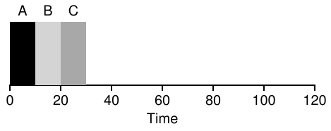
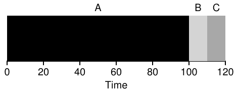
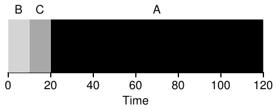
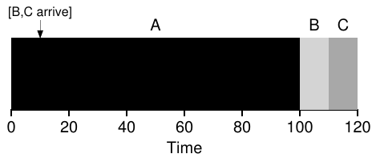
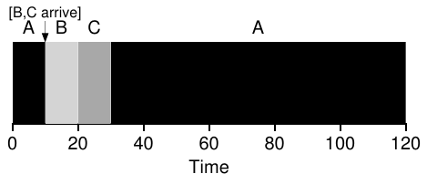
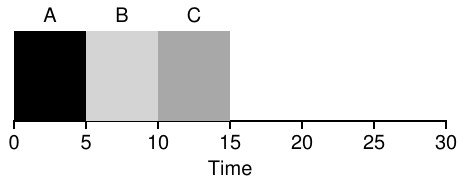
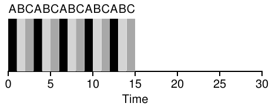
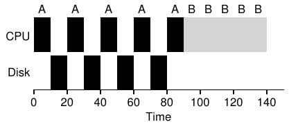
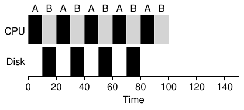

# 7 Scheduling: Giới thiệu

Đến đây, hẳn bạn đã hiểu rõ các mechanism low-level để chạy process (ví dụ context switching); nếu chưa, hãy quay lại một hoặc hai chương và đọc lại phần mô tả cách chúng hoạt động. Tuy nhiên, ta vẫn chưa hiểu các policy high-level mà OS scheduler sử dụng. Giờ ta sẽ tìm hiểu chính điều đó, bằng cách trình bày một loạt scheduling policy (đôi khi gọi là discipline) mà nhiều người thông minh và hard-working đã phát triển qua nhiều năm.

Thực ra, scheduling có nguồn gốc từ trước hệ thống máy tính; các cách tiếp cận ban đầu được lấy từ lĩnh vực quản trị vận hành rồi áp dụng vào máy tính. Điều này không có gì đáng ngạc nhiên: dây chuyền lắp ráp và nhiều hoạt động khác của con người cũng cần scheduling, với nhiều mối quan tâm tương tự, bao gồm mong muốn đạt hiệu quả với sự tập trung laser-like. Và như vậy, vấn đề của ta là:

> MẤU CHỐT: LÀM THẾ NÀO ĐỂ PHÁT TRIỂN SCHEDULING POLICY
>
> Ta nên xây dựng một khuôn khổ cơ bản để suy nghĩ về scheduling policy như thế nào? Những giả định then chốt là gì? Những metric nào quan trọng? Các hệ thống máy tính đầu tiên đã dùng những cách tiếp cận cơ bản nào?

## 7.1 Các giả định về workload

Trước khi đi vào các policy khả dĩ, trước hết hãy đưa ra một số giả định đơn giản hóa về các process đang chạy trong hệ thống, đôi khi được gọi chung là workload. Xác định workload là phần thiết yếu khi xây dựng policy, và càng biết nhiều về workload, policy của bạn càng có thể được fine-tuned.

Các giả định workload ở đây phần lớn không thực tế, nhưng điều đó chấp nhận được (ở thời điểm hiện tại), vì ta sẽ dần nới lỏng chúng và cuối cùng phát triển thứ ta sẽ gọi là ... (ngừng lại đầy kịch tính) ... một scheduling discipline fully-operational[^1].

Ta sẽ đưa ra những giả định sau về các process, đôi khi gọi là job, đang chạy trong hệ thống:

1. Mỗi job chạy trong khoảng thời gian như nhau.

2. Mọi job đến cùng một thời điểm.

3. Một khi bắt đầu, mỗi job chạy cho đến khi hoàn tất.

4. Mọi job chỉ dùng CPU (tức là không thực hiện I/O)

5. Ta biết run-time của mỗi job.

Ta đã nói nhiều giả định này không thực tế, nhưng cũng như một số con vật bình đẳng hơn những con khác trong Animal Farm của Orwell [O45], trong chương này một số giả định thiếu thực tế hơn những giả định khác. Đặc biệt, việc biết run-time của mỗi job có thể khiến bạn băn khoăn: điều đó biến scheduler thành đấng toàn tri, mà dù (có lẽ) rất tuyệt, cũng khó có khả năng sớm xảy ra.

## 7.2 Scheduling metric

Ngoài các giả định workload, ta còn cần một thứ nữa để so sánh những scheduling policy khác nhau: scheduling metric. Metric đơn giản là thứ ta dùng để đo lường một điều gì đó, và có nhiều metric khác nhau hợp lý trong scheduling.

Tuy nhiên, hiện tại hãy tiếp tục đơn giản hóa bằng cách chỉ dùng một metric duy nhất: turnaround time. Turnaround time của job được định nghĩa là thời điểm job hoàn tất trừ thời điểm job đến hệ thống. Viết hình thức hơn, turnaround time Tturnaround là:

Tturnaround = Tcompletion − Tarrival (7.1)

Vì đã giả định mọi job đến cùng lúc, hiện tại Tarrival = 0 và do đó Tturnaround = Tcompletion. Điều này sẽ thay đổi khi ta nới lỏng các giả định nói trên.

Bạn nên lưu ý turnaround time là một performance metric, trọng tâm chính của chương này. Một metric đáng quan tâm khác là fairness, được đo chẳng hạn bằng Jain’s Fairness Index [J91]. Hiệu năng và fairness thường mâu thuẫn trong scheduling; ví dụ, scheduler có thể tối ưu hiệu năng nhưng phải đánh đổi bằng việc không cho một vài job chạy, do đó giảm fairness. Tình thế khó xử này cho thấy cuộc sống không phải lúc nào cũng hoàn hảo.

## 7.3 First In, First Out (FIFO)

Thuật toán cơ bản nhất ta có thể triển khai được gọi là First In, First Out (FIFO) scheduling, hoặc đôi khi là First Come, First Served (FCFS). FIFO có một số ưu điểm: rõ ràng nó đơn giản, nên dễ triển khai. Và với các giả định của ta, nó hoạt động khá tốt.

Hãy cùng làm nhanh một ví dụ. Tưởng tượng ba job A, B và C đến hệ thống gần như cùng lúc (Tarrival = 0). Vì FIFO phải đặt một job lên trước, hãy giả sử dù tất cả đến đồng thời, A đến sớm hơn B một chút và B đến sớm hơn C một chút. Cũng giả sử mỗi job chạy trong 10 giây. Turnaround time trung bình của các job này sẽ bằng bao nhiêu?

Hình 7.1: Ví dụ đơn giản về FIFO

Từ Hình 7.1, bạn thấy A hoàn tất tại 10, B tại 20 và C tại 30. Vì vậy, turnaround time trung bình của ba job đơn giản là (10+20+30)/3 = 20. Tính turnaround time chỉ đơn giản như vậy.

Giờ hãy nới lỏng một giả định. Cụ thể, nới lỏng giả định 1, tức không còn giả sử mọi job chạy trong khoảng thời gian như nhau. Lúc này FIFO hoạt động thế nào? Bạn có thể xây dựng workload kiểu gì khiến FIFO hoạt động kém?

(hãy suy nghĩ trước khi đọc tiếp ... tiếp tục suy nghĩ ... hiểu ra chưa?!)

Có lẽ đến đây bạn đã hiểu, nhưng để chắc chắn, hãy làm ví dụ cho thấy các job có độ dài khác nhau có thể gây rắc rối cho FIFO scheduling như thế nào. Cụ thể, lại giả sử có ba job (A, B và C), nhưng lần này A chạy 100 giây, còn B và C mỗi job chạy 10 giây.

Hình 7.2: Vì sao FIFO không tốt đến vậy

Như bạn thấy trong Hình 7.2, Job A chạy trước trong trọn 100 giây rồi B hoặc C mới có cơ hội chạy. Vì vậy, turnaround time trung bình của hệ thống cao: 110 giây đầy khó chịu ( (100+110+120)/3 = 110).

Vấn đề này thường được gọi là convoy effect [B+79], trong đó một số bên có thể sử dụng tài nguyên trong thời gian relatively-short phải xếp hàng sau một bên tiêu thụ tài nguyên rất nặng. Tình huống scheduling này có thể khiến bạn nhớ đến một hàng chờ duy nhất ở cửa hàng tạp hóa và cảm giác khi thấy người phía trước có ba xe đẩy đầy hàng cùng cuốn sổ séc cầm sẵn; bạn sẽ phải đợi khá lâu đấy[^2].

> MẸO: NGUYÊN TẮC SJF
>
> Shortest Job First thể hiện một nguyên tắc scheduling tổng quát có thể áp dụng cho mọi hệ thống mà turnaround time cảm nhận được của mỗi khách hàng (hay trong trường hợp của ta là job) quan trọng. Hãy nghĩ đến bất kỳ hàng chờ nào bạn từng đứng: nếu cơ sở đó quan tâm sự hài lòng của khách hàng, có lẽ họ đã tính đến SJF. Ví dụ, cửa hàng tạp hóa thường có hàng “ten-items-or-less” để bảo đảm người chỉ mua vài món không bị kẹt sau một gia đình đang chuẩn bị cho mùa đông hạt nhân sắp tới.

Vậy ta nên làm gì? Làm thế nào phát triển thuật toán tốt hơn để xử lý thực tế mới rằng các job chạy trong thời gian khác nhau? Hãy suy nghĩ trước rồi đọc tiếp.

## 7.4 Shortest Job First (SJF)

Hóa ra một cách rất đơn giản giải quyết được vấn đề này; thực ra đó là ý tưởng lấy từ nghiên cứu vận trù [C54,PV56] rồi áp dụng vào scheduling job trong hệ thống máy tính. Scheduling discipline mới này gọi là Shortest Job First (SJF), một tên dễ nhớ vì mô tả policy khá đầy đủ: chạy job ngắn nhất trước, rồi job ngắn tiếp theo, cứ như vậy.

Hình 7.3: Ví dụ đơn giản về SJF

Hãy dùng ví dụ bên trên nhưng chọn SJF làm scheduling policy. Hình 7.3 cho thấy kết quả chạy A, B và C. Hy vọng sơ đồ làm rõ vì sao SJF tốt hơn nhiều về turnaround time trung bình. Chỉ bằng cách chạy B và C trước A, SJF giảm turnaround trung bình từ 110 giây xuống 50 ( (10+20+120)/3 = 50), cải thiện hơn hai lần.

Thực ra, với giả định mọi job đến cùng lúc, ta có thể chứng minh SJF thực sự là thuật toán scheduling tối ưu. Tuy nhiên, bạn đang học về hệ thống, không phải lý thuyết hay nghiên cứu vận trù; không được đưa ra chứng minh.

> THÔNG TIN THÊM: PREEMPTIVE SCHEDULER
>
> Trong thời kỳ batch computing trước đây, một số scheduler non-preemptive đã được phát triển; hệ thống như vậy chạy mỗi job cho đến khi hoàn tất rồi mới xét có chạy job mới không. Gần như mọi scheduler hiện đại đều preemptive, sẵn sàng dừng process này để chạy process khác. Điều này có nghĩa scheduler dùng những mechanism ta đã học trước đó; cụ thể, nó có thể thực hiện context switch, tạm dừng process đang chạy rồi tiếp tục (hoặc bắt đầu) process khác.

Như vậy, với SJF ta có một cách scheduling tốt, nhưng các giả định vẫn khá thiếu thực tế. Hãy nới lỏng thêm một giả định. Cụ thể, xét giả định 2 và giờ giả sử job có thể đến bất kỳ lúc nào, thay vì tất cả cùng đến một lúc. Điều này dẫn đến những vấn đề gì?

(Lại tạm dừng để suy nghĩ ... bạn đang suy nghĩ chứ? Cố lên, bạn làm được mà)

Ở đây, ta lại có thể minh họa vấn đề bằng ví dụ. Lần này, giả sử A đến tại t = 0 và cần chạy 100 giây, còn B và C đến tại t = 10 và mỗi job cần chạy 10 giây. Với SJF thuần túy, ta có schedule trong Hình 7.4.

Hình 7.4: SJF khi B và C đến muộn

Như thấy trong hình, dù B và C đến ngay sau A không lâu, chúng vẫn buộc phải chờ A hoàn tất, nên cũng chịu vấn đề convoy tương tự. Turnaround time trung bình của ba job này là 103.33 giây ( (100+(110−10)+(120−10))/3). Scheduler có thể làm gì?

## 7.5 Shortest Time-to-Completion First (STCF)

Để giải quyết điều này, ta cần nới lỏng giả định 3 (job phải chạy cho đến khi hoàn tất), vậy hãy làm điều đó. Ta cũng cần một số mechanism bên trong chính scheduler. Như có thể bạn đã đoán từ phần thảo luận timer interrupt và context switching, scheduler chắc chắn có thể làm điều khác khi B và C đến: nó có thể preempt job A và quyết định chạy job khác, có lẽ tiếp tục A sau. Theo định nghĩa của ta, SJF là scheduler non-preemptive nên gặp các vấn đề mô tả bên trên.

Hình 7.5: Ví dụ đơn giản về STCF

May mắn là có scheduler thực hiện đúng điều đó: bổ sung preemption vào SJF, được gọi là Shortest Time-to-Completion First (STCF) hay Preemptive Shortest Job First (PSJF) scheduler [CK68]. Mỗi khi job mới vào hệ thống, STCF scheduler xác định job nào trong số các job còn lại (kể cả job mới) có thời gian còn lại ít nhất rồi schedule job đó. Vì vậy, trong ví dụ, STCF sẽ preempt A và chạy B cùng C đến khi hoàn tất; chỉ sau khi chúng xong, phần thời gian còn lại của A mới được schedule. Hình 7.5 trình bày ví dụ.

Kết quả là turnaround time trung bình ở mức much-improved: 50 giây ( ((120−0)+(20−10)+(30−10))/3). Và như trước, với những giả định mới, có thể chứng minh STCF tối ưu; vì SJF tối ưu khi mọi job đến cùng lúc, có lẽ bạn có thể hiểu trực giác đằng sau tính tối ưu của STCF.

## 7.6 Metric mới: Response Time

Như vậy, nếu biết độ dài job, các job chỉ dùng CPU và metric duy nhất là turnaround time, STCF sẽ là policy tuyệt vời. Thực ra, với một số hệ thống batch computing đời đầu, các thuật toán scheduling kiểu này khá hợp lý. Tuy nhiên, sự xuất hiện của máy time-shared thay đổi tất cả. Giờ người dùng ngồi tại terminal và cũng đòi hỏi interactive performance từ hệ thống. Vì vậy, một metric mới ra đời: response time.

Response time được định nghĩa là khoảng thời gian từ khi job đến hệ thống cho đến lần đầu nó được schedule. Viết hình thức hơn:

Tresponse = Tfirstrun − Tarrival (7.2)

Ví dụ, với schedule bên trên (A đến tại thời điểm 0, còn B và C tại thời điểm 10), response time của từng job như sau: 0 cho job A, 0 cho B và 10 cho C (trung bình: 3.33).

Như có lẽ bạn đang nghĩ, STCF và các discipline liên quan không đặc biệt tốt về response time. Ví dụ, nếu ba job đến cùng lúc, job thứ ba phải chờ hai job trước chạy xong toàn bộ mới được schedule dù chỉ một lần. Dù rất tốt về turnaround time, cách này khá tệ về response time và tính tương tác. Thật vậy, hãy tưởng tượng đang ngồi tại terminal, gõ phím rồi phải chờ 10 giây mới thấy hệ thống phản hồi chỉ vì job khác được schedule trước job của bạn: chẳng dễ chịu lắm.

Hình 7.6: Lại là SJF (tệ về Response Time)

Hình 7.7: Round Robin (tốt về Response Time)

Vì vậy, ta lại có một vấn đề: làm thế nào xây dựng scheduler chú trọng response time?

## 7.7 Round Robin

Để giải quyết vấn đề, ta giới thiệu thuật toán scheduling mới, thường được gọi là Round-Robin (RR) scheduling [K64]. Ý tưởng cơ bản rất đơn giản: thay vì chạy job đến khi hoàn tất, RR chạy một job trong một time slice (đôi khi gọi là scheduling quantum), rồi chuyển sang job tiếp theo trong run queue. Nó lặp lại cho đến khi các job hoàn tất. Vì lý do này, RR đôi khi được gọi là time-slicing. Lưu ý độ dài time slice phải là bội số của chu kỳ timer-interrupt; vì vậy, nếu timer phát interrupt mỗi 10 millisecond, time slice có thể là 10, 20 hoặc bất kỳ bội số nào khác của 10 ms.

Để hiểu RR chi tiết hơn, hãy xem ví dụ. Giả sử ba job A, B và C đến hệ thống cùng lúc, mỗi job muốn chạy 5 giây. SJF scheduler chạy mỗi job đến khi hoàn tất rồi mới chạy job khác (Hình 7.6). Ngược lại, RR với time-slice 1 giây sẽ nhanh chóng luân phiên qua các job (Hình 7.7).

Response time trung bình của RR là: (0+1+2)/3 = 1; với SJF, response time trung bình là: (0+5+10)/3 = 5.

Như bạn thấy, độ dài time slice rất quan trọng với RR. Nó càng ngắn thì RR càng tốt theo metric response-time. Tuy nhiên, time slice quá ngắn gây vấn đề: chi phí context switching đột nhiên chi phối hiệu năng tổng thể. Vì vậy, quyết định độ dài time slice đặt ra trade-off cho người thiết kế hệ thống: đủ dài để amortize chi phí chuyển đổi nhưng không quá dài đến mức hệ thống mất khả năng phản hồi nhanh.

> MẸO: AMORTIZATION CÓ THỂ GIẢM CHI PHÍ
>
> Kỹ thuật amortization tổng quát thường được dùng trong hệ thống khi một thao tác có chi phí cố định. Bằng cách giảm tần suất phát sinh chi phí (tức thực hiện thao tác ít lần hơn), tổng chi phí hệ thống giảm. Ví dụ, nếu đặt time slice bằng 10 ms và chi phí context-switch là 1 ms, khoảng 10% thời gian dành cho context switching, do đó bị lãng phí. Nếu muốn amortize chi phí này, ta có thể tăng time slice, chẳng hạn lên 100 ms. Khi đó, dưới 1% thời gian dành cho context switching, và như vậy chi phí time-slicing đã được amortize.

Lưu ý chi phí context switching không chỉ đến từ việc OS lưu và khôi phục một vài register. Khi chương trình chạy, nó tạo rất nhiều trạng thái trong CPU cache, TLB, branch predictor và hardware on-chip khác. Chuyển sang job khác khiến trạng thái này bị flush và trạng thái mới liên quan đến job currently-running được đưa vào, điều có thể gây chi phí hiệu năng đáng kể [MB91].

Vì vậy, RR với time slice hợp lý là scheduler xuất sắc nếu response time là metric duy nhất. Nhưng còn người bạn cũ turnaround time thì sao? Hãy xem lại ví dụ bên trên. A, B và C, mỗi job chạy 5 giây, đến cùng lúc; scheduler là RR với time slice 1-second (dài). Từ hình bên trên, ta thấy A hoàn tất tại 13, B tại 14 và C tại 15, trung bình là 14. Khá tệ!

Vì vậy, không ngạc nhiên khi RR thực sự là một trong những policy tệ nhất nếu metric là turnaround time. Về trực giác, điều này hợp lý: RR kéo dài mỗi job hết mức có thể bằng cách chỉ chạy từng job một chút rồi chuyển sang job tiếp theo. Vì turnaround time chỉ quan tâm khi nào job hoàn tất, RR gần như tệ nhất, thậm chí tệ hơn FIFO đơn giản trong nhiều trường hợp.

Tổng quát hơn, mọi policy công bằng (như RR), tức chia đều CPU cho các process hoạt động trên thang thời gian ngắn, sẽ kém theo metric như turnaround time. Thực ra đây là trade-off vốn có: nếu sẵn lòng không công bằng, bạn có thể chạy các job ngắn đến khi hoàn tất nhưng phải đánh đổi response time; nếu coi trọng fairness, response time giảm nhưng phải đánh đổi turnaround time. Kiểu trade-off này phổ biến trong hệ thống; bạn không thể vừa giữ chiếc bánh vừa ăn nó[^3].

Ta đã phát triển hai loại scheduler. Loại thứ nhất (SJF, STCF) tối ưu turnaround time nhưng tệ về response time. Loại thứ hai (RR) tối ưu response time nhưng tệ về turnaround. Và vẫn còn hai giả định cần nới lỏng: giả định 4 (job không thực hiện I/O) và giả định 5 (biết run-time của mỗi job). Tiếp theo hãy xử lý những giả định đó.

> MẸO: OVERLAP CHO PHÉP UTILIZATION CAO HƠN
>
> Khi có thể, hãy overlap các thao tác để tối đa hóa utilization hệ thống. Overlap hữu ích trong nhiều lĩnh vực, kể cả khi thực hiện disk I/O hoặc gửi thông điệp đến máy ở xa; trong cả hai trường hợp, bắt đầu thao tác rồi chuyển sang công việc khác là ý tưởng tốt, giúp cải thiện utilization tổng thể và hiệu quả hệ thống.

## 7.8 Tính đến I/O

Đầu tiên, ta nới lỏng giả định 4 — tất nhiên mọi chương trình đều thực hiện I/O. Hãy tưởng tượng chương trình không nhận bất kỳ đầu vào nào: mỗi lần nó sẽ tạo cùng đầu ra. Tưởng tượng một chương trình không có đầu ra: nó như cái cây đổ trong rừng mà không ai nhìn thấy trong câu chuyện quen thuộc; việc nó đã chạy chẳng có ý nghĩa gì.

Rõ ràng scheduler phải quyết định khi job khởi tạo I/O request, vì job currently-running không dùng CPU trong lúc I/O; nó bị blocked để chờ I/O hoàn tất. Nếu I/O được gửi đến hard disk drive, process có thể bị blocked trong vài millisecond hoặc lâu hơn, tùy tải I/O hiện tại của ổ đĩa. Vì vậy, scheduler có lẽ nên schedule job khác trên CPU lúc đó.

Scheduler cũng phải quyết định khi I/O hoàn tất. Khi đó, interrupt phát sinh, OS chạy và chuyển process đã gửi I/O từ blocked trở lại trạng thái ready. Tất nhiên, nó thậm chí có thể quyết định chạy job ngay lúc đó. OS nên xử lý mỗi job như thế nào?

Để hiểu rõ hơn, giả sử có hai job A và B, mỗi job cần 50 ms CPU time. Tuy nhiên, có một khác biệt rõ ràng: A chạy 10 ms rồi gửi I/O request (giả sử mỗi I/O mất 10 ms), còn B chỉ dùng CPU trong 50 ms và không thực hiện I/O. Scheduler chạy A trước rồi đến B (Hình 7.8).

Hình 7.8: Sử dụng tài nguyên kém hiệu quả

Giả sử ta đang xây dựng STCF scheduler. Scheduler như vậy nên tính đến việc A được chia thành 5 sub-jobs 10-ms, còn B chỉ là một nhu cầu CPU 50-ms duy nhất như thế nào? Rõ ràng, chỉ chạy job này rồi job kia mà không xét cách tính đến I/O chẳng có mấy ý nghĩa.

Một cách phổ biến là xem mỗi sub-job 10-ms của A như job độc lập. Vì vậy, khi hệ thống bắt đầu, nó phải chọn schedule A 10-ms hay B 50-ms. Với STCF, lựa chọn rất rõ: chọn job ngắn hơn, trong trường hợp này là A. Sau đó, khi sub-job đầu tiên của A hoàn tất, chỉ còn B và B bắt đầu chạy. Rồi một sub-job mới của A được đưa vào, preempt B và chạy 10 ms. Làm vậy cho phép overlap: CPU được một process sử dụng trong khi chờ I/O của process khác hoàn tất; nhờ đó hệ thống được tận dụng tốt hơn (xem Hình 7.9).

Hình 7.9: Overlap cho phép tận dụng tài nguyên tốt hơn

Như vậy, ta thấy scheduler có thể tính đến I/O như thế nào. Bằng cách xem mỗi CPU burst là một job, scheduler bảo đảm các process “interactive” được chạy thường xuyên. Trong khi những job interactive này thực hiện I/O, các job CPU-intensive khác chạy, nhờ đó tận dụng processor tốt hơn.

## 7.9 Không còn khả năng tiên tri

Với cách tiếp cận I/O cơ bản đã có, ta đến giả định cuối cùng: scheduler biết độ dài mỗi job. Như đã nói, đây có lẽ là giả định tệ nhất ta có thể đưa ra. Thực ra, trong OS general-purpose (như những OS ta quan tâm), OS thường biết rất ít về độ dài mỗi job. Vậy làm thế nào xây dựng một cách tiếp cận hoạt động như SJF/STCF mà không có kiến thức biết trước như vậy? Hơn nữa, làm thế nào kết hợp một số ý tưởng đã thấy ở RR scheduler để response time cũng khá tốt?

## 7.10 Tóm tắt

Ta đã giới thiệu những ý tưởng cơ bản đằng sau scheduling và phát triển hai nhóm cách tiếp cận. Nhóm đầu chạy job còn lại ngắn nhất, nhờ đó tối ưu turnaround time; nhóm thứ hai luân phiên giữa mọi job, nhờ đó tối ưu response time. Đáng tiếc, mỗi nhóm đều kém ở điểm nhóm kia tốt, một trade-off vốn có thường gặp trong hệ thống. Ta cũng thấy có thể tính đến I/O thế nào, nhưng vẫn chưa giải quyết được vấn đề OS về bản chất không thể nhìn trước tương lai. Sắp tới, ta sẽ thấy cách khắc phục bằng cách xây dựng scheduler dùng quá khứ gần để dự đoán tương lai. Scheduler này gọi là multi-level feedback queue, chủ đề của chương tiếp theo.

## Tài liệu tham khảo

[B+79] “The Convoy Phenomenon”

M. Blasgen, J. Gray, M. Mitoma, T. Price

ACM Operating Systems Review, 13:2, tháng Tư năm 1979

Có lẽ là tài liệu đầu tiên đề cập convoy, hiện tượng xuất hiện trong cả database lẫn OS.

[C54] “Priority Assignment in Waiting Line Problems”

A. Cobham

Journal of Operations Research, 2:70, trang 70–76, 1954

Bài báo tiên phong về dùng cách tiếp cận SJF để scheduling việc sửa chữa máy.

[K64] “Analysis of a Time-Shared Processor”

Leonard Kleinrock

Naval Research Logistics Quarterly, 11:1, trang 59–73, tháng Ba năm 1964

Có thể là tài liệu đầu tiên đề cập thuật toán scheduling round-robin; chắc chắn là một trong những phân tích đầu tiên về cách scheduling hệ thống time-shared này.

[CK68] “Computer Scheduling Methods and their Countermeasures”

Edward G. Coffman and Leonard Kleinrock

AFIPS ’68 (mùa Xuân), tháng Tư năm 1968

Một công trình thời kỳ đầu giới thiệu và phân tích xuất sắc một số scheduling discipline cơ bản.

[J91] “The Art of Computer Systems Performance Analysis: Techniques for Experimental Design, Measurement, Simulation, and Modeling”

R. Jain

Interscience, New York, tháng Tư năm 1991

Giáo trình chuẩn về đo lường hệ thống máy tính. Chắc chắn là tài liệu tham khảo rất tốt cho thư viện của bạn.

[O45] “Animal Farm”

George Orwell

Secker and Warburg (London), 1945

Một cuốn sách ngụ ngôn tuyệt vời nhưng buồn bã về quyền lực và sự tha hóa của nó. Có người nói sách phê phán Stalin và thời kỳ Stalin pre-WWII ở U.S.S.R; chúng tôi nói nó phê phán lợn.

[PV56] “Machine Repair as a Priority Waiting-Line Problem”

Thomas E. Phipps Jr. and W. R. Van Voorhis

Operations Research, 4:1, trang 76–86, tháng Hai năm 1956

Công trình Follow-on khái quát hóa cách tiếp cận SJF cho sửa chữa máy từ công trình ban đầu của Cobham; đồng thời nêu giả thuyết về tính hữu ích của cách tiếp cận STCF trong môi trường đó. Cụ thể: “Có những loại công việc sửa chữa, ... cần tháo dỡ nhiều và khiến sàn đầy đai ốc cùng bu lông, chắc chắn không nên bị gián đoạn một khi đã bắt đầu; trong những trường hợp khác, sẽ không hợp lý nếu tiếp tục làm một công việc dài khi một hoặc nhiều công việc ngắn đã sẵn sàng (p.81).”

[MB91] “The effect of context switches on cache performance”

Jeffrey C. Mogul and Anita Borg

ASPLOS, 1991

Một nghiên cứu hay về ảnh hưởng của context switching đến hiệu năng cache; vấn đề này ít nghiêm trọng hơn trên hệ thống ngày nay, nơi processor issue hàng tỷ instruction mỗi giây nhưng context-switches vẫn xảy ra trong khoảng thời gian millisecond.

[W15] “You can’t have your cake and eat it” http://en.wikipedia.org/wiki/You_can’t_have_your_cake_and_eat_it

Wikipedia, tính đến tháng Mười Hai năm 2015

Phần hay nhất của trang này là đọc những thành ngữ tương tự trong các ngôn ngữ khác. Trong tiếng Tamil, bạn không thể “vừa giữ bộ ria mép vừa uống súp.”

## Bài tập về nhà

Chương trình scheduler.py này cho phép bạn thấy các scheduler khác nhau hoạt động thế nào theo scheduling metric như response time, turnaround time và tổng wait time. Xem README để biết chi tiết.

### Câu hỏi

1. Tính response time và turnaround time khi chạy ba job có độ dài 200 bằng SJF scheduler và FIFO scheduler.

2. Làm tương tự nhưng với các job có độ dài khác nhau: 100, 200 và 300.

3. Làm tương tự, nhưng dùng thêm RR scheduler và time-slice bằng 1.

4. Với những loại workload nào SJF cho turnaround time giống FIFO?

5. Với những loại workload và độ dài quantum nào SJF cho response time giống RR?

6. Điều gì xảy ra với response time của SJF khi độ dài job tăng? Bạn có thể dùng simulator để minh họa xu hướng không?

7. Điều gì xảy ra với response time của RR khi độ dài quantum tăng? Bạn có thể viết phương trình cho response time worst-case khi có N job không?

---

[^1]: Nói theo cùng cách bạn sẽ nói “Một Death Star fully-operational.”

[^2]: Hành động được khuyên trong trường hợp này: nhanh chóng chuyển sang hàng khác, hoặc hít một hơi dài, sâu và thư giãn. Đúng rồi, hít vào, thở ra. Mọi chuyện sẽ ổn, đừng lo.

[^3]: Một câu nói khiến người ta bối rối, vì đáng ra phải là “Bạn không thể vừa giữ chiếc bánh vừa ăn nó” (điều này khá hiển nhiên, phải không?). Thật ngạc nhiên là có một trang wikipedia về câu nói này; còn ngạc nhiên hơn, đọc nó khá thú vị [W15]. Như người Ý nói, bạn không thể Avere la botte piena e la moglie ubriaca.
