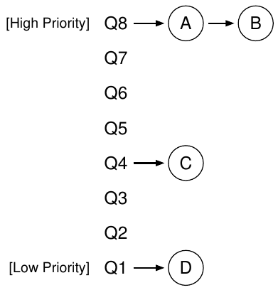
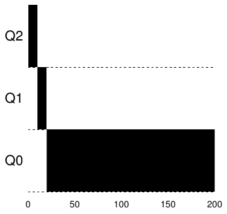
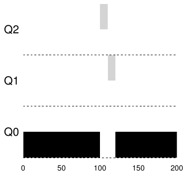
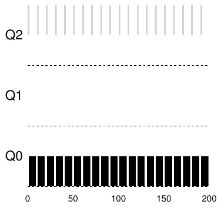
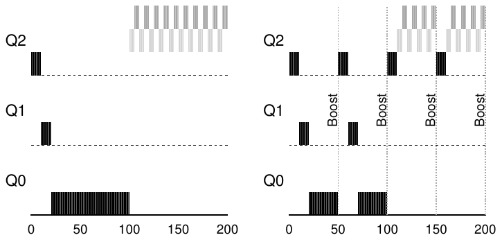
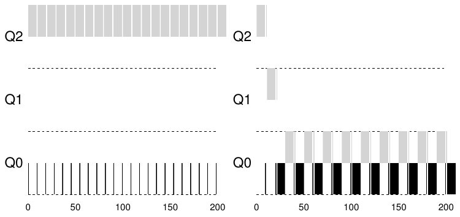
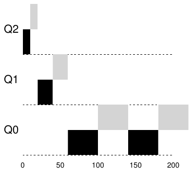

# 8 Scheduling: The Multi-Level Feedback Queue

Trong chương này, ta giải quyết việc phát triển một trong những cách scheduling well-known nhất, gọi là Multi-level Feedback Queue (MLFQ). Scheduler Multi-level Feedback Queue (MLFQ) được Corbato và cộng sự mô tả lần đầu năm 1962 [C+62] trong hệ thống Compatible Time-Sharing System (CTSS); công trình này cùng các công trình Multics sau đó khiến ACM trao cho Corbato vinh dự cao nhất của tổ chức, giải Turing. Scheduler tiếp tục được cải tiến qua nhiều năm thành những triển khai mà bạn sẽ gặp trong một số hệ thống hiện đại.

Vấn đề cơ bản MLFQ cố giải quyết có tính two-fold. Thứ nhất, nó muốn tối ưu turnaround time, mà như đã thấy ở phần trước, có thể làm bằng cách chạy job ngắn trước; đáng tiếc, OS thường không biết job sẽ chạy bao lâu, đúng loại kiến thức thuật toán như SJF (hoặc STCF) đòi hỏi. Thứ hai, MLFQ muốn hệ thống tạo cảm giác phản hồi nhanh cho người dùng tương tác (tức người ngồi nhìn màn hình chờ process hoàn tất), nên muốn giảm thiểu response time; đáng tiếc, thuật toán như Round Robin giảm response time nhưng rất tệ về turnaround time. Vì vậy, vấn đề là: khi nhìn chung không biết gì về process, làm thế nào xây dựng scheduler đạt các mục tiêu này? Trong lúc hệ thống chạy, scheduler có thể học đặc điểm những job nó đang chạy như thế nào để quyết định scheduling tốt hơn?

> MẤU CHỐT:
>
> LÀM THẾ NÀO ĐỂ SCHEDULE KHI KHÔNG BIẾT ĐẦY ĐỦ?
>
> Làm thế nào thiết kế scheduler vừa giảm thiểu response time cho interactive job vừa giảm thiểu turnaround time mà không biết trước độ dài job?
>
> MẸO: HỌC TỪ LỊCH SỬ
>
> multi-level feedback queue là ví dụ xuất sắc về hệ thống học từ quá khứ để dự đoán tương lai. Những cách này phổ biến trong operating system (và nhiều nơi khác trong Khoa học Máy tính, gồm hardware branch predictor và caching algorithm). Chúng hiệu quả khi job có các giai đoạn hành vi nên có thể dự đoán; tất nhiên phải cẩn thận, vì các kỹ thuật như vậy dễ sai và khiến hệ thống quyết định tệ hơn cả khi hoàn toàn không có thông tin.

## 8.1 MLFQ: Các quy tắc cơ bản

Để xây dựng scheduler như vậy, chương này mô tả các thuật toán cơ bản đằng sau multi-level feedback queue; dù chi tiết nhiều triển khai MLFQ khác nhau [E95], phần lớn cách tiếp cận tương tự nhau.

Trong cách trình bày ở đây, MLFQ có một số queue riêng biệt, mỗi queue được gán priority level khác nhau. Tại bất kỳ thời điểm nào, một job sẵn sàng chạy nằm trong một queue duy nhất. MLFQ dùng priority để quyết định job nào chạy tại một thời điểm: job có priority cao hơn (tức nằm ở queue cao hơn) được chọn chạy.

Tất nhiên, có thể có nhiều job trong cùng queue, do đó có cùng priority. Khi đó, ta chỉ dùng round-robin scheduling giữa các job này.

Vì vậy, chìa khóa của MLFQ scheduling nằm ở cách scheduler đặt priority. Thay vì gán priority cố định cho mỗi job, MLFQ thay đổi priority dựa trên hành vi quan sát được. Chẳng hạn, nếu job liên tục nhường CPU trong khi chờ đầu vào từ bàn phím, MLFQ giữ priority cao, vì interactive process có thể hành xử như vậy. Ngược lại, nếu job dùng CPU nhiều trong thời gian dài, MLFQ giảm priority. Nhờ vậy, MLFQ cố tìm hiểu process khi chúng chạy, dùng lịch sử job để dự đoán hành vi tương lai.

Như vậy, ta có hai quy tắc cơ bản đầu tiên của MLFQ:

• Quy tắc 1: Nếu Priority(A) > Priority(B), A chạy (B không chạy).

• Quy tắc 2: Nếu Priority(A) = Priority(B), A & B chạy theo RR.

Nếu vẽ hình các queue tại một thời điểm, ta có thể thấy như sau (Hình 8.1). Trong hình, hai job (A và B) ở priority level cao nhất, job C ở giữa và Job D có priority thấp nhất. Với hiểu biết hiện tại về MLFQ, scheduler chỉ luân phiên time slice giữa A và B vì chúng có priority cao nhất hệ thống; hai job C và D tội nghiệp thậm chí không bao giờ được chạy — thật bất công!

Tất nhiên, chỉ xem ảnh chụp tĩnh của một số queue chưa thực sự giúp bạn hiểu MLFQ hoạt động ra sao. Ta cần hiểu priority của job thay đổi theo thời gian như thế nào. Và điều đó, chỉ gây bất ngờ với người lần đầu đọc một chương trong sách này, chính là việc ta sẽ làm tiếp theo.

Hình 8.1: Ví dụ MLFQ

## 8.2 Lần thử #1: Cách thay đổi priority

Giờ ta phải quyết định MLFQ thay đổi priority level của job (và do đó queue chứa nó) trong suốt vòng đời như thế nào. Để làm vậy, phải luôn xét workload của chúng ta: hỗn hợp interactive job short-running (có thể thường xuyên nhường CPU) và một số job “CPU-bound” longer-running cần nhiều CPU time nhưng response time không quan trọng. Đây là lần thử đầu tiên cho thuật toán priority-adjustment:

• Quy tắc 3: Khi job vào hệ thống, đặt nó ở priority cao nhất (queue trên cùng).

• Quy tắc 4a: Nếu job dùng hết toàn bộ time slice khi chạy, giảm priority của nó (tức chuyển xuống một queue).

• Quy tắc 4b: Nếu job nhường CPU trước khi hết time slice, giữ nguyên priority level.

### Ví dụ 1: Một job Long-Running duy nhất

Hãy xem vài ví dụ. Đầu tiên, xem điều gì xảy ra khi hệ thống có một job chạy dài. Hình 8.2 cho thấy điều xảy ra với job này theo thời gian trong scheduler three-queue.

Hình 8.2: Job Long-running theo thời gian

Như bạn thấy trong ví dụ, job bắt đầu ở priority cao nhất (Q2). Sau một time-slice 10 ms duy nhất, scheduler giảm priority một mức, nên job nằm ở Q1. Sau khi chạy một time slice tại Q1, job cuối cùng bị hạ xuống priority thấp nhất hệ thống (Q0) và ở lại đó. Khá đơn giản, phải không?

### Ví dụ 2: Một job ngắn xuất hiện

Giờ xem ví dụ phức tạp hơn, hy vọng thấy MLFQ cố xấp xỉ SJF như thế nào. Có hai job: A là job CPU-intensive long-running, B là interactive job short-running. Giả sử A đã chạy một thời gian rồi B đến. Điều gì xảy ra? MLFQ có xấp xỉ SJF cho B không?

Hình 8.3 biểu diễn kết quả tình huống này. A (màu đen) đang chạy trong queue lowest-priority (như mọi job CPU-intensive long-running); B (màu xám) đến tại T = 100, nên được chèn vào queue cao nhất; do run-time ngắn (chỉ 20 ms), B hoàn tất trong hai time slice trước khi xuống queue thấp nhất; sau đó A tiếp tục chạy (với priority thấp).

Hình 8.3: Một interactive job xuất hiện

Hình 8.4: Workload hỗn hợp I/O-intensive và CPU-intensive

Hy vọng ví dụ giúp bạn hiểu một mục tiêu chính của thuật toán: vì không biết job ngắn hay long-running, trước hết nó giả định job có thể ngắn, nên cấp priority cao. Nếu thực sự ngắn, job chạy nhanh rồi hoàn tất; nếu không ngắn, nó dần xuống các queue, sớm thể hiện mình là process long-running mang tính batch-like hơn. Theo cách này, MLFQ xấp xỉ SJF.

### Ví dụ 3: Còn I/O thì sao?

Giờ xem ví dụ có I/O. Như Quy tắc 4b bên trên, nếu process nhường processor trước khi dùng hết time slice, ta giữ nó ở cùng priority level. Mục đích rất đơn giản: chẳng hạn, nếu interactive job thực hiện nhiều I/O (như chờ đầu vào bàn phím hoặc chuột), nó nhường CPU trước khi hết time slice; khi đó, ta không muốn phạt job nên chỉ giữ nguyên priority level của nó.

Hình 8.4 minh họa cách này hoạt động: interactive job B (màu xám) chỉ cần CPU 1 ms trước khi thực hiện I/O, cạnh tranh CPU với batch job A long-running (màu đen). MLFQ giữ B ở priority cao nhất vì B liên tục nhường CPU; nếu B là interactive job, MLFQ tiếp tục đạt mục tiêu chạy interactive job nhanh chóng.

### Những vấn đề với MLFQ hiện tại

Như vậy, ta có MLFQ cơ bản. Nó có vẻ khá tốt, chia CPU công bằng giữa job long-running và cho job ngắn hoặc interactive job I/O-intensive chạy nhanh. Đáng tiếc, cách ta phát triển đến đây có khiếm khuyết nghiêm trọng. Bạn nghĩ ra được vấn đề nào không?

(Đây là lúc tạm dừng và suy nghĩ thật tinh quái hết mức có thể)

Hình 8.5: Không có (trái) và có (phải) Priority Boost

Thứ nhất là starvation: nếu hệ thống có “quá nhiều” interactive job, chúng kết hợp tiêu thụ hết CPU time, nên job long-running không bao giờ nhận CPU time (bị starvation). Ta muốn các job này vẫn tiến triển ngay cả trong tình huống đó.

Thứ hai, người dùng thông minh có thể viết lại chương trình để lách scheduler. Gaming scheduler nói chung là làm điều tinh vi để đánh lừa scheduler cấp cho mình phần tài nguyên vượt mức công bằng. Thuật toán đã mô tả dễ bị tấn công như sau: trước khi time slice kết thúc, gửi thao tác I/O (đến file nào đó bạn không quan tâm) để nhường CPU; làm vậy cho phép ở lại cùng queue, nhờ đó nhận tỷ lệ CPU time cao hơn. Nếu thực hiện đúng (ví dụ chạy 99% time slice rồi mới nhường CPU), job có thể gần như độc chiếm CPU.

Cuối cùng, chương trình có thể thay đổi hành vi theo thời gian; từ CPU-bound chuyển sang giai đoạn tương tác. Với cách hiện tại, job như vậy sẽ rơi vào bất lợi và không được đối xử như các interactive job khác trong hệ thống.

## 8.3 Lần thử #2: Priority Boost

Hãy thử thay quy tắc xem có tránh starvation được không. Ta có thể làm gì để bảo đảm job CPU-bound tiến triển phần nào (dù không nhiều)?

Ý tưởng đơn giản là định kỳ boost priority của mọi job trong hệ thống. Có nhiều cách, nhưng hãy làm đơn giản: đưa tất cả vào queue trên cùng; do đó, có quy tắc mới:

• Quy tắc 5: Sau một khoảng thời gian S, chuyển mọi job trong hệ thống lên queue trên cùng.

Quy tắc mới giải quyết hai vấn đề cùng lúc. Thứ nhất, process được bảo đảm không starvation: khi ở queue trên cùng, job chia CPU với các job high-priority khác theo round-robin, nên cuối cùng được phục vụ. Thứ hai, nếu job CPU-bound trở thành interactive, scheduler xử lý đúng sau khi job nhận priority boost.

Hình 8.6: Không có (trái) và có (phải) khả năng chống gaming

Hãy xem ví dụ. Ở đây, ta chỉ thể hiện hành vi job long-running khi cạnh tranh CPU với hai interactive job short-running. Hình 8.5 (trang 6) có hai graph. Bên trái không có priority boost, nên job long-running bị starvation khi hai job ngắn đến; bên phải có priority boost mỗi 50 ms (có lẽ quá nhỏ, nhưng dùng ở đây để minh họa), nên ít nhất bảo đảm job long-running tiến triển phần nào, được boost lên priority cao nhất mỗi 50 ms và do đó được chạy định kỳ.

Tất nhiên, thêm khoảng thời gian S dẫn đến câu hỏi rõ ràng: nên đặt S bằng bao nhiêu? John Ousterhout, nhà nghiên cứu hệ thống well-regarded [O11], từng gọi những giá trị kiểu này là hằng số voo-doo vì dường như cần phép thuật hắc ám để đặt đúng. Đáng tiếc, S cũng như vậy. Nếu quá lớn, job long-running có thể starvation; quá nhỏ, interactive job có thể không nhận phần CPU thích hợp.

## 8.4 Lần thử #3: Accounting tốt hơn

Giờ còn một vấn đề: làm sao ngăn gaming scheduler? Thủ phạm thật sự, như có thể bạn đã đoán, là Quy tắc 4a và 4b, cho phép job giữ priority bằng cách nhường CPU trước khi hết time slice. Vậy nên làm gì?

Giải pháp là accounting CPU time tốt hơn tại mỗi mức MLFQ. Thay vì quên process đã dùng bao nhiêu time slice ở mức đó, scheduler phải theo dõi; khi process dùng hết allotment, hạ xuống priority queue tiếp theo. Dùng time slice trong một burst dài hay nhiều burst nhỏ không quan trọng. Vì vậy, ta viết lại Quy tắc 4a và 4b thành quy tắc duy nhất sau:

Hình 8.7: Priority thấp hơn, quantum dài hơn

• Quy tắc 4: Khi job dùng hết time allotment ở một mức nhất định (bất kể đã nhường CPU bao nhiêu lần), giảm priority của nó (tức chuyển xuống một queue).

Hãy xem ví dụ. Hình 8.6 (trang 7) cho thấy workload cố lách scheduler với Quy tắc 4a và 4b cũ (trái), cũng như Quy tắc 4 anti-gaming mới. Không có bảo vệ, process có thể gửi I/O ngay trước khi hết time slice và chiếm phần lớn CPU time. Khi có bảo vệ, bất kể hành vi I/O của process, nó dần xuống các queue, nên không thể giành phần CPU thiếu công bằng.

## 8.5 Tinh chỉnh MLFQ và những vấn đề khác

MLFQ scheduling còn một vài vấn đề khác. Câu hỏi lớn là tham số hóa scheduler như vậy ra sao. Ví dụ, cần bao nhiêu queue? Time slice của mỗi queue nên dài bao nhiêu? Bao lâu boost priority để tránh starvation và tính đến thay đổi hành vi? Không có câu trả lời dễ dàng, nên chỉ kinh nghiệm với workload cùng việc tinh chỉnh scheduler sau đó mới đem lại cân bằng thỏa đáng.

Ví dụ, phần lớn biến thể MLFQ cho phép độ dài time-slice khác nhau giữa các queue. Queue high-priority thường được cấp time slice ngắn; dù sao chúng chứa interactive job nên luân phiên nhanh giữa chúng là hợp lý (ví dụ 10 millisecond hoặc ít hơn). Ngược lại, queue low-priority chứa job long-running CPU-bound; do đó time slice dài hoạt động hiệu quả (ví dụ vài trăm ms, tức vài lần 100 ms). Hình 8.7 cho ví dụ hai job long-running chạy 10 ms ở queue cao nhất, 20 ở giữa và 40 ở thấp nhất.

> MẸO: TRÁNH HẰNG SỐ VOO-DOO (ĐỊNH LUẬT OUSTERHOUT)
>
> Tránh hằng số voo-doo là ý hay khi có thể. Đáng tiếc, như ví dụ trên, việc này thường khó. Có thể thử cho hệ thống học giá trị tốt, nhưng cũng không đơn giản. Kết quả thường là configuration file đầy giá trị parameter mặc định mà quản trị viên dày dạn có thể điều chỉnh khi điều gì đó chưa hoạt động đúng. Như bạn có thể hình dung, chúng thường được giữ nguyên, nên ta chỉ còn hy vọng mặc định hoạt động tốt trong thực tế. Mẹo này đến từ giáo sư OS cũ của chúng tôi, John Ousterhout, nên ta gọi là Định luật Ousterhout.

Triển khai MLFQ của Solaris — scheduling class Time-Sharing, hay TS — đặc biệt dễ cấu hình; nó cung cấp tập bảng xác định chính xác priority process thay đổi thế nào trong vòng đời, mỗi time slice dài bao lâu và bao lâu boost priority job [AD00]; quản trị viên có thể sửa bảng để scheduler hành xử khác nhau. Các giá trị mặc định trong bảng là 60 queue, độ dài time-slice tăng dần từ 20 millisecond (priority cao nhất) đến vài trăm millisecond (thấp nhất), và boost priority khoảng mỗi 1 giây.

Scheduler MLFQ khác không dùng bảng hoặc đúng các quy tắc trong chương; thay vào đó, điều chỉnh priority bằng công thức toán học. Ví dụ, FreeBSD scheduler (phiên bản 4.3) dùng công thức tính priority level hiện tại dựa trên lượng CPU process đã dùng [LM+89]; ngoài ra, usage giảm dần theo thời gian, cung cấp priority boost mong muốn theo cách khác với cách đã mô tả ở đây. Xem bài Epema để có tổng quan xuất sắc về các thuật toán decay-usage này và tính chất của chúng [E95].

Cuối cùng, nhiều scheduler có một vài tính năng khác bạn có thể gặp. Ví dụ, một số dành priority level cao nhất cho công việc operating system; vì vậy user job thông thường không bao giờ đạt priority cao nhất hệ thống. Một số hệ thống cũng cho phép người dùng đưa lời khuyên để giúp đặt priority; ví dụ dùng tiện ích command-line nice, bạn có thể tăng hoặc giảm priority job (phần nào), nhờ đó tăng hoặc giảm cơ hội chạy tại một thời điểm. Xem man page để biết thêm.

## 8.6 MLFQ: Tóm tắt

Ta đã mô tả cách scheduling gọi là Multi-Level Feedback Queue (MLFQ). Hy vọng giờ bạn hiểu tên đó: nó có nhiều mức queue và dùng feedback để xác định priority job. Lịch sử dẫn đường: chú ý hành vi job theo thời gian và đối xử tương ứng.

> MẸO: DÙNG ADVICE KHI CÓ THỂ
>
> Vì operating system hiếm khi biết điều gì tốt nhất cho từng process, cung cấp interface cho người dùng hoặc quản trị viên đưa gợi ý đến OS thường hữu ích. Ta thường gọi những gợi ý này là advice, vì OS không nhất thiết phải nghe theo mà có thể cân nhắc để quyết định tốt hơn. Gợi ý hữu ích trong nhiều phần OS, gồm scheduler (ví dụ nice), memory manager (ví dụ madvise) và file system (ví dụ informed prefetching và caching [P+95]).

Tập quy tắc MLFQ đã hoàn thiện, nằm rải rác trong chương, được nhắc lại ở đây để bạn tiện xem:

• Quy tắc 1: Nếu Priority(A) > Priority(B), A chạy (B không chạy).

• Quy tắc 2: Nếu Priority(A) = Priority(B), A & B chạy theo RR.

• Quy tắc 3: Khi job vào hệ thống, đặt nó ở priority cao nhất (queue trên cùng).

• Quy tắc 4: Khi job dùng hết time allotment ở một mức nhất định (bất kể đã nhường CPU bao nhiêu lần), giảm priority của nó (tức chuyển xuống một queue).

• Quy tắc 5: Sau một khoảng thời gian S, chuyển mọi job trong hệ thống lên queue trên cùng.

MLFQ thú vị vì: thay vì đòi hỏi biết trước bản chất job, nó quan sát việc thực thi và ưu tiên tương ứng. Nhờ vậy, nó đạt lợi ích của cả hai phía: hiệu năng tổng thể xuất sắc (tương tự SJF/STCF) cho interactive job short-running, đồng thời công bằng và cho workload CPU-intensive long-running tiến triển. Vì thế, nhiều hệ thống gồm các dẫn xuất BSD UNIX [LM+89, B86], Solaris [M06], Windows NT và operating system Windows sau đó [CS97] dùng một dạng MLFQ làm scheduler cơ sở.

## Tài liệu tham khảo

[AD00] “Multilevel Feedback Queue Scheduling in Solaris”

Andrea Arpaci-Dusseau

Có tại: http://www.cs.wisc.edu/˜remzi/solaris-notes.pdf

Tập ghi chép ngắn rất hay do một tác giả sách viết về chi tiết Solaris scheduler. Được rồi, có thể mô tả này thiên vị, nhưng các ghi chép thực sự rất tốt.

[B86] “The Design of the UNIX Operating System”

M.J. Bach

Prentice-Hall, 1986

Một cuốn sách kinh điển lâu đời về cách xây dựng operating system UNIX thực tế; chắc chắn là tài liệu must-read cho kernel hacker.

[C+62] “An Experimental Time-Sharing System”

F. J. Corbato, M. M. Daggett, R. C. Daley

IFIPS 1962

Hơi khó đọc, nhưng là nguồn của nhiều ý tưởng ban đầu về multi-level feedback scheduling. Phần lớn sau đó được đưa vào Multics, có thể xem là operating system ảnh hưởng nhất mọi thời đại.

[CS97] “Inside Windows NT”

Helen Custer and David A. Solomon

Microsoft Press, 1997

Cuốn sách về NT, nếu bạn muốn học thứ khác ngoài UNIX. Tất nhiên, sao lại muốn thế? Được rồi, đùa thôi; biết đâu một ngày bạn thực sự làm cho Microsoft.

[E95] “An Analysis of Decay-Usage Scheduling in Multiprocessors”

D.H.J. Epema

SIGMETRICS ’95

Một bài báo hay về trình độ phát triển scheduling vào giữa thập niên 1990, gồm tổng quan tốt về cách tiếp cận cơ bản của scheduler decay-usage.

[LM+89] “The Design and Implementation of the 4.3BSD UNIX Operating System”

S.J. Leffler, M.K. McKusick, M.J. Karels, J.S. Quarterman

Addison-Wesley, 1989

Một tác phẩm OS kinh điển khác, do bốn nhân vật chính đứng sau BSD viết. Các phiên bản sách sau này dù cập nhật hơn vẫn không hoàn toàn sánh được vẻ đẹp của bản này.

[M06] “Solaris Internals: Solaris 10 and OpenSolaris Kernel Architecture”

Richard McDougall

Prentice-Hall, 2006

Một cuốn sách hay về Solaris và cách nó hoạt động.

[O11] “John Ousterhout’s Home Page”

John Ousterhout

Có tại: http://www.stanford.edu/˜ouster/

Trang chủ của Giáo sư Ousterhout nổi tiếng. Hai co-authors cuốn sách từng vui mừng được học operating system sau đại học với Ousterhout; thực ra, đó là nơi hai co-authors quen nhau, cuối cùng dẫn đến kết hôn, con cái và cả cuốn sách này. Vì vậy, bạn thực sự có thể trách Ousterhout về toàn bộ mớ rắc rối mình đang gặp.

[P+95] “Informed Prefetching and Caching”

R.H. Patterson, G.A. Gibson, E. Ginting, D. Stodolsky, J. Zelenka

SOSP ’95

Một bài báo thú vị về những ý tưởng rất hay trong file system, gồm cách ứng dụng đưa advice cho OS về file đang truy cập và kế hoạch truy cập.

## Bài tập về nhà

Chương trình mlfq.py cho phép xem hành vi MLFQ scheduler trong chương này. Xem README để biết chi tiết.

### Câu hỏi

1. Chạy một vài bài toán randomly-generated chỉ với hai job và hai queue; tính MLFQ execution trace cho mỗi bài. Đơn giản hóa bằng cách giới hạn độ dài mỗi job và tắt I/O.

2. Bạn chạy scheduler thế nào để tái tạo từng ví dụ trong chương?

3. Bạn cấu hình parameter scheduler thế nào để nó hành xử như scheduler round-robin?

4. Tạo workload hai job và parameter scheduler để một job lợi dụng Quy tắc 4a và 4b cũ (bật bằng flag -S) nhằm lách scheduler, nhận 99% CPU trong một khoảng thời gian cụ thể.

5. Với hệ thống có quantum dài 10 ms ở queue cao nhất, cần boost job về priority cao nhất thường xuyên đến mức nào (bằng flag -B) để bảo đảm một job long-running (và potentially-starving) duy nhất nhận ít nhất 5% CPU?

6. Một câu hỏi trong scheduling là thêm job vừa hoàn tất I/O vào đầu nào của queue; flag -I thay đổi hành vi này trong scheduling simulator. Thử một số workload để xem tác động của flag.
