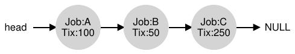
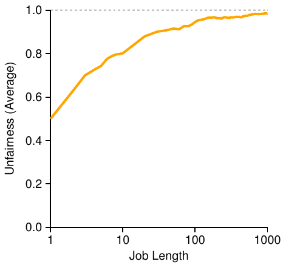

# 9 Scheduling: Proportional Share

Trong chương này, ta xem xét loại scheduler khác gọi là proportional-share scheduler, đôi khi cũng gọi là fair-share scheduler. Proportional-share dựa trên khái niệm đơn giản: thay vì tối ưu turnaround hay response time, scheduler có thể cố bảo đảm mỗi job nhận một tỷ lệ CPU time nhất định.

Một ví dụ hiện đại xuất sắc về proportional-share scheduling nằm trong nghiên cứu của Waldspurger và Weihl [WW94], gọi là lottery scheduling; tuy nhiên ý tưởng chắc chắn có từ lâu hơn nhiều [KL88]. Ý tưởng cơ bản rất đơn giản: định kỳ tổ chức một cuộc xổ số để quyết định process nào được chạy tiếp; process cần chạy thường xuyên hơn được cấp nhiều cơ hội thắng hơn. Dễ đúng không? Giờ đến chi tiết! Nhưng trước hết là mấu chốt:

> MẤU CHỐT: LÀM THẾ NÀO ĐỂ CHIA SẺ CPU THEO TỶ LỆ
>
> Làm thế nào thiết kế scheduler chia CPU theo tỷ lệ? Các mechanism then chốt là gì? Chúng hiệu quả đến đâu?

## 9.1 Khái niệm cơ bản: Ticket đại diện cho phần được chia

Nền tảng lottery scheduling là khái niệm rất cơ bản: ticket, dùng để đại diện phần tài nguyên mà process (hoặc người dùng hay đối tượng khác) nên nhận. Phần trăm ticket của process đại diện phần tài nguyên hệ thống đang xét mà nó được chia.

Hãy xem ví dụ. Tưởng tượng có hai process A và B, trong đó A có 75 ticket còn B chỉ có 25. Vì vậy, ta muốn A nhận 75% CPU và B nhận 25% còn lại.

Lottery scheduling đạt điều này theo xác suất (không theo cách deterministic) bằng cách tổ chức xổ số định kỳ (chẳng hạn mỗi time slice). Tổ chức rất đơn giản: scheduler phải biết tổng số ticket (ở đây là 100). Sau đó nó chọn ticket thắng, là số từ 0 đến 99[^1]. Giả sử A giữ ticket 0 đến 74 và B giữ 75 đến 99, ticket thắng quyết định đơn giản A hay B chạy. Scheduler load trạng thái process thắng rồi chạy nó.

> MẸO: DÙNG TÍNH NGẪU NHIÊN
>
> Một điểm đẹp nhất của lottery scheduling là dùng tính ngẫu nhiên. Khi cần quyết định, dùng cách randomized như vậy thường vững chắc và đơn giản.
>
> Cách ngẫu nhiên có ít nhất ba ưu điểm so với cách ra quyết định truyền thống. Thứ nhất, thường tránh hành vi corner-case lạ mà thuật toán truyền thống có thể khó xử lý. Ví dụ, xét replacement policy LRU (sẽ học kỹ hơn ở chương virtual memory); dù thường là replacement algorithm tốt, LRU hoạt động tệ nhất với một số workload cyclic-sequential. Ngược lại, cách ngẫu nhiên không có worst case như vậy.
>
> Thứ hai, cách ngẫu nhiên cũng nhẹ, cần ít trạng thái để theo dõi các lựa chọn. Trong thuật toán scheduling fair-share truyền thống, theo dõi lượng CPU mỗi process đã nhận đòi hỏi accounting per-process, cập nhật sau mỗi lần chạy process. Làm ngẫu nhiên chỉ cần trạng thái per-process tối thiểu (ví dụ số ticket mỗi process có).
>
> Cuối cùng, cách ngẫu nhiên có thể rất nhanh. Miễn tạo số ngẫu nhiên nhanh thì quyết định cũng nhanh, nên có thể dùng tại nhiều nơi cần tốc độ. Tất nhiên, càng cần nhanh thì tính ngẫu nhiên càng có xu hướng trở thành pseudo-random.

Đây là ví dụ đầu ra các ticket thắng của lottery scheduler:

```
63 85 70 39 76 17 29 41 36 39 10 99 68 83 63 62 43  0 49 49
```

Schedule thu được như sau:

```
A     A  A     A  A  A  A  A  A     A     A  A  A  A  A  A
   B        B                    B     B
```

Như thấy trong ví dụ, tính ngẫu nhiên của lottery scheduling đem lại sự đúng đắn theo xác suất về tỷ lệ mong muốn nhưng không bảo đảm. Ở ví dụ trên, B chỉ chạy 4 trong 20 time slice (20%), thay vì mức cấp phát mong muốn 25%. Tuy nhiên, hai job cạnh tranh càng lâu thì càng có khả năng đạt tỷ lệ mong muốn.

> MẸO: DÙNG TICKET ĐẠI DIỆN PHẦN ĐƯỢC CHIA
>
> Một trong những mechanism mạnh nhất (và cơ bản nhất) khi thiết kế lottery (và stride) scheduling là ticket. Trong các ví dụ này, ticket đại diện phần CPU của process, nhưng có thể áp dụng rộng hơn nhiều. Ví dụ, trong công trình mới hơn về quản lý virtual memory cho hypervisor, Waldspurger cho thấy dùng ticket đại diện phần memory của guest operating system thế nào [W02]. Vì vậy, nếu cần mechanism thể hiện tỷ lệ sở hữu, khái niệm này có thể chính là ... (chờ nhé) ... ticket.

## 9.2 Các mechanism về ticket

Lottery scheduling cũng cung cấp một số mechanism thao tác ticket theo những cách khác nhau, đôi khi hữu ích. Một cách là khái niệm ticket currency. Currency cho phép người dùng có một tập ticket phân bổ giữa các job riêng theo bất kỳ đơn vị currency nào họ muốn; hệ thống sau đó tự chuyển sang giá trị global đúng.

Ví dụ, giả sử người dùng A và B mỗi người nhận 100 ticket. A chạy hai job A1 và A2, cấp mỗi job 500 ticket (trong tổng 1000) theo currency riêng của A. B chỉ chạy 1 job và cấp nó 10 ticket (trong tổng 10). Hệ thống chuyển phần cấp phát A1 và A2 từ mỗi job 500 theo currency A thành mỗi job 50 theo global currency; tương tự, 10 ticket của B1 chuyển thành 100 ticket. Xổ số sau đó diễn ra trên global ticket currency (tổng 200) để quyết định job chạy.

```
User A -> 500 (A’s currency) to A1 ->  50 (global currency)
       -> 500 (A’s currency) to A2 ->  50 (global currency)
User B ->  10 (B’s currency) to B1 -> 100 (global currency)
```

Mechanism hữu ích khác là ticket transfer. Với transfer, process tạm chuyển ticket cho process khác. Khả năng này đặc biệt hữu ích trong mô hình client/server, nơi client process gửi thông điệp yêu cầu server làm việc thay mình. Để tăng tốc, client có thể chuyển ticket cho server, cố tối đa hiệu năng server khi xử lý yêu cầu client. Khi xong, server chuyển ticket trở lại client và mọi thứ như trước.

Cuối cùng, ticket inflation đôi khi hữu ích. Với inflation, process có thể tạm tăng hoặc giảm số ticket sở hữu. Tất nhiên, trong tình huống cạnh tranh giữa process không tin nhau, cách này ít ý nghĩa; process tham lam có thể tự cấp rất nhiều ticket để chiếm cả máy. Thay vào đó, inflation áp dụng được trong môi trường nhóm process tin nhau; nếu một process biết cần thêm CPU time, nó có thể tăng giá trị ticket để phản ánh nhu cầu với hệ thống mà không phải giao tiếp với process khác.

```
 1   // counter: used to track if we’ve found the winner yet
 2   int counter = 0;
 3
 4   // winner: use some call to a random number generator to
 5   //         get a value, between 0 and the total # of tickets
 6   int winner = getrandom(0, totaltickets);
 7
 8   // current: use this to walk through the list of jobs
 9   node_t *current = head;
10
11   // loop until the sum of ticket values is > the winner
12   while (current) {
13       counter = counter + current->tickets;
14       if (counter > winner)
15           break; // found the winner
16       current = current->next;
17   }
18   // ’current’ is the winner: schedule it...
```

Hình 9.1: Code quyết định Lottery Scheduling

## 9.3 Triển khai

Có lẽ điều đáng kinh ngạc nhất ở lottery scheduling là triển khai đơn giản. Tất cả cần có là random number generator tốt để chọn ticket thắng, data structure theo dõi process hệ thống (như list) và tổng số ticket.

Giả sử giữ các process trong list. Đây là ví dụ ba process A, B, C, mỗi process có số ticket nhất định.



Để quyết định scheduling, đầu tiên chọn số ngẫu nhiên (winner) từ tổng số ticket (400)[^2] Giả sử chọn 300. Sau đó, chỉ cần duyệt list và dùng counter đơn giản tìm winner (Hình 9.1).

Code duyệt list process, cộng mỗi giá trị ticket vào counter đến khi vượt winner. Khi đó phần tử list hiện tại là winner. Với ticket thắng bằng 300 trong ví dụ, diễn biến như sau. Đầu tiên, counter tăng lên 100 để tính ticket A; vì 100 nhỏ hơn 300, vòng lặp tiếp tục. Sau đó counter cập nhật thành 150 (ticket B), vẫn nhỏ hơn 300 nên tiếp tục. Cuối cùng counter thành 400 (rõ ràng lớn hơn 300), nên thoát vòng lặp với current trỏ đến C (winner).

Để triển khai hiệu quả nhất, nhìn chung nên tổ chức list theo thứ tự giảm dần số ticket. Thứ tự không ảnh hưởng tính đúng của thuật toán; tuy nhiên, nhìn chung bảo đảm số lần lặp list ít nhất, đặc biệt khi một vài process sở hữu phần lớn ticket.



Hình 9.2: Nghiên cứu fairness của lottery

## 9.4 Một ví dụ

Để hiểu rõ hơn cách lottery scheduling hoạt động, giờ ta nghiên cứu ngắn về completion time của hai job cạnh tranh, mỗi job có cùng số ticket (100) và run time (R, sẽ thay đổi).

Trong tình huống này, ta muốn mỗi job hoàn tất gần cùng lúc, nhưng do tính ngẫu nhiên, đôi khi job này xong trước job kia. Để định lượng khác biệt, định nghĩa unfairness metric đơn giản U, là thời điểm job đầu hoàn tất chia thời điểm job thứ hai hoàn tất. Ví dụ, nếu R = 10, job đầu xong tại 10 (job thứ hai tại 20), U = 10/20 = 0.5. Khi cả hai hoàn tất gần cùng lúc, U gần 1. Đây là mục tiêu: scheduler hoàn toàn công bằng đạt U = 1.

Hình 9.2 biểu diễn unfairness trung bình khi độ dài hai job (R) thay đổi từ 1 đến 1000 qua ba mươi thử nghiệm (kết quả tạo bằng simulator ở cuối chương). Như graph cho thấy, khi job không dài lắm, unfairness trung bình khá nghiêm trọng. Chỉ khi chạy số time slice đáng kể, lottery scheduler mới tiến gần kết quả mong muốn.

## 9.5 Phân bổ ticket thế nào?

Một vấn đề chưa xử lý là phân bổ ticket cho job thế nào? Đây là vấn đề khó, vì hành vi hệ thống rõ ràng phụ thuộc mạnh vào cách phân bổ. Một cách là giả định người dùng biết rõ nhất; mỗi người nhận một số ticket và phân bổ tùy ý cho các job mình chạy. Tuy nhiên, đây là một non-solution: thực sự nó không chỉ ra bạn phải làm gì. Vì vậy, với tập job cho trước, “bài toán ticket-assignment” vẫn bỏ ngỏ.

## 9.6 Vì sao không deterministic?

Có thể bạn cũng thắc mắc: sao lại dùng tính ngẫu nhiên? Như thấy trên, dù đem lại scheduler đơn giản (và gần đúng), đôi khi nó không cho tỷ lệ chính xác, đặc biệt trong khoảng thời gian ngắn. Vì vậy, Waldspurger phát minh stride scheduling, một scheduler fair-share deterministic [W95].

Stride scheduling cũng đơn giản. Mỗi job có stride tỷ lệ nghịch số ticket của nó. Trong ví dụ trên, A, B, C lần lượt có 100, 50, 250 ticket, ta tính stride bằng cách chia một số lớn cho số ticket mỗi process được gán. Ví dụ, chia 10,000 cho từng số ticket, thu stride của A, B, C là 100, 200, 40. Ta gọi giá trị này là stride mỗi process; mỗi lần process chạy, tăng counter của nó (gọi là pass value) thêm stride để theo dõi tiến triển global.

Sau đó scheduler dùng stride và pass để quyết định process chạy tiếp. Ý tưởng đơn giản: tại bất kỳ thời điểm nào, chọn process có pass value thấp nhất đến lúc đó; khi chạy process, tăng pass counter thêm stride. Waldspurger cung cấp triển khai pseudocode [W95]:

```
current = remove_min(queue);      // pick client with minimum pass
schedule(current);                // use resource for quantum
current->pass += current->stride; // compute next pass using stride
insert(queue, current);           // put back into the queue
```

Trong ví dụ, bắt đầu với ba process (A, B, C), stride 100, 200, 40, mọi pass value ban đầu bằng 0. Vì vậy, lúc đầu process nào cũng có thể chạy vì pass đều thấp như nhau. Giả sử chọn A (tùy ý; mọi process có pass thấp bằng nhau đều có thể chọn). A chạy; hết time slice, cập nhật pass thành 100. Rồi chạy B, pass được đặt thành 200. Cuối cùng chạy C, pass tăng lên 40. Lúc này thuật toán chọn pass thấp nhất, của C, và chạy nó, cập nhật pass lên 80 (nhớ stride C bằng 40). C lại chạy (vẫn pass thấp nhất), tăng pass lên 120. Giờ A chạy, cập nhật pass lên 200 (bằng B). Rồi C chạy thêm hai lần, cập nhật pass lên 160 rồi 200. Lúc này mọi pass lại bằng nhau, và quá trình lặp vô hạn. Hình 9.3 theo dõi hành vi scheduler theo thời gian.

| Pass(A) | Pass(B) | Pass(C) | Ai chạy? |
|---|---|---|---|
| (stride=100) | (stride=200) | (stride=40) |  |
| 0 | 0 | 0 | A |
| 100 | 0 | 0 | B |
| 100 | 200 | 0 | C |
| 100 | 200 | 40 | C |
| 100 | 200 | 80 | C |
| 100 | 200 | 120 | A |
| 200 | 200 | 120 | C |
| 200 | 200 | 160 | C |
| 200 | 200 | 200 | ... |

Hình 9.3: Stride Scheduling: Một trace

Như hình cho thấy, C chạy năm lần, A hai lần, B một lần, đúng tỷ lệ ticket 250, 100, 50. Lottery scheduling đạt tỷ lệ theo xác suất qua thời gian; stride scheduling đạt đúng tuyệt đối vào cuối mỗi chu kỳ scheduling.

Vậy có thể bạn hỏi: stride scheduling chính xác thế, sao vẫn dùng lottery scheduling? Lottery có một đặc tính hay mà stride không có: không có global state. Tưởng tượng job mới vào giữa ví dụ stride bên trên; pass của nó nên là bao nhiêu? Có đặt bằng 0 không? Nếu có, nó sẽ độc chiếm CPU. Với lottery, không có global state cho từng process; chỉ thêm process mới với số ticket nó có, cập nhật global variable duy nhất theo dõi tổng số ticket rồi tiếp tục. Nhờ vậy lottery dễ đưa process mới vào hợp lý hơn nhiều.

## 9.7 Tóm tắt

Ta đã giới thiệu proportional-share scheduling và thảo luận ngắn hai triển khai: lottery và stride. Lottery dùng ngẫu nhiên khéo léo để đạt proportional share; stride đạt theo cách deterministic. Dù thú vị về khái niệm, cả hai chưa được dùng wide-spread làm CPU scheduler vì nhiều lý do. Một là không phối hợp đặc biệt tốt với I/O [AC97]; hai là bỏ ngỏ vấn đề khó về phân bổ ticket, tức làm sao biết browser cần được cấp bao nhiêu ticket? General-purpose scheduler (như MLFQ đã thảo luận và những Linux scheduler tương tự) xử lý việc này uyển chuyển hơn nên được triển khai rộng hơn.

Do đó, scheduler proportional-share hữu ích hơn ở lĩnh vực mà một số vấn đề này (như gán share) tương đối dễ giải quyết. Ví dụ, trong virtualized data center, khi muốn gán one-quarter CPU cycle cho Windows VM và phần còn lại cho Linux cơ sở, proportional sharing có thể đơn giản và hiệu quả. Xem Waldspurger [W02] để biết thêm cách dùng phương án đó chia memory theo tỷ lệ trong ESX Server của VMWare.

## Tài liệu tham khảo

[AC97] “Extending Proportional-Share Scheduling to a Network of Workstations”

Andrea C. Arpaci-Dusseau and David E. Culler

PDPTA’97, tháng Sáu năm 1997

Bài báo của một tác giả sách về mở rộng proportional-share scheduling để hoạt động tốt hơn trong môi trường cluster.

[D82] “Why Numbering Should Start At Zero”

Edsger Dijkstra, tháng Tám năm 1982

http://www.cs.utexas.edu/users/EWD/ewd08xx/EWD831.PDF

Ghi chép ngắn của E. Dijkstra, người tiên phong khoa học máy tính. Ta sẽ nghe thêm nhiều về ông trong phần Concurrency. Trong lúc chờ, hãy đọc ghi chép với câu trích gợi mở này: “Một đồng nghiệp của tôi — không phải nhà khoa học máy tính — buộc tội một số nhà khoa học máy tính trẻ là ‘câu nệ tiểu tiết’ vì họ bắt đầu đánh số từ không.” Ghi chép giải thích vì sao làm vậy hợp lý.

[KL88] “A Fair Share Scheduler”

J. Kay and P. Lauder

CACM, Tập 31 Số 1, tháng Một năm 1988

Tài liệu thời kỳ đầu về scheduler fair-share.

[WW94] “Lottery Scheduling: Flexible Proportional-Share Resource Management”

Carl A. Waldspurger and William E. Weihl

OSDI ’94, tháng Mười Một năm 1994

Bài báo cột mốc về lottery scheduling khiến cộng đồng hệ thống re-energized về scheduling, fair sharing và sức mạnh thuật toán randomized đơn giản.

[W95] “Lottery and Stride Scheduling: Flexible Proportional-Share Resource Management”

Carl A. Waldspurger

Luận án Ph.D., MIT, 1995

Luận án award-winning của Waldspurger phác thảo lottery và stride scheduling. Nếu nghĩ đến việc viết luận án Ph.D. một ngày nào đó, bạn nên luôn có ví dụ tốt bên cạnh để làm mục tiêu phấn đấu: đây là một ví dụ rất tốt.

[W02] “Memory Resource Management in VMware ESX Server”

Carl A. Waldspurger

OSDI ’02, Boston, Massachusetts

Bài báo nên đọc về quản lý memory trong VMM (còn gọi là hypervisor). Ngoài tương đối dễ đọc, bài có nhiều ý tưởng hay về kiểu quản lý memory VMM-level mới này.

## Bài tập về nhà

Chương trình lottery.py cho phép xem lottery scheduler hoạt động thế nào. Xem README để biết chi tiết.

### Câu hỏi

1. Tính lời giải cho mô phỏng với 3 job và random seed 1, 2, 3.

2. Chạy hai job cụ thể: mỗi job dài 10, nhưng một job (job 0) chỉ có 1 ticket và job kia (job 1) có 100 (ví dụ -l 10:1,10:100). Điều gì xảy ra khi ticket mất cân đối đến vậy? Job 0 có bao giờ chạy trước khi job 1 xong không? Thường xuyên đến mức nào? Nói chung, mất cân đối ticket ảnh hưởng hành vi lottery scheduling thế nào?

3. Khi chạy hai job dài 100 và được cấp bằng nhau 100 ticket (-l 100:100,100:100), scheduler thiếu công bằng đến đâu? Chạy với một số random seed khác để xác định câu trả lời (theo xác suất); xác định unfairness bằng việc job này hoàn tất sớm hơn job kia bao nhiêu.

4. Câu trả lời trước thay đổi thế nào khi quantum size (-q) lớn hơn?

5. Bạn có thể tạo phiên bản graph trong chương không? Còn điều gì đáng khám phá? Graph với stride scheduler sẽ ra sao?

---

[^1]: Nhà khoa học máy tính luôn đếm từ 0. Điều này lạ với non-computer-types đến nỗi người nổi tiếng cảm thấy phải viết lý do ta làm vậy [D82].

[^2]: Đáng ngạc nhiên, như Bj ¨orn Lindberg chỉ ra, làm đúng điều này có thể khó; xem thêm tại http://stackoverflow.com/questions/2509679/how-to-generate-a-random-number-from-within-a-range.
