# 10 Multiprocessor Scheduling (Nâng cao)

Chương này giới thiệu những điều cơ bản về multiprocessor scheduling. Vì chủ đề tương đối nâng cao, có lẽ nên học sau khi đã nghiên cứu concurrency khá chi tiết (tức “phần dễ” lớn thứ hai của sách).

Sau nhiều năm chỉ xuất hiện ở phân khúc high-end của điện toán, hệ thống multiprocessor ngày càng phổ biến, có mặt trên desktop, laptop và cả thiết bị di động. Nguồn gốc là sự phát triển của multicore processor, chứa nhiều CPU core trên một chip; các chip này trở nên phổ biến vì kiến trúc sư máy tính khó làm một CPU nhanh hơn nhiều mà không tiêu thụ (quá) nhiều điện năng. Vì thế, giờ tất cả chúng ta có vài CPU để dùng, một điều tốt, đúng không?

Tất nhiên, có nhiều khó khăn khi có hơn một CPU. Khó khăn chính là ứng dụng thông thường (tức chương trình C bạn viết) chỉ dùng một CPU; thêm CPU không làm riêng ứng dụng đó nhanh hơn. Để khắc phục, phải viết lại ứng dụng để chạy song song, có thể dùng thread (thảo luận rất chi tiết trong phần hai). Ứng dụng Multi-threaded phân tán công việc trên nhiều CPU, nên nhanh hơn khi được cấp thêm tài nguyên CPU.

> THÔNG TIN THÊM: CÁC CHƯƠNG NÂNG CAO
>
> Để thực sự hiểu chương nâng cao, cần nội dung trải rộng trong sách, dù về logic chương nằm ở phần trước các kiến thức tiên quyết đó. Ví dụ, chương multiprocessor scheduling này dễ hiểu hơn nhiều nếu đã đọc phần giữa về concurrency; tuy nhiên về logic nó thuộc phần virtualization nói chung và CPU scheduling nói riêng. Vì vậy, nên học các chương này không theo thứ tự; trường hợp này là sau phần hai của sách.

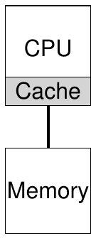

Hình 10.1: Một CPU với cache

Ngoài ứng dụng, vấn đề mới cho operating system (không ngạc nhiên!) là multiprocessor scheduling. Đến đây, ta thảo luận một số nguyên tắc single-processor scheduling; mở rộng các ý tưởng đó để dùng nhiều CPU thế nào? Cần vượt qua vấn đề mới nào? Vì vậy, vấn đề là:

> MẤU CHỐT: SCHEDULE JOB TRÊN NHIỀU CPU THẾ NÀO
>
> OS nên schedule job trên nhiều CPU thế nào? Vấn đề mới nào xuất hiện? Kỹ thuật cũ còn dùng được hay cần ý tưởng mới?

## 10.1 Kiến thức nền: Multiprocessor Architecture

Để hiểu vấn đề mới của multiprocessor scheduling, cần hiểu khác biệt mới và cơ bản giữa hardware single-CPU và multi-CPU. Khác biệt xoay quanh hardware cache (như Hình 10.1) và chính xác cách dữ liệu chia sẻ trên nhiều processor. Ta sẽ thảo luận thêm ở mức khái quát. Chi tiết có ở nơi khác [CSG99], đặc biệt trong học phần kiến trúc máy tính upper-level hoặc sau đại học.

Trong hệ thống một CPU, có hierarchy hardware cache giúp processor chạy chương trình nhanh hơn. Cache là memory nhỏ, nhanh, nhìn chung giữ bản sao dữ liệu thường dùng nằm trong main memory. Ngược lại, main memory giữ toàn bộ dữ liệu nhưng truy cập vùng memory lớn này chậm hơn. Giữ dữ liệu thường truy cập trong cache khiến memory lớn, chậm có vẻ nhanh.

Ví dụ, xét chương trình thực hiện load instruction tường minh để fetch giá trị từ memory, và hệ thống đơn giản chỉ có một CPU; CPU có cache nhỏ (chẳng hạn 64 KB) và main memory lớn. Lần đầu chương trình thực hiện load, dữ liệu nằm trong main memory nên fetch mất lâu (có thể hàng chục, thậm chí hàng trăm nanosecond). Processor dự đoán dữ liệu có thể dùng lại nên đặt bản sao vào CPU cache. Nếu sau đó chương trình fetch cùng dữ liệu lần nữa, CPU tìm trong cache trước; nếu thấy, dữ liệu được fetch nhanh hơn nhiều (chỉ vài nanosecond), nên chương trình nhanh hơn.

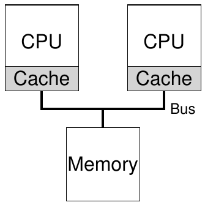

Hình 10.2: Hai CPU có cache chia sẻ memory

Như vậy cache dựa trên locality, gồm temporal locality và spatial locality. Temporal locality là khi truy cập một dữ liệu, có khả năng sớm truy cập lại; hãy nghĩ variable hay chính instruction được truy cập lặp trong vòng lặp. Spatial locality là khi chương trình truy cập dữ liệu tại address x, nó có khả năng truy cập dữ liệu gần x; nghĩ đến chương trình duyệt array hoặc instruction thực thi liên tiếp. Vì nhiều chương trình có các locality này, hardware có thể đoán tốt dữ liệu nên đưa vào cache và hoạt động hiệu quả.

Giờ đến phần khó: chuyện gì xảy ra khi có nhiều processor trong một hệ thống với main memory dùng chung duy nhất như Hình 10.2?

Hóa ra caching với nhiều CPU phức tạp hơn nhiều. Ví dụ, chương trình chạy trên CPU 1 đọc dữ liệu (giá trị D) tại address A; vì không có trong cache CPU 1, hệ thống fetch từ main memory và lấy D. Chương trình sửa giá trị tại A, chỉ cập nhật cache thành D<sup>′</sup>; ghi xuyên xuống main memory chậm nên hệ thống (thường) làm sau. Rồi OS quyết định dừng chương trình và chuyển sang CPU 2. Chương trình re-reads giá trị tại A; cache CPU 2 không có dữ liệu này nên fetch từ main memory, nhận D cũ thay vì D<sup>′</sup> đúng. Ôi!

Vấn đề tổng quát này gọi là cache coherence, và có kho nghiên cứu rất lớn mô tả những chi tiết tinh tế khác nhau khi giải quyết [SHW11]. Ở đây, ta bỏ qua chi tiết và nêu vài điểm chính; hãy học một (hoặc ba) học phần kiến trúc máy tính để biết thêm.

Giải pháp cơ bản do hardware cung cấp: bằng cách theo dõi memory access, hardware bảo đảm về cơ bản “điều đúng” xảy ra, giữ cách nhìn một shared memory duy nhất. Trên hệ thống bus-based (như trên), có thể dùng kỹ thuật cũ bus snooping [G83]; mỗi cache chú ý cập nhật memory bằng cách quan sát bus nối với main memory. Khi CPU thấy cập nhật dữ liệu nó đang giữ trong cache, nó nhận biết thay đổi và invalidate bản sao (xóa khỏi cache) hoặc cập nhật (đưa giá trị mới vào cache). Write-back cache, như đã gợi ý, khiến điều này phức tạp hơn (vì ghi main memory chưa hiện ra ngay), nhưng bạn có thể hình dung phương án cơ bản hoạt động thế nào.

## 10.2 Đừng quên synchronization

Nếu cache đã làm mọi việc đó để cung cấp coherence, chương trình (hay OS) có cần lo gì khi truy cập shared data không? Đáng tiếc là có, và điều này được trình bày rất chi tiết trong phần hai về concurrency. Dù không đi vào chi tiết tại đây, ta phác thảo/ôn lại một số ý cơ bản (giả sử bạn quen concurrency).

Khi truy cập (đặc biệt cập nhật) shared data hoặc structure trên nhiều CPU, thường cần mutual exclusion primitive (như lock) để bảo đảm đúng (cách khác như data structure lock-free phức tạp và chỉ thỉnh thoảng dùng; xem chương deadlock ở phần concurrency). Ví dụ, shared queue được nhiều CPU truy cập concurrently. Không có lock, thêm hoặc xóa phần tử đồng thời không hoạt động như mong đợi, dù có coherence protocol bên dưới; cần lock để cập nhật data structure sang trạng thái mới một cách atomic.

Cụ thể hơn, tưởng tượng chuỗi code xóa phần tử shared linked list trong Hình 10.3. Nếu thread trên hai CPU vào routine cùng lúc: Thread 1 thực thi dòng đầu, lưu head hiện tại vào tmp; nếu Thread 2 cũng thực thi dòng đầu, nó lưu cùng giá trị head vào tmp riêng (tmp được cấp phát trên stack, nên mỗi thread có vùng lưu riêng). Vì vậy, thay vì mỗi thread xóa một phần tử đầu list, chúng cố xóa cùng head element, gây đủ loại vấn đề (như cố double free head tại dòng 4, cũng như có thể trả cùng dữ liệu hai lần).

```
 1   typedef struct __Node_t {
 2       int              value;
 3       struct __Node_t *next;
 4   } Node_t;
 5
 6   int List_Pop() {
 7       Node_t *tmp = head;         // remember old head ...
 8       int value   = head->value;  // ... and its value
 9       head        = head->next;   // advance head to next pointer
10       free(tmp);                  // free old head
11       return value;               // return value at head
12   }
```

Hình 10.3: Code xóa list đơn giản

Tất nhiên giải pháp là làm routine đúng bằng locking. Ở đây, cấp phát mutex đơn giản (ví dụ pthread_mutex_t m;), thêm lock(&m) ở đầu và unlock(&m) ở cuối sẽ giải quyết, bảo đảm code thực thi như mong muốn. Đáng tiếc, như sẽ thấy, cách này chưa giải quyết hết vấn đề, đặc biệt về hiệu năng. Cụ thể, khi số CPU tăng, truy cập synchronized shared data structure trở nên khá chậm.

## 10.3 Vấn đề cuối: Cache Affinity

Vấn đề cuối khi xây dựng multiprocessor cache scheduler là cache affinity. Khái niệm đơn giản: process chạy trên CPU cụ thể tạo khá nhiều trạng thái trong cache (và TLB) của CPU. Lần chạy sau, chạy trên cùng CPU thường có lợi vì nhanh hơn nếu một phần trạng thái đã có sẵn trong cache. Ngược lại, mỗi lần chạy trên CPU khác sẽ kém hiệu năng vì phải load lại trạng thái (lưu ý vẫn chạy đúng nhờ hardware cache coherence protocol). Vì vậy, multiprocessor scheduler nên cân nhắc cache affinity khi quyết định, có thể ưu tiên giữ process trên cùng CPU khi có thể.

## 10.4 Single-Queue Scheduling

Với nền tảng này, giờ ta thảo luận xây dựng scheduler cho multiprocessor. Cách cơ bản nhất là dùng lại khuôn khổ single processor scheduling, đặt mọi job cần schedule vào một queue; gọi là single-queue multiprocessor scheduling, viết tắt SQMS. Ưu điểm là đơn giản; không cần nhiều công để lấy policy hiện có chọn job tốt nhất chạy tiếp và điều chỉnh cho hơn một CPU (ví dụ chọn hai job tốt nhất nếu có hai CPU).

Tuy nhiên SQMS có thiếu sót rõ ràng. Đầu tiên là thiếu scalability. Để scheduler đúng trên nhiều CPU, lập trình viên phải thêm một dạng locking như trên. Lock bảo đảm khi code SQMS truy cập queue duy nhất (như tìm job chạy tiếp), kết quả đúng xuất hiện.

Đáng tiếc, lock có thể giảm hiệu năng mạnh, đặc biệt khi số CPU tăng [A91]. Khi contention trên lock duy nhất tăng, hệ thống dành ngày càng nhiều thời gian cho lock overhead và ít hơn cho công việc cần làm (ghi chú: thật tốt nếu một ngày có số đo thực tế ở đây).

Vấn đề chính thứ hai của SQMS là cache affinity. Giả sử có năm job (A, B, C, D, E) và bốn processor. Scheduling queue như sau:


Theo thời gian, giả sử mỗi job chạy một time slice rồi chọn job khác, đây là một schedule khả dĩ trên các CPU:

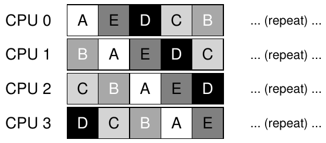

Vì mỗi CPU chỉ lấy job tiếp theo từ queue globally-shared, mỗi job cuối cùng nhảy từ CPU này sang CPU khác, làm đúng điều ngược với cách hợp lý nếu xét cache affinity.

Để xử lý, phần lớn scheduler SQMS có affinity mechanism nhằm tăng khả năng process tiếp tục trên cùng CPU. Cụ thể, có thể giữ affinity cho một số job nhưng di chuyển job khác để cân bằng tải. Ví dụ, tưởng tượng năm job đó được schedule như sau:

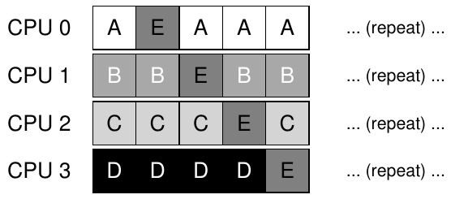

Theo cách này, A đến D không chuyển processor, chỉ E di chuyển giữa CPU, giữ affinity cho phần lớn. Bạn có thể chọn di chuyển job khác ở lượt sau, nhờ đó đạt một dạng công bằng về affinity. Tuy nhiên triển khai có thể phức tạp.

Như vậy SQMS có điểm mạnh và yếu. Nó dễ triển khai từ scheduler single-CPU sẵn có, theo định nghĩa chỉ có một queue. Nhưng không scale tốt (do synchronization overhead) và không dễ giữ cache affinity.

## 10.5 Multi-Queue Scheduling

Do vấn đề ở scheduler single-queue, một số hệ thống chọn nhiều queue, ví dụ mỗi CPU một queue. Ta gọi là multi-queue multiprocessor scheduling (MQMS).

Trong MQMS, khuôn khổ cơ bản gồm nhiều scheduling queue. Mỗi queue có thể theo scheduling discipline cụ thể như round robin, dù dùng thuật toán nào cũng được. Khi job vào hệ thống, nó được đặt vào đúng một queue theo heuristic (như ngẫu nhiên hoặc chọn queue ít job hơn). Sau đó được schedule gần như độc lập, tránh vấn đề chia sẻ thông tin và synchronization của single-queue.

Ví dụ hệ thống chỉ có hai CPU (CPU 0 và CPU 1), một số job vào: A, B, C, D. Vì mỗi CPU có queue, OS phải quyết định đặt mỗi job vào queue nào. Có thể như sau:

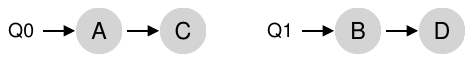

Tùy policy của queue, mỗi CPU giờ có hai job để chọn chạy. Ví dụ round robin có thể cho schedule như sau:

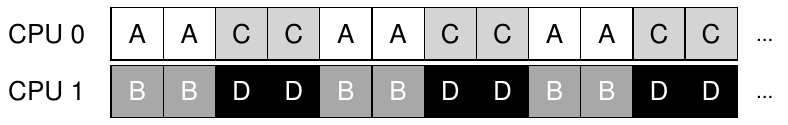

MQMS có ưu điểm rõ ràng so với SQMS là về bản chất scalable hơn. Số CPU tăng thì số queue cũng tăng, nên lock và cache contention không trở thành vấn đề trung tâm. Ngoài ra, MQMS vốn cung cấp cache affinity; job ở cùng CPU nên hưởng lợi dùng lại nội dung cache.

Nhưng nếu chú ý, bạn có thể thấy vấn đề mới, căn bản của cách multi-queue: load imbalance. Giả sử cùng thiết lập trên (bốn job, hai CPU), nhưng một job (C) hoàn tất. Queue giờ như sau:

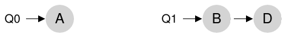

Nếu chạy policy round-robin trên mỗi queue, ta thấy schedule kết quả:

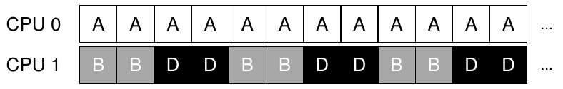

Như sơ đồ cho thấy, A nhận gấp đôi CPU so với B và D, không phải điều mong muốn. Tệ hơn, nếu A và C cùng hoàn tất, chỉ còn B, D. Queue sẽ như sau:

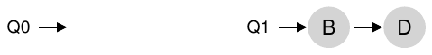

Kết quả CPU 0 bị idle! (chèn nhạc kịch tính, đáng sợ tại đây) Vì vậy timeline sử dụng CPU trông buồn bã:

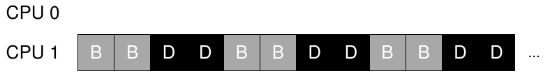

Vậy scheduler multi-queue multiprocessor tội nghiệp nên làm gì? Làm thế nào vượt qua load imbalance hiểm ác và đánh bại thế lực xấu xa ... Decepticons[^1]? Làm sao ngừng hỏi những câu chẳng mấy liên quan đến cuốn sách vốn tuyệt vời này?

> MẤU CHỐT: XỬ LÝ LOAD IMBALANCE THẾ NÀO
>
> Scheduler multi-queue multiprocessor nên xử lý load imbalance thế nào để đạt tốt hơn các mục tiêu scheduling?

Câu trả lời rõ ràng là di chuyển job, kỹ thuật (một lần nữa) gọi là migration. Di chuyển job từ CPU này sang CPU khác giúp đạt load balance thực sự.

Hãy xem vài ví dụ cho rõ. Lại có một CPU idle và CPU kia có vài job.

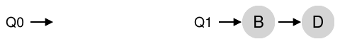

Ở đây migration mong muốn dễ hiểu: OS chỉ cần chuyển B hoặc D sang CPU 0. Kết quả một lần job migration là tải cân bằng đều và mọi người vui vẻ.

Trường hợp khó hơn ở ví dụ trước: A một mình trên CPU 0, B và D luân phiên CPU 1:

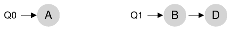

Ở đây, một migration không giải quyết được. Bạn làm gì? Đáng tiếc, câu trả lời là di chuyển liên tục một hoặc nhiều job. Một cách là tiếp tục chuyển job như timeline sau. Đầu tiên A một mình ở CPU 0, B và D luân phiên CPU 1. Sau vài time slice, B chuyển sang cạnh tranh với A ở CPU 0, còn D tận hưởng vài time slice một mình ở CPU 1. Nhờ đó tải cân bằng:

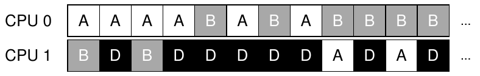

Tất nhiên còn nhiều mẫu migration khác. Nhưng giờ đến phần khó: hệ thống nên quyết định thực hiện migration như vậy thế nào?

Một cách cơ bản là kỹ thuật work stealing [FLR98]. Với cách work-stealing, queue (nguồn) ít job thỉnh thoảng xem queue khác (đích) đầy đến đâu. Nếu đích đầy hơn (đáng kể), nguồn “lấy trộm” một hoặc nhiều job từ đích để cân bằng tải.

Tất nhiên có căng thẳng tự nhiên ở đây. Xem queue khác quá thường xuyên gây overhead cao và khó scaling, trong khi scaling chính là mục đích triển khai nhiều queue! Ngược lại, ít xem quá dễ load imbalance nghiêm trọng. Tìm ngưỡng đúng vẫn là nghệ thuật khó nắm bắt, như thường gặp khi thiết kế policy hệ thống.

## 10.6 Linux Multiprocessor Scheduler

Thú vị là cộng đồng Linux chưa có giải pháp chung cho xây dựng multiprocessor scheduler. Qua thời gian xuất hiện ba scheduler: O(1), Completely Fair Scheduler (CFS), BF Scheduler (BFS)[^2]. Xem luận án Meehean để có tổng quan xuất sắc về ưu nhược điểm [M11]; ở đây chỉ tóm tắt cơ bản.

Cả O(1) và CFS dùng nhiều queue, BFS dùng một queue, cho thấy cả hai cách đều có thể thành công. Tất nhiên nhiều chi tiết khác phân biệt chúng. Ví dụ O(1) là scheduler priority-based (giống MLFQ), thay đổi priority theo thời gian rồi schedule priority cao nhất để đạt các mục tiêu; đặc biệt chú trọng tương tác. Ngược lại CFS là cách proportional-share deterministic (giống Stride đã thảo luận). BFS, cách single-queue duy nhất trong ba loại, cũng proportional-share nhưng dựa trên phương án phức tạp hơn là Earliest Eligible Virtual Deadline First (EEVDF) [SA96]. Hãy tự đọc thêm các thuật toán hiện đại này; giờ bạn có thể hiểu cách hoạt động!

## 10.7 Tóm tắt

Ta đã thấy các cách multiprocessor scheduling. Cách single-queue (SQMS) khá dễ xây dựng và cân bằng tải tốt, nhưng vốn khó scale đến nhiều processor và giữ cache affinity. Cách multiple-queue (MQMS) scale tốt hơn, xử lý cache affinity tốt nhưng gặp load imbalance và phức tạp hơn. Dù chọn cách nào cũng không có câu trả lời đơn giản: xây dựng general purpose scheduler vẫn khó, vì thay đổi code nhỏ có thể gây khác biệt hành vi lớn. Chỉ làm khi biết rõ mình đang làm gì, hoặc ít nhất được trả rất nhiều tiền để làm.

## Tài liệu tham khảo

[A90] “The Performance of Spin Lock Alternatives for Shared-Memory Multiprocessors” Thomas E. Anderson

IEEE TPDS Tập 1:1, tháng Một năm 1990

Bài báo kinh điển về cách các lựa chọn locking khác nhau scale được hoặc không. Tác giả Tom Anderson, nhà nghiên cứu rất nổi tiếng về hệ thống và networking. Phải nói ông cũng viết giáo trình OS rất hay.

[B+10] “An Analysis of Linux Scalability to Many Cores Abstract”

Silas Boyd-Wickizer, Austin T. Clements, Yandong Mao, Aleksey Pesterev, M. Frans Kaashoek, Robert Morris, Nickolai Zeldovich

OSDI ’10, Vancouver, Canada, tháng Mười năm 2010

Bài báo hiện đại tuyệt vời về khó khăn scaling Linux đến nhiều core.

[CSG99] “Parallel Computer Architecture: A Hardware/Software Approach”

David E. Culler, Jaswinder Pal Singh, and Anoop Gupta

Morgan Kaufmann, 1999

Kho báu chi tiết về máy và thuật toán parallel. Như Mark Hill hài hước nhận xét trên bìa, sách chứa nhiều thông tin hơn phần lớn bài báo nghiên cứu.

[FLR98] “The Implementation of the Cilk-5 Multithreaded Language”

Matteo Frigo, Charles E. Leiserson, Keith Randall

PLDI ’98, Montreal, Canada, tháng Sáu năm 1998

Cilk là ngôn ngữ và runtime nhẹ để viết parallel program, ví dụ xuất sắc về mô hình work-stealing.

[G83] “Using Cache Memory To Reduce Processor-Memory Traffic”

James R. Goodman

ISCA ’83, Stockholm, Sweden, tháng Sáu năm 1983

Bài báo tiên phong về dùng bus snooping, tức chú ý request trên bus, để xây dựng cache coherence protocol. Nghiên cứu nhiều năm của Goodman tại Wisconsin đầy sáng tạo, đây chỉ là một ví dụ.

[M11] “Towards Transparent CPU Scheduling”

Joseph T. Meehean

Luận án tiến sĩ tại University of Wisconsin—Madison, 2011

Luận án trình bày nhiều chi tiết hoạt động multiprocessor scheduling Linux hiện đại. Rất tuyệt! Nhưng vì là co-advisors của Joe, có thể chúng tôi hơi thiên vị.

[SHW11] “A Primer on Memory Consistency and Cache Coherence”

Daniel J. Sorin, Mark D. Hill, and David A. Wood

Synthesis Lectures in Computer Architecture

Morgan and Claypool Publishers, tháng Năm năm 2011

Tổng quan có tính nền tảng về memory consistency và multiprocessor caching. Bài đọc bắt buộc cho ai muốn biết quá nhiều về một chủ đề.

[SA96] “Earliest Eligible Virtual Deadline First: A Flexible and Accurate Mechanism for Proportional Share Resource Allocation”

Ion Stoica and Hussein Abdel-Wahab

Báo cáo kỹ thuật TR-95-22, Old Dominion University, 1996

Báo cáo kỹ thuật về ý tưởng scheduling hay này, từ Ion Stoica, hiện là giáo sư U.C. Berkeley, chuyên gia thế giới về networking, distributed system và nhiều thứ khác.

---

[^1]: Một sự thật ít biết là hành tinh quê nhà Cybertron bị phá hủy bởi quyết định CPU scheduling tồi. Giờ hãy coi đây là lần đầu và cuối nhắc Transformers trong sách, điều mà chúng tôi chân thành xin lỗi.

[^2]: Hãy tự tra BF viết tắt của gì; cảnh báo trước, không dành cho người yếu tim.
