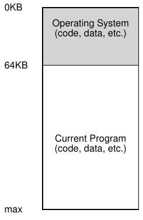
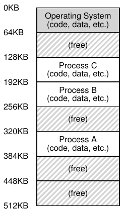
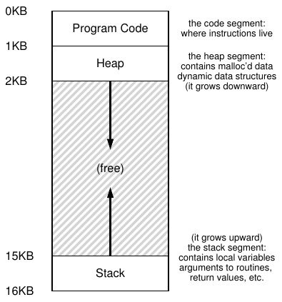

# 13 Abstraction: Address Space

Thời kỳ đầu, xây dựng hệ thống máy tính rất dễ. Vì sao ư? Vì người dùng không kỳ vọng nhiều. Chính những người dùng đáng ghét với kỳ vọng “dễ sử dụng”, “hiệu năng cao”, “độ tin cậy”, v.v. mới thực sự gây ra tất cả những chuyện đau đầu này. Lần sau gặp một người dùng máy tính như vậy, hãy cảm ơn họ vì mọi vấn đề họ đã gây ra.

## 13.1 Hệ thống thời kỳ đầu

Từ góc độ memory, máy đời đầu không cung cấp nhiều abstraction cho người dùng. Về cơ bản physical memory trông như Hình 13.1.

OS là tập routine (thực chất là thư viện) nằm trong memory (bắt đầu tại physical address 0 trong ví dụ), và có một chương trình đang chạy (process) nằm trong physical memory (bắt đầu tại physical address 64k) dùng phần memory còn lại. Có rất ít ảo giác và người dùng không kỳ vọng nhiều ở OS. Cuộc sống người phát triển OS thời đó hẳn dễ dàng, phải không?



Hình 13.1: Operating System: Những ngày đầu



Hình 13.2: Ba process: Chia sẻ memory

## 13.2 Multiprogramming và Time Sharing

Một thời gian sau, vì máy đắt, người ta bắt đầu chia sẻ máy hiệu quả hơn. Kỷ nguyên multiprogramming ra đời [DV66], nhiều process sẵn sàng tại một thời điểm và OS chuyển giữa chúng, ví dụ khi một process thực hiện I/O. Điều này tăng utilization CPU thực tế. Tăng hiệu quả đặc biệt quan trọng lúc mỗi máy giá hàng trăm nghìn, thậm chí hàng triệu đô la (vậy mà bạn nghĩ Mac của mình đắt!).

Tuy nhiên, chẳng bao lâu người ta đòi hỏi nhiều hơn và kỷ nguyên time sharing ra đời [S59, L60, M62, M83]. Cụ thể, nhiều người nhận ra giới hạn batch computing, đặc biệt với chính lập trình viên [CV65], vốn chán chu kỳ program-debug dài (nên kém hiệu quả). Tính tương tác trở nên quan trọng, vì nhiều người dùng máy concurrently, mỗi người chờ (hoặc hy vọng) phản hồi kịp thời từ tác vụ currently-executing.

Một cách triển khai time sharing là cho một process chạy trong khoảng thời gian ngắn, cấp toàn quyền truy cập mọi memory (Hình 13.1, trang 1), rồi dừng nó, lưu toàn bộ trạng thái lên một loại disk nào đó (gồm toàn bộ physical memory), load trạng thái của process khác, cho process đó chạy một lúc, nhờ vậy thực hiện hình thức chia sẻ máy sơ khai [M+63].

Đáng tiếc, cách này có vấn đề lớn: quá chậm, đặc biệt khi memory lớn lên. Dù lưu và khôi phục trạng thái register-level (PC, register general-purpose, v.v.) tương đối nhanh, lưu toàn bộ nội dung memory lên disk vô cùng non-performant. Vì vậy, ta muốn giữ các process trong memory khi chuyển giữa chúng, cho phép OS triển khai time sharing hiệu quả (Hình 13.2).



Hình 13.3: Ví dụ về Address Space

Trong sơ đồ có ba process (A, B, C), mỗi process được chia một phần nhỏ trong physical memory 512KB. Giả sử một CPU, OS chọn chạy một process (A), các process khác (B, C) nằm trong ready queue chờ chạy.

Khi time sharing phổ biến hơn, có lẽ bạn đoán được những yêu cầu mới đặt lên operating system. Đặc biệt, cho phép nhiều program cùng nằm trong memory khiến protection trở thành vấn đề quan trọng; bạn không muốn một process có thể đọc, hay tệ hơn là ghi, memory của process khác.

## 13.3 Address Space

Tuy nhiên, ta phải nhớ đến những người dùng phiền phức đó, nên OS cần tạo một abstraction dễ sử dụng của physical memory. Ta gọi abstraction này là address space: cách program đang chạy nhìn memory trong hệ thống. Hiểu abstraction cơ bản này của OS về memory là chìa khóa để hiểu cách memory được virtualize.

Address space process chứa mọi memory state của chương trình đang chạy. Ví dụ code (instruction) phải nằm trong memory nên thuộc address space. Khi chạy, chương trình dùng stack theo dõi vị trí trong chuỗi function call, cấp phát local variable, truyền parameter và return value vào/ra routine. Cuối cùng heap dùng cho memory dynamically-allocated, user-managed, như nhận từ malloc() trong C hay new trong ngôn ngữ object-oriented như C++ hoặc Java. Tất nhiên còn thứ khác (như variable statically-initialized), nhưng hiện tại chỉ giả định ba thành phần: code, stack, heap.

Trong ví dụ Hình 13.3 (trang 3), address space rất nhỏ (chỉ 16KB)[^1]. Code chương trình ở trên cùng (bắt đầu tại 0 và đóng gói trong 1K đầu của address space). Code là static (nên dễ đặt trong memory), vì vậy đặt ở trên cùng và biết nó không cần thêm không gian khi chương trình chạy.

Tiếp đến là hai vùng address space có thể tăng (và giảm) trong lúc chạy: heap (trên) và stack (dưới). Đặt như vậy vì mỗi vùng muốn mở rộng; đặt hai đầu đối diện cho phép tăng: chỉ cần tăng theo hai hướng ngược nhau. Heap bắt đầu ngay sau code (tại 1KB), tăng xuống dưới (khi người dùng yêu cầu thêm memory qua malloc()); stack bắt đầu tại 16KB, tăng lên trên (khi thực hiện procedure call). Tuy nhiên cách đặt chỉ là quy ước; có thể sắp xếp khác nếu muốn (như sẽ thấy, khi nhiều thread co-exist trong address space, đáng tiếc không còn cách chia gọn như vậy).

Tất nhiên, khi mô tả address space, ta đang mô tả abstraction mà OS cung cấp cho program đang chạy. Program không thực sự nằm trong memory tại physical address từ 0 đến 16KB; thay vào đó, nó được load tại một hoặc nhiều physical address tùy ý. Xem các process A, B và C trong Hình 13.2 để thấy mỗi process được load vào memory tại address khác nhau. Vì vậy, vấn đề là:

> MẤU CHỐT: VIRTUALIZE MEMORY THẾ NÀO
>
> Làm thế nào OS xây abstraction address space riêng, có thể lớn, cho nhiều process đang chạy (cùng chia sẻ memory) trên physical memory duy nhất?

Khi làm vậy, ta nói OS đang virtualize memory, vì chương trình nghĩ nó load vào memory tại address cụ thể (như 0) và có address space rất lớn (như 32-bits hoặc 64-bits); thực tế khác hẳn.

Ví dụ, khi process A trong Hình 13.2 thử load tại address 0 (ta gọi là virtual address), OS cùng một số hỗ trợ hardware phải bằng cách nào đó bảo đảm load không đến physical address 0 mà đến physical address 320KB (nơi A được load). Đó là chìa khóa virtualization memory, nền tảng mọi hệ thống máy tính hiện đại trên thế giới.

> MẸO: NGUYÊN TẮC ISOLATION
>
> Isolation là nguyên tắc then chốt xây dựng hệ thống tin cậy. Nếu hai thực thể được cô lập đúng, một thực thể có thể hỏng mà không ảnh hưởng thực thể kia. Operating system cố cô lập process để ngăn chúng gây hại nhau. Dùng memory isolation, OS còn bảo đảm chương trình không ảnh hưởng hoạt động OS bên dưới. Một số OS hiện đại cô lập xa hơn, tách phần OS khỏi phần khác. Microkernel như vậy [BH70, R+89, S+03] có thể tin cậy hơn thiết kế monolithic kernel thông thường.

## 13.4 Mục tiêu

Như vậy ta đến công việc OS trong các ghi chép này: virtualize memory. Nhưng OS không chỉ làm vậy; nó sẽ làm thật tốt. Để bảo đảm, cần mục tiêu dẫn đường. Ta đã gặp (nhớ phần Giới thiệu) và sẽ gặp lại, nhưng chắc chắn đáng nhắc lại.

Một mục tiêu chính của hệ thống virtual memory (VM) là transparency[^2]. OS nên triển khai virtual memory theo cách vô hình với chương trình đang chạy. Chương trình không nên biết memory được virtualize; nó hành xử như có physical memory riêng. Phía sau, OS (và hardware) làm mọi việc multiplex memory giữa nhiều job, thực hiện ảo giác.

Một mục tiêu khác của VM là hiệu quả. OS nên làm virtualization hiệu quả nhất có thể về cả thời gian (không làm program chạy chậm hơn nhiều) và không gian (không dùng quá nhiều memory cho các cấu trúc hỗ trợ virtualization). Để triển khai virtualization time-efficient, OS phải dựa vào hardware hỗ trợ, gồm những tính năng như TLB (ta sẽ học vào phần thích hợp).

Cuối cùng mục tiêu thứ ba là protection. OS phải bảo vệ process khỏi nhau và chính OS khỏi process. Khi process thực hiện load, store hoặc instruction fetch, nó không được truy cập hay ảnh hưởng bất kỳ nội dung memory của process khác hoặc OS (tức ngoài address space). Vì vậy protection cung cấp isolation giữa process; mỗi process chạy trong kén cô lập riêng, an toàn trước phá hoại từ process lỗi hoặc độc hại.

> THÔNG TIN THÊM: MỌI ADDRESS BẠN THẤY ĐỀU VIRTUAL
>
> Bạn từng viết chương trình C in pointer? Giá trị thấy (một số lớn, thường in hexadecimal) là virtual address. Từng tự hỏi code ở đâu? Bạn cũng in được, và đúng, nếu in được thì cũng là virtual address. Thực ra mọi address bạn thấy khi lập trình user-level đều virtual. Chỉ OS, qua kỹ thuật virtualization memory phức tạp, biết instruction và dữ liệu thực sự nằm đâu trong physical memory. Đừng quên: in address trong chương trình là in virtual address, ảo giác về bố trí memory; chỉ OS (và hardware) biết sự thật.
>
> Đây là chương trình nhỏ in vị trí routine main() (nơi code nằm), giá trị heap-allocated trả về từ malloc() và vị trí integer trên stack:
>
> ```
>  1   #include <stdio.h>
>  2   #include <stdlib.h>
>  3   int main(int argc, char *argv[]) {
>  4       printf("location of code  : %p\n", (void *) main);
>  5       printf("location of heap  : %p\n", (void *) malloc(1));
>  6       int x = 3;
>  7       printf("location of stack : %p\n", (void *) &x);
>  8       return x;
>  9   }
> ```
>
> Chạy trên máy Mac OS X 64-bit, thu được đầu ra:
>
> ```
> location of code  : 0x1095afe50
> location of heap  : 0x1096008c0
> location of stack : 0x7fff691aea64
> ```
>
> Qua đó thấy code đứng đầu address space, rồi heap, còn stack ở tận đầu kia của virtual space lớn này. Tất cả address đều virtual, sẽ được OS và hardware dịch để fetch giá trị từ vị trí vật lý thật.

Trong các chương tiếp, ta khám phá mechanism cơ bản để virtualize memory, gồm hỗ trợ hardware và operating system. Cũng nghiên cứu policy liên quan sẽ gặp, gồm quản lý free space và loại page nào khỏi memory khi thiếu chỗ. Qua đó, ta xây dựng hiểu biết về cách hệ thống virtual memory hiện đại thực sự hoạt động[^3].

## 13.5 Tóm tắt

Ta đã được giới thiệu một subsystem quan trọng của OS: virtual memory. VM system chịu trách nhiệm cung cấp cho program ảo giác về address space lớn, thưa thớt và riêng biệt, chứa toàn bộ instruction và data của chúng. OS, với hardware hỗ trợ đáng kể, lấy từng virtual memory reference và chuyển thành physical address, có thể gửi đến physical memory để lấy thông tin mong muốn. OS làm việc này cho nhiều process cùng lúc, bảo vệ các program khỏi nhau cũng như bảo vệ chính OS. Toàn bộ cách tiếp cận cần nhiều mechanism (nhiều cơ chế low-level) và một số policy thiết yếu để hoạt động; ta sẽ bắt đầu từ dưới lên, mô tả các mechanism thiết yếu trước. Và hãy tiếp tục!

## Tài liệu tham khảo

[BH70] “The Nucleus of a Multiprogramming System”

Per Brinch Hansen

Communications of the ACM, 13:4, tháng Tư năm 1970

Bài báo đầu tiên đề xuất OS hay kernel là nền tảng tối thiểu, linh hoạt để xây operating system tùy biến; chủ đề lặp lại trong lịch sử nghiên cứu OS.

[CV65] “Introduction and Overview of the Multics System”

F. J. Corbato and V. A. Vyssotsky

Fall Joint Computer Conference, 1965

Bài báo Multics đầu tiên rất hay. Trích dẫn hay về time sharing: “Động lực time-sharing đầu tiên đến từ lập trình viên chuyên nghiệp vì họ liên tục bực bội khi debug chương trình tại các cơ sở batch processing. Vì thế, mục tiêu ban đầu là time-share máy tính cho nhiều người truy cập đồng thời trong khi cho mỗi người ảo giác có toàn bộ máy để dùng.”

[DV66] “Programming Semantics for Multiprogrammed Computations”

Jack B. Dennis and Earl C. Van Horn

Communications of the ACM, Tập 9, Số 3, tháng Ba năm 1966

Bài báo thời kỳ đầu (nhưng không phải đầu tiên) về multiprogramming.

[L60] “Man-Computer Symbiosis”

J. C. R. Licklider

IRE Transactions on Human Factors in Electronics, HFE-1:1, tháng Ba năm 1960

Bài báo khác lạ về máy tính và con người bước vào thời đại cộng sinh; rõ ràng vượt thời đại nhưng vẫn rất hấp dẫn.

[M62] “Time-Sharing Computer Systems”

J. McCarthy

Management and the Computer of the Future, MIT Press, Cambridge, Mass, 1962

Có lẽ bài báo time sharing đầu tiên được ghi nhận của McCarthy. Tuy nhiên, bài khác [M83] nói ông nghĩ ý tưởng từ 1957. McCarthy rời lĩnh vực hệ thống và trở thành nhân vật lớn của Trí tuệ Nhân tạo tại Stanford, gồm sáng tạo ngôn ngữ LISP. Xem thêm trang chủ: http://www-formal.stanford.edu/jmc/

[M+63] “A Time-Sharing Debugging System for a Small Computer”

J. McCarthy, S. Boilen, E. Fredkin, J. C. R. Licklider

AFIPS ’63 (mùa Xuân), tháng Năm, 1963, New York, USA

Ví dụ ban đầu rất hay về hệ thống swap memory chương trình ra “drum” khi không chạy rồi trở lại “core” khi sắp chạy.

[M83] “Reminiscences on the History of Time Sharing”

John McCarthy

Mùa Đông hoặc mùa Xuân năm 1983

Có tại: http://www-formal.stanford.edu/jmc/history/timesharing/timesharing.html

Ghi chép lịch sử tuyệt vời về nguồn gốc time-sharing, gồm nghi ngờ với người xem công trình Strachey [S59] là tiên phong lĩnh vực này.

[R+89] “Mach: A System Software kernel”

Richard Rashid, Daniel Julin, Douglas Orr, Richard Sanzi, Robert Baron, Alessandro Forin, David Golub, Michael Jones

COMPCON 89, tháng Hai năm 1989

Dù không phải dự án microkernel đầu tiên, Mach tại CMU well-known và có ảnh hưởng; nay vẫn sống sâu bên trong Mac OS X.

[S59] “Time Sharing in Large Fast Computers”

C. Strachey

Proceedings of the International Conference on Information Processing, UNESCO, tháng Sáu năm 1959

Một trong những tài liệu sớm nhất về time sharing.

[S+03] “Improving the Reliability of Commodity Operating Systems”

Michael M. Swift, Brian N. Bershad, Henry M. Levy

SOSP 2003

Bài báo đầu tiên cho thấy tư duy microkernel-like cải thiện độ tin cậy operating system thế nào.

---

[^1]: Ta thường dùng ví dụ nhỏ vì (a) biểu diễn address space 32-bit rất phiền và (b) toán khó hơn. Chúng tôi thích toán đơn giản.

[^2]: Cách dùng transparency đôi khi gây nhầm; có sinh viên nghĩ “minh bạch” là công khai mọi thứ, như chính phủ nên làm. Ở đây nghĩa ngược lại: ứng dụng không được thấy ảo giác OS cung cấp. Vì vậy, cách dùng thông thường coi hệ thống transparent là khó nhận thấy, không phải hệ thống đáp ứng yêu cầu theo Freedom of Information Act.

[^3]: Hoặc ta thuyết phục bạn bỏ học phần. Nhưng khoan; nếu vượt qua VM, có lẽ bạn đi được đến cuối!
