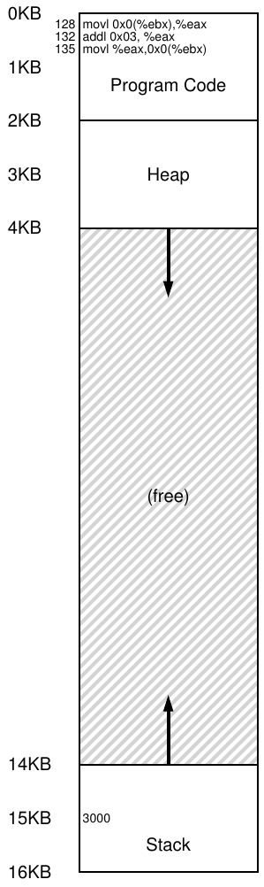
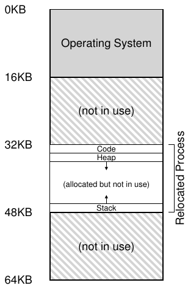

# 15 Mechanism: Address Translation

Khi phát triển CPU virtualization, ta tập trung vào mechanism tổng quát limited direct execution (LDE). Ý tưởng đơn giản: phần lớn thời gian cho chương trình chạy trực tiếp trên hardware; tuy nhiên tại điểm then chốt (như process gọi system call hoặc timer interrupt xảy ra), sắp xếp để OS tham gia và bảo đảm điều “đúng” xảy ra. Vì vậy, với chút hardware hỗ trợ, OS cố tránh cản đường chương trình để virtualization hiệu quả; nhưng can thiệp tại thời điểm quan trọng giúp giữ quyền điều khiển hardware. Hiệu quả và quyền điều khiển là hai mục tiêu chính của mọi operating system hiện đại.

Khi virtualize memory, ta theo chiến lược tương tự, vừa hiệu quả vừa kiểm soát trong khi cung cấp virtualization mong muốn. Hiệu quả đòi hỏi hardware hỗ trợ, lúc đầu thô sơ (vài register) nhưng sẽ khá phức tạp (TLB, hỗ trợ page-table, v.v.). Kiểm soát nghĩa là OS bảo đảm không ứng dụng nào truy cập memory ngoài phần riêng; vì vậy để bảo vệ ứng dụng khỏi nhau và OS khỏi ứng dụng, cũng cần hardware. Cuối cùng cần thêm tính linh hoạt từ VM; cụ thể muốn chương trình dùng address space theo ý mình để hệ thống dễ lập trình. Vì vậy mấu chốt được làm rõ:

> MẤU CHỐT:
>
> VIRTUALIZE MEMORY HIỆU QUẢ VÀ LINH HOẠT THẾ NÀO
>
> Làm sao xây dựng memory virtualization hiệu quả? Làm sao cung cấp tính linh hoạt application cần? Làm sao duy trì quyền kiểm soát những vị trí memory mà application được truy cập, qua đó bảo đảm memory access của application được giới hạn đúng cách? Làm sao thực hiện tất cả những điều này hiệu quả?

Kỹ thuật tổng quát ta dùng, có thể xem là bổ sung limited direct execution, gọi là address translation hardware-based, viết ngắn là address translation. Hardware biến đổi mỗi memory access (như instruction fetch, load, store), đổi virtual address instruction cung cấp thành physical address nơi thông tin thực sự nằm. Vì vậy trên từng memory reference, hardware thực hiện address translation để chuyển reference ứng dụng đến vị trí thật trong memory.

Tất nhiên riêng hardware không thể virtualize memory, chỉ cung cấp mechanism low-level hiệu quả. OS phải tham gia ở điểm then chốt để thiết lập hardware cho translation đúng; phải quản lý memory, theo dõi chỗ trống và đang dùng, can thiệp khéo léo để kiểm soát cách dùng.

Một lần nữa, mục tiêu của toàn bộ công việc là tạo ảo giác đẹp: program có memory riêng chứa code và data của mình. Đằng sau thực tế virtual ấy là sự thật vật lý xấu xí: nhiều program thực sự đang chia sẻ memory cùng lúc, khi CPU (hoặc các CPU) chuyển từ chạy program này sang program khác. Qua virtualization, OS (với hardware hỗ trợ) biến thực tế máy xấu xí thành abstraction hữu ích, mạnh mẽ và dễ sử dụng.

## 15.1 Giả định

Những lần thử virtualize memory đầu tiên rất đơn giản, gần như đáng cười. Cứ cười tùy thích; sớm thôi OS sẽ cười bạn khi cố hiểu chi tiết TLB, page table multi-level và kỳ quan kỹ thuật khác. Không thích OS cười? Có lẽ hết may mắn; OS là thế.

Cụ thể hiện tại giả sử address space người dùng phải nằm liên tục trong physical memory. Để đơn giản, cũng giả sử size không quá lớn, cụ thể nhỏ hơn physical memory. Cuối cùng giả sử mọi address space có đúng cùng size. Đừng lo nếu thiếu thực tế; ta dần nới lỏng để đạt virtualization thực tế.

## 15.2 Một ví dụ

Để hiểu rõ cần gì triển khai address translation và vì sao cần, hãy xem ví dụ đơn giản. Tưởng tượng process có address space Hình 15.1. Ta xét chuỗi code ngắn load giá trị từ memory, tăng thêm ba rồi store lại. Biểu diễn C-language có thể như sau:

> MẸO: INTERPOSITION RẤT MẠNH
>
> Interposition là kỹ thuật tổng quát, mạnh, thường rất hiệu quả trong hệ thống máy tính. Khi virtualize memory, hardware can thiệp vào mỗi memory access, dịch virtual address process phát thành physical address nơi thông tin thực lưu. Nhưng interposition áp dụng rộng hơn nhiều; gần như mọi interface well-defined đều có thể được can thiệp để thêm chức năng hay cải thiện hệ thống. Lợi ích thường là transparency; thường làm mà không đổi client của interface, nên client không cần thay đổi.

```
void func() {
    int x;
    x = x + 3; // this is the line of code we are interested in
```

Compiler biến dòng code thành assembly, có thể như sau (x86 assembly). Dùng objdump trên Linux hoặc otool trên Mac OS X để disassemble:

```
128: movl 0x0(%ebx), %eax     ;load 0+ebx into eax
132: addl $0x03, %eax         ;add 3 to eax register
135: movl %eax, 0x0(%ebx)     ;store eax back to mem
```

Đoạn code tương đối dễ hiểu; giả sử address x đã ở register ebx, rồi load giá trị tại đó vào register general-purpose eax bằng movl (di chuyển “longword”). Instruction kế cộng 3 vào eax, cuối cùng store giá trị eax về cùng vị trí memory.

Hình 15.1 (trang 4) cho thấy bố trí code và dữ liệu trong address space; chuỗi code three-instruction tại address 128 (code section gần trên), variable x tại 15 KB (stack gần dưới). Giá trị x ban đầu là 3000, như thấy trên stack.

Khi instruction chạy, từ góc nhìn process có các memory access sau.

• Fetch instruction tại address 128

• Thực thi instruction này (load từ address 15 KB)

• Fetch instruction tại address 132

• Thực thi instruction này (không có memory reference)

• Fetch instruction tại address 135

• Thực thi instruction này (store đến address 15 KB)



Hình 15.1: Process và Address Space

Từ góc nhìn chương trình, address space bắt đầu 0 và tăng tối đa 16 KB; mọi memory reference tạo ra phải trong giới hạn. Tuy nhiên để virtualize memory, OS muốn đặt process ở nơi khác trong physical memory, không nhất thiết 0. Vì vậy vấn đề là: relocate process thế nào mà transparent với nó? Tạo ảo giác address space virtual bắt đầu 0 khi thực tế tại physical address khác như thế nào?



Hình 15.2: Physical Memory với một process đã relocate

Hình 15.2 cho ví dụ physical memory khi address space được đặt vào. OS dùng slot đầu cho mình và relocate process trên vào slot bắt đầu physical memory address 32 KB. Hai slot khác trống (16 KB-32 KB và 48 KB-64 KB).

## 15.3 Dynamic Relocation (Hardware-based)

Để hiểu address translation hardware-based, trước tiên ta bàn hình thức đầu tiên của nó. Được giới thiệu trong những máy time-sharing đầu tiên vào cuối thập niên 1950, ý tưởng đơn giản này gọi là base và bounds; kỹ thuật cũng được gọi là dynamic relocation; ta sẽ dùng hai thuật ngữ thay thế nhau [SS74].

Cụ thể, cần hai hardware register mỗi CPU: base register và bounds (đôi khi limit register). Cặp base-and-bounds cho phép đặt address space bất kỳ đâu trong physical memory, đồng thời bảo đảm process chỉ truy cập address space riêng.

Theo thiết lập, chương trình được viết và compile như load tại address không. Nhưng khi bắt đầu chạy, OS quyết định load ở đâu và đặt base register bằng giá trị đó. Ví dụ trên, OS quyết định load tại physical address 32 KB nên đặt base tương ứng.

Điều thú vị bắt đầu khi process chạy. Mọi memory reference process tạo ra được processor dịch như sau:

```
physical address = virtual address + base
```

> THÔNG TIN THÊM: RELOCATION SOFTWARE-BASED
>
> Thời đầu, trước hỗ trợ hardware, một số hệ thống relocation sơ khai hoàn toàn bằng software. Kỹ thuật cơ bản static relocation: software loader lấy executable sắp chạy, viết lại address sang offset mong muốn trong physical memory.
>
> Ví dụ instruction load từ address 1000 vào register (movl 1000, %eax), address space được load bắt đầu tại 3000 (không phải 0 như chương trình nghĩ), loader viết lại instruction để cộng offset 3000 (movl 4000, %eax). Nhờ đó đạt static relocation đơn giản.
>
> Tuy nhiên, static relocation có nhiều vấn đề. Đầu tiên và quan trọng nhất, nó không cung cấp protection, vì process có thể tạo address sai và truy cập trái phép memory của process khác, thậm chí memory của OS; nhìn chung, có lẽ cần hardware hỗ trợ để có protection thực sự [WL+93]. Một nhược điểm khác là một khi đã đặt address space, sau đó khó relocate nó sang vị trí khác [M65].

Mỗi memory reference process tạo là virtual address; hardware cộng nội dung base register vào, cho physical address gửi đến memory system.

Để rõ hơn, theo dõi khi một instruction thực thi. Cụ thể, xét instruction từ chuỗi trước:

```
128: movl 0x0(%ebx), %eax
```

Program counter (PC) bằng 128; khi cần fetch instruction, hardware cộng với base register 32 KB (32768), thu physical address 32896; rồi fetch từ đó. Tiếp theo processor thực thi. Đến lúc process load từ virtual address 15 KB, processor lại cộng base register (32 KB), thu physical address 47 KB và nội dung mong muốn.

Biến virtual address thành physical address chính là address translation; hardware lấy address process nghĩ mình tham chiếu và biến thành physical address nơi dữ liệu thực nằm. Vì relocation diễn ra lúc runtime và có thể di chuyển address space sau khi process bắt đầu chạy, kỹ thuật thường gọi dynamic relocation [M65].

> MẸO: DYNAMIC RELOCATION HARDWARE-BASED
>
> Với dynamic relocation, chỉ ít hardware đem lại nhiều ích lợi. Base register biến virtual address (chương trình tạo) thành physical address. Bounds (hay limit) register bảo đảm address trong address space. Kết hợp cung cấp virtualization memory đơn giản, hiệu quả.

Có lẽ bạn hỏi: bounds (limit) register đâu? Dù sao đây là base và bounds mà? Đúng thế. Như đoán được, bounds giúp protection. Cụ thể processor trước hết kiểm tra memory reference trong bounds để bảo đảm hợp lệ; ví dụ đơn giản trên bounds luôn bằng 16 KB. Nếu process tạo virtual address lớn hơn bounds hoặc âm, CPU phát sinh exception và process có thể bị kết thúc. Bounds bảo đảm mọi address process tạo hợp lệ và trong “giới hạn” process.

Lưu ý base và bounds là hardware structure trên chip (mỗi CPU một cặp). Đôi khi phần processor giúp address translation gọi là memory management unit (MMU); khi phát triển kỹ thuật memory-management tinh vi hơn, ta thêm mạch vào MMU.

Thông tin nhỏ: bound register định nghĩa theo hai cách. Cách đầu (như trên) chứa size address space, hardware kiểm tra virtual address trước khi cộng base. Cách hai chứa physical address cuối address space, hardware cộng base rồi kiểm tra bounds. Hai cách tương đương logic; để đơn giản thường giả định cách đầu.

### Ví dụ translation

Để hiểu address translation base-and-bounds chi tiết hơn, xét process address space 4 KB (đúng, nhỏ thiếu thực tế) load tại physical address 16 KB. Kết quả một số translation:

| Virtual Address |  | Physical Address |
|---|---|---|
| 0 | → | 16 KB |
| 1 KB | → | 17 KB |
| 3000 | → | 19384 |
| 4400 | → | Fault (ngoài bounds) |

Như ví dụ, chỉ cộng base address vào virtual address (có thể xem đúng là offset trong address space) để có physical address. Chỉ nếu virtual address “quá lớn” hoặc âm mới fault, gây exception.

> THÔNG TIN THÊM: DATA STRUCTURE — FREE LIST
>
> OS phải theo dõi những phần free memory hiện chưa được dùng để có thể cấp phát memory cho process. Dĩ nhiên có thể dùng nhiều data structure cho nhiệm vụ này; đơn giản nhất (ta giả định ở đây) là free list, chỉ là list các khoảng physical memory hiện chưa được dùng.

## 15.4 Hỗ trợ hardware: Tóm tắt

Giờ tóm tắt hỗ trợ hardware cần (xem Hình 15.3, trang 9). Đầu tiên, như chương CPU virtualization, cần hai CPU mode. OS chạy privileged mode (kernel mode), truy cập toàn máy; ứng dụng chạy user mode, bị giới hạn. Một bit, có thể trong processor status word, chỉ CPU đang ở mode nào; khi có dịp đặc biệt (system call, exception, interrupt), CPU chuyển mode.

Hardware cũng phải cung cấp chính các base và bounds register; mỗi CPU vì vậy có thêm một cặp register, thuộc memory management unit (MMU) của CPU. Khi user program chạy, hardware chuyển đổi từng address bằng cách cộng giá trị base vào virtual address mà user program tạo ra. Hardware cũng phải kiểm tra address có valid không, bằng bounds register và một số mạch trong CPU.

Hardware nên có instruction đặc biệt sửa base và bounds, cho OS đổi khi process khác chạy. Instruction này privileged; chỉ kernel (privileged) mode mới sửa register. Tưởng tượng user process gây hỗn loạn[^1] nếu tùy ý đổi base khi chạy. Hãy tưởng tượng! Rồi nhanh xua ý nghĩ đen tối, vì đó là chất liệu ghê rợn tạo ác mộng.

Cuối cùng CPU phải tạo exception khi user program truy cập memory trái phép (address “ngoài bounds”); CPU dừng chương trình và cho exception handler “out-of-bounds” của OS chạy. Handler quyết định phản ứng, có thể kết thúc process. Tương tự, nếu user program sửa base và bounds privileged register, CPU phát exception, chạy handler “cố thực hiện privileged operation trong user mode”. CPU cũng phải có cách báo vị trí handler; vì vậy cần thêm vài privileged instruction.

| Yêu cầu hardware | Ghi chú |
|---|---|
| Privileged mode | Cần để ngăn process user-mode thực hiện privileged operation |
| Base/bounds register | Cần cặp register mỗi CPU hỗ trợ address translation và kiểm tra bounds |
| Khả năng dịch virtual address và kiểm tra trong bounds | Mạch thực hiện translation và kiểm tra giới hạn; ở đây khá đơn giản |
| Privileged instruction để cập nhật base/bounds | OS phải đặt được các giá trị này trước khi cho user program chạy |
| Privileged instruction đăng ký exception handler | OS phải báo hardware chạy code nào khi exception xảy ra |
| Khả năng phát sinh exception | Khi process cố truy cập privileged instruction hoặc memory out-of-bounds |

Hình 15.3: Dynamic Relocation: Yêu cầu hardware

## 15.5 Vấn đề operating system

Cùng lúc hardware có tính năng mới hỗ trợ dynamic relocation, OS có vấn đề mới phải xử lý; kết hợp hardware và quản lý OS tạo virtual memory đơn giản. Cụ thể, có vài thời điểm quan trọng OS phải tham gia để triển khai phiên bản base-and-bounds.

Đầu tiên, OS phải hành động khi tạo process, tìm không gian trong memory cho address space của nó. May mắn, với giả định mỗi address space (a) nhỏ hơn physical memory và (b) có cùng kích thước, việc này khá dễ; OS chỉ cần xem physical memory như array các slot, theo dõi mỗi slot trống hay đang dùng. Khi tạo process mới, OS tìm trong data structure (thường gọi free list) không gian cho address space mới, rồi đánh dấu đã dùng. Với address space variable-sized, mọi việc phức tạp hơn, nhưng ta để mối quan tâm đó cho các chương sau.

Ví dụ Hình 15.2 (trang 5), OS dùng slot đầu cho mình và relocate process trên vào slot physical memory address 32 KB. Hai slot khác trống (16 KB-32 KB và 48 KB- 64 KB); free list phải gồm hai entry này.

Thứ hai, khi process kết thúc (thoát bình thường hoặc bị kill cưỡng chế do hành xử sai), OS thu hồi toàn memory cho process khác hoặc OS dùng. Vì vậy đưa memory về free list, dọn data structure liên quan nếu cần.

Thứ ba, OS thực hiện bước bổ sung khi context switch. Mỗi CPU chỉ có một cặp base và bounds, giá trị khác nhau cho chương trình vì load tại physical address khác. Do đó phải lưu, khôi phục cặp base-and-bounds khi chuyển process. Cụ thể, dừng process phải lưu giá trị base và bounds vào memory trong structure per-process như process structure hay process control block (PCB). Tương tự, khi tiếp tục process (hoặc chạy lần đầu), phải đặt base và bounds CPU đúng cho process này.

| Yêu cầu OS | Ghi chú |
|---|---|
| Memory management | Cần cấp phát memory cho process mới;<br>Thu hồi memory từ process đã kết thúc;<br>Quản lý memory chung qua free list |
| Quản lý base/bounds | Phải đặt base/bounds đúng khi context switch |
| Exception handling | Code chạy khi exception phát sinh;<br>thường kết thúc process vi phạm |

Hình 15.4: Dynamic Relocation: Trách nhiệm OS

Lưu ý khi process dừng (không chạy), OS khá dễ chuyển address space trong memory. Đầu tiên deschedule process, rồi sao chép từ chỗ cũ sang mới; cuối cùng cập nhật base register đã lưu (trong process structure) trỏ chỗ mới. Khi tiếp tục, base register mới được khôi phục, process lại chạy mà không biết instruction và dữ liệu đã ở nơi hoàn toàn mới.

Thứ tư, OS phải cung cấp exception handler, tức các function được gọi như đã bàn; OS cài đặt những handler này lúc boot (qua privileged instruction). Ví dụ, nếu process cố truy cập memory ngoài bounds, CPU raise exception; OS phải sẵn sàng hành động khi exception xảy ra. Phản ứng thông thường của OS mang tính thù địch: rất có thể nó chấm dứt process vi phạm. OS cần bảo vệ nghiêm ngặt máy đang chạy, nên không dung thứ process cố truy cập memory hoặc thực thi instruction không được phép. Tạm biệt process hành xử sai; rất vui được biết bạn.

Hình 15.5 (trang 11) minh họa phần lớn tương tác hardware/OS bằng timeline: việc OS làm lúc boot để chuẩn bị, rồi khi Process A chạy; lưu ý hardware xử lý memory translation không cần OS. Đến lúc timer interrupt, OS chuyển Process B, thực hiện “bad load” (address memory trái phép); lúc đó OS phải tham gia, kết thúc và dọn bằng giải phóng memory B, xóa entry khỏi process table. Như sơ đồ, vẫn theo limited direct execution. Phần lớn trường hợp OS chỉ thiết lập hardware đúng rồi cho process chạy trực tiếp CPU; chỉ khi process sai OS mới phải tham gia.

| OS khi boot | Hardware |  |
|---|---|---|
| (kernel mode) |  |  |
| khởi tạo trap table |  |  |
|  | ghi nhớ address của... |  |
|  | system call handler |  |
|  | timer handler |  |
|  | handler mem-access trái phép |  |
|  | illegal instruction handler |  |
| khởi động interrupt timer |  |  |
|  | khởi động timer; interrupt sau X ms |  |
| khởi tạo process table |  |  |
| khởi tạo free list |  |  |
| OS khi chạy | Hardware | Chương trình |
| (kernel mode) |  | (user mode) |
| Để bắt đầu process A: |  |  |
| cấp phát entry trong process table |  |  |
| cấp phát memory cho process |  |  |
| đặt base/bounds register |  |  |
| return-from-trap (vào A) |  |  |
|  | khôi phục register A |  |
|  | chuyển sang user mode |  |
|  | nhảy đến PC (ban đầu) của A |  |
|  |  | Process A chạy |
|  |  | Fetch instruction |
|  | Dịch virtual address |  |
|  | và thực hiện fetch |  |
|  |  | Thực thi instruction |
|  | Nếu load/store tường minh: |  |
|  | Bảo đảm address in-bounds; |  |
|  | Dịch virtual address |  |
|  | và thực hiện load/store |  |
|  |  | ... |
|  | Timer interrupt |  |
|  | chuyển sang kernel mode |  |
|  | Nhảy đến interrupt handler |  |
| Xử lý trap |  |  |
| Gọi routine switch() |  |  |
| lưu regs(A) vào proc-struct(A) |  |  |
| (gồm base/bounds) |  |  |
| khôi phục regs(B) từ proc-struct(B) |  |  |
| (gồm base/bounds) |  |  |
| return-from-trap (vào B) |  |  |
|  | khôi phục register B |  |
|  | chuyển sang user mode |  |
|  | nhảy đến PC của B |  |
|  |  | Process B chạy |
|  |  | Thực hiện bad load |
|  | Load out-of-bounds; |  |
|  | chuyển sang kernel mode |  |
|  | nhảy đến trap handler |  |
| Xử lý trap |  |  |
| Quyết định kết thúc process B |  |  |
| de-allocate memory của B |  |  |
| giải phóng entry của B trong process table |  |  |

Hình 15.5: Protocol Limited Direct Execution (Dynamic Relocation)

## 15.6 Tóm tắt

Chương này mở rộng limited direct execution với mechanism virtual memory cụ thể address translation. Với nó, OS kiểm soát mọi memory access từ process, bảo đảm nằm trong address space. Chìa khóa hiệu quả là hardware, dịch nhanh mỗi access từ virtual address (góc nhìn process) sang physical address (thực tế). Toàn bộ transparent với process đã relocate; nó không biết memory reference được dịch, tạo ảo giác tuyệt vời.

Ta cũng thấy dạng virtualization cụ thể base và bounds hay dynamic relocation. Virtualization Base-and-bounds hiệu quả, chỉ cần thêm chút hardware logic cộng base register vào virtual address và kiểm tra bounds. Base-and-bounds cũng cung cấp protection; OS và hardware bảo đảm không process tạo memory reference ngoài address space riêng. Protection chắc chắn là một trong những mục tiêu quan trọng nhất của OS; không có thì không kiểm soát máy (nếu process tự do ghi đè memory, dễ ghi đè trap table để chiếm hệ thống).

Đáng tiếc dynamic relocation đơn giản có điểm kém hiệu quả. Ví dụ Hình 15.2 (trang 5), process dùng physical memory 32 KB đến 48 KB; nhưng stack và heap nhỏ nên mọi chỗ giữa bị lãng phí. Loại này thường gọi internal fragmentation, vì không dùng hết bên trong đơn vị cấp phát (bị phân mảnh). Hiện tại, dù có thể đủ physical memory cho thêm process, ta chỉ đặt address space vào slot fixed-sized nên có internal fragmentation[^2]. Cần mechanism tinh vi hơn để tận dụng memory và tránh lãng phí. Lần thử đầu là khái quát hóa nhẹ base và bounds, gọi segmentation, thảo luận tiếp.

## Tài liệu tham khảo

[M65] “On Dynamic Program Relocation”

W.C. McGee

IBM Systems Journal

Tập 4, Số 3, 1965, trang 184–199

Bài báo này tổng kết tốt các công trình thời kỳ đầu về dynamic relocation, cùng một số kiến thức cơ bản về static relocation.

[P90] “Relocating loader for MS-DOS .EXE executable files”

Kenneth D. A. Pillay

Microprocessors & Microsystems archive

Tập 14, Số 7 (tháng Chín năm 1990)

Ví dụ về relocating loader cho MS-DOS. Không phải ví dụ đầu tiên, mà là ví dụ tương đối hiện đại về cách hệ thống như vậy hoạt động.

[SS74] “The Protection of Information in Computer Systems”

J. Saltzer and M. Schroeder

CACM, tháng Bảy năm 1974

Từ bài báo: “Khái niệm register base-and-bound và descriptor hardware-interpreted xuất hiện dường như độc lập từ 1957 đến 1959 ở ba dự án mục tiêu khác nhau. Tại M.I.T., McCarthy đề xuất base-and-bound như một phần memory protection cần để time-sharing khả thi. IBM độc lập phát triển register base-and-bound để multiprogramming tin cậy trên Stretch (7030). Tại Burroughs, R. Barton đề xuất descriptor hardware-interpreted hỗ trợ trực tiếp quy tắc naming scope của ngôn ngữ bậc cao trên B5000.” Chúng tôi tìm trích dẫn trên trang lịch sử hay của Mark Smotherman [S04]; xem thêm tại đó.

[S04] “System Call Support”

Mark Smotherman, tháng Năm năm 2004

http://people.cs.clemson.edu/˜mark/syscall.html

Lịch sử hay về hỗ trợ system call. Smotherman cũng sưu tầm lịch sử sớm về interrupt và khía cạnh thú vị khác. Xem trang web để biết thêm.

[WL+93] “Efficient Software-based Fault Isolation”

Robert Wahbe, Steven Lucco, Thomas E. Anderson, Susan L. Graham

SOSP ’93

Bài báo tuyệt vời về dùng compiler hỗ trợ giới hạn memory reference mà không cần hardware. Nó khơi lại quan tâm đến kỹ thuật software cô lập memory reference.

## Bài tập về nhà

Chương trình relocation.py cho thấy address translation trong hệ thống base và bounds. Xem README để biết chi tiết.

### Câu hỏi

1. Chạy seed 1, 2, 3 và tính mỗi virtual address process tạo trong hay ngoài bounds. Nếu trong, tính translation.

2. Chạy flag -s 0 -n 10. Phải đặt -l (bounds register) bao nhiêu để mọi virtual address tạo ra trong bounds?

3. Chạy flag -s 1 -n 10 -l 100. Bounds lớn nhất bằng bao nhiêu để toàn address space vẫn vừa physical memory?

4. Chạy một số bài trên với address space lớn hơn (-a) và physical memory lớn hơn (-p).

5. Tỷ lệ virtual address randomly-generated hợp lệ phụ thuộc giá trị bounds thế nào? Vẽ graph từ các random seed, với limit từ 0 đến size address space tối đa.

---

[^1]: Ngoài “havoc” còn thứ gì có thể được “wreaked” không?

[^2]: Một giải pháp khác có thể đặt stack fixed-sized trong address space ngay dưới vùng code, rồi heap có thể tăng trưởng bên dưới. Tuy nhiên, điều này hạn chế tính linh hoạt vì khiến recursion và function call deeply-nested khó thực hiện, nên ta muốn tránh.
