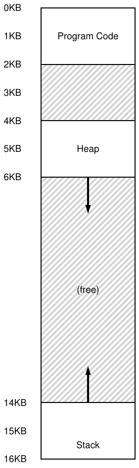
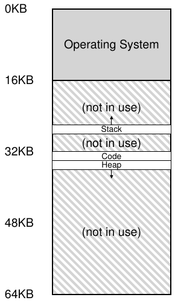
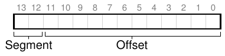
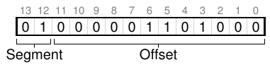
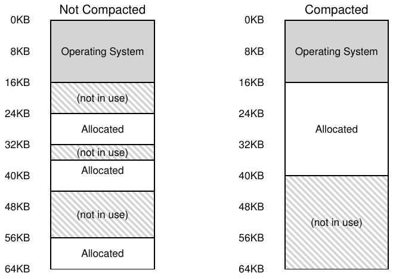

# 16 Segmentation

Đến đây, ta đặt toàn bộ address space mỗi process vào memory. Với base và bounds register, OS dễ relocate process sang phần khác của physical memory. Tuy nhiên có lẽ bạn nhận thấy điều thú vị: giữa stack và heap có một chunk lớn không gian “trống”.

Như hình dung từ Hình 16.1, dù process không dùng chỗ giữa stack và heap, nó vẫn chiếm physical memory khi relocate toàn address space; vì vậy dùng cặp base và bounds để virtualize memory lãng phí. Nó cũng khiến khó chạy chương trình nếu toàn address space không vừa memory; nên base và bounds chưa linh hoạt như muốn. Vì vậy:

> MẤU CHỐT: HỖ TRỢ ADDRESS SPACE LỚN THẾ NÀO
>
> Làm thế nào hỗ trợ address space lớn với (có thể) nhiều chỗ trống giữa stack và heap? Trong ví dụ address space nhỏ giả định, lãng phí không quá tệ. Nhưng tưởng tượng address space 32-bit (size 4 GB); chương trình thông thường chỉ dùng vài megabyte nhưng vẫn đòi toàn address space nằm trong memory.

## 16.1 Segmentation: Khái quát hóa Base/Bounds

Để giải quyết, ý tưởng segmentation ra đời. Khá cũ, ít nhất từ đầu thập niên 1960 [H61, G62]. Ý tưởng đơn giản: thay vì một cặp base và bounds trong MMU, sao không có cặp cho mỗi logical segment? Segment là phần liên tục của address space với độ dài nhất định, và mô hình điển hình có ba segment logically-different: code, stack, heap. Segmentation cho OS đặt từng segment vào các phần physical memory khác nhau, tránh lấp memory bằng virtual address space chưa dùng.



Hình 16.1: Một Address Space (lần nữa)

Ví dụ, giả sử muốn đặt address space Hình 16.1 vào physical memory. Với một cặp base và bounds mỗi segment, có thể đặt độc lập. Xem Hình 16.2 (trang 3): physical memory 64KB chứa ba segment đó (và 16KB dành OS).



Hình 16.2: Đặt segment trong Physical Memory

Như sơ đồ, chỉ memory dùng mới được cấp chỗ trong physical memory, nên hỗ trợ address space lớn có nhiều phần chưa dùng (đôi khi gọi sparse address space).

Cấu trúc hardware trong MMU cần để hỗ trợ segmentation đúng như bạn dự kiến: ở đây là tập ba cặp base và bounds register. Hình 16.3 bên dưới cho giá trị register của ví dụ trên; mỗi bounds register chứa kích thước một segment.

| Segment | Base | Size |
|---|---|---|
| Code | 32K | 2K |
| Heap | 34K | 2K |
| Stack | 28K | 2K |

Hình 16.3: Giá trị Segment Register

Từ hình, bạn thấy code segment được đặt tại physical address 32KB và có kích thước 2KB, còn heap segment tại 34KB, cũng có kích thước 2KB.

Hãy thử translation bằng address space trong Hình 16.1. Giả sử có reference tới virtual address 100 (thuộc code segment). Khi reference xảy ra (chẳng hạn instruction fetch), hardware cộng giá trị base vào offset trong segment (ở đây là 100), thu physical address mong muốn: 100 + 32KB, tức 32868. Sau đó, nó kiểm tra address nằm trong bounds (100 nhỏ hơn 2KB), thấy đúng và gửi reference tới physical memory address 32868.

> THÔNG TIN THÊM: SEGMENTATION FAULT
>
> Thuật ngữ segmentation fault hay violation đến từ memory access tới address trái phép trên máy segmented. Buồn cười là thuật ngữ vẫn tồn tại cả trên máy không hỗ trợ segmentation. Hoặc không buồn cười nếu bạn không hiểu vì sao code cứ fault.

Giờ xét address trong heap, virtual address 4200 (xem lại Hình 16.1). Nếu chỉ cộng 4200 vào base heap (34KB), được physical address 39016, không đúng. Trước hết cần lấy offset trong heap, tức address tham chiếu byte nào. Vì heap bắt đầu virtual address 4KB (4096), offset 4200 thực ra bằng 4200 trừ 4096, hay 104. Cộng offset (104) vào physical address trong base register (34K) cho kết quả mong muốn: 34920.

Nếu tham chiếu address trái phép như 7KB ngoài cuối heap? Hardware phát hiện ngoài bounds, trap vào OS, có thể kết thúc process vi phạm. Giờ bạn biết nguồn gốc thuật ngữ nổi tiếng mọi lập trình viên C đều sợ: segmentation violation hay segmentation fault.

## 16.2 Đang tham chiếu segment nào?

Hardware dùng segment register khi translation. Làm sao biết offset và address thuộc segment nào?

Một cách phổ biến, đôi khi gọi explicit, chia address space thành segment theo vài bit đầu virtual address; VAX/VMS dùng kỹ thuật này [LL82]. Ví dụ trên có ba segment nên cần hai bit. Dùng hai bit đầu virtual address 14-bit để chọn segment, address như sau:



Nếu hai bit đầu 00, hardware biết virtual address thuộc code segment, dùng cặp base và bounds code để relocate đến đúng vị trí. Nếu 01, address thuộc heap nên dùng base và bounds heap. Thử dịch heap virtual address trên (4200) để rõ. Dạng binary 4200 như sau:



Như hình, hai bit đầu (01) cho biết segment. 12 bit cuối là offset: 0000 0110 1000, hay hex 0x068, hay decimal 104. Hardware lấy hai bit đầu chọn segment register, 12 bit tiếp làm offset. Cộng base với offset cho physical address cuối. Offset cũng giúp kiểm tra bounds: chỉ kiểm tra offset nhỏ hơn bounds; không thì trái phép. Nếu base và bounds là array (mỗi segment một entry), hardware làm như sau để có physical address:

```
 1   // get top 2 bits of 14-bit VA
 2   Segment = (VirtualAddress & SEG_MASK) >> SEG_SHIFT
 3   // now get offset
 4   Offset  = VirtualAddress & OFFSET_MASK
 5   if (Offset >= Bounds[Segment])
 6       RaiseException(PROTECTION_FAULT)
 7   else
 8       PhysAddr = Base[Segment] + Offset
 9       Register = AccessMemory(PhysAddr)
```

Trong ví dụ xuyên suốt, có thể điền hằng số: SEG_MASK là 0x3000, SEG_SHIFT là 12, OFFSET_MASK là 0xFFF.

Có lẽ bạn nhận thấy dùng hai bit nhưng chỉ ba segment (code, heap, stack) khiến một segment không dùng. Vì vậy có hệ thống để code cùng segment heap, chỉ dùng một bit chọn segment [LL82].

Hardware có cách khác để biết segment của address. Với cách implicit, nhận biết cách address hình thành. Ví dụ từ program counter (instruction fetch) thì trong code segment; dựa trên stack hay base pointer thì trong stack; address khác thuộc heap.

## 16.3 Còn stack?

Đến đây, ta bỏ qua một thành phần quan trọng của address space: stack. Trong sơ đồ trên, stack được relocate tới physical address 28KB, nhưng có khác biệt thiết yếu: nó tăng trưởng ngược chiều. Trong physical memory, nó bắt đầu tại 28KB và mở rộng về 26KB, tương ứng virtual address từ 16KB về 14KB; translation vì vậy phải diễn ra khác.

Đầu tiên cần thêm chút hardware hỗ trợ. Ngoài base và bounds, hardware cần biết hướng segment tăng (ví dụ bit bằng 1 khi chiều dương, 0 khi âm). Hình 16.4 là thông tin hardware theo dõi đã cập nhật.

| Segment | Base | Size | Tăng chiều dương? |
|---|---|---|---|
| Code | 32K | 2K | 1 |
| Heap | 34K | 2K | 1 |
| Stack | 28K | 2K | 0 |

Hình 16.4: Segment Register (hỗ trợ Negative-Growth)

Khi hardware hiểu segment có thể tăng chiều âm, nó phải dịch virtual address hơi khác. Hãy dịch ví dụ stack virtual address để hiểu.

Giả sử truy cập virtual address 15KB, cần ánh xạ physical address 27KB. Binary là 11 1100 0000 0000 (hex 0x3C00). Hardware dùng hai bit đầu (11) xác định segment, còn offset 3KB. Để có offset âm đúng, trừ maximum segment size khỏi 3KB: segment có thể 4KB, nên offset âm đúng là 3KB trừ 4KB bằng -1KB. Cộng offset âm (-1KB) vào base (28KB) cho physical address 27KB. Kiểm tra bounds bằng bảo đảm trị tuyệt đối offset âm nhỏ hơn size segment.

## 16.4 Hỗ trợ chia sẻ

Khi hỗ trợ segmentation phát triển, người thiết kế hệ thống sớm nhận ra có thể đạt những dạng hiệu quả mới nếu thêm một chút hardware hỗ trợ. Cụ thể, để tiết kiệm memory, đôi khi chia sẻ một số memory segment giữa các address space rất hữu ích. Đặc biệt, code sharing phổ biến và vẫn được dùng trong hệ thống ngày nay.

Để chia sẻ cần hardware thêm dưới dạng protection bit. Hỗ trợ cơ bản thêm vài bit mỗi segment, chỉ chương trình có đọc, ghi hay thực thi code trong segment được không. Đặt code segment read-only cho nhiều process chia cùng code mà không lo hại isolation; mỗi process vẫn nghĩ truy cập memory riêng, OS bí mật chia memory không thể bị process sửa, giữ ảo giác.

Hình 16.5 cho ví dụ thông tin hardware (và OS) theo dõi thêm. Code segment đặt đọc và thực thi, nên cùng physical segment có thể ánh xạ nhiều virtual address space.

| Segment | Base | Size | Tăng chiều dương? | Protection |
|---|---|---|---|---|
| Code | 32K | 2K | 1 | Read-Execute |
| Heap | 34K | 2K | 1 | Read-Write |
| Stack | 28K | 2K | 0 | Read-Write |

Hình 16.5: Giá trị Segment Register (với Protection)

Với protection bit, thuật toán hardware trên phải đổi. Ngoài bounds, còn kiểm tra access cụ thể được phép không. Nếu user process ghi segment read-only hoặc thực thi từ segment non-executable, hardware phát exception để OS xử lý process vi phạm.

## 16.5 Segmentation Fine-grained và Coarse-grained

Phần lớn ví dụ tập trung vài segment (code, stack, heap); có thể xem coarse-grained vì chia address space thành chunk tương đối lớn, thô. Nhưng hệ thống sớm như Multics [CV65,DD68] linh hoạt hơn, cho nhiều segment nhỏ, gọi fine-grained segmentation.

Nhiều segment cần thêm hardware, với segment table trong memory. Table thường hỗ trợ tạo rất nhiều segment, cho dùng linh hoạt hơn đã bàn. Ví dụ Burroughs B5000 hỗ trợ hàng nghìn segment, kỳ vọng compiler chia code và dữ liệu thành segment riêng rồi OS và hardware hỗ trợ [RK68]. Ý tưởng là segment fine-grained giúp OS biết segment nào dùng hay không để tận dụng main memory hiệu quả.

## 16.6 Hỗ trợ OS

Giờ bạn có hình dung cơ bản segmentation. Các phần address space relocate vào physical memory khi hệ thống chạy, tiết kiệm rất nhiều so với một cặp base/bounds cho toàn address space. Cụ thể, không cần cấp physical memory cho chỗ trống giữa stack và heap, nên chứa được nhiều address space hơn.

Tuy nhiên segmentation đặt ra vấn đề mới. Đầu tiên là vấn đề OS cần xử lý, vốn quen: làm gì khi context switch? Hẳn bạn đoán được: lưu và khôi phục segment register. Mỗi process có virtual address space riêng nên OS phải đặt register đúng trước khi cho chạy lại.

Thứ hai và quan trọng hơn là quản lý free space physical memory. Khi tạo address space, OS phải tìm chỗ cho segment. Trước đây giả sử mọi address space cùng size, xem physical memory là tập slot vừa process. Giờ mỗi process có nhiều segment, mỗi segment có thể size khác.



Hình 16.6: Memory Non-compacted và đã compact

Vấn đề tổng quát phát sinh là physical memory nhanh chóng đầy những lỗ trống nhỏ, khiến khó cấp phát segment mới hoặc mở rộng segment hiện có. Ta gọi vấn đề này là external fragmentation [R69]; xem Hình 16.6 (trái).

Trong ví dụ, một process xuất hiện và muốn cấp phát segment 20KB. Có 24KB trống, nhưng không nằm trong một segment liên tục (mà trong ba chunk non-contiguous). Vì vậy, OS không đáp ứng được yêu cầu 20KB.

Một giải pháp là compact physical memory bằng sắp lại segment. OS có thể dừng process đang chạy, sao chép dữ liệu vào một vùng liên tục, đổi segment register trỏ vị trí mới, tạo khoảng memory trống lớn. Nhờ vậy yêu cầu cấp phát thành công. Nhưng compaction tốn kém, sao chép segment memory-intensive và dùng khá nhiều processor time. Xem Hình 16.6 (phải) cho sơ đồ physical memory sau compact.

Đơn giản hơn là thuật toán quản lý free-list cố giữ khoảng memory lớn để cấp. Có hàng trăm cách, gồm best-fit kinh điển (giữ list chỗ trống, trả chỗ gần size nhất đủ yêu cầu), worst-fit, first-fit và phức tạp hơn như buddy algorithm [K68]. Khảo sát Wilson và cộng sự [W+95] là khởi đầu tốt để học thêm, hoặc chờ chương sau về cơ bản. Đáng tiếc thuật toán thông minh đến đâu external fragmentation vẫn tồn tại; thuật toán tốt chỉ cố giảm thiểu.

> MẸO: NẾU CÓ 1000 LỜI GIẢI THÌ KHÔNG CÓ LỜI GIẢI TUYỆT VỜI
>
> Nhiều thuật toán cố giảm external fragmentation cho thấy sự thật sâu hơn: không có một cách “tốt nhất”. Vì vậy ta chấp nhận cách hợp lý, hy vọng đủ tốt. Lời giải thực sự duy nhất (sẽ thấy trong chương tới) là tránh hoàn toàn vấn đề bằng cách không bao giờ cấp memory theo chunk variable-sized.

## 16.7 Tóm tắt

Segmentation giải quyết nhiều vấn đề, giúp memory virtualization hiệu quả hơn. Ngoài dynamic relocation, hỗ trợ sparse address space tốt hơn bằng tránh lãng phí lớn giữa logical segment. Nó nhanh vì phép toán dễ và well-suited với hardware; translation overhead tối thiểu. Lợi ích phụ là code sharing: code trong segment riêng có thể chia giữa nhiều chương trình đang chạy.

Tuy nhiên, cấp segment variable-sized dẫn đến vấn đề cần vượt qua. Đầu tiên là external fragmentation. Vì segment variable-sized, free memory bị chia odd-sized, nên đáp ứng memory-allocation request khó. Có thể dùng thuật toán thông minh [W+95] hay compact định kỳ, nhưng vấn đề căn bản và khó tránh.

Thứ hai, có lẽ quan trọng hơn, segmentation chưa linh hoạt đủ để hỗ trợ address space sparse tổng quát hoàn toàn. Ví dụ heap lớn sparsely-used trong một logical segment vẫn phải nằm toàn trong memory mới truy cập được. Nói cách khác, nếu mô hình sử dụng address space không khớp thiết kế segmentation bên dưới, nó không hiệu quả. Cần tìm giải pháp mới. Sẵn sàng chưa?

## Tài liệu tham khảo

[CV65] “Introduction and Overview of the Multics System”

F. J. Corbato and V. A. Vyssotsky

Fall Joint Computer Conference, 1965

Một trong năm bài Multics trình bày tại Fall Joint Computer Conference; ước gì được âm thầm chứng kiến trong phòng hôm đó!

[DD68] “Virtual Memory, Processes, and Sharing in Multics”

Robert C. Daley and Jack B. Dennis

Communications of the ACM, Tập 11, Số 5, tháng Năm năm 1968

Bài báo sớm về dynamic linking trong Multics, vượt xa thời đại. Dynamic linking trở lại khoảng 20 năm sau khi thư viện X-windows lớn đòi hỏi. Có người nói thư viện X11 lớn là MIT trả đũa việc bỏ dynamic linking trong UNIX đời đầu!

[G62] “Fact Segmentation”

M. N. Greenfield

Proceedings of the SJCC, Tập 21, tháng Năm năm 1962

Bài báo segmentation sớm khác; sớm đến mức không tham khảo công trình khác.

[H61] “Program Organization and Record Keeping for Dynamic Storage”

A. W. Holt

Communications of the ACM, Tập 4, Số 10, tháng Mười năm 1961

Bài báo từ thời kỳ rất sớm, khó đọc, về segmentation và một số ứng dụng của nó.

[I09] “Intel 64 and IA-32 Architectures Software Developer’s Manuals”

Intel, 2009

Có tại: http://www.intel.com/products/processor/manuals

Thử đọc segmentation ở đây (Chương 3 trong Tập 3a); sẽ đau đầu ít nhất một chút.

[K68] “The Art of Computer Programming: Volume I”

Donald Knuth

Addison-Wesley, 1968

Knuth nổi tiếng không chỉ vì các sách ban đầu về Art of Computer Programming, mà còn vì hệ thống dàn trang TeX, vẫn là công cụ dàn trang mạnh mẽ được giới chuyên môn sử dụng ngày nay, và thực sự được dùng để dàn trang chính cuốn sách này. Các bộ sách đồ sộ về thuật toán của ông là tài liệu tham khảo tuyệt vời từ thời kỳ đầu cho nhiều thuật toán làm nền tảng hệ thống máy tính ngày nay.

[L83] “Hints for Computer Systems Design”

Butler Lampson

ACM Operating Systems Review, 15:5, tháng Mười năm 1983

Những lời khuyên khôn ngoan về xây dựng hệ thống, một treasure-trove thực sự. Khó đọc hết trong một lần; hãy tiếp nhận từng chút, như thưởng thức rượu ngon hoặc đọc reference manual.

[LL82] “Virtual Memory Management in the VAX/VMS Operating System”

Henry M. Levy and Peter H. Lipman

IEEE Computer, Tập 15, Số 3 (tháng Ba năm 1982)

Một memory management system kinh điển, với thiết kế chứa nhiều suy xét hợp lý dựa trên lẽ thường. Ta sẽ nghiên cứu kỹ hơn trong một chương sau.

[RK68] “Dynamic Storage Allocation Systems”

B. Randell and C.J. Kuehner

Communications of the ACM

Tập 11(5), trang 297-306, tháng Năm năm 1968

Tổng quan tốt về những khác biệt giữa paging và segmentation, cùng một số thảo luận lịch sử về các máy khác nhau.

[R69] “A note on storage fragmentation and program segmentation”

Brian Randell

Communications of the ACM

Tập 12(7), trang 365-372, tháng Bảy năm 1969

Một trong những bài đầu tiên về fragmentation.

[W+95] “Dynamic Storage Allocation: A Survey and Critical Review”

Paul R. Wilson, Mark S. Johnstone, Michael Neely, and David Boles

Trong International Workshop on Memory Management

Scotland, United Kingdom, tháng Chín năm 1995

Bài khảo sát rất hay về memory allocator.

## Bài tập về nhà

Chương trình này cho thấy address translation trong hệ thống segmentation. Xem README để biết chi tiết.

### Câu hỏi

1. Đầu tiên dùng address space nhỏ dịch vài address. Đây là parameter đơn giản với vài random seed; bạn dịch được không?

```
segmentation.py -a 128 -p 512 -b 0 -l 20 -B 512 -L 20 -s 0
segmentation.py -a 128 -p 512 -b 0 -l 20 -B 512 -L 20 -s 1
segmentation.py -a 128 -p 512 -b 0 -l 20 -B 512 -L 20 -s 2
```

2. Giờ xem ta đã hiểu address space nhỏ vừa xây dựng chưa (dùng parameter của câu trên). Virtual address hợp lệ cao nhất trong segment 0 là gì? Còn virtual address hợp lệ thấp nhất trong segment 1? Address trái phép thấp nhất và cao nhất trong toàn address space này là gì? Cuối cùng, bạn chạy segmentation.py với flag -A thế nào để kiểm tra câu trả lời của mình đúng hay không?

3. Giả sử address space 16-byte nhỏ trong physical memory 128-byte. Đặt base và bounds nào để simulator tạo kết quả dịch cho address stream: hợp lệ, hợp lệ, vi phạm, ..., vi phạm, hợp lệ, hợp lệ? Giả sử parameter:

```
segmentation.py -a 16 -p 128
  -A 0,1,2,3,4,5,6,7,8,9,10,11,12,13,14,15
  --b0 ? --l0 ? --b1 ? --l1 ?
```

4. Giả sử muốn tạo bài toán có khoảng 90% virtual address randomly-generated hợp lệ (không segmentation violation). Cấu hình simulator thế nào? Parameter nào quan trọng?

5. Có thể chạy simulator sao cho không virtual address nào hợp lệ không? Bằng cách nào?
