# 17 Quản lý Free-Space

Trong chương này, ta tạm rời thảo luận về memory virtualization để xét một khía cạnh cơ bản của mọi memory management system, dù đó là library malloc (quản lý page của heap trong process) hay chính OS (quản lý các phần address space của process). Cụ thể, ta sẽ bàn những vấn đề quanh quản lý free-space.

Hãy làm rõ vấn đề. Quản lý không gian trống chắc chắn có thể dễ, như ta sẽ thấy khi bàn khái niệm paging. Nó dễ khi không gian quản lý chia thành các đơn vị fixed-sized; khi đó, bạn chỉ giữ một list các đơn vị fixed-sized này; khi client yêu cầu một đơn vị, trả về entry đầu tiên.

Quản lý free-space khó hơn (và thú vị hơn) khi không gian trống gồm các đơn vị variable-sized; điều này xuất hiện trong library memory-allocation user-level (như malloc() và free()) và trong OS quản lý physical memory khi dùng segmentation triển khai virtual memory. Trong cả hai, vấn đề tồn tại gọi là external fragmentation: không gian trống bị chia nhỏ thành những mảnh có kích thước khác nhau nên bị phân mảnh; yêu cầu sau đó có thể thất bại vì không có một vùng liên tục đủ đáp ứng, dù tổng không gian trống vượt kích thước yêu cầu.

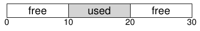

Hình minh họa ví dụ về vấn đề này. Ở đây, tổng không gian trống khả dụng là 20 byte; đáng tiếc nó bị phân thành hai chunk, mỗi chunk 10 byte. Vì vậy, yêu cầu 15 byte thất bại dù còn 20 byte trống. Và đó là vấn đề chương này giải quyết.

> MẤU CHỐT: LÀM THẾ NÀO QUẢN LÝ KHÔNG GIAN TRỐNG
>
> Nên quản lý không gian trống thế nào khi đáp ứng yêu cầu variable-sized? Có thể dùng chiến lược nào giảm fragmentation? Overhead về thời gian và không gian của các cách khác nhau là gì?

## 17.1 Các giả định

Phần lớn thảo luận tập trung vào lịch sử phong phú của allocator trong library memory-allocation user-level. Ta dựa trên khảo sát xuất sắc của Wilson [W+95], nhưng khuyến khích bạn đọc quan tâm tìm tài liệu nguồn để biết thêm chi tiết[^1].

Ta giả định interface cơ bản như malloc() và free() cung cấp. Cụ thể, void *malloc(size_t size) nhận một parameter duy nhất, size, là số byte application yêu cầu; nó trả pointer (không thuộc kiểu cụ thể nào, hay void pointer theo thuật ngữ C) tới vùng có kích thước đó (hoặc lớn hơn). Routine bổ sung void free(void *ptr) nhận pointer và giải phóng chunk tương ứng. Lưu ý hàm ý của interface: khi giải phóng không gian, user không báo library kích thước của nó; vì vậy library phải biết chunk memory lớn bao nhiêu chỉ từ pointer đến nó. Ta sẽ bàn cách làm sau trong chương.

Không gian library này quản lý theo lịch sử được gọi là heap, và data structure tổng quát quản lý không gian trống trong heap là một dạng free list. Cấu trúc này chứa reference tới mọi chunk trống trong vùng memory được quản lý. Dĩ nhiên, data structure không nhất thiết thực sự là list, chỉ cần một dạng data structure theo dõi không gian trống.

Ta còn giả định chủ yếu quan tâm external fragmentation như mô tả trên. Allocator dĩ nhiên cũng có thể gặp internal fragmentation; nếu allocator đưa ra chunk memory lớn hơn yêu cầu, phần không được yêu cầu (nên không dùng) trong chunk là internal fragmentation (vì lãng phí xảy ra bên trong đơn vị đã cấp phát), một dạng lãng phí không gian khác. Tuy nhiên, để đơn giản và vì external fragmentation thú vị hơn trong hai loại, ta chủ yếu tập trung vào nó.

Ta cũng giả định khi memory đã được đưa cho client, không thể di dời nó tới vị trí memory khác. Chẳng hạn, nếu program gọi malloc() và nhận pointer vào heap, vùng memory đó về cơ bản “thuộc sở hữu” program (library không thể chuyển nó) cho đến khi program trả lại qua lời gọi free() tương ứng. Vì vậy, không thể compaction không gian trống, vốn hữu ích để chống fragmentation[^2]. Tuy nhiên, OS có thể dùng compaction xử lý fragmentation khi triển khai segmentation (như đã bàn trong chương segmentation).

Cuối cùng, ta giả định allocator quản lý một vùng byte liên tục. Đôi khi allocator có thể yêu cầu vùng đó lớn lên; chẳng hạn library memory-allocation user-level có thể gọi kernel mở rộng heap (qua system call như sbrk) khi hết chỗ. Tuy nhiên, để đơn giản, ta giả định vùng có một kích thước cố định suốt vòng đời.

## 17.2 Mechanism Low-level

Trước khi tìm hiểu policy, ta trình bày vài mechanism phổ biến trong phần lớn allocator. Đầu tiên là kiến thức cơ bản về splitting và coalescing, những kỹ thuật phổ biến trong hầu hết allocator. Thứ hai, ta chỉ cách theo dõi kích thước vùng đã cấp phát nhanh và tương đối dễ. Cuối cùng, ta bàn cách xây dựng list đơn giản bên trong không gian trống để theo dõi phần nào trống và phần nào không.

### Splitting và Coalescing

Free list chứa tập hợp phần tử mô tả không gian trống còn lại trong heap. Vì vậy, giả sử heap 30-byte sau:

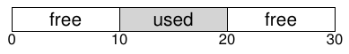

Free list cho heap này có hai phần tử. Một entry mô tả free segment 10-byte đầu tiên (byte 0-9), và một entry mô tả free segment còn lại (byte 20-29):

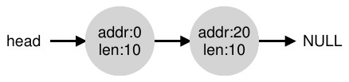

Như mô tả trên, yêu cầu lớn hơn 10 byte đều thất bại (trả NULL); đơn giản không có chunk memory liên tục đủ kích thước. Yêu cầu đúng kích thước đó (10 byte) dễ dàng được đáp ứng bởi một trong hai free chunk. Nhưng nếu yêu cầu nhỏ hơn 10 byte thì sao?

Giả sử yêu cầu chỉ một byte memory. Khi đó, allocator thực hiện thao tác gọi là splitting: tìm free chunk đáp ứng yêu cầu rồi chia làm hai. Chunk đầu được trả cho bên gọi; chunk thứ hai vẫn trên list. Vì vậy, trong ví dụ trên, nếu yêu cầu 1 byte và allocator chọn phần tử thứ hai trên list để đáp ứng, lời gọi malloc() trả 20 (address của vùng 1-byte đã cấp phát), và list thành:

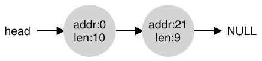

Trong hình, bạn thấy list về cơ bản vẫn nguyên vẹn; thay đổi duy nhất là free region giờ bắt đầu tại 21 thay vì 20, và chiều dài free region chỉ còn 9[^3]. Vì vậy, allocator thường dùng split khi yêu cầu nhỏ hơn kích thước của một free chunk cụ thể.

Một mechanism đi kèm trong nhiều allocator gọi là coalescing không gian trống. Xét lại ví dụ trên (10 byte trống, 10 byte đang dùng và 10 byte trống nữa).

Với heap (nhỏ) này, chuyện gì xảy ra khi application gọi free(10), trả lại không gian giữa heap? Nếu chỉ thêm không gian trống này vào list mà không suy nghĩ nhiều, ta có thể có list như sau:

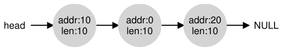

Lưu ý vấn đề: dù toàn bộ heap hiện trống, nó dường như chia thành ba chunk, mỗi chunk 10 byte. Vì vậy, nếu user yêu cầu 20 byte, duyệt list đơn giản sẽ không tìm thấy free chunk như thế và trả thất bại.

Để tránh vấn đề, allocator coalesce không gian trống khi giải phóng chunk memory. Ý tưởng đơn giản: khi trả free chunk trong memory, xem kỹ address của chunk đang trả và các free chunk gần nó; nếu phần newly-freed nằm sát một (hoặc hai như ví dụ này) free chunk hiện có, gộp chúng thành một free chunk lớn hơn. Vì vậy, với coalescing, list cuối phải như sau:

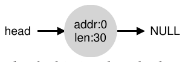

Thực ra, đây chính là hình dạng heap list ban đầu, trước mọi lần cấp phát. Với coalescing, allocator bảo đảm tốt hơn rằng application có các vùng trống lớn khả dụng.

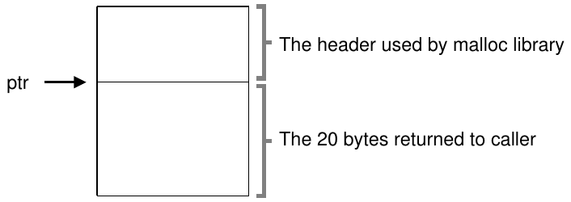

Hình 17.1: Vùng đã cấp phát cùng Header

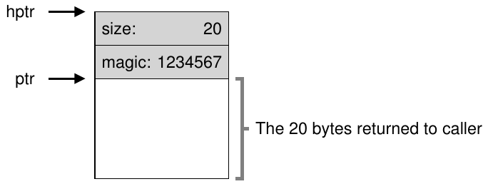

Hình 17.2: Nội dung cụ thể của Header

### Theo dõi kích thước vùng đã cấp phát

Bạn có thể nhận ra interface free(void *ptr) không nhận parameter kích thước; vì vậy giả định rằng chỉ với pointer, library malloc nhanh chóng xác định kích thước vùng memory đang giải phóng rồi đưa không gian ấy vào free list.

Để làm việc này, phần lớn allocator lưu ít thông tin thêm trong header block nằm trong memory, thường ngay trước chunk memory handed-out. Hãy xem lại ví dụ (Hình 17.1). Ở đây ta xét block đã cấp phát 20 byte, được ptr trỏ tới; tưởng tượng user gọi malloc() và lưu kết quả vào ptr, chẳng hạn ptr = malloc(20);.

Header tối thiểu chứa kích thước vùng đã cấp phát (ở đây là 20); nó cũng có thể chứa pointer bổ sung để tăng tốc deallocation, magic number hỗ trợ kiểm tra tính toàn vẹn và thông tin khác. Giả sử header đơn giản chứa kích thước vùng và magic number như sau:

```
typedef struct __header_t {
    int size;
    int magic;
} header_t;
```

Ví dụ trên sẽ giống Hình 17.2. Khi user gọi free(ptr), library dùng pointer arithmetic đơn giản để tìm nơi header bắt đầu:

```
void free(void *ptr) {
    header_t *hptr = (void *)ptr - sizeof(header_t);
    ...
```

Sau khi có pointer tới header, library dễ dàng xác định magic number có khớp giá trị mong đợi hay không như một sanity check (assert(hptr->magic == 1234567)), và tính tổng kích thước vùng newly-freed bằng phép toán đơn giản (tức cộng kích thước header với kích thước vùng). Lưu ý chi tiết nhỏ nhưng thiết yếu ở câu trước: kích thước free region bằng kích thước header cộng kích thước không gian cấp cho user. Vì vậy, khi user yêu cầu N byte memory, library không tìm free chunk kích thước N; thay vào đó tìm free chunk kích thước N cộng kích thước header.

### Nhúng Free List

Đến đây, ta coi free list đơn giản là thực thể khái niệm; chỉ là list mô tả các free chunk memory trong heap. Nhưng làm sao xây list ấy ngay bên trong không gian trống?

Trong list thông thường hơn, khi cấp phát node mới, bạn chỉ gọi malloc() lúc cần không gian cho node. Đáng tiếc, bên trong library memory-allocation, bạn không thể làm thế! Thay vào đó, cần xây list ngay trong không gian trống. Đừng lo nếu thấy hơi kỳ; nó kỳ thật, nhưng chưa kỳ đến mức không làm được!

Giả sử có chunk memory 4096-byte cần quản lý (tức heap 4KB). Để quản lý như free list, trước hết phải khởi tạo list; ban đầu nó có một entry kích thước 4096 (trừ kích thước header). Đây là mô tả node của list:

```
typedef struct __node_t {
    int              size;
    struct __node_t *next;
} node_t;
```

Giờ xem code khởi tạo heap và đặt phần tử đầu của free list vào không gian đó. Ta giả định heap được xây trong không gian trống lấy qua system call mmap(); đây không phải cách duy nhất xây heap như vậy nhưng phù hợp ví dụ này. Code như sau:

```
// mmap() returns a pointer to a chunk of free space
node_t *head = mmap(NULL, 4096, PROT_READ|PROT_WRITE,
                    MAP_ANON|MAP_PRIVATE, -1, 0);
head->size   = 4096 - sizeof(node_t);
head->next   = NULL;
```

Sau khi chạy code, list có một entry duy nhất kích thước 4088. Đúng, heap rất nhỏ, nhưng là ví dụ tốt ở đây. Pointer head chứa address bắt đầu vùng này; giả sử là 16KB (dù bất kỳ virtual address nào cũng được). Trực quan, heap giống Hình 17.3.

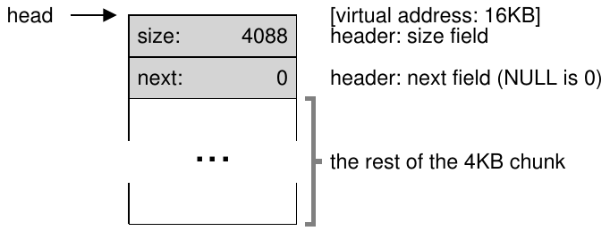

Hình 17.3: Heap với một Free Chunk

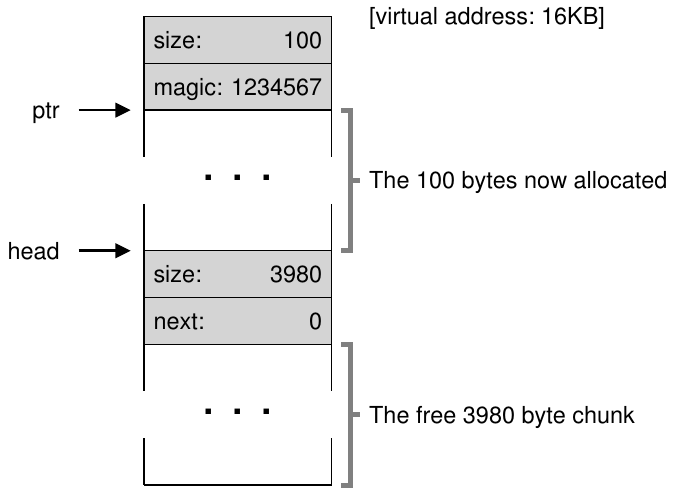

Hình 17.4: Heap sau một lần cấp phát

Giờ tưởng tượng có yêu cầu chunk memory, chẳng hạn 100 byte. Để phục vụ, library trước hết tìm chunk đủ lớn; vì chỉ có một free chunk (kích thước: 4088), chunk ấy được chọn. Sau đó chunk chia làm hai: một chunk đủ phục vụ yêu cầu (và header như mô tả trên), cùng free chunk còn lại. Giả sử header 8-byte (một integer size và một integer magic number), không gian heap giờ giống Hình 17.4.

Vì vậy, khi nhận yêu cầu 100 byte, library cấp phát 108 byte từ free chunk duy nhất hiện có, trả pointer tới đó (đánh dấu ptr trong hình trên), cất thông tin header ngay trước không gian đã cấp phát để dùng sau khi free(), và thu nhỏ free node duy nhất trong list xuống 3980 byte (4088 trừ 108).

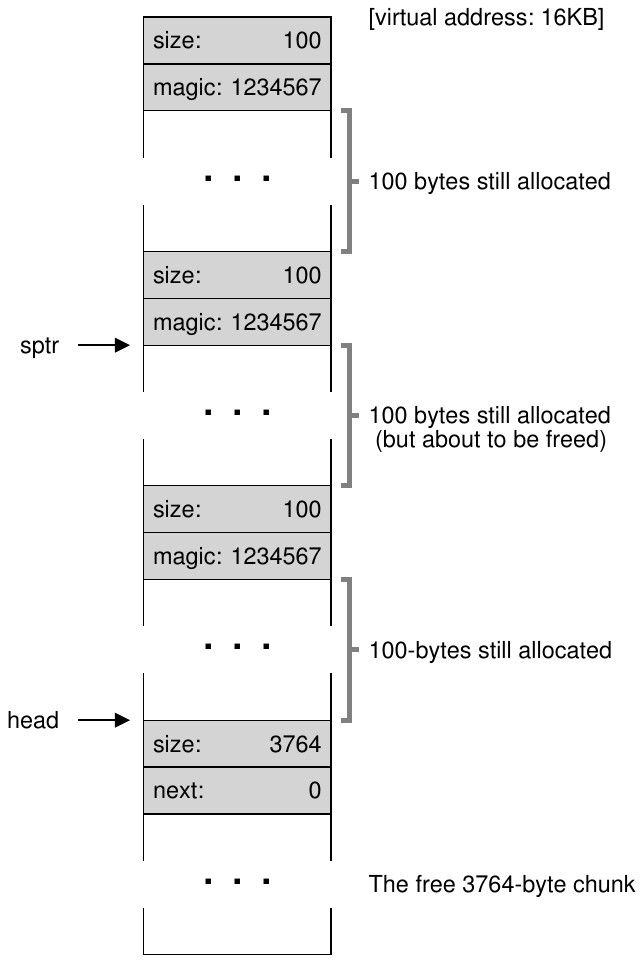

Hình 17.5: Không gian trống với ba Chunk đã cấp phát

Giờ xem heap khi có ba vùng đã cấp phát, mỗi vùng 100 byte (hoặc 108 gồm header). Hình 17.5 minh họa heap này.

Như bạn thấy, 324 byte đầu heap giờ đã được cấp phát, nên trong không gian đó có ba header cùng ba vùng 100 byte mà program gọi đang dùng. Free list vẫn không có gì đặc biệt: chỉ có một node (head trỏ tới), nhưng kích thước giờ chỉ còn 3764 byte sau ba lần split. Tuy nhiên, chuyện gì xảy ra khi program gọi trả lại một phần memory qua free()?

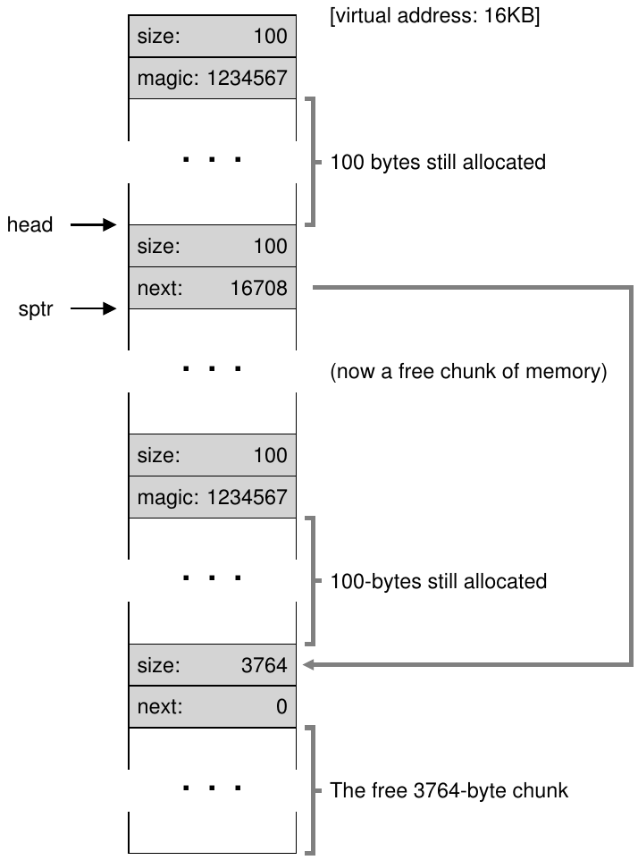

Hình 17.6: Không gian trống với hai Chunk đã cấp phát

Ở ví dụ này, application trả lại chunk đã cấp phát ở giữa bằng cách gọi free(16500) (giá trị 16500 được tính bằng cách cộng điểm bắt đầu vùng memory, 16384, với 108 của chunk trước và 8 byte header của chunk này). Giá trị được pointer sptr biểu diễn trong sơ đồ trước.

Library lập tức xác định kích thước free region, rồi thêm free chunk trở lại free list. Giả sử ta chèn ở đầu free list, không gian giờ trông như sau (Hình 17.6).

Giờ ta có list bắt đầu bằng free chunk nhỏ (100 byte, head của list trỏ tới) và free chunk lớn (3764 byte). Cuối cùng list đã có hơn một phần tử! Và đúng, không gian trống bị phân mảnh, điều đáng tiếc nhưng thường gặp.

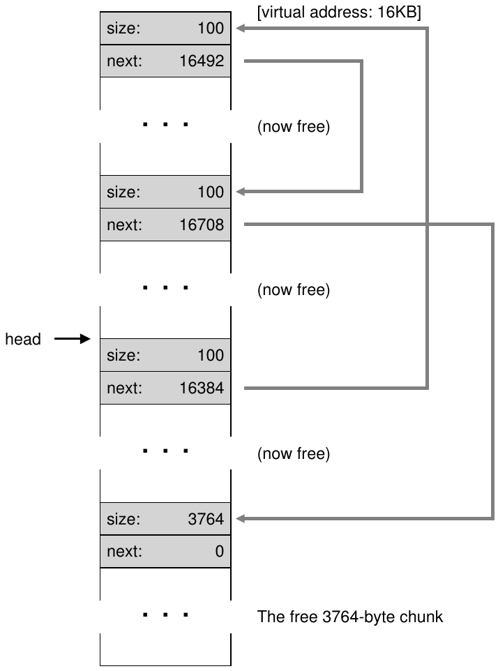

Hình 17.7: Free List Non-Coalesced

Ví dụ cuối: giả sử hai chunk in-use còn lại được giải phóng. Nếu không coalescing, bạn có thể có free list bị phân mảnh mạnh (xem Hình 17.7).

Như hình cho thấy, giờ ta có một mớ hỗn độn! Vì sao? Đơn giản là quên coalesce list. Dù mọi memory đều trống, nó bị cắt thành mảnh nên trông như memory phân mảnh dù thực chất không phải. Giải pháp đơn giản: duyệt list và gộp chunk lân cận; khi xong, heap lại nguyên vẹn.

### Mở rộng Heap

Ta nên bàn mechanism cuối trong nhiều allocation library. Cụ thể, làm gì nếu heap hết chỗ? Cách đơn giản nhất là thất bại. Đôi khi đây là lựa chọn duy nhất, nên trả NULL là cách đáng trọng. Đừng buồn! Bạn đã cố gắng, và dù thất bại, bạn đã chiến đấu hết mình.

Phần lớn allocator truyền thống bắt đầu với heap small-sized rồi yêu cầu thêm memory từ OS khi hết. Thường có nghĩa thực hiện system call nào đó (ví dụ sbrk trong phần lớn UNIX) để mở rộng heap, rồi cấp chunk mới từ đó. Để phục vụ yêu cầu sbrk, OS tìm free physical page, map vào address space của process yêu cầu, rồi trả giá trị cuối heap mới; lúc đó heap lớn hơn khả dụng, và yêu cầu được phục vụ thành công.

## 17.3 Chiến lược cơ bản

Giờ đã biết một số cơ chế, hãy xem các chiến lược cơ bản quản lý không gian trống. Chúng chủ yếu dựa trên policy khá đơn giản bạn có thể tự nghĩ ra; thử trước khi đọc xem bạn nghĩ được mọi phương án (hoặc vài cách mới!) không.

Allocator lý tưởng vừa nhanh vừa giảm thiểu fragmentation. Đáng tiếc, vì chuỗi yêu cầu cấp phát và giải phóng có thể tùy ý (rốt cuộc programmer quyết định), bất kỳ chiến lược cụ thể nào cũng có thể rất tệ với bộ input không phù hợp. Vì vậy, ta không mô tả cách “tốt nhất”, mà nói về kiến thức cơ bản cùng ưu nhược điểm.

### Best Fit

Chiến lược best fit khá đơn giản: trước hết tìm trong free list các free chunk memory có kích thước bằng hoặc lớn hơn yêu cầu. Rồi trả chunk nhỏ nhất trong nhóm ứng viên; đó là chunk best-fit (cũng có thể gọi smallest fit). Duyệt free list một lượt đủ tìm đúng block cần trả.

Trực giác đằng sau best fit đơn giản: trả block sát yêu cầu user để giảm không gian lãng phí. Tuy nhiên có chi phí; implementation ngây thơ chịu tổn thất hiệu năng lớn khi tìm toàn diện free block đúng.

### Worst Fit

Worst fit ngược best fit; tìm chunk lớn nhất rồi trả lượng được yêu cầu; giữ chunk (lớn) còn lại trên free list. Worst fit cố để lại chunk trống lớn thay vì nhiều chunk nhỏ có thể xuất hiện từ cách best-fit. Tuy nhiên, một lần nữa cần tìm toàn bộ không gian trống, nên có thể tốn kém. Tệ hơn, phần lớn nghiên cứu cho thấy hiệu quả kém, tạo fragmentation quá mức mà overhead vẫn cao.

### First Fit

First fit đơn giản tìm block đủ lớn đầu tiên rồi trả lượng yêu cầu cho user. Như trước, không gian trống còn lại giữ cho yêu cầu sau.

First fit có lợi thế tốc độ — không cần tìm toàn diện mọi không gian trống — nhưng đôi khi làm đầu free list đầy các object nhỏ. Vì vậy, cách allocator quản lý thứ tự free list trở thành vấn đề. Một cách là thứ tự address-based; giữ list theo address của không gian trống giúp coalescing dễ hơn và có xu hướng giảm fragmentation.

### Next Fit

Thay vì luôn bắt đầu tìm first-fit từ đầu list, next fit giữ thêm pointer tới vị trí đã tìm lần trước. Ý tưởng là phân bố việc tìm không gian trống đều hơn trên toàn list, tránh chia vụn đầu list. Hiệu năng tương tự first fit, vì một lần nữa tránh được tìm kiếm toàn diện.

### Ví dụ

Đây là vài ví dụ về các chiến lược trên. Hãy hình dung free list có ba phần tử với kích thước 10, 30 và 20 (ở đây ta bỏ qua header cùng chi tiết khác, chỉ tập trung cách chiến lược hoạt động):


Giả sử có yêu cầu cấp phát kích thước 15. Cách best-fit tìm toàn bộ list và thấy 20 phù hợp nhất, vì đây là không gian trống nhỏ nhất đáp ứng được yêu cầu. Free list kết quả như sau:

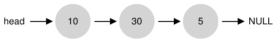

Như trong ví dụ và thường gặp với best-fit, giờ còn lại free chunk nhỏ. Cách worst-fit tương tự nhưng tìm chunk lớn nhất, ở đây là 30. List kết quả:

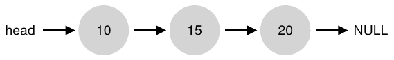

Chiến lược first-fit trong ví dụ làm giống worst-fit, cũng tìm free block đầu tiên đáp ứng yêu cầu. Khác biệt nằm ở chi phí tìm kiếm; best-fit và worst-fit đều xem toàn bộ list; first-fit chỉ xem free chunk đến khi gặp chunk vừa, giảm chi phí tìm.

Các ví dụ này mới chỉ chạm bề mặt allocation policy. Để hiểu sâu cần phân tích chi tiết hơn với workload thực tế và hành vi allocator phức tạp hơn (ví dụ coalescing). Bạn nói có lẽ nên đưa vào bài tập à?

## 17.4 Những cách khác

Ngoài cách cơ bản trên, nhiều kỹ thuật và thuật toán đã được đề xuất để cải thiện memory allocation theo cách nào đó. Ta liệt kê một số để bạn cân nhắc (tức khiến bạn nghĩ xa hơn allocation best-fit).

### Segregated Lists

Một cách thú vị đã có từ lâu là segregated list. Ý tưởng cơ bản đơn giản: nếu application cụ thể thường yêu cầu một (hoặc vài) kích thước popular-sized, giữ list riêng chỉ quản lý object kích thước đó; mọi yêu cầu khác chuyển cho memory allocator tổng quát hơn.

Lợi ích rõ ràng. Dành chunk memory cho một kích thước yêu cầu cụ thể khiến fragmentation ít đáng lo hơn; hơn nữa, yêu cầu cấp phát và giải phóng đúng kích thước được phục vụ rất nhanh vì không cần tìm list phức tạp.

Như mọi ý tưởng hay, cách này cũng đưa thêm phức tạp vào hệ thống. Ví dụ, nên dành bao nhiêu memory cho pool phục vụ yêu cầu chuyên biệt kích thước cụ thể, thay vì pool chung? Một allocator cụ thể, slab allocator của uber-engineer Jeff Bonwick (thiết kế cho Solaris kernel), xử lý khá hay [B94].

Cụ thể, khi kernel boot, nó cấp một số object cache cho kernel object có thể được yêu cầu thường xuyên (như lock, inode file-system, v.v.); mỗi object cache do đó là segregated free list của một kích thước, phục vụ yêu cầu cấp phát và giải phóng memory nhanh. Khi cache gần hết không gian trống, nó yêu cầu vài slab memory từ memory allocator tổng quát hơn (tổng lượng yêu cầu là bội số của page size và object tương ứng). Ngược lại, khi reference count của mọi object trong slab đều về zero, general allocator có thể thu hồi chúng từ specialized allocator, thường khi VM system cần thêm memory.

> BỔ SUNG: KỸ SƯ GIỎI THỰC SỰ RẤT GIỎI
>
> Kỹ sư như Jeff Bonwick (không chỉ viết slab allocator ở đây mà còn dẫn dắt file system tuyệt vời ZFS) là trái tim Silicon Valley. Sau gần như mọi sản phẩm hay công nghệ tuyệt vời là một người (hoặc nhóm nhỏ) có tài năng, năng lực và tận tâm vượt xa trung bình. Như Mark Zuckerberg (Facebook) nói: “Người xuất sắc trong vai trò của mình không chỉ giỏi hơn người khá giỏi một chút. Họ giỏi hơn 100 lần.” Vì vậy, ngay hôm nay, một hoặc hai người vẫn có thể lập công ty thay đổi thế giới mãi mãi (nghĩ Google, Apple hay Facebook). Làm việc chăm chỉ, bạn cũng có thể trở thành người “100x”. Nếu không, làm việc cùng người như vậy; bạn học trong một ngày nhiều hơn phần lớn người khác trong một tháng. Nếu cũng không, hãy buồn đi.

Slab allocator còn vượt phần lớn cách segregated list bằng cách giữ free object trên list ở trạng thái pre-initialized. Bonwick cho thấy khởi tạo và hủy data structure tốn kém [B94]; giữ object đã giải phóng trong list cụ thể ở trạng thái đã khởi tạo giúp slab allocator tránh chu kỳ khởi tạo và hủy thường xuyên cho từng object, giảm overhead đáng kể.

### Buddy Allocation

Vì coalescing thiết yếu cho allocator, một số cách được thiết kế xoay quanh việc đơn giản hóa coalescing. Binary buddy allocator [K65] là ví dụ tốt.

Trong hệ thống này, về khái niệm free memory ban đầu là không gian lớn kích thước 2<sup>N</sup>. Khi yêu cầu memory, việc tìm không gian trống chia đôi đệ quy cho đến khi thấy block đủ chứa yêu cầu (chia đôi tiếp sẽ quá nhỏ). Lúc đó, block yêu cầu được trả cho user. Đây là ví dụ không gian trống 64KB được chia khi tìm block 7KB:

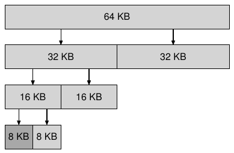

Trong ví dụ, block 8KB ngoài cùng bên trái được cấp phát (màu xám đậm hơn) và trả cho user; lưu ý cách này có thể gây internal fragmentation vì chỉ được đưa ra block power-of-two-sized.

Điểm đẹp của buddy allocation là điều xảy ra khi giải phóng block. Khi trả block 8KB vào free list, allocator kiểm tra “buddy” 8KB có trống không; nếu có, coalesce hai block thành block 16KB. Rồi kiểm tra buddy của block 16KB còn trống không; nếu có, lại coalesce hai block. Quá trình coalescing đệ quy tiếp tục lên tree, hoặc khôi phục toàn bộ không gian trống hoặc dừng khi buddy đang dùng.

Buddy allocation hoạt động tốt vì dễ xác định buddy của block cụ thể. Bằng cách nào? Hãy nghĩ address các block trong không gian trống trên. Nếu nghĩ kỹ, bạn thấy address mỗi cặp buddy chỉ khác một bit; bit nào tùy level trong buddy tree. Và bạn đã có ý tưởng cơ bản về binary buddy allocation. Như mọi khi, xem khảo sát Wilson [W+95] để biết thêm.

### Ý tưởng khác

Một vấn đề lớn của nhiều cách trên là thiếu khả năng mở rộng. Cụ thể, tìm kiếm trong list có thể khá chậm. Vì vậy, allocator tiên tiến dùng data structure phức tạp hơn để giải quyết chi phí này, đánh đổi sự đơn giản lấy hiệu năng. Ví dụ gồm balanced binary tree, splay tree hoặc tree partially-ordered [W+95].

Vì hệ thống hiện đại thường có nhiều processor và chạy workload multi-threaded (bạn sẽ học rất kỹ trong phần Concurrency), không ngạc nhiên khi nhiều nỗ lực được dành để allocator hoạt động tốt trên hệ thống multiprocessor-based. Hai ví dụ tuyệt vời là Berger và cộng sự [B+00] và Evans [E06]; hãy đọc để biết chi tiết.

Đây chỉ là hai trong hàng nghìn ý tưởng về memory allocator qua thời gian; hãy tự đọc nếu tò mò. Nếu không, đọc cách glibc allocator hoạt động [S15] để biết thế giới thực như thế nào.

## 17.5 Tổng kết

Trong chương này, ta bàn các dạng memory allocator sơ đẳng nhất. Chúng tồn tại khắp nơi, được link vào mọi program C bạn viết, cũng như OS bên dưới quản lý memory cho data structure riêng. Như nhiều hệ thống, xây dựng hệ thống này cần nhiều trade-offs, và càng biết chính xác workload allocator nhận, bạn càng có thể điều chỉnh để nó phục vụ workload đó tốt hơn. Tạo allocator nhanh, space-efficient, mở rộng được và hoạt động tốt với nhiều workload vẫn là thách thức on-going trong hệ thống máy tính hiện đại.

## Tài liệu tham khảo

[B+00] “Hoard: A Scalable Memory Allocator for Multithreaded Applications”

Emery D. Berger, Kathryn S. McKinley, Robert D. Blumofe, and Paul R. Wilson

ASPLOS-IX, November 2000

Allocator xuất sắc cho hệ thống multiprocessor của Berger và cộng sự. Không chỉ là bài báo thú vị, nó còn được dùng thực tế!

[B94] “The Slab Allocator: An Object-Caching Kernel Memory Allocator”

Jeff Bonwick

USENIX ’94

Bài báo hay về xây allocator cho operating system kernel, ví dụ tuyệt vời về chuyên biệt hóa cho các kích thước object thường gặp cụ thể.

[E06] “A Scalable Concurrent malloc(3) Implementation for FreeBSD”

Jason Evans

http://people.freebsd.org/˜jasone/jemalloc/bsdcan2006/jemalloc.pdf

April 2006

Cái nhìn chi tiết về xây allocator hiện đại thực tế cho multiprocessor. Allocator “jemalloc” hiện được dùng rộng rãi trong FreeBSD, NetBSD, Mozilla Firefox và Facebook.

[K65] “A Fast Storage Allocator”

Kenneth C. Knowlton

Communications of the ACM, Volume 8, Number 10, October 1965

Tài liệu tham khảo phổ biến cho buddy allocation. Chi tiết lạ ngẫu nhiên: Knuth ghi nhận ý tưởng không phải cho Knowlton mà cho Harry Markowitz, nhà kinh tế đoạt Nobel-prize. Chi tiết lạ khác: Knuth trao đổi mọi email qua thư ký; ông không tự gửi email mà bảo thư ký gửi gì, rồi thư ký gửi. Chi tiết cuối về Knuth: ông tạo TeX, công cụ dàn trang cuốn sách này. Đây là software tuyệt vời[^4].

[S15] “Understanding glibc malloc”

Sploitfun

February, 2015

https://sploitfun.wordpress.com/2015/02/10/understanding-glibc-malloc/

Tìm hiểu sâu cách glibc malloc hoạt động. Chi tiết đáng kinh ngạc và rất đáng đọc.

[W+95] “Dynamic Storage Allocation: A Survey and Critical Review”

Paul R. Wilson, Mark S. Johnstone, Michael Neely, David Boles

International Workshop on Memory Management

Kinross, Scotland, September 1995

Khảo sát xuất sắc và far-reaching về nhiều khía cạnh memory allocation. Quá nhiều chi tiết để bàn trong chương nhỏ này!

## Bài tập

Program malloc.py cho phép khám phá hành vi free-space allocator đơn giản như mô tả trong chương. Xem README để biết hoạt động cơ bản.

### Câu hỏi

1. Trước tiên chạy với flag -n 10 -H 0 -p BEST -s 0 để tạo vài lần cấp phát và giải phóng ngẫu nhiên. Bạn dự đoán alloc()/free() trả gì được không? Bạn đoán trạng thái free list sau mỗi yêu cầu được không? Bạn nhận ra gì về free list theo thời gian?

2. Kết quả khác gì khi dùng policy WORST fit tìm free list (-p WORST)? Điều gì thay đổi?

3. Nếu dùng FIRST fit (-p FIRST) thì sao? Phần nào được tăng tốc khi bạn dùng first fit?

4. Với các câu trên, thứ tự list có thể ảnh hưởng thời gian tìm vị trí trống của một số policy. Dùng các thứ tự free list khác nhau (-l ADDRSORT, -l SIZESORT+, -l SIZESORT-) xem policy và thứ tự list tương tác thế nào.

5. Coalescing free list có thể rất quan trọng. Tăng số lần cấp phát ngẫu nhiên (chẳng hạn -n 1000). Yêu cầu cấp phát lớn hơn gặp chuyện gì theo thời gian? Chạy có và không coalescing (tức không có và có flag -C). Bạn thấy kết quả khác nhau gì? Free list lớn bao nhiêu theo thời gian trong mỗi trường hợp? Thứ tự list có quan trọng ở đây không?

6. Khi đổi tỷ lệ phần trăm cấp phát -P lớn hơn 50 thì sao? Các lần cấp phát thế nào khi tỷ lệ gần 100? Còn khi gần 0?

7. Bạn có thể đưa ra những yêu cầu cụ thể nào để tạo không gian trống highly-fragmented? Dùng flag -A tạo free list phân mảnh, xem policy và option khác nhau thay đổi tổ chức free list thế nào.

---

[^1]: Nó dài gần 80 trang; vì vậy bạn phải thực sự quan tâm!

[^2]: Khi đã đưa pointer tới chunk memory cho program C, nhìn chung khó xác định mọi reference (pointer) tới vùng ấy, có thể được lưu trong variable khác hoặc thậm chí register tại một thời điểm thực thi. Điều này có thể không đúng với ngôn ngữ strongly-typed, garbage-collected hơn, nên có thể dùng compaction chống fragmentation.

[^3]: Thảo luận này giả sử không có header, một giả định thiếu thực tế nhưng đơn giản hóa ta tạm dùng.

[^4]: Thực ra ta dùng LaTeX, dựa trên các bổ sung của Lamport cho TeX, nhưng cũng gần đúng.
