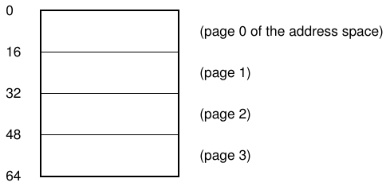
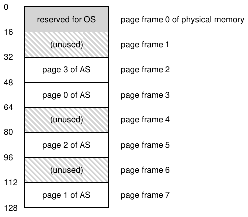
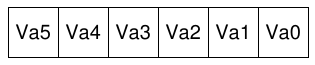
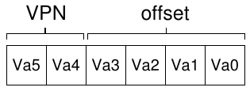
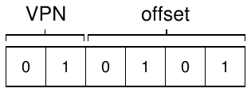
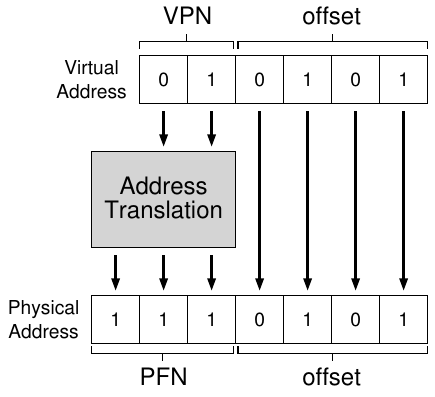
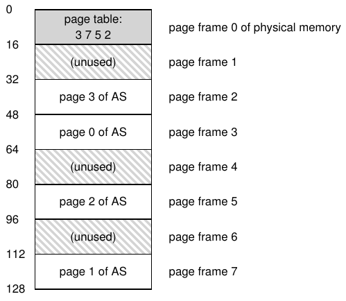
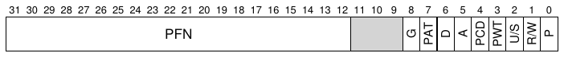
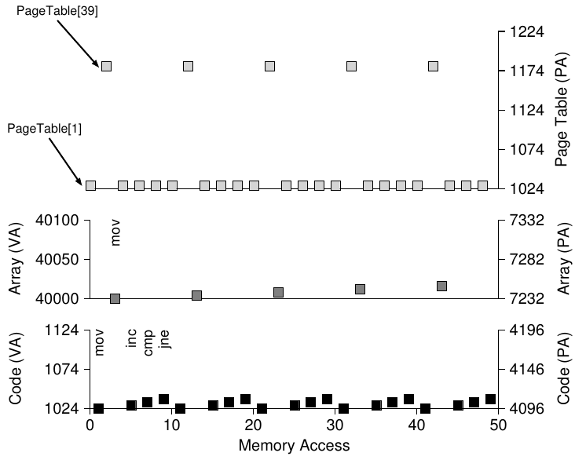

# 18 Paging: Giới thiệu

Đôi khi người ta nói operating system dùng một trong hai cách khi giải quyết hầu hết vấn đề space-management. Cách đầu chia mọi thứ thành các phần variable-sized, như segmentation trong virtual memory. Đáng tiếc, giải pháp này có khó khăn vốn có. Cụ thể, khi chia không gian thành chunk different-size, bản thân không gian có thể phân mảnh, khiến allocation khó hơn theo thời gian.

Vì vậy, đáng cân nhắc cách thứ hai: chia không gian thành các phần fixed-sized. Trong virtual memory, ta gọi ý tưởng này là paging, có từ hệ thống quan trọng thời kỳ đầu Atlas [KE+62, L78]. Thay vì chia address space của process thành một số logical segment variable-sized (như code, heap, stack), ta chia thành đơn vị fixed-sized, mỗi đơn vị gọi là page. Tương ứng, ta xem physical memory như array các slot fixed-sized gọi là page frame; mỗi frame chứa được một page virtual-memory. Thách thức là:

> MẤU CHỐT:
>
> LÀM THẾ NÀO VIRTUALIZE MEMORY BẰNG PAGE
>
> Làm sao virtualize memory bằng page để tránh vấn đề của segmentation? Những kỹ thuật cơ bản là gì? Làm sao chúng hoạt động tốt với overhead không gian và thời gian tối thiểu?

## 18.1 Ví dụ đơn giản và tổng quan

Để làm rõ cách này, hãy minh họa bằng ví dụ đơn giản. Hình 18.1 (trang 2) trình bày address space nhỏ, tổng cộng chỉ 64 byte, gồm bốn page 16-byte (virtual page 0, 1, 2 và 3). Dĩ nhiên address space thực lớn hơn nhiều, thường 32 bit tức address space 4-GB, hoặc thậm chí 64 bit[^1]; trong sách, ta thường dùng ví dụ nhỏ cho dễ hiểu.



Hình 18.1: Address Space 64-byte đơn giản

Physical memory trong Hình 18.2 cũng gồm các slot fixed-sized, ở đây là tám page frame (physical memory 128-byte, cũng nhỏ đến vô lý). Như sơ đồ cho thấy, page của virtual address space được đặt ở những vị trí khác nhau trong physical memory; sơ đồ cũng cho thấy OS dùng một phần physical memory cho chính nó.

Paging có nhiều lợi thế so với cách trước. Cải thiện quan trọng nhất có lẽ là tính linh hoạt: với paging fully-developed, hệ thống hỗ trợ hiệu quả abstraction address space, bất kể process dùng address space thế nào; chẳng hạn ta không giả định hướng tăng trưởng hay cách dùng heap và stack.

Một lợi thế nữa là paging đơn giản hóa quản lý free-space. Ví dụ, khi OS muốn đặt address space 64-byte nhỏ vào physical memory eight-page, nó chỉ tìm bốn free page; có thể OS giữ free list mọi free page và lấy bốn free page đầu. Trong ví dụ, OS đặt virtual page 0 của address space (AS) vào physical frame 3, virtual page 1 của AS vào physical frame 7, page 2 vào frame 5 và page 3 vào frame 2. Page frame 1, 4 và 6 hiện trống.



Hình 18.2: Address Space 64-Byte trong Physical Memory 128-Byte

Để ghi vị trí mỗi virtual page của address space trong physical memory, operating system thường giữ data structure per-process gọi là page table. Vai trò chính của page table là lưu address translation cho từng virtual page của address space, cho biết mỗi page nằm ở đâu trong physical memory. Với ví dụ đơn giản (Hình 18.2, trang 2), page table có bốn entry: (Virtual Page 0 → Physical Frame 3), (VP 1 → PF 7), (VP 2 → PF 5) và (VP 3 → PF 2).

Quan trọng là nhớ page table này là data structure per-process (phần lớn cấu trúc page table ta bàn đều per-process; một ngoại lệ sẽ đề cập là inverted page table). Nếu process khác chạy trong ví dụ trên, OS phải quản lý page table khác cho nó, vì virtual page của nó rõ ràng map tới physical page khác (ngoại trừ phần được chia sẻ).

Giờ ta biết đủ để thực hiện ví dụ address-translation. Tưởng tượng process có address space nhỏ đó (64 byte) đang memory access:

```
movl <virtual address>, %eax
```

Cụ thể, hãy chú ý load data tường minh từ address &lt;virtual address&gt; vào register eax (bỏ qua instruction fetch hẳn đã xảy ra trước).

Để chuyển virtual address process tạo ra, trước hết chia nó thành hai thành phần: virtual page number (VPN) và offset trong page. Vì virtual address space của process là 64 byte, ta cần tổng cộng 6 bit cho virtual address (2<sup>6</sup> = 64). Vì vậy, có thể hình dung virtual address như sau:



Trong sơ đồ, Va5 là bit highest-order của virtual address, Va0 là bit lowest-order. Vì biết page size (16 byte), ta chia tiếp virtual address như sau:



Page size là 16 byte trong address space 64-byte; do đó cần chọn được 4 page, và 2 bit cao nhất làm đúng việc đó. Vì vậy, VPN là 2-bit. Các bit còn lại cho biết byte nào trong page ta quan tâm, ở đây là 4 bit; đó là offset.

Khi process tạo virtual address, OS và hardware phải phối hợp chuyển nó thành physical address có ý nghĩa. Ví dụ, giả sử load trên tới virtual address 21:

```
movl 21, %eax
```

Đổi “21” sang binary, được “010101”, rồi có thể xem virtual address chia thành virtual page number (VPN) và offset thế nào:



Vì vậy virtual address “21” nằm tại byte thứ 5 (“0101”) của virtual page “01” (hay 1). Với VPN, giờ ta index page table để tìm physical frame chứa virtual page 1. Trong page table trên, physical frame number (PFN) (đôi khi gọi physical page number hay PPN) là 7 (binary 111). Vì vậy, ta chuyển virtual address bằng cách thay VPN bằng PFN rồi gửi load tới physical memory (Hình 18.3).

Lưu ý offset giữ nguyên (không được chuyển đổi), vì offset chỉ cho biết byte nào trong page ta muốn. Physical address cuối là 1110101 (117 trong decimal), đúng nơi ta muốn load lấy dữ liệu (Hình 18.2, trang 2).

Với tổng quan cơ bản này, giờ ta hỏi (và hy vọng trả lời) vài câu cơ bản về paging. Chẳng hạn, page table lưu ở đâu? Nội dung thường gồm gì, và lớn bao nhiêu? Paging có khiến hệ thống (quá) chậm không? Những câu hỏi hấp dẫn này cùng câu khác được trả lời, ít nhất phần nào, ở dưới. Đọc tiếp nhé!



Hình 18.3: Quá trình Address Translation



Hình 18.4: Ví dụ Page Table trong Kernel Physical Memory

## 18.2 Page Table được lưu ở đâu?

Page table có thể lớn khủng khiếp, lớn hơn nhiều segment table nhỏ hoặc cặp base/bounds đã bàn. Ví dụ, tưởng tượng address space 32-bit điển hình với page 4KB. Virtual address chia thành VPN 20-bit và offset 12-bit (nhớ cần 10 bit cho page size 1KB, thêm hai bit để lên 4KB).

VPN 20-bit có nghĩa OS phải quản lý 2<sup>20</sup> translation mỗi process (khoảng một triệu); giả sử cần 4 byte mỗi page table entry (PTE) chứa physical translation cùng thông tin hữu ích khác, mỗi page table cần tận 4MB memory! Khá lớn. Giờ tưởng tượng có 100 process chạy: OS cần 400MB memory chỉ cho address translation! Ngay thời hiện đại khi máy có gigabyte memory, dùng một phần lớn memory chỉ cho translation nghe hơi điên, đúng không? Ta thậm chí chưa nghĩ page table ấy lớn bao nhiêu cho address space 64-bit; điều đó quá kinh khủng, có thể làm bạn sợ bỏ cuộc.

Vì page table quá lớn, ta không giữ hardware on-chip đặc biệt trong MMU để lưu page table của process currently-running. Thay vào đó, lưu page table mỗi process đâu đó trong memory. Hiện giả sử page table nằm trong physical memory OS quản lý; sau này sẽ thấy phần lớn memory của chính OS có thể virtualize, nên page table có thể lưu trong OS virtual memory (thậm chí swap xuống disk), nhưng hiện quá khó hiểu nên bỏ qua. Hình 18.4 minh họa page table trong OS memory; thấy tập translation nhỏ trong đó chứ?



Hình 18.5: Page Table Entry (PTE) x86

## 18.3 Page Table thực sự chứa gì?

Hãy nói đôi chút về tổ chức page table. Page table chỉ là data structure dùng để map virtual address (thực ra là VPN) sang physical address (PFN). Vì vậy, data structure nào cũng có thể dùng. Dạng đơn giản nhất gọi là linear page table, chỉ là array. OS index array bằng VPN rồi tra entry page-table (PTE) tại index đó để tìm PFN mong muốn. Hiện ta giả định cấu trúc linear đơn giản; các chương sau dùng data structure tiên tiến hơn để giải quyết vài vấn đề của paging.

Về nội dung mỗi PTE, có nhiều bit khác nhau đáng hiểu ở mức nào đó. Valid bit thường cho biết translation cụ thể có valid không; chẳng hạn khi program bắt đầu chạy, code và heap nằm một đầu address space, stack ở đầu kia. Mọi không gian in-between không dùng được đánh dấu invalid, và nếu process cố truy cập memory như vậy, nó tạo trap tới OS, có thể khiến process bị chấm dứt. Vì vậy, valid bit thiết yếu để hỗ trợ sparse address space; chỉ đánh dấu mọi page không dùng là invalid, ta khỏi cấp physical frame cho chúng và tiết kiệm nhiều memory.

Ta cũng có thể có protection bit, cho biết page được đọc, ghi hay thực thi không. Một lần nữa, truy cập page theo cách bit này không cho phép sẽ tạo trap tới OS.

Có vài bit quan trọng khác nhưng hiện chưa bàn nhiều. Present bit cho biết page trong physical memory hay trên disk (đã swap out). Ta sẽ hiểu rõ hơn khi học cách swap phần address space xuống disk để hỗ trợ address space lớn hơn physical memory; swapping cho phép OS giải phóng physical memory bằng cách chuyển page rarely-used xuống disk. Dirty bit cũng phổ biến, cho biết page đã bị sửa từ khi đưa vào memory chưa.

Reference bit (còn gọi accessed bit) đôi khi dùng theo dõi page đã được truy cập chưa, giúp xác định page nào phổ biến nên giữ trong memory; kiến thức này thiết yếu trong page replacement, chủ đề sẽ nghiên cứu kỹ ở các chương sau.

Hình 18.5 cho ví dụ page table entry của kiến trúc x86 [I09]. Nó chứa present bit (P); read/write bit (R/W) quyết định có cho ghi page không; user/supervisor bit (U/S) quyết định process user-mode được truy cập page không; vài bit (PWT, PCD, PAT và G) quyết định hardware caching cho các page; accessed bit (A) và dirty bit (D); cuối cùng chính page frame number (PFN).

Đọc Intel Architecture Manuals [I09] để biết thêm hỗ trợ paging x86. Tuy nhiên, lưu ý trước: đọc manual như vậy dù giàu thông tin (và chắc chắn cần cho người viết code dùng page table trong OS) ban đầu có thể khó. Cần chút kiên nhẫn và nhiều quyết tâm.

## 18.4 Paging: Cũng quá chậm

Với page table trong memory, ta đã biết chúng có thể quá lớn. Hóa ra chúng còn làm chậm mọi thứ. Chẳng hạn xét instruction đơn giản:

```
movl 21, %eax
```

Một lần nữa, chỉ xét reference tường minh tới address 21, không lo instruction fetch. Ở ví dụ, giả sử hardware làm translation cho ta. Để lấy dữ liệu mong muốn, hệ thống trước hết chuyển virtual address (21) thành physical address đúng (117). Vì vậy, trước khi lấy dữ liệu từ address 117, hệ thống phải lấy page table entry phù hợp từ page table của process, thực hiện translation, rồi load dữ liệu từ physical memory.

Để làm vậy, hardware phải biết page table của process currently-running ở đâu. Hiện giả sử một base register page-table chứa physical address vị trí bắt đầu page table. Để tìm vị trí PTE mong muốn, hardware thực hiện:

```
VPN     = (VirtualAddress & VPN_MASK) >> SHIFT
PTEAddr = PageTableBaseRegister + (VPN * sizeof(PTE))
```

Trong ví dụ, VPN_MASK được đặt 0x30 (hex 30, hay binary 110000) để chọn các VPN bit từ virtual address đầy đủ; SHIFT bằng 4 (số bit offset), để dịch VPN bit xuống tạo integer VPN đúng. Ví dụ với virtual address 21 (010101), phép masking AND biến giá trị thành 010000; phép shift đổi thành 01, tức virtual page 1 như mong muốn. Rồi dùng giá trị này làm index vào array PTE mà page table base register trỏ tới.

Khi biết physical address này, hardware lấy PTE từ memory, trích PFN và nối với offset từ virtual address để tạo physical address mong muốn. Cụ thể, có thể xem PFN được left-shifted một lượng SHIFT, rồi OR logic với offset để tạo address cuối như sau:

```
offset   = VirtualAddress & OFFSET_MASK
PhysAddr = (PFN << SHIFT) | offset
 1   // Extract the VPN from the virtual address
 2   VPN = (VirtualAddress & VPN_MASK) >> SHIFT
 3
 4   // Form the address of the page-table entry (PTE)
 5   PTEAddr = PTBR + (VPN * sizeof(PTE))
 6
 7   // Fetch the PTE
 8   PTE = AccessMemory(PTEAddr)
 9
10   // Check if process can access the page
11   if (PTE.Valid == False)
12       RaiseException(SEGMENTATION_FAULT)
13   else if (CanAccess(PTE.ProtectBits) == False)
14       RaiseException(PROTECTION_FAULT)
15   else
16       // Access is OK: form physical address and fetch it
17       offset   = VirtualAddress & OFFSET_MASK
18       PhysAddr = (PTE.PFN << PFN_SHIFT) | offset
19       Register = AccessMemory(PhysAddr)
```

Hình 18.6: Truy cập Memory với Paging

Cuối cùng, hardware lấy dữ liệu mong muốn từ memory rồi đặt vào register eax. Program đã load thành công một giá trị từ memory!

Để tổng hợp, giờ ta mô tả protocol ban đầu cho mỗi memory reference. Hình 18.6 cho cách cơ bản. Với mỗi memory reference (instruction fetch hay load hoặc store tường minh), paging đòi thêm một memory reference để lấy translation từ page table trước. Rất nhiều việc! Memory reference bổ sung tốn kém, và trong trường hợp này có thể làm process chậm gấp hai hoặc hơn.

Giờ hy vọng bạn thấy hai vấn đề thực sự phải giải quyết. Không thiết kế cả hardware và software cẩn thận, page table khiến hệ thống chạy quá chậm và chiếm quá nhiều memory. Dù có vẻ giải pháp tuyệt vời cho nhu cầu memory virtualization, trước hết phải vượt hai vấn đề thiết yếu này.

## 18.5 Memory Trace

Trước khi kết thúc, ta trace ví dụ memory access đơn giản để minh họa mọi memory access sinh ra khi dùng paging. Đoạn code (C, trong file array.c) ta quan tâm như sau:

```
int array[1000];
...
for (i = 0; i < 1000; i++)
    array[i] = 0;
```

Ta compile array.c và chạy với các command:

> BỔ SUNG: DATA STRUCTURE — PAGE TABLE
>
> Một data structure quan trọng nhất trong memory management subsystem của OS hiện đại là page table. Nhìn chung, page table lưu address translation virtual-to-physical, cho hệ thống biết mỗi page của address space thực sự nằm đâu trong physical memory. Vì mỗi address space cần translation, thường mỗi process có một page table. Cấu trúc chính xác hoặc do hardware quyết định (hệ thống cũ), hoặc OS quản lý linh hoạt hơn (hệ thống hiện đại).

```
prompt> gcc -o array array.c -Wall -O
prompt> ./array
```

Dĩ nhiên, để thực sự hiểu đoạn code (chỉ khởi tạo array) thực hiện memory access nào, ta phải biết (hoặc giả định) thêm vài điều. Đầu tiên cần disassemble binary kết quả (dùng objdump trên Linux hoặc otool trên Mac) để xem assembly instruction nào khởi tạo array trong loop. Assembly code kết quả:

```
0x1024 movl $0x0,(%edi,%eax,4)
0x1028 incl %eax
0x102c cmpl $0x03e8,%eax
0x1030 jne  0x1024
```

Nếu biết chút x86, code thực ra khá dễ hiểu[^2]. Instruction đầu chuyển giá trị zero (hiển thị $0x0) vào virtual memory address vị trí array; address tính bằng nội dung %edi cộng %eax nhân bốn. Vì vậy %edi giữ base address của array, %eax giữ array index (i); nhân bốn vì đây là array integer, mỗi integer bốn byte.

Instruction thứ hai tăng array index chứa trong %eax, còn instruction thứ ba so sánh nội dung register đó với giá trị hex 0x03e8, tức decimal 1000. Nếu phép so sánh cho thấy hai giá trị chưa bằng nhau (điều instruction jne kiểm tra), instruction thứ tư nhảy trở lại đầu loop.

Để hiểu memory access chuỗi instruction này tạo ra (cả mức virtual và physical), ta cần giả định vị trí đoạn code và array trong virtual memory, cùng nội dung và vị trí page table.

Trong ví dụ này, ta giả sử virtual address space có kích thước 64KB (nhỏ một cách thiếu thực tế). Ta cũng giả sử page size là 1KB.



Hình 18.7: Memory Trace Virtual (và Physical)

Giờ ta chỉ cần biết nội dung page table và vị trí của nó trong physical memory. Hãy giả sử ta có page table linear (array-based), nằm tại physical address 1KB (1024).

Về nội dung, chỉ vài virtual page cần map trong ví dụ. Đầu tiên là virtual page chứa code. Vì page size 1KB, virtual address 1024 nằm trên page thứ hai của virtual address space (VPN=1, vì VPN=0 là page đầu). Giả sử virtual page này map tới physical frame 4 (VPN 1 → PFN 4).

Tiếp theo là chính array. Nó có kích thước 4000 byte (1000 integer), giả sử nằm từ virtual address 40000 đến 44000 (không gồm byte cuối). Virtual page cho khoảng decimal này là VPN=39 ... VPN=42. Vì vậy cần mapping cho chúng. Giả sử các mapping virtual-to-physical: (VPN 39 → PFN 7), (VPN 40 → PFN 8), (VPN 41 → PFN 9), (VPN 42 → PFN 10).

Giờ sẵn sàng trace memory reference của program. Khi chạy, mỗi instruction fetch tạo hai memory reference: một tới page table tìm physical frame chứa instruction, một tới chính instruction để lấy vào CPU xử lý. Ngoài ra có một memory reference tường minh dưới dạng instruction mov; điều này thêm page table access trước (chuyển virtual address array sang physical address đúng), rồi truy cập chính array.

Toàn bộ quá trình cho năm vòng lặp đầu trong Hình 18.7 (trang 10). Đồ thị dưới cùng thể hiện instruction memory reference màu đen trên y-axis (virtual address bên trái, physical address thực bên phải); đồ thị giữa thể hiện array access xám đậm (cũng virtual trái và physical phải); cuối cùng, đồ thị trên thể hiện page table memory access xám nhạt (chỉ physical, vì page table ví dụ nằm trong physical memory). x-axis của toàn trace thể hiện memory access qua năm vòng lặp đầu; có 10 memory access mỗi vòng, gồm bốn instruction fetch, một cập nhật memory tường minh, năm page table access để chuyển đổi bốn fetch và một cập nhật tường minh ấy.

Thử hiểu các quy luật xuất hiện trong hình. Cụ thể, điều gì đổi khi loop tiếp tục sau năm vòng đầu? Vị trí memory mới nào được truy cập? Bạn tìm ra được không?

Đây mới là ví dụ đơn giản nhất (vài dòng code C), nhưng có thể bạn đã cảm nhận độ phức tạp khi hiểu hành vi memory thực của application thực tế. Đừng lo: chắc chắn còn tệ hơn, vì các mechanism sắp giới thiệu chỉ làm cơ chế vốn phức tạp này thêm phức tạp. Xin lỗi[^3]!

## 18.6 Tổng kết

Ta giới thiệu paging như giải pháp cho thách thức memory virtualization. Paging có nhiều ưu điểm so với các cách trước (như segmentation). Thứ nhất, nó không dẫn tới external fragmentation vì paging (theo thiết kế) chia memory thành đơn vị fixed-sized. Thứ hai, nó khá linh hoạt, cho phép dùng virtual address space thưa thớt.

Tuy nhiên, triển khai paging thiếu cẩn thận sẽ khiến máy chậm hơn (nhiều memory access bổ sung để truy cập page table) và lãng phí memory (memory đầy page table thay vì application data hữu ích). Vì vậy cần suy nghĩ kỹ hơn để có paging system không chỉ hoạt động mà còn hoạt động tốt. May mắn là hai chương sau cho thấy cách làm.

## Tài liệu tham khảo

[KE+62] “One-level Storage System”

T. Kilburn, and D.B.G. Edwards and M.J. Lanigan and F.H. Sumner

IRE Trans. EC-11, 2 (1962), pp. 223-235

(In lại trong Bell và Newell, “Computer Structures: Readings and Examples” McGraw-Hill, New York, 1971).

Atlas tiên phong chia memory thành page fixed-sized, và theo nhiều nghĩa là hình thức ban đầu của các ý tưởng memory-management thấy trong hệ thống hiện đại.

[I09] “Intel 64 and IA-32 Architectures Software Developer’s Manuals”

Intel, 2009

Có tại: http://www.intel.com/products/processor/manuals

Đặc biệt chú ý “Volume 3A: System Programming Guide Part 1” và “Volume 3B: System Programming Guide Part 2”

[L78] “The Manchester Mark I and atlas: a historical perspective”

S. H. Lavington

Communications of the ACM archive

Volume 21, Issue 1 (January 1978), pp. 4-12

Số chuyên đề về computer architecture

Bài báo nhìn lại rất hay một phần lịch sử phát triển các hệ thống máy tính quan trọng. Như đôi khi ta quên ở Mỹ, nhiều ý tưởng mới này đến từ nước ngoài.

## Bài tập

Trong bài tập này, bạn dùng program đơn giản paging-linear-translate.py để xem mình hiểu address translation virtual-to-physical đơn giản với linear page table thế nào. Xem README để biết chi tiết.

### Câu hỏi

1. Trước khi translation, dùng simulator nghiên cứu linear page table đổi kích thước theo parameter khác nhau thế nào. Tính kích thước linear page table khi parameter thay đổi. Vài input gợi ý bên dưới; dùng flag -v sẽ thấy bao nhiêu entry page-table được điền. Đầu tiên, để hiểu kích thước linear page table đổi thế nào khi address space lớn lên:

```
paging-linear-translate.py -P 1k -a 1m -p 512m -v -n 0
paging-linear-translate.py -P 1k -a 2m -p 512m -v -n 0
paging-linear-translate.py -P 1k -a 4m -p 512m -v -n 0
```

Tiếp theo, để hiểu kích thước linear page table đổi thế nào khi page size tăng:

```
paging-linear-translate.py -P 1k -a 1m -p 512m -v -n 0
paging-linear-translate.py -P 2k -a 1m -p 512m -v -n 0
paging-linear-translate.py -P 4k -a 1m -p 512m -v -n 0
```

Trước khi chạy, thử nghĩ xu hướng mong đợi. Kích thước page-table nên đổi thế nào khi address space tăng? Khi page size tăng? Vì sao không cứ dùng page thật lớn nói chung?

2. Giờ thực hiện vài translation. Bắt đầu ví dụ nhỏ và đổi số page được cấp cho address space bằng flag -u. Chẳng hạn:

```
paging-linear-translate.py -P 1k -a 16k -p 32k -v -u 0
paging-linear-translate.py -P 1k -a 16k -p 32k -v -u 25
paging-linear-translate.py -P 1k -a 16k -p 32k -v -u 50
paging-linear-translate.py -P 1k -a 16k -p 32k -v -u 75
paging-linear-translate.py -P 1k -a 16k -p 32k -v -u 100
```

Chuyện gì xảy ra khi tăng tỷ lệ page được cấp trong mỗi address space?

3. Giờ thử random seed khác và các parameter address-space khác nhau (đôi khi khá điên rồ) cho đa dạng:

```
paging-linear-translate.py -P 8  -a 32   -p 1024 -v -s 1
paging-linear-translate.py -P 8k -a 32k  -p 1m   -v -s 2
paging-linear-translate.py -P 1m -a 256m -p 512m -v -s 3
```

Những tổ hợp parameter nào trong số này thiếu thực tế? Vì sao?

4. Dùng program thử vài vấn đề khác. Bạn tìm được giới hạn nơi program không còn hoạt động không? Ví dụ, nếu kích thước address-space lớn hơn physical memory thì sao?

---

[^1]: Address space 64-bit khó hình dung vì lớn kinh ngạc. So sánh có thể giúp: nếu address space 32-bit bằng sân tennis, address space 64-bit cỡ châu Âu(!).

[^2]: Ta hơi gian lận, giả sử mỗi instruction bốn byte cho đơn giản; thực tế instruction x86 là variable-sized.

[^3]: Ta không thực sự xin lỗi. Nhưng ta xin lỗi vì không xin lỗi, nếu điều đó có nghĩa.
