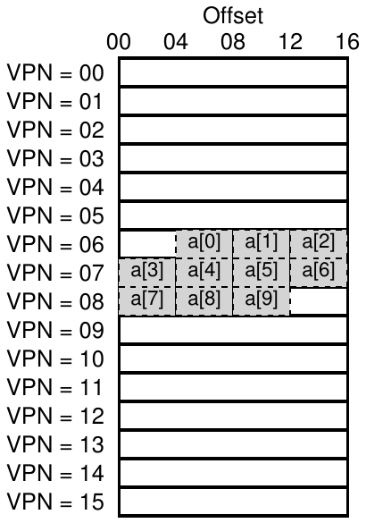
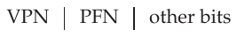
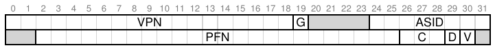
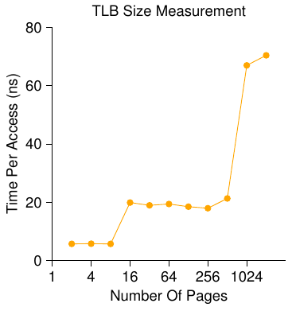

# 19 Paging: Translation nhanh hơn (TLB)

Dùng paging làm mechanism chính hỗ trợ virtual memory có thể gây overhead hiệu năng cao. Chia address space thành đơn vị nhỏ fixed-sized (page) khiến paging cần nhiều thông tin mapping. Vì thông tin đó thường lưu trong physical memory, về logic paging cần thêm memory lookup cho mỗi virtual address program tạo ra. Tới memory tìm thông tin translation trước mỗi instruction fetch hoặc load/store tường minh chậm không thể chấp nhận. Và vấn đề là:

> MẤU CHỐT:
>
> LÀM THẾ NÀO TĂNG TỐC ADDRESS TRANSLATION
>
> Làm sao tăng tốc address translation và nhìn chung tránh memory reference bổ sung mà paging dường như cần? Cần hardware hỗ trợ gì? OS cần tham gia thế nào?

Muốn tăng tốc, OS thường cần giúp đỡ. Và sự giúp đỡ thường đến từ bạn cũ của OS: hardware. Để tăng tốc address translation, ta thêm thứ được gọi (vì lý do lịch sử [CP78]) là translation-lookaside buffer, hay TLB [C68, C95]. TLB thuộc memory-management unit (MMU) của chip, chỉ là hardware cache chứa address translation virtual-to-physical thường gặp; vì vậy tên hay hơn là cache address-translation. Mỗi virtual memory reference, hardware kiểm tra TLB trước xem có translation mong muốn không; nếu có, translation được làm (nhanh) mà khỏi tham khảo page table (chứa mọi translation). Vì ảnh hưởng hiệu năng to lớn, theo nghĩa thực tế TLB khiến virtual memory trở nên khả thi [C95].

## 19.1 Thuật toán cơ bản của TLB

Hình 19.1 phác thảo hardware có thể xử lý virtual address translation thế nào, giả sử linear page table đơn giản (tức array) và TLB hardware-managed (hardware gánh phần lớn trách nhiệm truy cập page table; ta sẽ giải thích thêm bên dưới).

```
 1   VPN = (VirtualAddress & VPN_MASK) >> SHIFT
 2   (Success, TlbEntry) = TLB_Lookup(VPN)
 3   if (Success == True)   // TLB Hit
 4       if (CanAccess(TlbEntry.ProtectBits) == True)
 5           Offset   = VirtualAddress & OFFSET_MASK
 6           PhysAddr = (TlbEntry.PFN << SHIFT) | Offset
 7           AccessMemory(PhysAddr)
 8       else
 9           RaiseException(PROTECTION_FAULT)
10   else                  // TLB Miss
11       PTEAddr = PTBR + (VPN * sizeof(PTE))
12       PTE = AccessMemory(PTEAddr)
13       if (PTE.Valid == False)
14           RaiseException(SEGMENTATION_FAULT)
15       else if (CanAccess(PTE.ProtectBits) == False)
16           RaiseException(PROTECTION_FAULT)
17       else
18           TLB_Insert(VPN, PTE.PFN, PTE.ProtectBits)
19           RetryInstruction()
```

Hình 19.1: Thuật toán Control Flow TLB

Thuật toán hardware làm như sau: đầu tiên trích VPN từ virtual address (dòng 1 trong Hình 19.1), kiểm tra TLB có translation cho VPN này không (dòng 2). Nếu có, ta có TLB hit, nghĩa là TLB chứa translation. Thành công! Giờ trích PFN từ TLB entry tương ứng, nối với offset của virtual address gốc, tạo physical address (PA) mong muốn và truy cập memory (dòng 5–7), giả sử kiểm tra protection không thất bại (dòng 4).

Nếu CPU không tìm thấy translation trong TLB (TLB miss), cần làm thêm việc. Trong ví dụ, hardware truy cập page table tìm translation (dòng 11–12), và giả sử virtual memory reference process tạo ra là valid và được phép truy cập (dòng 13, 15), cập nhật TLB với translation (dòng 18). Các hành động này tốn kém, chủ yếu vì memory reference bổ sung cần để truy cập page table (dòng 12). Cuối cùng, khi TLB được cập nhật, hardware thử lại instruction; lần này translation có trong TLB, memory reference được xử lý nhanh.

TLB, như mọi cache, xây trên tiền đề thường tìm được translation trong cache (tức hit). Nếu vậy, overhead thêm rất ít vì TLB ở gần processing core và được thiết kế rất nhanh. Khi miss, phải trả chi phí paging cao; cần truy cập page table tìm translation, sinh thêm memory reference (hoặc nhiều hơn với page table phức tạp). Nếu thường xảy ra, program có thể chạy chậm thấy rõ; so với phần lớn CPU instruction, memory access khá tốn kém, và TLB miss tạo thêm memory access. Vì vậy ta mong tránh TLB miss tối đa.



Hình 19.2: Ví dụ Array trong Address Space nhỏ

## 19.2 Ví dụ: Truy cập Array

Để làm rõ hoạt động TLB, xét virtual address trace đơn giản xem TLB cải thiện hiệu năng ra sao. Giả sử array có 10 integer 4-byte trong memory, bắt đầu tại virtual address 100. Giả sử thêm virtual address space nhỏ 8-bit với page 16-byte; virtual address chia thành VPN 4-bit (16 virtual page) và offset 4-bit (16 byte mỗi page).

Hình 19.2 cho thấy array bố trí trên 16 page 16-byte. Như bạn thấy, entry đầu (a[0]) bắt đầu tại (VPN=06, offset=04); chỉ ba integer 4-byte vừa page đó. Array tiếp tục trên page kế (VPN=07), chứa bốn entry tiếp (a[3] ... a[6]). Cuối cùng ba entry cuối của array 10-entry (a[7]... a[9]) nằm trên page kế của address space (VPN=08).

Giờ xét loop đơn giản truy cập từng phần tử array, trong C sẽ như sau:

```
int sum = 0;
for (i = 0; i < 10; i++) {
    sum += a[i];
}
```

Để đơn giản, giả vờ loop chỉ tạo memory access tới array (bỏ qua variable i và sum cùng chính instruction). Khi truy cập phần tử đầu (a[0]), CPU thấy load tới virtual address 100. Hardware trích VPN (VPN=06), dùng nó kiểm tra TLB tìm valid translation. Giả sử đây là lần đầu program truy cập array, kết quả là TLB miss.

Truy cập tiếp là a[1], và có tin vui: TLB hit! Vì phần tử thứ hai nằm sát phần tử đầu, nó cùng page; vì đã truy cập page khi đọc phần tử đầu, translation đã được load vào TLB. Đó là lý do thành công. Truy cập a[2] cũng thành công (hit nữa), vì nó cùng page với a[0] và a[1].

Đáng tiếc, khi program truy cập a[3], ta gặp thêm một TLB miss. Tuy nhiên, một lần nữa, những entry tiếp theo (a[4] ... a[6]) sẽ hit trong TLB, vì tất cả nằm trên cùng page trong memory.

Cuối cùng, truy cập a[7] gây TLB miss cuối. Hardware lại tham khảo page table tìm vị trí virtual page trong physical memory, rồi cập nhật TLB. Hai truy cập cuối (a[8] và a[9]) hưởng lợi từ cập nhật này; hardware tìm translation trong TLB tạo thêm hai hit.

Tổng hợp hoạt động TLB trong mười truy cập array: miss, hit, hit, miss, hit, hit, hit, miss, hit, hit. Vì vậy TLB hit rate, tức số hit chia tổng số truy cập, là 70%. Dù không cao (ta thực sự muốn gần 100%), nó non-zero, có thể khiến bạn ngạc nhiên. Dù lần đầu program truy cập array, TLB cải thiện hiệu năng nhờ spatial locality. Các phần tử array xếp chặt trong page (gần nhau trong không gian), nên chỉ truy cập phần tử đầu trên page tạo TLB miss.

Cũng lưu ý vai trò page size ở đây. Nếu page size gấp đôi (32 byte thay vì 16), array access gặp ít miss hơn nữa. Vì page size điển hình khoảng 4KB, kiểu truy cập dày đặc array-based này đạt hiệu năng TLB xuất sắc, chỉ một miss mỗi page truy cập.

Điểm cuối về hiệu năng TLB: nếu program sớm truy cập lại array sau khi loop xong, có thể thấy kết quả tốt hơn nữa, giả sử TLB đủ lớn cache các translation cần: hit, hit, hit, hit, hit, hit, hit, hit, hit, hit. Khi đó TLB hit rate cao nhờ temporal locality, tức re-referencing các mục memory nhanh theo thời gian. Như mọi cache, TLB dựa trên cả spatial và temporal locality, là thuộc tính program. Nếu program có locality đó (nhiều program có), TLB hit rate có thể cao.

> MẸO: DÙNG CACHING KHI CÓ THỂ
>
> Caching là kỹ thuật hiệu năng căn bản nhất trong hệ thống máy tính, được dùng đi dùng lại để “common-case fast” [HP06]. Ý tưởng hardware cache là tận dụng locality trong instruction và data reference. Thường có hai loại: temporal locality và spatial locality. Temporal locality nghĩa là instruction hay data item vừa được truy cập có thể sớm được re-accessed. Nghĩ variable hoặc instruction trong loop; chúng được truy cập lặp lại theo thời gian. Spatial locality nghĩa là nếu program truy cập memory tại address x, nó có thể sớm truy cập gần x. Hình dung duyệt một array, truy cập phần tử này rồi phần tử kế. Dĩ nhiên, thuộc tính tùy bản chất chính xác của program, nên không phải luật hard-and-fast mà giống quy tắc kinh nghiệm.
>
> Hardware cache cho instruction, data hay address translation (như TLB) tận dụng locality bằng cách giữ bản copy memory trong memory on-chip nhỏ, nhanh. Thay vì tới memory (chậm) phục vụ yêu cầu, processor kiểm tra trước xem cache gần đó có bản copy không; nếu có, truy cập nhanh (vài CPU cycle), tránh thời gian memory access tốn kém (nhiều nanosecond).
>
> Bạn có thể hỏi: nếu cache (như TLB) tốt vậy, sao không làm cache lớn hơn và giữ mọi data trong đó? Đáng tiếc, ở đây ta gặp luật cơ bản hơn như vật lý. Muốn cache nhanh, nó phải nhỏ, vì những vấn đề như speed-of-light và ràng buộc vật lý khác trở nên quan trọng. Cache lớn theo định nghĩa là chậm, đi ngược mục đích. Vì vậy ta chỉ có cache nhỏ và nhanh; câu hỏi còn lại là dùng chúng tốt nhất thế nào để cải thiện hiệu năng.

## 19.3 Ai xử lý TLB Miss?

Một câu hỏi phải trả lời: ai xử lý TLB miss? Hai đáp án khả dĩ: hardware hoặc software (OS). Ngày xưa, hardware có instruction set phức tạp (đôi khi gọi CISC, viết tắt complex-instruction set computer), và người làm hardware không tin dân OS ranh mãnh lắm. Vì vậy hardware xử lý toàn bộ TLB miss. Để làm vậy, hardware phải biết chính xác page table nằm đâu trong memory (qua base register page-table, dùng ở dòng 11 Hình 19.1), cùng định dạng chính xác; khi miss, hardware “walk” page table, tìm entry page-table đúng, trích translation mong muốn, cập nhật TLB rồi thử lại instruction. Ví dụ kiến trúc “cũ” có TLB hardware-managed là Intel x86, dùng page table multi-level cố định (chi tiết ở chương sau); register CR3 trỏ tới page table hiện tại [I09].

```
 1   VPN = (VirtualAddress & VPN_MASK) >> SHIFT
 2   (Success, TlbEntry) = TLB_Lookup(VPN)
 3   if (Success == True)   // TLB Hit
 4       if (CanAccess(TlbEntry.ProtectBits) == True)
 5           Offset   = VirtualAddress & OFFSET_MASK
 6           PhysAddr = (TlbEntry.PFN << SHIFT) | Offset
 7           Register = AccessMemory(PhysAddr)
 8       else
 9           RaiseException(PROTECTION_FAULT)
10   else                  // TLB Miss
11       RaiseException(TLB_MISS)
```

Hình 19.3: Thuật toán Control Flow TLB (OS xử lý)

Kiến trúc hiện đại hơn (như MIPS R10k [H93] hay SPARC v9 của Sun [WG00], đều RISC tức reduced-instruction set computer) có TLB software-managed. Khi TLB miss, hardware chỉ raise exception (dòng 11 Hình 19.3), dừng instruction stream hiện tại, nâng privilege level lên kernel mode, nhảy tới trap handler. Như bạn đoán, trap handler là code OS viết riêng để xử lý TLB miss. Khi chạy, code tra translation trong page table, dùng instruction “privileged” đặc biệt cập nhật TLB rồi return từ trap; lúc này hardware thử lại instruction (tạo TLB hit).

Hãy bàn vài chi tiết quan trọng. Đầu tiên, instruction return-from-trap cần hơi khác return-from-trap đã thấy khi phục vụ system call. Trường hợp sau, return-from-trap tiếp tục tại instruction sau trap vào OS, như return từ procedure call trở lại instruction ngay sau lời gọi. Trường hợp trước, khi trở lại từ trap miss-handling TLB, hardware phải tiếp tục tại instruction gây trap; thử lại cho instruction chạy lần nữa, lần này TLB hit. Vì vậy, tùy nguyên nhân trap hay exception, hardware phải lưu PC khác nhau khi trap vào OS để tiếp tục đúng lúc.

Thứ hai, khi chạy code miss-handling TLB, OS phải đặc biệt cẩn thận tránh chuỗi TLB miss vô hạn. Có nhiều giải pháp; chẳng hạn giữ TLB miss handler trong physical memory (không map, không chịu address translation), hoặc dành một số entry TLB cho translation permanently-valid và dùng vài slot translation cố định ấy cho chính handler code; những wired translation này luôn hit TLB.

Ưu điểm chính của cách software-managed là linh hoạt: OS dùng bất kỳ data structure nào để triển khai page table mà khỏi đổi hardware. Ưu điểm khác là đơn giản; như control flow TLB (dòng 11 Hình 19.3 so với dòng 11–19 Hình 19.1), hardware không phải làm nhiều khi miss; nó raise exception, OS TLB miss handler làm phần còn lại.

> BỔ SUNG: RISC VÀ CISC
>
> Những năm 1980, trận chiến lớn diễn ra trong cộng đồng computer architecture. Một bên là CISC, Complex Instruction Set Computing; bên kia RISC, Reduced Instruction Set Computing [PS81]. Phe RISC được spear-headed bởi David Patterson ở Berkeley và John Hennessy ở Stanford (cũng là co-authors vài sách nổi tiếng [HP06]), dù sau đó John Cocke nhận giải Turing cho công trình RISC sớm nhất [CM00]. CISC instruction set thường có nhiều instruction, mỗi instruction tương đối mạnh. Ví dụ, có thể có string copy nhận hai pointer và chiều dài, copy byte từ nguồn tới đích. Ý tưởng CISC là instruction nên là primitive high-level, giúp assembly language dễ dùng và code gọn hơn.
>
> RISC instruction set hoàn toàn ngược lại. Quan sát then chốt là instruction set thực ra là đích của compiler, và compiler chỉ cần vài primitive đơn giản để sinh code high-performance. Vì vậy người ủng hộ RISC lập luận hãy bỏ tối đa khỏi hardware (nhất là microcode), làm phần còn lại đơn giản, đồng nhất và nhanh.
>
> Ban đầu chip RISC tác động lớn vì nhanh hơn rõ [BC91]; nhiều bài báo được viết; vài công ty thành lập (MIPS, Sun). Tuy nhiên, về sau hãng CISC như Intel kết hợp nhiều kỹ thuật RISC vào core processor, như thêm pipeline stage sớm biến instruction phức tạp thành micro-instructions rồi xử lý theo cách RISC-like. Các đổi mới này cùng số transistor mỗi chip tăng cho CISC tiếp tục cạnh tranh. Kết quả tranh luận lắng xuống, ngày nay cả hai loại processor đều có thể chạy nhanh.

## 19.4 Nội dung TLB: Có gì bên trong?

Hãy xem nội dung hardware TLB kỹ hơn. TLB điển hình có thể có 32, 64 hoặc 128 entry và thuộc dạng fully associative. Về cơ bản nghĩa là translation bất kỳ có thể ở bất cứ đâu trong TLB, hardware tìm song song toàn bộ TLB để lấy translation mong muốn. TLB entry có thể như sau:



Lưu ý mỗi entry đều chứa VPN và PFN vì translation có thể ở bất kỳ vị trí nào (theo thuật ngữ hardware, TLB là cache fully-associative). Hardware tìm song song các entry xem có khớp không.

> BỔ SUNG: TLB VALID BIT 6= PAGE TABLE VALID BIT
>
> Sai lầm phổ biến là nhầm valid bit trong TLB với trong page table. Trong page table, khi entry page-table (PTE) invalid, nghĩa là process chưa cấp phát page, và program correctly-working không nên truy cập. Phản ứng thường gặp khi truy cập invalid page là trap tới OS, OS đáp lại bằng cách kill process.
>
> Ngược lại, TLB valid bit chỉ cho biết TLB entry có valid translation không. Chẳng hạn khi boot, trạng thái đầu phổ biến mỗi TLB entry là invalid vì chưa cache address translation nào. Khi bật virtual memory, program bắt đầu chạy và truy cập virtual address space, TLB dần được điền, nên valid entry sớm lấp đầy TLB.
>
> TLB valid bit cũng hữu ích khi context switch như sẽ bàn dưới. Đặt mọi TLB entry invalid bảo đảm process about-to-be-run không vô tình dùng translation virtual-to-physical của process trước.

Thú vị hơn là “các bit khác”. Ví dụ TLB thường có valid bit cho biết entry có valid translation không. Protection bit cũng phổ biến, quyết định page được truy cập thế nào (như page table). Chẳng hạn code page được đánh dấu đọc và thực thi, heap page đọc và ghi. Có thể thêm field khác gồm identifier address-space, dirty bit, v.v.; xem bên dưới để biết thêm.

## 19.5 Vấn đề TLB: Context Switch

Với TLB, vấn đề mới nảy sinh khi chuyển giữa process (và address space). Cụ thể, TLB chứa translation virtual-to-physical chỉ valid cho process đang chạy; chúng vô nghĩa với process khác. Vì vậy, khi chuyển process, hardware hoặc OS (hoặc cả hai) phải bảo đảm process about-to-be-run không vô tình dùng translation của process đã chạy trước.

Để hiểu hơn, xem ví dụ. Khi process (P1) chạy, nó giả định TLB có thể cache translation valid cho nó, tức từ page table P1. Giả sử virtual page thứ 10 của P1 map tới physical frame 100.

Trong ví dụ này, giả sử có process (P2) khác và OS có thể sớm quyết định context switch để chạy nó. Giả sử virtual page thứ 10 của P2 map tới physical frame 170. Nếu entry của cả hai process cùng ở trong TLB, nội dung TLB sẽ là:

| VPN | PFN | valid | prot |
|---|---|---|---|
| 10 | 100 | 1 | rwx |
| — | — | 0 | — |
| 10 | 170 | 1 | rwx |
| — | — | 0 | — |

TLB trên rõ ràng có vấn đề: VPN 10 chuyển sang PFN 100 (P1) hoặc PFN 170 (P2), nhưng hardware không phân biệt entry nào cho process nào. Vì vậy cần làm thêm để TLB hỗ trợ virtualization đúng và hiệu quả qua nhiều process. Mấu chốt là:

> MẤU CHỐT:
>
> LÀM THẾ NÀO QUẢN LÝ NỘI DUNG TLB KHI CONTEXT SWITCH
>
> Khi context-switching giữa process, translation TLB của process cuối vô nghĩa với process about-to-be-run. Hardware hay OS phải làm gì để giải quyết?

Có nhiều giải pháp. Một cách là flush TLB khi context switch, làm rỗng trước khi chạy process kế. Trên hệ thống software-based, thực hiện bằng hardware instruction tường minh (và privileged); với TLB hardware-managed, flush có thể diễn ra khi base register page-table đổi (lưu ý dù sao OS cũng phải đổi PTBR khi context switch). Trong cả hai, flush chỉ đặt mọi valid bit bằng 0, về cơ bản xóa nội dung TLB.

Flush TLB mỗi context switch cho giải pháp hoạt động được vì process không bao giờ vô tình gặp translation sai trong TLB. Nhưng có chi phí: mỗi lần chạy, process phải chịu TLB miss khi chạm data và code page. Nếu OS chuyển process thường xuyên, chi phí có thể cao.

Để giảm overhead, một số hệ thống thêm hardware hỗ trợ chia sẻ TLB qua context switch. Cụ thể, một số hardware có field address space identifier (ASID) trong TLB. Có thể xem ASID như process identifier (PID), nhưng thường ít bit hơn (ví dụ ASID 8 bit so với PID 32 bit).

Nếu lấy TLB ví dụ trên rồi thêm ASID, rõ ràng các process có thể dễ dàng chia sẻ TLB: chỉ cần field ASID để phân biệt các translation vốn giống nhau về mặt khác. Đây là minh họa TLB được thêm ASID:

| VPN | PFN | valid | prot | ASID |
|---|---|---|---|---|
| 10 | 100 | 1 | rwx | 1 |
| — | — | 0 | — | — |
| 10 | 170 | 1 | rwx | 2 |
| — | — | 0 | — | — |

Vì vậy, với identifier address-space, TLB giữ đồng thời translation nhiều process mà không nhầm. Dĩ nhiên hardware cũng cần biết process nào đang chạy để translation, nên khi context switch OS phải đặt privileged register nào đó thành ASID process hiện tại.

Ngoài lề, bạn có thể nghĩ trường hợp khác có hai entry TLB rất giống nhau. Ở ví dụ này, hai entry cho hai process khác, với hai VPN khác, trỏ cùng physical page:

| VPN | PFN | valid | prot | ASID |
|---|---|---|---|---|
| 10 | 101 | 1 | r-x | 1 |
| — | — | 0 | — | — |
| 50 | 101 | 1 | r-x | 2 |
| — | — | 0 | — | — |

Tình huống này có thể xuất hiện khi hai process chia sẻ một page (chẳng hạn code page). Trong ví dụ trên, Process 1 chia sẻ physical page 101 với Process 2; P1 map page này vào page thứ 10 trong address space của nó, còn P2 map vào page thứ 50 trong address space của mình. Chia sẻ code page (trong binary hoặc shared library) hữu ích vì giảm số physical page đang dùng, qua đó giảm memory overhead.

## 19.6 Vấn đề: Replacement Policy

Như mọi cache, và TLB cũng vậy, vấn đề nữa phải xét là cache replacement. Cụ thể, khi cài entry mới vào TLB, phải thay entry cũ, nên câu hỏi là thay entry nào?

> MẤU CHỐT: THIẾT KẾ TLB REPLACEMENT POLICY THẾ NÀO
>
> Nên thay TLB entry nào khi thêm entry mới? Dĩ nhiên mục tiêu là giảm miss rate (hoặc tăng hit rate), cải thiện hiệu năng.

Ta sẽ nghiên cứu khá kỹ policy này khi giải quyết swapping page xuống disk; ở đây chỉ nêu vài policy điển hình. Một cách phổ biến là evict entry least-recently-used hay LRU. LRU cố tận dụng locality trong stream memory-reference, giả định entry chưa dùng gần đây có thể là ứng viên evict tốt. Cách điển hình khác là random policy, evict TLB mapping ngẫu nhiên. Policy này hữu ích vì đơn giản và tránh hành vi corner-case; ví dụ policy “hợp lý” như LRU khá vô lý khi program lặp qua n + 1 page với TLB kích thước n; khi đó LRU miss mọi truy cập, còn random tốt hơn nhiều.



Hình 19.4: TLB Entry của MIPS

## 19.7 TLB Entry thực tế

Cuối cùng xem nhanh TLB thực. Ví dụ từ MIPS R4000 [H93], hệ thống hiện đại dùng TLB software-managed; Hình 19.4 cho TLB entry MIPS đơn giản hóa đôi chút.

MIPS R4000 hỗ trợ address space 32-bit với page 4KB. Vì vậy dự kiến VPN 20-bit, offset 12-bit trong virtual address điển hình. Tuy nhiên, TLB chỉ có 19 bit VPN; hóa ra user address chỉ đến từ nửa address space (phần còn lại dành kernel), nên chỉ cần 19 bit VPN. VPN chuyển sang PFN tối đa 24-bit, hỗ trợ hệ thống tới 64GB main memory (physical) (2<sup>24</sup> page 4KB).

Có vài bit thú vị khác trong MIPS TLB. Global bit (G) dùng cho page globally-shared giữa process. Vì vậy nếu global bit được đặt, ASID bị bỏ qua. Ta cũng thấy ASID 8-bit OS dùng phân biệt address space (như trên). Câu hỏi: OS nên làm gì nếu hơn 256 (2<sup>8</sup>) process chạy cùng lúc? Cuối cùng có 3 Coherence bit (C), quyết định hardware cache page thế nào (hơi ngoài phạm vi); dirty bit đánh dấu khi page đã được ghi (sẽ thấy công dụng sau); valid bit cho hardware biết entry có valid translation không. Cũng có page mask field (không vẽ), hỗ trợ nhiều page size; sau này sẽ thấy vì sao page lớn hữu ích. Cuối cùng, một số trong 64 bit không dùng (xám trong sơ đồ).

MIPS TLB thường có 32 hoặc 64 entry như vậy, phần lớn user process dùng khi chạy. Tuy nhiên, vài entry dành OS. OS đặt wired register để báo hardware dành bao nhiêu TLB slot cho OS; OS dùng mapping dành riêng này cho code và data cần truy cập lúc quan trọng, khi TLB miss gây vấn đề (ví dụ trong TLB miss handler).

Vì MIPS TLB do software quản lý, cần instruction cập nhật TLB. MIPS cung cấp bốn instruction: TLBP thăm dò TLB xem có translation cụ thể không; TLBR đọc nội dung TLB entry vào register; TLBWI thay TLB entry cụ thể; TLBWR thay TLB entry ngẫu nhiên. OS dùng chúng quản lý nội dung TLB. Dĩ nhiên thiết yếu là chúng privileged; tưởng tượng user process làm gì nếu sửa được TLB (gợi ý: hầu như mọi thứ, gồm chiếm máy, chạy “OS” độc hại riêng, thậm chí làm Mặt Trời biến mất).

> MẸO: RAM KHÔNG PHẢI LÚC NÀO CŨNG LÀ RAM (ĐỊNH LUẬT CULLER)
>
> Thuật ngữ random-access memory, hay RAM, hàm ý truy cập mọi phần RAM nhanh như nhau. Dù nhìn RAM như vậy thường tốt, do tính năng hardware/OS như TLB, truy cập page memory cụ thể có thể tốn kém, nhất là page chưa được TLB map. Vì vậy luôn nhớ mẹo implementation: RAM không phải lúc nào cũng RAM. Đôi khi truy cập address space ngẫu nhiên, nhất là khi số page vượt TLB coverage, gây tổn thất hiệu năng nặng. Vì một cố vấn của chúng tôi, David Culler, thường chỉ ra TLB là nguồn nhiều vấn đề hiệu năng, ta đặt tên định luật để tôn vinh ông: Định luật Culler.

## 19.8 Tổng kết

Ta thấy hardware giúp address translation nhanh hơn thế nào. Cung cấp TLB on-chip nhỏ, chuyên dụng làm cache address-translation, hy vọng phần lớn memory reference được xử lý mà không truy cập page table trong main memory. Vì vậy, thông thường hiệu năng program gần như memory không hề virtualize, thành tựu xuất sắc cho operating system, chắc chắn thiết yếu để dùng paging trong hệ thống hiện đại.

Tuy nhiên TLB không khiến mọi program đều thuận lợi. Cụ thể, nếu số page program truy cập trong thời gian ngắn vượt số page TLB chứa, program tạo nhiều TLB miss và chạy chậm hơn nhiều. Ta gọi hiện tượng này là vượt TLB coverage, có thể là vấn đề lớn với vài program. Một giải pháp ở chương sau là hỗ trợ page size lớn hơn; map data structure quan trọng vào vùng address space dùng page lớn giúp tăng coverage hiệu quả của TLB. Hỗ trợ large page thường được program như database management system (DBMS) tận dụng, vì có data structure vừa lớn vừa randomly-accessed.

Vấn đề TLB khác đáng nhắc: TLB access dễ thành bottleneck trong CPU pipeline, nhất là với cache physically-indexed. Với cache này, address translation phải diễn ra trước cache access, có thể làm chậm đáng kể. Vì vậy, người ta nghiên cứu đủ cách thông minh truy cập cache bằng virtual address, tránh translation tốn kém khi cache hit. Cache virtually-indexed như vậy giải quyết vài vấn đề hiệu năng nhưng cũng thêm vấn đề thiết kế hardware. Xem khảo sát hay của Wiggins để biết thêm [W03].

## Tài liệu tham khảo

[BC91] “Performance from Architecture: Comparing a RISC and a CISC with Similar Hardware Organization”

D. Bhandarkar and Douglas W. Clark

Communications of the ACM, September 1991

So sánh RISC và CISC rất hay và công bằng. Kết quả: trên hardware tương tự, RISC tốt hơn khoảng ba lần về hiệu năng.

[CM00] “The evolution of RISC technology at IBM”

John Cocke and V. Markstein

IBM Journal of Research and Development, 44:1/2

Tổng kết ý tưởng và công trình sau IBM 801, thứ nhiều người coi là RISC microprocessor thực sự đầu tiên.

[C95] “The Core of the Black Canyon Computer Corporation”

John Couleur

IEEE Annals of History of Computing, 17:4, 1995

Trong ghi chép lịch sử thú vị, Couleur kể việc phát minh TLB năm 1964 khi làm ở GE, và sự hợp tác tình cờ sau đó với nhóm Project MAC tại MIT.

[CG68] “Shared-access Data Processing System”

John F. Couleur and Edward L. Glaser

Patent 3412382, November 1968

Bằng sáng chế chứa ý tưởng associative memory lưu address translation. Theo Couleur, ý tưởng ra đời năm 1964.

[CP78] “The architecture of the IBM System/370”

R.P. Case and A. Padegs

Communications of the ACM. 21:1, 73-96, January 1978

Có lẽ bài báo đầu dùng thuật ngữ translation lookaside buffer. Tên bắt nguồn từ tên lịch sử của cache là lookaside buffer, do người phát triển Atlas ở University of Manchester gọi; vì vậy cache address translation thành translation lookaside buffer. Dù thuật ngữ lookaside buffer không còn được ưa chuộng, TLB dường như vẫn tồn tại vì lý do nào đó.

[H93] “MIPS R4000 Microprocessor User’s Manual”.

Joe Heinrich, Prentice-Hall, June 1993

Có tại: http://cag.csail.mit.edu/raw/documents/R4400_Uman_book_Ed2.pdf

[HP06] “Computer Architecture: A Quantitative Approach”

John Hennessy and David Patterson

Morgan-Kaufmann, 2006

Sách tuyệt vời về computer architecture. Chúng tôi đặc biệt gắn bó với ấn bản đầu kinh điển.

[I09] “Intel 64 and IA-32 Architectures Software Developer’s Manuals”

Intel, 2009

Có tại: http://www.intel.com/products/processor/manuals

Đặc biệt chú ý “Volume 3A: System Programming Guide Part 1” và “Volume 3B: System Programming Guide Part 2”

[PS81] “RISC-I: A Reduced Instruction Set VLSI Computer”

D.A. Patterson and C.H. Sequin

ISCA ’81, Minneapolis, May 1981

Bài báo giới thiệu thuật ngữ RISC và khởi đầu làn sóng nghiên cứu đơn giản hóa chip máy tính để tăng hiệu năng.

[SB92] “CPU Performance Evaluation and Execution Time Prediction Using Narrow Spectrum Benchmarking”

Rafael H. Saavedra-Barrera

EECS Department, University of California, Berkeley

Technical Report No. UCB/CSD-92-684, February 1992

www.eecs.berkeley.edu/Pubs/TechRpts/1992/CSD-92-684.pdf

Luận án tuyệt vời về dự đoán thời gian thực thi application bằng cách chia thành phần cấu thành và biết chi phí từng phần. Có lẽ phần thú vị nhất là công cụ đo chi tiết cache hierarchy (mô tả trong Chương 5). Nhớ xem các sơ đồ tuyệt vời trong đó.

[W03] “A Survey on the Interaction Between Caching, Translation and Protection”

Adam Wiggins

University of New South Wales TR UNSW-CSE-TR-0321, August, 2003

Khảo sát xuất sắc cách TLB tương tác với phần khác của CPU pipeline, cụ thể hardware cache.

[WG00] “The SPARC Architecture Manual: Version 9”

David L. Weaver and Tom Germond, September 2000

SPARC International, San Jose, California

Có tại: http://www.sparc.org/standards/SPARCV9.pdf

## Bài tập (Đo lường)

Ở bài này, bạn đo kích thước và chi phí truy cập TLB. Ý tưởng dựa trên Saavedra-Barrera [SB92], người phát triển phương pháp đơn giản mà đẹp để đo nhiều khía cạnh cache hierarchy, tất cả bằng program user-level rất đơn giản. Đọc công trình của ông để biết thêm.

Ý tưởng cơ bản là truy cập một số page trong data structure lớn (như array) rồi đo thời gian. Ví dụ, giả sử TLB size của máy là 4 (rất nhỏ nhưng hữu ích cho thảo luận). Nếu viết program chạm 4 page trở xuống, mỗi access nên TLB hit nên khá nhanh. Tuy nhiên, khi chạm 5 page trở lên lặp lại trong loop, chi phí mỗi access đột ngột tăng lên mức TLB miss.

Code cơ bản duyệt array một lần nên như sau:

```
int jump = PAGESIZE / sizeof(int);
for (i = 0; i < NUMPAGES * jump; i += jump) {
    a[i] += 1;
}
```

Trong loop, mỗi page của array a có một integer được cập nhật, tới số page NUMPAGES chỉ định. Đo thời gian loop nhiều lần (chẳng hạn vài trăm triệu lần trong loop bên ngoài, hoặc đủ vòng để chạy vài giây), bạn đo được thời gian mỗi access (trung bình). Tìm bước nhảy chi phí khi NUMPAGES tăng giúp xác định gần đúng TLB first-level lớn bao nhiêu, có TLB second-level không (và kích thước nếu có), nói chung hiểu rõ TLB hit và miss ảnh hưởng hiệu năng ra sao.

Hình 19.5 (trang 16) cho thời gian trung bình mỗi access khi số page trong loop tăng. Như đồ thị, khi chỉ truy cập vài page (8 trở xuống), thời gian trung bình khoảng 5 nanosecond. Khi 16 page trở lên, tăng đột ngột đến khoảng 20 nanosecond mỗi access. Bước nhảy cuối khoảng 1024 page, lúc đó mỗi access khoảng 70 nanosecond. Từ dữ liệu, kết luận có TLB hierarchy two-level; tầng đầu khá nhỏ (có lẽ 8 đến 16 entry); tầng hai lớn hơn nhưng chậm hơn (khoảng 512 entry). Chênh lệch tổng giữa hit TLB first-level và miss khá lớn, khoảng mười bốn lần. Hiệu năng TLB rất quan trọng!



Hình 19.5: Khám phá kích thước TLB và chi phí Miss

### Câu hỏi

1. Để đo thời gian, cần timer như gettimeofday() cung cấp. Timer này chính xác đến đâu? Thao tác phải kéo dài bao lâu để đo chính xác? (giúp xác định số lần lặp page access trong loop để đo thành công)

2. Viết program tlb.c đo gần đúng chi phí truy cập từng page. Input gồm: số page cần chạm và số lần thử.

3. Giờ viết script bằng scripting language yêu thích (csh, python, v.v.) để chạy program này, đồng thời thay đổi số page được truy cập từ 1 đến vài nghìn, có thể tăng gấp hai mỗi vòng. Chạy script trên các máy khác nhau và thu thập dữ liệu. Cần bao nhiêu lần thử để có phép đo đáng tin cậy?

4. Tiếp theo, vẽ đồ thị kết quả tương tự hình trên. Dùng công cụ tốt như ploticus. Trực quan hóa thường giúp dữ liệu dễ hiểu hơn nhiều; bạn nghĩ vì sao?

5. Một điều cần chú ý là compiler optimization. Compiler làm đủ thứ thông minh, gồm bỏ loop tăng giá trị mà phần khác của program không dùng sau đó. Làm sao bảo đảm compiler không bỏ main loop trên khỏi bộ ước lượng TLB size?

6. Điều nữa cần chú ý là phần lớn hệ thống nay có nhiều CPU, mỗi CPU dĩ nhiên có TLB hierarchy riêng. Muốn đo tốt, phải chạy code trên đúng một CPU, thay vì để scheduler chuyển từ CPU này sang CPU khác. Làm thế nào? (gợi ý: tra “pinning a thread” trên Google) Điều gì xảy ra nếu không làm và code chuyển qua lại giữa CPU?

7. Vấn đề khác có thể liên quan khởi tạo. Nếu không khởi tạo array a trên trước khi truy cập, lần đầu sẽ rất tốn kém do chi phí ban đầu như demand zeroing. Điều này ảnh hưởng code và đo thời gian không? Bạn làm gì để bù những chi phí tiềm tàng ấy?
