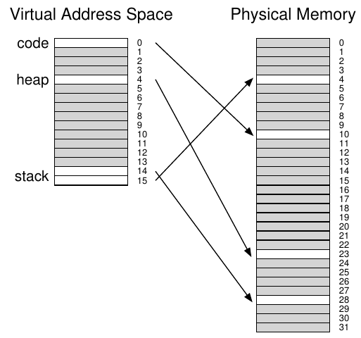
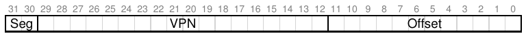
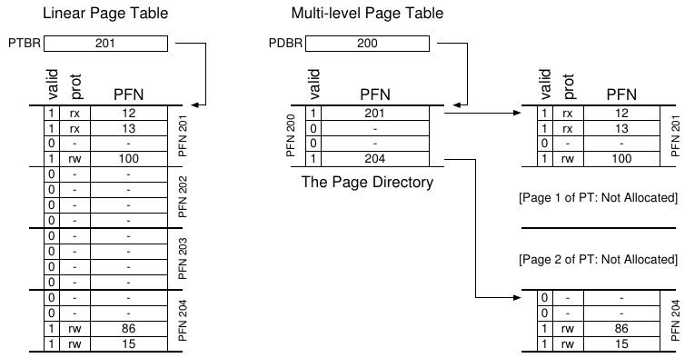
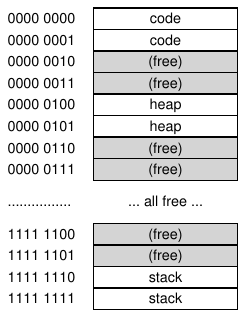
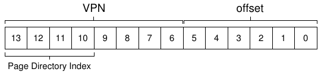
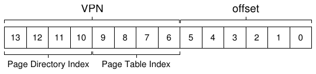
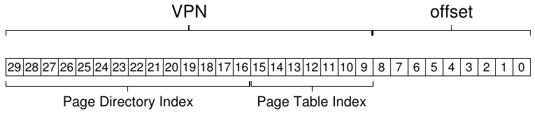
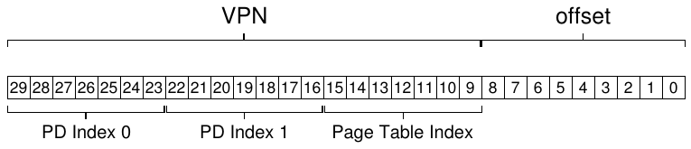

# 20 Paging: Page Table nhỏ hơn

Giờ ta xử lý vấn đề thứ hai paging đưa ra: page table quá lớn nên tiêu thụ quá nhiều memory. Bắt đầu bằng linear page table. Như bạn có thể nhớ[^1], linear page table khá lớn. Lại giả sử address space 32-bit (2<sup>32</sup> byte), page 4KB (2<sup>12</sup> byte) và entry page-table 4-byte. Address space có khoảng một triệu virtual page (2<sup>32</sup>/2<sup>12</sup>); nhân kích thước entry page-table, thấy page table 4MB. Cũng nhớ: thường mỗi process có một page table! Với một trăm process hoạt động (không hiếm trên hệ thống hiện đại), ta cấp hàng trăm megabyte memory chỉ cho page table! Vì vậy cần kỹ thuật giảm gánh nặng này. Có nhiều cách, hãy bắt đầu. Nhưng trước hết là mấu chốt:

> MẤU CHỐT: LÀM THẾ NÀO THU NHỎ PAGE TABLE?
>
> Page table array-based đơn giản (thường gọi linear page table) quá lớn, chiếm quá nhiều memory trên hệ thống điển hình. Làm sao thu nhỏ page table? Ý tưởng then chốt là gì? Data structure mới này gây kém hiệu quả gì?

## 20.1 Giải pháp đơn giản: Page lớn hơn

Ta có thể giảm page table bằng cách đơn giản: dùng page lớn hơn. Lại xét address space 32-bit nhưng lần này page 16KB. Ta có VPN 18-bit cùng offset 14-bit. Giả sử PTE vẫn 4 byte, linear page table có 2<sup>18</sup> entry, tổng kích thước 1MB mỗi bảng, giảm bốn lần (không ngạc nhiên, mức giảm đúng bằng mức tăng page size bốn lần).

> BỔ SUNG: NHIỀU PAGE SIZE
>
> Ngoài lề, lưu ý nhiều kiến trúc (MIPS, SPARC, x86-64) hiện hỗ trợ nhiều page size. Thường dùng page nhỏ (4KB hoặc 8KB). Tuy nhiên, nếu application “thông minh” yêu cầu, có thể dùng một large page (ví dụ 4MB) cho phần address space cụ thể, cho phép đặt data structure frequently-used (và lớn) ở đó mà chỉ tiêu thụ một TLB entry. Large page phổ biến trong database management system và commercial application high-end khác. Tuy nhiên, lý do chính hỗ trợ nhiều page size không phải tiết kiệm page table, mà giảm áp lực TLB, cho program truy cập nhiều address space hơn mà không gặp quá nhiều TLB miss. Nhưng như nghiên cứu cho thấy [N+02], dùng nhiều page size khiến OS virtual memory manager phức tạp hơn đáng kể, nên đôi khi cách dễ nhất dùng large page là xuất interface mới cho application yêu cầu large page trực tiếp.

Tuy nhiên, vấn đề lớn là page lớn gây lãng phí bên trong mỗi page, gọi là internal fragmentation (vì lãng phí bên trong đơn vị cấp phát). Application cấp page nhưng chỉ dùng ít mảnh của mỗi page, memory nhanh chóng đầy những page overly-large. Vì vậy, phần lớn hệ thống thường dùng page size khá nhỏ: 4KB (x86) hoặc 8KB (SPARCv9). Than ôi, vấn đề không giải quyết dễ vậy.

## 20.2 Cách kết hợp: Paging và Segment

Bất cứ khi nào có hai cách hợp lý nhưng khác nhau cho điều gì trong cuộc sống, luôn nên xét kết hợp xem đạt được ưu điểm cả hai không. Ta gọi kết hợp đó là hybrid. Ví dụ sao chỉ ăn chocolate hay bơ đậu phộng khi kết hợp được thành món hybrid ngon mang tên Reese’s Peanut Butter Cup [M28]?

Nhiều năm trước, người tạo Multics (đặc biệt Jack Dennis) tình cờ nghĩ ý tưởng đó khi xây virtual memory system Multics [M07]. Cụ thể, Dennis kết hợp paging và segmentation để giảm memory overhead của page table. Xem linear page table điển hình kỹ hơn giúp hiểu vì sao có thể hiệu quả. Giả sử address space có phần heap và stack đang dùng nhỏ. Ta dùng address space nhỏ 16KB với page 1KB (Hình 20.1); page table cho address space nằm trong Hình 20.2.



Hình 20.1: Address Space 16KB với Page 1KB

Ví dụ giả sử code page duy nhất (VPN 0) map tới physical page 10, heap page duy nhất (VPN 4) tới physical page 23, hai stack page ở đầu kia address space (VPN 14 và 15) lần lượt map tới physical page 28 và 4. Như hình, phần lớn page table không dùng, đầy invalid entry. Thật lãng phí! Mà đây chỉ là address space nhỏ 16KB. Tưởng tượng page table cho address space 32-bit với mọi không gian có thể lãng phí! Thực ra đừng tưởng tượng; quá kinh khủng.

| PFN | valid | prot | present | dirty |
|---|---|---|---|---|
| 10 | 1 | r-x | 1 | 0 |
| - | 0 | — | - | - |
| - | 0 | — | - | - |
| - | 0 | — | - | - |
| 23 | 1 | rw- | 1 | 1 |
| - | 0 | — | - | - |
| - | 0 | — | - | - |
| - | 0 | — | - | - |
| - | 0 | — | - | - |
| - | 0 | — | - | - |
| - | 0 | — | - | - |
| - | 0 | — | - | - |
| - | 0 | — | - | - |
| - | 0 | — | - | - |
| 28 | 1 | rw- | 1 | 1 |
| 4 | 1 | rw- | 1 | 1 |

Hình 20.2: Page Table cho Address Space 16KB

Vậy cách hybrid: thay vì một page table cho toàn address space process, sao không một bảng cho mỗi logical segment? Ở ví dụ, có thể có ba page table, cho phần code, heap và stack.

Nhớ với segmentation, base register cho biết mỗi segment ở đâu trong physical memory, bound hay limit register cho biết kích thước. Trong hybrid, ta vẫn có cấu trúc ấy trong MMU; ở đây base không trỏ chính segment mà giữ physical address của page table segment. Bounds register chỉ điểm cuối page table (tức có bao nhiêu valid page).

Ví dụ đơn giản để làm rõ. Giả sử virtual address space 32-bit, page 4KB, chia thành bốn segment. Ta chỉ dùng ba segment: code, heap và stack.

Để xác định address chỉ segment nào, dùng hai bit cao nhất address space. Giả sử 00 là segment không dùng, 01 cho code, 10 cho heap, 11 cho stack. Virtual address như sau:



Giả sử hardware có ba cặp base/bounds cho code, heap, stack. Khi process chạy, base register mỗi segment chứa physical address linear page table của segment; do đó mỗi process nay có ba page table. Khi context switch, phải đổi register phản ánh vị trí page table của process newly-running.

Khi TLB miss (giả sử TLB hardware-managed, tức hardware xử lý TLB miss), hardware dùng segment bit (SN) xác định cặp base và bounds. Rồi lấy physical address trong đó kết hợp VPN như sau để tạo address của PTE:

```
SN           = (VirtualAddress & SEG_MASK) >> SN_SHIFT
VPN          = (VirtualAddress & VPN_MASK) >> VPN_SHIFT
AddressOfPTE = Base[SN] + (VPN * sizeof(PTE))
```

Chuỗi thao tác này hẳn trông quen thuộc; nó gần như giống hệt những gì ta thấy trước đây với linear page table. Dĩ nhiên, khác biệt duy nhất là dùng một trong ba segment base register thay vì page table base register duy nhất.

Khác biệt thiết yếu trong hybrid là bounds register cho mỗi segment; mỗi register giữ giá trị valid page tối đa trong segment. Ví dụ code segment dùng ba page đầu (0, 1 và 2), code segment page table chỉ cấp ba entry, bounds register đặt 3; memory access vượt cuối segment tạo exception và có thể chấm dứt process. Cách hybrid nhờ đó tiết kiệm memory đáng kể so với linear page table; page chưa cấp giữa stack và heap không còn chiếm page table (chỉ để đánh dấu không valid).

> MẸO: DÙNG HYBRID
>
> Khi có hai ý tưởng tốt dường như đối lập, luôn xem kết hợp được thành hybrid có ưu điểm cả hai không. Ví dụ giống ngô lai được biết khỏe hơn mọi giống naturally-occurring. Dĩ nhiên không phải hybrid nào cũng hay; xem Zeedonk (hay Zonkey), lai Zebra và Donkey. Nếu không tin có sinh vật ấy, hãy tra và chuẩn bị ngạc nhiên.

Tuy nhiên như bạn nhận thấy, cách này vẫn có vấn đề. Đầu tiên, vẫn cần segmentation; như đã bàn, segmentation chưa linh hoạt như mong muốn vì giả định kiểu dùng address space nhất định; chẳng hạn heap lớn nhưng sparsely-used vẫn có thể lãng phí nhiều page table. Thứ hai, hybrid làm external fragmentation xuất hiện lại. Dù phần lớn memory quản lý theo đơn vị page-sized, page table nay có thể kích thước tùy ý (bội số PTE). Vì vậy tìm không gian trống cho chúng trong memory phức tạp hơn. Do đó người ta tiếp tục tìm cách tốt hơn triển khai page table nhỏ.

## 20.3 Page Table Multi-level

Cách khác không dựa segmentation nhưng xử lý cùng vấn đề: làm sao bỏ mọi vùng invalid trong page table thay vì giữ tất cả trong memory? Ta gọi là page table multi-level, vì biến linear page table thành cấu trúc giống tree. Cách hiệu quả đến mức nhiều hệ thống hiện đại dùng (như x86 [BOH10]). Giờ ta mô tả chi tiết.

Ý tưởng page table multi-level đơn giản. Trước hết chia page table thành đơn vị page-sized; rồi nếu cả page chứa entry page-table (PTE) invalid, đừng cấp page đó. Để theo dõi page chứa page table có valid không (và nếu có, ở đâu trong memory), dùng cấu trúc mới page directory. Page directory do đó cho biết page chứa page table ở đâu, hoặc cả page chứa page table không có valid page nào.

Hình 20.3 minh họa. Bên trái là linear page table cổ điển; dù phần lớn vùng giữa address space không valid, vẫn cần cấp không gian page-table cho chúng (hai page giữa page table). Bên phải là page table multi-level. Page directory chỉ đánh dấu hai page chứa page table valid (đầu và cuối); vì vậy chỉ hai page này ở memory. Có thể hình dung bảng multi-level như sau: làm một số phần linear page table biến mất (giải phóng frame cho việc khác), và theo dõi page chứa page table được cấp bằng page directory.



Hình 20.3: Page Table Linear (trái) và Multi-Level (phải)

Page directory trong bảng two-level đơn giản chứa một entry mỗi page chứa page table. Nó gồm nhiều page directory entry (PDE). PDE tối thiểu có valid bit và PFN, giống PTE. Tuy nhiên như gợi ý trên, nghĩa valid bit hơi khác: nếu PDE valid, ít nhất một page của page table mà entry trỏ tới (qua PFN) valid, tức ít nhất một PTE trên page mà PDE này trỏ tới có valid bit bằng một. Nếu PDE không valid (bằng zero), phần còn lại không xác định.

Page table Multi-level có vài ưu điểm rõ so với cách trước. Đầu tiên, dễ thấy nhất, bảng multi-level chỉ cấp không gian page-table tỷ lệ lượng address space đang dùng; vì vậy thường gọn và hỗ trợ sparse address space.

Thứ hai, nếu xây cẩn thận, mỗi phần page table vừa gọn một page, dễ quản lý memory; OS chỉ lấy free page kế khi cần cấp hoặc mở rộng page table. So với linear page table đơn giản (non-paged)[^2], chỉ là array PTE index bằng VPN; cấu trúc đó buộc toàn bộ linear page table liên tục trong physical memory. Với page table lớn (4MB), tìm chunk free physical memory liên tục lớn như vậy rất khó. Cấu trúc multi-level thêm một tầng indirection qua page directory trỏ các phần page table; indirection cho phép đặt page page-table bất cứ đâu trong physical memory.

> MẸO: HIỂU TRADE -OFFS TIME-SPACE
>
> Khi xây data structure, luôn xét trade-offs time-space. Thường muốn truy cập data structure nhanh hơn, phải trả chi phí space-usage cho cấu trúc.

Lưu ý bảng multi-level có chi phí; khi TLB miss cần hai load từ memory để lấy thông tin translation đúng từ page table (một page directory, một chính PTE), so với chỉ một load linear page table. Do đó multi-level là ví dụ nhỏ về trade-off time-space. Ta muốn bảng nhỏ hơn (và có được) nhưng không miễn phí; dù trường hợp thường (TLB hit) hiệu năng rõ ràng giống nhau, TLB miss tốn hơn với bảng nhỏ này.

Nhược điểm rõ khác là phức tạp. Dù hardware hay OS xử lý lookup page-table (khi TLB miss), chắc chắn phức tạp hơn lookup page-table linear đơn giản. Ta thường chấp nhận tăng phức tạp để tăng hiệu năng hoặc giảm overhead; với bảng multi-level, ta làm lookup page-table phức tạp hơn để tiết kiệm memory quý.

### Ví dụ Multi-Level chi tiết

Để hiểu page table multi-level hơn, làm ví dụ. Tưởng tượng address space nhỏ 16KB với page 64-byte. Ta có virtual address space 14-bit, VPN 8 bit, offset 6 bit. Linear page table có 2<sup>8</sup> (256) entry dù chỉ phần nhỏ address space dùng. Hình 20.4 cho ví dụ.



Hình 20.4: Address Space 16KB với Page 64-byte

> MẸO: THẬN TRỌNG VỚI ĐỘ PHỨC TẠP
>
> Người thiết kế hệ thống nên thận trọng thêm phức tạp. Người xây hệ thống tốt triển khai hệ thống ít phức tạp nhất hoàn thành nhiệm vụ. Ví dụ nếu disk space dư dả, đừng thiết kế file system vất vả dùng ít byte nhất; tương tự, nếu processor nhanh, viết module OS rõ ràng dễ hiểu tốt hơn code hand-assembled, CPU-optimized nhất có thể. Thận trọng với phức tạp không cần thiết, trong code prematurely-optimized hoặc dạng khác; chúng khiến hệ thống khó hiểu, bảo trì và debug hơn. Như Antoine de Saint-Exupery viết câu nổi tiếng: “Cuối cùng đạt hoàn hảo không phải khi không còn gì để thêm, mà khi không còn gì để bớt.” Điều ông không viết: “Nói về hoàn hảo dễ hơn thực sự đạt nó rất nhiều.”

Ở ví dụ, virtual page 0 và 1 cho code, virtual page 4 và 5 cho heap, virtual page 254 và 255 cho stack; các page khác không dùng.

Để xây page table two-level cho address space này, bắt đầu linear page table đầy đủ rồi chia thành đơn vị page-sized. Nhớ bảng đầy đủ ở đây có 256 entry; giả sử mỗi PTE 4 byte. Page table do đó 1KB (256 × 4 byte). Với page 64-byte, page table 1KB chia thành 16 page 64-byte; mỗi page chứa 16 PTE.

Giờ ta cần hiểu cách lấy VPN và dùng nó làm index trước vào page directory, rồi vào page chứa page table. Nhớ rằng mỗi cấu trúc là array các entry; vì vậy, ta chỉ cần xác định cách tạo index cho từng cấu trúc từ các phần của VPN.

Trước hết index vào page directory. Page table ví dụ nhỏ: 256 entry trải 16 page. Page directory cần một entry mỗi page chứa page table; vì vậy có 16 entry. Kết quả cần bốn bit VPN để index directory; dùng bốn bit cao nhất như sau:



Khi trích index page-directory (viết tắt PDIndex) từ VPN, dùng nó tìm address entry page-directory (PDE) bằng phép tính: PDEAddr = PageDirBase + (PDIndex * sizeof(PDE)). Kết quả dẫn tới page directory, ta xem xét để tiến tiếp translation.

Nếu entry page-directory invalid, biết truy cập invalid và raise exception. Nếu PDE valid, còn việc phải làm. Cụ thể, cần lấy entry page-table (PTE) từ page chứa page table mà entry page-directory trỏ tới. Để tìm PTE, index phần page table bằng các bit VPN còn lại:



Index page-table này (viết tắt PTIndex) sau đó được dùng làm index vào chính page table, cho ta address của PTE:

```
PTEAddr = (PDE.PFN << SHIFT) + (PTIndex * sizeof(PTE))
```

Lưu ý số page-frame (PFN) lấy từ entry page-directory phải được left-shifted vào vị trí trước khi kết hợp index page-table tạo address PTE.

Để xem có hợp lý không, giờ điền page table multi-level bằng giá trị thực và chuyển một virtual address. Bắt đầu page directory ví dụ (trái Hình 20.5).

Trong hình, mỗi PDE mô tả điều gì đó về page chứa page table cho address space. Ví dụ có hai valid region trong address space (đầu và cuối), cùng nhiều mapping invalid in-between.

Trong physical page 100 (PFN của page thứ 0 chứa page table), ta có page đầu gồm 16 page table entry cho 16 VPN đầu của address space. Xem Hình 20.5 (giữa) để biết nội dung phần này.

| Page Directory | Page chứa PT (@PFN:100) | Page chứa PT (@PFN:101) |
|---|---|---|
| PFN valid? | PFN valid prot | PFN valid prot |
| 100 1 | 10 1 r-x | — 0 — |
| — 0 | 23 1 r-x | — 0 — |
| — 0 | — 0 — | — 0 — |
| — 0 | — 0 — | — 0 — |
| — 0 | 80 1 rw- | — 0 — |
| — 0 | 59 1 rw- | — 0 — |
| — 0 | — 0 — | — 0 — |
| — 0 | — 0 — | — 0 — |
| — 0 | — 0 — | — 0 — |
| — 0 | — 0 — | — 0 — |
| — 0 | — 0 — | — 0 — |
| — 0 | — 0 — | — 0 — |
| — 0 | — 0 — | — 0 — |
| — 0 | — 0 — | — 0 — |
| — 0 | — 0 — | 55 1 rw- |
| 101 1 | — 0 — | 45 1 rw- |

Hình 20.5: Page Directory và các phần Page Table

Page chứa page table này gồm mapping cho 16 VPN đầu; ở ví dụ VPN 0 và 1 valid (code segment), cũng như 4 và 5 (heap). Vì vậy bảng có thông tin mapping cho mỗi page đó. Entry còn lại invalid.

Page valid còn lại chứa page table nằm trong PFN 101. Page này chứa mapping cho 16 VPN cuối của address space; xem Hình 20.5 (phải) để biết chi tiết.

Ở ví dụ, VPN 254 và 255 (stack) có valid mapping. Hy vọng ta thấy cấu trúc index multi-level tiết kiệm bao nhiêu. Thay vì cấp đủ mười sáu page cho linear page table, ta chỉ cấp ba: một cho page directory, hai cho phần page table có valid mapping. Với address space lớn (32-bit hoặc 64-bit), rõ ràng tiết kiệm có thể lớn hơn nhiều.

Cuối cùng dùng thông tin để translation. Address tham chiếu byte thứ 0 của VPN 254: 0x3F80, hay binary 11 1111 1000 0000.

Nhớ dùng 4 bit VPN cao nhất index page directory. Vì vậy 1111 chọn entry cuối (thứ 15 nếu bắt đầu 0) của page directory trên. Nó trỏ page valid chứa page table tại address 101. Dùng 4 bit VPN tiếp (1110) index page chứa page table để tìm PTE mong muốn. 1110 là entry next-to-last (thứ 14), cho biết page 254 của virtual address space map tại physical page 55. Nối PFN=55 (hex 0x37) với offset=000000, ta tạo physical address mong muốn, gửi yêu cầu tới memory system: PhysAddr = (PTE.PFN << SHIFT) + offset = 00 1101 1100 0000 = 0x0DC0.

Giờ bạn hẳn hiểu phần nào xây page table two-level bằng page directory trỏ các page chứa page table. Nhưng đáng tiếc chưa xong. Như sẽ bàn, đôi khi hai level chưa đủ!

### Hơn hai Level

Trong ví dụ đến đây, ta giả sử page table multi-level chỉ có hai level: page directory, rồi đến các phần của page table. Trong một số trường hợp, tree sâu hơn là khả dĩ (và thực sự cần thiết).

Lấy ví dụ đơn giản cho thấy vì sao bảng multi-level sâu hơn hữu ích. Giả sử virtual address space 30-bit, page nhỏ (512 byte). Virtual address có VPN 21-bit và offset 9-bit.

Nhớ mục tiêu xây page table multi-level: mỗi phần vừa một page. Đến đây chỉ xét chính page table; nhưng nếu page directory quá lớn?

Để xác định số level cần trong bảng multi-level sao cho mọi phần vừa page, bắt đầu tính bao nhiêu entry page-table vừa page. Page size 512 byte, giả sử PTE 4 byte, thấy một page chứa 128 PTE. Khi index page chứa page table, kết luận cần 7 bit thấp nhất (log<sub>2</sub>128) của VPN làm index:



Điều khác thấy ở sơ đồ là số bit còn cho page directory (lớn): 14. Nếu page directory có 2<sup>14</sup> entry, nó trải không phải một page mà 128, mục tiêu mỗi phần page table multi-level vừa một page tan biến.

Để khắc phục, xây thêm tầng tree bằng cách chia chính page directory thành nhiều page, thêm page directory nữa phía trên trỏ tới các page chứa page directory. Ta chia virtual address như sau:



Giờ khi index page directory upper-level, dùng các bit cao nhất virtual address (PD Index 0 trong sơ đồ); index này lấy entry page-directory từ page directory top-level. Nếu valid, tra level thứ hai page directory bằng cách kết hợp PFN từ PDE top-level với phần VPN kế (PD Index 1). Cuối cùng nếu valid, tạo address PTE từ index page-table kết hợp address từ PDE second-level. Phù! Nhiều việc thật. Chỉ để tra cứu một thứ trong bảng multi-level.

### Quá trình Translation: Nhớ TLB

Để tổng hợp toàn bộ address translation dùng page table two-level, ta lại trình bày control flow dạng thuật toán (Hình 20.6). Hình cho thấy hardware làm gì (giả sử TLB hardware-managed) với mỗi memory reference.

Như hình, trước mọi truy cập page table multi-level phức tạp, hardware kiểm tra TLB trước; nếu hit, tạo physical address trực tiếp không truy cập page table như trước. Chỉ khi TLB miss hardware mới lookup multi-level đầy đủ. Trên đường này, thấy chi phí page table two-level truyền thống: thêm hai memory access để tra valid translation.

```
 1   VPN = (VirtualAddress & VPN_MASK) >> SHIFT
 2   (Success, TlbEntry) = TLB_Lookup(VPN)
 3   if (Success == True)   // TLB Hit
 4       if (CanAccess(TlbEntry.ProtectBits) == True)
 5           Offset   = VirtualAddress & OFFSET_MASK
 6           PhysAddr = (TlbEntry.PFN << SHIFT) | Offset
 7           Register = AccessMemory(PhysAddr)
 8       else
 9           RaiseException(PROTECTION_FAULT)
10   else                  // TLB Miss
11       // first, get page directory entry
12       PDIndex = (VPN & PD_MASK) >> PD_SHIFT
13       PDEAddr = PDBR + (PDIndex * sizeof(PDE))
14       PDE     = AccessMemory(PDEAddr)
15       if (PDE.Valid == False)
16           RaiseException(SEGMENTATION_FAULT)
17       else
18           // PDE is valid: now fetch PTE from page table
19           PTIndex = (VPN & PT_MASK) >> PT_SHIFT
20           PTEAddr = (PDE.PFN << SHIFT) + (PTIndex * sizeof(PTE))
21           PTE     = AccessMemory(PTEAddr)
22           if (PTE.Valid == False)
23               RaiseException(SEGMENTATION_FAULT)
24           else if (CanAccess(PTE.ProtectBits) == False)
25               RaiseException(PROTECTION_FAULT)
26           else
27               TLB_Insert(VPN, PTE.PFN, PTE.ProtectBits)
28               RetryInstruction()
```

Hình 20.6: Control Flow Page Table Multi-level

## 20.4 Inverted Page Table

Inverted page table tiết kiệm không gian còn cực đoan hơn. Thay vì nhiều page table (mỗi process một bảng), giữ một page table duy nhất có entry cho mỗi physical page hệ thống. Entry cho biết process nào dùng page, virtual page nào của process map tới physical page này.

Tìm entry đúng giờ trở thành việc tìm kiếm trong data structure này. Quét linear sẽ tốn kém, nên thường có hash table được xây trên cấu trúc nền để tăng tốc lookup. PowerPC là một ví dụ kiến trúc như vậy [JM98].

Tổng quát hơn, inverted page table minh họa điều nói từ đầu: page table chỉ là data structure. Có thể làm nhiều điều điên rồ với data structure, làm nhỏ hoặc lớn, chậm hoặc nhanh. Page table Multi-level và inverted chỉ là hai ví dụ trong nhiều khả năng.

## 20.5 Swap Page Table xuống Disk

Cuối cùng, bàn việc nới lỏng giả định cuối. Đến đây giả định page table nằm trong physical memory kernel-owned. Dù nhiều thủ thuật giảm kích thước, vẫn có thể chúng quá lớn để cùng vừa memory. Vì vậy một số hệ thống đặt page table trong kernel virtual memory, cho phép swap vài page table xuống disk khi áp lực memory tăng. Ta bàn thêm ở chương sau (cụ thể nghiên cứu VAX/VMS), khi hiểu kỹ cách chuyển page vào và ra memory.

## 20.6 Tổng kết

Ta đã thấy page table thực được xây thế nào; không nhất thiết chỉ linear array mà data structure phức tạp hơn. Các trade-offs là thời gian và không gian — bảng càng lớn càng phục vụ TLB miss nhanh, và ngược lại — nên cấu trúc đúng phụ thuộc mạnh ràng buộc môi trường.

Trong hệ thống memory-constrained (như nhiều hệ thống cũ), cấu trúc nhỏ hợp lý; trong hệ thống memory tương đối đủ và workload tích cực dùng nhiều page, bảng lớn tăng tốc TLB miss có thể đúng. Với TLB software-managed, toàn bộ không gian data structure mở ra làm người đổi mới operating system thích thú (gợi ý: chính bạn). Bạn nghĩ ra cấu trúc mới nào? Chúng giải quyết gì? Nghĩ những câu này khi chìm vào giấc ngủ, mơ giấc mơ lớn chỉ nhà phát triển operating-system mơ được.

## Tài liệu tham khảo

[BOH10] “Computer Systems: A Programmer’s Perspective”

Randal E. Bryant and David R. O’Hallaron

Addison-Wesley, 2010

Ta chưa tìm được tài liệu đầu tiên tốt về page table multi-level. Tuy nhiên giáo trình tuyệt vời của Bryant và O’Hallaron đi sâu x86, ít nhất là hệ thống sớm dùng cấu trúc này. Đây cũng là sách rất đáng có.

[JM98] “Virtual Memory: Issues of Implementation”

Bruce Jacob and Trevor Mudge

IEEE Computer, June 1998

Khảo sát xuất sắc nhiều hệ thống khác nhau và cách memory virtualization. Nhiều chi tiết x86, PowerPC, MIPS và kiến trúc khác.

[LL82] “Virtual Memory Management in the VAX/VMS Operating System”

Hank Levy and P. Lipman

IEEE Computer, Vol. 15, No. 3, March 1982

Bài báo tuyệt vời về virtual memory manager thực trong OS kinh điển VMS. Tuyệt đến mức vài chương nữa ta sẽ dùng để ôn mọi điều đã học về virtual memory.

[M28] “Reese’s Peanut Butter Cups”

Mars Candy Corporation.

Có vẻ những món bánh kẹo ngon này được phát minh năm 1928 bởi Harry Burnett Reese, cựu nông dân nuôi bò sữa và đốc công vận chuyển của một người tên Milton S. Hershey. Ít nhất Wikipedia nói vậy. Nếu đúng, Hershey và Reese có lẽ ghét nhau cay đắng, như mọi cặp ông trùm chocolate nên thế.

[N+02] “Practical, Transparent Operating System Support for Superpages”

Juan Navarro, Sitaram Iyer, Peter Druschel, Alan Cox

OSDI ’02, Boston, Massachusetts, October 2002

Bài báo hay cho thấy mọi chi tiết phải làm đúng để đưa large page, hay superpage, vào OS hiện đại. Than ôi, không dễ như bạn nghĩ.

[M07] “Multics: History”

Có tại: http://www.multicians.org/history.html

Website tuyệt vời cung cấp rất nhiều lịch sử Multics, chắc chắn một hệ thống ảnh hưởng nhất lịch sử OS. Trích dẫn: “Jack Dennis ở MIT đóng góp những ý tưởng kiến trúc có ảnh hưởng cho khởi đầu Multics, đặc biệt kết hợp paging và segmentation.” (từ Mục 1.2.1)

## Bài tập

Bài tập nhỏ vui này kiểm tra bạn hiểu page table multi-level hoạt động ra sao. Và đúng, có tranh luận về từ “vui” ở câu trước. Program có tên không bất ngờ: paging-multilevel-translate.py; xem README để biết chi tiết.

### Câu hỏi

1. Với linear page table, cần một register xác định page table, giả sử hardware lookup khi TLB miss. Cần bao nhiêu register xác định page table two-level? Bảng three-level?

2. Dùng simulator translation với random seed 0, 1 và 2, kiểm tra đáp án bằng flag -c. Mỗi lookup cần bao nhiêu memory reference?

3. Với hiểu biết về cache memory, bạn nghĩ memory reference tới page table hoạt động trong cache thế nào? Chúng tạo nhiều cache hit (nên access nhanh?) hay nhiều miss (nên access chậm)?

---

[^1]: Hoặc thực ra có thể bạn không nhớ; paging này đang mất kiểm soát rồi nhỉ? Dù vậy luôn bảo đảm hiểu vấn đề đang giải quyết trước khi đến giải pháp; thực sự hiểu vấn đề thường giúp tự suy ra giải pháp. Ở đây vấn đề rõ: page table linear (array-based) đơn giản quá lớn.

[^2]: Ở đây có vài giả định, tức mọi page table nằm toàn bộ trong physical memory (không swap xuống disk); ta sẽ sớm nới lỏng.
