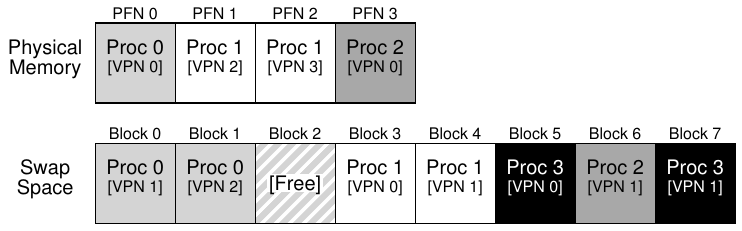

# 21 Vượt ra ngoài Physical Memory: Mechanism

Đến đây, ta đã giả định address space nhỏ một cách thiếu thực tế và nằm vừa trong physical memory. Thực ra, ta đã giả định mọi address space của mọi process đang chạy đều vừa memory. Giờ ta nới lỏng những giả định lớn này và giả sử muốn hỗ trợ nhiều address space lớn concurrently-running.

Để làm vậy, ta cần thêm một tầng trong memory hierarchy. Đến đây, ta giả định mọi page nằm trong physical memory. Tuy nhiên, để hỗ trợ address space lớn, OS cần một nơi cất những phần address space hiện chưa có nhu cầu cao. Nói chung, nơi đó cần có dung lượng lớn hơn memory; vì vậy nó thường chậm hơn (nếu nhanh hơn thì ta dùng nó làm memory luôn, đúng không?). Trong hệ thống hiện đại, hard disk drive thường đảm nhận vai trò này. Vì vậy, trong memory hierarchy, hard drive lớn và chậm nằm dưới cùng, memory ngay phía trên. Và ta đến mấu chốt của vấn đề:

> MẤU CHỐT: LÀM THẾ NÀO VƯỢT RA NGOÀI PHYSICAL MEMORY
>
> Làm sao OS dùng thiết bị lớn hơn, chậm hơn để cung cấp ảo giác về virtual address space lớn một cách trong suốt?

Bạn có thể hỏi: vì sao ta muốn hỗ trợ một address space lớn cho một process? Một lần nữa, câu trả lời là thuận tiện và dễ sử dụng. Với address space lớn, bạn không phải lo memory có đủ chỗ cho data structure của program hay không; thay vào đó, bạn viết program tự nhiên, cấp phát memory theo nhu cầu. Đó là ảo giác mạnh mẽ OS cung cấp, khiến cuộc sống của bạn đơn giản hơn rất nhiều. Không có gì! Ngược lại, các hệ thống cũ dùng memory overlay yêu cầu programmer tự chuyển từng phần code hoặc data vào và ra khỏi memory khi cần [D97]. Thử tưởng tượng: trước khi gọi function hay truy cập data, bạn phải sắp xếp để code hoặc data nằm trong memory; thật kinh khủng!

> BỔ SUNG: CÔNG NGHỆ STORAGE
>
> Ta sẽ tìm hiểu sâu hơn nhiều về cách I/O device thực sự hoạt động ở phần sau (xem chương I/O device). Hãy kiên nhẫn! Dĩ nhiên thiết bị chậm hơn không nhất thiết là hard disk, mà có thể hiện đại hơn như SSD Flash-based. Ta cũng sẽ nói về chúng. Hiện tại, cứ giả sử ta có thiết bị lớn và relatively-slow, dùng để tạo ảo giác virtual memory rất lớn, thậm chí lớn hơn chính physical memory.

Không chỉ cho một process, việc thêm swap space cho phép OS hỗ trợ ảo giác virtual memory lớn cho nhiều process concurrently-running. Sự ra đời của multiprogramming (chạy nhiều program “cùng lúc” để tận dụng máy tốt hơn) gần như đòi hỏi khả năng swap out một số page, vì các máy thời kỳ đầu rõ ràng không thể đồng thời chứa mọi page mà mọi process cần. Vì vậy, kết hợp multiprogramming với ease-of-use khiến ta muốn hỗ trợ dùng nhiều memory hơn lượng có thực tế. Mọi VM system hiện đại đều làm việc này; giờ ta sẽ tìm hiểu thêm.

## 21.1 Swap Space

Điều đầu tiên cần làm là dành một phần không gian trên disk để chuyển page qua lại. Trong operating system, ta thường gọi đó là swap space, vì ta swap page từ memory ra đó rồi swap từ đó vào memory. Vì vậy, ta đơn giản giả sử OS đọc và ghi được swap space theo đơn vị page-sized. Để làm vậy, OS cần nhớ disk address của một page cụ thể.

Kích thước swap space quan trọng, vì cuối cùng nó quyết định số memory page tối đa hệ thống có thể dùng tại một thời điểm. Để đơn giản, hiện cứ giả sử nó rất lớn.

Trong ví dụ nhỏ (Hình 21.1), bạn thấy physical memory có 4 page và swap space 8-page. Ba process (Proc 0, Proc 1 và Proc 2) đang tích cực chia sẻ physical memory; tuy nhiên, mỗi process chỉ có một số valid page trong memory, phần còn lại trong swap space trên disk. Process thứ tư (Proc 3) có mọi page bị swap out xuống disk, nên rõ ràng hiện không chạy. Một swap block còn trống. Ngay từ ví dụ nhỏ này, hy vọng bạn thấy dùng swap space cho phép hệ thống giả vờ memory lớn hơn thực tế.

Cần lưu ý swap space không phải vị trí on-disk duy nhất phục vụ swapping. Ví dụ, giả sử bạn chạy program binary (chẳng hạn ls hoặc main program do bạn compile). Code page của binary này ban đầu nằm trên disk, và khi program chạy chúng được load vào memory (tất cả cùng lúc khi bắt đầu thực thi, hoặc như hệ thống hiện đại, từng page khi cần). Tuy nhiên, nếu cần dành chỗ trong physical memory cho việc khác, hệ thống có thể an toàn re-use vùng memory chứa các code page này, vì biết sau đó có thể swap chúng vào lại từ binary on-disk trong file system.



Hình 21.1: Physical Memory và Swap Space

## 21.2 Present Bit

Giờ đã có không gian trên disk, ta cần bổ sung cơ chế ở tầng cao hơn trong hệ thống để hỗ trợ swap page xuống disk và từ disk trở lại. Để đơn giản, giả sử hệ thống có TLB hardware-managed.

Trước hết, nhớ lại chuyện gì xảy ra với một memory reference. Process đang chạy tạo virtual memory reference (cho instruction fetch hoặc data access), và trong trường hợp này, hardware chuyển chúng sang physical address trước khi lấy dữ liệu mong muốn từ memory.

Nhớ rằng hardware trước hết trích VPN từ virtual address, kiểm tra TLB xem có khớp không (TLB hit), và nếu hit thì tạo physical address tương ứng rồi lấy dữ liệu từ memory. Hy vọng đây là trường hợp thường gặp vì nhanh (không cần thêm memory access).

Nếu không tìm thấy VPN trong TLB (tức TLB miss), hardware xác định page table trong memory (dùng page table base register), rồi tra page table entry (PTE) cho page này bằng VPN làm index. Nếu page valid và hiện diện trong physical memory, hardware trích PFN từ PTE, cài vào TLB và thử lại instruction, lần này tạo TLB hit; đến đây mọi chuyện vẫn ổn.

Tuy nhiên, nếu muốn cho phép swap page xuống disk, ta phải thêm cơ chế nữa. Cụ thể, khi hardware xem PTE, nó có thể thấy page không hiện diện trong physical memory. Hardware (hoặc OS trong cách dùng TLB software-managed) xác định điều này qua thông tin mới trong mỗi entry page-table, gọi là present bit. Nếu present bit bằng một, page đang trong physical memory và mọi việc diễn ra như trên; nếu bằng zero, page không trong memory mà ở đâu đó trên disk. Truy cập một page không trong physical memory thường gọi là page fault.

> BỔ SUNG: THUẬT NGỮ SWAPPING VÀ NHỮNG ĐIỀU KHÁC
>
> Thuật ngữ trong virtual memory system có thể hơi khó hiểu và khác nhau giữa máy và operating system. Chẳng hạn, tổng quát hơn, page fault có thể chỉ mọi tham chiếu tới page table tạo ra một dạng fault: gồm fault đang bàn ở đây, tức page-not-present fault, nhưng đôi khi có thể chỉ truy cập memory trái phép. Thực sự khá lạ khi gọi một truy cập hoàn toàn hợp lệ (vào page được map trong virtual address space của process, chỉ là lúc đó không trong physical memory) là “fault”; đúng ra nên gọi page miss. Nhưng thường khi người ta nói program đang “page faulting”, họ muốn nói nó truy cập các phần virtual address space mà OS đã swap out xuống disk. Ta cho rằng lý do hành vi này được gọi là “fault” liên quan cơ chế OS xử lý nó. Khi điều bất thường xảy ra, tức việc hardware không biết xử lý, hardware đơn giản chuyển quyền điều khiển sang OS, hy vọng OS giải quyết được. Ở đây, page process muốn truy cập đang thiếu trong memory; hardware làm điều duy nhất nó có thể: raise exception, rồi OS tiếp quản. Vì điều này giống hệt khi process làm việc trái phép, có lẽ không ngạc nhiên khi ta gọi hoạt động ấy là “fault”.

Khi page fault xảy ra, OS được gọi để phục vụ nó. Một đoạn code cụ thể, gọi là handler page-fault, sẽ chạy và phải phục vụ page fault như ta sắp mô tả.

## 21.3 Page Fault

Nhớ rằng với TLB miss, ta có hai loại hệ thống: TLB hardware-managed (hardware tra page table để tìm translation mong muốn) và TLB software-managed (OS làm việc đó). Trong cả hai, nếu page không hiện diện, OS chịu trách nhiệm xử lý page fault. Handler page-fault của OS, appropriately-named, chạy để xác định cần làm gì. Gần như mọi hệ thống xử lý page fault bằng software; ngay cả với TLB hardware-managed, hardware cũng tin OS quản lý nhiệm vụ quan trọng này.

Nếu page không hiện diện và đã được swap xuống disk, OS cần swap page vào memory để phục vụ page fault. Vậy câu hỏi là: OS biết tìm page mong muốn ở đâu? Trong nhiều hệ thống, page table là chỗ tự nhiên để lưu thông tin đó. Do vậy, OS có thể dùng các bit PTE thường chứa dữ liệu như PFN của page để lưu disk address. Khi nhận page fault cho page, OS xem PTE để tìm address, rồi gửi yêu cầu tới disk lấy page vào memory.

> BỔ SUNG: VÌ SAO HARDWARE KHÔNG XỬ LÝ PAGE FAULT
>
> Từ trải nghiệm với TLB, ta biết người thiết kế hardware rất ngại tin OS làm điều gì. Vậy sao họ tin OS xử lý page fault? Có vài lý do chính. Thứ nhất, page fault xuống disk chậm; dù OS xử lý fault lâu, thực thi rất nhiều instruction, bản thân thao tác disk vốn chậm đến mức overhead thêm từ chạy software là tối thiểu. Thứ hai, để xử lý page fault, hardware phải hiểu swap space, cách gửi I/O đến disk và nhiều chi tiết khác mà hiện nó không biết rõ. Vì vậy, do cả hiệu năng lẫn sự đơn giản, OS xử lý page fault, và ngay cả dân hardware cũng hài lòng.

Khi disk I/O hoàn tất, OS cập nhật page table đánh dấu page hiện diện, cập nhật field PFN của entry page-table (PTE) ghi vị trí in-memory của page newly-fetched, rồi thử lại instruction. Lần thử này có thể tạo TLB miss, sau đó được phục vụ và cập nhật TLB với translation (cũng có thể cập nhật TLB khi phục vụ page fault để tránh bước này). Cuối cùng, khởi động lại lần nữa sẽ tìm thấy translation trong TLB, rồi lấy data hoặc instruction mong muốn từ memory tại physical address đã chuyển đổi.

Lưu ý khi I/O đang diễn ra, process ở trạng thái blocked. Vì vậy, OS có thể chạy các ready process khác trong lúc phục vụ page fault. Vì I/O tốn kém, chồng lấp I/O (page fault) của process này với việc thực thi process khác là một cách nữa để hệ thống multiprogrammed sử dụng hardware hiệu quả nhất.

## 21.4 Nếu Memory đầy thì sao?

Trong quá trình trên, có thể bạn nhận ra ta giả định có nhiều free memory để page in page từ swap space. Dĩ nhiên có thể không như vậy; memory có thể đầy (hoặc gần đầy). Vì vậy, OS có thể muốn page out một hay nhiều page trước để dành chỗ cho page mới sắp đưa vào. Quá trình chọn page để đẩy ra, hay thay thế, gọi là policy page-replacement.

Hóa ra nhiều công sức suy nghĩ đã dành cho việc tạo policy page-replacement tốt, vì đẩy nhầm page có thể khiến hiệu năng program chịu tổn thất lớn. Quyết định sai có thể khiến program chạy ở tốc độ disk-like thay vì memory-like; với công nghệ hiện tại, nghĩa là program chậm hơn 10,000 hoặc 100,000 lần. Vì vậy, ta nên nghiên cứu policy này khá chi tiết; đó chính là việc ở chương sau. Hiện chỉ cần hiểu policy ấy tồn tại, xây trên những mechanism mô tả ở đây.

```
 1   VPN = (VirtualAddress & VPN_MASK) >> SHIFT
 2   (Success, TlbEntry) = TLB_Lookup(VPN)
 3   if (Success == True)   // TLB Hit
 4       if (CanAccess(TlbEntry.ProtectBits) == True)
 5           Offset   = VirtualAddress & OFFSET_MASK
 6           PhysAddr = (TlbEntry.PFN << SHIFT) | Offset
 7           Register = AccessMemory(PhysAddr)
 8       else
 9           RaiseException(PROTECTION_FAULT)
10   else                  // TLB Miss
11       PTEAddr = PTBR + (VPN * sizeof(PTE))
12       PTE = AccessMemory(PTEAddr)
13       if (PTE.Valid == False)
14           RaiseException(SEGMENTATION_FAULT)
15       else
16           if (CanAccess(PTE.ProtectBits) == False)
17               RaiseException(PROTECTION_FAULT)
18           else if (PTE.Present == True)
19               // assuming hardware-managed TLB
20               TLB_Insert(VPN, PTE.PFN, PTE.ProtectBits)
21               RetryInstruction()
22           else if (PTE.Present == False)
23               RaiseException(PAGE_FAULT)
```

Hình 21.2: Thuật toán Control Flow Page-Fault (Hardware)

## 21.5 Control Flow của Page Fault

Với toàn bộ kiến thức này, giờ ta có thể phác thảo control flow hoàn chỉnh của memory access. Nói cách khác, khi ai hỏi “chuyện gì xảy ra khi program lấy dữ liệu từ memory?”, bạn hẳn biết khá rõ mọi khả năng. Xem control flow trong Hình 21.2 và 21.3 để biết thêm; hình đầu cho thấy hardware làm gì khi translation, hình sau cho thấy OS làm gì khi page fault.

Từ sơ đồ hardware control flow trong Hình 21.2, lưu ý giờ có ba trường hợp quan trọng khi TLB miss. Thứ nhất, page vừa present vừa valid (dòng 18–21); khi đó, TLB miss handler chỉ cần lấy PFN từ PTE, thử lại instruction (lần này TLB hit), rồi tiếp tục như mô tả (nhiều lần) trước đây. Trường hợp thứ hai (dòng 22–23), page fault handler phải chạy; dù đây là page process được truy cập hợp lệ (rốt cuộc nó valid), nó không hiện diện trong physical memory. Thứ ba (cuối cùng), truy cập có thể vào page invalid, chẳng hạn do bug trong program (dòng 13–14). Khi đó, mọi bit khác trong PTE đều không quan trọng; hardware trap truy cập invalid này, OS trap handler chạy và có thể chấm dứt process vi phạm.

Từ software control flow trong Hình 21.3, ta thấy khái quát OS phải làm gì để phục vụ page fault. Trước hết, OS tìm physical frame chứa page soon-to-be-faulted-in; nếu không có page như vậy, phải đợi replacement algorithm chạy và đẩy một số page khỏi memory, giải phóng chúng cho việc dùng ở đây. Có physical frame, handler gửi yêu cầu I/O đọc page từ swap space. Cuối cùng, khi thao tác chậm đó hoàn tất, OS cập nhật page table và thử lại instruction. Thử lại tạo TLB miss, rồi khi thử thêm lần nữa tạo TLB hit, lúc đó hardware truy cập được mục mong muốn.

```
 1   PFN = FindFreePhysicalPage()
 2   if (PFN == -1)              // no free page found
 3       PFN = EvictPage()       // run replacement algorithm
 4   DiskRead(PTE.DiskAddr, pfn) // sleep (waiting for I/O)
 5   PTE.present = True          // update page table with present
 6   PTE.PFN     = PFN           // bit and translation (PFN)
 7   RetryInstruction()          // retry instruction
```

Hình 21.3: Thuật toán Control Flow Page-Fault (Software)

## 21.6 Khi nào Replacement thực sự diễn ra

Đến đây, cách mô tả replacement giả định OS chờ đến khi memory đầy hoàn toàn rồi mới thay thế (evict) một page dành chỗ cho page khác. Như bạn hình dung, điều này hơi thiếu thực tế, và có nhiều lý do để OS chủ động giữ một phần nhỏ memory trống.

Để giữ một lượng nhỏ free memory, phần lớn operating system có dạng high watermark (HW) và low watermark (LW) giúp quyết định khi nào bắt đầu evict page khỏi memory. Cách hoạt động như sau: khi OS thấy còn ít hơn LW page khả dụng, background thread chịu trách nhiệm giải phóng memory chạy. Thread evict page cho đến khi có HW page khả dụng. Background thread, đôi khi gọi là swap daemon hoặc page daemon[^1], rồi đi ngủ, hài lòng vì đã giải phóng memory cho process đang chạy và OS dùng.

Thực hiện nhiều replacement cùng lúc mở ra các tối ưu hiệu năng mới. Chẳng hạn, nhiều hệ thống cluster hay gom một số page rồi ghi cùng lúc ra swap partition, nhờ đó tăng hiệu quả disk [LL82]; như ta sẽ thấy khi bàn kỹ hơn về disk, clustering giảm overhead seek và quay của disk nên tăng hiệu năng đáng kể.

Để làm việc với background paging thread, control flow trong Hình 21.3 cần sửa đôi chút; thay vì replacement trực tiếp, thuật toán chỉ kiểm tra còn free page không. Nếu không, nó báo background paging thread rằng cần free page; khi thread giải phóng được một số page, nó re-awaken thread ban đầu, thread đó page in page mong muốn rồi tiếp tục công việc.

> MẸO: LÀM VIỆC TRONG BACKGROUND
>
> Khi có việc cần làm, làm trong background thường là ý hay để tăng hiệu quả và cho phép gom thao tác. Operating system thường làm việc trong background; chẳng hạn nhiều hệ thống buffer các lần ghi file trong memory trước khi thực sự ghi dữ liệu xuống disk. Có nhiều lợi ích khả dĩ: disk hiệu quả hơn vì có thể nhận nhiều lần ghi cùng lúc và schedule tốt hơn; latency ghi cải thiện vì application tưởng các lần ghi hoàn tất rất nhanh; có thể giảm công việc vì những lần ghi có thể không bao giờ cần xuống disk (tức nếu file bị xóa); và tận dụng thời gian nhàn rỗi tốt hơn vì công việc background có thể làm khi hệ thống vốn đang rảnh, nhờ đó tận dụng hardware tốt hơn [G+95].

## 21.7 Tổng kết

Trong chương ngắn này, ta giới thiệu khái niệm truy cập nhiều memory hơn lượng có thực tế trong hệ thống. Điều đó yêu cầu cấu trúc page-table phức tạp hơn, vì phải thêm present bit (dưới dạng nào đó) cho biết page có trong memory hay không. Nếu không, handler page-fault của operating system chạy để phục vụ page fault, thu xếp chuyển page mong muốn từ disk sang memory, có thể trước hết thay một số page trong memory dành chỗ cho page sắp swap vào.

Hãy nhớ điều quan trọng (và đáng kinh ngạc!) là mọi hành động này diễn ra trong suốt đối với process. Với process, nó chỉ truy cập virtual memory riêng, liên tục của mình. Phía sau, page được đặt tại vị trí tùy ý (non-contiguous) trong physical memory, đôi khi thậm chí không hiện diện trong memory mà phải lấy từ disk. Dù hy vọng memory access thường nhanh, trong một số trường hợp phải dùng nhiều thao tác disk để phục vụ nó; việc đơn giản như thực hiện một instruction duy nhất trong trường hợp xấu nhất có thể mất nhiều millisecond mới xong.

## Tài liệu tham khảo

[CS94] “Take Our Word For It”

F. Corbato and R. Steinberg

Có tại: http://www.takeourword.com/TOW146/page4.html

Richard Steinberg viết: “Có người hỏi tôi nguồn gốc từ daemon dùng trong điện toán. Theo những gì tôi nghiên cứu được, từ này được dùng đầu tiên bởi những người trong nhóm của ông tại Project MAC dùng IBM 7094 vào năm 1963.” Giáo sư Corbato đáp: “Việc dùng từ daemon của chúng tôi lấy cảm hứng từ daemon Maxwell trong vật lý và nhiệt động lực học (chuyên môn của tôi là vật lý). Daemon Maxwell là tác nhân tưởng tượng giúp phân loại phân tử có tốc độ khác nhau, làm việc không mệt mỏi trong background. Chúng tôi bắt đầu dùng từ daemon một cách đầy tưởng tượng để mô tả background process không mệt mỏi thực hiện các công việc hệ thống.”

[D97] “Before Memory Was Virtual”

Peter Denning

Trích In the Beginning: Recollections of Software Pioneers, Wiley, November 1997 Một bài lịch sử xuất sắc của một trong những người tiên phong về virtual memory và working set.

[G+95] “Idleness is not sloth”

Richard Golding, Peter Bosch, Carl Staelin, Tim Sullivan, John Wilkes

USENIX ATC ’95, New Orleans, Louisiana

Thảo luận thú vị và easy-to-read về cách tận dụng thời gian nhàn rỗi trong hệ thống tốt hơn, với nhiều ví dụ hay.

[LL82] “Virtual Memory Management in the VAX/VMS Operating System”

Hank Levy and P. Lipman

IEEE Computer, Vol. 15, No. 3, March 1982

Không phải nơi đầu tiên dùng clustering như vậy, nhưng giải thích rõ ràng và đơn giản cách mechanism ấy hoạt động.

---

[^1]: Từ “daemon”, thường phát âm “demon”, là thuật ngữ cũ chỉ background thread hoặc process làm một việc hữu ích. Hóa ra (lại một lần nữa!) nguồn gốc thuật ngữ là Multics [CS94].
