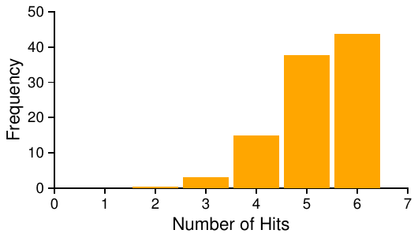
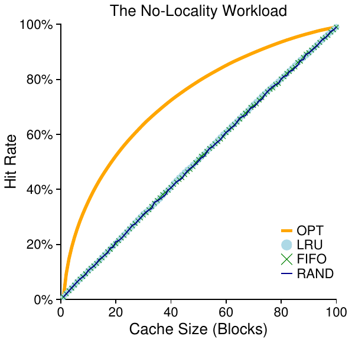
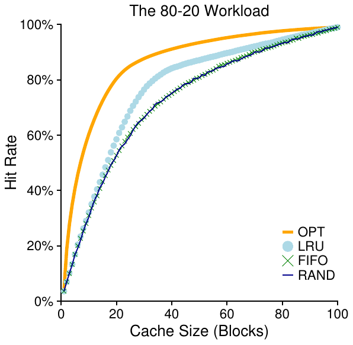
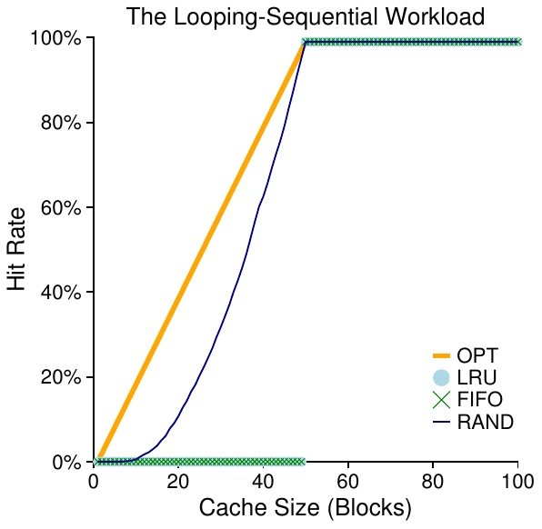
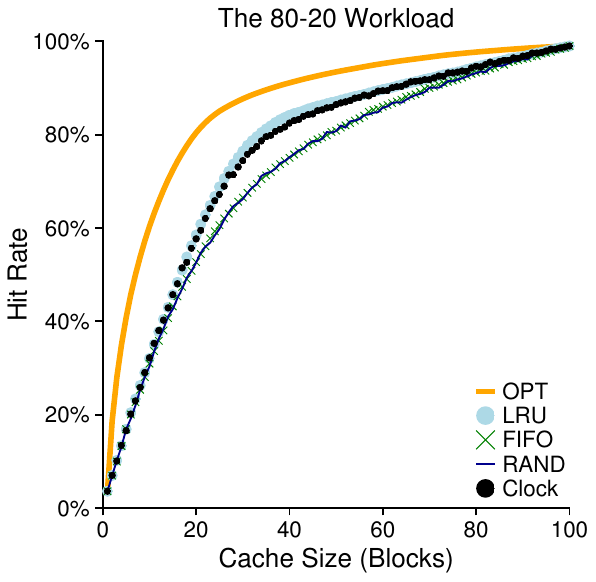

# 22 Vượt ra ngoài Physical Memory: Policy

Trong virtual memory manager, cuộc sống dễ dàng khi có nhiều free memory. Page fault xảy ra, bạn tìm free page trên list free-page rồi gán cho page gây fault. Này Operating System, chúc mừng! Bạn lại làm được rồi.

Đáng tiếc, mọi việc thú vị hơn khi ít free memory. Khi đó, memory pressure buộc OS bắt đầu paging out page dành chỗ cho page actively-used. Quyết định evict page nào nằm trong replacement policy của OS; về lịch sử, đó là quyết định quan trọng nhất của virtual memory system thời đầu, vì hệ thống cũ có ít physical memory. Ít nhất, đây là tập policy thú vị đáng tìm hiểu thêm. Và vấn đề là:

> MẤU CHỐT: LÀM THẾ NÀO QUYẾT ĐỊNH EVICT PAGE NÀO
>
> Làm sao OS quyết định page nào cần evict khỏi memory? Replacement policy hệ thống đưa ra quyết định, thường theo vài nguyên tắc chung (bàn dưới) nhưng cũng thêm điều chỉnh tránh hành vi corner-case.

## 22.1 Quản lý Cache

Trước khi đi sâu policy, ta mô tả kỹ hơn vấn đề cần giải quyết. Vì main memory chứa một tập con mọi page trong hệ thống, có thể xem đúng nghĩa là cache cho virtual memory page. Vì vậy mục tiêu chọn replacement policy cho cache này là giảm số cache miss, tức giảm số lần phải lấy page từ disk. Cũng có thể xem mục tiêu là tăng số cache hit, tức số lần page được truy cập được tìm thấy trong memory.

Biết số cache hit và miss cho phép ta tính average memory access time (AMAT) của program (một metric mà computer architect tính cho hardware cache [HP06]). Cụ thể, với các giá trị này, ta tính AMAT của program như sau:

AMAT = (PHit · TM) + (PMiss · TD) (22.1)

trong đó TM là chi phí memory access, TD là chi phí disk access, PHit là xác suất tìm data item trong cache (hit), PMiss là xác suất không tìm thấy data trong cache (miss). PHit và PMiss đều từ 0.0 đến 1.0, và PMiss + PHit = 1.0.

Ví dụ, tưởng tượng máy có address space (nhỏ) 4KB, page 256-byte. Virtual address có VPN 4-bit (các bit most-significant) và offset 8-bit (các bit least-significant). Process có thể truy cập tổng 24 tức 16 virtual page. Ví dụ process tạo memory reference (virtual address): 0x000, 0x100, 0x200, 0x300, 0x400, 0x500, 0x600, 0x700, 0x800, 0x900. Chúng tham chiếu byte đầu mỗi page trong mười page đầu address space (page number là chữ số hex đầu mỗi virtual address).

Giả sử thêm mọi page trừ virtual page 3 đã trong memory. Chuỗi memory reference có hành vi: hit, hit, hit, miss, hit, hit, hit, hit, hit, hit. Hit rate (phần trăm reference tìm trong memory) là 90% (PHit = 0.9), vì 9 trong 10 reference trong memory. Miss rate rõ ràng 10% (PMiss = 0.1).

Để tính AMAT, chỉ cần biết chi phí memory access và disk access. Giả sử memory access (TM) khoảng 100 nanosecond, disk access (TD) khoảng 10 millisecond, AMAT là 0.9 · 100ns + 0.1 · 10ms, tức 90ns + 1ms, hay 1.00009 ms, khoảng 1 millisecond. Nếu hit rate là 99.9%, kết quả rất khác: AMAT 10.1 microsecond, nhanh hơn khoảng 100 lần. Khi hit rate gần 100%, AMAT gần 100 nanosecond.

Đáng tiếc như ví dụ, chi phí disk access cao đến mức ngay miss rate nhỏ cũng nhanh chóng chi phối AMAT tổng của program. Rõ ràng cần tránh miss tối đa hoặc chạy chậm ở tốc độ disk. Một cách là phát triển policy thông minh cẩn thận, như sắp làm.

## 22.2 Optimal Replacement Policy

Để hiểu replacement policy cụ thể hoạt động thế nào, tốt nhất so với policy tốt nhất có thể. Hóa ra Belady phát triển policy tối ưu này nhiều năm trước [B66] (ban đầu gọi MIN). Optimal replacement policy dẫn đến tổng miss ít nhất. Belady cho thấy cách đơn giản (nhưng đáng tiếc khó triển khai!) thay page được truy cập xa nhất trong tương lai là policy tối ưu, tạo cache miss fewest-possible.

> MẸO: SO SÁNH VỚI TỐI ƯU RẤT HỮU ÍCH
>
> Dù optimal không thực tế làm policy thật, nó vô cùng hữu ích làm mốc so sánh trong mô phỏng hay nghiên cứu khác. Chỉ nói thuật toán mới cầu kỳ có hit rate 80% không có ý nghĩa riêng; nói optimal đạt hit rate 82% (nên cách mới khá gần tối ưu) làm kết quả ý nghĩa hơn và có bối cảnh. Vì vậy, trong mọi nghiên cứu, biết optimal giúp so sánh tốt hơn, cho thấy còn cải thiện bao nhiêu, và khi nào dừng cải thiện policy vì đủ gần lý tưởng [AD03].

Hy vọng trực giác optimal policy hợp lý. Nghĩ thế này: nếu phải bỏ page, sao không bỏ page cần xa nhất từ hiện tại? Như vậy về cơ bản bạn nói mọi page khác trong cache quan trọng hơn page xa nhất. Lý do đơn giản: bạn sẽ tham chiếu page khác trước page xa nhất.

Trace ví dụ đơn giản để hiểu quyết định optimal policy. Giả sử program truy cập chuỗi virtual page: 0, 1, 2, 0, 1, 3, 0, 3, 1, 2, 1. Hình 22.1 cho hành vi optimal với cache chứa ba page.

Trong hình, thấy các hành động sau. Không ngạc nhiên, ba access đầu miss vì cache ban đầu rỗng; miss này đôi khi gọi cold-start miss (hay compulsory miss). Rồi tham chiếu page 0 và 1, đều cache hit. Cuối cùng lại miss (page 3), nhưng cache đã đầy; phải replacement! Câu hỏi là thay page nào? Với optimal, xem tương lai từng page trong cache (0, 1 và 2), thấy 0 được truy cập gần như ngay, 1 muộn hơn chút, 2 xa nhất tương lai. Vì vậy dễ chọn: evict page 2, để page 0, 1 và 3 trong cache. Ba reference tiếp hit, rồi đến page 2 đã evict lâu trước, lại miss. Optimal lại xem tương lai từng page (0, 1 và 3), thấy chỉ cần không evict page 1 (sắp truy cập) là ổn. Ví dụ evict page 3, dù 0 cũng tốt. Cuối cùng hit page 1, trace xong.

|  |  |  | Kết quả |
|---|---|---|---|
| Truy cập | Hit/Miss? | Evict | Trạng thái Cache |
| 0 | Miss |  | 0 |
| 1 | Miss |  | 0, 1 |
| 2 | Miss |  | 0, 1, 2 |
| 0 | Hit |  | 0, 1, 2 |
| 1 | Hit |  | 0, 1, 2 |
| 3 | Miss | 2 | 0, 1, 3 |
| 0 | Hit |  | 0, 1, 3 |
| 3 | Hit |  | 0, 1, 3 |
| 1 | Hit |  | 0, 1, 3 |
| 2 | Miss | 3 | 0, 1, 2 |
| 1 | Hit |  | 0, 1, 2 |

Hình 22.1: Trace Optimal Policy

> BỔ SUNG: CÁC LOẠI CACHE MISS
>
> Trong computer architecture, đôi khi hữu ích phân loại miss thành ba nhóm: compulsory, capacity và conflict miss, đôi khi gọi Three C’s [H87]. Compulsory miss (hay cold-start miss [EF78]) xảy ra vì cache ban đầu rỗng và đây là reference đầu tới item; ngược lại capacity miss xảy ra vì cache hết chỗ, phải evict item để đưa item mới vào. Loại thứ ba (conflict miss) phát sinh trong hardware do giới hạn vị trí item được đặt trong hardware cache, vì thứ gọi là set-associativity; không xuất hiện trong OS page cache vì cache ấy luôn fully-associative, tức không hạn chế page được đặt đâu trong memory. Xem H&P để biết thêm [HP06].

Cũng tính được cache hit rate: với 6 hit và 5 miss, hit rate là (Hits)/(Hits+Misses), tức 6/(6+5) hay 54.5%. Cũng có thể tính hit rate bỏ compulsory miss (bỏ miss đầu tới page), cho hit rate 85.7%.

Đáng tiếc, như thấy khi phát triển scheduling policy, nhìn chung không biết tương lai; không thể xây optimal policy cho operating system general-purpose[^1]. Vì vậy, khi phát triển policy thực có thể triển khai, tập trung cách khác quyết định evict page nào. Optimal chỉ làm mốc so sánh để biết gần “hoàn hảo” bao nhiêu.

## 22.3 Policy đơn giản: FIFO

Nhiều hệ thống đầu tránh phức tạp khi cố gần optimal và dùng replacement policy rất đơn giản. Ví dụ vài hệ thống dùng FIFO (first-in, first-out), chỉ đặt page vào queue khi vào hệ thống; khi replacement, page cuối queue (page “first-in”) bị evict. FIFO có ưu điểm lớn: rất dễ triển khai.

Xem FIFO hoạt động với chuỗi reference ví dụ (Hình 22.2, trang 5). Lại bắt đầu trace bằng ba compulsory miss page 0, 1 và 2, rồi hit 0 và 1. Tiếp tham chiếu page 3 gây miss; FIFO dễ quyết định: chọn page “đầu tiên” vào (trạng thái cache trong hình theo FIFO, page first-in bên trái), là page 0. Đáng tiếc, access tiếp tới page 0 gây thêm miss và replacement (page 1). Rồi hit page 3 nhưng miss 1 và 2, cuối cùng hit 3.

|  |  |  | Kết quả |
|---|---|---|---|
| Truy cập | Hit/Miss? | Evict | Trạng thái Cache |
| 0 | Miss |  | First-in→ 0 |
| 1 | Miss |  | First-in→ 0, 1 |
| 2 | Miss |  | First-in→ 0, 1, 2 |
| 0 | Hit |  | First-in→ 0, 1, 2 |
| 1 | Hit |  | First-in→ 0, 1, 2 |
| 3 | Miss | 0 | First-in→ 1, 2, 3 |
| 0 | Miss | 1 | First-in→ 2, 3, 0 |
| 3 | Hit |  | First-in→ 2, 3, 0 |
| 1 | Miss | 2 | First-in→ 3, 0, 1 |
| 2 | Miss | 3 | First-in→ 0, 1, 2 |
| 1 | Hit |  | First-in→ 0, 1, 2 |

Hình 22.2: Trace FIFO Policy

So với optimal, FIFO kém rõ: hit rate 36.4% (hoặc 57.1% bỏ compulsory miss). FIFO không xác định được tầm quan trọng block: dù page 0 được truy cập nhiều lần, FIFO vẫn đẩy ra chỉ vì nó được đưa vào memory đầu tiên.

> BỔ SUNG: NGHỊCH LÝ BELADY
>
> Belady (tác giả optimal policy) và cộng sự tìm thấy chuỗi reference thú vị có hành vi hơi bất ngờ [BNS69]. Chuỗi memory-reference: 1, 2, 3, 4, 1, 2, 5, 1, 2, 3, 4, 5. Replacement policy họ nghiên cứu là FIFO. Phần thú vị: cache hit rate đổi thế nào khi cache size từ 3 lên 4 page.
>
> Thường bạn mong hit rate tăng (tốt hơn) khi cache lớn. Nhưng ở đây, với FIFO, lại tệ hơn! Tự tính hit và miss xem. Hành vi lạ thường gọi Belady’s Anomaly (khiến co-authors phiền lòng).
>
> Policy khác như LRU không gặp vấn đề. Bạn đoán vì sao? Hóa ra LRU có stack property [M+70]. Với thuật toán có tính chất này, cache kích thước N + 1 tự nhiên chứa nội dung cache kích thước N. Vì vậy tăng cache size, hit rate giữ nguyên hoặc tăng. FIFO và Random (cùng vài policy khác) rõ ràng không tuân stack property, nên dễ có hành vi bất thường.

|  |  |  | Kết quả |
|---|---|---|---|
| Truy cập | Hit/Miss? | Evict | Trạng thái Cache |
| 0 | Miss |  | 0 |
| 1 | Miss |  | 0, 1 |
| 2 | Miss |  | 0, 1, 2 |
| 0 | Hit |  | 0, 1, 2 |
| 1 | Hit |  | 0, 1, 2 |
| 3 | Miss | 0 | 1, 2, 3 |
| 0 | Miss | 1 | 2, 3, 0 |
| 3 | Hit |  | 2, 3, 0 |
| 1 | Miss | 3 | 2, 0, 1 |
| 2 | Hit |  | 2, 0, 1 |
| 1 | Hit |  | 2, 0, 1 |

Hình 22.3: Trace Random Policy

## 22.4 Policy đơn giản khác: Random

Replacement policy tương tự khác là Random, chỉ chọn page ngẫu nhiên thay khi memory pressure. Random có tính chất giống FIFO; dễ triển khai nhưng không cố quá thông minh khi chọn block evict. Xem Random với chuỗi reference quen thuộc (Hình 22.3).

Dĩ nhiên Random tốt thế nào phụ thuộc hoàn toàn may mắn (hay xui xẻo) khi chọn. Ví dụ trên Random hơn FIFO chút, kém optimal chút. Thực tế có thể chạy thí nghiệm Random hàng nghìn lần để xem hiệu quả chung. Hình 22.4 cho số hit Random đạt qua 10,000 lần thử, mỗi lần random seed khác. Như thấy, đôi khi (hơn 40% số lần), Random tốt bằng optimal, đạt 6 hit trên trace; đôi khi tệ hơn nhiều, chỉ 2 hit hoặc ít hơn. Hiệu quả Random tùy vận may.

Hình 22.4: Hiệu năng Random qua 10,000 lần thử

|  |  |  | Kết quả |
|---|---|---|---|
| Truy cập | Hit/Miss? | Evict | Trạng thái Cache |
| 0 | Miss |  | LRU→ 0 |
| 1 | Miss |  | LRU→ 0, 1 |
| 2 | Miss |  | LRU→ 0, 1, 2 |
| 0 | Hit |  | LRU→ 1, 2, 0 |
| 1 | Hit |  | LRU→ 2, 0, 1 |
| 3 | Miss | 2 | LRU→ 0, 1, 3 |
| 0 | Hit |  | LRU→ 1, 3, 0 |
| 3 | Hit |  | LRU→ 1, 0, 3 |
| 1 | Hit |  | LRU→ 0, 3, 1 |
| 2 | Miss | 0 | LRU→ 3, 1, 2 |
| 1 | Hit |  | LRU→ 3, 2, 1 |

Hình 22.5: Trace LRU Policy

## 22.5 Dùng lịch sử: LRU

Đáng tiếc, policy đơn giản như FIFO hay Random dễ có vấn đề chung: đẩy page quan trọng sắp được tham chiếu lại. FIFO đẩy page được đưa vào đầu tiên; nếu page có code hay data structure quan trọng, vẫn bị bỏ dù sắp được page in. Vì vậy FIFO, Random và policy tương tự khó gần optimal; cần thông minh hơn.

Như scheduling policy, để đoán tương lai tốt hơn, ta lại dựa quá khứ, lấy lịch sử chỉ dẫn. Chẳng hạn program vừa truy cập page gần đây có thể sẽ sớm truy cập lại.

Một loại thông tin lịch sử policy page-replacement có thể dùng là frequency; page đã truy cập nhiều lần có lẽ không nên thay vì rõ ràng có giá trị. Thuộc tính commonly-used hơn là recency; page càng vừa được truy cập, có lẽ càng dễ truy cập lại.

Họ policy này dựa trên principle of locality [D70], về cơ bản chỉ là quan sát về program và hành vi. Nguyên lý đơn giản nói program thường truy cập vài chuỗi code (như trong loop) và data structure (như array loop truy cập) khá thường xuyên; do đó nên dùng lịch sử tìm page quan trọng, giữ trong memory khi cần eviction.

Vì vậy họ thuật toán historically-based đơn giản ra đời. Policy Least-Frequently-Used (LFU) thay page least-frequently-used khi phải evict. Tương tự, policy Least-Recently- Used (LRU) thay page least-recently-used. Thuật toán dễ nhớ: biết tên là biết chính xác làm gì, một đặc tính tuyệt vời của tên.

Để hiểu LRU, xem nó với chuỗi reference ví dụ. Hình 22.5 (trang 7) cho kết quả. Thấy LRU dùng lịch sử tốt hơn policy stateless như Random hay FIFO. Ví dụ LRU evict page 2 khi phải replacement đầu tiên vì 0 và 1 được truy cập gần hơn. Rồi thay page 0 vì 1 và 3 được truy cập gần hơn. Cả hai quyết định dựa lịch sử đều đúng, reference tiếp là hit. Trong ví dụ đơn giản, LRU tốt nhất có thể, hiệu năng bằng optimal[^2].

> BỔ SUNG: CÁC LOẠI LOCALITY
>
> Program thường có hai loại locality. Đầu là spatial locality: nếu page P được truy cập, các page quanh nó (P − 1 hay P + 1) cũng có thể được truy cập. Hai là temporal locality: page vừa truy cập gần đây có thể được truy cập lại trong tương lai gần. Giả định có locality này đóng vai trò lớn trong caching hierarchy hardware, dùng nhiều tầng caching instruction, data và address-translation giúp program nhanh khi có locality.
>
> Dĩ nhiên principle of locality không phải luật hard-and-fast mọi program phải theo. Thực tế, một số program truy cập memory (hoặc disk) khá ngẫu nhiên, ít hoặc không có locality trong access stream. Vì vậy dù locality đáng nhớ khi thiết kế cache bất kỳ (hardware hoặc software), nó không bảo đảm thành công. Đúng hơn là heuristic thường hữu ích khi thiết kế hệ thống máy tính.

Cũng lưu ý có thuật toán ngược: Most- Frequently-Used (MFU) và Most-Recently-Used (MRU). Phần lớn trường hợp (không phải tất cả!), chúng hoạt động không tốt vì bỏ qua locality phần lớn program có thay vì tận dụng.

## 22.6 Ví dụ Workload

Xem thêm vài ví dụ để hiểu policy hoạt động thế nào. Ở đây xét workload phức tạp hơn thay vì trace nhỏ. Tuy nhiên, ngay workload này vẫn đơn giản hóa nhiều; nghiên cứu tốt hơn nên có application trace.

Workload đầu không có locality, nghĩa mỗi reference tới page ngẫu nhiên trong tập page được truy cập. Ví dụ đơn giản, workload truy cập 100 page riêng biệt theo thời gian, chọn page tiếp ngẫu nhiên; tổng 10,000 page access. Thí nghiệm đổi cache size từ rất nhỏ (1 page) tới đủ chứa mọi page riêng (100 page), xem mỗi policy hoạt động qua dải cache size.

Hình 22.6: Workload No-Locality

Hình 22.6 vẽ kết quả thí nghiệm cho optimal, LRU, Random và FIFO. y-axis thể hiện hit rate mỗi policy đạt được; x-axis thay đổi cache size như mô tả trên.

Ta rút ra nhiều kết luận. Thứ nhất, khi workload không locality, policy thực tế nào không quan trọng lắm; LRU, FIFO, Random đều giống, hit rate hoàn toàn do cache size quyết định. Thứ hai, cache đủ lớn chứa toàn workload thì policy nào cũng không quan trọng; mọi policy (kể cả Random) hội tụ hit rate 100% khi mọi block tham chiếu vừa cache. Cuối cùng, optimal tốt hơn rõ rệt các policy thực tế; nhìn tương lai, nếu được, replacement tốt hơn nhiều.

Workload tiếp gọi “80-20”, có locality: 80% reference tới 20% page (“hot”); 20% reference còn lại tới 80% page còn lại (“cold”). Workload lại có tổng 100 page riêng; vì vậy phần lớn thời gian tham chiếu “hot” page, còn lại “cold” page. Hình 22.7 (trang 10) cho hiệu năng policy với workload.

Như hình, random và FIFO khá tốt, LRU tốt hơn vì dễ giữ hot page; vì page này đã được tham chiếu thường xuyên trong quá khứ, có thể sớm tham chiếu lại. Optimal lại tốt hơn, cho thấy thông tin lịch sử LRU không hoàn hảo.

Hình 22.7: Workload 80-20

Bạn có thể hỏi: cải thiện LRU so với Random và FIFO thực sự quan trọng vậy không? Như thường lệ đáp án “tùy”. Nếu miss rất tốn kém (không hiếm), tăng hit rate nhỏ (giảm miss rate) cũng tạo khác biệt hiệu năng lớn. Nếu miss không tốn lắm, dĩ nhiên lợi ích LRU ít quan trọng hơn.

Xem workload cuối. Gọi “looping sequential”, vì tham chiếu 50 page tuần tự, từ 0 rồi 1, ..., tới 49, rồi lặp lại, tổng 10,000 access tới 50 page riêng. Đồ thị cuối Hình 22.8 cho hành vi policy với workload.

Workload này phổ biến trong nhiều application (gồm commercial application quan trọng như database [CD85]), là worst-case cho cả LRU và FIFO. Với workload looping-sequential, chúng đẩy page cũ; đáng tiếc vì tính lặp, page cũ sẽ được truy cập sớm hơn page policy thích giữ trong cache. Thực tế ngay cache 49, workload looping-sequential 50 page cho hit rate 0%. Thú vị là Random tốt hơn rõ, chưa gần optimal nhưng ít nhất có hit rate non-zero. Hóa ra random có vài tính chất hay; một là không có hành vi corner-case kỳ quặc.

Hình 22.8: Workload lặp

## 22.7 Triển khai thuật toán dựa lịch sử

Như thấy, thuật toán LRU thường tốt hơn policy đơn giản FIFO hay Random có thể bỏ page quan trọng. Đáng tiếc, policy lịch sử đưa ra thách thức mới: triển khai thế nào?

Ví dụ, hãy xét LRU. Để triển khai hoàn hảo, ta cần làm nhiều việc. Cụ thể, với mỗi page access (tức mỗi memory access, dù instruction fetch hay load hoặc store), phải cập nhật một data structure để chuyển page này lên đầu list (phía MRU). So với FIFO, list FIFO chứa page chỉ được truy cập khi evict page (bỏ page first-in) hoặc thêm page mới vào list (phía last-in). Để theo dõi page được dùng least- và most-recently, hệ thống phải làm công việc ghi chép với mọi memory reference. Rõ ràng, nếu không hết sức cẩn thận, việc ghi chép này có thể làm giảm hiệu năng đáng kể.

Một cách tăng tốc là thêm ít hardware hỗ trợ. Ví dụ mỗi page access, máy cập nhật time field trong memory (có thể trong page table per-process, hoặc array riêng trong memory, một entry mỗi physical page). Khi truy cập page, hardware đặt time field bằng thời gian hiện tại. Khi replacement, OS chỉ quét mọi time field tìm page least-recently-used.

Đáng tiếc, khi số page tăng, quét array thời gian lớn chỉ tìm page tuyệt đối least-recently-used quá tốn. Tưởng tượng máy hiện đại memory 4GB chia page 4KB. Máy có 1 triệu page, tìm LRU page rất lâu ngay với tốc độ CPU hiện đại. Câu hỏi là: thực sự cần tìm page cũ nhất tuyệt đối không? Có thể dùng xấp xỉ không?

> MẤU CHỐT: TRIỂN KHAI LRU REPLACEMENT POLICY THẾ NÀO
>
> Vì LRU hoàn hảo tốn kém, có thể xấp xỉ cách nào mà vẫn đạt hành vi mong muốn?

## 22.8 Xấp xỉ LRU

Hóa ra có: xấp xỉ LRU khả thi hơn về computational-overhead, thực sự nhiều hệ thống hiện đại làm vậy. Ý tưởng cần hardware hỗ trợ dưới dạng use bit (đôi khi reference bit), lần đầu triển khai trong hệ thống paging đầu tiên, Atlas one-level store [KE+62]. Mỗi page có một use bit, nằm đâu đó trong memory (ví dụ page table per-process hoặc array). Khi tham chiếu page (đọc hay ghi), hardware đặt use bit bằng 1. Tuy nhiên hardware không bao giờ xóa bit (đặt 0); đó là trách nhiệm OS.

OS dùng use bit xấp xỉ LRU thế nào? Có nhiều cách, nhưng clock algorithm [C69] đề xuất cách đơn giản. Tưởng tượng mọi page hệ thống xếp circular list. Clock hand ban đầu trỏ page cụ thể (page nào không quan trọng). Khi phải replacement, OS xem page currently-pointed P có use bit 1 hay 0. Nếu 1, P được dùng gần đây nên không phải ứng viên tốt. Vì vậy use bit P đặt 0 (xóa), clock hand tăng sang page kế (P + 1). Thuật toán tiếp tục đến khi gặp use bit 0, nghĩa page chưa dùng gần đây (hoặc trường hợp xấu nhất mọi page đều đã dùng và giờ quét toàn tập, xóa mọi bit).

Lưu ý đây không phải cách duy nhất dùng use bit để xấp xỉ LRU. Thực tế, mọi cách định kỳ xóa use bit, rồi phân biệt page có use bit 1 với 0 để quyết định page cần thay, đều được. Clock algorithm của Corbato chỉ là một cách thời kỳ đầu đã có thành công, với tính chất hay là không phải liên tục quét toàn bộ memory để tìm page chưa được dùng.

Hình 22.9: Workload 80-20 với Clock

Hình 22.9 cho hành vi biến thể clock algorithm. Biến thể quét page ngẫu nhiên khi replacement; gặp page reference bit 1 thì xóa bit (đặt 0); gặp page reference bit 0 thì chọn làm victim. Như thấy, dù không bằng LRU hoàn hảo, nó tốt hơn cách không xét lịch sử chút nào.

## 22.9 Xét Dirty Page

Sửa đổi nhỏ thường gặp cho clock algorithm (cũng do Corbato đề xuất đầu [C69]) là xét thêm page đã bị sửa trong memory chưa. Lý do: nếu page đã sửa nên dirty, phải ghi lại disk để evict, tốn kém. Nếu chưa sửa (clean), eviction miễn phí; physical frame tái dùng cho việc khác mà không thêm I/O. Vì vậy vài VM system thích evict clean page hơn dirty page.

Để hỗ trợ hành vi này, hardware nên có modified bit (còn gọi dirty bit). Bit được đặt bất cứ khi nào page được ghi, nên có thể dùng trong thuật toán page-replacement. Ví dụ, clock algorithm có thể được đổi để tìm những page vừa chưa dùng vừa clean để evict trước; nếu không thấy thì tìm page chưa dùng nhưng dirty, v.v.

## 22.10 VM Policy khác

Page replacement không phải policy duy nhất VM subsystem dùng (dù có thể quan trọng nhất). Ví dụ OS cũng quyết định khi nào đưa page vào memory. Policy này đôi khi gọi page selection policy (như Denning gọi [D70]), cho OS các lựa chọn khác nhau.

Với phần lớn page, OS chỉ demand paging, tức đưa page vào memory khi được truy cập, “theo nhu cầu”. Dĩ nhiên OS có thể đoán page sắp dùng nên đưa vào trước; hành vi này là prefetching, chỉ nên làm khi khả năng thành công hợp lý. Ví dụ một số hệ thống giả định code page P vào memory thì code page P +1 có thể sớm được truy cập nên cũng đưa vào.

Policy khác quyết định OS ghi page xuống disk thế nào. Dĩ nhiên có thể ghi từng page; nhưng nhiều hệ thống gom các lần ghi đang chờ trong memory, ghi xuống disk bằng một lần (hiệu quả hơn). Hành vi thường gọi clustering hay gom các lần ghi, hiệu quả vì bản chất disk drive: một lần ghi lớn hiệu quả hơn nhiều lần nhỏ.

## 22.11 Thrashing

Trước khi kết thúc, câu hỏi cuối: OS nên làm gì khi memory bị yêu cầu quá mức, nhu cầu memory tập process đang chạy vượt physical memory khả dụng? Khi đó hệ thống paging liên tục, tình trạng đôi khi gọi thrashing [D70].

Một số OS trước có tập mechanism khá tinh vi để phát hiện và xử lý thrashing. Ví dụ với tập process, hệ thống có thể không chạy một tập con, hy vọng working set của số process giảm còn lại (page đang dùng tích cực) vừa memory nên tiến triển được. Cách này thường gọi admission control, nói rằng đôi khi làm ít việc nhưng tốt hơn cố làm mọi thứ cùng lúc mà kém, tình huống thường gặp cả đời thực lẫn hệ thống hiện đại (đáng buồn).

Một số hệ thống hiện tại dùng cách hà khắc hơn với memory overload. Ví dụ vài phiên bản Linux chạy killer out-of-memory khi memory bị yêu cầu quá mức; daemon chọn process memory-intensive và kill, giảm memory theo cách none-too-subtle. Dù giảm memory pressure thành công, có thể có vấn đề, ví dụ kill X server khiến application cần màn hình không dùng được.

## 22.12 Tổng kết

Ta đã giới thiệu nhiều policy page-replacement (và khác), thuộc VM subsystem mọi OS hiện đại. Hệ thống hiện đại thêm vài điều chỉnh vào xấp xỉ LRU đơn giản như clock; ví dụ scan resistance quan trọng trong nhiều thuật toán hiện đại như ARC [MM03]. Thuật toán Scan-resistant thường LRU-like nhưng cố tránh hành vi worst-case LRU đã thấy với workload looping-sequential. Vì vậy thuật toán page-replacement tiếp tục tiến hóa.

Tuy nhiên nhiều trường hợp tầm quan trọng thuật toán giảm, vì chênh lệch thời gian memory-access và disk-access tăng. Paging xuống disk quá đắt nên paging thường xuyên không thể chấp nhận. Vì vậy giải pháp tốt nhất cho paging quá mức thường đơn giản (dù không thỏa mãn trí tuệ): mua thêm memory.

## Tài liệu tham khảo

[AD03] “Run-Time Adaptation in River”

Remzi H. Arpaci-Dusseau

ACM TOCS, 21:1, February 2003

Tổng kết luận án của một tác giả về hệ thống River. Chắc chắn là nơi ông học so sánh với lý tưởng là kỹ thuật quan trọng cho người thiết kế hệ thống.

[B66] “A Study of Replacement Algorithms for Virtual-Storage Computer”

Laszlo A. Belady

IBM Systems Journal 5(2): 78-101, 1966

Bài báo giới thiệu cách đơn giản để tính hành vi tối ưu của một policy (thuật toán MIN).

[BNS69] “An Anomaly in Space-time Characteristics of Certain Programs Running in a Paging Machine”

L. A. Belady and R. A. Nelson and G. S. Shedler

Communications of the ACM, 12:6, June 1969

Giới thiệu chuỗi memory reference nhỏ mang tên Belady’s Anomaly. Tò mò Nelson và Shedler cảm thấy sao về tên này?

[CD85] “An Evaluation of Buffer Management Strategies for Relational Database Systems” Hong-Tai Chou and David J. DeWitt

VLDB ’85, Stockholm, Sweden, August 1985

Bài báo database nổi tiếng về buffering strategy nên dùng với các database access pattern phổ biến. Bài học tổng quát: biết workload cho phép điều chỉnh policy tốt hơn policy general-purpose thường trong OS.

[C69] “A Paging Experiment with the Multics System”

F.J. Corbato

Trong tập Festschrift xuất bản tôn vinh Prof. P.M. Morse

MIT Press, Cambridge, MA, 1969

Tài liệu gốc (và khó tìm!) về clock algorithm, dù không phải lần đầu dùng use bit. Cảm ơn H. Balakrishnan ở MIT tìm bài cho chúng tôi.

[D70] “Virtual Memory”

Peter J. Denning

Computing Surveys, Vol. 2, No. 3, September 1970

Khảo sát nổi tiếng thời đầu của Denning về virtual memory system.

[EF78] “Cold-start vs. Warm-start Miss Ratios”

Malcolm C. Easton and Ronald Fagin

Communications of the ACM, 21:10, October 1978

Một thảo luận hay về miss cold-start và warm-start.

[FP89] “Electrochemically Induced Nuclear Fusion of Deuterium”

Martin Fleischmann and Stanley Pons

Journal of Electroanalytical Chemistry, Volume 26, Number 2, Part 1, April, 1989

Bài báo nổi tiếng lẽ ra cách mạng hóa thế giới bằng cách dễ tạo năng lượng nearly-infinite từ bình nước có ít kim loại. Đáng tiếc, kết quả Pons và Fleischmann công bố (và quảng bá rộng) không thể tái lập, nên hai nhà khoa học well-meaning mất uy tín (và chắc chắn bị chế giễu). Người duy nhất thực sự vui là Marvin Hawkins, bị bỏ tên khỏi bài dù tham gia; nhờ đó tránh gắn tên với một sai lầm khoa học lớn nhất thế kỷ 20.

[HP06] “Computer Architecture: A Quantitative Approach”

John Hennessy and David Patterson

Morgan-Kaufmann, 2006

Sách tuyệt vời về computer architecture. Hãy đọc!

[H87] “Aspects of Cache Memory and Instruction Buffer Performance”

Mark D. Hill

Ph.D. Dissertation, U.C. Berkeley, 1987

Trong luận án, Mark Hill giới thiệu Three C’s, sau đó phổ biến rộng nhờ H&P [HP06]. Trích dẫn: “Tôi thấy hữu ích khi chia miss ... thành ba thành phần theo trực giác dựa trên nguyên nhân miss (trang 49).”

[KE+62] “One-level Storage System”

T. Kilburn, and D.B.G. Edwards and M.J. Lanigan and F.H. Sumner

IRE Trans. EC-11:2, 1962

Dù Atlas có use bit, số page rất ít, nên quét use bit trong memory lớn không phải vấn đề các tác giả giải quyết.

[M+70] “Evaluation Techniques for Storage Hierarchies”

R. L. Mattson, J. Gecsei, D. R. Slutz, I. L. Traiger

IBM Systems Journal, Volume 9:2, 1970

Bài chủ yếu về mô phỏng cache hierarchy hiệu quả; chắc chắn kinh điển về mặt đó cũng như thảo luận xuất sắc tính chất các replacement algorithm. Bạn hiểu vì sao stack property hữu ích để mô phỏng nhiều cache different-sized cùng lúc không?

[MM03] “ARC: A Self-Tuning, Low Overhead Replacement Cache”

Nimrod Megiddo and Dharmendra S. Modha

FAST 2003, February 2003, San Jose, California

Bài báo hiện đại xuất sắc về replacement algorithm, gồm policy mới ARC hiện dùng trong vài hệ thống. Được cộng đồng storage system trao giải “Test of Time” năm 2014 tại FAST ’14.

## Bài tập

Simulator paging-policy.py cho phép thử các policy page-replacement khác nhau. Xem README để biết chi tiết.

### Câu hỏi

1. Sinh address ngẫu nhiên với argument: -s 0 -n 10, -s 1 -n 10 và -s 2 -n 10. Đổi policy từ FIFO sang LRU rồi OPT. Tính mỗi access trong address trace là hit hay miss.

2. Với cache kích thước 5, tạo stream address reference worst-case cho từng policy: FIFO, LRU và MRU (stream reference worst-case gây nhiều miss nhất có thể. Với stream worst case, cache cần lớn thêm bao nhiêu để cải thiện mạnh hiệu năng và gần OPT?

3. Sinh trace ngẫu nhiên (dùng python hoặc perl). Bạn dự đoán policy khác nhau hoạt động thế nào trên trace?

4. Giờ tạo trace có locality. Tạo thế nào? LRU hoạt động ra sao? LRU tốt hơn RAND bao nhiêu? CLOCK thế nào? Còn CLOCK với số clock bit khác nhau?

5. Dùng program như valgrind instrument application thực và tạo virtual page reference stream. Ví dụ chạy valgrind --tool=lackey --trace-mem=yes ls xuất trace reference nearly-complete của mọi instruction và data reference program ls tạo. Để hữu ích cho simulator trên, trước hết đổi từng virtual memory reference thành reference page-number ảo (mask bỏ offset và dịch các bit kết quả xuống). Application trace cần cache lớn bao nhiêu để đáp ứng phần lớn yêu cầu? Vẽ đồ thị working set khi cache size tăng.

---

[^1]: Nếu làm được, báo chúng tôi! Ta có thể giàu cùng nhau. Hoặc, như nhà khoa học “phát hiện” cold fusion, bị khinh miệt và chế giễu rộng rãi [FP89].

[^2]: Được rồi, ta đã chế kết quả. Nhưng đôi khi nấu nướng là cần để chứng minh ý.
