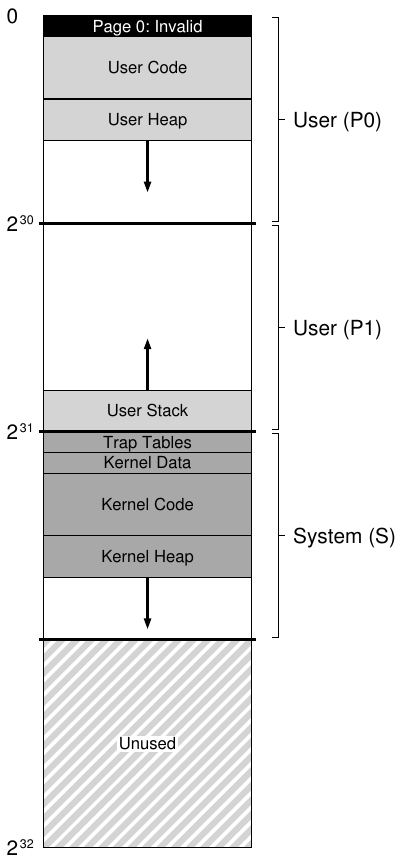

# 23 Virtual Memory System VAX/VMS

Trước khi kết thúc nghiên cứu về virtual memory, hãy xem kỹ một virtual memory manager đặc biệt sáng sủa và được thiết kế tốt, đó là manager trong operating system VAX/VMS [LL82]. Trong phần này, ta sẽ thảo luận hệ thống ấy để minh họa cách một số khái niệm đã trình bày ở các chương trước kết hợp trong một memory manager hoàn chỉnh.

## 23.1 Bối cảnh

Kiến trúc minicomputer VAX-11 được Digital Equipment Corporation (DEC) giới thiệu vào cuối những năm 1970. DEC là một thế lực lớn trong ngành máy tính thời mini-computer; đáng tiếc, hàng loạt quyết định sai lầm cùng sự xuất hiện của PC chậm rãi (nhưng chắc chắn) dẫn đến sự suy tàn của họ [C03]. Kiến trúc này có nhiều implementation, gồm VAX-11/780 và VAX-11/750 kém mạnh hơn.

OS cho hệ thống có tên VAX/VMS (hoặc đơn giản là VMS), một trong những kiến trúc sư chính là Dave Cutler, người sau này dẫn dắt việc phát triển Windows NT của Microsoft [C93]. VMS phải giải quyết vấn đề chung là chạy trên rất nhiều máy, từ VAXen rất rẻ (đúng, đó là dạng số nhiều chính xác) đến những máy high-end cực mạnh trong cùng họ kiến trúc. Vì vậy, OS phải có các mechanism và policy hoạt động được (và hoạt động tốt) trên dải hệ thống rộng lớn này.

> MẤU CHỐT: LÀM THẾ NÀO TRÁNH LỜI NGUYỀN CỦA TÍNH TỔNG QUÁT
>
> Operating system thường gặp vấn đề mang tên “lời nguyền của tính tổng quát”, khi chúng được giao nhiệm vụ hỗ trợ chung cho nhiều loại application và hệ thống. Hệ quả căn bản của lời nguyền là OS khó hỗ trợ thật tốt bất kỳ cấu hình cụ thể nào. Với VMS, lời nguyền rất thực tế, vì kiến trúc VAX-11 có nhiều implementation khác nhau. Vậy làm sao xây dựng OS chạy hiệu quả trên nhiều loại hệ thống?

Một khía cạnh nữa là VMS minh họa rất tốt các đổi mới software nhằm che giấu một số khiếm khuyết vốn có của kiến trúc. Dù OS thường dựa vào hardware để tạo ra abstraction và ảo giác hiệu quả, đôi khi người thiết kế hardware không làm đúng mọi thứ; ta sẽ thấy vài ví dụ trong hardware VAX, cùng cách operating system VMS xây dựng một hệ thống hiệu quả và vận hành được bất chấp những khiếm khuyết này.

## 23.2 Hardware quản lý memory

VAX-11 cung cấp virtual address space 32-bit cho mỗi process, chia thành các page 512-byte. Vì vậy, một virtual address gồm VPN 23-bit và offset 9-bit. Ngoài ra, hai bit cao nhất của VPN phân biệt segment chứa page; do đó, hệ thống kết hợp paging và segmentation như ta đã thấy trước đây.

Phần lower-half của address space được gọi là “process space” và riêng biệt cho mỗi process. Nửa đầu process space (gọi là P0) chứa user program cùng heap tăng trưởng xuống dưới. Nửa sau process space (P1) chứa stack tăng trưởng lên trên. Phần upper-half của address space gọi là system space (S), dù chỉ một nửa được dùng. Code và data được bảo vệ của OS nằm ở đây, nhờ đó OS được chia sẻ giữa các process.

Một mối lo lớn của người thiết kế VMS là page trong hardware VAX nhỏ đến khó tin (512 byte). Kích thước này được chọn vì lý do lịch sử, có vấn đề căn bản là khiến linear page table đơn giản trở nên quá lớn. Vì vậy, một trong những mục tiêu đầu tiên của họ là bảo đảm VMS không để page table lấn át memory.

Hệ thống giảm áp lực page table đặt lên memory theo hai cách. Thứ nhất, bằng cách chia user address space thành hai segment, VAX-11 cung cấp một page table cho mỗi vùng (P0 và P1) của mỗi process; nhờ đó không cần không gian page-table cho phần address space không dùng giữa stack và heap. Base và bounds register được dùng như bạn dự kiến; base register giữ address của page table cho segment đó, còn bounds giữ kích thước của nó (tức số entry page-table).

Thứ hai, OS giảm thêm áp lực memory bằng cách đặt user page table (cho P0 và P1, tức hai bảng mỗi process) trong kernel virtual memory. Vì vậy, khi cấp phát hoặc mở rộng page table, kernel cấp phát không gian từ virtual memory của chính nó trong segment S. Nếu memory chịu áp lực nghiêm trọng, kernel có thể swap các page chứa những page table này xuống disk, giải phóng physical memory cho mục đích khác.

Đặt page table trong kernel virtual memory khiến address translation phức tạp hơn nữa. Chẳng hạn, để chuyển đổi virtual address trong P0 hoặc P1, trước hết hardware phải thử tra cứu entry page-table cho page đó trong page table tương ứng (page table P0 hoặc P1 của process); tuy nhiên, để làm vậy, có thể hardware phải tham khảo system page table trước (nằm trong physical memory); hoàn thành translation này, hardware biết address của page chứa page table, rồi cuối cùng biết address của memory access mong muốn. May mắn là toàn bộ quá trình được tăng tốc nhờ các TLB hardware-managed của VAX, thường (hy vọng vậy) tránh được việc tra cứu vất vả này.



Hình 23.1: Address Space của VAX/VMS

## 23.3 Một Address Space thực tế

Một điểm hay khi nghiên cứu VMS là ta thấy cách một address space thực tế được xây dựng (Hình 23.1. Đến đây, ta đã giả định address space đơn giản chỉ có user code, user data và user heap, nhưng như thấy ở trên, address space thực tế phức tạp hơn đáng kể.

> BỔ SUNG: VÌ SAO TRUY CẬP NULL POINTER GÂY SEG FAULT
>
> Giờ bạn hẳn đã hiểu rõ chính xác chuyện gì xảy ra khi dereference null-pointer. Một process tạo virtual address 0 bằng cách làm tương tự như sau:
>
> ```
> int *p = NULL; // set p = 0
> *p = 10;       // try to store value 10 to virtual address 0
> ```
>
> Hardware cố tra cứu VPN (ở đây cũng là 0) trong TLB và gặp TLB miss. Page table được tham khảo, và entry cho VPN 0 được đánh dấu invalid. Như vậy ta có truy cập invalid, chuyển quyền điều khiển sang OS, rất có thể OS sẽ chấm dứt process (trên UNIX, process được gửi signal cho phép chúng phản ứng với fault như vậy; tuy nhiên, nếu không bắt signal, process bị kill).

Chẳng hạn, code segment không bao giờ bắt đầu tại page 0. Thay vào đó, page này được đánh dấu không thể truy cập, nhằm phần nào hỗ trợ phát hiện truy cập null-pointer. Vì vậy, hỗ trợ debugging là một mối quan tâm khi thiết kế address space, và zero page không thể truy cập cung cấp một dạng hỗ trợ ở đây.

Có lẽ quan trọng hơn, kernel virtual address space (tức data structure và code của nó) là một phần trong mỗi user address space. Khi context switch, OS thay đổi các register P0 và P1 để trỏ đến page table thích hợp của process soon-to-be-run; tuy nhiên, nó không thay đổi base và bound register S, nên các cấu trúc kernel “giống nhau” được map vào mỗi user address space.

Kernel được map vào mỗi address space vì nhiều lý do. Cách tổ chức này giúp kernel làm việc dễ hơn; chẳng hạn khi OS nhận pointer từ user program (ví dụ qua system call write()), nó dễ dàng copy dữ liệu từ pointer đó sang các cấu trúc của mình. OS được viết và compile một cách tự nhiên, không phải lo dữ liệu nó truy cập đến từ đâu. Ngược lại, nếu kernel hoàn toàn nằm trong physical memory, những việc như swap page chứa page table xuống disk sẽ rất khó; nếu kernel có address space riêng, chuyển dữ liệu giữa user application và kernel cũng lại phức tạp và khổ sở. Với cách tổ chức này (hiện được dùng rộng rãi), kernel gần giống một library đối với application, dù là library được bảo vệ.

Điểm cuối về address space này liên quan đến protection. Rõ ràng OS không muốn user application đọc hay ghi data hoặc code của OS. Vì vậy, hardware phải hỗ trợ các protection level khác nhau cho page. VAX thực hiện bằng cách chỉ định trong protection bit của page table privilege level mà CPU phải có để truy cập một page cụ thể. Do đó, system data và code có mức bảo vệ cao hơn user data và code; cố truy cập thông tin ấy từ user code sẽ tạo trap vào OS, và (bạn đoán đúng rồi) nhiều khả năng chấm dứt process vi phạm.

## 23.4 Page Replacement

Page table entry (PTE) trong VAX chứa các bit sau: valid bit, protection field (4 bit), modify (hay dirty) bit, field dành cho OS (5 bit), và cuối cùng physical frame number (PFN) lưu vị trí của page trong physical memory. Bạn đọc tinh ý có thể nhận ra: không có reference bit! Vì vậy, replacement algorithm của VMS phải xoay xở mà không có hardware hỗ trợ xác định page nào đang hoạt động.

Các nhà phát triển cũng lo ngại memory hog, những program dùng nhiều memory và khiến program khác khó chạy. Phần lớn policy ta đã xem đều dễ bị kiểu chiếm dụng này; chẳng hạn LRU là global policy không chia sẻ memory công bằng giữa các process.

### Segmented FIFO

Để giải quyết hai vấn đề này, họ nghĩ ra replacement policy segmented FIFO [RL81]. Ý tưởng đơn giản: mỗi process có số page tối đa được giữ trong memory, gọi là resident set size (RSS). Mỗi page được giữ trên FIFO list; khi process vượt RSS, page “first-in” bị evict. FIFO rõ ràng không cần hardware hỗ trợ nên dễ triển khai.

Dĩ nhiên, FIFO thuần túy không hoạt động thật tốt, như ta đã thấy. Để cải thiện hiệu năng FIFO, VMS bổ sung hai list second-chance chứa page trước khi evict chúng khỏi memory, cụ thể là global clean-page free list và dirty-page list. Khi process P vượt RSS, một page được lấy khỏi FIFO per-process của nó; nếu clean (chưa sửa đổi), nó được đặt vào cuối clean-page list; nếu dirty (đã sửa đổi), nó được đặt vào cuối dirty-page list.

Nếu process Q khác cần free page, nó lấy free page đầu tiên khỏi global clean list. Tuy nhiên, nếu process P ban đầu gặp fault với page đó trước khi nó được tái sử dụng, P lấy lại page từ free list (hoặc dirty list), tránh được disk access tốn kém. Các global list second-chance càng lớn, hiệu năng segmented FIFO càng gần LRU [RL81].

### Page Clustering

Một tối ưu khác trong VMS cũng khắc phục kích thước page nhỏ của VMS. Cụ thể, với page nhỏ như vậy, disk I/O khi swapping có thể rất kém hiệu quả, vì disk hoạt động tốt hơn với những lần truyền lớn. Để swapping I/O hiệu quả hơn, VMS thêm nhiều tối ưu, quan trọng nhất là clustering. Với clustering, VMS gom nhiều page thành các nhóm lớn từ global dirty list, rồi ghi tất cả xuống disk một lượt (khiến chúng thành clean). Clustering được dùng trong phần lớn hệ thống hiện đại, vì tự do đặt page ở bất kỳ đâu trong swap space cho phép OS gom page, thực hiện ít lần ghi hơn nhưng lớn hơn, nhờ đó cải thiện hiệu năng.

> BỔ SUNG: MÔ PHỎNG REFERENCE BIT
>
> Hóa ra bạn không cần hardware reference bit để phần nào biết page nào đang được dùng trong hệ thống. Thực tế, đầu những năm 1980, Babaoglu và Joy cho thấy có thể dùng protection bit trên VAX để mô phỏng reference bit [BJ81]. Ý tưởng cơ bản: nếu muốn biết phần nào page đang được dùng tích cực, hãy đánh dấu mọi page trong page table là không thể truy cập (nhưng giữ lại thông tin về page mà process thực sự được phép truy cập, có thể trong phần “reserved OS field” của page table entry). Khi process truy cập page, nó tạo trap vào OS; OS kiểm tra xem page có thực sự nên được phép truy cập hay không, và nếu có thì khôi phục protection bình thường (chẳng hạn read-only hoặc read-write). Khi replacement, OS kiểm tra page nào còn được đánh dấu không thể truy cập, nhờ đó biết phần nào page nào chưa được dùng gần đây.
>
> Chìa khóa của cách “mô phỏng” reference bit này là giảm overhead mà vẫn nắm được tình hình sử dụng page. OS không được đánh dấu page không thể truy cập quá mạnh tay, nếu không overhead quá cao. OS cũng không được quá thụ động, nếu không mọi page cuối cùng đều được tham chiếu; OS lại không biết nên evict page nào.

## 23.5 Những thủ thuật VM thú vị khác

VMS có hai thủ thuật now-standard khác: demand zeroing và copy-on-write. Giờ ta mô tả những tối ưu trì hoãn này.

Một dạng trì hoãn trong VMS (và phần lớn hệ thống hiện đại) là demand zeroing các page. Để hiểu rõ hơn, xét ví dụ thêm page vào address space, chẳng hạn heap của bạn. Trong implementation ngây thơ, OS đáp ứng yêu cầu thêm page vào heap bằng cách tìm page trong physical memory, điền zero vào đó (cần cho bảo mật; nếu không bạn có thể thấy nội dung page từ khi process khác dùng nó!), rồi map vào address space của bạn (tức thiết lập page table tham chiếu physical page đó như mong muốn). Nhưng implementation ngây thơ này có thể tốn kém, nhất là nếu process không dùng page.

Với demand zeroing, thay vào đó OS làm rất ít việc khi page được thêm vào address space; nó đặt entry trong page table đánh dấu page không thể truy cập. Nếu process sau đó đọc hay ghi page, trap vào OS xảy ra. Khi xử lý trap, OS nhận ra (thường qua vài bit đánh dấu trong phần “reserved for OS” của page table entry) đây thực ra là page demand-zero; lúc này OS mới tìm physical page, điền zero và map nó vào address space của process. Nếu process không bao giờ truy cập page, toàn bộ công việc này được tránh, đó là ưu điểm của demand zeroing.

> MẸO: HÃY LƯỜI BIẾNG
>
> Lười biếng có thể là đức tính tốt cả trong cuộc sống lẫn operating system. Lười biếng trì hoãn công việc đến sau, có ích trong OS vì nhiều lý do. Thứ nhất, trì hoãn có thể giảm latency của thao tác hiện tại, cải thiện khả năng phản hồi; chẳng hạn operating system thường báo ngay rằng ghi file thành công, rồi chỉ ghi xuống disk sau trong background. Thứ hai, quan trọng hơn, đôi khi trì hoãn giúp khỏi phải làm công việc đó; chẳng hạn trì hoãn một lần ghi cho đến khi file bị xóa loại bỏ hoàn toàn nhu cầu ghi. Lười biếng cũng có ích trong cuộc sống: ví dụ trì hoãn project OS, bạn có thể thấy các bạn cùng lớp đã xử lý lỗi trong đặc tả project; tuy nhiên project khó bị hủy, nên quá lười có thể gây vấn đề, khiến project trễ, điểm kém và giáo sư buồn. Đừng làm giáo sư buồn!

Một tối ưu hay khác trong VMS (và một lần nữa, gần như mọi OS hiện đại) là copy-on-write (viết tắt COW). Ý tưởng có từ ít nhất thời operating system TENEX [BB+72] rất đơn giản: khi OS cần copy page từ address space này sang address space khác, thay vì copy, nó có thể map page vào address space đích và đánh dấu read-only trong cả hai address space. Nếu cả hai chỉ đọc page, không cần làm gì thêm, nên OS đã thực hiện copy nhanh mà không thực sự chuyển dữ liệu nào.

Tuy nhiên, nếu một address space thực sự cố ghi vào page, nó sẽ trap vào OS. OS nhận ra đây là COW page, nên (theo cách trì hoãn) cấp phát page mới, điền dữ liệu vào đó rồi map page mới vào address space của process gây fault. Process tiếp tục và giờ có bản copy riêng của page.

COW hữu ích vì nhiều lý do. Chắc chắn mọi dạng shared library đều có thể được map copy-on-write vào address space của nhiều process, tiết kiệm memory quý giá. Trong UNIX, COW còn quan trọng hơn do semantics của fork() và exec(). Bạn có thể nhớ fork() tạo bản copy chính xác address space của bên gọi; với address space lớn, copy như vậy chậm và tốn nhiều dữ liệu. Tệ hơn, phần lớn address space lập tức bị over-written bởi lời gọi exec() tiếp theo, thay thế address space của process gọi bằng address space của program soon-to-be-exec’d. Bằng cách thực hiện fork() copy-on-write, OS tránh nhiều thao tác copy vô ích, giữ semantics đúng đồng thời cải thiện hiệu năng.

## 23.6 Tổng kết

Bạn vừa xem xét top-to-bottom toàn bộ một virtual memory system. Hy vọng phần lớn chi tiết dễ theo dõi, vì bạn đã hiểu rõ phần lớn mechanism và policy cơ bản. Có thêm chi tiết trong bài báo xuất sắc (và ngắn) của Levy và Lipman [LL82]; ta khuyến khích bạn đọc, một cách rất hay để biết tài liệu nguồn đứng sau những chương này như thế nào.

Bạn cũng nên tìm hiểu các kỹ thuật hiện đại bằng cách đọc về Linux và những hệ thống hiện đại khác khi có thể. Có nhiều tài liệu nguồn, gồm một số sách khá tốt [BC05]. Một điều sẽ khiến bạn ngạc nhiên: những ý tưởng kinh điển trong bài báo cũ như bài VAX/VMS này vẫn ảnh hưởng cách xây dựng operating system hiện đại.

## Tài liệu tham khảo

[BB+72] “TENEX, A Paged Time Sharing System for the PDP-10”

Daniel G. Bobrow, Jerry D. Burchfiel, Daniel L. Murphy, Raymond S. Tomlinson

Communications of the ACM, Volume 15, March 1972

Một OS time-sharing thời kỳ đầu, nơi xuất phát nhiều ý tưởng hay. Copy-on-write chỉ là một trong số đó; cảm hứng cho nhiều khía cạnh khác của hệ thống hiện đại, gồm process management, virtual memory và file system, đều có ở đây.

[BJ81] “Converting a Swap-Based System to do Paging in an Architecture Lacking Page-Reference Bits”

Ozalp Babaoglu and William N. Joy

SOSP ’81, Pacific Grove, California, December 1981

Bài báo với ý tưởng thông minh về khai thác cơ chế protection sẵn có trong máy để mô phỏng reference bit. Ý tưởng đến từ nhóm Berkeley làm phiên bản UNIX riêng, gọi là Berkeley Systems Distribution, hay BSD. Nhóm có ảnh hưởng lớn đến sự phát triển UNIX, về virtual memory, file system và networking.

[BC05] “Understanding the Linux Kernel (Third Edition)”

Daniel P. Bovet and Marco Cesati

O’Reilly Media, November 2005

Một trong nhiều sách bạn có thể tìm về Linux. Chúng nhanh lỗi thời, nhưng nhiều kiến thức cơ bản vẫn tồn tại và đáng đọc.

[C03] “The Innovator’s Dilemma”

Clayton M. Christenson

Harper Paperbacks, January 2003

Cuốn sách tuyệt vời về ngành disk-drive và cách đổi mới mới phá vỡ những thứ đang tồn tại. Đáng đọc cho cả người học kinh doanh lẫn nhà khoa học máy tính. Giúp hiểu vì sao những công ty lớn và thành công có thể thất bại hoàn toàn.

[C93] “Inside Windows NT”

Helen Custer and David Solomon

Microsoft Press, 1993

Cuốn sách về Windows NT giải thích hệ thống từ đầu đến cuối, chi tiết hơn mức bạn có thể thích. Nhưng nghiêm túc mà nói, đây là sách khá hay.

[LL82] “Virtual Memory Management in the VAX/VMS Operating System”

Henry M. Levy, Peter H. Lipman

IEEE Computer, Volume 15, Number 3 (March 1982) Hãy đọc nguồn gốc của phần lớn tài liệu này; bài viết ngắn gọn và dễ đọc. Đặc biệt quan trọng nếu bạn muốn học cao học, nơi bạn chỉ đọc bài báo, làm việc, đọc thêm bài báo, làm thêm việc, cuối cùng viết một bài báo, rồi lại làm việc. Nhưng rất vui!

[RL81] “Segmented FIFO Page Replacement”

Rollins Turner and Henry Levy

SIGMETRICS ’81, Las Vegas, Nevada, September 1981

Bài báo ngắn cho thấy với một số workload, segmented FIFO có thể đạt gần hiệu năng LRU.
