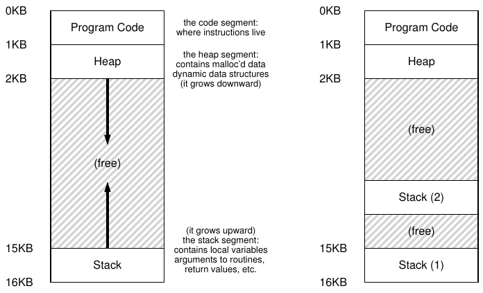

# 26 Concurrency: Giới thiệu

Cho đến nay, chúng ta đã tìm hiểu sự phát triển của những abstraction cơ bản mà OS thực hiện. Chúng ta đã thấy cách biến một CPU vật lý thành nhiều CPU ảo, tạo ra ảo giác nhiều chương trình đang chạy đồng thời. Chúng ta cũng đã thấy cách tạo ra ảo giác mỗi process có một virtual memory lớn và riêng tư; abstraction address space này cho phép mỗi chương trình hành xử như thể có memory riêng, trong khi OS thực ra đang âm thầm multiplex các address space trên physical memory (và đôi khi trên disk).

Trong phần này, chúng ta giới thiệu một abstraction mới cho một process đang chạy: thread. Thay cho cách nhìn truyền thống rằng chương trình có một điểm thực thi duy nhất (tức một PC duy nhất để fetch và thực thi instruction), chương trình multi-threaded có nhiều điểm thực thi (tức nhiều PC, mỗi PC xác định nơi fetch và thực thi). Một cách nghĩ khác là mỗi thread rất giống một process riêng biệt, ngoại trừ một điểm: chúng chia sẻ cùng address space nên có thể truy cập cùng dữ liệu.

Vì vậy, state của một thread rất giống state của process. Nó có program counter (PC) theo dõi nơi chương trình đang fetch instruction. Mỗi thread có bộ register riêng để tính toán; do đó, nếu hai thread chạy trên một processor, khi chuyển từ thread này (T1) sang thread kia (T2), phải thực hiện context switch. Context switch giữa các thread khá giống context switch giữa các process: phải lưu register state của T1 và khôi phục register state của T2 trước khi chạy T2. Với process, chúng ta lưu state vào process control block (PCB); giờ chúng ta cần một hoặc nhiều thread control block (TCBs) để lưu state của từng thread trong process. Tuy nhiên, có một khác biệt lớn giữa context switch của thread và process: address space vẫn như cũ (tức không cần thay đổi page table đang dùng).

Một khác biệt lớn khác giữa thread và process liên quan đến stack. Trong mô hình address space đơn giản của process truyền thống (giờ có thể gọi là process single-threaded), chỉ có một stack, thường nằm ở cuối address space (Hình 26.1, bên trái).



Hình 26.1: Address Space Single-Threaded và Multi-Threaded

Tuy nhiên, trong process multi-threaded, mỗi thread chạy độc lập và tất nhiên có thể gọi nhiều routine để thực hiện công việc của mình. Thay vì một stack duy nhất trong address space, mỗi thread có một stack. Giả sử chúng ta có process multi-threaded chứa hai thread; address space thu được sẽ khác (Hình 26.1, bên phải).

Trong hình, bạn thấy hai stack phân bố trong address space của process. Do đó, mọi biến stack-allocated, parameter, return value và những thứ khác chúng ta đặt trên stack sẽ nằm trong vùng đôi khi được gọi là thread-local storage, tức stack của thread tương ứng.

Bạn cũng có thể nhận thấy điều này phá vỡ cách bố trí address space đẹp đẽ của chúng ta. Trước đây, stack và heap có thể tăng độc lập và chỉ gặp vấn đề khi hết chỗ trong address space. Ở đây, chúng ta không còn tình huống thuận lợi đó. May thay, điều này thường không sao, vì stack nói chung không cần quá lớn (ngoại lệ là các chương trình sử dụng recursion nhiều).

## 26.1 Ví dụ: Tạo thread

Giả sử chúng ta muốn chạy một chương trình tạo hai thread, mỗi thread làm việc độc lập, trong trường hợp này là in “A” hoặc “B”. Code nằm trong Hình 26.2.

Chương trình main tạo hai thread, mỗi thread chạy hàm mythread(), nhưng với argument khác nhau (chuỗi A hoặc B). Khi được tạo, thread có thể chạy ngay (tùy quyết định của scheduler); hoặc nó có thể được đặt ở state “ready” nhưng chưa “running”, do đó chưa chạy. Sau khi tạo hai thread (T1 và T2), main thread gọi pthread_join(), hàm chờ một thread cụ thể hoàn tất.

```
 1   #include <stdio.h>
 2   #include <assert.h>
 3   #include <pthread.h>
 4
 5   void *mythread(void *arg) {
 6       printf("%s\n", (char *) arg);
 7       return NULL;
 8   }
 9
10   int
11   main(int argc, char *argv[]) {
12       pthread_t p1, p2;
13       int rc;
14       printf("main: begin\n");
15       rc = pthread_create(&p1, NULL, mythread, "A"); assert(rc == 0);
16       rc = pthread_create(&p2, NULL, mythread, "B"); assert(rc == 0);
17       // join waits for the threads to finish
18       rc = pthread_join(p1, NULL); assert(rc == 0);
19       rc = pthread_join(p2, NULL); assert(rc == 0);
20       printf("main: end\n");
21       return 0;
22   }
```

Hình 26.2: Code tạo thread đơn giản (t0.c)

Hãy xem xét các thứ tự thực thi có thể có của chương trình nhỏ này. Trong sơ đồ thực thi (Hình 26.3, trang 4), thời gian tăng theo chiều từ trên xuống, và mỗi cột cho biết lúc một thread khác nhau (main, Thread 1 hoặc Thread 2) đang chạy.

Tuy nhiên, lưu ý đây không phải thứ tự duy nhất có thể xảy ra. Thực ra, với một chuỗi instruction, có khá nhiều thứ tự, tùy thread mà scheduler chọn chạy tại mỗi thời điểm. Chẳng hạn, ngay khi được tạo, thread có thể chạy lập tức, dẫn đến cách thực thi trong Hình 26.4 (trang 4).

Chúng ta thậm chí có thể thấy “B” được in trước “A”, chẳng hạn nếu scheduler chọn chạy Thread 2 trước dù Thread 1 được tạo sớm hơn; không có lý do gì để giả định thread được tạo trước sẽ chạy trước. Hình 26.5 (trang 4) minh họa thứ tự thực thi cuối cùng này, trong đó Thread 2 được thể hiện mình trước Thread 1.

Như bạn có thể thấy, một cách nghĩ về việc tạo thread là nó hơi giống gọi hàm; tuy nhiên, thay vì thực thi hàm trước rồi quay lại caller, hệ thống tạo một thread thực thi mới cho routine được gọi, và thread đó chạy độc lập với caller, có thể trước khi lời gọi create trả về, nhưng cũng có thể muộn hơn nhiều.

Ví dụ này cũng cho thấy thread khiến mọi thứ phức tạp hơn: chỉ việc xác định cái gì chạy khi nào đã khó! Máy tính vốn đã đủ khó hiểu khi chưa có concurrency. Thật không may, concurrency khiến điều đó tệ hơn. Tệ hơn nhiều.

| main | Thread 1 | Thread2 |
|---|---|---|
| bắt đầu chạy |  |  |
| in “main: begin” |  |  |
| tạo Thread 1 |  |  |
| tạo Thread 2 |  |  |
| chờ T1 |  |  |
|  | chạy |  |
|  | in “A” |  |
|  | trả về |  |
| chờ T2 |  |  |
|  |  | chạy |
|  |  | in “B” |
|  |  | trả về |
| in “main: end” |  |  |

Hình 26.3: Thread Trace (1)

| main | Thread 1 | Thread2 |
|---|---|---|
| bắt đầu chạy |  |  |
| in “main: begin” |  |  |
| tạo Thread 1 |  |  |
|  | chạy |  |
|  | in “A” |  |
|  | trả về |  |
| tạo Thread 2 |  |  |
|  |  | chạy |
|  |  | in “B” |
|  |  | trả về |
| chờ T1 |  |  |
| trả về ngay; T1 đã hoàn tất |  |  |
| chờ T2 |  |  |
| trả về ngay; T2 đã hoàn tất |  |  |
| in “main: end” |  |  |

Hình 26.4: Thread Trace (2)

| main | Thread 1 | Thread2 |
|---|---|---|
| bắt đầu chạy |  |  |
| in “main: begin” |  |  |
| tạo Thread 1 |  |  |
| tạo Thread 2 |  |  |
|  |  | chạy |
|  |  | in “B” |
|  |  | trả về |
| chờ T1 |  |  |
|  | chạy |  |
|  | in “A” |  |
|  | trả về |  |
| chờ T2 |  |  |
| trả về ngay; T2 đã hoàn tất |  |  |
| in “main: end” |  |  |

Hình 26.5: Thread Trace (3)

```
 1   #include <stdio.h>
 2   #include <pthread.h>
 3   #include "mythreads.h"
 4
 5   static volatile int counter = 0;
 6
 7   //
 8   // mythread()
 9   //
10   // Simply adds 1 to counter repeatedly, in a loop
11   // No, this is not how you would add 10,000,000 to
12   // a counter, but it shows the problem nicely.
13   //
14   void *
15   mythread(void *arg)
16   {
17       printf("%s: begin\n", (char *) arg);
18       int i;
19       for (i = 0; i < 1e7; i++) {
20           counter = counter + 1;
21       }
22       printf("%s: done\n", (char *) arg);
23       return NULL;
24   }
25
26   //
27   // main()
28   //
29   // Just launches two threads (pthread_create)
30   // and then waits for them (pthread_join)
31   //
32   int
33   main(int argc, char *argv[])
34   {
35       pthread_t p1, p2;
36       printf("main: begin (counter = %d)\n", counter);
37       Pthread_create(&p1, NULL, mythread, "A");
38       Pthread_create(&p2, NULL, mythread, "B");
39
40       // join waits for the threads to finish
41       Pthread_join(p1, NULL);
42       Pthread_join(p2, NULL);
43       printf("main: done with both (counter = %d)\n", counter);
44       return 0;
45   }
```

Hình 26.6: Chia sẻ dữ liệu: Ôi không (t1.c)

## 26.2 Tại sao tệ hơn: Shared Data

Ví dụ thread đơn giản ở trên hữu ích để minh họa cách tạo thread và cách chúng chạy theo những thứ tự khác nhau tùy quyết định của scheduler. Tuy nhiên, nó chưa cho thấy cách các thread tương tác khi truy cập shared data.

Hãy tưởng tượng một ví dụ đơn giản, trong đó hai thread muốn cập nhật một global shared variable. Code chúng ta nghiên cứu nằm trong Hình 26.6.

Có vài lưu ý về code. Trước tiên, theo đề xuất của Stevens [SR05], chúng ta bọc các routine tạo và join thread để đơn giản là thoát khi thất bại; với chương trình đơn giản như thế này, chúng ta muốn ít nhất nhận biết lỗi xảy ra (nếu có), nhưng không xử lý cầu kỳ (ví dụ chỉ thoát). Vì vậy, Pthread_create() chỉ gọi pthread_create() và bảo đảm return code bằng 0; nếu không, Pthread_create() in thông báo rồi thoát.

Thứ hai, thay vì dùng hai thân hàm riêng cho các worker thread, chúng ta dùng chung một đoạn code và truyền cho thread một argument (ở đây là chuỗi), để mỗi thread in một chữ cái khác nhau trước các thông báo của nó.

Cuối cùng, và quan trọng nhất, giờ chúng ta có thể xem mỗi worker đang cố làm gì: cộng một số vào shared variable counter, thực hiện 10 triệu lần (1e7) trong loop. Do đó, kết quả cuối cùng mong muốn là: 20,000,000.

Giờ chúng ta compile và chạy chương trình để xem nó hoạt động thế nào. Đôi khi, mọi thứ đúng như mong đợi:

```
prompt> gcc -o main main.c -Wall -pthread
prompt> ./main
main: begin (counter = 0)
A: begin
B: begin
A: done
B: done
main: done with both (counter = 20000000)
```

Thật không may, khi chạy code này, ngay cả trên một processor duy nhất, chúng ta không nhất thiết nhận được kết quả mong muốn. Đôi khi, kết quả là:

```
prompt> ./main
main: begin (counter = 0)
A: begin
B: begin
A: done
B: done
main: done with both (counter = 19345221)
```

Hãy thử thêm lần nữa, xem có phải chúng ta phát điên không. Rốt cuộc, chẳng phải máy tính phải cho kết quả deterministic như bạn đã được dạy sao?! Có lẽ các giáo sư đã nói dối bạn? (há hốc)

```
prompt> ./main
main: begin (counter = 0)
A: begin
B: begin
A: done
B: done
main: done with both (counter = 19221041)
```

Mỗi lần chạy không chỉ sai mà còn cho kết quả khác nhau! Một câu hỏi lớn vẫn còn: tại sao điều này xảy ra?

> MẸO: HIỂU VÀ SỬ DỤNG CÔNG CỤ CỦA BẠN
>
> Bạn nên luôn học những công cụ mới giúp viết, debug và hiểu hệ thống máy tính. Ở đây, chúng ta dùng công cụ hay gọi là disassembler. Khi chạy disassembler trên executable, nó cho biết những assembly instruction tạo nên chương trình. Chẳng hạn, nếu muốn hiểu code low-level để cập nhật counter (như ví dụ của chúng ta), chúng ta chạy objdump (Linux) để xem code assembly:
>
> ```
> prompt> objdump -d main
> ```
>
> Thao tác này tạo danh sách dài mọi instruction trong chương trình, được gắn nhãn rõ ràng (đặc biệt nếu compile với flag -g), bao gồm thông tin symbol trong chương trình. Chương trình objdump chỉ là một trong nhiều công cụ bạn nên học; debugger như gdb, memory profiler như valgrind hoặc purify, và tất nhiên bản thân compiler cũng là những công cụ bạn nên dành thời gian tìm hiểu; càng giỏi sử dụng công cụ, bạn càng xây dựng được hệ thống tốt hơn.

## 26.3 Cốt lõi của vấn đề: Scheduling không được kiểm soát

Để hiểu tại sao điều này xảy ra, chúng ta phải hiểu chuỗi code mà compiler sinh ra để cập nhật counter. Trong trường hợp này, chúng ta chỉ muốn cộng một số (1) vào counter. Vì vậy, chuỗi code thực hiện có thể giống như sau (trong x86);

```
mov 0x8049a1c, %eax
add $0x1, %eax
mov %eax, 0x8049a1c
```

Ví dụ này giả định biến counter nằm tại address 0x8049a1c. Trong chuỗi three-instruction này, instruction mov của x86 trước tiên lấy giá trị memory tại address đó và đưa vào register eax. Sau đó thực hiện add, cộng 1 (0x1) vào nội dung register eax, và cuối cùng lưu nội dung eax trở lại memory tại cùng address.

Hãy tưởng tượng một trong hai thread (Thread 1) đi vào vùng code này, chuẩn bị tăng counter thêm một. Nó load giá trị counter (giả sử ban đầu là 50) vào register eax của mình. Do đó, eax=50 đối với Thread 1. Sau đó nó cộng một vào register, nên eax=51. Lúc này, điều không may xảy ra: timer interrupt phát sinh; OS lưu state của thread đang chạy (PC, các register gồm eax, v.v.) vào TCB của thread.

Giờ điều tệ hơn xảy ra: Thread 2 được chọn chạy và đi vào cùng đoạn code. Nó cũng thực thi instruction đầu tiên, lấy giá trị counter và đưa vào eax của mình (hãy nhớ: khi chạy, mỗi thread có register riêng; các register được virtualize bởi code context-switch lưu và khôi phục chúng). Lúc này counter vẫn là 50, nên Thread 2 có eax=50. Tiếp theo, giả sử Thread 2 thực thi hai instruction kế tiếp, tăng eax thêm 1 (thành eax=51), rồi lưu nội dung eax vào counter (address 0x8049a1c). Vì vậy global variable counter giờ có giá trị 51.

|  |  |  | (sau instruction) |  |  |
|---|---|---|---|---|---|
| OS | Thread 1 | Thread 2 | PC | %eax | counter |
|  | trước critical section |  | 100 | 0 | 50 |
|  | mov 0x8049a1c, %eax |  | 105 | 50 | 50 |
|  | add $0x1, %eax |  | 108 | 51 | 50 |
| interrupt |  |  |  |  |  |
| lưu state của T1 |  |  |  |  |  |
| khôi phục state của T2 |  |  | 100 | 0 | 50 |
|  |  | mov 0x8049a1c, %eax | 105 | 50 | 50 |
|  |  | add $0x1, %eax | 108 | 51 | 50 |
|  |  | mov %eax, 0x8049a1c | 113 | 51 | 51 |
| interrupt |  |  |  |  |  |
| lưu state của T2 |  |  |  |  |  |
| khôi phục state của T1 |  |  | 108 | 51 | 51 |
|  | mov %eax, 0x8049a1c |  | 113 | 51 | 51 |

Hình 26.7: Vấn đề: Nhìn thật gần

Cuối cùng, một context switch khác xảy ra và Thread 1 tiếp tục chạy. Nhớ rằng nó vừa thực thi mov và add, và chuẩn bị thực hiện instruction mov cuối cùng. Cũng nhớ rằng eax=51. Do đó, instruction mov cuối cùng thực thi và lưu giá trị vào memory; counter lại được đặt bằng 51.

Nói đơn giản, chuyện xảy ra là: code tăng counter đã chạy hai lần, nhưng counter, vốn bắt đầu từ 50, giờ chỉ bằng 51. Phiên bản “đúng” của chương trình này phải khiến biến counter bằng 52.

Hãy xem execution trace chi tiết để hiểu rõ hơn. Trong ví dụ này, giả sử code ở trên được load tại address 100 trong memory, như chuỗi sau (lưu ý với những bạn quen instruction set RISC-like đẹp đẽ: x86 có instruction variable-length; instruction mov này chiếm 5 byte memory, còn add chỉ chiếm 3):

```
100 mov    0x8049a1c, %eax
105 add    $0x1, %eax
108 mov    %eax, 0x8049a1c
```

Với những giả định đó, diễn biến được minh họa trong Hình 26.7. Giả sử counter bắt đầu bằng 50 và lần theo ví dụ để bảo đảm bạn hiểu điều đang xảy ra.

Điều chúng ta vừa minh họa được gọi là race condition: kết quả phụ thuộc vào thời điểm thực thi code. Nếu không may (tức context switch xảy ra ở những thời điểm không thích hợp trong quá trình thực thi), chúng ta nhận kết quả sai. Thực ra mỗi lần có thể nhận kết quả khác nhau; do đó, thay vì phép tính deterministic như thường thấy ở máy tính, chúng ta gọi kết quả này là indeterminate: không biết trước output sẽ là gì và rất có thể nó khác nhau giữa các lần chạy.

Vì nhiều thread thực thi code này có thể dẫn đến race condition, chúng ta gọi đoạn code này là critical section. Critical section là đoạn code truy cập shared variable (hoặc tổng quát hơn là shared resource) và không được có nhiều hơn một thread thực thi đồng thời.

Điều chúng ta thực sự muốn cho code này được gọi là mutual exclusion. Thuộc tính này bảo đảm nếu một thread đang thực thi trong critical section, các thread khác sẽ bị ngăn làm như vậy.

Nhân tiện, hầu như tất cả thuật ngữ này do Edsger Dijkstra đặt ra; ông là người tiên phong trong lĩnh vực và thực sự đã nhận Turing Award nhờ công trình này cùng những công trình khác; xem bài báo năm 1968 “Cooperating Sequential Processes” [D68] của ông để có mô tả cực kỳ rõ ràng về vấn đề. Chúng ta sẽ còn gặp Dijkstra nhiều hơn trong phần này của sách.

## 26.4 Mong muốn có Atomicity

Một cách giải quyết vấn đề là có instruction mạnh hơn, thực hiện đúng mọi việc cần làm trong một bước duy nhất, nhờ đó loại bỏ khả năng interrupt xảy ra không đúng lúc. Chẳng hạn, nếu chúng ta có một siêu instruction như sau thì sao?

```
memory-add 0x8049a1c, $0x1
```

Giả sử instruction này cộng một giá trị vào vị trí memory, và hardware bảo đảm nó thực thi atomically; khi thực thi, instruction sẽ cập nhật đúng mong muốn. Nó không thể bị ngắt mid-instruction, vì hardware bảo đảm chính điều đó: khi interrupt xảy ra, hoặc instruction chưa chạy chút nào, hoặc đã hoàn tất; không có state in-between. Hardware thật tuyệt, phải không?

Trong ngữ cảnh này, atomically nghĩa là “như một đơn vị”, đôi khi hiểu là “tất cả hoặc không có gì”. Chúng ta muốn thực thi atomically chuỗi ba instruction:

```
mov 0x8049a1c, %eax
add $0x1, %eax
mov %eax, 0x8049a1c
```

Như đã nói, nếu có một instruction duy nhất để làm việc này, chúng ta chỉ cần phát instruction đó là xong. Nhưng trong trường hợp tổng quát, chúng ta không có instruction như vậy. Hãy tưởng tượng đang xây dựng một B-tree concurrent và muốn cập nhật nó; liệu chúng ta thực sự muốn hardware hỗ trợ instruction “cập nhật atomic B-tree” không? Có lẽ không, ít nhất trong một instruction set hợp lý.

Vì vậy, thay vào đó, chúng ta yêu cầu hardware cung cấp vài instruction hữu ích làm nền tảng xây dựng một bộ tổng quát gọi là synchronization primitive. Sử dụng các hardware synchronization primitive này cùng sự hỗ trợ của operating system, chúng ta có thể xây dựng code multi-threaded truy cập critical section theo cách đồng bộ và có kiểm soát, nhờ đó tạo kết quả đúng một cách đáng tin cậy bất chấp khó khăn của concurrent execution. Tuyệt đấy chứ?

> BÊN LỀ: CÁC THUẬT NGỮ CONCURRENCY THEN CHỐT
>
> CRITICAL SECTION, RACE CONDITION,
>
> INDETERMINATE, MUTUAL EXCLUSION
>
> Bốn thuật ngữ này thiết yếu với concurrent code đến mức chúng tôi thấy cần nêu riêng chúng. Xem những công trình đầu tiên của Dijkstra [D65,D68] để biết thêm chi tiết.
>
> • Critical section là đoạn code truy cập shared resource, thường là biến hoặc data structure.
>
> • Race condition xuất hiện nếu nhiều thread thực thi đi vào critical section gần như cùng lúc; cả hai cố cập nhật shared data structure, dẫn đến kết quả bất ngờ (và có thể không mong muốn).
>
> • Chương trình indeterminate chứa một hoặc nhiều race condition; output thay đổi giữa các lần chạy tùy thread nào đã chạy lúc nào. Vì vậy kết quả không deterministic, điều thường được kỳ vọng ở hệ thống máy tính.
>
> • Để tránh những vấn đề này, các thread nên dùng một loại mutual exclusion primitive; điều đó bảo đảm chỉ một thread được vào critical section, tránh race và tạo output chương trình deterministic.

Đó là vấn đề chúng ta nghiên cứu trong phần này của sách. Đây là vấn đề tuyệt vời nhưng khó, có thể khiến bạn đau đầu (một chút). Nếu không thấy vậy thì bạn chưa hiểu! Hãy tiếp tục đến khi thấy đau đầu; lúc đó bạn biết mình đang đi đúng hướng. Đến lúc ấy, hãy nghỉ ngơi; chúng tôi không muốn bạn đau đầu quá nhiều.

> MẤU CHỐT:
>
> LÀM THẾ NÀO ĐỂ HỖ TRỢ SYNCHRONIZATION
>
> Chúng ta cần hardware hỗ trợ gì để xây dựng synchronization primitive hữu ích? Cần OS hỗ trợ gì? Làm sao xây dựng những primitive này đúng và hiệu quả? Chương trình có thể dùng chúng thế nào để nhận kết quả mong muốn?

## 26.5 Một vấn đề nữa: Chờ thread khác

Chương này đặt vấn đề concurrency như thể chỉ có một loại tương tác giữa các thread: truy cập shared variable và nhu cầu hỗ trợ atomicity cho critical section. Thực ra còn một tương tác phổ biến khác: một thread phải chờ thread khác hoàn tất hành động nào đó trước khi tiếp tục. Chẳng hạn, tương tác này xuất hiện khi process thực hiện disk I/O rồi được đưa vào trạng thái sleep; khi I/O hoàn tất, process cần được đánh thức để tiếp tục.

Vì vậy, trong các chương tới, chúng ta không chỉ nghiên cứu cách hỗ trợ synchronization primitive nhằm cung cấp atomicity, mà còn nghiên cứu mechanism hỗ trợ kiểu tương tác sleep/wake phổ biến trong chương trình multi-threaded. Nếu lúc này bạn chưa hiểu thì không sao! Bạn sẽ sớm hiểu khi đọc chương về condition variable. Nếu đến lúc đó vẫn chưa hiểu thì ít ổn hơn rồi, và bạn nên đọc lại chương đó (nhiều lần) đến khi hiểu.

## 26.6 Tổng kết: Tại sao trong môn OS?

Trước khi kết thúc, bạn có thể thắc mắc: tại sao chúng ta nghiên cứu điều này trong môn OS? Câu trả lời one-word là “Lịch sử”; OS là chương trình concurrent đầu tiên và nhiều kỹ thuật được tạo ra để dùng trong OS. Sau này, với process multi-threaded, lập trình viên ứng dụng cũng phải xem xét những vấn đề đó.

Chẳng hạn, tưởng tượng có hai process đang chạy. Giả sử cả hai gọi write() để ghi vào file và đều muốn append dữ liệu vào file (tức thêm dữ liệu ở cuối file, làm tăng chiều dài). Để làm vậy, cả hai phải cấp phát một block mới, ghi vào inode của file vị trí block này, và thay đổi kích thước file để phản ánh kích thước lớn hơn (cùng những việc khác; chúng ta sẽ tìm hiểu file trong phần thứ ba của sách). Vì interrupt có thể xảy ra bất kỳ lúc nào, code cập nhật những shared structure này (ví dụ bitmap cấp phát hoặc inode của file) là critical section; do đó, ngay từ khi interrupt xuất hiện, người thiết kế OS đã phải quan tâm cách OS cập nhật internal structure. Interrupt không đúng lúc gây ra tất cả vấn đề mô tả ở trên. Không ngạc nhiên khi page table, process list, file system structure và hầu như mọi kernel data structure đều phải được truy cập cẩn thận với synchronization primitive thích hợp để hoạt động đúng.

> MẸO: SỬ DỤNG ATOMIC OPERATION
>
> Atomic operation là một trong những kỹ thuật nền tảng mạnh nhất khi xây dựng hệ thống máy tính, từ computer architecture đến concurrent code (đang nghiên cứu ở đây), file system (sắp nghiên cứu), database management system và cả distributed system [L+93].
>
> Ý tưởng biến một chuỗi hành động thành atomic được diễn tả đơn giản bằng “tất cả hoặc không có gì”; phải thể hiện như thể tất cả hành động muốn nhóm lại đều đã xảy ra, hoặc không hành động nào xảy ra, không để lộ state in-between. Đôi khi, việc nhóm nhiều hành động thành một atomic action được gọi là transaction, ý tưởng được phát triển rất chi tiết trong thế giới database và transaction processing [GR92].
>
> Khi khám phá concurrency, chúng ta dùng synchronization primitive để biến chuỗi instruction ngắn thành khối thực thi atomic, nhưng như sẽ thấy, atomicity còn rộng hơn nhiều. Chẳng hạn, file system sử dụng kỹ thuật như journaling hoặc copy-on-write để chuyển đổi state on-disk theo cách atomic, điều thiết yếu để hoạt động đúng khi hệ thống gặp sự cố. Nếu chưa hiểu, đừng lo — bạn sẽ hiểu trong một chương sau.

.

## Tài liệu tham khảo

[D65] “Solution of a problem in concurrent programming control”

E. W. Dijkstra

Communications of the ACM, 8(9):569, September 1965

Được xem là bài báo đầu tiên của Dijkstra trình bày vấn đề mutual exclusion và một lời giải. Tuy nhiên, lời giải này không được dùng rộng rãi; cần hardware tiên tiến và OS hỗ trợ, như chúng ta sẽ thấy trong các chương tới.

[D68] “Cooperating sequential processes”

Edsger W. Dijkstra, 1968

Có tại: http://www.cs.utexas.edu/users/EWD/ewd01xx/EWD123.PDF

Dijkstra lưu lại số lượng đáng kinh ngạc các bài báo, ghi chú và suy nghĩ cũ của mình (cho hậu thế) trên website này tại nơi ông làm việc cuối cùng, University of Texas. Tuy nhiên, phần lớn công trình nền tảng được thực hiện nhiều năm trước khi ông ở Technische Hochshule of Eindhoven (THE), gồm bài báo nổi tiếng “cooperating sequential processes” này, về cơ bản trình bày toàn bộ suy nghĩ cần thiết khi viết chương trình multi-threaded. Dijkstra khám phá phần lớn những điều này trong lúc xây dựng operating system mang tên trường mình: operating system “THE” (đọc “T”, “H”, “E”, không đọc như từ “the”).

[GR92] “Transaction Processing: Concepts and Techniques”

Jim Gray and Andreas Reuter

Morgan Kaufmann, September 1992

Cuốn sách này là kinh thánh về transaction processing, do một huyền thoại của lĩnh vực, Jim Gray, viết. Vì vậy nó cũng được coi là “brain dump” của Jim Gray, nơi ông viết ra tất cả những gì biết về cách database management system hoạt động. Đáng buồn, Gray đã qua đời trong một bi kịch vài năm trước, và nhiều người trong chúng tôi mất đi một người bạn, người thầy tuyệt vời, gồm các co-authors của cuốn sách đang đọc, những người may mắn được tương tác với Gray khi học cao học.

[L+93] “Atomic Transactions”

Nancy Lynch, Michael Merritt, William Weihl, Alan Fekete

Morgan Kaufmann, August 1993

Một cuốn sách hay về lý thuyết và thực hành atomic transaction trong distributed system. Có lẽ hơi hình thức với một số người, nhưng chứa nhiều nội dung giá trị.

[SR05] “Advanced Programming in the UNIX Environment”

W. Richard Stevens and Stephen A. Rago

Addison-Wesley, 2005

Như đã nói nhiều lần, hãy mua cuốn này và đọc từng phần nhỏ, tốt nhất trước khi đi ngủ. Nhờ vậy bạn thực sự ngủ nhanh hơn; quan trọng hơn, bạn học thêm một chút cách trở thành lập trình viên UNIX thực thụ.

## Bài tập

Chương trình x86.py cho phép bạn thấy cách các thread interleaving khác nhau gây ra hoặc tránh race condition. Xem README để biết chi tiết cách chương trình hoạt động và input cơ bản, rồi trả lời các câu hỏi dưới đây.

### Câu hỏi

1. Để bắt đầu, hãy xem chương trình đơn giản “loop.s”. Trước tiên chỉ xem chương trình và thử hiểu nó: cat loop.s. Sau đó chạy với những argument này:

```
./x86.py -p loop.s -t 1 -i 100 -R dx
```

Điều này chỉ định một thread, interrupt sau mỗi 100 instruction và theo dõi register %dx. Bạn có xác định được giá trị %dx trong quá trình chạy không? Sau đó chạy lại như trên và dùng flag -c để kiểm tra câu trả lời; lưu ý đáp án ở bên trái cho biết giá trị register (hoặc giá trị memory) sau khi instruction bên phải đã chạy.

2. Giờ chạy cùng code nhưng với những flag này:

```
./x86.py -p loop.s -t 2 -i 100 -a dx=3,dx=3 -R dx
```

Điều này chỉ định hai thread và khởi tạo mỗi register %dx bằng 3. %dx sẽ nhận những giá trị nào? Chạy với flag -c để xem đáp án. Sự hiện diện của nhiều thread có ảnh hưởng đến tính toán của bạn không? Code này có race condition không?

3. Giờ chạy như sau:

```
./x86.py -p loop.s -t 2 -i 3 -r -a dx=3,dx=3 -R dx
```

Điều này khiến khoảng cách giữa các interrupt khá nhỏ và ngẫu nhiên; dùng seed khác nhau với -s để xem những interleaving khác nhau. Tần suất interrupt có thay đổi điều gì ở chương trình này không?

4. Tiếp theo, chúng ta xem chương trình khác (looping-race-nolock.s). Chương trình truy cập shared variable tại memory address 2000; để đơn giản, gọi biến này là x. Chạy với một thread và bảo đảm bạn hiểu nó làm gì, như sau:

```
./x86.py -p looping-race-nolock.s -t 1 -M 2000
```

Giá trị của x (tức tại memory address 2000) là gì trong suốt lần chạy? Dùng -c để kiểm tra câu trả lời.

5. Giờ chạy với nhiều iteration và thread:

```
./x86.py -p looping-race-nolock.s -t 2 -a bx=3 -M 2000
```

Bạn hiểu tại sao code trong mỗi thread lặp ba lần không? Giá trị cuối cùng của x sẽ là gì?

6. Giờ chạy với khoảng cách interrupt ngẫu nhiên:

```
./x86.py -p looping-race-nolock.s -t 2 -M 2000 -i 4 -r -s 0
```

Sau đó đổi random seed, đặt -s 1, rồi -s 2, v.v. Chỉ nhìn thread interleaving, bạn có xác định được giá trị cuối cùng của x không? Vị trí chính xác của interrupt có quan trọng không? Nó có thể xảy ra an toàn ở đâu? Interrupt gây vấn đề ở đâu? Nói cách khác, critical section chính xác nằm ở đâu?

7. Giờ dùng khoảng cách interrupt cố định để khám phá chương trình thêm. Chạy:

```
./x86.py -p looping-race-nolock.s -a bx=1 -t 2 -M 2000 -i 1
```

Thử đoán giá trị cuối cùng của shared variable x. Điều gì xảy ra khi đổi -i 2, -i 3, v.v.? Với những khoảng cách interrupt nào chương trình cho đáp án cuối cùng “đúng”?

8. Giờ chạy cùng code với nhiều vòng lặp hơn (ví dụ đặt -a bx=100). Những khoảng cách interrupt nào, đặt bằng flag -i, cho kết quả “đúng”? Những khoảng cách nào dẫn đến kết quả bất ngờ?

9. Chúng ta sẽ xem chương trình cuối cùng trong bài tập này (wait-for-me.s). Chạy code như sau:

```
./x86.py -p wait-for-me.s -a ax=1,ax=0 -R ax -M 2000
```

Điều này đặt register %ax bằng 1 cho thread 0 và bằng 0 cho thread 1, đồng thời theo dõi giá trị %ax và memory location 2000 trong suốt lần chạy. Code nên hoạt động thế nào? Các thread dùng giá trị tại location 2000 ra sao? Giá trị cuối cùng của nó là gì?

10. Giờ đổi các input:

```
./x86.py -p wait-for-me.s -a ax=0,ax=1 -R ax -M 2000
```

Các thread hoạt động thế nào? Thread 0 đang làm gì? Thay đổi khoảng cách interrupt (ví dụ -i 1000 hoặc dùng khoảng cách ngẫu nhiên) thay đổi trace kết quả thế nào? Chương trình có sử dụng CPU hiệu quả không?
