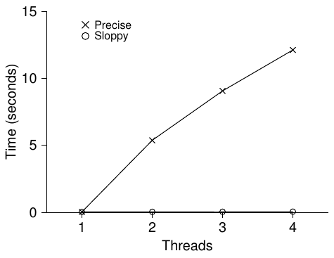
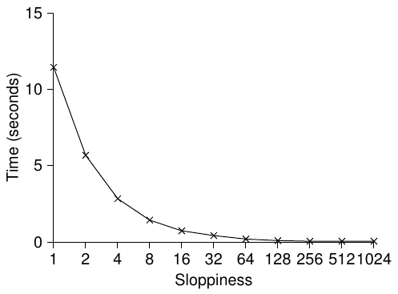
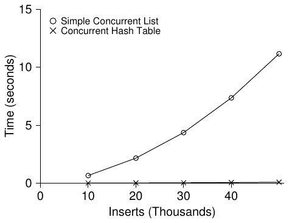

# 29 Concurrent Data Structure Lock-based

Trước khi đi xa hơn lock, chúng ta mô tả cách dùng lock trong một số data structure phổ biến. Thêm lock vào data structure để các thread dùng được khiến structure đó thread safe. Tất nhiên, cách thêm lock cụ thể quyết định cả correctness và hiệu năng. Vì vậy, thử thách là:

> MẤU CHỐT: CÁCH THÊM LOCK VÀO DATA STRUCTURE
>
> Với một data structure cụ thể, nên thêm lock thế nào để hoạt động đúng? Hơn nữa, làm sao thêm lock để data structure đạt hiệu năng cao, cho phép nhiều thread truy cập cùng lúc, tức concurrently?

Tất nhiên khó bao quát mọi data structure hoặc mọi cách thêm concurrency, vì chủ đề đã được nghiên cứu nhiều năm với hàng nghìn bài báo (theo nghĩa đen). Vì vậy chúng tôi hy vọng giới thiệu đủ cách tư duy cần thiết và chỉ ra nguồn tài liệu tốt để bạn tự tìm hiểu thêm. Khảo sát của Moir và Shavit là nguồn thông tin tuyệt vời [MS04].

## 29.1 Concurrent Counter

Một trong những data structure đơn giản nhất là counter. Nó được dùng phổ biến và có interface đơn giản. Chúng ta định nghĩa counter non-concurrent đơn giản trong Hình 29.1.

### Đơn giản nhưng không Scalable

Như thấy, counter non-synchronized là data structure rất đơn giản, chỉ cần ít code triển khai. Thử thách tiếp theo: làm sao khiến code này thread safe? Hình 29.2 minh họa cách làm.

```
 1   typedef struct __counter_t {
 2       int value;
 3   } counter_t;
 4
 5   void init(counter_t *c) {
 6       c->value = 0;
 7   }
 8
 9   void increment(counter_t *c) {
10       c->value++;
11   }
12
13   void decrement(counter_t *c) {
14       c->value--;
15   }
16
17   int get(counter_t *c) {
18       return c->value;
19   }
```

Hình 29.1: Counter không có lock

```
 1   typedef struct __counter_t {
 2       int             value;
 3       pthread_mutex_t lock;
 4   } counter_t;
 5
 6   void init(counter_t *c) {
 7       c->value = 0;
 8       Pthread_mutex_init(&c->lock, NULL);
 9   }
10
11   void increment(counter_t *c) {
12       Pthread_mutex_lock(&c->lock);
13       c->value++;
14       Pthread_mutex_unlock(&c->lock);
15   }
16
17   void decrement(counter_t *c) {
18       Pthread_mutex_lock(&c->lock);
19       c->value--;
20       Pthread_mutex_unlock(&c->lock);
21   }
22
23   int get(counter_t *c) {
24       Pthread_mutex_lock(&c->lock);
25       int rc = c->value;
26       Pthread_mutex_unlock(&c->lock);
27       return rc;
28   }
```

Hình 29.2: Counter có lock

Concurrent counter này đơn giản và đúng. Thực ra nó theo design pattern phổ biến của concurrent data structure cơ bản nhất: chỉ thêm một lock, acquire khi gọi routine thao tác data structure và release khi quay về. Theo cách đó, nó giống data structure xây dựng bằng monitor [BH73], nơi lock tự động acquire và release khi gọi rồi quay về từ object method.



Hình 29.3: Hiệu năng counter truyền thống so với Sloppy Counter

Đến đây bạn có concurrent data structure hoạt động. Vấn đề có thể gặp là hiệu năng. Nếu data structure quá chậm, phải làm nhiều hơn thêm một lock; những tối ưu đó, nếu cần, là chủ đề còn lại của chương. Lưu ý nếu data structure không quá chậm thì bạn đã xong! Không cần làm phức tạp nếu cách đơn giản hoạt động.

Để hiểu chi phí hiệu năng của cách đơn giản, chúng ta chạy benchmark trong đó mỗi thread cập nhật một shared counter số lần cố định; sau đó thay đổi số thread. Hình 29.3 cho tổng thời gian với một đến bốn thread hoạt động; mỗi thread cập nhật counter một triệu lần. Thí nghiệm chạy trên iMac có bốn CPU Intel i5 2.7 GHz; với nhiều CPU hoạt động hơn, hy vọng hoàn thành nhiều tổng công việc hơn mỗi đơn vị thời gian.

Đường trên trong hình (nhãn precise) cho thấy hiệu năng synchronized counter scale kém. Một thread hoàn thành một triệu cập nhật rất nhanh (khoảng 0.03 giây), nhưng hai thread mỗi thread đồng thời cập nhật một triệu lần gây chậm đáng kể (hơn 5 giây!). Càng nhiều thread càng tệ.

Lý tưởng là các thread hoàn thành trên nhiều processor nhanh như một thread trên một processor. Đạt điều đó gọi là perfect scaling; dù nhiều việc hơn, chúng được làm song song nên thời gian hoàn thành không tăng.

### Counting Scalable

Thật đáng ngạc nhiên, các nhà nghiên cứu đã nghiên cứu xây dựng counter scalable hơn nhiều năm [MS04]. Đáng ngạc nhiên hơn là scalable counter thực sự quan trọng, như công trình mới về phân tích hiệu năng operating system cho thấy [B+10]; không có scalable counting, một số workload Linux gặp vấn đề scalability nghiêm trọng trên máy multicore.

| Thời gian | L<sub>1</sub> | L<sub>2</sub> | L<sub>3</sub> | L<sub>4</sub> | G |
|---|---|---|---|---|---|
| 0 | 0 | 0 | 0 | 0 | 0 |
| 1 | 0 | 0 | 1 | 1 | 0 |
| 2 | 1 | 0 | 2 | 1 | 0 |
| 3 | 2 | 0 | 3 | 1 | 0 |
| 4 | 3 | 0 | 3 | 2 | 0 |
| 5 | 4 | 1 | 3 | 3 | 0 |
| 6 | 5 → 0 | 1 | 3 | 4 | 5 (từ L<sub>1</sub>) |
| 7 | 0 | 2 | 4 | 5 → 0 | 10 (từ L<sub>4</sub>) |

Hình 29.4: Lần theo Sloppy Counter

Dù nhiều kỹ thuật đã được phát triển để giải quyết, giờ chúng ta mô tả một cách cụ thể. Ý tưởng được giới thiệu trong nghiên cứu mới [B+10], gọi là sloppy counter.

Sloppy counter biểu diễn một logical counter duy nhất bằng nhiều local physical counter, mỗi CPU core một cái, cùng một global counter. Cụ thể trên máy bốn CPU, có bốn local counter và một global counter. Ngoài counter còn có lock: một cho mỗi local counter và một cho global counter.

Ý tưởng sloppy counting như sau. Khi thread trên một core muốn tăng counter, nó tăng local counter; truy cập local counter đồng bộ qua local lock tương ứng. Vì mỗi CPU có local counter riêng, thread trên các CPU có thể cập nhật local counter không contention, nên cập nhật counter scalable.

Tuy nhiên, để global counter được cập nhật (khi thread muốn đọc), giá trị local định kỳ được chuyển sang global counter bằng cách acquire global lock và tăng thêm giá trị local counter; sau đó reset local counter về không.

Tần suất chuyển local-to-global do threshold quyết định, ở đây gọi S (sloppiness). S càng nhỏ, counter càng giống counter non-scalable ở trên; S càng lớn, counter càng scalable, nhưng giá trị global có thể lệch càng xa số đếm thật. Có thể acquire mọi local lock và global lock (theo thứ tự xác định để tránh deadlock) để lấy giá trị chính xác, nhưng cách đó không scalable.

Để rõ hơn, xem ví dụ (Hình 29.4). Threshold S bằng 5, có thread trên mỗi CPU trong bốn CPU cập nhật local counter L<sub>1</sub> ... L<sub>4</sub>. Giá trị global counter (G) cũng trong trace, thời gian tăng từ trên xuống. Mỗi bước, local counter có thể tăng; nếu đạt threshold S, giá trị local chuyển sang global counter và local counter được reset.

Đường dưới Hình 29.3 (nhãn sloppy, trang 3) cho hiệu năng sloppy counter với threshold S bằng 1024. Hiệu năng tuyệt vời; cập nhật counter bốn triệu lần trên bốn processor chỉ tốn thời gian nhỉnh hơn cập nhật một triệu lần trên một processor.

```
 1   typedef struct __counter_t {
 2       int             global;            // global count
 3       pthread_mutex_t glock;             // global lock
 4       int             local[NUMCPUS];    // local count (per cpu)
 5       pthread_mutex_t llock[NUMCPUS];    // ... and locks
 6       int             threshold;         // update frequency
 7   } counter_t;
 8
 9   // init: record threshold, init locks, init values
10   //       of all local counts and global count
11   void init(counter_t *c, int threshold) {
12       c->threshold = threshold;
13       c->global = 0;
14       pthread_mutex_init(&c->glock, NULL);
15       int i;
16       for (i = 0; i < NUMCPUS; i++) {
17           c->local[i] = 0;
18           pthread_mutex_init(&c->llock[i], NULL);
19       }
20   }
21
22   // update: usually, just grab local lock and update local amount
23   //         once local count has risen by ’threshold’, grab global
24   //         lock and transfer local values to it
25   void update(counter_t *c, int threadID, int amt) {
26       int cpu = threadID % NUMCPUS;
27       pthread_mutex_lock(&c->llock[cpu]);
28       c->local[cpu] += amt;                 // assumes amt > 0
29       if (c->local[cpu] >= c->threshold) {  // transfer to global
30           pthread_mutex_lock(&c->glock);
31           c->global += c->local[cpu];
32           pthread_mutex_unlock(&c->glock);
33           c->local[cpu] = 0;
34       }
35       pthread_mutex_unlock(&c->llock[cpu]);
36   }
37
38   // get: just return global amount (which may not be perfect)
39   int get(counter_t *c) {
40       pthread_mutex_lock(&c->glock);
41       int val = c->global;
42       pthread_mutex_unlock(&c->glock);
43       return val; // only approximate!
44   }
```

Hình 29.5: Triển khai Sloppy Counter

Hình 29.6 cho thấy tầm quan trọng threshold S, với bốn thread mỗi thread tăng counter 1 triệu lần trên bốn CPU. S thấp thì hiệu năng kém (nhưng global count luôn khá chính xác); S cao thì hiệu năng tuyệt vời nhưng global count trễ (tối đa số CPU nhân S). Sloppy counter cho phép trade-off độ chính xác/hiệu năng này.

Phiên bản sơ bộ sloppy counter ở Hình 29.5. Hãy đọc, hoặc tốt hơn tự chạy thí nghiệm để hiểu cách hoạt động.



Hình 29.6: Scaling Sloppy Counter

## 29.2 Concurrent Linked List

Tiếp theo xét structure phức tạp hơn: linked list. Lại bắt đầu bằng cách cơ bản. Để đơn giản, bỏ một số routine hiển nhiên mà list có và chỉ tập trung concurrent insert; để bạn đọc nghĩ về lookup, delete, v.v. Hình 29.7 là code data structure sơ khai này.

Như code cho thấy, chỉ acquire lock khi vào routine insert và release khi ra. Một vấn đề tinh tế nhỏ xảy ra nếu malloc() thất bại (hiếm); khi đó code cũng phải release lock trước khi báo insert thất bại.

Exceptional control flow kiểu này khá dễ lỗi; nghiên cứu mới về Linux kernel patch cho thấy tỷ lệ bug lớn (gần 40%) nằm trên code path rarely-taken như vậy (thực ra quan sát này khơi gợi nghiên cứu của chúng tôi, loại bỏ mọi path memory-failing khỏi một Linux file system, tạo hệ thống vững chắc hơn [S+11]).

Vì vậy, chúng ta có một thử thách: có thể viết lại các routine insert và lookup để vẫn đúng khi concurrent insert, nhưng tránh trường hợp failure path cũng cần thêm unlock không?

Ở đây, có. Cụ thể có thể sắp xếp lại code để lock và release chỉ bao actual critical section trong code insert, và dùng common exit path trong code lookup. Điều đầu hoạt động vì một phần lookup thực sự không cần lock; giả định malloc() thread-safe, mỗi thread gọi được mà không lo race condition hay concurrency bug khác. Chỉ khi cập nhật shared list mới cần giữ lock. Xem Hình 29.8 để biết chi tiết thay đổi.

```
 1   // basic node structure
 2   typedef struct __node_t {
 3       int                 key;
 4       struct __node_t         *next;
 5   } node_t;
 6
 7   // basic list structure (one used per list)
 8   typedef struct __list_t {
 9       node_t                *head;
10       pthread_mutex_t     lock;
11   } list_t;
12
13   void List_Init(list_t *L) {
14       L->head = NULL;
15       pthread_mutex_init(&L->lock, NULL);
16   }
17
18   int List_Insert(list_t *L, int key) {
19       pthread_mutex_lock(&L->lock);
20       node_t *new = malloc(sizeof(node_t));
21       if (new == NULL) {
22           perror("malloc");
23           pthread_mutex_unlock(&L->lock);
24           return -1; // fail
25       }
26       new->key  = key;
27       new->next = L->head;
28       L->head   = new;
29       pthread_mutex_unlock(&L->lock);
30       return 0; // success
31   }
32
33   int List_Lookup(list_t *L, int key) {
34       pthread_mutex_lock(&L->lock);
35       node_t *curr = L->head;
36       while (curr) {
37           if (curr->key == key) {
38               pthread_mutex_unlock(&L->lock);
39               return 0; // success
40           }
41           curr = curr->next;
42       }
43       pthread_mutex_unlock(&L->lock);
44       return -1; // failure
45   }
```

Hình 29.7: Concurrent Linked List

Với routine lookup, chỉ cần biến đổi code để nhảy khỏi main search loop tới một return path duy nhất. Điều này lại giảm số điểm acquire/release lock, giảm nguy cơ vô tình thêm bug (như quên unlock trước return).

### Scaling Linked List

Dù lại có concurrent linked list cơ bản, chúng ta lại gặp tình huống scale không tốt. Một kỹ thuật được nghiên cứu để tăng concurrency trong list là hand-over-hand locking (còn gọi lock coupling) [MS04].

```
 1   void List_Init(list_t *L) {
 2       L->head = NULL;
 3       pthread_mutex_init(&L->lock, NULL);
 4   }
 5
 6   void List_Insert(list_t *L, int key) {
 7       // synchronization not needed
 8       node_t *new = malloc(sizeof(node_t));
 9       if (new == NULL) {
10           perror("malloc");
11           return;
12       }
13       new->key = key;
14
15       // just lock critical section
16       pthread_mutex_lock(&L->lock);
17       new->next = L->head;
18       L->head   = new;
19       pthread_mutex_unlock(&L->lock);
20   }
21
22   int List_Lookup(list_t *L, int key) {
23       int rv = -1;
24       pthread_mutex_lock(&L->lock);
25       node_t *curr = L->head;
26       while (curr) {
27           if (curr->key == key) {
28               rv = 0;
29               break;
30           }
31           curr = curr->next;
32       }
33       pthread_mutex_unlock(&L->lock);
34       return rv; // now both success and failure
35   }
```

Hình 29.8: Concurrent Linked List: Viết lại

Ý tưởng đơn giản. Thay vì một lock cho cả list, thêm một lock cho mỗi node. Khi duyệt, code lấy lock của node tiếp theo trước rồi release lock node hiện tại (từ đó có tên hand-over-hand).

Về khái niệm, linked list hand-over-hand có lý; nó cho concurrency cao trong list operation. Nhưng thực tế khó nhanh hơn cách một lock đơn giản, vì overhead acquire và release lock cho mỗi node khi duyệt quá lớn. Ngay cả list lớn và nhiều thread, concurrency nhờ nhiều lượt duyệt on-going khó nhanh hơn chỉ lấy một lock, thực hiện operation rồi release. Có lẽ nên nghiên cứu cách hybrid (lấy lock mới sau mỗi số node nhất định).

> MẸO: NHIỀU CONCURRENCY HƠN CHƯA CHẮC NHANH HƠN
>
> Nếu thiết kế thêm nhiều overhead (ví dụ acquire và release lock thường xuyên thay vì một lần), concurrency cao hơn có thể không quan trọng. Cách đơn giản thường tốt, nhất là ít dùng routine tốn kém. Thêm lock và phức tạp có thể khiến thất bại. Dù vậy, chỉ một cách biết chắc: xây dựng cả hai (đơn giản ít concurrent, phức tạp nhiều concurrent) rồi đo. Cuối cùng không thể gian lận hiệu năng; ý tưởng hoặc nhanh hơn hoặc không.

> MẸO: CẨN THẬN VỚI LOCK VÀ CONTROL FLOW
>
> Mẹo thiết kế chung hữu ích cả trong concurrent code lẫn nơi khác: cẩn thận thay đổi control flow dẫn đến return, exit hoặc error condition tương tự dừng thực thi hàm. Vì nhiều hàm bắt đầu bằng acquire lock, cấp phát memory hoặc stateful operation tương tự, khi lỗi code phải hoàn tác mọi state trước return, điều dễ error-prone. Vì vậy tốt nhất tổ chức code giảm thiểu mẫu này.

## 29.3 Concurrent Queue

Như đã biết, luôn có cách tiêu chuẩn tạo concurrent data structure: thêm lock lớn. Với queue, bỏ qua cách này vì giả định bạn tự làm được.

Thay vào đó xem queue concurrent hơn một chút do Michael và Scott thiết kế [MS98]. Data structure và code trong Hình 29.9 trang sau.

Nghiên cứu kỹ code, bạn thấy hai lock: một cho head, một cho tail queue. Mục tiêu là cho phép enqueue và dequeue concurrent. Trường hợp thường, enqueue chỉ truy cập tail lock, dequeue chỉ head lock.

Một mẹo Michael và Scott dùng là thêm dummy node (cấp phát trong code khởi tạo queue); dummy cho phép tách head và tail operation. Nghiên cứu code, hoặc tốt hơn nhập, chạy và đo để hiểu sâu.

Queue phổ biến trong ứng dụng multi-threaded. Nhưng queue ở đây (chỉ có lock) thường chưa đáp ứng đủ nhu cầu. Bounded queue hoàn thiện hơn, cho thread chờ khi queue empty hoặc quá full, là chủ đề nghiên cứu kỹ ở chương tới về condition variable. Hãy đón đọc!

```
 1   typedef struct __node_t {
 2       int                 value;
 3       struct __node_t    *next;
 4   } node_t;
 5
 6   typedef struct __queue_t {
 7       node_t             *head;
 8       node_t             *tail;
 9       pthread_mutex_t     headLock;
10       pthread_mutex_t     tailLock;
11   } queue_t;
12
13   void Queue_Init(queue_t *q) {
14       node_t *tmp = malloc(sizeof(node_t));
15       tmp->next = NULL;
16       q->head = q->tail = tmp;
17       pthread_mutex_init(&q->headLock, NULL);
18       pthread_mutex_init(&q->tailLock, NULL);
19   }
20
21   void Queue_Enqueue(queue_t *q, int value) {
22       node_t *tmp = malloc(sizeof(node_t));
23       assert(tmp != NULL);
24       tmp->value = value;
25       tmp->next  = NULL;
26
27       pthread_mutex_lock(&q->tailLock);
28       q->tail->next = tmp;
29       q->tail = tmp;
30       pthread_mutex_unlock(&q->tailLock);
31   }
32
33   int Queue_Dequeue(queue_t *q, int *value) {
34       pthread_mutex_lock(&q->headLock);
35       node_t *tmp = q->head;
36       node_t *newHead = tmp->next;
37       if (newHead == NULL) {
38           pthread_mutex_unlock(&q->headLock);
39           return -1; // queue was empty
40       }
41       *value = newHead->value;
42       q->head = newHead;
43       pthread_mutex_unlock(&q->headLock);
44       free(tmp);
45       return 0;
46   }
```

Hình 29.9: Concurrent Queue Michael và Scott

## 29.4 Concurrent Hash Table

Kết thúc bằng concurrent data structure đơn giản, áp dụng rộng: hash table. Tập trung hash table đơn giản không resize; xử lý resize cần thêm chút việc, để bạn đọc làm bài tập (xin lỗi!).

Concurrent hash table này có cách triển khai dễ hiểu, được xây dựng bằng các concurrent list đã phát triển trước đó và hoạt động rất tốt. Hiệu năng tốt vì thay cho một lock toàn structure, dùng một lock cho mỗi hash bucket (mỗi bucket biểu diễn bằng list). Điều đó cho phép nhiều concurrent operation.

```
 1   #define BUCKETS (101)
 2
 3   typedef struct __hash_t {
 4       list_t lists[BUCKETS];
 5   } hash_t;
 6
 7   void Hash_Init(hash_t *H) {
 8       int i;
 9       for (i = 0; i < BUCKETS; i++) {
10           List_Init(&H->lists[i]);
11       }
12   }
13
14   int Hash_Insert(hash_t *H, int key) {
15       int bucket = key % BUCKETS;
16       return List_Insert(&H->lists[bucket], key);
17   }
18
19   int Hash_Lookup(hash_t *H, int key) {
20       int bucket = key % BUCKETS;
21       return List_Lookup(&H->lists[bucket], key);
22   }
```

Hình 29.10: Concurrent Hash Table

Hình 29.11 cho hiệu năng hash table khi concurrent update (10,000 đến 50,000 cập nhật concurrent từ mỗi thread trong bốn thread, cùng iMac bốn CPU). Để so sánh cũng có hiệu năng linked list (một lock). Biểu đồ cho thấy hash table đơn giản này scale tuyệt vời; linked list thì không.



Hình 29.11: Scaling Hash Table

> MẸO: TRÁNH PREMATURE OPTIMIZATION (ĐỊNH LUẬT KNUTH)
>
> Khi xây concurrent data structure, bắt đầu cách cơ bản nhất: thêm một lock lớn để đồng bộ truy cập. Nhờ vậy dễ xây lock đúng; nếu sau đó thấy vấn đề hiệu năng, tinh chỉnh, chỉ tăng tốc khi cần. Như Knuth nổi tiếng nói, “Tối ưu quá sớm là gốc rễ mọi điều xấu.” Nhiều operating system dùng một lock khi mới chuyển sang multiprocessor, gồm Sun OS và Linux. Ở Linux lock thậm chí có tên big kernel lock (BKL). Nhiều năm, cách đơn giản này tốt, nhưng khi hệ thống multi-CPU phổ biến, chỉ cho một thread hoạt động trong kernel mỗi lúc trở thành bottleneck hiệu năng. Vì vậy đã đến lúc tối ưu bằng cải thiện concurrency. Linux chọn cách thẳng thắn: thay một lock bằng nhiều lock. Sun quyết định căn bản hơn: xây operating system mới hoàn toàn Solaris, tích hợp concurrency từ nền tảng ngay ngày đầu. Đọc sách Linux và Solaris kernel để biết thêm về các hệ thống hấp dẫn [BC05, MM00].

## 29.5 Tổng kết

Chúng ta giới thiệu một số concurrent data structure: counter, list, queue và hash table phổ biến heavily-used. Qua đó học vài bài quan trọng: cẩn thận acquire và release lock quanh thay đổi control flow; tăng concurrency không nhất thiết tăng hiệu năng; chỉ khắc phục vấn đề hiệu năng khi thực sự tồn tại. Điểm cuối, tránh premature optimization, cốt yếu với developer performance-minded; tăng tốc không có giá trị nếu không cải thiện tổng hiệu năng ứng dụng.

Tất nhiên chúng ta mới chạm bề mặt structure hiệu năng cao. Xem khảo sát xuất sắc Moir và Shavit để biết thêm cùng liên kết nguồn khác [MS04]. Đặc biệt bạn có thể quan tâm structure khác (như B-trees); môn database là lựa chọn tốt nhất. Cũng có thể quan tâm kỹ thuật hoàn toàn không dùng lock truyền thống; chúng ta sẽ nếm thử data structure non-blocking trong chương concurrency bug phổ biến, nhưng thực sự đây là lĩnh vực kiến thức cần nghiên cứu nhiều hơn cuốn sách khiêm tốn này cho phép. Hãy tự tìm hiểu nếu quan tâm (như thường lệ!).

## Tài liệu tham khảo

[B+10] “An Analysis of Linux Scalability to Many Cores”

Silas Boyd-Wickizer, Austin T. Clements, Yandong Mao, Aleksey Pesterev, M. Frans Kaashoek, Robert Morris, Nickolai Zeldovich

OSDI ’10, Vancouver, Canada, October 2010

Nghiên cứu hay về hiệu năng Linux trên máy multicore và vài giải pháp đơn giản.

[BH73] “Operating System Principles”

Per Brinch Hansen, Prentice-Hall, 1973

Có tại: http://portal.acm.org/citation.cfm?id=540365

Một trong những cuốn sách đầu tiên về operating system; chắc chắn đi trước thời đại. Giới thiệu monitor làm concurrency primitive.

[BC05] “Understanding the Linux Kernel (Third Edition)”

Daniel P. Bovet and Marco Cesati

O’Reilly Media, November 2005

Sách kinh điển về Linux kernel. Bạn nên đọc.

[L+13] “A Study of Linux File System Evolution”

Lanyue Lu, Andrea C. Arpaci-Dusseau, Remzi H. Arpaci-Dusseau, Shan Lu

FAST ’13, San Jose, CA, February 2013

Bài báo nghiên cứu mọi patch Linux file system gần một thập kỷ của chúng tôi. Nhiều phát hiện thú vị; đọc để biết! Nhưng thực hiện rất vất vả; nghiên cứu sinh đáng thương Lanyue Lu phải xem từng patch bằng tay để hiểu chúng làm gì.

[MS98] “Nonblocking Algorithms and Preemption-safe Locking on Multiprogrammed Shared-memory Multiprocessors”

M. Michael and M. Scott

Journal of Parallel and Distributed Computing, Vol. 51, No. 1, 1998

Giáo sư Scott và sinh viên tiên phong về concurrent algorithm và data structure nhiều năm; xem website, nhiều bài báo hoặc sách để biết thêm.

[MS04] “Concurrent Data Structures”

Mark Moir and Nir Shavit

In Handbook of Data Structures and Applications

(Editors D. Metha and S.Sahni)

Chapman and Hall/CRC Press, 2004

Có tại: www.cs.tau.ac.il/˜shanir/concurrent-data-structures.pdf

Tài liệu tra cứu ngắn nhưng khá toàn diện về concurrent data structure. Dù thiếu vài công trình mới nhất (vì tuổi đời), vẫn cực kỳ hữu ích.

[MM00] “Solaris Internals: Core Kernel Architecture”

Jim Mauro and Richard McDougall

Prentice Hall, October 2000

Cuốn sách Solaris. Cũng nên đọc nếu muốn tìm hiểu rất chi tiết điều khác ngoài Linux.

[S+11] “Making the Common Case the Only Case with Anticipatory Memory Allocation” Swaminathan Sundararaman, Yupu Zhang, Sriram Subramanian,

Andrea C. Arpaci-Dusseau, Remzi H. Arpaci-Dusseau

FAST ’11, San Jose, CA, February 2011

Công trình của chúng tôi loại bỏ lời gọi malloc possibly-failing khỏi kernel code path. Ý tưởng là cấp phát trước mọi memory có thể cần trước khi làm việc, tránh thất bại sâu trong storage stack.
