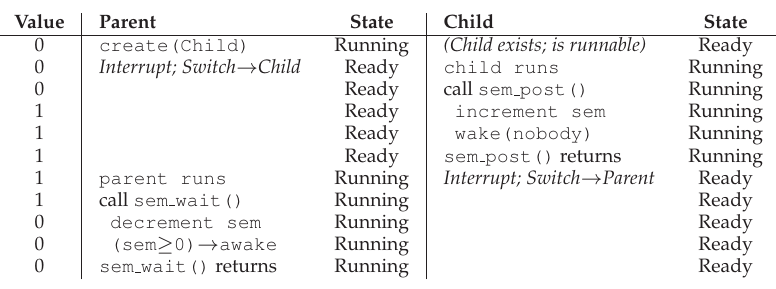
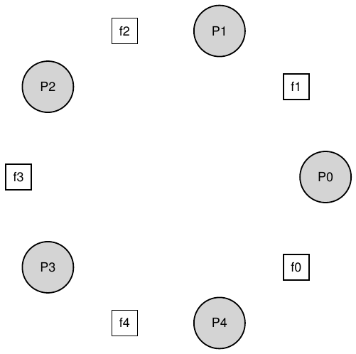

# 31 Semaphore

Như đã biết, cần cả lock và condition variable để giải quyết nhiều vấn đề concurrency liên quan và thú vị. Một trong những người đầu tiên nhận ra điều này nhiều năm trước là Edsger Dijkstra (dù khó biết lịch sử chính xác [GR92]), nổi tiếng với thuật toán “shortest paths” trong graph theory [D59], bài luận chiến thời đầu về structured programming mang tên “Goto Statements Considered Harmful” [D68a] (tên hay quá!), và trong nội dung nghiên cứu ở đây là giới thiệu synchronization primitive tên semaphore [D68b,D72]. Thực ra Dijkstra cùng đồng nghiệp phát minh semaphore như primitive duy nhất cho mọi thứ synchronization; như sẽ thấy, semaphore dùng được làm cả lock lẫn condition variable.

> MẤU CHỐT: CÁCH DÙNG SEMAPHORE
>
> Có thể dùng semaphore thay lock và condition variable thế nào? Định nghĩa semaphore là gì? Binary semaphore là gì? Xây semaphore từ lock và condition variable có dễ không? Xây lock và condition variable từ semaphore thì sao?

## 31.1 Semaphore: Định nghĩa

Semaphore là object có integer value thao tác bằng hai routine; trong chuẩn POSIX là sem_wait() và sem_post()[^1]. Vì giá trị ban đầu quyết định hành vi, trước khi gọi routine khác tương tác semaphore, phải khởi tạo giá trị, như code Hình 31.1.

```
 1   #include <semaphore.h>
 2   sem_t s;
 3   sem_init(&s, 0, 1);
```

Hình 31.1: Khởi tạo Semaphore

Trong hình, khai báo semaphore s rồi khởi tạo bằng 1 bằng cách truyền 1 làm argument thứ ba. Argument thứ hai của sem_init() bằng 0 trong mọi ví dụ ở đây; chỉ semaphore chia sẻ giữa thread cùng process. Xem man page về cách dùng khác (đồng bộ truy cập giữa process khác nhau), cần giá trị khác cho argument thứ hai.

Sau khởi tạo có thể gọi một trong hai hàm để tương tác, sem_wait() hoặc sem_post(). Hành vi hai hàm trong Hình 31.2.

Hiện tại chưa quan tâm triển khai routine, rõ ràng cần cẩn thận; nhiều thread gọi sem_wait() và sem_post() đòi hỏi quản lý critical section. Giờ tập trung cách dùng primitive; sau có thể bàn cách xây dựng.

Cần bàn vài điểm nổi bật của interface. Đầu tiên sem_wait() hoặc trả về ngay (giá trị semaphore một trở lên khi gọi sem_wait()), hoặc khiến caller ngừng thực thi chờ post sau đó. Tất nhiên nhiều calling thread có thể gọi sem_wait(), tất cả vào queue chờ được đánh thức.

Thứ hai, sem_post() không chờ condition cụ thể như sem_wait(). Thay vào đó chỉ tăng giá trị semaphore rồi, nếu có thread chờ thức, đánh thức một thread.

Thứ ba, giá trị semaphore khi âm bằng số waiting thread [D68b]. Dù người dùng thường không thấy giá trị, invariant đáng biết này có thể giúp nhớ cách semaphore hoạt động.

Đừng lo (lúc này) về race condition có vẻ có trong semaphore; giả sử các hành động thực hiện atomically. Chúng ta sẽ sớm dùng lock và condition variable để làm chính việc đó.

```
 1   int sem_wait(sem_t *s) {
 2       decrement the value of semaphore s by one
 3       wait if value of semaphore s is negative
 4   }
 5
 6   int sem_post(sem_t *s) {
 7       increment the value of semaphore s by one
 8       if there are one or more threads waiting, wake one
 9   }
```

Hình 31.2: Semaphore: Định nghĩa Wait và Post

```
 1   sem_t m;
 2   sem_init(&m, 0, X); // initialize semaphore to X; what should X be?
 3
 4   sem_wait(&m);
 5   // critical section here
 6   sem_post(&m);
```

Hình 31.3: Binary Semaphore (tức Lock)

## 31.2 Binary Semaphore (Lock)

Giờ chúng ta đã sẵn sàng sử dụng semaphore. Cách đầu đã quen: dùng semaphore làm lock. Xem code Hình 31.3; chỉ bao critical section bằng cặp sem_wait()/sem_post(). Tuy nhiên then chốt là giá trị ban đầu semaphore m (khởi tạo bằng X trong hình). X nên là gì?

... (Thử suy nghĩ trước khi tiếp tục) ...

Xem lại định nghĩa sem_wait() và sem_post() trên, giá trị ban đầu nên bằng 1.

Để rõ hơn, tưởng tượng hai thread. Thread đầu (Thread 0) gọi sem_wait(); trước tiên giảm giá trị semaphore thành 0. Sau đó chỉ chờ nếu giá trị không lớn hơn hoặc bằng 0. Vì bằng 0, sem_wait() chỉ trả về và calling thread tiếp tục; Thread 0 được vào critical section. Nếu không thread nào khác thử acquire khi Thread 0 ở trong, khi gọi sem_post() nó chỉ khôi phục semaphore thành 1 (không đánh thức thread vì không có). Hình 31.4 là trace tình huống.

Thú vị hơn khi Thread 0 “giữ lock” (đã sem_wait() chưa sem_post()), thread khác (Thread 1) thử vào critical section bằng sem_wait(). Thread 1 giảm semaphore thành -1 rồi wait (tự sleep và nhường processor). Thread 0 chạy lại, cuối cùng sem_post(), tăng semaphore về không rồi đánh thức Thread 1, thread này có thể acquire lock. Khi Thread 1 xong, nó lại tăng semaphore về 1.

| Giá trị Semaphore | Thread 0 | Thread 1 |
|---|---|---|
| 1 |  |  |
| 1 | gọi sem_wait() |  |
| 0 | sem_wait() trả về |  |
| 0 | (crit sect) |  |
| 0 | gọi sem_post() |  |
| 1 | sem_post() trả về |  |

Hình 31.4: Thread Trace: Một thread dùng Semaphore

| Giá trị | Thread 0 | State | Thread 1 | State |
|---|---|---|---|---|
| 1 |  | Running |  | Ready |
| 1 | gọi sem_wait() | Running |  | Ready |
| 0 | sem_wait() trả về | Running |  | Ready |
| 0 | (crit sect: begin) | Running |  | Ready |
| 0 | Interrupt; Chuyển→T1 | Ready |  | Running |
| 0 |  | Ready | gọi sem_wait() | Running |
| -1 |  | Ready | giảm sem | Running |
| -1 |  | Ready | (sem<0)→sleep | Sleeping |
| -1 |  | Running | Chuyển→T0 | Sleeping |
| -1 | (crit sect: end) | Running |  | Sleeping |
| -1 | gọi sem_post() | Running |  | Sleeping |
| 0 | tăng sem | Running |  | Sleeping |
| 0 | wake(T1) | Running |  | Ready |
| 0 | sem_post() trả về | Running |  | Ready |
| 0 | Interrupt; Chuyển→T1 | Ready |  | Running |
| 0 |  | Ready | sem_wait() trả về | Running |
| 0 |  | Ready | (crit sect) | Running |
| 0 |  | Ready | gọi sem_post() | Running |
| 1 |  | Ready | sem_post() trả về | Running |

Hình 31.5: Thread Trace: Hai thread dùng Semaphore

Hình 31.5 là trace ví dụ. Ngoài hành động, hình cho scheduler state mỗi thread: Running, Ready (chạy được nhưng chưa chạy), Sleeping. Đặc biệt Thread 1 sleep khi thử acquire lock already-held; chỉ khi Thread 0 chạy lại, Thread 1 mới được đánh thức và có thể chạy lại.

Nếu muốn tự làm ví dụ, thử nhiều thread xếp queue chờ lock. Giá trị semaphore sẽ thay đổi như thế nào trong trace đó?

Như vậy dùng semaphore làm lock được. Vì lock chỉ có hai state (held và not held), đôi khi gọi semaphore dùng làm lock là binary semaphore. Lưu ý nếu chỉ dùng kiểu binary, có thể triển khai đơn giản hơn generalized semaphore trình bày ở đây.

## 31.3 Semaphore làm Condition Variable

Semaphore cũng hữu ích khi thread muốn dừng chờ condition đúng. Ví dụ thread chờ list non-empty để delete phần tử. Trong mẫu sử dụng này, chúng ta thường thấy một thread chờ một việc xảy ra, còn thread khác thực hiện việc đó rồi signal rằng nó đã xảy ra, nhờ đó đánh thức waiting thread. Vì thread chờ condition chương trình đổi, chúng ta dùng semaphore làm condition variable.

```
 1   sem_t s;
 2
 3   void *
 4   child(void *arg) {
 5       printf("child\n");
 6       sem_post(&s); // signal here: child is done
 7       return NULL;
 8   }
 9
10   int
11   main(int argc, char *argv[]) {
12       sem_init(&s, 0, X); // what should X be?
13       printf("parent: begin\n");
14       pthread_t c;
15       Pthread_create(c, NULL, child, NULL);
16       sem_wait(&s); // wait here for child
17       printf("parent: end\n");
18       return 0;
19   }
```

Hình 31.6: Parent chờ Child

Ví dụ đơn giản như sau. Tưởng tượng thread tạo thread khác rồi muốn chờ nó thực thi xong (Hình 31.6). Khi chương trình chạy, muốn thấy:

```
parent: begin
child
parent: end
```

Câu hỏi là dùng semaphore để đạt hiệu ứng thế nào; hóa ra đáp án khá dễ hiểu. Như code, parent chỉ gọi sem_wait(), child sem_post() để chờ condition child hoàn tất thực thi đúng. Nhưng điều này đặt câu hỏi: giá trị ban đầu semaphore nên là gì?

(Lại hãy nghĩ ở đây thay vì đọc tiếp)

Đáp án tất nhiên là đặt semaphore bằng 0. Có hai trường hợp. Đầu tiên giả sử parent tạo child nhưng child chưa chạy (trong ready queue). Trường hợp này (Hình 31.7, trang 6), parent gọi sem_wait() trước child sem_post(); muốn parent chờ child chạy. Chỉ xảy ra nếu giá trị semaphore không lớn hơn 0; vì vậy khởi tạo 0. Parent chạy, giảm semaphore (thành -1), rồi wait (sleep). Khi child chạy, nó sem_post(), tăng semaphore thành 0, đánh thức parent, parent quay về sem_wait() và kết thúc chương trình.

Trường hợp hai (Hình 31.8, trang 6), child hoàn tất trước khi parent có cơ hội sem_wait(). Child trước tiên sem_post(), tăng semaphore từ 0 thành 1. Parent sau đó chạy, sem_wait() thấy giá trị 1; giảm giá trị (về 0) rồi quay về không chờ, cũng đạt hiệu ứng mong muốn.

| Giá trị | Parent | State | Child | State |
|---|---|---|---|---|
| 0 | create(Child) | Running | (Child tồn tại; có thể chạy) | Ready |
| 0 | gọi sem_wait() | Running |  | Ready |
| -1 | giảm sem | Running |  | Ready |
| -1 | (sem<0)→sleep | Sleeping |  | Ready |
| -1 | Chuyển→Child | Sleeping | child chạy | Running |
| -1 |  | Sleeping | gọi sem_post() | Running |
| 0 |  | Sleeping | tăng sem | Running |
| 0 |  | Ready | wake(Parent) | Running |
| 0 |  | Ready | sem_post() trả về | Running |
| 0 |  | Ready | Interrupt; Chuyển→Parent | Ready |
| 0 | sem_wait() trả về | Running |  | Ready |

Hình 31.7: Thread Trace: Parent chờ Child (Trường hợp 1)



Hình 31.8: Thread Trace: Parent chờ Child (Trường hợp 2)

## 31.4 Bài toán Producer/Consumer (Bounded Buffer)

Vấn đề tiếp theo là producer/consumer, đôi khi gọi bounded buffer [D72]. Chương trước về condition variable đã mô tả chi tiết; xem ở đó.

### Thử lần đầu

Lần thử đầu đưa vào hai semaphore, empty và full, để thread chỉ khi buffer entry đã được làm empty hoặc fill tương ứng. Code put và get trong Hình 31.9; lời giải thử producer/consumer trong Hình 31.10.

Ở đây producer trước tiên chờ buffer empty để put dữ liệu, consumer chờ buffer full trước dùng. Trước tiên giả sử MAX=1 (chỉ một buffer trong array), xem hoạt động không.

Lại có hai thread, producer và consumer. Xét kịch bản trên một CPU. Giả sử consumer chạy trước, tới dòng c1 gọi sem_wait(&full). Vì full khởi tạo 0, lời gọi giảm full (thành -1), block consumer và chờ thread khác sem_post() trên full, đúng mong muốn.

```
 1   int buffer[MAX];
 2   int fill = 0;
 3   int use  = 0;
 4
 5   void put(int value) {
 6       buffer[fill] = value;    // line f1
 7       fill = (fill + 1) % MAX; // line f2
 8   }
 9
10   int get() {
11       int tmp = buffer[use];   // line g1
12       use = (use + 1) % MAX;   // line g2
13       return tmp;
14   }
```

Hình 31.9: Routine Put và Get

```
 1   sem_t empty;
 2   sem_t full;
 3
 4   void *producer(void *arg) {
 5       int i;
 6       for (i = 0; i < loops; i++) {
 7           sem_wait(&empty);           // line P1
 8           put(i);                     // line P2
 9           sem_post(&full);            // line P3
10       }
11   }
12
13   void *consumer(void *arg) {
14       int i, tmp = 0;
15       while (tmp != -1) {
16           sem_wait(&full);            // line C1
17           tmp = get();                // line C2
18           sem_post(&empty);           // line C3
19           printf("%d\n", tmp);
20       }
21   }
22
23   int main(int argc, char *argv[]) {
24       // ...
25       sem_init(&empty, 0, MAX); // MAX buffers are empty to begin with...
26       sem_init(&full, 0, 0);    // ... and 0 are full
27       // ...
28   }
```

Hình 31.10: Thêm Condition Full và Empty

Giả sử producer chạy tiếp. Nó tới dòng P1, gọi sem_wait(&empty). Khác consumer, producer đi qua dòng vì empty khởi tạo MAX (ở đây 1). Vì vậy empty giảm thành 0, producer put dữ liệu vào entry đầu của buffer (P2). Producer tiếp tục P3, sem_post(&full), đổi full từ -1 thành 0 và đánh thức consumer (ví dụ từ blocked sang ready).

Ở đây có hai khả năng. Nếu producer tiếp tục, nó loop về P1. Lần này block vì empty bằng 0. Nếu producer bị interrupt và consumer chạy, consumer gọi sem_wait(&full) (c1), thấy buffer full nên tiêu thụ. Cả hai đều đạt hành vi mong muốn.

Bạn có thể thử cùng ví dụ với nhiều thread (nhiều producer, consumer). Vẫn nên hoạt động.

Giờ tưởng tượng MAX lớn hơn 1 (giả sử MAX = 10). Ví dụ giả định nhiều producer và consumer. Giờ có race condition. Bạn thấy ở đâu không? (dành thời gian tìm) Nếu không, gợi ý: xem kỹ code put() và get().

Hãy hiểu vấn đề. Tưởng tượng hai producer (Pa, Pb) cùng gọi put() gần đồng thời. Pa chạy trước, vừa bắt đầu fill entry đầu (fill = 0 tại f1). Trước khi Pa tăng fill thành 1, nó bị interrupt. Pb chạy, ở f1 cũng đặt dữ liệu vào phần tử 0 của buffer, ghi đè dữ liệu cũ! Đây là điều no-no; không muốn mất dữ liệu producer.

### Lời giải: Thêm Mutual Exclusion

Như thấy, đã quên mutual exclusion. Fill buffer và tăng index là critical section cần bảo vệ cẩn thận. Hãy dùng người bạn binary semaphore thêm lock. Hình 31.11 là lần thử.

Giờ thêm lock quanh toàn bộ phần put()/get(), như comment NEW LINE. Có vẻ đúng ý nhưng vẫn sai. Tại sao? Deadlock. Tại sao deadlock? Dành chút thời gian xét; thử tìm trường hợp deadlock. Chuỗi bước nào phải xảy ra để chương trình deadlock?

### Tránh Deadlock

Được rồi, giờ bạn đã tìm ra vấn đề, đây là đáp án. Hãy tưởng tượng có hai thread, một producer và một consumer. Consumer được chạy trước. Nó acquire mutex (dòng c0), rồi gọi sem_wait() trên semaphore full (dòng c1); vì chưa có dữ liệu, lời gọi này khiến consumer block và do đó nhường CPU; tuy nhiên, điều quan trọng là consumer vẫn giữ lock.

Producer chạy. Có dữ liệu để tạo, nếu chạy được sẽ đánh thức consumer và mọi thứ ổn. Đáng tiếc đầu tiên nó sem_wait() trên binary mutex semaphore (p0). Lock đã được giữ. Vì vậy producer cũng mắc kẹt chờ.

```
 1   sem_t empty;
 2   sem_t full;
 3   sem_t mutex;
 4
 5   void *producer(void *arg) {
 6       int i;
 7       for (i = 0; i < loops; i++) {
 8           sem_wait(&mutex);           // line p0 (NEW LINE)
 9           sem_wait(&empty);           // line p1
10           put(i);                     // line p2
11           sem_post(&full);            // line p3
12           sem_post(&mutex);           // line p4 (NEW LINE)
13       }
14   }
15
16   void *consumer(void *arg) {
17       int i;
18       for (i = 0; i < loops; i++) {
19           sem_wait(&mutex);           // line c0 (NEW LINE)
20           sem_wait(&full);            // line c1
21           int tmp = get();            // line c2
22           sem_post(&empty);           // line c3
23           sem_post(&mutex);           // line c4 (NEW LINE)
24           printf("%d\n", tmp);
25       }
26   }
27
28   int main(int argc, char *argv[]) {
29       // ...
30       sem_init(&empty, 0, MAX); // MAX buffers are empty to begin with...
31       sem_init(&full, 0, 0);    // ... and 0 are full
32       sem_init(&mutex, 0, 1);   // mutex=1 because it is a lock (NEW LINE)
33       // ...
34   }
```

Hình 31.11: Thêm Mutual Exclusion (Sai)

Có cycle đơn giản: consumer giữ mutex, chờ ai signal full. Producer có thể signal full nhưng chờ mutex. Cả hai mắc kẹt chờ nhau: deadlock kinh điển.

### Cuối cùng, lời giải hoạt động

Chỉ cần giảm phạm vi lock để giải quyết. Hình 31.12 là lời giải cuối hoạt động. Chỉ chuyển acquire/release mutex để bao critical section; code wait và signal full/empty bên ngoài. Kết quả là bounded buffer đơn giản hoạt động, mẫu commonly-used trong chương trình multi-threaded. Hiểu bây giờ, dùng sau. Bạn sẽ cảm ơn chúng tôi nhiều năm. Hoặc ít nhất khi đề thi cuối kỳ hỏi cùng câu.

```
 1   sem_t empty;
 2   sem_t full;
 3   sem_t mutex;
 4
 5   void *producer(void *arg) {
 6       int i;
 7       for (i = 0; i < loops; i++) {
 8           sem_wait(&empty);           // line p1
 9           sem_wait(&mutex);           // line p1.5 (MOVED MUTEX HERE...)
10           put(i);                     // line p2
11           sem_post(&mutex);           // line p2.5 (... AND HERE)
12           sem_post(&full);            // line p3
13       }
14   }
15
16   void *consumer(void *arg) {
17       int i;
18       for (i = 0; i < loops; i++) {
19           sem_wait(&full);            // line c1
20           sem_wait(&mutex);           // line c1.5 (MOVED MUTEX HERE...)
21           int tmp = get();            // line c2
22           sem_post(&mutex);           // line c2.5 (... AND HERE)
23           sem_post(&empty);           // line c3
24           printf("%d\n", tmp);
25       }
26   }
27
28   int main(int argc, char *argv[]) {
29       // ...
30       sem_init(&empty, 0, MAX); // MAX buffers are empty to begin with...
31       sem_init(&full, 0, 0);    // ... and 0 are full
32       sem_init(&mutex, 0, 1);   // mutex=1 because it is a lock
33       // ...
34   }
```

Hình 31.12: Thêm Mutual Exclusion (Đúng)

## 31.5 Reader-Writer Lock

Vấn đề kinh điển khác từ mong muốn locking primitive linh hoạt hơn, thừa nhận truy cập data structure khác nhau có thể cần locking khác nhau. Ví dụ nhiều concurrent list operation, gồm insert và lookup đơn giản. Insert đổi state list (critical section truyền thống hợp lý), lookup chỉ đọc; miễn bảo đảm không insert on-going, cho phép nhiều lookup concurrent. Loại lock đặc biệt để hỗ trợ gọi là reader-writer lock [CHP71]. Code trong Hình 31.13.

Code khá đơn giản. Nếu thread muốn cập nhật data structure, gọi cặp synchronization operation mới: rwlock_acquire_writelock() acquire write lock, rwlock_release_writelock() release. Bên trong chỉ dùng semaphore writelock bảo đảm một writer acquire lock rồi vào critical section cập nhật structure.

```
 1   typedef struct _rwlock_t {
 2     sem_t lock;      // binary semaphore (basic lock)
 3     sem_t writelock; // used to allow ONE writer or MANY readers
 4     int   readers;   // count of readers reading in critical section
 5   } rwlock_t;
 6
 7   void rwlock_init(rwlock_t *rw) {
 8     rw->readers = 0;
 9     sem_init(&rw->lock, 0, 1);
10     sem_init(&rw->writelock, 0, 1);
11   }
12
13   void rwlock_acquire_readlock(rwlock_t *rw) {
14     sem_wait(&rw->lock);
15     rw->readers++;
16     if (rw->readers == 1)
17       sem_wait(&rw->writelock); // first reader acquires writelock
18     sem_post(&rw->lock);
19   }
20
21   void rwlock_release_readlock(rwlock_t *rw) {
22     sem_wait(&rw->lock);
23     rw->readers--;
24     if (rw->readers == 0)
25       sem_post(&rw->writelock); // last reader releases writelock
26     sem_post(&rw->lock);
27   }
28
29   void rwlock_acquire_writelock(rwlock_t *rw) {
30     sem_wait(&rw->writelock);
31   }
32
33   void rwlock_release_writelock(rwlock_t *rw) {
34     sem_post(&rw->writelock);
35   }
```

Hình 31.13: Reader-Writer Lock đơn giản

Thú vị hơn là cặp routine acquire/release read lock. Khi acquire, reader trước tiên acquire lock rồi tăng readers để theo dõi số reader đang trong structure. Bước quan trọng trong rwlock_acquire_readlock() khi reader đầu acquire: reader còn acquire write lock bằng sem_wait() trên writelock, rồi cuối cùng release lock bằng sem_post().

Vì vậy khi một reader acquire read lock, reader khác cũng được acquire read lock; nhưng thread muốn write lock phải chờ mọi reader xong; reader cuối ra critical section gọi sem_post() trên “writelock”, cho waiting writer acquire.

Cách này hoạt động đúng mong muốn, nhưng có nhược điểm, đặc biệt fairness. Reader khá dễ khiến writer starvation. Có giải pháp tinh vi hơn; bạn nghĩ triển khai tốt hơn được không? Gợi ý: cần làm gì ngăn reader mới vào lock khi writer đang chờ.

> MẸO: ĐƠN GIẢN VÀ NGỐC CÓ THỂ TỐT HƠN (ĐỊNH LUẬT HILL)
>
> Đừng đánh giá thấp khả năng cách đơn giản và ngốc là tốt nhất. Với locking, đôi khi spin lock đơn giản tốt nhất vì dễ triển khai và nhanh. Reader/writer lock nghe hay nhưng phức tạp, mà phức tạp có thể chậm. Vì vậy luôn thử cách đơn giản trước.
>
> Ý tưởng chuộng đơn giản có ở nhiều nơi. Nguồn sớm là luận án Mark Hill [H87], nghiên cứu thiết kế CPU cache. Hill thấy cache direct-mapped đơn giản tốt hơn thiết kế set-associative cầu kỳ (một lý do: cache đơn giản lookup nhanh hơn). Hill tóm tắt: “Lớn và ngốc tốt hơn.” Vì vậy gọi lời khuyên tương tự là định luật Hill.

Cuối cùng cần thận trọng dùng reader-writer lock. Chúng thường thêm overhead (nhất là triển khai tinh vi), nên không tăng hiệu năng so với locking primitive đơn giản nhanh [CB08]. Dù sao chúng minh họa lần nữa cách dùng semaphore thú vị hữu ích.

## 31.6 Dining Philosopher

Một trong những vấn đề concurrency nổi tiếng nhất do Dijkstra nêu và giải là dining philosopher [D71]. Nó nổi tiếng vì vui và thú vị trí tuệ, nhưng hữu ích thực tiễn thấp. Tuy vậy danh tiếng buộc phải đưa vào; thực ra phỏng vấn có thể hỏi, bạn sẽ ghét giáo sư OS nếu trượt câu này rồi không được nhận. Ngược lại nếu được việc, cứ gửi giáo sư thư cảm ơn hoặc stock option.

Thiết lập cơ bản của bài toán như sau (minh họa trong Hình 31.14): giả sử có năm “triết gia” ngồi quanh một chiếc bàn. Giữa mỗi cặp triết gia có một chiếc nĩa (do đó tổng cộng có năm chiếc). Mỗi triết gia có những lúc suy nghĩ và không cần nĩa, cùng những lúc ăn. Để ăn, một triết gia cần hai chiếc nĩa: cả chiếc bên trái lẫn chiếc bên phải. Sự tranh chấp những chiếc nĩa này và các vấn đề synchronization phát sinh chính là lý do chúng ta nghiên cứu bài toán này trong concurrent programming. Đây là vòng lặp cơ bản của mỗi triết gia:



Hình 31.14: Dining Philosopher

```
while (1) {
  think();
  getforks();
  eat();
  putforks();
}
```

Thử thách then chốt là viết getforks() và putforks() không deadlock, không triết gia starvation mãi không ăn, concurrency cao (nhiều triết gia ăn đồng thời nhất có thể).

Theo lời giải Downey [D08], dùng vài helper function:

```
int left(int p)  { return p; }
int right(int p) { return (p + 1) % 5; }
```

Khi triết gia p muốn tham chiếu chiếc nĩa bên trái, họ chỉ cần gọi left(p). Tương tự, chiếc nĩa bên phải triết gia p được tham chiếu bằng lời gọi right(p); modulo operator trong đó xử lý trường hợp triết gia cuối cùng (p=4) cố lấy chiếc nĩa bên phải mình, tức nĩa 0.

Cũng cần semaphore. Giả sử năm cái, mỗi nĩa một: sem_t forks[5].

```
 1   void getforks() {
 2     sem_wait(forks[left(p)]);
 3     sem_wait(forks[right(p)]);
 4   }
 5
 6   void putforks() {
 7     sem_post(forks[left(p)]);
 8     sem_post(forks[right(p)]);
 9   }
```

Hình 31.15: Routine getforks() và putforks()

### Lời giải sai

Thử lời giải đầu. Giả sử khởi tạo mỗi semaphore trong array forks bằng 1. Mỗi triết gia biết số mình (p). Viết getforks() và putforks() như Hình 31.15.

Trực giác lời giải (sai): acquire nĩa bằng lấy “lock” mỗi cái, trái trước phải sau. Ăn xong release. Đơn giản nhỉ? Đáng tiếc ở đây đơn giản nghĩa là sai. Bạn thấy vấn đề không? Hãy nghĩ.

Vấn đề là deadlock. Nếu mỗi triết gia đều lấy được chiếc nĩa bên trái trước khi bất kỳ ai lấy được chiếc nĩa bên phải, mỗi người sẽ mắc kẹt, giữ một chiếc nĩa và chờ chiếc còn lại mãi mãi. Cụ thể, triết gia 0 lấy nĩa 0, triết gia 1 lấy nĩa 1, triết gia 2 lấy nĩa 2, triết gia 3 lấy nĩa 3 và triết gia 4 lấy nĩa 4; tất cả nĩa đều đã được lấy, và mọi triết gia đều mắc kẹt chờ chiếc nĩa do người khác giữ. Chúng ta sẽ sớm nghiên cứu deadlock chi tiết hơn; hiện tại, có thể khẳng định đây không phải lời giải hoạt động được.

### Lời giải: Phá Dependency

Cách đơn giản nhất để giải quyết vấn đề này là thay đổi cách lấy nĩa của ít nhất một triết gia; thực ra, chính Dijkstra đã giải bài toán như vậy. Cụ thể, hãy giả sử triết gia 4 (người có số thứ tự cao nhất) lấy nĩa theo thứ tự khác. Code thực hiện như sau:

```
 1   void getforks() {
 2     if (p == 4) {
 3       sem_wait(forks[right(p)]);
 4       sem_wait(forks[left(p)]);
 5     } else {
 6       sem_wait(forks[left(p)]);
 7       sem_wait(forks[right(p)]);
 8     }
 9   }
```

Vì triết gia cuối thử lấy phải trước trái, không tình huống mỗi người lấy một nĩa rồi chờ cái khác; cycle chờ bị phá. Nghĩ hệ quả và tự thuyết phục lời giải hoạt động.

```
 1   typedef struct __Zem_t {
 2       int value;
 3       pthread_cond_t cond;
 4       pthread_mutex_t lock;
 5   } Zem_t;
 6
 7   // only one thread can call this
 8   void Zem_init(Zem_t *s, int value) {
 9       s->value = value;
10       Cond_init(&s->cond);
11       Mutex_init(&s->lock);
12   }
13
14   void Zem_wait(Zem_t *s) {
15       Mutex_lock(&s->lock);
16       while (s->value <= 0)
17           Cond_wait(&s->cond, &s->lock);
18       s->value--;
19       Mutex_unlock(&s->lock);
20   }
21
22   void Zem_post(Zem_t *s) {
23       Mutex_lock(&s->lock);
24       s->value++;
25       Cond_signal(&s->cond);
26       Mutex_unlock(&s->lock);
27   }
```

Hình 31.16: Triển khai Zemaphore bằng Lock và CV

Có vấn đề “nổi tiếng” khác tương tự như cigarette smoker hay sleeping barber. Phần lớn chỉ là cớ nghĩ về concurrency; vài cái tên thú vị. Tra cứu nếu muốn tìm hiểu thêm hoặc luyện tư duy concurrent [D08].

## 31.7 Cách triển khai Semaphore

Cuối cùng dùng synchronization primitive low-level, lock và condition variable, xây phiên bản semaphore của mình tên ... (trống dồn) ... Zemaphore. Việc khá thẳng thắn như Hình 31.16.

Như hình, chỉ dùng một lock và một condition variable cộng state variable theo dõi giá trị semaphore. Tự nghiên cứu code tới khi thực sự hiểu. Làm đi!

Khác biệt tinh tế giữa Zemaphore và semaphore thuần Dijkstra là không duy trì invariant giá trị âm phản ánh số waiting thread; thực ra giá trị không bao giờ dưới không. Hành vi dễ triển khai hơn và khớp Linux hiện tại.

Thú vị là xây lock và condition variable từ semaphore khó hơn nhiều. Những lập trình viên concurrent rất kinh nghiệm thử trong Windows và gặp nhiều bug [B04]. Tự thử và xem tại sao xây condition variable từ semaphore khó hơn vẻ ngoài.

> MẸO: THẬN TRỌNG TỔNG QUÁT HÓA
>
> Kỹ thuật trừu tượng tổng quát hóa khá hữu ích trong thiết kế hệ thống: mở rộng chút ý tưởng tốt giải quyết lớp vấn đề lớn hơn. Nhưng cẩn thận; Lampson cảnh báo “Đừng tổng quát hóa; những tổng quát hóa thường sai” [L83].
>
> Có thể xem semaphore là tổng quát lock và condition variable; nhưng có cần không? Với khó khăn triển khai condition variable trên semaphore, có lẽ tổng quát này không tổng quát như tưởng.

## 31.8 Tổng kết

Semaphore là primitive mạnh linh hoạt để viết concurrent program. Một số lập trình viên chỉ dùng chúng, tránh lock và condition variable vì tính đơn giản hữu ích.

Chương này chỉ trình bày vài bài toán, lời giải kinh điển. Nếu muốn thêm, nhiều tài liệu tham khảo khác. Một nguồn hay (miễn phí) là sách Allen Downey về concurrency và lập trình semaphore [D08]. Cuốn sách có nhiều câu đố mà bạn có thể giải để hiểu rõ hơn semaphore nói riêng và concurrency nói chung. Để trở thành chuyên gia concurrency thực thụ cần nhiều năm nỗ lực; tìm hiểu vượt ra ngoài kiến thức học trong lớp này chắc chắn là chìa khóa để làm chủ chủ đề.

## Tài liệu tham khảo

[B04] “Implementing Condition Variables with Semaphores”

Andrew Birrell

December 2004

Bài thú vị về triển khai CV trên semaphore thực sự khó thế nào, cùng lỗi tác giả và co-workers mắc. Đặc biệt liên quan vì nhóm đã lập trình concurrent rất nhiều; Birrell chẳng hạn nổi tiếng (ngoài việc khác) với nhiều hướng dẫn thread-programming.

[CB08] “Real-world Concurrency”

Bryan Cantrill and Jeff Bonwick

ACM Queue. Volume 6, No. 5. September 2008

Bài hay từ các kernel hacker của công ty trước tên Sun về vấn đề thực tế trong concurrent code.

[CHP71] “Concurrent Control with Readers and Writers”

P.J. Courtois, F. Heymans, D.L. Parnas

Communications of the ACM, 14:10, October 1971

Giới thiệu bài reader-writer và lời giải đơn giản. Công trình sau có lời giải phức tạp hơn, bỏ qua ở đây vì khá phức tạp.

[D59] “A Note on Two Problems in Connexion with Graphs”

E. W. Dijkstra

Numerische Mathematik 1, 269271, 1959

Có tại: http://www-m3.ma.tum.de/twiki/pub/MN0506/WebHome/dijkstra.pdf

Bạn tin người ta nghiên cứu thuật toán năm 1959 không? Chúng tôi không tin. Trước khi máy tính thú vị để dùng, họ đã cảm thấy nó sẽ thay đổi thế giới...

[D68a] “Go-to Statement Considered Harmful”

E.W. Dijkstra

Communications of the ACM, volume 11(3): pages 147148, March 1968

Có tại: http://www.cs.utexas.edu/users/EWD/ewd02xx/EWD215.PDF

Đôi khi được xem là khởi đầu software engineering.

[D68b] “The Structure of the THE Multiprogramming System”

E.W. Dijkstra

Communications of the ACM, volume 11(5), pages 341346, 1968

Một trong các bài sớm chỉ công trình hệ thống trong computer science là nỗ lực trí tuệ hấp dẫn. Cũng lập luận mạnh cho modularity dạng layered system.

[D72] “Information Streams Sharing a Finite Buffer”

E.W. Dijkstra

Information Processing Letters 1: 179180, 1972

Có tại: http://www.cs.utexas.edu/users/EWD/ewd03xx/EWD329.PDF

Dijkstra phát minh mọi thứ sao? Không, nhưng gần vậy. Chắc chắn ông đầu tiên viết rõ vấn đề concurrent code. Nhưng người thực hành thiết kế OS đã biết nhiều vấn đề ông mô tả, nên cho ông quá nhiều công có thể sai lịch sử.

[D08] “The Little Book of Semaphores”

A.B. Downey

Có tại: http://greenteapress.com/semaphores/

Sách hay (miễn phí!) về semaphore. Nhiều bài vui để giải nếu bạn thích.

[D71] “Hierarchical ordering of sequential processes”

E.W. Dijkstra

Có tại: http://www.cs.utexas.edu/users/EWD/ewd03xx/EWD310.PDF

Trình bày nhiều concurrency problem, gồm Dining Philosophers. Trang wikipedia về bài này cũng nhiều thông tin.

[GR92] “Transaction Processing: Concepts and Techniques”

Jim Gray and Andreas Reuter

Morgan Kaufmann, September 1992

Câu chính xác chúng tôi thấy hài ở trang 485, đầu Mục 8.8: “Những multiprocessor đầu tiên, khoảng 1960, có instruction test and set ... có lẽ các imple-mentors OS tìm ra thuật toán thích hợp, dù Dijkstra thường được ghi công phát minh semaphore nhiều năm sau.”

[H87] “Aspects of Cache Memory and Instruction Buffer Performance”

Mark D. Hill

Ph.D. Dissertation, U.C. Berkeley, 1987

Luận án Hill dành cho ai mê caching hệ thống thời đầu. Ví dụ tuyệt vời luận án định lượng.

[L83] “Hints for Computer Systems Design”

Butler Lampson

ACM Operating Systems Review, 15:5, October 1983

Lampson, nhà nghiên cứu hệ thống nổi tiếng, thích dùng hint trong thiết kế máy tính. Hint thường đúng nhưng có thể sai; ở đây signal() nói với waiting thread đã đổi condition nó chờ, nhưng đừng tin condition vẫn mong muốn khi thức. Trong bài về hint thiết kế hệ thống, một hint chung của Lampson là hãy dùng hint. Không khó hiểu như nghe có vẻ.

---

[^1]: Trong lịch sử, Dijkstra gọi sem_wait() là P(), sem_post() là V(). P() từ “prolaag”, rút gọn “probeer” (tiếng Hà Lan nghĩa “thử”) và “verlaag” (“giảm”); V() từ “verhoog” nghĩa “tăng” (cảm ơn Mart Oskamp về thông tin). Đôi khi gọi down và up. Dùng tên Hà Lan để gây ấn tượng bạn bè, hoặc khiến họ bối rối, hoặc cả hai.
