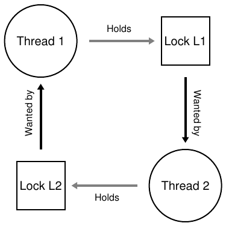
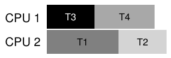
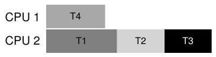

# 32 Những vấn đề Concurrency phổ biến

Các nhà nghiên cứu dành nhiều thời gian và công sức tìm hiểu concurrency bug qua nhiều năm. Công trình đầu chủ yếu về deadlock, chủ đề đã chạm tới ở chương trước nhưng giờ nghiên cứu sâu [C+71]. Các công trình gần đây hơn tập trung nghiên cứu những loại concurrency bug phổ biến khác (non-deadlock). Chương này xem ngắn vài ví dụ vấn đề concurrency trong code thực tế để hiểu cần cảnh giác điều gì. Vì vậy vấn đề trung tâm là:

> MẤU CHỐT: XỬ LÝ CONCURRENCY BUG PHỔ BIẾN
>
> Concurrency bug thường theo nhiều mẫu phổ biến. Biết cần chú ý mẫu nào là bước đầu viết concurrent code vững chắc và đúng hơn.

## 32.1 Có những loại bug nào?

Câu hỏi đầu hiển nhiên: loại concurrency bug nào biểu hiện trong chương trình concurrent phức tạp? Khó trả lời tổng quát, nhưng may có người làm giúp. Cụ thể dựa vào nghiên cứu Lu và cộng sự [L+08], phân tích rất chi tiết vài ứng dụng concurrent phổ biến để hiểu loại bug thực tế.

Nghiên cứu tập trung bốn ứng dụng open-source quan trọng: MySQL (database management system phổ biến), Apache (web server well-known), Mozilla (web browser nổi tiếng), OpenOffice (phiên bản miễn phí bộ MS Office mà thực sự có người dùng). Tác giả xem concurrency bug đã tìm và sửa trong mỗi code base, biến công việc developer thành phân tích bug định lượng; hiểu kết quả giúp hiểu vấn đề thực sự trong code base trưởng thành.

| Ứng dụng | Chức năng | Non-Deadlock | Deadlock |
|---|---|---|---|
| MySQL | Database Server | 14 | 9 |
| Apache | Web Server | 13 | 4 |
| Mozilla | Web Browser | 41 | 16 |
| OpenOffice | Bộ ứng dụng văn phòng | 6 | 2 |
| Tổng |  | 74 | 31 |

Hình 32.1: Bug trong ứng dụng hiện đại

Hình 32.1 tổng hợp bug Lu và đồng nghiệp nghiên cứu. Tổng 105 bug, phần lớn không deadlock (74); 31 còn lại là deadlock bug. Cũng thấy số bug mỗi ứng dụng; OpenOffice chỉ 8 concurrency bug tổng cộng, Mozilla gần 60.

Giờ chúng ta nghiên cứu sâu hơn một chút các lớp bug (non-deadlock, deadlock). Với non-deadlock dùng ví dụ từ nghiên cứu dẫn dắt. Với deadlock, bàn chuỗi công trình lâu dài về prevention, avoidance hoặc handling deadlock.

## 32.2 Bug Non-Deadlock

Bug Non-deadlock chiếm phần lớn concurrency bug theo Lu. Nhưng loại nào? Phát sinh thế nào? Sửa ra sao? Giờ bàn hai loại non-deadlock chính Lu và cộng sự thấy: atomicity violation và order violation.

### Bug Atomicity-Violation

Loại đầu gọi atomicity violation. Đây là ví dụ đơn giản từ MySQL. Trước khi đọc giải thích, thử tìm bug. Làm đi!

```
 1   Thread 1::
 2   if (thd->proc_info) {
 3     ...
 4     fputs(thd->proc_info, ...);
 5     ...
 6   }
 7
 8   Thread 2::
 9   thd->proc_info = NULL;
```

Ở ví dụ, hai thread truy cập field proc_info của structure thd. Thread đầu kiểm tra non-NULL rồi in giá trị; thread hai đặt NULL. Rõ ràng nếu thread đầu kiểm tra rồi bị interrupt trước fputs, thread hai có thể chạy in-between đặt pointer bằng NULL; thread đầu tiếp tục sẽ crash vì fputs dereference NULL pointer.

Định nghĩa hình thức hơn theo Lu và cộng sự: “Serializability mong muốn giữa nhiều memory access bị vi phạm (tức vùng code được định là atomic, nhưng atomicity không được bảo đảm khi thực thi).” Ví dụ trên có atomicity assumption (theo lời Lu) về kiểm tra non-NULL của proc_info và dùng nó trong fputs(); khi giả định sai, code không như mong muốn.

Sửa loại này thường (không phải luôn) dễ. Bạn nghĩ cách sửa code trên được không?

Lời giải chỉ thêm lock quanh shared-variable reference, bảo đảm khi một trong hai thread truy cập field proc_info, đang giữ lock (proc_info_lock). Tất nhiên mọi code khác truy cập structure cũng phải acquire lock trước.

```
 1   pthread_mutex_t proc_info_lock = PTHREAD_MUTEX_INITIALIZER;
 2
 3   Thread 1::
 4   pthread_mutex_lock(&proc_info_lock);
 5   if (thd->proc_info) {
 6     ...
 7     fputs(thd->proc_info, ...);
 8     ...
 9   }
10   pthread_mutex_unlock(&proc_info_lock);
11
12   Thread 2::
13   pthread_mutex_lock(&proc_info_lock);
14   thd->proc_info = NULL;
15   pthread_mutex_unlock(&proc_info_lock);
```

### Bug Order-Violation

Loại non-deadlock phổ biến khác Lu và cộng sự thấy là order violation. Đây là ví dụ đơn giản khác; lại thử tìm tại sao code có bug.

```
 1   Thread 1::
 2   void init() {
 3      ...
 4      mThread = PR_CreateThread(mMain, ...);
 5      ...
 6   }
 7
 8   Thread 2::
 9   void mMain(...) {
10       ...
11       mState = mThread->State;
12       ...
13   }
```

Như có lẽ bạn thấy, code Thread 2 có vẻ giả định mThread đã khởi tạo (không NULL); nhưng nếu Thread 2 chạy ngay khi tạo, mThread chưa được đặt khi truy cập trong mMain() của Thread 2, dễ crash vì NULL-pointer dereference. Lưu ý giả định mThread ban đầu NULL; nếu không, điều kỳ lạ hơn xảy ra vì dereference ở Thread 2 truy cập memory location tùy ý.

Định nghĩa hình thức hơn của order violation là: “Thứ tự mong muốn giữa hai (nhóm) memory access bị đảo (tức A luôn phải thực thi trước B, nhưng thứ tự không được bảo đảm khi thực thi)” [L+08].

Cách sửa thường là cưỡng chế thứ tự. Như đã bàn kỹ, condition variable là cách dễ, vững chắc để thêm kiểu synchronization này vào code hiện đại. Vì vậy có thể viết lại ví dụ như sau:

```
 1   pthread_mutex_t mtLock = PTHREAD_MUTEX_INITIALIZER;
 2   pthread_cond_t  mtCond = PTHREAD_COND_INITIALIZER;
 3   int mtInit             = 0;
 4
 5   Thread 1::
 6   void init() {
 7      ...
 8      mThread = PR_CreateThread(mMain, ...);
 9
10      // signal that the thread has been created...
11      pthread_mutex_lock(&mtLock);
12      mtInit = 1;
13      pthread_cond_signal(&mtCond);
14      pthread_mutex_unlock(&mtLock);
15      ...
16   }
17
18   Thread 2::
19   void mMain(...) {
20       ...
21       // wait for the thread to be initialized...
22       pthread_mutex_lock(&mtLock);
23       while (mtInit == 0)
24           pthread_cond_wait(&mtCond, &mtLock);
25       pthread_mutex_unlock(&mtLock);
26
27       mState = mThread->State;
28       ...
29   }
```

Trong code fixed-up, thêm lock (mtLock), condition variable (mtCond), state variable (mtInit). Khi code khởi tạo chạy, đặt mtInit bằng 1 và signal. Nếu Thread 2 chạy trước, nó chờ signal và state đổi tương ứng; nếu chạy sau, kiểm tra state thấy đã khởi tạo (mtInit bằng 1), nên tiếp tục đúng. Có thể dùng chính mThread làm state variable, nhưng không làm để đơn giản. Khi thứ tự giữa thread quan trọng, condition variable (hoặc semaphore) có thể cứu giúp.

### Bug Non-Deadlock: Tổng kết

Tỷ lệ lớn (97%) non-deadlock bug Lu và cộng sự nghiên cứu là atomicity hoặc order violation. Vì vậy nghĩ cẩn thận các mẫu này giúp lập trình viên tránh tốt hơn. Hơn nữa, khi công cụ code-checking tự động phát triển, nên tập trung hai loại vì chiếm phần lớn non-deadlock bug triển khai thực tế.

Đáng tiếc không mọi bug dễ sửa như ví dụ trên. Có loại cần hiểu sâu chương trình đang làm gì, hoặc tổ chức lại code/data structure nhiều hơn. Đọc bài xuất sắc (dễ đọc) của Lu và cộng sự để biết thêm.

## 32.3 Deadlock Bug

Ngoài concurrency bug trên, vấn đề kinh điển trong nhiều concurrent system có locking protocol phức tạp là deadlock. Chẳng hạn thread (Thread 1) giữ lock L1 chờ L2; đáng tiếc Thread 2 giữ L2 chờ L1 release. Đoạn code minh họa khả năng deadlock:

```
Thread 1:             Thread 2:
lock(L1);             lock(L2);
lock(L2);             lock(L1);
```

Lưu ý chạy code không nhất thiết deadlock; nó có thể xảy ra nếu Thread 1 lấy L1 rồi context switch sang Thread 2. Lúc đó Thread 2 lấy L2, thử acquire L1. Có deadlock vì mỗi thread chờ nhau, không ai chạy được. Xem minh họa Hình 32.2; cycle trong graph chỉ deadlock.

Hình làm rõ vấn đề. Lập trình viên nên viết code thế nào để xử lý deadlock?

> MẤU CHỐT: CÁCH XỬ LÝ DEADLOCK
>
> Nên xây hệ thống thế nào để prevent, avoid hoặc ít nhất detect và recover deadlock? Đây có là vấn đề thực tế ngày nay?

### Tại sao Deadlock xảy ra?

Bạn có thể nghĩ deadlock đơn giản như trên dễ tránh. Ví dụ Thread 1 và 2 cùng bảo đảm lấy lock cùng thứ tự thì không bao giờ deadlock. Vậy tại sao vẫn xảy ra?



Hình 32.2: Deadlock Dependency Graph

Một lý do là code lớn có dependency phức tạp giữa component. Chẳng hạn operating system: virtual memory system có thể cần file system để page in block từ disk; file system sau đó cần page memory để đọc block vào nên liên hệ virtual memory system. Do đó phải thiết kế chiến lược locking hệ thống lớn cẩn thận, tránh deadlock khi circular dependency tự nhiên xuất hiện trong code.

Lý do khác là encapsulation. Developer được dạy ẩn chi tiết triển khai để dễ xây software modular. Đáng tiếc modularity không hợp locking. Như Jula và cộng sự chỉ [J+08], interface tưởng vô hại gần như mời gọi deadlock. Ví dụ Java Vector class và method AddAll(). Routine gọi như sau:

```
Vector v1, v2;
v1.AddAll(v2);
```

Bên trong, vì method phải an toàn multi-thread, cần acquire lock cho cả vector đích (v1) và parameter (v2). Routine acquire theo thứ tự tùy ý (v1 rồi v2 chẳng hạn) để thêm nội dung v2 vào v1. Nếu thread khác gọi v2.AddAll(v1) gần đồng thời, có khả năng deadlock, theo cách khá ẩn với ứng dụng gọi.

### Điều kiện Deadlock

Bốn condition cần cùng đúng để deadlock xảy ra [C+71]:

• Mutual exclusion: Thread yêu cầu độc quyền resource cần dùng (ví dụ thread lấy lock).

• Hold-and-wait: Thread giữ resource đã cấp phát (ví dụ lock đã acquire) trong khi chờ resource bổ sung (ví dụ lock muốn acquire).

• No preemption: Không thể cưỡng chế lấy resource (ví dụ lock) khỏi thread đang giữ.

• Circular wait: Tồn tại chuỗi thread vòng tròn, mỗi thread giữ một hoặc nhiều resource (ví dụ lock) mà thread kế tiếp yêu cầu.

Nếu bất kỳ condition nào trong bốn không thỏa, deadlock không thể xảy ra. Vì vậy, trước tiên chúng ta khám phá các kỹ thuật prevent deadlock; mỗi chiến lược ngăn một condition trên, là cách xử lý vấn đề.

### Prevention

### Circular Wait

Kỹ thuật prevention thực tiễn nhất (chắc chắn thường dùng) có lẽ là viết locking code không bao giờ gây circular wait. Cách trực tiếp nhất là quy định một total ordering cho việc acquire lock. Ví dụ chỉ hai lock L1 và L2, ngăn deadlock bằng luôn acquire L1 trước L2. Thứ tự chặt chẽ bảo đảm không circular wait, nên không deadlock.

Tất nhiên, hệ thống phức tạp hơn có nhiều hơn hai lock, nên total ordering có thể khó đạt (và có lẽ cũng không cần thiết). Vì vậy, partial ordering có thể hữu ích để tổ chức việc acquire lock nhằm tránh deadlock. Ví dụ thật xuất sắc là memory mapping code Linux [T+94]; comment đầu source code cho mười nhóm thứ tự acquire khác nhau, đơn giản như “i_mutex trước i_mmap_mutex”, phức tạp như “i_mmap_mutex trước private_lock trước swap_lock trước mapping->tree_lock”.

Cả total và partial ordering đòi thiết kế chiến lược locking cẩn thận, xây dựng hết sức cẩn trọng. Hơn nữa ordering chỉ quy ước, lập trình viên cẩu thả dễ bỏ locking protocol gây deadlock. Cuối cùng, lock ordering cần hiểu sâu code base và cách gọi routine; chỉ một lỗi dẫn đến từ “D”[^1].

> MẸO: CƯỠNG CHẾ LOCK ORDERING BẰNG LOCK ADDRESS
>
> Đôi khi hàm phải lấy hai (hoặc nhiều) lock; phải cẩn thận kẻo deadlock. Tưởng tượng hàm gọi: do_something(mutex_t *m1, mutex_t *m2). Nếu luôn lấy m1 trước m2 (hoặc luôn m2 trước m1), có thể deadlock vì thread này gọi do_something(L1, L2), thread kia gọi do_something(L2, L1).
>
> Để tránh, lập trình viên khéo dùng address lock sắp acquire. Acquire theo address high-to-low hoặc low-to-high bảo đảm do_something() luôn acquire cùng thứ tự, bất kể thứ tự truyền vào. Code như sau:
>
> ```
> if (m1 > m2) {  // grab locks in high-to-low address order
>   pthread_mutex_lock(m1);
>   pthread_mutex_lock(m2);
> } else {
>   pthread_mutex_lock(m2);
>   pthread_mutex_lock(m1);
> }
> // Code assumes that m1 != m2 (it is not the same lock)
> ```
>
> Kỹ thuật đơn giản này bảo đảm triển khai multi-lock acquisition deadlock-free đơn giản hiệu quả.

### Hold-and-wait

Có thể tránh yêu cầu hold-and-wait bằng acquire mọi lock cùng lúc, atomically. Thực tế có thể làm như sau:

```
 1   lock(prevention);
 2   lock(L1);
 3   lock(L2);
 4   ...
 5   unlock(prevention);
```

Lấy lock prevention trước bảo đảm không thread switch không đúng lúc giữa acquire lock, nên lại tránh deadlock. Tất nhiên mỗi lần thread lấy bất kỳ lock nào phải acquire global prevention lock trước. Ví dụ thread khác thử lấy L1 và L2 thứ tự khác vẫn ổn vì nó giữ prevention khi làm.

Giải pháp có vấn đề vì nhiều lý do. Như trước, encapsulation chống lại: gọi routine đòi biết chính xác lock nào phải giữ và acquire trước. Kỹ thuật cũng dễ giảm concurrency vì mọi lock phải acquire sớm (cùng lúc) thay khi thực sự cần.

### No Preemption

Vì thường xem lock giữ đến khi unlock, acquire nhiều lock hay gây vấn đề vì chờ lock này khi giữ lock khác. Nhiều thư viện thread cung cấp interface linh hoạt hơn để tránh. Cụ thể trylock() lấy lock nếu available, hoặc trả -1 báo đang được giữ, hãy thử lại sau nếu muốn.

Có thể dùng interface như sau xây protocol acquire lock deadlock-free, ordering-robust:

```
 1   top:
 2     lock(L1);
 3     if (trylock(L2) == -1) {
 4       unlock(L1);
 5       goto top;
 6     }
```

Thread khác theo protocol nhưng lấy ngược (L2 rồi L1) thì chương trình vẫn không deadlock. Nhưng vấn đề mới là livelock. Có thể (dù ít khả năng) hai thread liên tục thử chuỗi này và liên tục không acquire được cả hai. Cả hai hệ thống chạy đi chạy lại code (không deadlock) nhưng không tiến triển, nên gọi livelock. Có giải pháp: ví dụ thêm random delay trước loop lại thử toàn bộ, giảm khả năng thread tranh chấp liên tục cản nhau.

Một điểm cuối về lời giải này: nó né tránh những phần khó khi dùng cách tiếp cận trylock. Vấn đề đầu tiên có khả năng xuất hiện lại bắt nguồn từ encapsulation: nếu một trong các lock này nằm sâu trong routine đang được gọi, việc nhảy về đầu trở nên phức tạp hơn khi triển khai. Nếu code đã acquire thêm resource nào đó (ngoài L1) trong quá trình thực hiện, nó cũng phải bảo đảm release chúng cẩn thận; ví dụ, nếu sau khi acquire L1, code đã cấp phát memory, thì khi không acquire được L2, nó phải giải phóng memory đó trước khi nhảy về đầu để thử lại toàn bộ chuỗi thao tác. Tuy nhiên, trong những hoàn cảnh hạn chế (ví dụ Java vector method đã nhắc trước đó), cách tiếp cận này có thể hoạt động tốt.

### Mutual Exclusion

Kỹ thuật prevention cuối là tránh hoàn toàn nhu cầu mutual exclusion. Nói chung khó, vì code thật sự có critical section. Vậy làm gì?

Herlihy nghĩ có thể thiết kế data structure wait-free [H91]. Ý tưởng đơn giản: dùng hardware instruction mạnh xây structure không cần locking tường minh.

Ví dụ đơn giản, giả sử có instruction compare-and-swap, atomic instruction do hardware cung cấp làm như sau:

```
 1   int CompareAndSwap(int *address, int expected, int new) {
 2     if (*address == expected) {
 3       *address = new;
 4       return 1; // success
 5     }
 6     return 0; // failure
 7   }
```

Giờ muốn atomically tăng giá trị thêm lượng nhất định. Có thể làm:

```
 1   void AtomicIncrement(int *value, int amount) {
 2     do {
 3       int old = *value;
 4     } while (CompareAndSwap(value, old, old + amount) == 0);
 5   }
```

Thay vì acquire lock, cập nhật rồi release, chúng ta xây cách liên tục thử cập nhật thành giá trị mới bằng compare-and-swap. Theo cách này, không lock nào được acquire, nên không deadlock nào có thể xảy ra (dù livelock vẫn có thể).

Xét ví dụ phức tạp hơn chút: list insertion. Code insert đầu list:

```
 1   void insert(int value) {
 2     node_t *n = malloc(sizeof(node_t));
 3     assert(n != NULL);
 4     n->value = value;
 5     n->next  = head;
 6     head     = n;
 7   }
```

Code insert đơn giản nhưng nhiều thread gọi “cùng lúc” có race condition (thử tìm tại sao). Tất nhiên giải bằng bao code bằng acquire/release lock:

```
 1   void insert(int value) {
 2     node_t *n = malloc(sizeof(node_t));
 3     assert(n != NULL);
 4     n->value = value;
 5     lock(listlock);   // begin critical section
 6     n->next  = head;
 7     head     = n;
 8     unlock(listlock); // end of critical section
 9   }
```

Ở lời giải này dùng lock truyền thống[^2]. Thay vào đó thử insertion wait-free chỉ dùng compare-and-swap. Một cách:

```
 1   void insert(int value) {
 2     node_t *n = malloc(sizeof(node_t));
 3     assert(n != NULL);
 4     n->value = value;
 5     do {
 6       n->next = head;
 7     } while (CompareAndSwap(&head, n->next, n) == 0);
 8   }
```

Code cập nhật next pointer trỏ head hiện tại, rồi thử swap node newly-created vào vị trí head mới. Nhưng thất bại nếu thread khác đã swap head mới trong lúc đó, khiến thread này thử lại với head mới.

Tất nhiên list hữu ích cần hơn insert; không ngạc nhiên, xây list insert/delete/lookup wait-free là non-trivial. Đọc tài liệu phong phú wait-free synchronization nếu thích.

### Deadlock Avoidance qua Scheduling

Thay prevention, đôi khi deadlock avoidance thích hợp hơn. Avoidance cần biết toàn cục thread có thể lấy lock nào khi chạy, rồi schedule thread để bảo đảm không deadlock.

Ví dụ, giả sử chúng ta có hai processor và bốn thread cần được schedule trên chúng. Giả sử thêm rằng ta biết Thread 1 (T1) acquire các lock L1 và L2 (theo một thứ tự nào đó, tại một thời điểm nào đó trong quá trình thực thi), T2 cũng acquire L1 và L2, T3 chỉ acquire L2, còn T4 hoàn toàn không acquire lock nào. Ta có thể biểu diễn nhu cầu acquire lock của các thread dưới dạng bảng:

```
       T1   T2   T3   T4
L1    yes  yes   no   no
L2    yes  yes  yes   no
```

Scheduler thông minh tính được miễn T1 và T2 không chạy cùng lúc thì không thể deadlock. Một schedule:



Lưu ý (T3 và T1) hoặc (T3 và T2) được chồng lấp. Dù T3 lấy L2, không bao giờ gây deadlock khi concurrent vì chỉ lấy một lock.

Xem ví dụ nữa. Ở đây contention cùng resource (lại L1 và L2) lớn hơn, như bảng:

```
       T1   T2   T3   T4
L1    yes  yes  yes   no
L2    yes  yes  yes   no
```

Cụ thể T1, T2 và T3 đều cần lấy cả L1 và L2 lúc nào đó khi chạy. Schedule bảo đảm không deadlock:



Như thấy, static scheduling dẫn cách bảo thủ, T1, T2 và T3 cùng chạy trên một processor nên tổng thời gian dài đáng kể. Dù có thể chạy task concurrent, lo deadlock ngăn làm vậy, và giá phải trả là hiệu năng.

Ví dụ nổi tiếng là Banker’s Algorithm của Dijkstra [D64], nhiều cách tương tự được mô tả. Đáng tiếc chỉ hữu ích môi trường hạn chế, ví dụ embedded system biết toàn bộ task và lock cần. Hơn nữa có thể hạn chế concurrency như ví dụ hai. Vì vậy tránh deadlock qua scheduling không phải giải pháp general-purpose widely-used.

### Detect và Recover

Chiến lược tổng quát cuối là cho deadlock thỉnh thoảng xảy ra rồi xử lý khi detect. Ví dụ OS treo mỗi năm một lần, chỉ reboot rồi vui vẻ (hoặc bực bội) làm tiếp. Nếu hiếm, non-solution này khá thực dụng.

> MẸO: KHÔNG PHẢI LÚC NÀO CŨNG HOÀN HẢO (ĐỊNH LUẬT TOM WEST)
>
> Tom West, nổi tiếng là nhân vật sách computer-industry kinh điển Soul of a New Machine [K81], nói: “Không phải mọi việc đáng làm đều đáng làm tốt”, châm ngôn kỹ thuật tuyệt. Nếu điều xấu hiếm, không nên tốn nhiều công ngăn, đặc biệt khi chi phí thấp. Ngược lại, nếu xây tàu con thoi, sự cố khiến nó nổ tung, có lẽ nên bỏ qua lời khuyên này.

Nhiều database system sử dụng các kỹ thuật deadlock detection và recovery. Deadlock detector chạy định kỳ, dựng resource graph rồi kiểm tra cycle. Nếu có cycle (deadlock), cần khởi động lại hệ thống. Nếu trước tiên cần sửa data structure tinh vi hơn, có thể cần con người hỗ trợ.

Chi tiết database concurrency, deadlock và vấn đề liên quan có ở nguồn khác [B+87, K87]. Đọc hoặc tốt hơn học môn database để hiểu chủ đề phong phú thú vị.

## 32.4 Tổng kết

Chương này nghiên cứu bug trong concurrent program. Loại đầu non-deadlock phổ biến đáng ngạc nhiên nhưng thường dễ sửa hơn. Gồm atomicity violation, khi chuỗi instruction phải thực thi cùng nhau lại không; và order violation, khi thứ tự cần giữa hai thread không bảo đảm.

Cũng bàn ngắn deadlock: lý do và giải pháp. Vấn đề xưa như concurrency, hàng trăm bài báo viết về nó. Thực tiễn tốt nhất là cẩn thận, xây thứ tự acquire lock, ngăn từ đầu. Cách Wait-free cũng hứa hẹn, một số data structure wait-free đã vào thư viện commonly-used và hệ thống quan trọng gồm Linux. Nhưng thiếu tổng quát và khó phát triển data structure wait-free mới có thể hạn chế hữu ích chung. Có lẽ tốt nhất phát triển mô hình lập trình concurrent mới: hệ thống như MapReduce (Google) [GD02] cho mô tả vài loại tính toán parallel không lock. Lock vốn có vấn đề; có lẽ nên tránh trừ khi thực sự phải dùng.

## Tài liệu tham khảo

[B+87] “Concurrency Control and Recovery in Database Systems”

Philip A. Bernstein, Vassos Hadzilacos, Nathan Goodman

Addison-Wesley, 1987

Sách kinh điển concurrency trong database management system. Hiểu concurrency, deadlock và chủ đề database khác là cả một thế giới. Hãy nghiên cứu để tự tìm hiểu.

[C+71] “System Deadlocks”

E.G. Coffman, M.J. Elphick, A. Shoshani

ACM Computing Surveys, 3:2, June 1971

Bài kinh điển nêu condition deadlock và cách xử lý. Chắc chắn có bài sớm hơn; xem tài liệu tham khảo trong đó.

[D64] “Een algorithme ter voorkoming van de dodelijke omarming”

Edsger Dijkstra

Lưu hành riêng, khoảng 1964

Có tại: http://www.cs.utexas.edu/users/EWD/ewd01xx/EWD108.PDF

Thực ra Dijkstra không chỉ đưa nhiều giải pháp deadlock mà còn đầu tiên ghi nhận nó, ít nhất bằng văn bản. Nhưng ông gọi “deadly embrace”, may thay tên không phổ biến.

[GD02] “MapReduce: Simplified Data Processing on Large Clusters”

Sanjay Ghemawhat and Jeff Dean

OSDI ’04, San Francisco, CA, October 2004

Bài MapReduce mở thời đại xử lý dữ liệu large-scale, đề xuất framework tính toán trên cluster máy thường không đáng tin cậy.

[H91] “Wait-free Synchronization”

Maurice Herlihy

ACM TOPLAS, 13(1), pages 124-149, January 1991

Công trình Herlihy tiên phong ý tưởng wait-free để viết concurrent program. Cách này phức tạp khó, thường khó hơn dùng lock đúng, có lẽ hạn chế thành công thực tế.

[J+08] “Deadlock Immunity: Enabling Systems To Defend Against Deadlocks”

Horatiu Jula, Daniel Tralamazza, Cristian Zamfir, George Candea

OSDI ’08, San Diego, CA, December 2008

Bài mới xuất sắc về deadlock và cách tránh mắc cùng deadlock nhiều lần trong hệ thống cụ thể.

[K81] “Soul of a New Machine”

Tracy Kidder, 1980

Sách must-read cho người xây hệ thống hoặc kỹ sư, kể thời đầu nhóm trong Data General (DG) do Tom West dẫn dắt làm “máy mới”. Sách khác của Kidder cũng tuyệt, gồm Mountains beyond Mountains. Hoặc có lẽ bạn không đồng ý, dấu phẩy?

[K87] “Deadlock Detection in Distributed Databases”

Edgar Knapp

ACM Computing Surveys, Volume 19, Number 4, December 1987

Tổng quan xuất sắc deadlock detection trong distributed database system. Cũng chỉ nhiều công trình liên quan, là nơi tốt bắt đầu đọc.

[L+08] “Learning from Mistakes — A Comprehensive Study on Real World Concurrency Bug Characteristics”

Shan Lu, Soyeon Park, Eunsoo Seo, Yuanyuan Zhou

ASPLOS ’08, March 2008, Seattle, Washington

Nghiên cứu in-depth đầu tiên concurrency bug trong software thật, nền tảng chương này. Xem website Y.Y. Zhou hoặc Shan Lu để có nhiều bài thú vị về bug.

[T+94] “Linux File Memory Map Code”

Linus Torvalds and many others

Có tại: http://lxr.free-electrons.com/source/mm/filemap.c

Cảm ơn Michael Walfish (NYU) chỉ ví dụ quý này. Như file cho thấy, thế giới thật có thể phức tạp hơn sự đơn giản rõ ràng trong sách...

---

[^1]: Gợi ý: “D” là “Deadlock”.

[^2]: Bạn đọc tinh ý có thể hỏi tại sao lấy lock muộn thay vì ngay khi vào insert(); bạn có tìm ra tại sao có lẽ đúng không?
