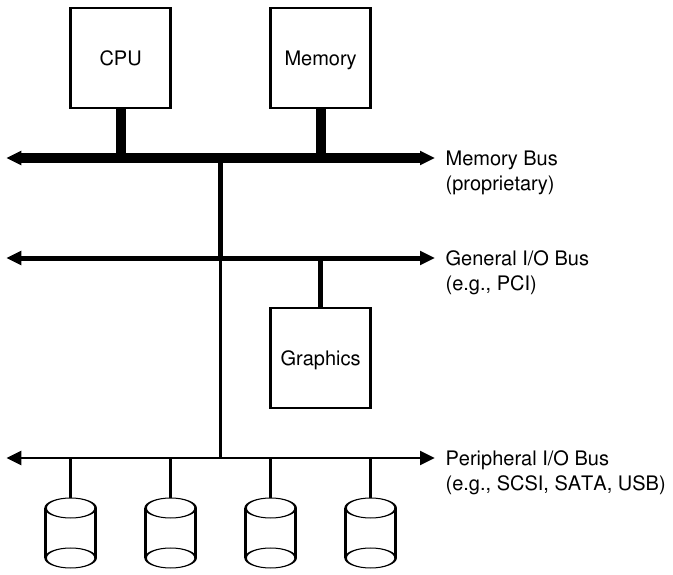
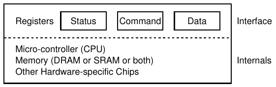
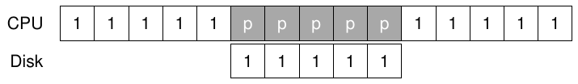
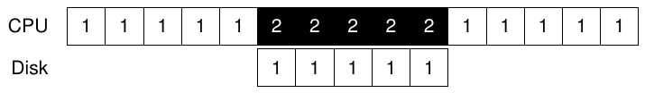
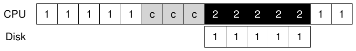
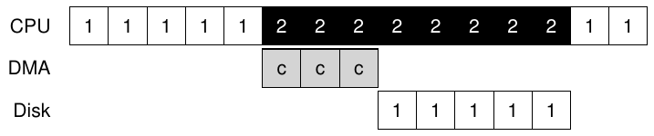
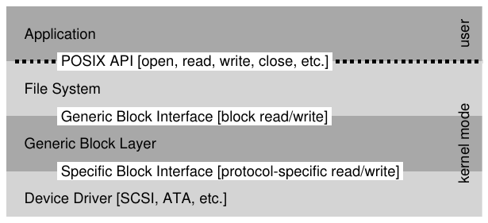

# 36 I/O Device

Trước khi đi sâu vào nội dung chính của phần này (về persistence), trước tiên chúng ta giới thiệu khái niệm input/output (I/O) device và chỉ ra cách operating system có thể tương tác với thực thể đó. Dĩ nhiên I/O rất quan trọng với hệ thống máy tính; hãy tưởng tượng chương trình không có input (nó cho cùng kết quả mỗi lần); giờ hãy tưởng tượng chương trình không có output (nó chạy để làm gì?). Rõ ràng, để hệ thống máy tính có ý nghĩa, cần cả input lẫn output. Và vì thế, vấn đề tổng quát của chúng ta:

> MẤU CHỐT: LÀM SAO TÍCH HỢP I/O VÀO HỆ THỐNG
>
> Nên tích hợp I/O vào hệ thống như thế nào? Những mechanism tổng quát là gì? Làm sao để chúng hiệu quả?

## 36.1 System Architecture

Để bắt đầu thảo luận, hãy xem cấu trúc hệ thống điển hình (Hình 36.1). Hình vẽ cho thấy một CPU nối với main memory của hệ thống qua một loại memory bus hoặc interconnect nào đó. Một số device kết nối với hệ thống qua I/O bus tổng quát, trong nhiều hệ thống hiện đại là PCI (hoặc một trong nhiều biến thể của nó); graphics và một số I/O device higher-performance khác có thể ở đây. Cuối cùng, thấp hơn nữa là một hoặc nhiều peripheral bus, như SCSI, SATA hay USB. Chúng kết nối những device chậm nhất với hệ thống, gồm disk, chuột và các thành phần tương tự.

Một câu hỏi bạn có thể đặt ra là: vì sao cần cấu trúc phân cấp như vậy? Nói đơn giản: vật lý và chi phí. Bus càng nhanh thì phải càng ngắn; do đó, high-performance memory bus không có nhiều chỗ để gắn device và các thứ tương tự. Ngoài ra, thiết kế bus đạt hiệu năng cao khá tốn kém. Vì vậy, người thiết kế hệ thống dùng cách phân cấp này: các thành phần cần hiệu năng cao (như graphics card) nằm gần CPU hơn. Những thành phần hiệu năng thấp ở xa hơn. Đặt disk và device chậm khác trên peripheral bus có nhiều lợi ích; đặc biệt, có thể đặt số lượng device lớn trên đó.



Hình 36.1: System Architecture điển hình

## 36.2 Một Device mẫu

Giờ hãy xem một device mẫu (không phải device thực), dùng nó để hiểu một số cơ chế cần thiết nhằm tương tác với device hiệu quả. Từ Hình 36.2, ta thấy device có hai thành phần quan trọng. Thứ nhất là hardware interface nó cung cấp cho phần còn lại của hệ thống. Giống phần mềm, hardware cũng phải cung cấp một loại interface cho phép system software điều khiển hoạt động của nó. Do đó, mọi device có interface và protocol xác định cho tương tác thông thường.

Phần thứ hai của mọi device là cấu trúc bên trong. Phần này phụ thuộc cách triển khai và chịu trách nhiệm hiện thực abstraction mà device cung cấp cho hệ thống. Device rất đơn giản có một hoặc vài hardware chip để thực hiện chức năng; device phức tạp hơn gồm CPU đơn giản, một ít general purpose memory và các device-specific chip khác để làm việc. Chẳng hạn, RAID controller hiện đại có thể gồm hàng trăm nghìn dòng firmware (tức phần mềm trong hardware device) để thực hiện chức năng.



Hình 36.2: Một Device mẫu

## 36.3 Protocol mẫu

Trong hình trên, device interface (đơn giản hóa) gồm ba register: status register có thể đọc để biết trạng thái hiện tại của device; command register để yêu cầu device thực hiện task nhất định; và data register để truyền dữ liệu tới device hoặc lấy dữ liệu từ nó. Bằng cách đọc và ghi các register này, operating system điều khiển hành vi của device.

Giờ hãy mô tả tương tác điển hình giữa OS và device để device làm một việc thay OS. Protocol như sau:

```
While (STATUS == BUSY)
    ; // wait until device is not busy
Write data to DATA register
Write command to COMMAND register
    (Doing so starts the device and executes the command)
While (STATUS == BUSY)
    ; // wait until device is done with your request
```

Protocol có bốn bước. Đầu tiên, OS chờ device sẵn sàng nhận command bằng cách liên tục đọc status register; ta gọi đó là polling device (về cơ bản chỉ hỏi nó đang làm gì). Thứ hai, OS gửi dữ liệu xuống data register; có thể hình dung nếu đây là disk thì cần nhiều lần ghi để chuyển một disk block (chẳng hạn 4KB) tới device. Khi CPU chính tham gia di chuyển dữ liệu (như trong protocol ví dụ này), ta gọi đó là programmed I/O (PIO). Thứ ba, OS ghi command vào command register; việc này ngầm báo device rằng dữ liệu đã có và nó nên bắt đầu thực hiện command. Cuối cùng, OS chờ device hoàn tất bằng cách lại polling trong vòng lặp, đợi xem nó xong chưa (sau đó có thể nhận error code biểu thị thành công hay thất bại).

Protocol cơ bản này có ưu điểm đơn giản và hoạt động được. Tuy nhiên, nó có một số điểm kém hiệu quả và bất tiện. Vấn đề đầu tiên bạn có thể nhận thấy là polling có vẻ kém hiệu quả; cụ thể, nó lãng phí nhiều thời gian CPU chỉ để đợi device (có thể chậm) hoàn thành hoạt động, thay vì chuyển sang process sẵn sàng khác để tận dụng CPU tốt hơn.

> MẤU CHỐT: LÀM SAO TRÁNH CHI PHÍ POLLING
>
> Làm sao OS kiểm tra trạng thái device mà không polling thường xuyên, qua đó giảm CPU overhead cần để quản lý device?

## 36.4 Giảm CPU Overhead bằng Interrupt

Phát minh mà nhiều kỹ sư tìm ra từ lâu để cải thiện tương tác này là điều chúng ta đã gặp: interrupt. Thay vì polling device liên tục, OS có thể phát request, cho process gọi sleep và context switch sang task khác. Khi device hoàn tất thao tác, nó phát hardware interrupt, khiến CPU nhảy vào OS tại một interrupt service routine (ISR) pre-determined, hay đơn giản là interrupt handler. Handler chỉ là một đoạn operating system code hoàn tất request (ví dụ đọc dữ liệu và có thể error code từ device) rồi đánh thức process chờ I/O, để process tiếp tục như mong muốn.

Như vậy interrupt cho phép tính toán chồng lấp với I/O, yếu tố then chốt để cải thiện utilization. Timeline này cho thấy vấn đề:



Trong sơ đồ, Process 1 chạy trên CPU một thời gian (biểu thị bằng số 1 lặp lại trên dòng CPU), rồi phát I/O request tới disk để đọc dữ liệu. Không có interrupt, hệ thống chỉ spin, polling trạng thái device liên tục tới khi I/O hoàn tất (biểu thị bằng p). Disk phục vụ request và cuối cùng Process 1 có thể chạy lại.

Nếu thay vào đó dùng interrupt và cho phép chồng lấp, OS có thể làm việc khác trong khi chờ disk:



Trong ví dụ này, OS chạy Process 2 trên CPU trong khi disk phục vụ request của Process 1. Khi disk request hoàn tất, interrupt xảy ra, OS đánh thức Process 1 và chạy nó lại. Do đó cả CPU lẫn disk đều được tận dụng hợp lý trong khoảng thời gian ở giữa.

Lưu ý dùng interrupt không phải lúc nào cũng tốt nhất. Ví dụ, hình dung device làm việc rất nhanh: lần poll đầu tiên thường thấy device đã xong task. Dùng interrupt ở đây thực ra làm hệ thống chậm hơn: chuyển sang process khác, xử lý interrupt rồi chuyển về process phát request rất tốn kém. Vì thế, nếu device nhanh, polling có thể tốt nhất; nếu chậm, interrupt cho phép chồng lấp là tốt nhất. Nếu không biết tốc độ device, hoặc lúc nhanh lúc chậm, có thể tốt nhất là kết hợp polling một lúc rồi dùng interrupt nếu device chưa xong. Cách tiếp cận two-phased này có thể đạt ưu điểm của cả hai.

> MẸO: INTERRUPT KHÔNG PHẢI LÚC NÀO CŨNG TỐT HƠN PIO
>
> Dù interrupt cho phép chồng lấp tính toán và I/O, nó chỉ thực sự hợp lý với device chậm. Nếu không, chi phí xử lý interrupt và context switching có thể vượt lợi ích mà interrupt mang lại. Cũng có trường hợp một lượng interrupt dồn dập làm quá tải hệ thống và dẫn tới livelock [MR96]; khi đó polling cho OS kiểm soát scheduling tốt hơn và vì thế lại hữu ích.

Lý do khác để không dùng interrupt xuất hiện trong network [MR96]. Khi một luồng packet đến khổng lồ mà mỗi packet tạo một interrupt, OS có thể livelock, tức chỉ xử lý interrupt mà không bao giờ cho user-level process chạy để thực sự phục vụ request. Ví dụ, tưởng tượng web server đột nhiên chịu tải cao do “hiệu ứng slashdot”. Trường hợp này, thỉnh thoảng dùng polling sẽ tốt hơn để kiểm soát hoạt động trong hệ thống, cho web server phục vụ vài request trước khi quay lại device kiểm tra packet đến mới.

Một tối ưu interrupt-based khác là coalescing. Trong cấu hình đó, device cần phát interrupt sẽ chờ một chút trước khi chuyển interrupt tới CPU. Trong khi chờ, request khác có thể sớm hoàn tất, nên nhiều interrupt có thể được gộp thành một lần chuyển interrupt, giảm overhead xử lý interrupt. Dĩ nhiên, chờ quá lâu làm tăng latency của request, một trade-off phổ biến trong hệ thống. Xem Ahmad và cộng sự [A+11] để có tổng kết xuất sắc.

## 36.5 Di chuyển dữ liệu hiệu quả hơn bằng DMA

Đáng tiếc, còn một khía cạnh của protocol mẫu cần chú ý. Cụ thể, khi dùng programmed I/O (PIO) để chuyển lượng dữ liệu lớn tới device, CPU lại bị đè nặng bởi task khá tầm thường, lãng phí nhiều thời gian và công sức đáng ra nên dành cho process khác. Timeline minh họa vấn đề: trong timeline, Process 1 đang chạy rồi muốn ghi dữ liệu xuống disk. Nó khởi phát I/O, phải sao chép dữ liệu từ memory tới device một cách tường minh, từng word một (đánh dấu c trong sơ đồ). Khi sao chép xong, I/O bắt đầu trên disk và CPU cuối cùng mới có thể dùng cho việc khác.



> MẤU CHỐT: LÀM SAO GIẢM PIO OVERHEAD
>
> Với PIO, CPU dành quá nhiều thời gian tự di chuyển dữ liệu tới và từ device. Làm sao chuyển công việc này sang nơi khác để sử dụng CPU hiệu quả hơn?

Lời giải là thứ chúng ta gọi Direct Memory Access (DMA). DMA engine về cơ bản là device rất chuyên biệt trong hệ thống, có thể điều phối truyền dữ liệu giữa device và main memory mà không cần nhiều can thiệp của CPU.

DMA hoạt động như sau. Ví dụ, để truyền dữ liệu tới device, OS lập trình DMA engine bằng cách cho biết dữ liệu ở đâu trong memory, cần sao chép bao nhiêu và gửi tới device nào. Đến đó OS đã xong phần việc truyền dữ liệu và có thể làm việc khác. Khi DMA hoàn tất, DMA controller phát interrupt, nhờ đó OS biết truyền dữ liệu đã xong. Timeline sửa đổi:



Từ timeline, bạn thấy việc sao chép dữ liệu giờ do DMA controller xử lý. Vì CPU rảnh trong thời gian đó, OS có thể làm việc khác, ở đây chọn chạy Process 2. Vì thế Process 2 dùng được CPU nhiều hơn trước khi Process 1 chạy lại.

## 36.6 Phương pháp tương tác với Device

Giờ đã hiểu phần nào vấn đề hiệu quả của I/O, còn một vài vấn đề khác cần xử lý để đưa device vào hệ thống hiện đại. Một vấn đề có thể bạn đã nhận thấy: chúng ta thực ra chưa nói gì về cách OS thực sự giao tiếp với device! Vì thế, vấn đề là:

> MẤU CHỐT: LÀM SAO GIAO TIẾP VỚI DEVICE
>
> Hardware nên giao tiếp với device như thế nào? Có nên có instruction tường minh? Hay còn cách khác?

Theo thời gian, hai phương pháp giao tiếp với device chủ yếu đã phát triển. Phương pháp đầu tiên và lâu đời nhất (được IBM mainframe dùng nhiều năm) là có I/O instruction tường minh. Chúng chỉ định cách OS gửi dữ liệu tới device register cụ thể, nhờ đó cho phép xây dựng những protocol mô tả ở trên.

Ví dụ, trên x86, instruction in và out có thể dùng để giao tiếp với device. Chẳng hạn, để gửi dữ liệu tới device, caller chỉ định register chứa dữ liệu và port cụ thể định danh device. Thực thi instruction dẫn tới hành vi mong muốn.

Các instruction này thường là privileged. OS điều khiển device, vì thế OS là thực thể duy nhất được giao tiếp trực tiếp với chúng. Tưởng tượng bất kỳ chương trình nào cũng đọc hoặc ghi disk được: hỗn loạn hoàn toàn (như mọi khi), vì bất kỳ user program nào cũng dùng được lỗ hổng đó để chiếm toàn quyền điều khiển máy.

Phương pháp tương tác device thứ hai gọi là memory-mapped I/O. Với cách này, hardware cung cấp device register như thể chúng là vị trí memory. Để truy cập register cụ thể, OS phát load (để đọc) hoặc store (để ghi) địa chỉ đó; hardware chuyển load/store tới device thay vì main memory.

Không có ưu thế quá lớn nghiêng về cách nào. Cách memory-mapped có điểm hay là không cần instruction mới để hỗ trợ, nhưng cả hai cách vẫn được dùng ngày nay.

## 36.7 Tích hợp vào OS: Device Driver

Vấn đề cuối cùng chúng ta thảo luận: làm sao tích hợp device, mỗi loại có interface rất riêng, vào OS mà ta muốn giữ tổng quát nhất có thể. Ví dụ, xét file system. Ta muốn xây dựng file system hoạt động trên SCSI disk, IDE disk, USB keychain drive, v.v., và muốn nó tương đối không cần biết mọi chi tiết về cách phát read hay write request tới các loại drive khác nhau. Do đó, vấn đề là:

> MẤU CHỐT: LÀM SAO XÂY DỰNG OS DEVICE-NEUTRAL
>
> Làm sao giữ phần lớn OS device-neutral, qua đó giấu chi tiết tương tác device khỏi các OS subsystem chính?

Vấn đề được giải quyết bằng kỹ thuật age-old là abstraction. Ở tầng thấp nhất, một phần mềm trong OS phải biết chi tiết cách device hoạt động. Ta gọi phần mềm đó là device driver, và mọi chi tiết tương tác device được đóng gói bên trong.

Hãy xem abstraction này giúp thiết kế và triển khai OS thế nào bằng cách khảo sát Linux file system software stack. Hình 36.3 mô tả sơ lược và gần đúng cách tổ chức Linux software. Như bạn thấy trong sơ đồ, file system (và chắc chắn cả ứng dụng bên trên) hoàn toàn không cần biết chi tiết về loại disk đang dùng; nó chỉ phát block read và write request tới generic block layer, tầng này chuyển chúng tới device driver phù hợp, rồi driver xử lý chi tiết phát request cụ thể. Dù đơn giản hóa, sơ đồ cho thấy cách giấu chi tiết đó khỏi phần lớn OS.



Hình 36.3: File System Stack

Lưu ý encapsulation như vậy cũng có mặt hạn chế. Chẳng hạn, nếu device có nhiều khả năng đặc biệt nhưng phải cung cấp generic interface cho phần còn lại của kernel, những khả năng đặc biệt đó không được sử dụng. Ví dụ, tình huống này xuất hiện trong Linux với SCSI device, vốn báo lỗi rất phong phú; vì block device khác (ví dụ ATA/IDE) xử lý lỗi đơn giản hơn nhiều, những tầng phần mềm cao hơn chỉ nhận error code EIO tổng quát (generic IO error); mọi chi tiết bổ sung mà SCSI có thể cung cấp vì thế bị mất đối với file system [G08].

Điều thú vị là vì mọi device bạn có thể cắm vào hệ thống đều cần device driver, theo thời gian chúng chiếm tỷ lệ rất lớn trong kernel code. Nghiên cứu Linux kernel cho thấy hơn 70% OS code nằm trong device driver [C01]; với Windows-based system, tỷ lệ có lẽ cũng rất cao. Vì vậy, khi người ta nói OS có hàng triệu dòng code, thực ra họ nói OS có hàng triệu dòng device-driver code. Dĩ nhiên, ở một bản cài đặt cụ thể, phần lớn code đó có thể không hoạt động (tức chỉ vài device kết nối với hệ thống tại một thời điểm). Có lẽ buồn hơn nữa là vì driver thường do “người không chuyên” viết (thay vì full-time kernel developer), chúng thường có nhiều bug hơn hẳn và vì vậy góp phần chủ yếu gây kernel crash [S03].

## 36.8 Nghiên cứu trường hợp: IDE Disk Driver đơn giản

Để tìm hiểu sâu hơn, hãy xem nhanh device thực: IDE disk drive [L94]. Chúng ta tổng kết protocol được mô tả trong tài liệu này [W10]; cũng xem qua source code xv6 để có ví dụ đơn giản về IDE driver hoạt động được [CK+08].

IDE disk cung cấp interface đơn giản cho hệ thống, gồm bốn loại register: control, command block, status và error. Có thể truy cập chúng bằng đọc hoặc ghi các “I/O address” cụ thể (như 0x3F6 dưới đây), dùng (trên x86) I/O instruction in và out.

```
Control Register:
  Address 0x3F6 = 0x80 (0000 1RE0): R=reset, E=0 means "enable interrupt"
Command Block Registers:
  Address 0x1F0 = Data Port
  Address 0x1F1 = Error
  Address 0x1F2 = Sector Count
  Address 0x1F3 = LBA low byte
  Address 0x1F4 = LBA mid byte
  Address 0x1F5 = LBA hi  byte
  Address 0x1F6 = 1B1D TOP4LBA: B=LBA, D=drive
  Address 0x1F7 = Command/status
Status Register (Address 0x1F7):
    7      6    5      4    3    2    1     0
   BUSY  READY FAULT SEEK  DRQ  CORR IDDEX ERROR
Error Register (Address 0x1F1): (check when Status ERROR==1)
    7      6    5      4    3    2    1    0
   BBK    UNC   MC   IDNF  MCR  ABRT T0NF AMNF
   BBK  = Bad Block
   UNC  = Uncorrectable data error
   MC   = Media Changed
   IDNF = ID mark Not Found
   MCR  = Media Change Requested
   ABRT = Command aborted
   T0NF = Track 0 Not Found
   AMNF = Address Mark Not Found
```

Hình 36.4: IDE Interface

Protocol cơ bản để tương tác với device như sau, giả sử nó đã được khởi tạo.

• Chờ drive sẵn sàng. Đọc Status Register (0x1F7) tới khi drive không bận và READY.

• Ghi parameter vào command register. Ghi sector count, logical block address (LBA) của những sector cần truy cập, và drive number (master=0x00 hoặc slave=0x10, vì IDE chỉ cho phép hai drive) vào command register (0x1F2-0x1F6).

• Bắt đầu I/O bằng cách phát read/write tới command register. Ghi command READ—WRITE vào command register (0x1F7).

• Truyền dữ liệu (khi ghi): Chờ trạng thái drive là READY và DRQ (drive request for data); ghi dữ liệu vào data port.

• Xử lý interrupt. Ở trường hợp đơn giản nhất, xử lý interrupt cho mỗi sector được truyền; cách phức tạp hơn cho phép batching và vì thế chỉ có một interrupt cuối khi toàn bộ truyền dữ liệu hoàn tất.

• Xử lý lỗi. Sau mỗi thao tác, đọc status register. Nếu bit ERROR bật, đọc error register để biết chi tiết.

Phần lớn protocol này nằm trong xv6 IDE driver (Hình 36.5), vốn (sau khởi tạo) hoạt động qua bốn function chính. Đầu tiên là ide_rw(), đưa request vào queue (nếu còn request khác đang chờ), hoặc phát trực tiếp tới disk (qua ide_start_request()); trong cả hai trường hợp, routine chờ request hoàn tất và process gọi được cho sleep. Thứ hai là ide_start_request(), dùng để gửi request (và có thể dữ liệu khi ghi) tới disk; x86 instruction in và out lần lượt được gọi để đọc và ghi device register. Routine bắt đầu request dùng function thứ ba, ide_wait_ready(), để bảo đảm drive sẵn sàng trước khi phát request tới nó. Cuối cùng, ide_intr() được gọi khi interrupt xảy ra; nó đọc dữ liệu từ device (nếu request là đọc chứ không phải ghi), đánh thức process đợi I/O hoàn tất và (nếu còn request trong I/O queue) khởi phát I/O tiếp theo qua ide_start_request().

```
static int ide_wait_ready() {
  while (((int r = inb(0x1f7)) & IDE_BSY) || !(r & IDE_DRDY))
    ;                              // loop until drive isn’t busy
}
static void ide_start_request(struct buf *b) {
  ide_wait_ready();
  outb(0x3f6, 0);                  // generate interrupt
  outb(0x1f2, 1);                  // how many sectors?
  outb(0x1f3, b->sector & 0xff);   // LBA goes here ...
  outb(0x1f4, (b->sector >> 8) & 0xff);   // ... and here
  outb(0x1f5, (b->sector >> 16) & 0xff);  // ... and here!
  outb(0x1f6, 0xe0 | ((b->dev&1)<<4) | ((b->sector>>24)&0x0f));
  if(b->flags & B_DIRTY){
    outb(0x1f7, IDE_CMD_WRITE);    // this is a WRITE
    outsl(0x1f0, b->data, 512/4);  // transfer data too!
  } else {
    outb(0x1f7, IDE_CMD_READ);     // this is a READ (no data)
  }
}
void ide_rw(struct buf *b) {
  acquire(&ide_lock);
  for (struct buf **pp = &ide_queue; *pp; pp=&(*pp)->qnext)
    ;                              // walk queue
  *pp = b;                         // add request to end
  if (ide_queue == b)              // if q is empty
    ide_start_request(b);          // send req to disk
  while ((b->flags & (B_VALID|B_DIRTY)) != B_VALID)
    sleep(b, &ide_lock);           // wait for completion
  release(&ide_lock);
}
void ide_intr() {
  struct buf *b;
  acquire(&ide_lock);
  if (!(b->flags & B_DIRTY) && ide_wait_ready() >= 0)
    insl(0x1f0, b->data, 512/4);   // if READ: get data
  b->flags |= B_VALID;
  b->flags &= ˜B_DIRTY;
  wakeup(b);                       // wake waiting process
  if ((ide_queue = b->qnext) != 0) // start next request
    ide_start_request(ide_queue);  // (if one exists)
  release(&ide_lock);
}
```

Hình 36.5: xv6 IDE Disk Driver (Đơn giản hóa)

## 36.9 Ghi chú lịch sử

Trước khi kết thúc, chúng ta thêm ghi chú lịch sử ngắn về nguồn gốc một số ý tưởng nền tảng này. Nếu muốn tìm hiểu thêm, hãy đọc tổng kết xuất sắc của Smotherman [S08].

Interrupt là ý tưởng lâu đời, hiện diện trên những máy đầu tiên. Ví dụ UNIVAC đầu những năm 1950 có một dạng interrupt vectoring, dù chưa rõ tính năng này xuất hiện chính xác năm nào [S08]. Đáng buồn là dù lịch sử điện toán còn non trẻ, chúng ta đã bắt đầu mất dấu nguồn gốc của nó.

Cũng còn tranh luận máy nào đầu tiên đưa ra ý tưởng DMA. Ví dụ, Knuth và những người khác chỉ ra DYSEAC (máy “di động”, thời đó nghĩa là có thể kéo trên trailer), trong khi người khác nghĩ IBM SAGE có thể là đầu tiên [S08]. Dù thế nào, tới giữa những năm 50 đã có hệ thống với I/O device giao tiếp trực tiếp với memory và ngắt CPU khi hoàn tất.

Lịch sử ở đây khó truy vết vì phát minh gắn với những máy thực, đôi khi ít người biết đến. Ví dụ, một số người nghĩ máy TX-2 của Lincoln Labs đầu tiên có vectored interrupt [S08], nhưng điều này chưa rõ ràng.

Vì các ý tưởng tương đối hiển nhiên — không cần bước nhảy tư duy kiểu Einstein để nghĩ ra việc cho CPU làm việc khác trong khi chờ I/O chậm — có lẽ tập trung vào “ai đầu tiên?” là sai hướng. Điều chắc chắn rõ ràng: khi xây những máy đầu tiên này, người ta nhận ra cần hỗ trợ I/O. Interrupt, DMA và các ý tưởng liên quan đều là kết quả trực tiếp của bản chất CPU nhanh và device chậm; nếu có mặt khi đó, bạn có thể cũng nghĩ tương tự.

## 36.10 Tổng kết

Giờ bạn đã có hiểu biết rất cơ bản về cách OS tương tác với device. Hai kỹ thuật, interrupt và DMA, đã được giới thiệu để giúp device hoạt động hiệu quả, và hai cách truy cập device register, I/O instruction tường minh và memory-mapped I/O, đã được mô tả. Cuối cùng, khái niệm device driver được trình bày, cho thấy chính OS có thể đóng gói chi tiết low-level và nhờ đó giúp xây phần còn lại của OS theo cách device-neutral dễ hơn.

## Tài liệu tham khảo

[A+11] “vIC: Interrupt Coalescing for Virtual Machine Storage Device IO”

Irfan Ahmad, Ajay Gulati, Ali Mashtizadeh

USENIX ’11

Khảo sát tuyệt vời về interrupt coalescing trong môi trường truyền thống và virtualized.

[C01] “An Empirical Study of Operating System Errors”

Andy Chou, Junfeng Yang, Benjamin Chelf, Seth Hallem, Dawson Engler

SOSP ’01

Một trong những bài báo đầu tiên khảo sát có hệ thống số bug trong operating system hiện đại. Trong những phát hiện thú vị khác, tác giả cho thấy device driver có số bug nhiều khoảng bảy lần so với mainline kernel code.

[CK+08] “The xv6 Operating System”

Russ Cox, Frans Kaashoek, Robert Morris, Nickolai Zeldovich

Từ: http://pdos.csail.mit.edu/6.828/2008/index.html

Xem ide.c để biết IDE device driver, với thêm vài chi tiết ở đó.

[D07] “What Every Programmer Should Know About Memory”

Ulrich Drepper

November, 2007

Có tại: http://www.akkadia.org/drepper/cpumemory.pdf

Tài liệu tuyệt vời về memory system hiện đại, bắt đầu từ DRAM lên tận virtualization và cache-optimized algorithm.

[G08] “EIO: Error-handling is Occasionally Correct”

Haryadi Gunawi, Cindy Rubio-Gonzalez, Andrea Arpaci-Dusseau, Remzi Arpaci-Dusseau, Ben Liblit

FAST ’08, San Jose, CA, February 2008

Công trình của chính chúng tôi về xây công cụ tìm code trong Linux file system không xử lý đúng giá trị lỗi trả về. Chúng tôi tìm thấy hàng trăm bug, nhiều lỗi nay đã được sửa.

[L94] “AT Attachment Interface for Disk Drives”

Lawrence J. Lamers, X3T10 Technical Editor

Có tại: ftp://ftp.t10.org/t13/project/d0791r4c-ATA-1.pdf

Mã tài liệu: ANSI X3.221 - 1994 Một tài liệu khá khô khan về device interface. Hãy tự cân nhắc trước khi đọc.

[MR96] “Eliminating Receive Livelock in an Interrupt-driven Kernel”

Jeffrey Mogul and K. K. Ramakrishnan

USENIX ’96, San Diego, CA, January 1996

Mogul và đồng nghiệp thực hiện nhiều công trình tiên phong về hiệu năng network của web server. Bài báo này chỉ là một ví dụ.

[S08] “Interrupts”

Mark Smotherman, as of July ’08

Có tại: http://people.cs.clemson.edu/˜mark/interrupts.html

Kho thông tin quý về lịch sử interrupt, DMA và những ý tưởng điện toán ban đầu liên quan.

[S03] “Improving the Reliability of Commodity Operating Systems” Michael M. Swift, Brian N. Bershad, and Henry M. Levy

SOSP ’03

Công trình của Swift khơi lại sự quan tâm tới cách tiếp cận microkernel-like hơn với operating system; ít nhất, cuối cùng nó đưa ra vài lý do tốt vì sao bảo vệ dựa trên address-space có thể hữu ích trong OS hiện đại.

[W10] “Hard Disk Driver”

Trang chủ môn học tại Washington State

Có tại: http://eecs.wsu.edu/˜cs460/cs560/HDdriver.html

Tổng kết hay về interface của IDE disk drive đơn giản và cách xây device driver cho nó.
