# 37 Hard Disk Drive

Chương trước giới thiệu khái niệm tổng quát I/O device và cho thấy OS có thể tương tác với nó như thế nào. Chương này đi sâu hơn vào một device cụ thể: hard disk drive. Những drive này là hình thức persistent data storage chủ yếu trong hệ thống máy tính suốt nhiều thập kỷ, và phần lớn sự phát triển công nghệ file system (sắp tới) dựa trên hành vi của chúng. Vì vậy, nên hiểu chi tiết hoạt động disk trước khi xây file system software quản lý nó. Nhiều chi tiết này có trong những bài báo xuất sắc của Ruemmler và Wilkes [RW92] và Anderson, Dykes, Riedel [ADR03].

> MẤU CHỐT: LÀM SAO LƯU TRỮ VÀ TRUY CẬP DỮ LIỆU TRÊN DISK
>
> hard-disk drive hiện đại lưu dữ liệu thế nào? Interface là gì? Dữ liệu thực sự được bố trí và truy cập thế nào? Disk scheduling cải thiện hiệu năng ra sao?

## 37.1 Interface

Hãy bắt đầu tìm hiểu interface của disk drive hiện đại. Interface cơ bản cho mọi drive hiện đại khá đơn giản. Drive gồm số lượng lớn sector (512-byte block), mỗi sector đều có thể đọc hoặc ghi. Sector được đánh số từ 0 tới n − 1 trên disk có n sector. Vì thế có thể xem disk như array sector; 0 tới n − 1 chính là address space của drive.

Có thể thực hiện thao tác Multi-sector; thực tế nhiều file system đọc hoặc ghi 4KB mỗi lần (hoặc hơn). Tuy nhiên khi cập nhật disk, điều duy nhất nhà sản xuất bảo đảm là một lần ghi 512- byte có tính atomic (tức hoặc hoàn tất toàn bộ hoặc không hoàn tất chút nào); vì vậy nếu mất điện không đúng lúc, chỉ một phần của lần ghi lớn hơn có thể hoàn tất (đôi khi gọi là torn write).

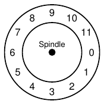

Hình 37.1: Disk chỉ có một Track

Có những giả định mà phần lớn client của disk drive đưa ra nhưng không được quy định trực tiếp trong interface; Schlosser và Ganger gọi đây là “hợp đồng bất thành văn” của disk drive [SG04]. Cụ thể, thường có thể giả định truy cập hai block gần one-another trong address space của drive sẽ nhanh hơn hai block xa nhau. Cũng thường có thể giả định truy cập các block trong một vùng liên tục (tức sequential read hoặc write) là chế độ truy cập nhanh nhất, thường nhanh hơn nhiều so với bất kỳ access pattern ngẫu nhiên hơn nào.

## 37.2 Cấu trúc hình học cơ bản

Hãy bắt đầu tìm hiểu một số thành phần disk hiện đại. Ta bắt đầu với platter, bề mặt cứng hình tròn lưu dữ liệu lâu dài bằng cách tạo thay đổi từ tính trên đó. Disk có thể có một hoặc nhiều platter; mỗi platter có 2 mặt, mỗi mặt gọi là surface. Platter thường làm từ vật liệu cứng (như nhôm), rồi phủ lớp từ tính mỏng giúp drive lưu bit lâu dài ngay cả khi tắt điện.

Các platter được gắn với nhau quanh spindle, nối với motor quay chúng (khi drive bật điện) ở tốc độ không đổi (cố định). Tốc độ quay thường đo bằng rotations per minute (RPM), giá trị hiện đại điển hình từ 7,200 RPM tới 15,000 RPM. Lưu ý ta thường quan tâm thời gian một vòng quay, ví dụ drive quay 10,000 RPM nghĩa là mỗi vòng mất khoảng 6 millisecond (6 ms).

Dữ liệu được mã hóa trên mỗi surface thành các vòng sector đồng tâm; một vòng như vậy gọi là track. Một surface chứa hàng nghìn hàng nghìn track sát nhau, với hàng trăm track nằm vừa trong bề rộng sợi tóc người.

Để đọc và ghi surface, cần mechanism cho phép cảm nhận (tức đọc) dạng từ tính trên disk hoặc tạo thay đổi (tức ghi) chúng. Quá trình đọc ghi được thực hiện bởi disk head; mỗi surface của drive có một head như vậy. Disk head gắn vào một disk arm, di chuyển trên surface để đặt head trên track mong muốn.

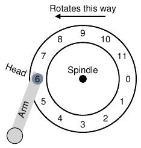

Hình 37.2: Một Track cùng Head

## 37.3 Disk Drive đơn giản

Hãy hiểu disk hoạt động bằng cách xây dần mô hình, mỗi lần một track. Giả sử có disk đơn giản với một track (Hình 37.1).

Track này chỉ có 12 sector, mỗi sector có kích thước 512 byte (nhớ rằng đây là sector size điển hình của ta), nên được định địa chỉ bằng số 0 tới 11. Platter duy nhất ở đây quay quanh spindle gắn với motor. Dĩ nhiên chỉ track thôi chưa thú vị; ta muốn đọc hoặc ghi các sector, vì thế cần disk head gắn vào disk arm, như hình hiện tại (Hình 37.2).

Trong hình, disk head gắn ở đầu arm nằm trên sector 6, và surface quay counter-clockwise.

### Single-track Latency: Rotational Delay

Để hiểu request được xử lý trên disk one-track đơn giản này thế nào, tưởng tượng giờ nhận request đọc block 0. Disk nên phục vụ request ra sao?

Trong disk đơn giản, disk không phải làm nhiều. Cụ thể, chỉ cần chờ sector mong muốn quay tới dưới disk head. Sự chờ đợi này xảy ra đủ thường xuyên trong drive hiện đại, và là thành phần đủ quan trọng của I/O service time để có tên riêng: rotational delay (đôi khi rotation delay, dù nghe kỳ lạ). Trong ví dụ, nếu thời gian quay trọn vòng là R, disk chịu rotational delay khoảng R/2 để chờ 0 tới dưới read/write head (nếu bắt đầu ở 6). Request worst-case trên track này là sector 5, cần gần trọn một vòng quay để phục vụ.

### Nhiều Track: Seek Time

Đến đây disk chỉ có một track, không thực tế lắm; disk hiện đại dĩ nhiên có nhiều triệu track. Hãy xem surface thực tế hơn ever-so-slightly, với ba track (Hình 37.3, bên trái).

Trong hình, head hiện ở track trong cùng (chứa sector 24 tới 35); track kế tiếp chứa tập sector tiếp theo (12 tới 23), và track ngoài cùng chứa các sector đầu tiên (0 tới 11).

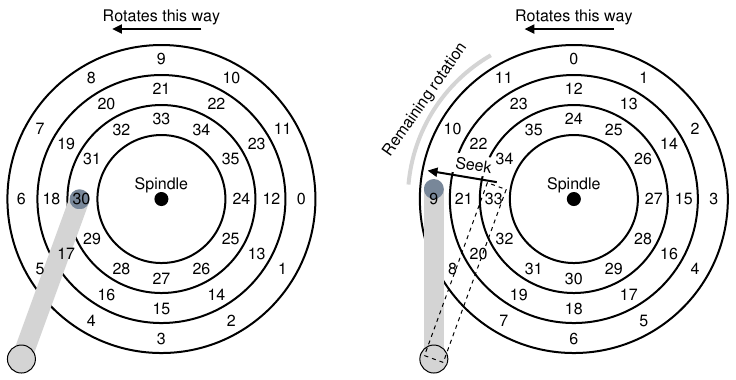

Hình 37.3: Ba Track cùng Head (Phải: Có Seek)

Để hiểu drive truy cập sector cụ thể như thế nào, giờ ta theo dõi điều xảy ra với request tới sector xa, ví dụ đọc sector 11. Để phục vụ lần đọc này, drive trước tiên phải di chuyển disk arm tới track đúng (ở đây là ngoài cùng), quá trình gọi là seek. Seek, cùng với rotation, là một trong những thao tác disk tốn kém nhất.

Cần lưu ý seek có nhiều pha: trước tiên acceleration khi disk arm bắt đầu chuyển động; tiếp đến coasting khi arm di chuyển ở tốc độ tối đa, rồi deceleration khi arm chậm lại; cuối cùng settling khi head được đặt cẩn thận trên đúng track. Settling time thường khá đáng kể, ví dụ 0.5 tới 2 ms, vì drive phải chắc chắn tìm đúng track (hãy tưởng tượng nếu chỉ đến gần!).

Sau seek, disk arm đã đặt head trên đúng track. Minh họa seek nằm trong Hình 37.3 (bên phải).

Như thấy được, trong seek, arm đã chuyển tới track mong muốn, và platter dĩ nhiên cũng quay, ở đây khoảng 3 sector. Vì thế sector 9 sắp đi dưới disk head, và ta chỉ cần chờ rotational delay ngắn để hoàn tất truyền dữ liệu.

Khi sector 11 đi dưới disk head, pha cuối I/O diễn ra, gọi là transfer, trong đó dữ liệu được đọc từ hoặc ghi lên surface. Như vậy ta có bức tranh đầy đủ về I/O time: đầu tiên seek, rồi chờ rotational delay, cuối cùng transfer.

### Một số chi tiết khác

Dù không dành quá nhiều thời gian, còn những chi tiết thú vị khác về hoạt động hard drive. Nhiều drive dùng một dạng track skew để bảo đảm sequential read được phục vụ đúng cả khi vượt ranh giới track. Với disk ví dụ đơn giản, điều này có thể như Hình 37.4.

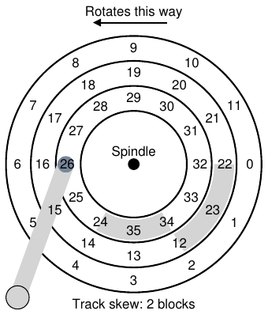

Hình 37.4: Ba Track: Track Skew bằng 2

Sector thường được skew như vậy vì khi chuyển giữa các track, disk cần thời gian đặt lại head (kể cả track kế bên). Không có skew, head chuyển tới track kế nhưng block tiếp theo mong muốn đã quay qua dưới head, nên drive phải chờ gần trọn rotational delay mới truy cập block đó.

Thực tế khác là track ngoài thường có nhiều sector hơn track trong, do hình học; đơn giản bên ngoài có nhiều chỗ hơn. Chúng thường được gọi là multi-zoned disk drive, trong đó disk chia nhiều zone, mỗi zone là tập track liên tiếp trên surface. Mỗi zone có cùng số sector trên mỗi track, và zone ngoài có nhiều sector hơn zone trong.

Cuối cùng, phần quan trọng của mọi disk drive hiện đại là cache, vì lý do lịch sử đôi khi gọi là track buffer. Cache chỉ là lượng memory nhỏ (thường khoảng 8 hoặc 16 MB) mà drive dùng để giữ dữ liệu đọc từ hoặc ghi tới disk. Ví dụ khi đọc sector, drive có thể quyết định đọc toàn bộ sector trên track và cache chúng trong memory; việc đó cho phép trả lời nhanh các request sau tới cùng track.

Khi ghi, drive có lựa chọn: xác nhận ghi hoàn tất khi đặt dữ liệu trong memory, hay sau khi dữ liệu thực sự được ghi xuống disk? Cách đầu gọi write back caching (đôi khi immediate reporting), cách sau là write through. Write back caching đôi khi làm drive có vẻ “nhanh hơn”, nhưng có thể nguy hiểm; nếu file system hoặc ứng dụng yêu cầu dữ liệu được ghi xuống disk theo thứ tự nhất định để bảo đảm đúng đắn, write-back caching có thể gây vấn đề (đọc chương về file-system journaling để biết chi tiết).

> BỔ SUNG: DIMENSIONAL ANALYSIS
>
> Nhớ trong giờ Hóa học, bạn giải gần như mọi bài toán chỉ bằng sắp xếp đơn vị để chúng triệt tiêu, rồi bằng cách nào đó đáp án xuất hiện? Phép màu hóa học đó có tên hoa mỹ dimensional analysis và hóa ra cũng hữu ích khi phân tích hệ thống máy tính.
>
> Hãy làm ví dụ để thấy dimensional analysis hoạt động thế nào và vì sao hữu ích. Ở đây, giả sử cần tìm thời gian một vòng quay disk theo millisecond. Đáng tiếc, bạn chỉ được cho RPM của disk, hay rotations per minute. Giả sử đang nói về disk 10K RPM (tức quay 10,000 vòng mỗi phút). Thiết lập dimensional analysis thế nào để nhận thời gian mỗi vòng theo millisecond?
>
> Để làm vậy, bắt đầu bằng đơn vị mong muốn ở bên trái; ở đây cần thời gian (theo millisecond) mỗi vòng, nên viết đúng như vậy: Time (ms)/(1 Rotation). Sau đó viết mọi điều đã biết, bảo đảm triệt tiêu đơn vị khi có thể. Trước tiên, có (1 minute)/(10,000 Rotations) (giữ rotation ở mẫu, như ở bên trái), rồi đổi phút thành giây bằng (60 seconds)/(1 minute), cuối cùng đổi giây thành millisecond bằng (1000 ms)/(1 second). Kết quả cuối như sau (với đơn vị triệt tiêu gọn gàng):
>
> 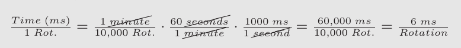
>
> Như ví dụ cho thấy, dimensional analysis biến điều tưởng như trực giác thành quy trình đơn giản, lặp lại được. Ngoài tính RPM ở trên, nó thường hữu ích trong phân tích I/O. Ví dụ bạn thường được cho transfer rate của disk, như 100 MB/second, rồi được hỏi: truyền block 512 KB mất bao lâu (theo millisecond)? Với dimensional analysis, rất dễ:
>
> 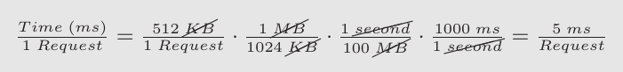

## 37.4 I/O Time: Tính toán

Giờ có mô hình trừu tượng về disk, ta có thể dùng chút phân tích để hiểu hiệu năng disk tốt hơn. Cụ thể, giờ biểu diễn I/O time bằng tổng ba thành phần chính:

TI/O = Tseek + Trotation + Ttransfer (37.1)

|  | Cheetah 15K.5 | Barracuda |
|---|---|---|
| Dung lượng | 300 GB | 1 TB |
| RPM | 15,000 | 7,200 |
| Seek trung bình | 4 ms | 9 ms |
| Transfer tối đa | 125 MB/s | 105 MB/s |
| Platters | 4 | 4 |
| Cache | 16 MB | 16/32 MB |
| Kết nối qua | SCSI | SATA |

Hình 37.5: Thông số Disk Drive: SCSI so với SATA

Lưu ý I/O rate (RI/O), thường dễ dùng hơn để so sánh drive (như sẽ làm dưới đây), dễ dàng tính được từ thời gian. Chỉ cần chia kích thước transfer cho thời gian mất:

RI/O = SizeTransfer/TI/O (37.2)

Để hiểu rõ I/O time hơn, hãy tính như sau. Giả sử quan tâm hai workload. Thứ nhất, random workload, phát read nhỏ (ví dụ 4KB) tới vị trí ngẫu nhiên trên disk. Random workload phổ biến trong nhiều ứng dụng quan trọng, kể cả database management system. Thứ hai, sequential workload, chỉ đọc nhiều sector liên tiếp từ disk mà không nhảy qua lại. Sequential access pattern khá phổ biến nên cũng quan trọng.

Để hiểu khác biệt hiệu năng giữa random và sequential workload, trước tiên cần vài giả định về disk drive. Hãy xem hai disk hiện đại của Seagate. Thứ nhất, Cheetah 15K.5 [S09b], là high-performance SCSI drive. Thứ hai, Barracuda [S09a], được xây dựng hướng tới dung lượng. Chi tiết cả hai trong Hình 37.5.

Như bạn thấy, các drive có đặc tính khác nhau rõ rệt, và theo nhiều cách thể hiện rõ hai phân khúc quan trọng của thị trường disk drive. Thứ nhất là thị trường drive “hiệu năng cao”, được thiết kế quay nhanh nhất có thể, seek time thấp và truyền dữ liệu nhanh. Thứ hai là thị trường “dung lượng”, trong đó chi phí mỗi byte quan trọng nhất; vì vậy drive chậm hơn nhưng chứa nhiều bit nhất có thể trong không gian sẵn có.

Từ những số này, có thể bắt đầu tính drive hoạt động tốt thế nào dưới hai workload trên. Bắt đầu với random workload. Giả sử mỗi read 4 KB diễn ra tại vị trí ngẫu nhiên trên disk, có thể tính thời gian mỗi lần đọc. Trên Cheetah:

Tseek = 4 ms, Trotation = 2 ms, Ttransfer = 30 microsecs (37.3)

> MẸO: DÙNG DISK THEO KIỂU SEQUENTIAL
>
> Bất cứ khi nào có thể, truyền dữ liệu tới và từ disk theo kiểu sequential. Nếu không thể sequential, ít nhất hãy nghĩ tới truyền theo khối lớn: càng lớn càng tốt. Nếu I/O gồm những phần nhỏ ngẫu nhiên, hiệu năng I/O giảm nghiêm trọng. Người dùng cũng khổ. Bạn cũng khổ, khi biết sự khổ sở mình gây ra bằng những random I/O thiếu thận trọng.

Average seek time (4 millisecond) lấy theo thời gian trung bình nhà sản xuất báo; lưu ý full seek (từ đầu này tới đầu kia surface) có thể lâu hơn hai hoặc ba lần. Average rotational delay tính trực tiếp từ RPM. 15000 RPM bằng 250 RPS (rotations per second); vì vậy mỗi vòng mất 4 ms. Trung bình disk gặp nửa vòng quay, nên 2 ms là thời gian trung bình. Cuối cùng, transfer time chỉ là kích thước transfer chia peak transfer rate; ở đây nó cực nhỏ (30 microsecond; nhớ cần 1000 microsecond mới được 1 millisecond!).

Vì thế, từ phương trình trên, TI/O của Cheetah xấp xỉ 6 ms. Để tính I/O rate, chỉ cần chia kích thước transfer cho thời gian trung bình, thu được RI/O của Cheetah với random workload khoảng 0.66 MB/s. Tính tương tự cho Barracuda cho TI/O khoảng 13.2 ms, chậm hơn gấp đôi, nên rate khoảng 0.31 MB/s.

Giờ xem sequential workload. Ở đây có thể giả sử chỉ một seek và rotation trước transfer rất dài. Cho đơn giản, giả sử kích thước transfer là 100 MB. Vì vậy TI/O của Barracuda và Cheetah lần lượt khoảng 800 ms và 950 ms. I/O rate do đó gần sát peak transfer rate lần lượt 125 MB/s và 105 MB/s. Hình 37.6 tổng kết các số này.

Hình cho thấy nhiều điều quan trọng. Đầu tiên và quan trọng nhất, có khoảng cách hiệu năng rất lớn giữa random và sequential workload, gần khoảng 200 lần với Cheetah và hơn 300 lần với Barracuda. Vì thế ta đi tới mẹo thiết kế hiển nhiên nhất trong lịch sử điện toán.

Điểm thứ hai tinh tế hơn: có khác biệt hiệu năng lớn giữa high-end drive “hiệu năng” và low-end drive “dung lượng”. Vì lý do này (và lý do khác), người ta thường sẵn lòng trả giá cao nhất cho loại đầu, đồng thời cố mua loại sau rẻ nhất có thể.

|  | Cheetah | Barracuda |
|---|---|---|
| RI/O Random | 0.66 MB/s | 0.31 MB/s |
| RI/O Sequential | 125 MB/s | 105 MB/s |

Hình 37.6: Hiệu năng Disk Drive: SCSI so với SATA

> BỔ SUNG: TÍNH SEEK “TRUNG BÌNH”
>
> Trong nhiều sách và bài báo, bạn thấy disk-seek time trung bình được dẫn là khoảng one-third full seek time. Điều này từ đâu ra?
>
> Hóa ra nó đến từ phép tính đơn giản dựa trên khoảng cách seek trung bình, không phải thời gian. Tưởng tượng disk như tập track từ 0 tới N. Khoảng cách seek giữa hai track x và y tính bằng trị tuyệt đối hiệu của chúng: |x − y|.
>
> Để tính khoảng cách seek trung bình, chỉ cần cộng trước mọi khoảng cách seek có thể:
>
> 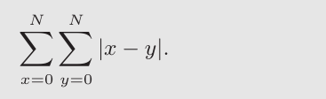 (37.4)
>
> Rồi chia cho số seek khác nhau có thể: N2. Để tính tổng, ta dùng dạng tích phân:
>
> 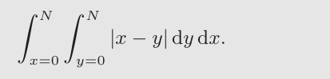 (37.5)
>
> Để tính tích phân trong, hãy tách trị tuyệt đối:
>
> 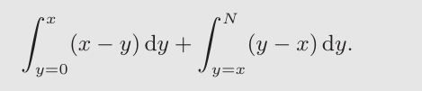 (37.6)
>
> Giải biểu thức này cho (xy − (1/2)y2)\|0x + ((1/2)y2 − xy)\|xN, có thể rút gọn thành (x2 − Nx + (1/2)N2). Giờ cần tính tích phân ngoài:
>
> 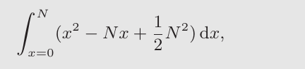 (37.7)
>
> cho kết quả:
>
> 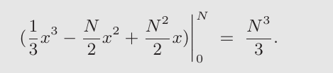 (37.8)
>
> Nhớ vẫn phải chia cho tổng số seek (N2) để tính khoảng cách seek trung bình: ((N3)/3)/(N2) = (1/3)N. Như vậy khoảng cách seek trung bình trên disk, tính trên mọi seek có thể, bằng one-third toàn khoảng cách. Giờ khi nghe average seek là one-third full seek, bạn biết nó từ đâu ra.

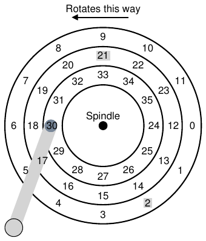

Hình 37.7: SSTF: Scheduling Request 21 và 2

## 37.5 Disk Scheduling

Vì I/O có chi phí cao, từ lâu OS đã đóng vai trò quyết định thứ tự I/O phát tới disk. Cụ thể, với tập I/O request, disk scheduler xem chúng và quyết định request nào được schedule tiếp theo [SCO90, JW91].

Khác job scheduling, nơi thường không biết độ dài mỗi job, với disk scheduling ta có thể đoán khá đúng “job” (tức disk request) mất bao lâu. Bằng ước lượng seek và rotational delay có thể của request, disk scheduler biết mỗi request mất bao lâu, nhờ đó chọn (theo kiểu greedy) request cần ít thời gian phục vụ nhất trước. Vì vậy disk scheduler cố tuân nguyên tắc SJF (shortest job first) khi hoạt động.

### SSTF: Shortest Seek Time First

Một cách disk scheduling ban đầu gọi là shortest-seek-time-first (SSTF) (cũng gọi shortest-seek-first hay SSF). SSTF sắp queue I/O request theo track, chọn request trên track gần nhất để hoàn tất trước. Ví dụ, giả sử head hiện trên track trong, và có request cho sector 21 (track giữa) và 2 (track ngoài), ta phát request tới 21 trước, chờ hoàn tất rồi phát request tới 2 (Hình 37.7).

SSTF hoạt động tốt trong ví dụ, seek tới track giữa trước rồi track ngoài. Tuy nhiên SSTF không phải thuốc chữa bách bệnh vì những lý do sau. Thứ nhất, host OS không biết drive geometry; nó chỉ thấy array block. May mắn, vấn đề khá dễ khắc phục. Thay SSTF, OS chỉ cần triển khai nearest-block-first (NBF), schedule tiếp request có block address gần nhất.

Vấn đề thứ hai căn bản hơn: starvation. Tưởng tượng trong ví dụ có luồng request đều đặn tới track trong, nơi head hiện ở. Request tới mọi track khác sẽ bị cách SSTF thuần túy bỏ qua hoàn toàn. Và vì vậy, mấu chốt là:

> MẤU CHỐT: LÀM SAO XỬ LÝ DISK STARVATION
>
> Làm sao triển khai scheduling SSTF-like mà tránh starvation?

### Elevator (còn gọi SCAN hoặc C-SCAN)

Câu trả lời được phát triển từ lâu (ví dụ xem [CKR72]), và tương đối dễ hiểu. Thuật toán ban đầu gọi SCAN chỉ di chuyển qua lại trên disk, phục vụ request theo thứ tự các track. Gọi một lượt qua disk (từ track ngoài vào trong hoặc trong ra ngoài) là sweep. Vì vậy, nếu request tới block trên track đã được phục vụ trong sweep hiện tại, nó không được xử lý ngay mà vào queue đợi sweep tiếp theo (theo hướng ngược lại).

SCAN có vài biến thể, tất cả làm gần giống nhau. Ví dụ Coffman và cộng sự giới thiệu F-SCAN, đóng băng queue cần phục vụ khi đang sweep [CKR72]; hành động này đưa request đến trong sweep vào queue để phục vụ sau. Nó tránh starvation cho request far-away bằng cách trì hoãn phục vụ request late-arriving (nhưng gần hơn).

C-SCAN là biến thể phổ biến khác, viết tắt Circular SCAN. Thay vì sweep cả hai hướng, thuật toán chỉ sweep outer-to-inner, rồi đặt lại ở track ngoài để bắt đầu lại. Việc đó công bằng hơn chút với track trong và ngoài, vì SCAN back-and-forth thuần túy ưu ái track giữa, tức sau phục vụ track ngoài, SCAN đi qua giữa hai lần mới trở lại track ngoài.

Vì những lý do giờ đã rõ, SCAN (và các họ hàng) đôi khi gọi elevator algorithm, vì giống thang máy đi lên hoặc xuống chứ không phục vụ tầng chỉ theo tầng nào gần hơn. Tưởng tượng bực thế nào nếu đi từ tầng 10 xuống 1, ai đó vào ở 3 và bấm 4, thang đi lên 4 vì “gần hơn” 1! Như bạn thấy, elevator algorithm khi dùng ngoài đời ngăn đánh nhau trong thang máy. Trong disk, nó chỉ ngăn starvation.

Đáng tiếc, SCAN và họ hàng không đại diện công nghệ scheduling tốt nhất. Cụ thể, SCAN (hay cả SSTF) chưa tuân sát nguyên tắc SJF như có thể. Đặc biệt, chúng bỏ qua rotation. Vì vậy, lại có mấu chốt:

> MẤU CHỐT: LÀM SAO TÍNH ĐẾN CHI PHÍ DISK ROTATION
>
> Làm sao triển khai thuật toán gần SJF hơn bằng tính cả seek lẫn rotation?

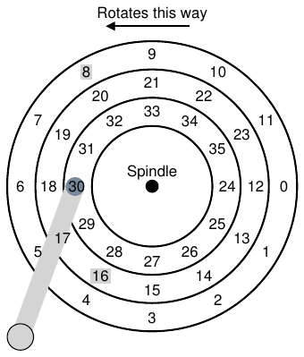

Hình 37.8: SSTF: Đôi khi chưa đủ tốt

### SPTF: Shortest Positioning Time First

Trước khi bàn shortest positioning time first hay SPTF scheduling (đôi khi gọi shortest access time first hay SATF), lời giải cho vấn đề, hãy bảo đảm hiểu vấn đề chi tiết hơn. Hình 37.8 trình bày ví dụ.

Trong ví dụ, head hiện trên sector 30 ở track trong. Scheduler phải quyết định: schedule sector 16 (track giữa) hay sector 8 (track ngoài) làm request tiếp theo. Vậy nên phục vụ cái nào trước?

Câu trả lời dĩ nhiên là “còn tùy”. Trong kỹ thuật, hóa ra “còn tùy” gần như luôn là câu trả lời, phản ánh rằng trade-offs là phần cuộc sống kỹ sư; châm ngôn này cũng hữu ích lúc bí, ví dụ khi không biết trả lời câu hỏi của sếp, bạn có thể thử câu quý giá này. Tuy nhiên, gần như luôn tốt hơn nếu biết vì sao còn tùy, điều ta thảo luận ở đây.

Điều quyết định ở đây là thời gian seek tương đối so với rotation. Nếu trong ví dụ seek time cao hơn nhiều rotational delay thì SSTF (và biến thể) hoàn toàn ổn. Nhưng tưởng tượng seek nhanh hơn rotation khá nhiều. Khi đó sẽ hợp lý hơn nếu seek xa để phục vụ request 8 trên track ngoài, thay vì seek ngắn hơn tới track giữa phục vụ 16, vốn phải quay cả vòng trước khi tới dưới disk head.

Trên drive hiện đại, như đã thấy, seek và rotation gần tương đương (dĩ nhiên tùy request chính xác), vì vậy SPTF hữu ích và cải thiện hiệu năng. Tuy nhiên, còn khó triển khai trong OS hơn, vì OS thường không biết rõ ranh giới track ở đâu hay disk head hiện ở đâu (theo góc quay). Do đó SPTF thường thực hiện bên trong drive, mô tả dưới đây.

> MẸO: LUÔN CÒN TÙY (ĐỊNH LUẬT LIVNY)
>
> Gần như mọi câu hỏi đều có thể trả lời “còn tùy”, như đồng nghiệp Miron Livny luôn nói. Nhưng dùng thận trọng, vì nếu trả lời quá nhiều câu như vậy, người ta sẽ ngừng hỏi bạn. Ví dụ ai đó hỏi: “đi ăn trưa không?” Bạn trả lời: “còn tùy, bạn có đi cùng không?”

### Các vấn đề Scheduling khác

Có nhiều vấn đề khác không được bàn trong mô tả ngắn này về hoạt động disk cơ bản, scheduling và chủ đề liên quan. Một vấn đề là: disk scheduling thực hiện ở đâu trong hệ thống hiện đại? Trong hệ thống cũ, operating system làm toàn bộ scheduling; sau khi xem tập request chờ, OS chọn request tốt nhất rồi phát tới disk. Khi request xong, chọn cái tiếp theo, cứ thế. Disk hồi đó đơn giản hơn, cuộc sống cũng vậy.

Trong hệ thống hiện đại, disk chứa được nhiều request chưa hoàn tất và tự có internal scheduler tinh vi (có thể triển khai SPTF chính xác; trong disk controller có mọi chi tiết liên quan, gồm vị trí head chính xác). Vì thế OS scheduler thường chọn vài request nó cho tốt nhất (chẳng hạn 16) rồi phát tất cả tới disk; disk dùng hiểu biết nội bộ về vị trí head và bố trí track chi tiết để phục vụ request theo thứ tự tốt nhất có thể (SPTF).

Task quan trọng liên quan khác của disk scheduler là I/O merging. Ví dụ hình dung một loạt request đọc block 33, rồi 8, rồi 34, như Hình 37.8. Scheduler nên gộp request block 33 và 34 thành một request two-block; mọi sắp xếp lại của scheduler được thực hiện trên request đã gộp. Merging đặc biệt quan trọng ở tầng OS, vì giảm số request gửi tới disk và do đó giảm overhead.

Vấn đề cuối scheduler hiện đại giải quyết là: hệ thống nên chờ bao lâu trước khi phát I/O tới disk? Có thể ngây thơ nghĩ rằng chỉ cần có một I/O, disk nên phát request tới drive ngay; cách này gọi work-conserving, vì disk không bao giờ nhàn rỗi nếu còn request cần phục vụ. Tuy nhiên nghiên cứu anticipatory disk scheduling cho thấy đôi khi chờ một chút tốt hơn [ID01], gọi là cách non-work-conserving. Nhờ chờ, request mới và “tốt hơn” có thể đến disk, tăng hiệu quả tổng thể. Dĩ nhiên quyết định lúc nào chờ và bao lâu có thể khó; xem bài nghiên cứu để biết chi tiết, hoặc xem triển khai Linux kernel để biết các ý tưởng chuyển vào thực tế thế nào (nếu bạn có tham vọng).

## 37.6 Tổng kết

Chúng ta đã tổng kết cách disk hoạt động. Thực ra đây là mô hình chức năng chi tiết; nó không mô tả vật lý, điện tử và khoa học vật liệu kỳ diệu trong thiết kế drive thực. Với ai muốn thêm chi tiết loại đó, chúng tôi gợi ý chuyên ngành khác (hoặc có lẽ ngành phụ); với ai hài lòng với mô hình này, tốt! Giờ có thể dùng mô hình để xây hệ thống thú vị hơn trên các device phi thường này.

## Tài liệu tham khảo

[ADR03] “More Than an Interface: SCSI vs. ATA”

Dave Anderson, Jim Dykes, Erik Riedel

FAST ’03, 2003

Một trong những tài liệu recent-ish tốt nhất về cách disk drive hiện đại thực sự hoạt động; ai muốn biết thêm đều phải đọc.

[CKR72] “Analysis of Scanning Policies for Reducing Disk Seek Times”

E.G. Coffman, L.A. Klimko, B. Ryan

SIAM Journal of Computing, September 1972, Vol 1. No 3.

Một số công trình ban đầu trong lĩnh vực disk scheduling.

[ID01] “Anticipatory Scheduling: A Disk-scheduling Framework To Overcome Deceptive Idleness In Synchronous I/O”

Sitaram Iyer, Peter Druschel

SOSP ’01, October 2001

Bài báo thú vị cho thấy chờ có thể cải thiện disk scheduling: request tốt hơn có thể đang trên đường tới!

[JW91] “Disk Scheduling Algorithms Based On Rotational Position”

D. Jacobson, J. Wilkes

Technical Report HPL-CSP-91-7rev1, Hewlett-Packard (February 1991)

Cách nhìn hiện đại hơn về disk scheduling. Nó vẫn là technical report (không phải bài báo xuất bản) vì tác giả bị Seltzer và cộng sự [SCO90] công bố trước.

[RW92] “An Introduction to Disk Drive Modeling”

C. Ruemmler, J. Wilkes

IEEE Computer, 27:3, pp. 17-28, March 1994

Phần giới thiệu tuyệt vời về hoạt động disk cơ bản. Một số phần đã cũ nhưng hầu hết kiến thức cơ bản vẫn còn giá trị.

[SCO90] “Disk Scheduling Revisited”

Margo Seltzer, Peter Chen, John Ousterhout

USENIX 1990

Bài báo nói về tầm quan trọng của rotation trong disk scheduling.

[SG04] “MEMS-based storage devices and standard disk interfaces: A square peg in a round hole?”

Steven W. Schlosser, Gregory R. Ganger

FAST ’04, pp. 87-100, 2004

Dù khía cạnh MEMS của bài chưa tạo tác động, phần thảo luận hợp đồng giữa file system và disk rất hay và là đóng góp lâu dài.

[S09a] “Barracuda ES.2 data sheet”

http://www.seagate.com/docs/pdf/datasheet/disc/ds_cheetah_15k_5.pdf Một data

sheet; tự cân nhắc trước khi đọc. Rủi ro gì? Buồn chán.

[S09b] “Cheetah 15K.5”

http://www.seagate.com/docs/pdf/datasheet/disc/ds_barracuda_es.pdf Xem nhận xét

ở trên về data sheet.

## Bài tập

Bài tập này dùng disk.py để giúp bạn quen cách hard drive hiện đại hoạt động. Nó có nhiều option khác nhau và khác đa số mô phỏng khác ở chỗ có graphical animator cho thấy chính xác điều xảy ra khi disk hoạt động. Xem README để biết chi tiết.

1. Tính seek, rotation và transfer time cho các tập request: -a 0, -a 6, -a 30, -a 7,30,8, và cuối cùng -a 10,11,12,13.

2. Làm các request trên nhưng đổi seek rate thành các giá trị: -S 2, -S 4, -S 8, -S 10, -S 40, -S 0.1. Thời gian thay đổi thế nào?

3. Làm các request trên nhưng đổi rotation rate: -R 0.1, -R 0.5, -R 0.01. Thời gian thay đổi thế nào?

4. Bạn có thể nhận thấy một số luồng request sẽ được phục vụ tốt hơn bằng policy tốt hơn FIFO. Ví dụ với luồng request -a 7,30,8, nên xử lý theo thứ tự nào? Giờ chạy shortest seek-time first (SSTF) scheduler (-p SSTF) trên cùng workload; mỗi request cần bao lâu (seek, rotation, transfer) để phục vụ?

5. Giờ làm tương tự nhưng dùng shortest access-time first (SATF) scheduler (-p SATF). Có khác biệt nào với tập request -a 7,30,8 không? Tìm tập request mà SATF tốt hơn SSTF rõ rệt; cần điều kiện gì để khác biệt đáng kể xuất hiện?

6. Bạn có thể nhận thấy luồng request -a 10,11,12,13 không được disk xử lý tốt lắm. Vì sao? Có thể thêm track skew để giải quyết không (-o skew, với skew là số nguyên non-negative)? Với seek rate mặc định, skew nên bằng bao nhiêu để giảm tổng thời gian cho tập request này? Còn seek rate khác (ví dụ -S 2, -S 4)? Nói chung, bạn có thể viết công thức xác định skew khi cho seek rate và thông tin bố trí sector không?

7. Multi-zone disk chứa nhiều sector hơn trên track ngoài. Để cấu hình disk như vậy, chạy với flag -z. Cụ thể thử request trên disk chạy với -z 10,20,30 (các số chỉ không gian góc của mỗi sector theo track; trong ví dụ, track ngoài có sector mỗi 10 độ, track giữa mỗi 20 độ, track trong mỗi 30 độ). Chạy vài random request (ví dụ -a -1 -A 5,-1,0, chỉ định dùng random request qua flag -a -1 và tạo năm request từ 0 tới tối đa), xem có tính được seek, rotation và transfer time không. Dùng random seed khác nhau (-s 1, -s 2, v.v.). Bandwidth (theo sector mỗi đơn vị thời gian) trên track ngoài, giữa, trong là bao nhiêu?

8. Scheduling window xác định disk có thể xem bao nhiêu sector request cùng lúc để chọn sector phục vụ tiếp theo. Tạo random workload nhiều request (ví dụ -A 1000,-1,0, có thể với seed khác nhau), xem SATF scheduler mất bao lâu khi scheduling window đổi từ 1 tới số request (ví dụ -w 1 tới -w 1000 và vài giá trị giữa). Scheduling window cần lớn thế nào để gần hiệu năng tốt nhất? Vẽ đồ thị để xem. Gợi ý: dùng flag -c và không bật graphics bằng -G để chạy nhanh hơn. Khi scheduling window bằng 1, policy bạn dùng có quan trọng không?

9. Tránh starvation quan trọng với scheduler. Bạn có nghĩ được chuỗi request khiến sector cụ thể bị trì hoãn rất lâu dưới policy như SATF không? Với chuỗi đó, hiệu năng ra sao nếu dùng bounded SATF hay BSATF scheduling? Ở cách này, bạn chỉ định scheduling window (ví dụ -w 4) và BSATF policy (-p BSATF); scheduler chỉ chuyển tới window request tiếp theo khi mọi request trong window hiện tại đã được phục vụ. Điều này giải quyết starvation không? Hiệu năng so với SATF thế nào? Nói chung disk nên đưa ra trade-off giữa hiệu năng và tránh starvation thế nào?

10. Mọi scheduling policy đã xem đều greedy, tức chỉ chọn phương án tốt nhất tiếp theo thay vì tìm schedule tối ưu cho tập request. Bạn có thể tìm tập request mà cách greedy này không tối ưu không?
