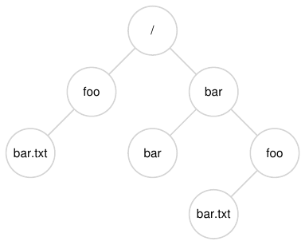

# 39 Phần xen kẽ: File và Directory

Đến đây, ta đã thấy sự phát triển hai abstraction then chốt của operating system: process, virtualization của CPU, và address space, virtualization của memory. Kết hợp lại, chúng cho phép chương trình chạy như ở trong thế giới riêng biệt, cô lập; như có processor (hoặc các processor) riêng; như có memory riêng. Ảo giác này khiến lập trình hệ thống dễ hơn nhiều, nên hiện phổ biến không chỉ ở desktop và server mà ngày càng ở mọi programmable platform, kể cả điện thoại di động và tương tự.

Phần này thêm mảnh ghép quan trọng vào bài toán virtualization: persistent storage. persistent-storage device, như hard disk drive cổ điển hay solid-state storage device hiện đại hơn, lưu thông tin vĩnh viễn (hoặc ít nhất lâu dài). Khác memory mất nội dung khi mất điện, persistent-storage device giữ dữ liệu nguyên vẹn. Vì vậy OS phải đặc biệt cẩn thận với device này: đây là nơi người dùng giữ dữ liệu họ thực sự coi trọng.

> MẤU CHỐT: LÀM SAO QUẢN LÝ PERSISTENT DEVICE
>
> OS nên quản lý persistent device thế nào? Các API là gì? Những khía cạnh triển khai quan trọng là gì?

Vì thế trong vài chương tới, ta khám phá các kỹ thuật then chốt quản lý persistent data, tập trung phương pháp cải thiện performance và reliability. Nhưng bắt đầu bằng tổng quan API: interface bạn dự kiến gặp khi tương tác UNIX file system.

## 39.1 File và Directory

Theo thời gian, hai abstraction then chốt phát triển trong virtualization storage. Thứ nhất là file. File đơn giản là linear array byte, mỗi byte có thể đọc hoặc ghi. Mỗi file có loại tên low-level nào đó, thường là một số; thường người dùng không biết tên này (như sẽ thấy). Vì lịch sử, tên low-level của file thường gọi inode number. Ta học nhiều hơn về inode ở chương sau; hiện chỉ giả định mỗi file có inode number gắn với nó.

Ở hầu hết hệ thống, OS không biết nhiều cấu trúc file (ví dụ hình ảnh, text file hay code C); trách nhiệm file system chỉ là lưu dữ liệu lâu dài trên disk và bảo đảm khi yêu cầu lại, bạn nhận đúng dữ liệu ban đầu đã đặt vào. Điều này không đơn giản như vẻ ngoài!

Abstraction thứ hai là directory. Directory, như file, cũng có tên low-level (tức inode number), nhưng nội dung cụ thể: danh sách cặp (tên user-readable, tên low-level). Ví dụ giả sử file có tên low-level “10”, được người dùng gọi bằng tên user-readable “foo”. Directory chứa “foo” có entry (“foo”, “10”) map tên user-readable sang tên low-level. Mỗi entry directory tham chiếu file hoặc directory khác. Đặt directory trong directory khác, người dùng xây được directory tree (hay directory hierarchy) tùy ý, chứa mọi file và directory.



Hình 39.1: Directory Tree ví dụ

Directory hierarchy bắt đầu tại root directory (trong UNIX-based system, root directory đơn giản gọi /), dùng một separator để đặt tên các sub-directories tiếp theo tới khi xác định file hoặc directory mong muốn. Ví dụ người dùng tạo directory foo trong root directory /, rồi tạo file bar.txt trong foo, ta tham chiếu file bằng absolute pathname /foo/bar.txt. Xem Hình 39.1 cho directory tree phức tạp hơn; directory hợp lệ gồm /, /foo, /bar, /bar/bar, /bar/foo và file hợp lệ là /foo/bar.txt và /bar/foo/bar.txt. Directory và file có thể cùng tên nếu ở vị trí khác trong file-system tree (ví dụ hình có hai file bar.txt, /foo/bar.txt và /bar/foo/bar.txt).

> MẸO: SUY NGHĨ CẨN THẬN VỀ NAMING
>
> Naming là khía cạnh quan trọng của hệ thống máy tính [SK09]. Trong UNIX, gần như mọi thứ bạn nghĩ tới đều được đặt tên qua file system. Ngoài file, device, pipe, thậm chí process [K84] cũng có trong thứ trông như file system thông thường. Naming thống nhất giúp mô hình khái niệm về hệ thống dễ hiểu, hệ thống đơn giản và modular hơn. Vì vậy mỗi khi tạo hệ thống hay interface, hãy nghĩ kỹ tên đang dùng.

Bạn có thể nhận thấy tên file trong ví dụ thường có hai phần: bar và txt, phân cách dấu chấm. Phần đầu tùy ý, phần sau thường biểu thị loại file, ví dụ code C (.c), hình ảnh (.jpg) hay nhạc (.mp3). Nhưng thường chỉ là quy ước: thường không có bảo đảm dữ liệu trong file main.c thực sự là source code C.

Như vậy thấy điều tuyệt vời file system cung cấp: cách thuận tiện đặt tên mọi file quan tâm. Tên quan trọng trong hệ thống vì bước đầu truy cập tài nguyên là có thể đặt tên nó. Vì thế UNIX file system cung cấp cách thống nhất truy cập file trên disk, USB stick, CD-ROM, nhiều device khác, thực ra nhiều thứ khác, tất cả dưới một directory tree.

## 39.2 File System Interface

Giờ bàn file system interface chi tiết hơn. Bắt đầu cơ bản tạo, truy cập và xóa file. Có thể nghĩ dễ hiểu, nhưng dọc đường sẽ khám phá lời gọi bí ẩn dùng xóa file, unlink(). Hy vọng cuối chương bí ẩn không còn quá bí ẩn!

## 39.3 Tạo File

Bắt đầu thao tác cơ bản nhất: tạo file. Có thể dùng system call open; gọi open() truyền flag O_CREAT, chương trình tạo được file mới. Đây là code ví dụ tạo file “foo” trong current working directory.

```
int fd = open("foo", O_CREAT | O_WRONLY | O_TRUNC);
```

Routine open() nhận nhiều flag khác nhau. Trong ví dụ, chương trình tạo file (O_CREAT), chỉ có thể ghi file khi mở theo cách này (O_WRONLY), và nếu file đã có, trước tiên truncate kích thước về không byte, xóa mọi nội dung cũ (O_TRUNC).

> BỔ SUNG: SYSTEM CALL CREAT()
>
> Cách tạo file cũ hơn là gọi creat(), như sau:
>
> ```
> int fd = creat("foo");
> ```
>
> Có thể xem creat() là open() với flag: O_CREAT | O_WRONLY | O_TRUNC. Vì open() tạo được file, creat() phần nào ít được ưa chuộng hơn (thực ra có thể triển khai bằng library call tới open()); nhưng nó có vị trí đặc biệt trong giai thoại UNIX. Cụ thể, khi hỏi Ken Thompson sẽ làm khác gì nếu thiết kế lại UNIX, ông đáp: “Tôi sẽ viết creat có thêm chữ e.”

Khía cạnh quan trọng của open() là giá trị trả về: file descriptor. File descriptor chỉ là số nguyên, riêng từng process, dùng trong UNIX để truy cập file; vì thế khi mở file, bạn dùng descriptor đọc ghi, giả sử có quyền. Theo nghĩa này file descriptor là capability [L84], tức opaque handle trao quyền thực hiện thao tác nhất định. Cách nghĩ khác là pointer tới object kiểu file; khi có object, gọi được “method” khác để truy cập file như read() và write(). Bên dưới sẽ thấy chính xác cách dùng descriptor.

## 39.4 Đọc và ghi File

Khi có file, dĩ nhiên có thể muốn đọc ghi. Bắt đầu đọc file có sẵn. Nếu gõ command line, có thể dùng cat xuất nội dung ra màn hình.

```
prompt> echo hello > foo
prompt> cat foo
hello
prompt>
```

Trong code này, redirect output của echo tới file foo, sau đó chứa từ “hello”. Rồi dùng cat xem nội dung. Nhưng cat truy cập file foo thế nào?

Để tìm hiểu, dùng công cụ cực hữu ích trace system call chương trình thực hiện. Trên Linux gọi strace; hệ thống khác có công cụ tương tự (xem dtruss trên Mac OS X hay truss ở UNIX cũ hơn). strace trace mọi system call chương trình thực hiện khi chạy, xuất trace ra màn hình cho bạn xem.

> MẸO: DÙNG STRACE (VÀ CÔNG CỤ TƯƠNG TỰ)
>
> strace cung cấp cách tuyệt vời xem chương trình làm gì. Chạy nó có thể trace system call, thấy argument và return code, nhìn chung hiểu rất rõ điều diễn ra.
>
> Công cụ cũng nhận argument hữu ích. Ví dụ -f theo dõi cả child được fork; -t báo giờ trong ngày mỗi call; -e trace=open,close,read,write chỉ trace những system call đó và bỏ các call khác. Còn nhiều flag mạnh hơn — đọc man page để biết khai thác công cụ tuyệt vời này.

Đây là ví dụ dùng strace tìm hiểu cat làm gì (bỏ vài call cho dễ đọc):

```
prompt> strace cat foo
...
open("foo", O_RDONLY|O_LARGEFILE)       = 3
read(3, "hello\n", 4096)                = 6
write(1, "hello\n", 6)                  = 6
hello
read(3, "", 4096)                       = 0
close(3)                                = 0
...
prompt>
```

Đầu tiên cat mở file để đọc. Có vài điều cần lưu ý; thứ nhất file chỉ mở đọc (không ghi), thể hiện bằng O_RDONLY; thứ hai dùng offset 64-bit (O_LARGEFILE); thứ ba open() thành công và trả file descriptor giá trị 3.

Vì sao open() đầu tiên trả 3, không phải 0 hoặc 1 như dự kiến? Hóa ra mỗi process đang chạy đã mở ba file: standard input (process đọc nhận input), standard output (process ghi để xuất thông tin ra màn hình), standard error (process ghi error message). Chúng lần lượt có file descriptor 0, 1, 2. Vì vậy lần đầu mở file khác (như cat trên), gần như chắc chắn là file descriptor 3.

Sau open thành công, cat dùng system call read() liên tục đọc byte từ file. Argument đầu là file descriptor, báo file system đọc file nào; process dĩ nhiên có thể mở nhiều file cùng lúc, descriptor giúp operating system biết read cụ thể tham chiếu file nào. Argument hai trỏ tới buffer đặt kết quả read(); trong system-call trace trên, strace hiển thị kết quả read ở đây (“hello”). Argument ba là buffer size, ở đây 4 KB. read() cũng trả thành công, trả số byte đã đọc (6, gồm 5 chữ cái “hello” và một end-of-line marker).

Đến đây thấy kết quả thú vị khác của strace: một system call write() tới file descriptor 1. Như nói trên đây là standard output, dùng ghi “hello” ra màn hình như mục đích cat. Nhưng có gọi trực tiếp write() không? Có thể (nếu tối ưu cao). Nếu không, cat có thể gọi library routine printf(); bên trong printf() xử lý mọi chi tiết định dạng, cuối cùng gọi write lên standard output để in kết quả.

cat tiếp tục thử đọc thêm, nhưng vì không còn byte, read() trả 0, chương trình biết nghĩa là đã đọc toàn file. Vì vậy gọi close() báo xong file “foo”, truyền file descriptor tương ứng. File được đóng và đọc hoàn tất.

Ghi file theo các bước tương tự. Đầu tiên mở file để ghi, rồi gọi system call write(), có thể lặp lại với file lớn, sau đó close(). Dùng strace trace write tới file, có thể chương trình tự viết hoặc trace tiện ích dd, ví dụ dd if=foo of=bar.

## 39.5 Đọc ghi nhưng không Sequential

Đến đây đã bàn đọc ghi file, nhưng mọi truy cập đều sequential; tức hoặc đọc từ đầu tới cuối hoặc ghi từ đầu tới cuối.

Tuy nhiên đôi khi hữu ích nếu đọc ghi offset cụ thể trong file; ví dụ xây index cho text document, dùng tra từ cụ thể, cuối cùng có thể đọc offset ngẫu nhiên trong tài liệu. Để làm vậy dùng system call lseek(). Đây là function prototype:

```
off_t lseek(int fildes, off_t offset, int whence);
```

Argument đầu quen thuộc (file descriptor). Argument hai là offset, đặt file offset tới vị trí cụ thể trong file. Argument ba, vì lịch sử gọi whence, xác định seek chính xác thế nào. Từ man page:

```
If whence is SEEK_SET, the offset is set to offset bytes.
If whence is SEEK_CUR, the offset is set to its current
location plus offset bytes.
If whence is SEEK_END, the offset is set to the size of
the file plus offset bytes.
```

Như mô tả, với mỗi file process mở, OS theo dõi offset “hiện tại”, xác định read hay write tiếp bắt đầu ở đâu trong file. Vì thế một phần abstraction open file là có current offset, cập nhật theo hai cách. Thứ nhất khi read hoặc write N byte, cộng N vào current offset; mỗi read hay write ngầm cập nhật offset. Thứ hai, tường minh dùng lseek, đổi offset như quy định trên.

> BỔ SUNG: GỌI LSEEK() KHÔNG THỰC HIỆN DISK SEEK
>
> System call poorly-named lseek() khiến nhiều sinh viên cố hiểu disk và file system bên trên nhầm lẫn. Đừng nhầm hai thứ! lseek() chỉ đổi biến trong OS memory, theo dõi offset mà read hay write tiếp theo của process cụ thể sẽ bắt đầu. Disk seek xảy ra khi read hoặc write phát tới disk khác track với lần trước nên phải di chuyển head. Còn gây nhầm hơn là gọi lseek() để đọc ghi phần ngẫu nhiên của file, rồi thực sự đọc ghi những phần đó, đúng là dẫn tới nhiều disk seek hơn. Vì vậy lseek() chắc chắn có thể dẫn tới seek ở read hoặc write sắp tới, nhưng bản thân tuyệt đối không gây disk I/O.

Lưu ý lseek() này không liên quan thao tác seek disk di chuyển disk arm. lseek() chỉ đổi giá trị biến trong kernel; khi thực hiện I/O, tùy vị trí disk head, disk có thể seek thực hoặc không để phục vụ request.

## 39.6 Ghi ngay bằng fsync()

Đa số khi gọi write(), chương trình chỉ nói file system: hãy ghi dữ liệu này vào persistent storage lúc nào đó sau này. Vì performance, file system buffer write trong memory một thời gian (chẳng hạn 5 giây hoặc 30); tới lúc đó write mới thực sự phát tới storage device. Với ứng dụng gọi, write có vẻ xong nhanh, chỉ trường hợp hiếm (ví dụ máy crash sau write() nhưng trước ghi disk) mới mất dữ liệu.

Nhưng một số ứng dụng cần hơn bảo đảm cuối cùng này. Ví dụ database management system (DBMS), phát triển recovery protocol đúng cần khả năng thỉnh thoảng buộc ghi disk.

Để hỗ trợ ứng dụng này, đa số file system có control API bổ sung. Trong UNIX, interface cung cấp là fsync(int fd). Khi process gọi fsync() với file descriptor cụ thể, file system buộc mọi dirty data (tức chưa ghi) của file được descriptor chỉ tới xuống disk. fsync() trả về khi mọi write đó hoàn tất.

Đây là ví dụ đơn giản dùng fsync(). Code mở file foo, ghi một chunk dữ liệu rồi gọi fsync() bảo đảm write được buộc ghi disk ngay. Khi fsync() trả về, ứng dụng an tâm tiếp tục vì biết dữ liệu đã persisted (nếu fsync() triển khai đúng).

```
int fd = open("foo", O_CREAT | O_WRONLY | O_TRUNC);
assert(fd > -1);
int rc = write(fd, buffer, size);
assert(rc == size);
rc = fsync(fd);
assert(rc == 0);
```

Điều thú vị là chuỗi này không bảo đảm mọi điều có thể mong đợi; đôi khi còn cần fsync() directory chứa file foo. Thêm bước này bảo đảm không chỉ chính file nằm trên disk mà nếu mới tạo, nó cũng thuộc directory một cách bền vững. Không ngạc nhiên, chi tiết kiểu này thường bị bỏ qua, gây nhiều application-level bug [P+13].

## 39.7 Đổi tên File

Khi có file, đôi khi hữu ích nếu đổi tên. Trên command line dùng mv; ở ví dụ file foo đổi thành bar:

```
prompt> mv foo bar
```

Dùng strace thấy mv dùng system call rename(char *old, char *new), nhận đúng hai argument: tên file ban đầu (old) và tên mới (new).

Bảo đảm thú vị của rename() là nó (thường) triển khai atomic đối với system crash; nếu crash trong đổi tên, file hoặc có tên cũ hoặc tên mới, không trạng thái in-between kỳ lạ nào. Vì vậy rename() then chốt hỗ trợ một số ứng dụng cần atomic update file state.

Hãy cụ thể hơn. Tưởng tượng dùng file editor (ví dụ emacs), chèn dòng vào giữa file. Tên file ví dụ là foo.txt. Editor có thể cập nhật để bảo đảm file mới chứa nội dung gốc cộng dòng chèn như sau (bỏ error-checking cho đơn giản):

```
int fd = open("foo.txt.tmp", O_WRONLY|O_CREAT|O_TRUNC);
write(fd, buffer, size); // write out new version of file
fsync(fd);
close(fd);
rename("foo.txt.tmp", "foo.txt");
```

Editor làm đơn giản: ghi bản file mới dưới tên tạm (foo.txt.tmp), buộc xuống disk bằng fsync(), rồi khi chắc chắn metadata và nội dung file mới trên disk, đổi tên tạm thành tên file gốc. Bước cuối atomically đưa file mới vào chỗ, đồng thời xóa bản cũ, đạt atomic file update.

## 39.8 Lấy thông tin File

Ngoài truy cập, kỳ vọng file system giữ khá nhiều thông tin về mỗi file. Thường gọi dữ liệu về file là metadata. Để xem metadata file cụ thể, dùng system call stat() hoặc fstat(). Chúng nhận pathname (hay file descriptor) và điền stat structure như dưới:

```
struct stat {
    dev_t     st_dev;     /* ID of device containing file */
    ino_t     st_ino;     /* inode number */
    mode_t    st_mode;    /* protection */
    nlink_t   st_nlink;   /* number of hard links */
    uid_t     st_uid;     /* user ID of owner */
    gid_t     st_gid;     /* group ID of owner */
    dev_t     st_rdev;    /* device ID (if special file) */
    off_t     st_size;    /* total size, in bytes */
    blksize_t st_blksize; /* blocksize for filesystem I/O */
    blkcnt_t  st_blocks;  /* number of blocks allocated */
    time_t    st_atime;   /* time of last access */
    time_t    st_mtime;   /* time of last modification */
    time_t    st_ctime;   /* time of last status change */
};
```

Bạn thấy giữ nhiều thông tin về file, gồm kích thước (byte), tên low-level (tức inode number), ownership information, thông tin khi nào truy cập hoặc sửa, cùng những điều khác. Để xem dùng công cụ command line stat:

```
prompt> echo hello > file
prompt> stat file
  File: ‘file’
  Size: 6 Blocks: 8          IO Block: 4096   regular file
Device: 811h/2065d Inode: 67158084    Links: 1
Access: (0640/-rw-r-----) Uid: (30686/ remzi) Gid: (30686/ remzi)
Access: 2011-05-03 15:50:20.157594748 -0500
Modify: 2011-05-03 15:50:20.157594748 -0500
Change: 2011-05-03 15:50:20.157594748 -0500
```

Hóa ra mỗi file system thường giữ thông tin này trong structure gọi inode[^1]. Khi bàn triển khai file system sẽ học nhiều hơn. Hiện chỉ nên nghĩ inode là persistent data structure được file system giữ, chứa thông tin như trên.

## 39.9 Xóa File

Đến đây biết tạo và truy cập file, sequential hoặc không. Nhưng xóa thế nào? Nếu đã dùng UNIX, có lẽ nghĩ biết: chỉ chạy rm. Nhưng rm dùng system call nào xóa file?

Dùng lại bạn cũ strace để biết. Ở đây xóa file “foo” phiền phức:

```
prompt> strace rm foo
...
unlink("foo")                           = 0
...
```

Đã bỏ nhiều thứ không liên quan khỏi trace output, chỉ còn một lời gọi system call mysteriously-named unlink(). Như thấy, unlink() chỉ nhận tên file cần xóa, trả không khi thành công. Nhưng có câu đố lớn: vì sao tên “unlink”? Sao không “remove” hay “delete”. Để trả lời, phải hiểu không chỉ file mà cả directory.

## 39.10 Tạo Directory

Ngoài file, tập system call directory-related cho phép tạo, đọc và xóa directory. Lưu ý không bao giờ ghi trực tiếp directory; vì định dạng directory là file system metadata, chỉ có thể cập nhật gián tiếp, ví dụ tạo file, directory hay object khác bên trong. Nhờ vậy file system bảo đảm nội dung directory luôn như dự kiến.

Để tạo directory có system call mkdir(). Chương trình mkdir cùng tên dùng tạo directory. Xem điều xảy ra khi chạy mkdir tạo directory đơn giản foo:

```
prompt> strace mkdir foo
...
mkdir("foo", 0777)                      = 0
...
prompt>
```

> MẸO: THẬN TRỌNG VỚI COMMAND MẠNH
>
> rm cung cấp ví dụ hay về command mạnh và vì sao đôi khi quá mạnh là xấu. Ví dụ xóa nhiều file một lần, gõ như:
>
> ```
> prompt> rm *
> ```
>
> trong đó * khớp mọi file trong current directory. Nhưng đôi khi muốn xóa cả directory và mọi nội dung bên trong. Có thể yêu cầu rm đi xuống đệ quy mỗi directory và xóa nội dung:
>
> ```
> prompt> rm -rf *
> ```
>
> Rắc rối với chuỗi ký tự nhỏ này xảy ra nếu vô tình thực hiện command từ root directory file system, xóa mọi file và directory. Ôi!
>
> Vì vậy nhớ con dao double-edged của command mạnh; dù cho làm rất nhiều với ít phím gõ, chúng cũng nhanh chóng và dễ dàng gây hại lớn.

Khi directory đó tạo xong, được xem “rỗng”, dù vẫn có nội dung tối thiểu. Cụ thể directory rỗng có hai entry: một tham chiếu chính nó, một tham chiếu parent. Đầu gọi directory “.” (dot), sau “..” (dot-dot). Có thể thấy bằng truyền flag (-a) cho ls:

```
prompt> ls -a
./  ../
prompt> ls -al
total 8
drwxr-x---  2 remzi remzi    6 Apr 30 16:17 ./
drwxr-x--- 26 remzi remzi 4096 Apr 30 16:17 ../
```

## 39.11 Đọc Directory

Giờ tạo directory rồi, cũng có thể muốn đọc. Đúng là việc ls làm. Hãy viết công cụ nhỏ như ls để xem cách thực hiện.

Thay vì mở directory như file, dùng tập call mới. Dưới là chương trình ví dụ in nội dung directory. Dùng ba call opendir(), readdir(), closedir(), và bạn thấy interface đơn giản thế nào; chỉ dùng vòng lặp đọc một directory entry mỗi lần, in tên và inode number mỗi file trong directory.

```
int main(int argc, char *argv[]) {
    DIR *dp = opendir(".");
    assert(dp != NULL);
    struct dirent *d;
    while ((d = readdir(dp)) != NULL) {
        printf("%d %s\n", (int) d->d_ino, d->d_name);
    }
    closedir(dp);
    return 0;
}
```

Khai báo dưới cho thấy thông tin trong mỗi directory entry của data structure struct dirent:

```
struct dirent {
    char           d_name[256]; /* filename */
    ino_t          d_ino;       /* inode number */
    off_t          d_off;       /* offset to the next dirent */
    unsigned short d_reclen;    /* length of this record */
    unsigned char  d_type;      /* type of file */
};
```

Vì directory ít thông tin (về cơ bản chỉ map tên tới inode number cùng vài chi tiết), chương trình có thể muốn gọi stat() mỗi file để biết thêm, như độ dài hay chi tiết khác. Đúng là ls làm khi truyền flag -l; thử strace ls có và không flag để tự xem.

## 39.12 Xóa Directory

Cuối cùng xóa directory bằng rmdir() (được chương trình cùng tên rmdir dùng). Nhưng khác xóa file, xóa directory nguy hiểm hơn vì có thể xóa lượng lớn dữ liệu bằng một command. Vì vậy rmdir() yêu cầu directory rỗng (tức chỉ entry “.” và “..”) trước khi xóa. Nếu thử xóa directory non-empty, rmdir() chỉ thất bại.

## 39.13 Hard Link

Giờ trở lại bí ẩn vì sao xóa file qua unlink(), bằng hiểu cách mới tạo entry trong file system tree qua system call link(). link() nhận hai argument, pathname cũ và mới; khi “link” tên mới tới tên cũ, về cơ bản tạo cách khác tham chiếu cùng file. Chương trình command-line ln dùng làm việc này như ví dụ:

```
prompt> echo hello > file
prompt> cat file
hello
prompt> ln file file2
prompt> cat file2
hello
```

Ở đây tạo file chứa “hello”, gọi tên file là file[^2]. Rồi tạo hard link tới file bằng ln. Sau đó có thể xem bằng mở file hay file2.

link hoạt động bằng chỉ tạo tên khác trong directory đích của link, tham chiếu cùng inode number (tức tên low-level) của file gốc. Không sao chép file theo bất kỳ cách nào; chỉ có hai tên cho người dùng (file và file2) cùng tham chiếu file. Thậm chí thấy điều này trong directory bằng in inode number mỗi file:

```
prompt> ls -i file file2
67158084 file
67158084 file2
prompt>
```

Truyền flag -i cho ls, nó in inode number mỗi file (và tên). Vì thế thấy link thực sự chỉ tạo tham chiếu mới tới đúng cùng inode number (67158084 trong ví dụ).

Giờ có thể bắt đầu hiểu vì sao unlink() gọi là unlink(). Tạo file thực ra làm hai việc. Thứ nhất tạo structure (inode) theo dõi gần như mọi thông tin liên quan, gồm kích thước, block nằm đâu trên disk, v.v. Thứ hai link tên human-readable tới file và đặt link vào directory.

Sau tạo hard link, với file system không khác biệt giữa tên file gốc (file) và tên mới (file2); cả hai chỉ là link tới metadata bên dưới, tại inode number 67158084.

Vì vậy để xóa file khỏi file system, gọi unlink(). Trong ví dụ có thể xóa tên file và vẫn truy cập file không khó:

```
prompt> rm file
removed ‘file’
prompt> cat file2
hello
```

Lý do là khi file system unlink file, nó kiểm tra reference count trong inode number. Reference count (đôi khi link count) cho phép theo dõi bao nhiêu tên file được link tới inode này. Gọi unlink() xóa “link” giữa tên human-readable (file đang xóa) với inode number, giảm reference count; chỉ khi reference count bằng không file system mới free inode và data block liên quan, do đó thực sự “xóa” file.

Dĩ nhiên có thể xem reference count bằng stat(). Xem khi tạo và xóa hard link. Ví dụ tạo ba link tới cùng file rồi xóa chúng. Chú ý link count!

```
prompt> echo hello > file
prompt> stat file
... Inode: 67158084    Links: 1 ...
prompt> ln file file2
prompt> stat file
... Inode: 67158084    Links: 2 ...
prompt> stat file2
... Inode: 67158084    Links: 2 ...
prompt> ln file2 file3
prompt> stat file
... Inode: 67158084    Links: 3 ...
prompt> rm file
prompt> stat file2
... Inode: 67158084    Links: 2 ...
prompt> rm file2
prompt> stat file3
... Inode: 67158084    Links: 1 ...
prompt> rm file3
```

## 39.14 Symbolic Link

Còn loại link hữu ích khác gọi symbolic link hay đôi khi soft link. Hóa ra hard link có giới hạn: không tạo tới directory được (sợ tạo cycle trong directory tree); không hard link tới file ở disk partition khác (vì inode number chỉ duy nhất trong một file system, không phải giữa các file system); v.v. Vì thế symbolic link được tạo ra.

Tạo link này bằng cùng ln nhưng flag -s. Ví dụ:

```
prompt> echo hello > file
prompt> ln -s file file2
prompt> cat file2
hello
```

Như thấy, tạo soft link có vẻ rất giống, file gốc giờ truy cập được qua tên file lẫn symbolic link file2.

Nhưng ngoài giống bề ngoài, symbolic link rất khác hard link. Đầu tiên symbolic link thực ra chính nó là file, thuộc loại khác. Đã bàn regular file và directory; symbolic link là loại thứ ba file system biết. stat symlink cho thấy tất cả:

```
prompt> stat file
 ... regular file ...
prompt> stat file2
 ... symbolic link ...
```

Chạy ls cũng cho thấy. Nhìn kỹ ký tự đầu dạng long-form output ls, thấy ký tự đầu cột left-most là - với regular file, d với directory, l với soft link. Cũng thấy kích thước symbolic link (4 byte ở đây), và link trỏ tới đâu (file tên file).

```
prompt> ls -al
drwxr-x---  2 remzi remzi   29 May  3 19:10 ./
drwxr-x--- 27 remzi remzi 4096 May  3 15:14 ../
-rw-r-----  1 remzi remzi    6 May  3 19:10 file
lrwxrwxrwx  1 remzi remzi    4 May  3 19:10 file2 -> file
```

file2 có 4 byte vì symbolic link được tạo bằng giữ pathname file linked-to làm dữ liệu link file. Vì link tới file tên file, link file file2 nhỏ (4 byte). Nếu link tới pathname dài hơn, link file lớn hơn:

```
prompt> echo hello > alongerfilename
prompt> ln -s alongerfilename file3
prompt> ls -al alongerfilename file3
-rw-r----- 1 remzi remzi  6 May  3 19:17 alongerfilename
lrwxrwxrwx 1 remzi remzi 15 May  3 19:17 file3 -> alongerfilename
```

Cuối cùng, do cách tạo symbolic link, chúng cho phép điều gọi dangling reference:

```
prompt> echo hello > file
prompt> ln -s file file2
prompt> cat file2
hello
prompt> rm file
prompt> cat file2
cat: file2: No such file or directory
```

Như ví dụ, khác hẳn hard link, xóa file gốc tên file khiến link trỏ pathname không còn tồn tại.

## 39.15 Tạo và Mount File System

Đã xem interface cơ bản truy cập file, directory và một số special link. Nhưng còn chủ đề cần bàn: ghép directory tree đầy đủ từ nhiều file system bên dưới thế nào. Thực hiện bằng tạo file system trước, rồi mount để truy cập nội dung.

Để tạo file system, đa số cung cấp công cụ thường gọi mkfs (đọc “make fs”), làm đúng task đó. Ý tưởng: truyền input là device (như disk partition /dev/sda1), loại file system (ví dụ ext3), nó chỉ ghi file system rỗng bắt đầu root directory vào partition. Và mkfs phán: hãy có file system!

Nhưng tạo xong file system cần cho truy cập trong file-system tree thống nhất. Dùng chương trình mount (gọi system call mount() bên dưới làm việc thật). mount đơn giản lấy directory có sẵn làm target mount point, về cơ bản dán file system mới vào directory tree tại điểm đó.

Ví dụ có thể hữu ích. Tưởng tượng ext3 file system chưa mount lưu ở partition /dev/sda1, nội dung: root directory chứa hai sub-directories a và b, mỗi cái giữ một file foo. Giả sử muốn mount tại /home/users. Gõ như sau:

```
prompt> mount -t ext3 /dev/sda1 /home/users
```

Nếu thành công, mount khiến file system mới dùng được. Nhưng lưu ý cách truy cập. Để xem root directory dùng ls như sau:

```
prompt> ls /home/users/
a b
```

Như thấy, pathname /home/users/ giờ tham chiếu root của directory newly-mounted. Tương tự truy cập file a và b bằng /home/users/a và /home/users/b. Cuối cùng file foo qua /home/users/a/foo và /home/users/b/foo. Đó là cái hay của mount: thay nhiều file system riêng, mount thống nhất tất cả thành một tree, naming thống nhất và thuận tiện.

Để xem hệ thống đã mount gì và ở đâu, chỉ chạy mount. Sẽ thấy như sau:

```
/dev/sda1 on / type ext3 (rw)
proc on /proc type proc (rw)
sysfs on /sys type sysfs (rw)
/dev/sda5 on /tmp type ext3 (rw)
/dev/sda7 on /var/vice/cache type ext3 (rw)
tmpfs on /dev/shm type tmpfs (rw)
AFS on /afs type afs (rw)
```

Sự pha trộn này cho thấy nhiều file system, gồm ext3 (disk-based file system chuẩn), proc (file system truy cập thông tin process hiện tại), tmpfs (chỉ cho temporary file) và AFS (distributed file system), đều gắn vào file-system tree của cùng máy.

## 39.16 Tổng kết

File system interface UNIX (thực ra mọi hệ thống) có vẻ rất sơ khai, nhưng có nhiều điều để hiểu nếu muốn thành thạo. Dĩ nhiên không gì tốt hơn tự dùng thật nhiều. Hãy làm vậy! Cũng đọc thêm; như mọi khi Stevens [SR05] là nơi bắt đầu.

Đã xem interface cơ bản, hy vọng hiểu chút về cách hoạt động. Thú vị hơn nữa là triển khai file system đáp ứng API thế nào, chủ đề sẽ tìm hiểu rất chi tiết tiếp theo.

## Tài liệu tham khảo

[K84] “Processes as Files”

Tom J. Killian

USENIX, June 1984

Bài báo giới thiệu /proc file system, nơi mỗi process có thể được xem như file trong pseudo file system. Ý tưởng thông minh vẫn thấy trong UNIX hiện đại.

[L84] “Capability-Based Computer Systems”

Henry M. Levy

Digital Press, 1984

Có tại: http://homes.cs.washington.edu/˜levy/capabook

Tổng quan xuất sắc về capability-based system ban đầu.

[P+13] “Towards Efficient, Portable Application-Level Consistency”

Thanumalayan S. Pillai, Vijay Chidambaram, Joo-Young Hwang, Andrea C. Arpaci-Dusseau, and Remzi H. Arpaci-Dusseau

HotDep ’13, November 2013

Công trình của chúng tôi cho thấy ứng dụng dễ mắc lỗi khi commit dữ liệu xuống disk thế nào; đặc biệt giả định về file system len vào ứng dụng, khiến ứng dụng chỉ đúng khi chạy trên file system cụ thể.

[SK09] “Principles of Computer System Design”

Jerome H. Saltzer and M. Frans Kaashoek

Morgan-Kaufmann, 2009

Tác phẩm systems xuất sắc must-read cho ai quan tâm lĩnh vực. Đây là cách họ dạy systems ở MIT. Đọc một lần rồi vài lần nữa để ngấm hết.

[SR05] “Advanced Programming in the UNIX Environment”

W. Richard Stevens and Stephen A. Rago

Addison-Wesley, 2005

Có lẽ đã dẫn cuốn này vài trăm nghìn lần. Nó hữu ích đến thế nếu muốn thành systems programmer xuất sắc.

## Bài tập

Bài tập này làm quen cách API trong chương hoạt động. Bạn sẽ viết vài chương trình khác nhau, chủ yếu dựa trên các UNIX utility.

### Câu hỏi

1. Stat: Viết bản riêng của chương trình command line stat, chỉ gọi stat() trên file hoặc directory cho trước. In file size, số block cấp phát, reference (link) count, v.v. Link count directory thế nào khi số entry thay đổi? Interface hữu ích:

```
stat()
```

2. Liệt kê File: Viết chương trình liệt kê file trong directory cho trước. Không argument thì chỉ in tên. Có flag -l thì in thông tin mỗi file như owner, group, permission và thông tin khác từ stat(). Chương trình nhận thêm một argument là directory cần đọc, ví dụ myls -l directory. Nếu không cho directory thì dùng current working directory. Interface hữu ích: stat(), opendir(), readdir(), getcwd().

3. Tail: Viết chương trình in vài dòng cuối file. Chương trình nên hiệu quả: seek gần cuối, đọc một block dữ liệu, rồi đi ngược tới khi tìm đủ số dòng yêu cầu; lúc đó in các dòng từ điểm này tới cuối file. Gọi chương trình bằng: mytail -n file, n là số dòng cuối cần in. Interface hữu ích: stat(), lseek(), open(), read(), close().

4. Tìm kiếm đệ quy: Viết chương trình in tên mỗi file và directory trong file system tree, bắt đầu điểm cho trước. Ví dụ không argument thì bắt đầu current working directory, in nội dung cùng nội dung mọi sub-directories, v.v. tới khi in toàn tree có root tại CWD. Nếu có một argument (tên directory), dùng nó làm root thay thế. Cải tiến tìm kiếm đệ quy bằng option thú vị hơn, tương tự công cụ command line find mạnh mẽ. Interface hữu ích: tự tìm hiểu.

---

[^1]: Một số file system gọi structure này bằng tên giống nhưng hơi khác, như dnodes; nhưng ý tưởng cơ bản tương tự.

[^2]: Chú ý tác giả cuốn này sáng tạo thế nào. Chúng tôi từng có mèo tên “Cat” (chuyện thật). Nhưng nó chết rồi, giờ có hamster tên “Hammy.” Cập nhật: Hammy giờ cũng chết. Xác thú cưng đang chất đống.
