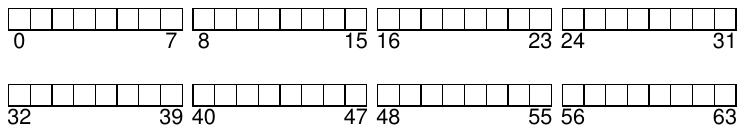
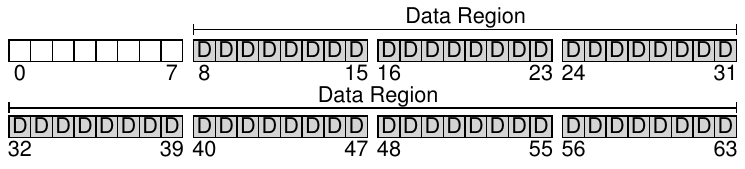
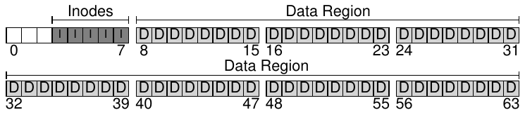
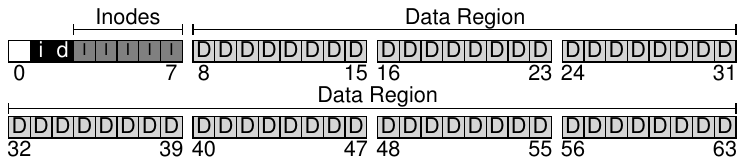
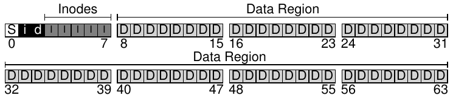
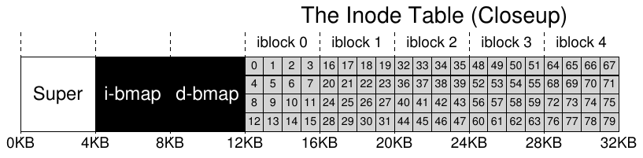
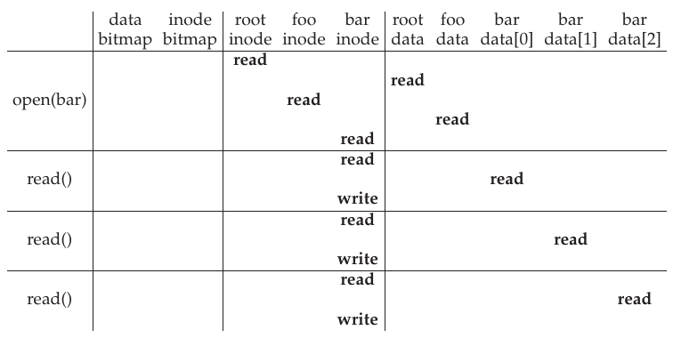
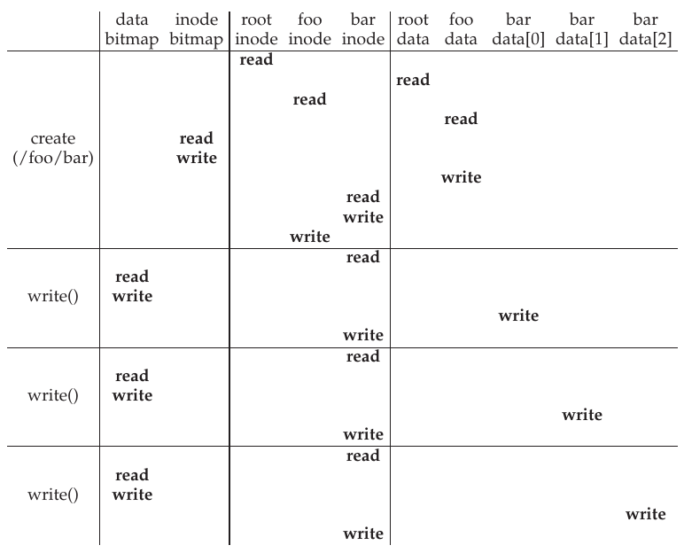

# 40 Triển khai File System

Trong chương này, chúng ta giới thiệu một cách triển khai file system đơn giản, gọi là vsfs (Very Simple File System). File system này là phiên bản đơn giản hóa của file system UNIX điển hình, qua đó giới thiệu một số structure on-disk cơ bản, các phương thức truy cập và những policy khác nhau mà bạn sẽ gặp trong nhiều file system ngày nay.

File system hoàn toàn là software; khác với quá trình xây dựng CPU virtualization và memory virtualization, chúng ta sẽ không thêm tính năng hardware để cải thiện khía cạnh nào đó của file system (dù vẫn cần chú ý đặc tính thiết bị để bảo đảm file system hoạt động tốt). Vì có nhiều tự do khi xây dựng file system, rất nhiều hệ thống khác nhau đã ra đời, đúng nghĩa từ AFS (Andrew File System) [H+88] đến ZFS (Zettabyte File System của Sun) [B07]. Tất cả đều có data structure khác nhau và làm một số việc tốt hơn hoặc kém hơn những hệ thống còn lại. Vì vậy, chúng ta sẽ học về file system qua các nghiên cứu trường hợp: trước tiên là file system đơn giản (vsfs) trong chương này để giới thiệu phần lớn khái niệm, rồi một loạt nghiên cứu về file system thực tế để hiểu chúng có thể khác nhau thế nào trong thực tiễn.

> MẤU CHỐT: TRIỂN KHAI FILE SYSTEM ĐƠN GIẢN THẾ NÀO
>
> Làm thế nào để xây dựng một file system đơn giản? Cần những structure nào trên disk? Những structure đó cần theo dõi thông tin gì? Chúng được truy cập như thế nào?

## 40.1 Cách suy nghĩ

Khi suy nghĩ về file system, chúng tôi thường đề nghị xem xét hai khía cạnh khác nhau; nếu hiểu cả hai, có lẽ bạn đã hiểu cách file system hoạt động về cơ bản.

Khía cạnh đầu tiên là các data structure của file system. Nói cách khác, file system sử dụng những loại structure on-disk nào để tổ chức data và metadata? Những file system đầu tiên chúng ta xem xét (gồm vsfs dưới đây) sử dụng structure đơn giản như array chứa block hoặc object khác, còn file system tinh vi hơn như XFS của SGI sử dụng structure tree-based phức tạp hơn [S+96].

> THÔNG TIN THÊM: MÔ HÌNH TƯ DUY VỀ FILE SYSTEM
>
> Như đã thảo luận, mô hình tư duy chính là điều bạn thực sự cố phát triển khi học về hệ thống. Với file system, mô hình tư duy cuối cùng cần bao gồm câu trả lời cho những câu hỏi như: structure on-disk nào lưu data và metadata của file system? Điều gì xảy ra khi process mở file? Structure on-disk nào được truy cập trong thao tác read hoặc write? Khi xây dựng và cải thiện mô hình tư duy, bạn phát triển hiểu biết trừu tượng về những gì đang diễn ra, thay vì chỉ cố hiểu chi tiết của một đoạn code file-system nào đó (dù tất nhiên điều đó cũng hữu ích!).

Khía cạnh thứ hai của file system là các phương thức truy cập. Nó ánh xạ những lời gọi do process thực hiện, như open(), read(), write(), v.v., vào các structure như thế nào? Structure nào được đọc khi thực thi một system call cụ thể? Structure nào được ghi? Tất cả những bước này được thực hiện hiệu quả đến đâu?

Nếu hiểu data structure và phương thức truy cập của file system, bạn đã phát triển mô hình tư duy tốt về cách nó thực sự hoạt động, một phần then chốt của tư duy hệ thống. Hãy cố xây dựng mô hình tư duy khi chúng ta tìm hiểu cách triển khai đầu tiên.

## 40.2 Tổ chức tổng thể

Giờ chúng ta xây dựng cách tổ chức on-disk tổng thể cho các data structure của file system vsfs. Việc đầu tiên cần làm là chia disk thành các block; file system đơn giản chỉ dùng một block size, và ở đây chúng ta cũng làm như vậy. Hãy chọn kích thước commonly-used là 4 KB.

Vì vậy, chúng ta nhìn disk partition nơi xây dựng file system một cách đơn giản: một chuỗi block, mỗi block có kích thước 4 KB. Trong partition có N block 4-KB, các block được đánh address từ 0 đến N − 1. Giả sử chúng ta có một disk rất nhỏ, chỉ gồm 64 block:



Giờ hãy nghĩ xem cần lưu gì trong các block này để xây dựng file system. Tất nhiên, điều đầu tiên nghĩ đến là user data. Thực ra, phần lớn không gian của mọi file system là (và nên là) user data. Hãy gọi vùng disk dùng cho user data là data region, và một lần nữa để đơn giản, dành một phần cố định của disk cho các block này, chẳng hạn 56 block cuối trong 64 block trên disk:



Như đã tìm hiểu (một chút) trong chương trước, file system phải theo dõi thông tin về mỗi file. Thông tin này là phần metadata then chốt, theo dõi những điều như: các data block nào (trong data region) tạo nên file, kích thước file, owner và access right, thời điểm truy cập và sửa đổi, cùng những loại thông tin tương tự. Để lưu thông tin đó, file system thường có structure gọi là inode (chúng ta sẽ tìm hiểu thêm về inode dưới đây).

Để chứa inode, chúng ta cũng cần dành một phần không gian trên disk cho chúng. Gọi phần này là inode table, đơn giản chứa một array các inode on-disk. Vì vậy, hình ảnh on-disk hiện tại như hình sau, giả sử dùng 5 trong 64 block cho inode (ký hiệu bằng các chữ I trong sơ đồ):



Ở đây cần lưu ý inode thường không quá lớn, chẳng hạn 128 hoặc 256 byte. Giả sử mỗi inode có 256 byte, một block 4-KB chứa được 16 inode, và file system trên có tổng cộng 80 inode. Với file system đơn giản xây dựng trên partition 64-block nhỏ bé này, con số đó biểu thị số file tối đa có thể có; tuy nhiên, lưu ý cùng file system đó trên disk lớn hơn chỉ cần cấp phát inode table lớn hơn để chứa thêm file.

Đến đây, file system có data block (D) và inode (I), nhưng vẫn thiếu một vài thứ. Một thành phần chính còn cần, như có thể bạn đã đoán, là cách theo dõi inode hoặc data block nào đang free hay đã được cấp phát. Vì vậy, những allocation structure này là thành phần thiết yếu của mọi file system.

Tất nhiên, có nhiều phương pháp allocation-tracking khả thi. Chẳng hạn, có thể dùng free list trỏ tới free block đầu tiên, block đó trỏ tới free block tiếp theo, v.v. Thay vào đó, chúng ta chọn structure đơn giản và phổ biến là bitmap: một cho data region (data bitmap) và một cho inode table (inode bitmap). Bitmap có cấu trúc đơn giản: mỗi bit cho biết object/block tương ứng đang free (0) hay in-use (1). Vì vậy, bố trí on-disk mới có inode bitmap (i) và data bitmap (d) như sau:



Bạn có thể nhận thấy dùng cả block 4-KB cho những bitmap này hơi dư thừa; một bitmap như vậy theo dõi được 32K object đã cấp phát hay chưa, trong khi chúng ta chỉ có 80 inode và 56 data block. Tuy nhiên, để đơn giản, chúng ta vẫn dùng cả block 4-KB cho mỗi bitmap.

Bạn đọc cẩn thận (tức người vẫn còn thức) có thể nhận thấy còn một block trong thiết kế structure on-disk của file system rất đơn giản này. Chúng ta dành nó cho superblock, ký hiệu S trong sơ đồ dưới. Superblock chứa thông tin về file system cụ thể này, chẳng hạn có bao nhiêu inode và data block (ở đây lần lượt là 80 và 56), inode table bắt đầu ở đâu (block 3), v.v. Nó cũng có thể chứa một loại magic number để nhận diện file system type (trong trường hợp này là vsfs).



Vì vậy, khi mount file system, operating system đọc superblock trước để khởi tạo các parameter, rồi gắn volume vào tree file-system. Khi truy cập file trong volume, hệ thống nhờ đó biết chính xác phải tìm những structure on-disk cần thiết ở đâu.

## 40.3 Tổ chức file: Inode

Một trong những structure on-disk quan trọng nhất của file system là inode; hầu như mọi file system đều có structure tương tự. Tên inode viết tắt cho index node, tên lịch sử được dùng trong UNIX [RT74] và có thể cả những hệ thống trước đó, vì ban đầu các node này được sắp trong array, và người ta dùng index vào array để truy cập một inode cụ thể.

> THÔNG TIN THÊM: DATA STRUCTURE — INODE
>
> Inode là tên gọi chung được nhiều file system dùng để mô tả structure giữ metadata của một file cụ thể, như độ dài, permission và vị trí các block tạo nên file. Tên gọi này có từ ít nhất thời UNIX (có lẽ xa hơn tới Multics, nếu không phải hệ thống còn sớm hơn); nó viết tắt index node, vì inode number được dùng làm index vào array inode on-disk để tìm inode mang số đó. Như sẽ thấy, thiết kế inode là phần then chốt của thiết kế file system. Phần lớn hệ thống hiện đại có một loại structure như vậy cho mỗi file chúng theo dõi, nhưng có thể gọi bằng tên khác (như dnodes, fnodes, v.v.).

Mỗi inode được tham chiếu ngầm bằng một số (gọi là inumber), trước đây chúng ta gọi là tên low-level của file. Trong vsfs (và file system đơn giản khác), khi biết i-number, bạn có thể tính trực tiếp vị trí inode tương ứng trên disk. Chẳng hạn, inode table vsfs ở trên có kích thước 20-KB (5 block 4-KB), nên chứa 80 inode (giả sử mỗi inode 256 byte); giả sử thêm rằng inode region bắt đầu tại 12KB (tức superblock bắt đầu tại 0KB, inode bitmap tại address 4KB, data bitmap tại 8KB, nên inode table nằm ngay sau). Vì vậy, phần đầu file system partition của vsfs có bố trí như sau (nhìn gần):



Để đọc inode số 32, file system trước tiên tính offset trong inode region (32 · sizeof(inode) hay 8192), cộng vào address bắt đầu inode table trên disk (inodeStartAddr = 12KB), nhờ đó có đúng byte address của block inode mong muốn: 20K B. Nhớ rằng disk không được đánh address theo byte, mà gồm nhiều sector có thể đánh address, thường có kích thước 512 byte. Vì vậy, để fetch block inode chứa inode 32, file system phát lệnh read tới sector (20×1024)/512, tức 40, để lấy inode block mong muốn. Tổng quát hơn, sector address iaddr của inode block được tính như sau:

```
blk    = (inumber * sizeof(inode_t)) / blockSize;
sector = ((blk * blockSize) + inodeStartAddr) / sectorSize;
```

Bên trong mỗi inode là hầu như mọi thông tin cần biết về file: type (ví dụ regular file, directory, v.v.), kích thước, số block đã cấp phát, thông tin bảo vệ (như ai sở hữu và ai được truy cập file), một số thông tin thời gian gồm lúc tạo, sửa đổi hoặc truy cập gần nhất, cùng thông tin về vị trí các data block trên disk (ví dụ một loại pointer). Chúng ta gọi tất cả thông tin đó về file là metadata; thực ra, mọi thông tin trong file system không phải user data thuần thường đều được gọi như vậy. Hình 40.1 minh họa một inode của ext2 [P09][^1].

| Size | Tên | Inode field này dùng làm gì? |
|---|---|---|
| 2 | mode | file có thể đọc/ghi/thực thi không? |
| 2 | uid | ai sở hữu file? |
| 4 | size | file có bao nhiêu byte? |
| 4 | time | file được truy cập lần cuối khi nào? |
| 4 | ctime | file được tạo khi nào? |
| 4 | mtime | file được sửa đổi lần cuối khi nào? |
| 4 | dtime | inode được xóa khi nào? |
| 2 | gid | file thuộc group nào? |
| 2 | links_count | file có bao nhiêu hard link? |
| 4 | blocks | đã cấp phát bao nhiêu block cho file này? |
| 4 | flags | ext2 nên sử dụng inode này như thế nào? |
| 4 | osd1 | field OS-dependent |
| 60 | block | tập disk pointer (tổng 15) |
| 4 | generation | phiên bản file (NFS dùng) |
| 4 | file_acl | mô hình permission mới ngoài mode bit |
| 4 | dir_acl | gọi là access control list |

Hình 40.1: Inode Ext2 đơn giản hóa

Một trong những quyết định quan trọng nhất khi thiết kế inode là cách nó tham chiếu tới vị trí data block. Cách đơn giản là đặt một hoặc nhiều direct pointer (disk address) bên trong inode; mỗi pointer tham chiếu một disk block thuộc file. Cách này có giới hạn: chẳng hạn nếu muốn file thật lớn (ví dụ lớn hơn block size nhân số direct pointer), bạn không thể đáp ứng được.

### Multi-Level Index

Để hỗ trợ file lớn hơn, người thiết kế file system phải đưa các structure khác vào inode. Một ý tưởng phổ biến là pointer đặc biệt gọi là indirect pointer. Thay vì trỏ tới block chứa user data, nó trỏ tới block chứa thêm pointer, mỗi pointer này trỏ tới user data. Vì vậy, inode có thể có số direct pointer cố định (ví dụ 12) và một indirect pointer. Nếu file tăng đủ lớn, một indirect block được cấp phát (từ data-block region trên disk), và ô indirect pointer trong inode được đặt để trỏ tới nó. Giả sử block 4-KB và disk address 4-byte, cách này thêm 1024 pointer; file có thể tăng tới (12 + 1024) · 4K, tức 4144KB.

> MẸO: CÂN NHẮC CÁCH EXTENT-BASED
>
> Một cách khác là dùng extent thay pointer. Extent đơn giản là một disk pointer cộng độ dài (tính bằng block); vì vậy, thay vì cần pointer cho mỗi block của file, chỉ cần pointer và độ dài để chỉ định vị trí on-disk của file. Chỉ có một extent sẽ hạn chế, vì có thể khó tìm vùng free space on-disk liên tục khi cấp phát file. Do đó, file system extent-based thường cho phép nhiều hơn một extent, tạo thêm tự do khi cấp phát file.
>
> So sánh hai cách, phương pháp pointer-based linh hoạt nhất nhưng dùng nhiều metadata cho mỗi file (đặc biệt file lớn). Phương pháp Extent-based ít linh hoạt hơn nhưng gọn hơn; đặc biệt hoạt động tốt khi disk đủ free space và có thể bố trí file liên tục (dù sao đây cũng là mục tiêu của hầu như mọi file allocation policy).

Không ngạc nhiên khi với cách này bạn vẫn có thể muốn hỗ trợ file lớn hơn nữa. Chỉ cần thêm pointer vào inode: double indirect pointer. Nó trỏ tới block chứa pointer tới indirect block, mỗi indirect block lại chứa pointer tới data block. Do đó double indirect block cho phép tăng thêm 1024 · 1024, tức 1-million block 4KB, hay hỗ trợ file lớn hơn 4GB. Có thể bạn còn muốn hơn nữa, và chúng tôi cá bạn biết hướng tiếp theo: triple indirect pointer.

Nhìn chung, tree không cân bằng này được gọi là cách multi-level index để trỏ tới file block. Hãy xét ví dụ có mười hai direct pointer cùng cả single và double indirect block. Giả sử block size 4 KB và pointer 4-byte, structure này chứa được file lớn hơn 4 GB một chút (tức (12 + 1024 + 1024<sup>2</sup>) × 4 KB). Bạn có tính được file lớn tối đa thế nào khi thêm triple-indirect block không? (gợi ý: khá lớn)

Nhiều file system dùng multi-level index, gồm các hệ thống commonly-used như Linux ext2 [P09] và ext3, WAFL của NetApp, cùng file system UNIX ban đầu. Hệ thống khác, gồm SGI XFS và Linux ext4, dùng extent thay pointer đơn giản; xem phần bên lề trước để biết cách extent-based hoạt động (tương tự segment khi thảo luận virtual memory).

Bạn có thể tự hỏi: tại sao dùng tree không cân bằng như vậy? Tại sao không chọn cách khác? Hóa ra nhiều nhà nghiên cứu đã nghiên cứu file system và cách sử dụng, và hầu như lần nào cũng tìm thấy những “sự thật” giữ đúng qua nhiều thập kỷ. Một phát hiện là phần lớn file đều nhỏ. Thiết kế không cân bằng này phản ánh thực tế đó; nếu hầu hết file thực sự nhỏ, tối ưu trường hợp này là hợp lý. Vì vậy, với ít direct pointer (12 là số điển hình), inode có thể trỏ trực tiếp tới 48 KB dữ liệu, chỉ cần một (hoặc nhiều) indirect block cho file lớn hơn. Xem Agrawal và cộng sự [A+07] để biết nghiên cứu gần đây; Hình 40.2 tổng hợp kết quả.

> THÔNG TIN THÊM: CÁCH LINKED-BASED
>
> Một cách thiết kế inode khác đơn giản hơn là dùng linked list. Vì vậy, bên trong inode, thay vì nhiều pointer, chỉ cần một pointer tới block đầu của file. Để xử lý file lớn hơn, thêm pointer ở cuối data block đó, rồi tiếp tục như vậy để hỗ trợ file lớn.
>
> Như có thể bạn đã đoán, linked file allocation có hiệu năng kém với vài workload; chẳng hạn hãy nghĩ tới đọc block cuối file hoặc thực hiện random access. Do đó, để cải thiện linked allocation, một số hệ thống giữ bảng thông tin liên kết in-memory, thay vì lưu next pointer cùng chính data block. Bảng được index bằng address của data block D; nội dung entry chỉ là next pointer của D, tức address block kế tiếp D trong file. Entry cũng có thể chứa null-value (chỉ end-of-file), hoặc marker khác cho biết một block cụ thể đang free. Bảng next pointer như vậy cho phép linked allocation thực hiện random file access hiệu quả: trước tiên quét bảng (trong memory) để tìm block mong muốn, rồi truy cập trực tiếp nó (trên disk).
>
> Bảng này nghe quen không? Chúng ta vừa mô tả structure cơ bản của file allocation table, hay file system FAT. Đúng vậy, file system Windows cũ kinh điển trước NTFS [C94] này dựa trên cách cấp phát linked-based đơn giản. Nó còn khác file system UNIX tiêu chuẩn ở những điểm khác; chẳng hạn không có inode đúng nghĩa, mà có directory entry lưu metadata file và tham chiếu trực tiếp block đầu, khiến không thể tạo hard link. Xem Brouwer [B02] để biết thêm những chi tiết kém thanh nhã.

Tất nhiên, thiết kế inode còn nhiều khả năng khác; suy cho cùng inode chỉ là data structure, và bất cứ data structure nào lưu được thông tin liên quan, cho phép truy vấn hiệu quả, đều đủ. Vì software file system dễ thay đổi, bạn nên sẵn sàng khám phá thiết kế khác khi workload hoặc công nghệ thay đổi.

|  |  |
|---|---|
| Phần lớn file đều nhỏ | Kích thước phổ biến nhất khoảng 2K |
| Kích thước file trung bình đang tăng | Kích thước trung bình gần 200K |
| Phần lớn byte được lưu trong file lớn | Một vài file lớn sử dụng phần lớn không gian |
| File system chứa rất nhiều file | Trung bình gần 100K file |
| File system sử dụng khoảng một nửa dung lượng | Ngay cả khi disk lớn hơn, file system vẫn sử dụng ˜50% dung lượng |
| Directory thường nhỏ | Nhiều directory có ít entry; phần lớn có 20 entry hoặc ít hơn |

Hình 40.2: Tóm tắt đo lường File System

## 40.4 Tổ chức Directory

Trong vsfs (cũng như nhiều file system), directory được tổ chức đơn giản; về cơ bản chỉ chứa danh sách cặp (entry name, inode number). Với mỗi file hoặc directory trong một directory cụ thể, có một chuỗi và một số trong các data block của directory đó. Mỗi chuỗi cũng có thể kèm độ dài (giả sử tên variable-sized).

Chẳng hạn, giả sử directory dir (inode số 5) chứa ba file (foo, bar và foobar), inode number tương ứng là 12, 13 và 24. Dữ liệu on-disk của dir có thể như sau:

```
inum | reclen | strlen | name
  5       4        2     .
  2       4        3     ..
 12       4        4     foo
 13       4        4     bar
 24       8        7     foobar
```

Trong ví dụ này, mỗi entry có inode number, record length (tổng byte cho tên cộng phần không gian còn dư), string length (độ dài thực của tên), cuối cùng là tên entry. Lưu ý mỗi directory có thêm hai entry,. “dot” và.. “dot-dot”; directory dot chính là directory hiện tại (ở ví dụ này là dir), còn dot-dot là parent directory (ở đây là root).

Xóa file (ví dụ gọi unlink()) có thể để lại chỗ trống giữa directory, vì vậy cũng cần cách đánh dấu (chẳng hạn inode number dành riêng như số không). Thao tác xóa là một lý do dùng record length: entry mới có thể dùng lại entry cũ lớn hơn, nên có thêm không gian dư bên trong.

Bạn có thể tự hỏi directory được lưu chính xác ở đâu. File system thường xem directory là một type file đặc biệt. Vì vậy directory có inode nằm đâu đó trong inode table (type field được đánh dấu “directory” thay vì “regular file”). Directory có các data block được inode trỏ tới (và có thể có indirect block); những data block này nằm trong data block region của file system đơn giản. Vì vậy structure on-disk không thay đổi.

Cũng cần nhắc lại rằng linear list đơn giản chứa directory entry không phải cách duy nhất lưu thông tin này. Như trước, có thể dùng bất kỳ data structure nào. Chẳng hạn XFS [S+96] lưu directory dạng B-tree, khiến file create operation (phải bảo đảm tên file chưa được dùng trước khi tạo) nhanh hơn hệ thống dùng list đơn giản phải quét toàn bộ.

## 40.5 Quản lý Free Space

File system phải theo dõi inode và data block nào đang free, block nào không, để khi cấp phát file hoặc directory mới có thể tìm chỗ chứa. Vì vậy free space management quan trọng với mọi file system. Trong vsfs, chúng ta có hai bitmap đơn giản cho nhiệm vụ này.

> THÔNG TIN THÊM: FREE SPACE MANAGEMENT
>
> Có nhiều cách quản lý free space; bitmap chỉ là một cách. Một số file system thời đầu dùng free list: một pointer trong super block trỏ tới free block đầu; bên trong block đó lưu pointer tới free block tiếp theo, tạo list nối các free block của hệ thống. Khi cần block, sử dụng head block rồi cập nhật list tương ứng.
>
> File system hiện đại dùng data structure tinh vi hơn. Chẳng hạn XFS của SGI [S+96] dùng một dạng B-tree để biểu diễn gọn những vùng disk đang free. Như với mọi data structure, có thể có các trade-offs time-space khác nhau.

Chẳng hạn, khi tạo file, phải cấp phát inode cho file đó. Vì vậy file system tìm trong bitmap một inode free rồi cấp cho file; phải đánh dấu inode đã dùng (bằng 1), và cuối cùng cập nhật bitmap on-disk bằng thông tin đúng. Các hoạt động tương tự diễn ra khi cấp phát data block.

Có thể cần xem xét thêm vài điều khi cấp phát data block cho file mới. Chẳng hạn một số file system Linux như ext2 và ext3 tìm một chuỗi block free (giả sử 8) khi file mới được tạo và cần data block; tìm chuỗi free block rồi cấp cho file newly-created bảo đảm một phần file liên tục trên disk, nhờ đó cải thiện hiệu năng. Vì vậy policy pre-allocation này là heuristic commonly-used khi cấp không gian cho data block.

## 40.6 Access Path: Đọc và ghi

Giờ đã hình dung cách file và directory lưu trên disk, chúng ta có thể theo dõi luồng thao tác khi đọc hoặc ghi file. Hiểu điều xảy ra trên access path này là chìa khóa thứ hai để hiểu file system hoạt động; hãy chú ý!

Với các ví dụ sau, giả sử file system đã được mount, nên superblock đã nằm trong memory. Mọi thứ khác (tức inode, directory) vẫn trên disk.

### Đọc file từ đĩa

Trong ví dụ đơn giản này, trước tiên giả sử bạn chỉ muốn mở file (ví dụ /foo/bar, đọc rồi đóng file. Giả sử file chỉ có kích thước 4KB (tức 1 block).

Khi gọi open("/foo/bar", O_RDONLY), file system trước tiên cần tìm inode của file bar để lấy thông tin cơ bản (permission, file size, v.v.). Để làm vậy phải tìm được inode, nhưng hiện tại chỉ có pathname đầy đủ. File system phải duyệt pathname để tìm inode mong muốn.



Hình 40.3: Timeline đọc file (thời gian tăng từ trên xuống)

Mọi lượt duyệt bắt đầu từ root của file system, trong root directory có tên đơn giản là /. Vì vậy, thứ đầu tiên FS đọc từ disk là inode của root directory. Nhưng inode đó ở đâu? Để tìm inode, phải biết i-number. Thông thường tìm i-number của file hoặc directory trong parent directory; theo định nghĩa, root không có parent. Vì vậy root inode number phải được “biết rõ”; FS phải biết số đó khi mount. Trong phần lớn file system UNIX, root inode number bằng 2. Để bắt đầu, FS đọc block chứa inode số 2 (inode block đầu tiên).

Khi đã đọc inode vào, FS có thể tìm bên trong các pointer tới data block chứa nội dung root directory. FS dùng những pointer on-disk này để đọc qua directory, ở đây là tìm entry của foo. Đọc một hoặc nhiều directory data block sẽ tìm được entry foo; khi đó FS cũng tìm được inode number của foo (giả sử 44), cần cho bước tiếp theo.

Bước tiếp theo là duyệt đệ quy pathname đến khi tìm được inode mong muốn. Ở ví dụ này, FS đọc block chứa inode foo rồi directory data của nó, cuối cùng tìm inode number của bar. Bước cuối open() là đọc inode bar vào memory; FS kiểm tra permission lần cuối, cấp file descriptor cho process trong bảng open-file per-process, rồi trả về cho người dùng.

Khi đã mở file, chương trình có thể gọi system call read() để đọc. Lần read đầu (tại offset 0 nếu chưa gọi lseek()) đọc block đầu file, tham khảo inode để tìm vị trí block; cũng có thể cập nhật inode bằng thời điểm last-accessed mới. read còn cập nhật open file table in-memory cho file descriptor này, thay đổi file offset để lần read kế đọc block thứ hai, v.v.

> THÔNG TIN THÊM: READ KHÔNG TRUY CẬP ALLOCATION STRUCTURE
>
> Chúng tôi đã thấy nhiều sinh viên nhầm lẫn allocation structure như bitmap. Đặc biệt, nhiều người nghĩ khi chỉ đọc file, không cấp phát block mới, vẫn phải tham khảo bitmap. Điều này không đúng! Allocation structure như bitmap chỉ được truy cập khi cần cấp phát. Inode, directory và indirect block đã có đủ thông tin để hoàn tất read request; không cần bảo đảm block đã được cấp phát khi inode đã trỏ tới nó.

Đến một lúc, file sẽ được đóng. Ở đây có ít việc hơn nhiều; rõ ràng cần thu hồi file descriptor, nhưng hiện tại đó là tất cả những gì FS thực sự cần làm. Không có disk I/O nào xảy ra.

Hình 40.3 mô tả toàn bộ quá trình (thời gian tăng từ trên xuống). Trong hình, open gây ra nhiều lần read để cuối cùng tìm được inode của file. Sau đó, đọc mỗi block đòi hỏi file system tham khảo inode trước, đọc block rồi cập nhật field last-accessed-time của inode bằng một lần write. Hãy dành chút thời gian để hiểu điều đang diễn ra.

Cũng lưu ý lượng I/O do open tạo ra tỷ lệ với độ dài pathname. Với mỗi directory thêm vào path, phải đọc cả inode lẫn data của nó. Directory lớn còn làm tình hình tệ hơn; ở đây chỉ phải đọc một block để lấy nội dung directory, nhưng directory lớn có thể cần đọc nhiều data block mới tìm được entry mong muốn. Đúng vậy, đọc file có thể khá vất vả; như sắp thấy, ghi file (đặc biệt tạo file mới) còn tệ hơn.

### Ghi xuống đĩa

Ghi file là quá trình tương tự. Trước tiên phải mở file (như trên). Sau đó, ứng dụng gọi write() để cập nhật nội dung mới. Cuối cùng, file được đóng.

Khác với đọc, ghi file còn có thể cấp phát block (trừ khi chẳng hạn đang ghi đè block). Khi ghi file mới, mỗi lần write không chỉ ghi data xuống disk mà trước tiên phải quyết định block nào cấp cho file, rồi cập nhật các structure khác trên disk tương ứng (ví dụ data bitmap và inode). Vì vậy về mặt logic, mỗi write tạo năm I/O: một đọc data bitmap (sau đó cập nhật để đánh dấu block newly-allocated đã dùng), một ghi bitmap (phản ánh state mới xuống disk), thêm hai lần để đọc rồi ghi inode (được cập nhật bằng vị trí block mới), cuối cùng một lần ghi chính block dữ liệu.

Lượng write traffic còn tệ hơn khi xét thao tác đơn giản phổ biến như tạo file. Để tạo file, file system không chỉ cấp inode mà còn cấp chỗ trong directory chứa file mới. Tổng I/O khá cao: một lần đọc inode bitmap (tìm inode free), một lần ghi inode bitmap (đánh dấu đã cấp), một lần ghi inode mới (khởi tạo), một lần ghi data của directory (liên kết tên high-level của file với inode number), và một lần đọc cùng một lần ghi directory inode để cập nhật. Nếu directory cần lớn thêm để chứa entry mới, còn cần I/O bổ sung (tới data bitmap và directory block mới). Tất cả chỉ để tạo một file!



Hình 40.4: Timeline tạo file (thời gian tăng từ trên xuống)

Hãy xem ví dụ cụ thể: tạo file /foo/bar rồi ghi ba block vào. Hình 40.4 cho thấy điều xảy ra trong open() (tạo file) và trong mỗi lần ghi 4KB của ba lần write.

Trong hình, các lần read và write disk được nhóm theo system call gây ra chúng, với thứ tự tương đối có thể xảy ra từ trên xuống. Bạn thấy cần nhiều việc thế nào để tạo file: ở đây 10 I/O để đi qua pathname rồi cuối cùng tạo file. Cũng thấy mỗi write có cấp phát tốn 5 I/O: một cặp đọc và cập nhật inode, một cặp đọc và cập nhật data bitmap, cuối cùng ghi chính dữ liệu. File system có thể làm những việc này với hiệu quả hợp lý thế nào?

> MẤU CHỐT: GIẢM CHI PHÍ I/O FILE SYSTEM THẾ NÀO
>
> Ngay cả thao tác đơn giản nhất như mở, đọc hoặc ghi file cũng gây ra số lượng I/O rất lớn, phân tán khắp disk. File system có thể làm gì để giảm chi phí cao của nhiều I/O như vậy?

## 40.7 Caching và Buffering

Như các ví dụ trên cho thấy, đọc và ghi file có thể tốn kém, gây nhiều I/O tới disk (chậm). Để khắc phục vấn đề hiệu năng rõ ràng rất lớn này, phần lớn file system tích cực dùng system memory (DRAM) để cache những block quan trọng.

Hãy tưởng tượng ví dụ open ở trên: không có caching, mỗi lần mở file cần ít nhất hai lần read cho mỗi cấp trong directory hierarchy (một lần đọc inode của directory đó, và ít nhất một lần đọc data). Với pathname dài (ví dụ /1/2/3/ ... /100/file.txt), file system thực sự phải thực hiện hàng trăm lần read chỉ để mở file!

Vì vậy, file system thời đầu đưa vào cache fixed-size để giữ những block thường dùng. Như khi thảo luận virtual memory, chiến lược như LRU và các biến thể quyết định giữ block nào trong cache. Cache fixed-size này thường được cấp phát lúc boot, chiếm khoảng 10% tổng memory.

Tuy nhiên, cách chia memory tĩnh này có thể gây lãng phí; nếu tại một thời điểm file system không cần 10% memory thì sao? Với cách fixed-size mô tả trên, những page không dùng trong file cache không thể được re-purposed cho mục đích khác, nên bị lãng phí.

Ngược lại, hệ thống hiện đại sử dụng dynamic partitioning. Cụ thể, nhiều operating system hiện đại hợp nhất virtual memory page và file system page thành unified page cache [S00]. Nhờ đó, có thể phân bổ memory linh hoạt hơn giữa virtual memory và file system, tùy bên nào cần nhiều memory hơn tại một thời điểm.

Giờ hãy tưởng tượng ví dụ mở file khi có caching. Lần open đầu có thể tạo nhiều I/O traffic để đọc directory inode và data, nhưng những lần mở sau của cùng file (hoặc file trong cùng directory) phần lớn hit cache, nên không cần I/O.

Hãy xét thêm tác động của caching lên write. Read I/O có thể được tránh hoàn toàn nếu cache đủ lớn, nhưng write traffic phải đi xuống disk để trở nên persistent. Vì vậy, cache không đóng vai trò bộ lọc write traffic giống như với read. Dù vậy, write buffering (như đôi khi được gọi) chắc chắn có nhiều lợi ích hiệu năng. Đầu tiên, trì hoãn write cho phép file system gộp vài cập nhật thành ít I/O hơn; chẳng hạn, nếu inode bitmap được cập nhật khi tạo file rồi cập nhật lại ngay sau khi tạo file khác, file system tiết kiệm một I/O bằng cách trì hoãn write sau cập nhật đầu. Thứ hai, buffer một số write trong memory cho phép hệ thống schedule các I/O sau đó, tăng hiệu năng. Cuối cùng, trì hoãn giúp tránh hoàn toàn một số write; chẳng hạn nếu ứng dụng tạo file rồi xóa, trì hoãn các write phản ánh việc tạo file xuống disk sẽ tránh chúng hoàn toàn. Trong trường hợp này, sự lười biếng (khi ghi block xuống disk) là một đức tính tốt.

> MẸO: HIỂU STATIC VÀ DYNAMIC PARTITIONING
>
> Khi chia resource giữa các client/người dùng khác nhau, có thể dùng static partitioning hoặc dynamic partitioning. Cách static chỉ chia resource theo tỷ lệ cố định một lần; chẳng hạn nếu memory có hai người dùng, có thể cấp một tỷ lệ cố định cho người này, phần còn lại cho người kia. Cách dynamic linh hoạt hơn, cấp lượng resource khác nhau theo thời gian; chẳng hạn một người được tỷ lệ disk bandwidth cao hơn trong một khoảng thời gian, nhưng sau đó hệ thống có thể đổi và cấp phần available disk bandwidth lớn hơn cho người khác.
>
> Mỗi cách có ưu điểm. Static partitioning bảo đảm mỗi người nhận một phần resource, thường cho hiệu năng dễ dự đoán hơn và dễ triển khai hơn. Dynamic partitioning có thể đạt utilization tốt hơn (cho người dùng resource-hungry sử dụng resource vốn đang idle), nhưng có thể khó triển khai hơn và làm hiệu năng kém đi với những người có resource idle bị người khác dùng mất, rồi cần nhiều thời gian thu hồi khi cần. Như thường lệ, không có phương pháp tốt nhất; thay vào đó hãy xét vấn đề trước mắt để quyết định cách phù hợp. Thật vậy, chẳng phải bạn luôn nên làm thế sao?

Vì những lý do trên, phần lớn file system hiện đại buffer write trong memory khoảng năm đến ba mươi giây, thể hiện một trade-off nữa: nếu hệ thống crash trước khi cập nhật được chuyển xuống disk, những cập nhật đó sẽ mất; tuy nhiên, giữ write trong memory lâu hơn có thể cải thiện hiệu năng bằng batching, scheduling và thậm chí tránh write.

Một số ứng dụng (như database) không thích trade-off này. Vì vậy, để tránh mất dữ liệu bất ngờ do write buffering, chúng buộc ghi xuống disk bằng cách gọi fsync(), dùng direct I/O interface đi vòng qua cache, hoặc dùng raw disk interface và tránh hoàn toàn file system[^2]. Dù phần lớn ứng dụng chấp nhận các trade-offs của file system, vẫn có đủ khả năng điều khiển để khiến hệ thống làm điều bạn muốn nếu mặc định không đáp ứng.

> MẸO: HIỂU TRADE-OFF DURABILITY/PERFORMANCE
>
> Storage system thường đưa ra trade-off giữa durability/hiệu năng cho người dùng. Nếu muốn dữ liệu vừa ghi lập tức durable, hệ thống phải hoàn thành toàn bộ công việc commit dữ liệu newly-written xuống disk, nên write chậm (nhưng an toàn). Tuy nhiên, nếu chịu được mất một chút dữ liệu, hệ thống có thể buffer write trong memory một thời gian rồi ghi xuống disk sau (ở background). Điều này khiến write có vẻ hoàn tất nhanh, cải thiện hiệu năng cảm nhận; nhưng nếu crash, các write chưa commit xuống disk sẽ mất, từ đó có trade-off. Để chọn trade-off đúng, tốt nhất cần hiểu ứng dụng dùng storage system đòi hỏi gì; chẳng hạn mất vài ảnh cuối vừa tải qua web browser có thể chấp nhận, nhưng mất một phần database transaction đang cộng tiền vào tài khoản ngân hàng có lẽ khó chấp nhận hơn. Tất nhiên trừ khi bạn giàu; nếu vậy, tại sao lại quá quan tâm tích cóp từng xu cuối cùng?

## 40.8 Tóm tắt

Chúng ta đã thấy các mechanism cơ bản cần để xây dựng file system. Cần một số thông tin về mỗi file (metadata), thường lưu trong structure gọi là inode. Directory chỉ là một type file cụ thể lưu ánh xạ name→inode-number. Cũng cần những structure khác; chẳng hạn file system thường dùng structure như bitmap để theo dõi inode hay data block nào free hoặc đã cấp phát.

Khía cạnh tuyệt vời của thiết kế file system là sự tự do; mỗi file system khám phá trong các chương tới tận dụng điều đó để tối ưu một khía cạnh nào đó. Rõ ràng còn nhiều quyết định policy chúng ta chưa khám phá. Chẳng hạn khi tạo file mới, nên đặt nó ở đâu trên disk? Policy này cùng những policy khác cũng sẽ là chủ đề các chương sau. Hay có thật vậy không?[^3]

## Tài liệu tham khảo

[A+07] Nitin Agrawal, William J. Bolosky, John R. Douceur, Jacob R. Lorch

A Five-Year Study of File-System Metadata

FAST ’07, trang 31–45, tháng Hai năm 2007, San Jose, CA

Một phân tích gần đây xuất sắc về cách file system thực sự được sử dụng. Hãy dùng danh mục tài liệu tham khảo trong đó để lần theo các bài phân tích file-system ngược về đầu thập niên 1980.

[B07] “ZFS: The Last Word in File Systems”

Jeff Bonwick and Bill Moore

Có tại: http://opensolaris.org/os/community/zfs/docs/zfs_last.pdf

Một trong những file system quan trọng mới nhất, chứa đầy tính năng và điều tuyệt vời. Chúng tôi nên có chương về nó, và có lẽ sẽ sớm có.

[B02] “The FAT File System”

Andries Brouwer

Tháng Chín, 2002

Có tại: http://www.win.tue.nl/˜aeb/linux/fs/fat/fat.html

Một mô tả rõ ràng, hay về FAT. Là loại file system, không phải loại mỡ thịt xông khói. Dù phải thừa nhận, mỡ thịt xông khói có lẽ ngon hơn.

[C94] “Inside the Windows NT File System”

Helen Custer

Microsoft Press, 1994

Một cuốn sách ngắn về NTFS; có lẽ ở nơi khác có những cuốn nhiều chi tiết kỹ thuật hơn.

[H+88] “Scale and Performance in a Distributed File System”

John H. Howard, Michael L. Kazar, Sherri G. Menees, David A. Nichols, M. Satyanarayanan, Robert N. Sidebotham, Michael J. West.

ACM Transactions on Computing Systems (ACM TOCS), trang 51-81, Tập 6, Số 1, tháng Hai năm 1988

Một distributed file system kinh điển; chúng ta sẽ tìm hiểu thêm sau, đừng lo.

[P09] “The Second Extended File System: Internal Layout”

Dave Poirier, 2009

Có tại: http://www.nongnu.org/ext2-doc/ext2.html

Một số chi tiết về ext2, file system Linux rất đơn giản dựa trên FFS, Berkeley Fast File System. Chúng ta sẽ đọc về nó trong chương tiếp theo.

[RT74] “The UNIX Time-Sharing System”

M. Ritchie and K. Thompson

CACM, Tập 17:7, trang 365-375, 1974

Bài báo gốc về UNIX. Hãy đọc để thấy nền tảng của phần lớn operating system hiện đại.

[S00] “UBC: An Efficient Unified I/O and Memory Caching Subsystem for NetBSD”

Chuck Silvers

FREENIX, 2000

Một bài báo hay về cách NetBSD hợp nhất buffer caching file-system với page cache virtual-memory. Nhiều hệ thống khác cũng làm điều tương tự.

[S+96] “Scalability in the XFS File System”

Adan Sweeney, Doug Doucette, Wei Hu, Curtis Anderson,

Mike Nishimoto, Geoff Peck

USENIX ’96, tháng Một năm 1996, San Diego, CA

Nỗ lực đầu tiên lấy scalability của operation làm trọng tâm, gồm những việc như chứa hàng triệu file trong directory. Ví dụ tuyệt vời về đẩy ý tưởng tới cực hạn. Ý tưởng then chốt của file system này: mọi thứ đều là tree. Chúng tôi cũng nên có chương về file system này.

## Bài tập về nhà

Sử dụng công cụ vsfs.py để nghiên cứu cách state của file system thay đổi khi thực hiện những operation khác nhau. File system bắt đầu ở state rỗng, chỉ có root directory. Trong quá trình mô phỏng, các operation khác nhau được thực hiện, dần thay đổi state on-disk của file system. Xem README để biết chi tiết.

### Câu hỏi

1. Chạy simulator với vài random seed khác nhau (chẳng hạn 17, 18, 19, 20), và thử xác định operation nào phải xảy ra giữa mỗi lần state thay đổi.

2. Giờ làm tương tự với random seed khác (chẳng hạn 21, 22, 23, 24), nhưng chạy với flag -r, để bạn phải đoán state thay đổi thế nào khi được cho biết operation. Bạn kết luận được gì về thuật toán cấp phát inode và data-block, xét những block mà chúng ưu tiên cấp phát?

3. Giờ giảm số data block trong file system xuống thật thấp (chẳng hạn hai), rồi chạy simulator khoảng một trăm request. Cuối cùng những loại file nào có trong file system với bố trí highly-constrained này? Những loại operation nào thất bại?

4. Giờ làm tương tự nhưng với inode. Khi có rất ít inode, những loại operation nào có thể thành công? Những loại nào thường thất bại? State cuối cùng của file system có khả năng như thế nào?

---

[^1]: Thông tin type được giữ trong directory entry, nên không nằm trong chính inode.

[^2]: Hãy học môn database để biết thêm về database old-school và việc trước đây chúng khăng khăng tránh OS, tự kiểm soát mọi thứ. Nhưng cẩn thận! Những người làm database ấy luôn tìm cách nói xấu OS. Thật đáng xấu hổ, dân database. Đáng xấu hổ.

[^3]: Bật nhạc bí ẩn khiến bạn càng tò mò hơn về chủ đề file system.
