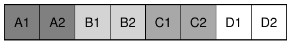
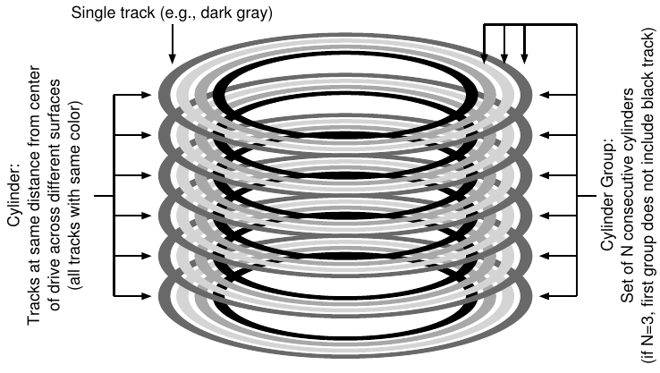
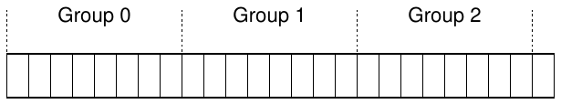
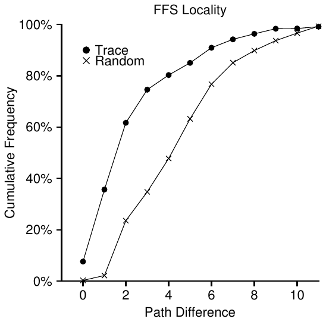
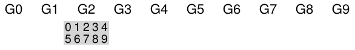
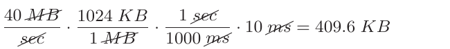
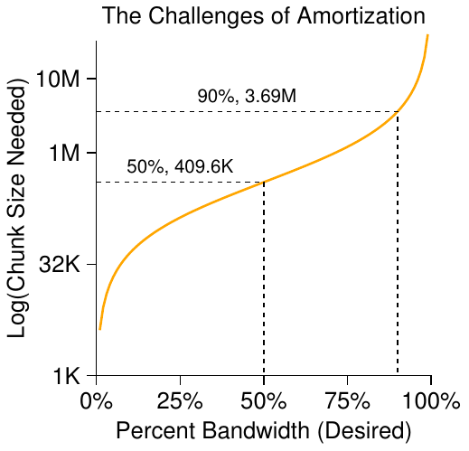
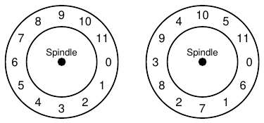

# 41 Locality và Fast File System

Khi UNIX operating system lần đầu được giới thiệu, chính bậc thầy UNIX Ken Thompson đã viết file system đầu tiên. Hãy gọi nó là “file system UNIX cũ”; nó thực sự rất đơn giản. Về cơ bản, các data structure của nó được bố trí trên disk như sau:

Super block (S) chứa thông tin về toàn bộ file system: volume lớn đến đâu, có bao nhiêu inode, một pointer tới đầu free list gồm các block, v.v. Vùng inode của disk chứa tất cả inode của file system. Cuối cùng, phần lớn disk được dành cho data block.

Điểm tốt của file system cũ là nó đơn giản và hỗ trợ các abstraction cơ bản mà file system muốn cung cấp: file và directory hierarchy. Hệ thống easy-to-use này thực sự là một bước tiến so với các hệ thống storage record-based cồng kềnh trước đây, và directory hierarchy là một tiến bộ thực sự so với những hierarchy one-level đơn giản hơn mà các hệ thống trước cung cấp.

## 41.1 Vấn đề: Performance kém

Vấn đề là performance rất tệ. Theo các phép đo của Kirk McKusick và đồng nghiệp tại Berkeley [MJLF84], performance vốn đã kém ngay từ đầu và tiếp tục giảm theo thời gian, đến mức file system chỉ cung cấp được 2% tổng disk bandwidth!

Vấn đề chính là file system UNIX cũ đối xử với disk như thể đó là random-access memory; data nằm rải rác khắp nơi mà không xét đến thực tế rằng phương tiện lưu trữ data là disk, do đó phải chịu chi phí định vị thực sự và tốn kém. Chẳng hạn, các data block của một file thường nằm rất xa inode của nó, gây ra một lần seek tốn kém mỗi khi trước tiên đọc inode rồi đọc các data block của file (một thao tác khá phổ biến).

Tệ hơn nữa, file system dần trở nên phân mảnh nghiêm trọng vì free space không được quản lý cẩn thận. Free list cuối cùng trỏ tới một loạt block rải khắp disk, và khi được cấp phát, các file đơn giản lấy free block kế tiếp. Kết quả là muốn truy cập một file liên tục về mặt logic thì phải di chuyển qua lại trên disk, khiến performance giảm mạnh.

Chẳng hạn, hãy hình dung vùng data block sau, chứa bốn file (A, B, C và D), mỗi file có kích thước 2 block:

Nếu xóa B và D, bố cục thu được là:

Như bạn có thể thấy, free space bị chia thành hai phần, mỗi phần hai block, thay vì một phần bốn block liền nhau gọn gàng. Giả sử bây giờ bạn muốn cấp phát file E có kích thước bốn block:

Bạn có thể thấy điều gì xảy ra: E nằm rải rác trên disk, và vì thế khi truy cập E, bạn không đạt peak performance (khi truy cập tuần tự) của disk. Thay vào đó, bạn đọc E1 và E2 trước, rồi seek, sau đó đọc E3 và E4. Vấn đề phân mảnh này liên tục xảy ra trong file system UNIX cũ và làm giảm performance. (Một lưu ý bên lề: đây chính là vấn đề mà các công cụ disk defragmentation giúp giải quyết; chúng tổ chức lại data on-disk để các file nằm liên tục và free space trở thành một hoặc một vài vùng liên tục, bằng cách di chuyển data rồi ghi lại inode và những cấu trúc tương tự để phản ánh thay đổi)

Một vấn đề nữa: block size ban đầu quá nhỏ (512 byte). Vì thế, việc truyền data từ disk vốn đã kém hiệu quả. Block nhỏ có lợi vì giảm thiểu internal fragmentation (phần lãng phí bên trong block), nhưng bất lợi cho việc truyền vì mỗi block có thể đòi hỏi positioning overhead để tiếp cận nó. Do đó, vấn đề đặt ra là:

> VẤN ĐỀ CỐT LÕI:
>
> CÁCH TỔ CHỨC DATA ON-DISK ĐỂ CẢI THIỆN PERFORMANCE
>
> Làm thế nào tổ chức các data structure của file system để cải thiện performance? Ta cần những loại allocation policy nào bên trên các data structure đó? Làm thế nào để file system “hiểu đặc tính của disk”?

## 41.2 FFS: Hiểu đặc tính của disk là giải pháp

Một nhóm tại Berkeley quyết định xây dựng file system tốt hơn, nhanh hơn, mà họ khéo léo đặt tên là Fast File System (FFS). Ý tưởng là thiết kế các cấu trúc và allocation policy của file system sao cho “hiểu đặc tính của disk”, qua đó cải thiện performance; và đó chính là điều họ đã làm. Vì vậy, FFS mở ra một kỷ nguyên mới cho nghiên cứu file system; bằng cách giữ nguyên interface của file system (cùng các API, bao gồm open(), read(), write(), close() và những file system call khác) nhưng thay đổi cách triển khai bên trong, các tác giả đã mở đường cho việc xây dựng file system mới, một công việc vẫn tiếp diễn đến ngày nay. Hầu như mọi file system hiện đại đều tuân theo interface hiện có (nhờ đó duy trì khả năng tương thích với ứng dụng), đồng thời thay đổi phần bên trong vì performance, reliability hoặc những lý do khác.

## 41.3 Cấu trúc tổ chức: Cylinder group

Bước đầu tiên là thay đổi các cấu trúc on-disk. FFS chia disk thành nhiều cylinder group. Một cylinder là tập hợp các track trên những bề mặt khác nhau của hard drive, có cùng khoảng cách tới tâm drive; nó được gọi là cylinder vì nó rõ ràng giống hình dạng hình học so-called cùng tên. FFS gom mỗi N cylinder liên tiếp thành một group, do đó có thể xem toàn bộ disk là một tập cylinder group. Sau đây là ví dụ đơn giản, thể hiện bốn track ngoài cùng của một drive có sáu platter và một cylinder group gồm ba cylinder:

Lưu ý rằng drive hiện đại không cung cấp đủ thông tin để file system thực sự biết một cylinder cụ thể có đang được sử dụng hay không; như đã thảo luận trước đó [AD14], disk cung cấp một logical address space gồm các block và che giấu chi tiết hình học của chúng với client. Vì vậy, các file system hiện đại (như Linux ext2, ext3 và ext4) thay vào đó tổ chức drive thành block group, mỗi group chỉ là một phần liên tiếp trong address space của disk. Hình dưới minh họa ví dụ trong đó cứ mỗi 8 block được tổ chức thành một block group riêng (lưu ý rằng group trong thực tế gồm nhiều block hơn rất nhiều):

Dù gọi là cylinder group hay block group, các group này vẫn là cơ chế trung tâm mà FFS sử dụng để cải thiện performance. Điều cốt yếu là bằng cách đặt hai file trong cùng một group, FFS có thể bảo đảm rằng truy cập lần lượt hai file sẽ không dẫn tới những lần seek dài trên disk.

Để sử dụng các group này lưu file và directory, FFS cần có khả năng đặt file và directory vào một group, đồng thời theo dõi tất cả thông tin cần thiết về chúng trong group đó. Để làm được điều này, FFS đưa vào mỗi group mọi cấu trúc mà bạn có thể mong đợi ở một file system, chẳng hạn chỗ dành cho inode, data block và một số cấu trúc theo dõi xem mỗi inode hay data block đã được cấp phát hay còn trống. Sau đây là minh họa những gì FFS lưu trong một cylinder group:

Bây giờ, hãy xem xét chi tiết hơn các thành phần của cylinder group này. FFS giữ một bản sao super block (S) trong mỗi group vì lý do reliability. Super block cần thiết để mount file system; nhờ giữ nhiều bản sao, nếu một bản bị hỏng, bạn vẫn có thể mount và truy cập file system bằng một bản sao còn hoạt động.

Trong mỗi group, FFS cần theo dõi xem inode và data block của group đã được cấp phát hay chưa. Inode bitmap (ib) per-group và data bitmap (db) đảm nhiệm vai trò này cho inode và data block trong mỗi group. Bitmap là cách rất tốt để quản lý free space trong file system vì dễ tìm một phần free space lớn và cấp phát cho file, có thể tránh được một số vấn đề phân mảnh của free list trong file system cũ.

Cuối cùng, các vùng inode và data block giống như trong very-simple file system (VSFS) trước đó. Như thường lệ, phần lớn mỗi cylinder group gồm các data block.

> BÊN LỀ: TẠO FILE TRONG FFS
>
> Lấy ví dụ, hãy nghĩ xem phải cập nhật những data structure nào khi tạo một file; trong ví dụ này, giả sử user tạo file mới /foo/bar.txt và file dài một block (4KB). File này mới nên cần inode mới; vì vậy, cả inode bitmap lẫn inode newly-allocated sẽ được ghi xuống disk. File cũng có data nên data cũng phải được cấp phát; do đó, data bitmap và một data block rồi cũng sẽ được ghi xuống disk. Như vậy, sẽ có ít nhất bốn lần ghi vào cylinder group hiện tại (nhớ rằng những lần ghi này có thể được giữ trong memory buffer một thời gian trước khi thực sự diễn ra). Nhưng chưa hết! Cụ thể, khi tạo file mới, bạn còn phải đặt file vào file-system hierarchy, tức phải cập nhật directory. Đặc biệt, parent directory foo phải được cập nhật để thêm entry cho bar.txt; lần cập nhật này có thể vừa trong một data block hiện có của foo hoặc đòi hỏi cấp phát block mới (cùng data bitmap liên quan). Inode của foo cũng phải được cập nhật để phản ánh độ dài mới của directory cũng như cập nhật các time field (như last-modified-time). Nhìn chung, chỉ tạo một file mới thôi cũng đã có rất nhiều việc phải làm! Có lẽ lần tới khi làm điều đó, bạn nên biết ơn hơn, hoặc ít nhất ngạc nhiên vì mọi thứ lại hoạt động tốt đến vậy.

## 41.4 Policy: Cách cấp phát file và directory

Với cấu trúc group này, FFS giờ phải quyết định cách đặt file, directory và metadata liên quan trên disk để cải thiện performance. Nguyên tắc cơ bản rất đơn giản: giữ những thứ liên quan ở gần nhau (và hệ quả là giữ những thứ không liên quan ở xa nhau).

Vì vậy, để tuân theo nguyên tắc này, FFS phải quyết định những gì là “liên quan” và đặt chúng trong cùng một block group; ngược lại, những mục không liên quan nên được đặt vào các block group khác nhau. Để đạt mục đích đó, FFS sử dụng một vài placement heuristic đơn giản.

Đầu tiên là vị trí đặt directory. FFS dùng cách đơn giản: tìm cylinder group có ít directory đã được cấp phát (để cân bằng directory giữa các group) và nhiều inode còn trống (để sau đó có thể cấp phát nhiều file), rồi đặt directory data cùng inode vào group đó. Dĩ nhiên, ở đây cũng có thể dùng các heuristic khác (chẳng hạn xét đến số data block còn trống).

Đối với file, FFS làm hai việc. Trước hết, nó bảo đảm (trong trường hợp tổng quát) cấp phát các data block của file trong cùng group với inode của file, nhờ đó ngăn những lần seek dài giữa inode và data (như trong file system cũ). Thứ hai, nó đặt mọi file thuộc cùng một directory vào cylinder group của directory đó. Vì thế, nếu user tạo bốn file /dir1/1.txt, /dir1/2.txt, /dir1/3.txt và /dir99/4.txt, FFS sẽ cố đặt ba file đầu gần nhau (cùng group) và file thứ tư ở xa (trong group khác).

Hình 41.1: Locality của FFS đối với SEER trace

Những heuristic này không dựa trên các nghiên cứu sâu rộng về file-system traffic hay điều gì đặc biệt tinh tế; thay vào đó, chúng dựa trên lẽ thường old-fashioned quen thuộc (suy cho cùng, chẳng phải CS là viết tắt của common sense sao?). Các file trong cùng một directory thường được truy cập cùng nhau (hãy hình dung compile một loạt file rồi link chúng thành một executable duy nhất). Vì thế, FFS thường cải thiện performance bằng cách bảo đảm những lần seek giữa các file liên quan đều ngắn, qua đó nâng cao performance.

## 41.5 Đo file locality

Để hiểu rõ hơn liệu những heuristic này có hợp lý không, hãy phân tích một số trace truy cập file system và xem thực sự có namespace locality hay không. Vì lý do nào đó, dường như chưa có nghiên cứu tốt về chủ đề này trong các tài liệu đã công bố.

Cụ thể, ta sẽ sử dụng các SEER trace [K94] và phân tích những lần truy cập file “cách xa nhau” đến mức nào trong directory tree. Chẳng hạn, nếu file f được mở rồi được re-opened ngay sau đó trong trace (trước khi mở bất kỳ file nào khác), khoảng cách giữa hai lần mở này trong directory tree bằng không (vì chúng là cùng một file). Nếu file f trong directory dir (tức dir/f) được mở, tiếp theo mở file g trong cùng directory (tức dir/g), khoảng cách giữa hai file access là một, vì chúng cùng directory nhưng không phải cùng file. Nói cách khác, thước đo khoảng cách của ta đo xem cần đi ngược lên directory tree bao xa để tìm common ancestor của hai file; chúng càng gần nhau trong tree thì giá trị thước đo càng thấp.

Hình 41.1 cho thấy locality quan sát được trong các SEER trace trên tất cả workstation của SEER cluster và trong toàn bộ các trace. Đồ thị biểu diễn thước đo độ chênh lệch trên x-axis và tỷ lệ phần trăm tích lũy các lần mở file có độ chênh lệch đó trên y-axis. Cụ thể, đối với các SEER trace (đánh dấu “Trace” trong đồ thị), bạn có thể thấy khoảng 7% các lần truy cập file hướng tới file vừa được mở trước đó, và gần 40% các lần truy cập hướng tới cùng file hoặc một file trong cùng directory (tức độ chênh lệch bằng không hoặc một). Vì vậy, giả định locality của FFS có vẻ hợp lý (ít nhất đối với những trace này).

Điều thú vị là khoảng 25% các lần truy cập file khác hướng tới những file có khoảng cách bằng hai. Loại locality này xuất hiện khi user tổ chức một tập directory liên quan theo kiểu multi-level và liên tục chuyển qua lại giữa chúng. Chẳng hạn, nếu user có directory src và tạo các object file (file .o) trong directory obj, và cả hai directory này đều là sub-directories của directory chính proj, một access pattern phổ biến sẽ là proj/src/foo.c rồi đến proj/obj/foo.o. Khoảng cách giữa hai lần truy cập này bằng hai vì proj là common ancestor. Các policy của FFS không khai thác loại locality này, do đó sẽ có nhiều seek hơn giữa những lần truy cập như vậy.

Để so sánh, đồ thị còn thể hiện locality của một trace “Random”. Random trace được tạo bằng cách chọn file từ một SEER trace hiện có theo thứ tự ngẫu nhiên rồi tính thước đo khoảng cách giữa những lần truy cập randomly-ordered này. Như bạn có thể thấy, namespace locality trong random trace thấp hơn, đúng như dự đoán. Tuy nhiên, vì cuối cùng mọi file đều có chung một ancestor (chẳng hạn root), vẫn có một mức locality nhất định, nên trường hợp ngẫu nhiên hữu ích làm mốc so sánh.

## 41.6 Ngoại lệ Large-File

Trong FFS, có một ngoại lệ quan trọng đối với policy bố trí file tổng quát, xuất hiện khi xử lý file lớn. Nếu không có quy tắc riêng, một file lớn sẽ lấp đầy hoàn toàn block group mà ban đầu nó được đặt vào (và có thể cả những group khác). Việc lấp đầy block group theo cách này không được mong muốn, vì nó ngăn những file “liên quan” được tạo sau đó nằm trong block group ấy, do đó có thể làm giảm file-access locality.

Vì thế, với file lớn, FFS làm như sau. Sau khi cấp phát một số block vào block group đầu tiên (chẳng hạn 12 block, hoặc bằng số direct pointer có trong một inode), FFS đặt phần “lớn” tiếp theo của file (chẳng hạn các block mà indirect block đầu tiên trỏ tới) vào block group khác (có thể được chọn vì mức sử dụng thấp). Sau đó, phần tiếp theo của file lại được đặt vào một block group khác nữa, và cứ tiếp tục như vậy.

Hãy xem một số hình để hiểu rõ hơn policy này. Nếu không có ngoại lệ large-file, một file lớn duy nhất sẽ đặt tất cả block của nó vào một phần của disk. Ta dùng ví dụ nhỏ về file có 10 block để minh họa trực quan hành vi này. Sau đây là hình minh họa FFS khi không có ngoại lệ large-file:

Với ngoại lệ large-file, bạn có thể thấy bố cục gần giống như sau, trong đó file được trải ra trên disk thành từng phần:

Bạn đọc tinh ý (chính là bạn) sẽ nhận ra rằng việc rải các block của file trên disk làm giảm performance, đặc biệt trong trường hợp tương đối phổ biến là truy cập file tuần tự (chẳng hạn khi user hoặc ứng dụng đọc các phần từ 0 đến 9 theo thứ tự). Và bạn nói đúng! Nhưng bạn có thể giải quyết vấn đề bằng cách chọn kích thước mỗi phần một cách cẩn thận.

Cụ thể, nếu kích thước mỗi phần đủ lớn, file system sẽ dành phần lớn thời gian để truyền data từ disk và chỉ một khoảng thời gian (tương đối) nhỏ để seek giữa các phần của block. Quá trình giảm overhead bằng cách thực hiện nhiều công việc hơn cho mỗi lần chịu overhead được gọi là amortization và là một kỹ thuật phổ biến trong hệ thống máy tính.

Hãy xét một ví dụ: giả sử positioning time trung bình (tức seek và rotation) của disk là 10 ms. Giả sử thêm rằng disk truyền data ở tốc độ 40 MB/s. Nếu mục tiêu là dành một nửa thời gian seek giữa các phần và một nửa thời gian truyền data (nhờ đó đạt 50% peak disk performance), bạn cần dành 10 ms truyền data cho mỗi 10 ms định vị. Vì vậy, câu hỏi trở thành: mỗi phần phải lớn bao nhiêu để mất 10 ms truyền? Rất đơn giản, chỉ cần dùng người bạn cũ của chúng ta là toán học, cụ thể là phân tích thứ nguyên được đề cập trong chương về disk [AD14]:

 (41.1)

Về cơ bản, phương trình này nói rằng: nếu truyền data ở tốc độ 40 MB/s, bạn chỉ cần truyền 409.6KB sau mỗi lần seek để dành một nửa thời gian cho seek và một nửa cho truyền data. Tương tự, bạn có thể tính kích thước mỗi phần cần thiết để đạt 90% peak bandwidth (kết quả khoảng 3.69MB), hoặc thậm chí 99% peak bandwidth (40.6MB!). Như bạn có thể thấy, càng muốn tiến gần mức đỉnh, các phần này càng phải lớn hơn (xem đồ thị các giá trị này ở Hình 41.2).

Tuy nhiên, FFS không dùng kiểu tính toán này để phân bố file lớn giữa các group. Thay vào đó, nó chọn cách đơn giản dựa trên chính cấu trúc inode. Mười hai direct block đầu tiên được đặt trong cùng group với inode; mỗi indirect block tiếp theo và mọi block mà nó trỏ tới được đặt trong một group khác. Với block size 4KB và disk address 32-bit, chiến lược này có nghĩa là cứ 1024 block của file (4MB) được đặt trong những group riêng, ngoại lệ duy nhất là 48KB đầu tiên của file do các direct pointer trỏ tới.

Hình 41.2: Amortization: Mỗi phần phải lớn đến mức nào?

Lưu ý rằng xu hướng của disk drive là transfer rate cải thiện khá nhanh vì các nhà sản xuất disk giỏi nhồi thêm bit vào cùng một bề mặt, nhưng những khía cạnh cơ học liên quan đến seek (tốc độ disk arm và tốc độ quay) cải thiện khá chậm [P98]. Điều này có nghĩa là theo thời gian, chi phí cơ học trở nên đắt hơn một cách tương đối, và vì thế, để phân bổ chi phí đó trên nhiều công việc hơn, bạn phải truyền nhiều data hơn giữa các lần seek.

## 41.7 Một vài điều khác về FFS

FFS còn đưa ra một số cải tiến khác. Đặc biệt, các nhà thiết kế rất lo lắng về việc hỗ trợ file nhỏ; hóa ra khi đó nhiều file chỉ có kích thước khoảng 2KB, và sử dụng block 4KB tuy có lợi cho truyền data nhưng không tốt lắm về hiệu quả sử dụng không gian. Internal fragmentation này vì thế có thể khiến khoảng một nửa disk bị lãng phí trong file system điển hình.

Giải pháp mà các nhà thiết kế FFS nghĩ ra rất đơn giản và giải quyết được vấn đề. Họ quyết định đưa vào sub-blocks, những block nhỏ 512-byte mà file system có thể cấp phát cho file. Do đó, nếu bạn tạo file nhỏ (chẳng hạn kích thước 1KB), nó sẽ chiếm hai sub-blocks và không lãng phí cả một block 4KB. Khi file lớn lên, file system tiếp tục cấp phát các block 512-byte cho đến khi file có đủ 4KB data. Lúc đó, FFS tìm một block 4KB, sao chép các sub-blocks vào đó rồi giải phóng những sub-blocks này để sử dụng về sau.

Hình 41.3: FFS: Bố trí tiêu chuẩn so với bố trí được tham số hóa

Bạn có thể nhận thấy quá trình này kém hiệu quả, đòi hỏi file system làm thêm nhiều việc (đặc biệt là nhiều I/O bổ sung để thực hiện sao chép). Và bạn lại đúng! Vì vậy, FFS nhìn chung tránh hành vi gây hiệu quả tệ nhất này bằng cách sửa thư viện libc; thư viện giữ các lần ghi trong buffer rồi gửi chúng tới file system theo từng phần 4KB, nhờ đó trong hầu hết trường hợp tránh hoàn toàn cơ chế xử lý riêng cho sub-block.

Điều hay thứ hai mà FFS đưa ra là disk layout được tối ưu cho performance. Vào thời đó (trước SCSI và các device interface hiện đại hơn), disk kém tinh vi hơn nhiều và đòi hỏi host CPU điều khiển hoạt động theo cách hands-on hơn. Một vấn đề xuất hiện trong FFS khi file được đặt trên các sector liên tiếp của disk, như bên trái Hình 41.3.

Cụ thể, vấn đề xuất hiện trong quá trình đọc tuần tự. Trước tiên, FFS gửi yêu cầu đọc block 0; đến khi đọc xong và FFS gửi yêu cầu đọc block 1 thì đã quá muộn: block 1 đã quay qua bên dưới head, và lúc này yêu cầu đọc block 1 sẽ phải chờ trọn một vòng quay.

FFS giải quyết vấn đề bằng bố cục khác, như bạn có thể thấy bên phải Hình 41.3. Bằng cách bỏ cách một block (trong ví dụ), FFS có đủ thời gian yêu cầu block tiếp theo trước khi nó đi qua disk head. Thực tế, FFS đủ thông minh để xác định với một disk cụ thể nên bỏ qua bao nhiêu block khi bố trí để tránh những vòng quay bổ sung; kỹ thuật này được gọi là parameterization, vì FFS xác định các performance parameter cụ thể của disk rồi dùng chúng để quyết định chính xác cách bố trí xen kẽ.

Có thể bạn đang nghĩ: rốt cuộc cách này cũng chẳng hay lắm. Thật vậy, bạn chỉ đạt 50% peak bandwidth với kiểu bố trí này vì phải đi quanh mỗi track hai lần chỉ để đọc mỗi block một lần. May mắn là disk hiện đại thông minh hơn nhiều: bên trong, chúng đọc toàn bộ track và giữ nó trong internal disk cache (thường được gọi là track buffer chính vì lý do này). Sau đó, ở những lần đọc tiếp theo từ track ấy, disk chỉ cần trả data mong muốn từ cache. Vì thế, file system không còn phải lo những chi tiết low-level vô cùng nhỏ nhặt này. Abstraction và interface higher-level có thể là điều tốt khi được thiết kế đúng cách.

Một số cải tiến khác về tính dễ sử dụng cũng được bổ sung. FFS là một trong những file system đầu tiên cho phép tên file dài, nhờ đó tên trong file system diễn đạt được nhiều ý nghĩa hơn thay vì cách tiếp cận fixed-size truyền thống (chẳng hạn 8 ký tự). Hơn nữa, một khái niệm mới được đưa ra là symbolic link. Như đã thảo luận trong chương trước, hard link bị hạn chế ở chỗ vừa không thể trỏ tới directory (vì lo tạo vòng lặp trong file system hierarchy), vừa chỉ có thể trỏ tới file trong cùng volume (tức inode number vẫn phải có ý nghĩa). Symbolic link cho phép user tạo một “bí danh” tới bất kỳ file hoặc directory nào khác trên hệ thống nên linh hoạt hơn nhiều. FFS còn đưa ra atomic rename() operation để đổi tên file. Ngoài công nghệ cơ bản, những cải tiến về tính dễ sử dụng có lẽ cũng giúp FFS có cộng đồng người dùng vững mạnh hơn.

> MẸO: LÀM CHO HỆ THỐNG DỄ SỬ DỤNG
>
> Có lẽ bài học cơ bản nhất từ FFS là nó không chỉ đưa ra ý tưởng hay về mặt khái niệm là bố trí disk-aware, mà còn bổ sung một số tính năng đơn giản giúp hệ thống dễ sử dụng hơn. Tên file dài, symbolic link và rename operation hoạt động theo cách atomic đều làm tăng tính hữu ích của hệ thống; dù khó viết bài nghiên cứu về chúng (hãy hình dung cố đọc một bài 14-pager về “Symbolic Link: Người anh em họ thất lạc từ lâu của Hard Link”), những tính năng nhỏ đó khiến FFS hữu ích hơn và nhờ vậy có lẽ tăng cơ hội được đón nhận. Làm cho hệ thống dễ sử dụng thường quan trọng ngang, thậm chí hơn, những đổi mới kỹ thuật sâu sắc của nó.

## 41.8 Tổng kết

Sự ra đời của FFS là bước ngoặt trong lịch sử file system, vì nó làm rõ rằng quản lý file là một trong những vấn đề thú vị nhất trong operating system, đồng thời cho thấy cách bắt đầu xử lý thiết bị vô cùng quan trọng là hard disk. Từ đó, hàng trăm file system mới đã được phát triển, nhưng đến nay nhiều file system vẫn học hỏi FFS (chẳng hạn Linux ext2 và ext3 rõ ràng kế thừa các ý tưởng của nó). Chắc chắn mọi hệ thống hiện đại đều tính đến bài học chính của FFS: hãy đối xử với disk đúng như một disk.

## Tài liệu tham khảo

[AD14] “Operating Systems: Three Easy Pieces”

Chương: Hard Disk Drives

Remzi Arpaci-Dusseau and Andrea Arpaci-Dusseau

Bạn tuyệt đối không nên đọc về FFS khi chưa hiểu tương đối chi tiết về hard drive. Nếu vẫn cố làm vậy, xin hãy đi thẳng vào tù; đừng đi qua ô xuất phát và, điều quan trọng là, đừng nhận $200.

[MJLF84] “A Fast File System for UNIX”

Marshall K. McKusick, William N. Joy, Sam J. Leffler, Robert S. Fabry

ACM Transactions on Computing Systems, 2:3, trang 181-197.

Tháng Tám, 1984. McKusick gần đây đã được trao giải IEEE Reynold B. Johnson vì những đóng góp cho file system, phần lớn dựa trên công việc xây dựng FFS. Trong bài phát biểu nhận giải, ông nói về software FFS ban đầu: chỉ 1200 dòng code! Các phiên bản hiện đại phức tạp hơn một chút; chẳng hạn, hậu duệ BSD FFS hiện nằm trong khoảng 50-thousand lines-of-code.

[P98] “Hardware Technology Trends and Database Opportunities”

David A. Patterson

Bài diễn thuyết chính tại ACM SIGMOD Conference (SIGMOD ’98)

Tháng Sáu, 1998

Một tổng quan xuất sắc và đơn giản về các xu hướng công nghệ disk và cách chúng thay đổi theo thời gian.

[K94] “The Design of the SEER Predictive Caching System”

G. H. Kuenning

MOBICOMM ’94, Santa Cruz, California, tháng Mười Hai 1994

Theo Kuenning, đây là tổng quan tốt nhất về dự án SEER, dự án đã dẫn tới, trong số nhiều kết quả khác, việc thu thập các trace này.
