# 42 Crash Consistency: FSCK và Journaling

Như đã thấy đến đây, file system quản lý một tập data structure để triển khai những abstraction mà ta mong đợi: file, directory và mọi metadata khác cần thiết để hỗ trợ abstraction cơ bản mà ta kỳ vọng ở file system. Khác với phần lớn data structure (chẳng hạn những cấu trúc nằm trong memory của chương trình đang chạy), data structure của file system phải tồn tại bền vững, tức phải được duy trì lâu dài, lưu trên những thiết bị vẫn giữ được data dù mất điện (như hard disk hoặc SSD flash-based).

Một thách thức lớn đối với file system là cách cập nhật persistent data structure khi có thể xảy ra mất điện hoặc system crash. Cụ thể, điều gì xảy ra nếu ngay giữa lúc đang cập nhật các cấu trúc on-disk, ai đó vấp vào dây nguồn khiến máy mất điện? Hoặc operating system gặp bug rồi crash? Vì mất điện và crash có thể xảy ra, việc cập nhật persistent data structure có thể khá phức tạp và dẫn đến một vấn đề mới thú vị trong triển khai file system, gọi là crash-consistency problem.

Vấn đề này khá dễ hiểu. Hãy hình dung bạn phải cập nhật hai cấu trúc on-disk, A và B, để hoàn thành một thao tác cụ thể. Vì disk chỉ phục vụ từng request một, một trong những request này sẽ đến disk trước (A hoặc B). Nếu hệ thống crash hoặc mất điện sau khi một lần ghi hoàn tất, cấu trúc on-disk sẽ bị để lại trong trạng thái không nhất quán. Vì vậy, ta có một vấn đề mà mọi file system đều cần giải quyết:

> VẤN ĐỀ CỐT LÕI: CÁCH CẬP NHẬT DISK DÙ CÓ THỂ XẢY RA CRASH
>
> Hệ thống có thể crash hoặc mất điện giữa hai lần ghi bất kỳ, do đó trạng thái on-disk có thể chỉ được cập nhật một phần. Sau crash, hệ thống khởi động và muốn mount lại file system (để truy cập file và những thành phần tương tự). Vì crash có thể xảy ra tại thời điểm bất kỳ, làm thế nào bảo đảm file system giữ được image on-disk ở trạng thái hợp lý?

Trong chương này, ta sẽ mô tả vấn đề chi tiết hơn và xem xét một số phương pháp mà các file system đã sử dụng để khắc phục nó. Ta bắt đầu bằng cách tiếp cận của những file system cũ, gọi là fsck hay file system checker. Sau đó, ta chuyển sang cách tiếp cận khác, gọi là journaling (còn gọi là write-ahead logging), một kỹ thuật thêm một chút overhead cho mỗi lần ghi nhưng phục hồi nhanh hơn sau crash hoặc mất điện. Ta sẽ thảo luận cơ chế cơ bản của journaling, bao gồm một vài dạng journaling khác nhau mà Linux ext3 [T98,PAA05] (một journaling file system tương đối hiện đại) triển khai.

## 42.1 Một ví dụ chi tiết

Để bắt đầu tìm hiểu journaling, hãy xét một ví dụ. Ta cần dùng workload cập nhật các cấu trúc on-disk theo một cách nào đó. Giả sử ở đây workload đơn giản là nối thêm một data block vào file hiện có. Thao tác nối thêm được thực hiện bằng cách mở file, gọi lseek() để chuyển file offset đến cuối file, rồi thực hiện một lần ghi 4KB vào file trước khi đóng nó.

Ta cũng giả sử đang sử dụng những cấu trúc file system đơn giản thông thường trên disk, tương tự các file system đã thấy trước đó. Ví dụ nhỏ này gồm inode bitmap (chỉ có 8 bit, mỗi inode một bit), data bitmap (cũng 8 bit, mỗi data block một bit), các inode (tổng cộng 8, đánh số từ 0 đến 7, trải trên bốn block) và các data block (tổng cộng 8, đánh số từ 0 đến 7). Sau đây là sơ đồ file system này:

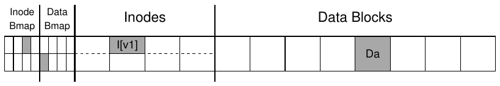

Nếu nhìn vào các cấu trúc trong hình, bạn có thể thấy một inode duy nhất được cấp phát (inode số 2), được đánh dấu trong inode bitmap, và một data block duy nhất được cấp phát (data block 4), cũng được đánh dấu trong data bitmap. Inode được ký hiệu I[v1] vì đây là phiên bản đầu tiên của inode đó; nó sắp được cập nhật (do workload mô tả ở trên).

Hãy xem cả bên trong inode đã được đơn giản hóa này. Trong I[v1], ta thấy:

```
owner       : remzi
permissions : read-write
size        : 1
pointer     : 4
pointer     : null
pointer     : null
pointer     : null
```

Trong inode được đơn giản hóa này, kích thước file là 1 (file đã được cấp phát một block), direct pointer đầu tiên trỏ tới block 4 (data block đầu tiên của file, Da), còn cả ba direct pointer khác đều được đặt thành null (cho biết chúng chưa được sử dụng). Dĩ nhiên, inode thực tế có nhiều field hơn; xem các chương trước để biết thêm thông tin.

Khi nối thêm vào file, ta bổ sung một data block mới, do đó phải cập nhật ba cấu trúc on-disk: inode (phải trỏ tới block mới và có kích thước lớn hơn do nối thêm), data block mới Db và một phiên bản mới của data bitmap (gọi là B[v2]) để cho biết data block mới đã được cấp phát.

Vì vậy, trong memory của hệ thống, ta có ba block phải ghi xuống disk. Inode được cập nhật (inode phiên bản 2, gọi tắt là I[v2]) giờ có dạng:

```
owner       : remzi
permissions : read-write
size        : 2
pointer     : 4
pointer     : 5
pointer     : null
pointer     : null
```

Data bitmap đã cập nhật (B[v2]) giờ có dạng: 00001100. Cuối cùng là data block (Db), được điền bằng bất cứ nội dung nào user đưa vào file. Có lẽ là nhạc sao chép lậu chăng?

Ta muốn image on-disk cuối cùng của file system có dạng như sau:

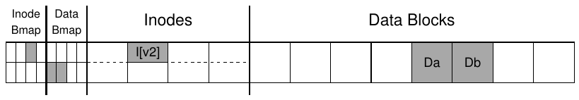

Để thực hiện sự chuyển đổi này, file system phải thực hiện ba lần ghi riêng biệt xuống disk, mỗi lần dành cho inode (I[v2]), bitmap (B[v2]) và data block (Db). Lưu ý rằng những lần ghi này thường không diễn ra ngay khi user gọi write() system call; thay vào đó, inode dirty, bitmap và data mới trước tiên sẽ nằm trong main memory (trong page cache hoặc buffer cache) một thời gian; sau đó, khi file system cuối cùng quyết định ghi chúng xuống disk (chẳng hạn sau 5 giây hoặc 30 giây), file system sẽ gửi những write request cần thiết tới disk. Đáng tiếc là crash có thể xảy ra, làm gián đoạn những cập nhật này. Cụ thể, nếu crash xảy ra sau khi một hoặc hai trong số các lần ghi đã diễn ra, nhưng chưa đủ cả ba, file system có thể bị để lại trong trạng thái bất thường.

### Các kịch bản crash

Để hiểu rõ vấn đề hơn, hãy xem một số kịch bản crash. Hình dung chỉ một lần ghi thành công; như vậy có ba kết quả có thể xảy ra, được liệt kê dưới đây:

• Chỉ data block (Db) được ghi xuống disk. Trong trường hợp này, data nằm trên disk nhưng không có inode nào trỏ tới và cũng không có bitmap nào cho biết block đã được cấp phát. Vì vậy, tình huống giống như lần ghi chưa từng xảy ra. Xét từ góc độ crash consistency của file-system, trường hợp này hoàn toàn không có vấn đề[^1].

• Chỉ inode đã cập nhật (I[v2]) được ghi xuống disk. Trong trường hợp này, inode trỏ tới disk address (5), nơi Db sắp được ghi, nhưng Db vẫn chưa được ghi vào đó. Vì thế, nếu tin pointer đó, ta sẽ đọc garbage data từ disk (nội dung cũ của disk address 5).

Hơn nữa, ta có một vấn đề mới, gọi là file-system inconsistency. Bitmap on-disk cho biết data block 5 chưa được cấp phát, nhưng inode lại nói rằng nó đã được cấp phát. Sự bất đồng này giữa các data structure của file system chính là tình trạng không nhất quán trong các data structure của file system; để sử dụng file system, bằng cách nào đó ta phải giải quyết vấn đề (sẽ bàn thêm bên dưới).

• Chỉ bitmap đã cập nhật (B[v2]) được ghi xuống disk. Trong trường hợp này, bitmap cho biết block 5 đã được cấp phát nhưng không có inode nào trỏ tới nó. Vì thế, file system lại không nhất quán; nếu không giải quyết, lần ghi này sẽ gây space leak, vì block 5 sẽ không bao giờ được file system sử dụng.

Còn có ba kịch bản crash khác trong nỗ lực ghi ba block xuống disk này. Ở những trường hợp đó, hai lần ghi thành công và lần cuối thất bại:

• Inode (I[v2]) và bitmap (B[v2]) được ghi xuống disk, nhưng data (Db) thì không. Trong trường hợp này, metadata của file system hoàn toàn nhất quán: inode có pointer tới block 5, bitmap cho biết 5 đang được sử dụng, nên mọi thứ có vẻ ổn từ góc độ metadata của file system. Nhưng có một vấn đề: block 5 lại chứa garbage data.

• Inode (I[v2]) và data block (Db) được ghi, nhưng bitmap (B[v2]) thì không. Trong trường hợp này, inode trỏ tới data chính xác trên disk, nhưng lại có sự không nhất quán giữa inode và phiên bản cũ của bitmap (B1). Vì thế, một lần nữa ta cần giải quyết vấn đề trước khi sử dụng file system.

• Bitmap (B[v2]) và data block (Db) được ghi, nhưng inode (I[v2]) thì không. Trong trường hợp này, lại có sự không nhất quán giữa inode và data bitmap. Tuy nhiên, dù block đã được ghi và bitmap cho biết nó được sử dụng, ta không biết nó thuộc file nào, vì không có inode nào trỏ tới file đó.

### Crash Consistency Problem

Hy vọng từ những kịch bản crash này, bạn có thể thấy nhiều vấn đề có thể xảy ra với image file system on-disk do crash: các data structure của file system có thể không nhất quán; có thể có space leak; ta có thể trả garbage data cho user; v.v. Lý tưởng nhất, ta muốn chuyển file system một cách atomic từ một trạng thái nhất quán (chẳng hạn trước khi file được nối thêm) sang một trạng thái nhất quán khác (chẳng hạn sau khi inode, bitmap và data block mới được ghi xuống disk). Đáng tiếc là không dễ làm điều này vì disk chỉ commit từng lần ghi một, và crash hoặc mất điện có thể xảy ra giữa những lần cập nhật. Ta gọi vấn đề tổng quát này là crash-consistency problem (cũng có thể gọi là consistent-update problem).

## 42.2 Giải pháp #1: File System Checker

Những file system đời đầu chọn cách tiếp cận đơn giản với crash consistency. Về cơ bản, chúng quyết định cứ để tình trạng không nhất quán xảy ra rồi sửa sau (khi reboot). Một ví dụ kinh điển về cách tiếp cận trì hoãn này là công cụ thực hiện điều đó: fsck[^2]. fsck là công cụ UNIX để tìm và sửa những tình trạng không nhất quán như vậy [M86]; các công cụ tương tự để kiểm tra và sửa disk partition cũng tồn tại trên những hệ thống khác. Lưu ý rằng cách tiếp cận này không thể khắc phục mọi vấn đề; chẳng hạn hãy xét trường hợp ở trên, file system có vẻ nhất quán nhưng inode trỏ tới garbage data. Mục tiêu thực sự duy nhất là bảo đảm metadata của file system nhất quán nội bộ.

Công cụ fsck hoạt động qua một số pha, được tóm tắt trong bài báo của McKusick và Kowalski [MK96]. Nó được chạy trước khi file system được mount và sẵn sàng sử dụng (fsck giả định không có hoạt động file-system nào khác on-going trong khi nó chạy); khi hoàn tất, file system on-disk phải nhất quán và do đó có thể cho user truy cập.

Sau đây là tóm tắt cơ bản những việc fsck thực hiện:

• Superblock: trước tiên, fsck kiểm tra xem superblock có hợp lý hay không, chủ yếu thực hiện sanity check như bảo đảm file system size lớn hơn số block đã cấp phát. Thông thường, mục tiêu của những sanity check này là phát hiện superblock đáng ngờ (bị hỏng); trong trường hợp đó, hệ thống (hoặc administrator) có thể quyết định sử dụng bản sao superblock khác.

• Free block: tiếp theo, fsck quét inode, indirect block, double indirect block, v.v. để xác định những block hiện đã được cấp phát trong file system. Nó sử dụng thông tin này để tạo phiên bản allocation bitmap chính xác; vì vậy, nếu có sự không nhất quán giữa bitmap và inode, vấn đề được giải quyết bằng cách tin thông tin trong inode. Cùng kiểu kiểm tra được thực hiện cho mọi inode, bảo đảm tất cả inode có vẻ đang được sử dụng đều được đánh dấu như vậy trong inode bitmap.

• Trạng thái inode: mỗi inode được kiểm tra xem có hỏng hoặc gặp vấn đề khác không. Chẳng hạn, fsck bảo đảm mỗi inode đã cấp phát có type field hợp lệ (ví dụ regular file, directory, symbolic link, v.v.). Nếu inode field có vấn đề không dễ khắc phục, inode bị xem là đáng ngờ và được fsck xóa; inode bitmap được cập nhật tương ứng.

• Inode link: fsck còn xác minh link count của mỗi inode đã cấp phát. Như bạn có thể nhớ, link count biểu thị số directory khác nhau chứa reference (tức link) tới file cụ thể này. Để xác minh link count, fsck quét toàn bộ directory tree, bắt đầu từ root directory, rồi tự tính link count cho từng file và directory trong file system. Nếu số đếm newly-calculated không khớp với số trong inode, phải thực hiện biện pháp sửa chữa, thường là sửa số đếm trong inode. Nếu phát hiện inode đã được cấp phát nhưng không có directory nào tham chiếu tới, nó được chuyển vào directory lost+found.

• Trùng lặp: fsck còn kiểm tra duplicate pointer, tức trường hợp hai inode khác nhau tham chiếu cùng một block. Nếu một inode rõ ràng bị lỗi, nó có thể bị xóa. Ngoài ra, block pointed-to có thể được sao chép, nhờ đó mỗi inode có bản sao riêng như mong muốn.

• Bad block: trong lúc quét danh sách mọi pointer, fsck cũng kiểm tra bad block pointer. Pointer được xem là “bad” nếu rõ ràng trỏ tới vị trí ngoài phạm vi hợp lệ, chẳng hạn có address tham chiếu một block vượt quá partition size. Trong trường hợp này, fsck không thể làm gì quá thông minh; nó chỉ loại bỏ (xóa) pointer khỏi inode hoặc indirect block.

• Kiểm tra directory: fsck không hiểu nội dung file của user; tuy nhiên, directory chứa thông tin được định dạng đặc biệt do chính file system tạo ra. Vì thế, fsck thực hiện thêm integrity check đối với nội dung mỗi directory, bảo đảm “.” và “..” là những entry đầu tiên, mỗi inode được tham chiếu trong directory entry đã được cấp phát, và không có directory nào được liên kết tới nhiều hơn một lần trong toàn hierarchy.

Như bạn có thể thấy, xây dựng fsck hoạt động được đòi hỏi hiểu biết tường tận về file system; bảo đảm phần code như vậy hoạt động chính xác trong mọi trường hợp có thể là một thách thức [G+08]. Tuy nhiên, fsck (và những cách tiếp cận tương tự) có vấn đề lớn hơn và có lẽ cơ bản hơn: chúng quá chậm. Với disk volume rất lớn, quét toàn bộ disk để tìm mọi block đã cấp phát và đọc toàn bộ directory tree có thể mất nhiều phút hoặc nhiều giờ. Khi dung lượng disk tăng và RAID trở nên phổ biến, chi phí performance của fsck trở nên không thể chấp nhận (dù gần đây đã có tiến bộ [M+13]).

Xét rộng hơn, tiền đề cơ bản của fsck có vẻ hơi vô lý. Hãy xét ví dụ trên, chỉ ba block được ghi xuống disk; quét toàn bộ disk để sửa những vấn đề xảy ra trong quá trình cập nhật chỉ ba block là cực kỳ tốn kém. Tình huống này giống như làm rơi chìa khóa xuống sàn phòng ngủ rồi bắt đầu thuật toán phục hồi search-the-entire-house-for-keys, từ tầng hầm lần lượt đi qua mọi phòng. Cách đó hiệu quả nhưng lãng phí. Vì thế, khi disk (và RAID) lớn lên, các nhà nghiên cứu và người triển khai bắt đầu tìm giải pháp khác.

## 42.3 Giải pháp #2: Journaling (hay Write-Ahead Logging)

Có lẽ giải pháp phổ biến nhất cho vấn đề cập nhật nhất quán là mượn ý tưởng từ thế giới database management system. Ý tưởng đó, gọi là write-ahead logging, được phát minh để giải quyết chính loại vấn đề này. Trong file system, ta thường gọi write-ahead logging là journaling vì lý do lịch sử. File system đầu tiên làm điều này là Cedar [H87], nhưng nhiều file system hiện đại cũng sử dụng ý tưởng đó, bao gồm Linux ext3 và ext4, reiserfs, JFS của IBM, XFS của SGI và Windows NTFS.

Ý tưởng cơ bản như sau. Khi cập nhật disk, trước khi ghi đè các cấu trúc tại chỗ, hãy ghi trước một ghi chú nhỏ (ở nơi khác trên disk, tại vị trí well-known) mô tả điều bạn sắp làm. Ghi chú này là phần “write ahead”, và ta ghi nó vào một cấu trúc được tổ chức thành “log”; vì thế có tên write-ahead logging.

Bằng cách ghi ghi chú xuống disk, bạn bảo đảm rằng nếu crash xảy ra trong lúc cập nhật (ghi đè) các cấu trúc đang cập nhật, bạn có thể quay lại xem ghi chú đã tạo và thử lại; nhờ vậy, sau crash bạn biết chính xác cần sửa gì (và sửa bằng cách nào), thay vì phải quét toàn bộ disk. Vì thế, theo thiết kế, journaling thêm một chút công việc khi cập nhật để giảm đáng kể lượng công việc cần thiết khi phục hồi.

Bây giờ, ta sẽ mô tả cách Linux ext3, một journaling file system phổ biến, tích hợp journaling vào file system. Phần lớn cấu trúc on-disk giống Linux ext2, chẳng hạn disk được chia thành block group và mỗi block group có inode bitmap, data bitmap, inode cùng data block. Cấu trúc mới then chốt là chính journal, chiếm một lượng nhỏ không gian trong partition hoặc trên thiết bị khác. Vì vậy, ext2 file system (không có journaling) có dạng như sau:

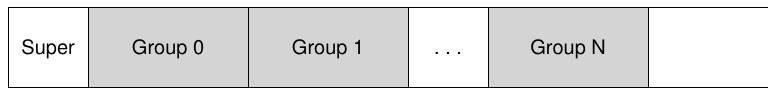

Giả sử journal được đặt trong cùng file system image (dù đôi khi nó được đặt trên thiết bị riêng hoặc dưới dạng file trong file system), một ext3 file system có journal sẽ có dạng:

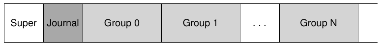

Khác biệt thực sự chỉ là sự hiện diện của journal và, dĩ nhiên, cách sử dụng nó.

### Data Journaling

Hãy xét ví dụ đơn giản để hiểu cách data journaling hoạt động. Data journaling là một mode có sẵn trong Linux ext3 file system, cơ sở cho phần lớn nội dung thảo luận này.

Giả sử ta lại có thao tác cập nhật điển hình, trong đó muốn ghi inode (I[v2]), bitmap (B[v2]) và data block (Db) xuống disk. Trước khi ghi chúng tới vị trí cuối cùng trên disk, giờ ta sẽ ghi chúng vào log (tức journal) trước. Nội dung trong log sẽ có dạng như sau:

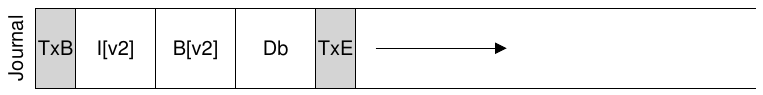

Bạn có thể thấy ta đã ghi năm block ở đây. Transaction begin (TxB) cho biết về lần cập nhật này, gồm thông tin về cập nhật đang chờ thực hiện đối với file system (chẳng hạn address cuối cùng của các block I[v2], B[v2] và Db), cùng một loại transaction identifier (TID). Ba block ở giữa chứa nguyên nội dung chính xác của các block; cách này gọi là physical logging vì ta đưa nội dung vật lý chính xác của cập nhật vào journal (một ý tưởng khác, logical logging, đưa biểu diễn logic gọn hơn của cập nhật vào journal, chẳng hạn “lần cập nhật này muốn nối data block Db vào file X”; cách đó phức tạp hơn một chút nhưng có thể tiết kiệm log space và có lẽ cải thiện performance). Block cuối (TxE) đánh dấu kết thúc transaction này và cũng chứa TID.

Khi transaction này đã nằm an toàn trên disk, ta sẵn sàng ghi đè các cấu trúc cũ trong file system; quá trình này gọi là checkpointing. Vì vậy, để checkpoint file system (tức cập nhật nó theo cập nhật đang chờ trong journal), ta gửi các lần ghi I[v2], B[v2] và Db tới disk location tương ứng như ở trên; nếu những lần ghi này hoàn tất thành công, ta đã checkpoint file system thành công và về cơ bản đã xong. Như vậy, chuỗi thao tác ban đầu của ta là:

1. Journal write: Ghi transaction, bao gồm một transaction-begin block, mọi cập nhật data và metadata đang chờ thực hiện, cùng một transaction-end block, vào log; chờ những lần ghi này hoàn tất.

2. Checkpoint: Ghi các cập nhật metadata và data đang chờ thực hiện tới vị trí cuối cùng của chúng trong file system.

Trong ví dụ này, ta ghi TxB, I[v2], B[v2], Db và TxE vào journal trước. Khi những lần ghi này hoàn tất, ta hoàn thành cập nhật bằng cách checkpoint I[v2], B[v2] và Db tới vị trí cuối cùng của chúng trên disk.

Mọi thứ trở nên phức tạp hơn một chút khi crash xảy ra trong lúc ghi vào journal. Ở đây, ta đang cố ghi tập block trong transaction (chẳng hạn TxB, I[v2], B[v2], Db, TxE) xuống disk. Một cách đơn giản là lần lượt gửi từng lần ghi, chờ nó hoàn tất rồi mới gửi lần tiếp theo. Tuy nhiên, cách này chậm. Lý tưởng nhất, ta muốn gửi đồng thời cả năm lần ghi block, vì như vậy biến năm lần ghi thành một lần ghi tuần tự duy nhất và do đó nhanh hơn. Nhưng cách này không an toàn vì lý do sau: với một lần ghi lớn như vậy, bên trong disk có thể thực hiện scheduling và hoàn thành những phần nhỏ của lần ghi theo thứ tự bất kỳ. Vì thế, bên trong disk có thể (1) ghi TxB, I[v2], B[v2] và TxE, rồi sau đó mới (2) ghi Db. Đáng tiếc là nếu disk mất điện giữa (1) và (2), nội dung cuối cùng trên disk sẽ như sau:

> BÊN LỀ: BUỘC CÁC LẦN GHI THỰC SỰ XUỐNG DISK
>
> Để thực thi thứ tự giữa hai lần ghi disk, file system hiện đại phải có thêm một vài biện pháp bảo đảm. Ngày trước, buộc hai lần ghi A và B theo đúng thứ tự rất dễ: chỉ cần gửi yêu cầu ghi A tới disk, chờ disk phát interrupt cho OS khi ghi xong rồi gửi yêu cầu ghi B.
>
> Mọi thứ phức tạp hơn đôi chút do write cache bên trong disk được sử dụng ngày càng nhiều. Khi bật write buffering (đôi khi gọi là immediate reporting), disk thông báo với OS rằng lần ghi đã hoàn tất ngay khi nó mới được đưa vào memory cache của disk, dù chưa thực sự xuống disk. Nếu sau đó OS gửi lần ghi tiếp theo, không có bảo đảm lần ghi ấy sẽ xuống disk sau các lần ghi trước; do đó, thứ tự giữa các lần ghi không được giữ nguyên. Một giải pháp là tắt write buffering. Tuy nhiên, các hệ thống hiện đại hơn có thêm biện pháp bảo đảm và gửi write barrier tường minh; khi barrier như vậy hoàn tất, nó bảo đảm mọi lần ghi được gửi trước barrier sẽ xuống disk trước bất kỳ lần ghi nào được gửi sau barrier.
>
> Toàn bộ cơ chế này đòi hỏi tin tưởng rất nhiều vào hoạt động chính xác của disk. Đáng tiếc là nghiên cứu gần đây cho thấy một số nhà sản xuất disk, nhằm cung cấp disk có “performance cao hơn”, cố tình bỏ qua write-barrier request, khiến disk có vẻ chạy nhanh hơn nhưng có nguy cơ hoạt động sai [C+13, R+11]. Như Kahan đã nói, thứ nhanh gần như luôn đánh bại thứ chậm, ngay cả khi thứ nhanh cho kết quả sai.

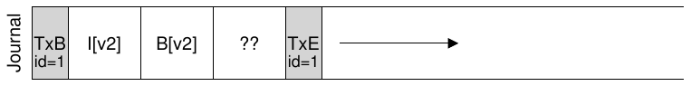

Tại sao đây lại là vấn đề? Transaction có vẻ hợp lệ (có phần bắt đầu và kết thúc với sequence number khớp nhau). Hơn nữa, file system không thể nhìn vào block thứ tư đó để biết nó sai; suy cho cùng, đó là user data tùy ý. Vì thế, nếu lúc này hệ thống reboot và thực hiện recovery, nó sẽ replay transaction này rồi vô tình sao chép nội dung garbage block ’??’ tới nơi lẽ ra Db phải nằm. Điều này đã không tốt đối với user data bất kỳ trong file; nó còn tệ hơn nhiều nếu xảy ra với một thành phần file system quan trọng như superblock, có thể khiến file system không mount được.

> BÊN LỀ: TỐI ƯU CÁC LẦN GHI LOG
>
> Có thể bạn đã nhận ra một điểm kém hiệu quả cụ thể khi ghi vào log. Đó là file system phải ghi transaction-begin block và nội dung transaction trước; chỉ sau khi những lần ghi này hoàn tất, file system mới có thể gửi transaction-end block xuống disk. Tác động tới performance rất rõ nếu nghĩ về cách disk hoạt động: thường phải chịu thêm một vòng quay (hãy nghĩ xem vì sao).
>
> Một cựu nghiên cứu sinh của chúng tôi, Vijayan Prabhakaran, có ý tưởng đơn giản để khắc phục vấn đề [P+05]. Khi ghi transaction vào journal, hãy đưa checksum của nội dung journal vào begin block và end block. Điều đó cho phép file system ghi toàn bộ transaction cùng lúc, không cần chờ; nếu trong recovery, file system thấy checksum tính được không khớp checksum lưu trong transaction, nó có thể kết luận crash đã xảy ra khi ghi transaction và do đó loại bỏ cập nhật file-system. Vì vậy, chỉ với một điều chỉnh nhỏ trong write protocol và recovery system, file system có thể đạt common-case performance nhanh hơn; hơn nữa, hệ thống còn đáng tin cậy hơn một chút vì mọi lần đọc từ journal giờ được checksum bảo vệ.
>
> Cách khắc phục đơn giản này đủ hấp dẫn để các nhà phát triển Linux file system chú ý, rồi tích hợp vào Linux file system thế hệ tiếp theo, mang tên (bạn đoán đúng rồi!) Linux ext4. Nó hiện được cung cấp trên hàng triệu máy toàn thế giới, kể cả nền tảng thiết bị cầm tay Android. Vì thế, mỗi khi bạn ghi xuống disk trên nhiều hệ thống Linux-based, một chút code được phát triển tại Wisconsin giúp hệ thống nhanh hơn và đáng tin cậy hơn một chút.

Để tránh vấn đề này, file system thực hiện việc ghi transaction theo hai bước. Trước tiên, nó ghi tất cả block trừ TxE block vào journal, gửi đồng thời những lần ghi này. Khi ghi xong, journal sẽ có dạng như sau (tiếp tục giả sử dùng workload nối thêm của ta):

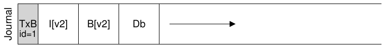

Khi những lần ghi đó hoàn tất, file system gửi yêu cầu ghi TxE block, nhờ đó để journal ở trạng thái cuối cùng an toàn này:

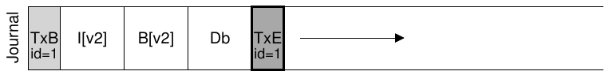

Một khía cạnh quan trọng của quá trình này là atomicity guarantee mà disk cung cấp. Disk bảo đảm rằng bất kỳ lần ghi 512-byte nào cũng hoặc diễn ra hoặc không diễn ra (và không bao giờ bị half-written); vì vậy, để bảo đảm việc ghi TxE là atomic, ta nên đặt nó trong một block 512-byte duy nhất. Như vậy, protocol cập nhật file system hiện tại gồm ba pha được gắn nhãn như sau:

1. Journal write: Ghi nội dung transaction (bao gồm TxB, metadata và data) vào log; chờ những lần ghi này hoàn tất.

2. Journal commit: Ghi transaction commit block (chứa TxE) vào log; chờ lần ghi hoàn tất; khi đó transaction được xem là đã commit.

3. Checkpoint: Ghi nội dung cập nhật (metadata và data) tới vị trí on-disk cuối cùng của chúng.

### Phục hồi

Bây giờ, hãy tìm hiểu cách file system sử dụng nội dung journal để phục hồi sau crash. Crash có thể xảy ra bất kỳ lúc nào trong chuỗi cập nhật này. Nếu crash xảy ra trước khi transaction được ghi an toàn vào log (tức trước khi Bước 2 ở trên hoàn tất), công việc của ta rất đơn giản: chỉ cần bỏ qua cập nhật đang chờ thực hiện. Nếu crash xảy ra sau khi transaction đã commit vào log nhưng trước khi checkpoint hoàn tất, file system có thể phục hồi cập nhật như sau. Khi hệ thống khởi động, quá trình recovery của file system quét log để tìm những transaction đã commit xuống disk; các transaction này được replay (theo thứ tự), trong đó file system lại cố ghi các block thuộc transaction tới vị trí on-disk cuối cùng của chúng. Đây là một trong những dạng logging đơn giản nhất, gọi là redo logging. Bằng cách phục hồi các transaction đã commit trong journal, file system bảo đảm những cấu trúc on-disk nhất quán, từ đó có thể tiếp tục mount file system và chuẩn bị phục vụ request mới.

Lưu ý rằng crash xảy ra tại bất kỳ thời điểm nào trong checkpointing cũng không sao, ngay cả khi một số cập nhật tới vị trí cuối cùng của block đã hoàn tất. Trong trường hợp xấu nhất, một số cập nhật này đơn giản được thực hiện lại trong recovery. Vì recovery là thao tác hiếm gặp (chỉ diễn ra sau system crash bất ngờ), vài lần ghi dư thừa không có gì đáng lo[^3].

### Gom các cập nhật log thành lô

Có thể bạn đã nhận ra protocol cơ bản làm tăng rất nhiều disk traffic. Chẳng hạn, hình dung ta liên tiếp tạo hai file tên file1 và file2 trong cùng directory. Để tạo một file, phải cập nhật một số cấu trúc on-disk, tối thiểu gồm: inode bitmap (để cấp phát inode mới), inode newly-created của file, data block của parent directory chứa directory entry mới, cùng inode của parent directory (giờ có modification time mới). Với journaling, về mặt logic ta commit tất cả thông tin này vào journal cho mỗi lần tạo trong hai file; vì các file nằm trong cùng directory, và giả sử ngay cả inode của chúng cũng nằm trong cùng inode block, nếu không cẩn thận, ta sẽ liên tục ghi lại chính những block này.

Để khắc phục vấn đề, một số file system không commit từng cập nhật riêng lẻ xuống disk (chẳng hạn Linux ext3); thay vào đó, có thể giữ mọi cập nhật trong buffer thuộc một global transaction. Trong ví dụ trên, khi hai file được tạo, file system chỉ đánh dấu inode bitmap in-memory, inode của các file, directory data và directory inode là dirty, rồi thêm chúng vào danh sách block tạo nên transaction hiện tại. Khi cuối cùng đến lúc ghi các block này xuống disk (chẳng hạn sau timeout 5 giây), một global transaction duy nhất được commit, chứa mọi cập nhật mô tả ở trên. Vì thế, bằng cách giữ các cập nhật trong buffer, file system có thể tránh write traffic quá mức tới disk trong nhiều trường hợp.

### Để log có kích thước hữu hạn

Như vậy, ta đã có protocol cơ bản để cập nhật các cấu trúc file-system on-disk. File system giữ các cập nhật trong memory buffer một thời gian; khi đến lúc ghi xuống disk, trước tiên nó ghi cẩn thận chi tiết transaction vào journal (tức write-ahead log); sau khi transaction hoàn tất, file system checkpoint các block đó tới vị trí cuối cùng trên disk.

Tuy nhiên, log có kích thước hữu hạn. Nếu cứ thêm transaction vào đó (như hình này), nó sẽ sớm đầy. Bạn nghĩ điều gì sẽ xảy ra khi ấy?

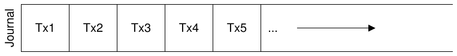

Có hai vấn đề khi log đầy. Vấn đề thứ nhất đơn giản hơn nhưng ít nghiêm trọng hơn: log càng lớn thì recovery càng lâu, vì quá trình recovery phải replay mọi transaction trong log (theo thứ tự) để phục hồi. Vấn đề thứ hai đáng lo hơn: khi log đầy (hoặc gần đầy), không thể commit thêm transaction xuống disk, khiến file system “kém hữu ích” (tức vô dụng).

Để giải quyết những vấn đề này, journaling file system xem log là circular data structure, re-using nó nhiều lần; đó là lý do đôi khi journal được gọi là circular log. Để làm vậy, file system phải có hành động một thời gian sau checkpoint. Cụ thể, khi một transaction đã được checkpoint, file system nên giải phóng không gian mà nó chiếm trong journal, cho phép tái sử dụng log space. Có nhiều cách đạt mục đích này; chẳng hạn chỉ cần đánh dấu các transaction non-checkpointed cũ nhất và mới nhất trong log tại journal superblock; mọi không gian khác đều trống. Sau đây là hình minh họa:

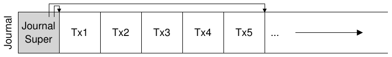

Trong journal superblock (đừng nhầm với superblock chính của file system), journaling system ghi đủ thông tin để biết transaction nào chưa được checkpoint, nhờ đó vừa giảm recovery time vừa cho phép re-use log theo vòng tròn. Vì thế, ta thêm một bước nữa vào protocol cơ bản:

1. Journal write: Ghi nội dung transaction (chứa TxB và nội dung cập nhật) vào log; chờ những lần ghi này hoàn tất.

2. Journal commit: Ghi transaction commit block (chứa TxE) vào log; chờ lần ghi hoàn tất; transaction giờ đã commit.

3. Checkpoint: Ghi nội dung cập nhật tới vị trí cuối cùng của chúng trong file system.

4. Free: Một thời gian sau, đánh dấu transaction là đã giải phóng trong journal bằng cách cập nhật journal superblock.

Như vậy, ta có data journaling protocol cuối cùng. Nhưng vẫn còn một vấn đề: ta ghi mỗi data block xuống disk hai lần, một cái giá nặng nề, đặc biệt để đối phó với sự kiện hiếm như system crash. Bạn có nghĩ ra cách duy trì tính nhất quán mà không ghi data hai lần không?

### Metadata Journaling

Dù recovery giờ nhanh (quét journal và replay vài transaction thay vì quét toàn bộ disk), hoạt động bình thường của file system vẫn chậm hơn mong muốn. Cụ thể, với mỗi lần ghi xuống disk, giờ ta còn ghi vào journal trước, khiến write traffic tăng gấp đôi; sự tăng gấp đôi này đặc biệt bất lợi với sequential write workload, vốn giờ chỉ chạy ở một nửa peak write bandwidth của drive. Hơn nữa, giữa các lần ghi journal và các lần ghi file system chính có một lần seek tốn kém, tạo overhead đáng kể cho một số workload.

Vì chi phí cao của việc ghi mỗi data block xuống disk hai lần, người ta đã thử một vài cách khác nhau để cải thiện performance. Chẳng hạn, journaling mode mô tả ở trên thường gọi là data journaling (như trong Linux ext3), vì nó ghi toàn bộ user data vào journal (ngoài metadata của file system). Một dạng journaling đơn giản hơn (và phổ biến hơn) đôi khi được gọi là ordered journaling (hoặc chỉ metadata journaling), gần giống như vậy, ngoại trừ việc user data không được ghi vào journal. Do đó, khi thực hiện cùng cập nhật như trên, thông tin sau sẽ được ghi vào journal:

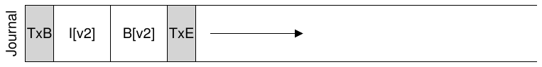

Data block Db, trước đây được ghi vào log, thay vào đó sẽ được ghi thẳng vào file system, tránh lần ghi bổ sung; vì phần lớn I/O traffic tới disk là data, việc không ghi data hai lần giảm đáng kể I/O load của journaling. Tuy nhiên, thay đổi này đặt ra câu hỏi thú vị: khi nào nên ghi data block xuống disk?

Hãy xét lại ví dụ nối thêm vào file để hiểu vấn đề rõ hơn. Cập nhật gồm ba block: I[v2], B[v2] và Db. Hai block đầu đều là metadata, sẽ được ghi vào log rồi checkpoint; block cuối chỉ được ghi một lần vào file system. Khi nào ta nên ghi Db xuống disk? Điều đó có quan trọng không?

Hóa ra thứ tự ghi data thực sự quan trọng với metadata-only journaling. Chẳng hạn, điều gì xảy ra nếu ta ghi Db xuống disk sau khi transaction (chứa I[v2] và B[v2]) hoàn tất? Đáng tiếc là cách này có vấn đề: file system nhất quán nhưng I[v2] có thể trỏ tới garbage data. Cụ thể, xét trường hợp I[v2] và B[v2] đã được ghi nhưng Db chưa xuống disk. Khi đó, file system sẽ cố phục hồi. Vì Db không có trong log, file system replay các lần ghi I[v2] và B[v2], tạo ra file system nhất quán (từ góc độ metadata của file-system). Tuy nhiên, I[v2] sẽ trỏ tới garbage data, tức bất cứ nội dung gì trước đó nằm ở vị trí mà Db dự định được ghi vào.

Để bảo đảm không xảy ra tình huống này, một số file system (chẳng hạn Linux ext3) ghi các data block (của regular file) xuống disk trước khi ghi metadata liên quan. Cụ thể, protocol như sau:

1. Data write: Ghi data tới vị trí cuối cùng; chờ hoàn tất (việc chờ là tùy chọn; xem chi tiết bên dưới).

2. Journal metadata write: Ghi begin block và metadata vào log; chờ những lần ghi hoàn tất.

3. Journal commit: Ghi transaction commit block (chứa TxE) vào log; chờ lần ghi hoàn tất; transaction (bao gồm data) giờ đã commit.

4. Checkpoint metadata: Ghi nội dung cập nhật metadata tới vị trí cuối cùng của chúng trong file system.

5. Free: Sau đó, đánh dấu transaction là đã giải phóng trong journal superblock.

Bằng cách buộc ghi data trước, file system có thể bảo đảm pointer không bao giờ trỏ tới garbage data. Thực vậy, quy tắc “ghi đối tượng được trỏ tới trước đối tượng chứa pointer tới nó” là cốt lõi của crash consistency và được những cơ chế crash consistency khác khai thác sâu hơn nữa [GP94] (xem chi tiết bên dưới).

Trong phần lớn hệ thống, metadata journaling (tương tự ordered journaling của ext3) phổ biến hơn full data journaling. Chẳng hạn, Windows NTFS và XFS của SGI đều sử dụng metadata journaling non-ordered. Linux ext3 cho phép lựa chọn data mode, ordered mode hoặc unordered mode (trong unordered mode, data có thể được ghi bất kỳ lúc nào). Tất cả mode này đều giữ metadata nhất quán; chúng khác nhau về semantics đối với data.

Cuối cùng, lưu ý rằng không bắt buộc phải chờ ghi data hoàn tất (Bước 1) trước khi gửi các lần ghi vào journal (Bước 2) để bảo đảm tính đúng đắn, như đã chỉ ra trong protocol ở trên. Cụ thể, có thể gửi các lần ghi data xuống disk đồng thời gửi transaction-begin block và metadata vào journal; yêu cầu thực sự duy nhất là Bước 1 và 2 phải hoàn tất trước khi gửi journal commit block (Bước 3).

### Trường hợp phức tạp: Tái sử dụng block

Có một số corner case thú vị khiến journaling phức tạp hơn và đáng để thảo luận. Một số trường hợp xoay quanh block reuse; như Stephen Tweedie (một trong những người đóng vai trò chủ chốt trong ext3) đã nói:

“Phần kinh khủng nhất của toàn hệ thống là gì? ... Là xóa file. Mọi thứ liên quan đến xóa đều rắc rối. Mọi thứ liên quan đến xóa... bạn gặp ác mộng về điều xảy ra nếu các block bị xóa rồi được cấp phát lại.” [T00]

Ví dụ cụ thể mà Tweedie đưa ra như sau. Giả sử bạn đang dùng một dạng metadata journaling (do đó các data block của file không được ghi vào journal). Giả sử có directory tên foo. User thêm một entry vào foo (chẳng hạn bằng cách tạo file), nên nội dung foo (vì directory được xem là metadata) được ghi vào log; giả sử vị trí data của directory foo là block 1000. Vì vậy, log chứa nội dung gần như sau:

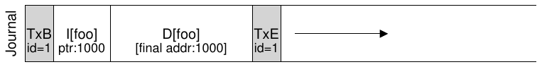

Lúc này, user xóa mọi thứ trong directory cũng như chính directory đó, giải phóng block 1000 để tái sử dụng. Cuối cùng, user tạo file mới (chẳng hạn foobar), và file này sử dụng lại đúng block (1000) từng thuộc về foo. Inode của foobar được commit xuống disk, data của nó cũng vậy; tuy nhiên, lưu ý rằng vì đang dùng metadata journaling, chỉ inode của foobar được commit vào journal; data newly-written trong block 1000 của file foobar không được ghi vào journal.

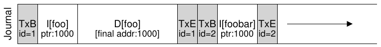

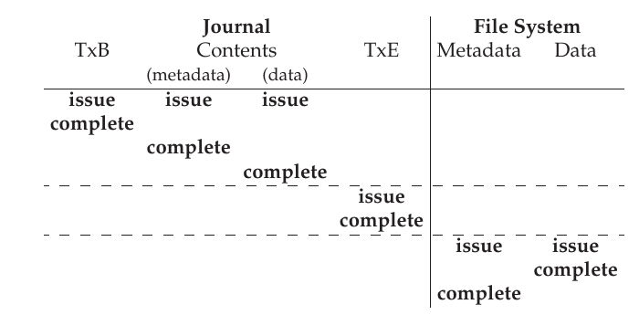

Hình 42.1: Timeline của data journaling

Bây giờ, giả sử crash xảy ra và toàn bộ thông tin này vẫn nằm trong log. Khi replay, quá trình recovery đơn giản replay mọi thứ trong log, bao gồm lần ghi directory data trong block 1000; vì vậy, replay ghi đè user data của file foobar hiện tại bằng nội dung directory cũ! Rõ ràng đây không phải hành động recovery đúng, và chắc chắn user sẽ bất ngờ khi đọc file foobar.

Có nhiều giải pháp cho vấn đề này. Chẳng hạn, có thể không bao giờ tái sử dụng block cho đến khi việc xóa các block đó được checkpoint từ journal tới vị trí cuối cùng. Thay vào đó, Linux ext3 thêm một loại record mới vào journal, gọi là revoke record. Trong trường hợp trên, xóa directory sẽ khiến một revoke record được ghi vào journal. Khi replay journal, trước tiên hệ thống quét tìm các revoke record như vậy; mọi data bị revoke đều không bao giờ được replay, nhờ đó tránh vấn đề đã nêu.

### Khép lại phần journaling: Timeline

Trước khi kết thúc thảo luận về journaling, ta tóm tắt các protocol đã bàn bằng timeline mô tả từng protocol. Hình 42.1 cho thấy protocol khi ghi cả data lẫn metadata vào journal, còn Hình 42.2 cho thấy protocol khi chỉ ghi metadata vào journal.

Trong mỗi hình, thời gian tăng theo hướng từ trên xuống, và mỗi hàng biểu diễn thời điểm logic mà một lần ghi có thể được gửi hoặc có thể hoàn tất. Chẳng hạn, trong data journaling protocol (Hình 42.1), về mặt logic, các lần ghi transaction begin block (TxB) và nội dung transaction có thể được gửi cùng lúc, vì thế có thể hoàn tất theo thứ tự bất kỳ; tuy nhiên, không được gửi lần ghi transaction end block (TxE) cho đến khi các lần ghi trước đó hoàn tất. Tương tự, các lần ghi checkpoint tới data block và metadata block không thể bắt đầu cho đến khi transaction end block đã commit. Các đường nét đứt nằm ngang cho biết nơi phải tuân thủ yêu cầu write-ordering.

Timeline tương tự được trình bày cho metadata journaling protocol. Lưu ý rằng về mặt logic, lần ghi data có thể được gửi cùng lúc với các lần ghi transaction begin và nội dung journal; tuy nhiên, nó phải được gửi và hoàn tất trước khi transaction end được gửi.

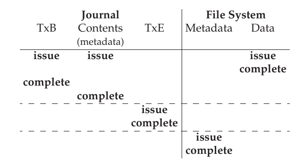

Hình 42.2: Timeline của metadata journaling

Cuối cùng, lưu ý rằng thời điểm hoàn tất được đánh dấu cho mỗi lần ghi trong timeline là tùy ý. Trong hệ thống thực tế, completion time do I/O subsystem quyết định; subsystem này có thể sắp xếp lại các lần ghi để cải thiện performance. Những bảo đảm duy nhất về thứ tự mà ta có là các bảo đảm phải được thực thi để protocol đúng đắn (được thể hiện bằng những đường nét đứt nằm ngang trong hình).

## 42.4 Giải pháp #3: Những cách tiếp cận khác

Đến đây, ta đã mô tả hai lựa chọn để giữ metadata của file system nhất quán: cách tiếp cận trì hoãn dựa trên fsck và cách chủ động hơn gọi là journaling. Tuy nhiên, đó không phải hai cách duy nhất. Một cách khác, gọi là Soft Updates [GP94], được Ganger và Patt giới thiệu. Cách này sắp xếp cẩn thận mọi lần ghi tới file system để bảo đảm các cấu trúc on-disk không bao giờ bị để lại trong trạng thái không nhất quán. Chẳng hạn, bằng cách ghi data block pointed-to xuống disk trước inode trỏ tới nó, ta bảo đảm inode không bao giờ trỏ tới garbage data; có thể suy ra những quy tắc tương tự cho mọi cấu trúc của file system. Tuy nhiên, triển khai Soft Updates có thể là thách thức; trong khi journaling layer mô tả ở trên có thể được triển khai với hiểu biết tương đối ít về các cấu trúc file system cụ thể, Soft Updates đòi hỏi hiểu biết tường tận về từng data structure của file system và vì thế làm hệ thống phức tạp thêm đáng kể.

Một cách tiếp cận khác gọi là copy-on-write (đúng vậy, COW), được dùng trong một số file system phổ biến, bao gồm ZFS của Sun [B07]. Kỹ thuật này không bao giờ ghi đè file hoặc directory tại chỗ; thay vào đó, nó đặt cập nhật mới vào những vị trí trước đó chưa được sử dụng trên disk. Sau khi hoàn tất một số cập nhật, COW file system chuyển root structure của file system sang cấu trúc chứa pointer tới những cấu trúc vừa được cập nhật. Nhờ vậy, giữ file system nhất quán trở nên đơn giản. Ta sẽ tìm hiểu kỹ thuật này sâu hơn khi thảo luận log-structured file system (LFS) ở chương sau; LFS là ví dụ đời đầu về COW.

Một cách tiếp cận khác là phương pháp chúng tôi vừa phát triển tại Wisconsin. Trong kỹ thuật mang tên backpointer-based consistency (hay BBC), không có thứ tự nào bị áp đặt giữa các lần ghi. Để đạt tính nhất quán, mỗi block trong hệ thống được bổ sung một back pointer; chẳng hạn, mỗi data block có reference tới inode mà nó thuộc về. Khi truy cập file, file system có thể xác định file có nhất quán không bằng cách kiểm tra xem forward pointer (chẳng hạn address trong inode hoặc direct block) có trỏ tới một block tham chiếu ngược về nó hay không. Nếu có, mọi thứ hẳn đã xuống disk an toàn và file nhất quán; nếu không, file không nhất quán và hệ thống trả về lỗi. Bằng cách thêm back pointer vào file system, có thể đạt được một dạng lazy crash consistency mới [C+12].

Cuối cùng, chúng tôi cũng nghiên cứu các kỹ thuật giảm số lần journal protocol phải chờ ghi disk hoàn tất. Mang tên optimistic crash consistency [C+13], cách tiếp cận mới này gửi nhiều lần ghi xuống disk nhất có thể và sử dụng dạng tổng quát hóa của transaction checksum [P+05], cùng một vài kỹ thuật khác, để phát hiện sự không nhất quán nếu xảy ra. Với một số workload, các kỹ thuật optimistic này có thể cải thiện performance lên một bậc độ lớn. Tuy nhiên, để thực sự hoạt động tốt, cần disk interface khác đi một chút [C+13].

## 42.5 Tổng kết

Ta đã giới thiệu crash consistency problem và thảo luận nhiều cách tiếp cận để giải quyết. Cách cũ là xây dựng file system checker vẫn hoạt động nhưng có lẽ quá chậm để phục hồi trên hệ thống hiện đại. Vì thế, nhiều file system hiện dùng journaling. Journaling giảm recovery time từ O(size-of-the-disk-volume) xuống O(size-of-thelog), nhờ đó tăng tốc đáng kể quá trình recovery sau crash và restart. Vì lý do này, nhiều file system hiện đại sử dụng journaling. Ta cũng đã thấy journaling có nhiều dạng khác nhau; dạng được sử dụng phổ biến nhất là ordered metadata journaling, giảm lượng traffic tới journal trong khi vẫn duy trì những bảo đảm nhất quán hợp lý cho cả metadata của file system lẫn user data.

## Tài liệu tham khảo

[B07] “ZFS: The Last Word in File Systems”

Jeff Bonwick and Bill Moore

Có tại: http://opensolaris.org/os/community/zfs/docs/zfs_last.pdf

Thực ra, ZFS sử dụng cả copy-on-write lẫn journaling, vì trong một số trường hợp, ghi các lần cập nhật disk vào log sẽ đạt performance tốt hơn.

[C+12] “Consistency Without Ordering”

Vijay Chidambaram, Tushar Sharma, Andrea C. Arpaci-Dusseau, Remzi H. Arpaci-Dusseau FAST ’12, San Jose, California

Một bài báo gần đây của chúng tôi về dạng crash consistency mới dựa trên back pointer. Hãy đọc để tìm hiểu những chi tiết thú vị!

[C+13] “Optimistic Crash Consistency”

Vijay Chidambaram, Thanu S. Pillai, Andrea C. Arpaci-Dusseau, Remzi H. Arpaci-Dusseau SOSP ’13, Nemacolin Woodlands Resort, PA, tháng Mười Một 2013

Công trình của chúng tôi về journaling protocol có tính optimistic hơn và performance cao hơn. Với workload gọi fsync() nhiều, performance có thể được cải thiện đáng kể.

[GP94] “Metadata Update Performance in File Systems”

Gregory R. Ganger and Yale N. Patt

OSDI ’94

Một bài báo thông minh về việc sử dụng thứ tự ghi được sắp xếp cẩn thận làm phương pháp chính để đạt tính nhất quán. Sau này được triển khai trong các hệ thống BSD-based.

[G+08] “SQCK: A Declarative File System Checker”

Haryadi S. Gunawi, Abhishek Rajimwale, Andrea C. Arpaci-Dusseau, Remzi H. Arpaci-Dusseau OSDI ’08, San Diego, California

Bài báo của chúng tôi về một cách mới và tốt hơn để xây dựng file system checker bằng SQL query. Chúng tôi còn chỉ ra một số vấn đề của checker hiện có, phát hiện nhiều bug và hành vi bất thường, hệ quả trực tiếp từ độ phức tạp của fsck.

[H87] “Reimplementing the Cedar File System Using Logging and Group Commit”

Robert Hagmann

SOSP ’87, Austin, Texas, tháng Mười Một 1987

Công trình đầu tiên (theo hiểu biết của chúng tôi) áp dụng write-ahead logging (tức journaling) cho file system.

[M+13] “ffsck: The Fast File System Checker”

Ao Ma, Chris Dragga, Andrea C. Arpaci-Dusseau, Remzi H. Arpaci-Dusseau

FAST ’13, San Jose, California, tháng Hai 2013

Một bài báo gần đây của chúng tôi trình bày chi tiết cách làm fsck nhanh hơn một bậc độ lớn. Một số ý tưởng đã được tích hợp vào BSD file system checker [MK96] và hiện đang được triển khai sử dụng.

[MK96] “Fsck - The UNIX File System Check Program”

Marshall Kirk McKusick and T. J. Kowalski

Được chỉnh sửa năm 1996

Mô tả công cụ kiểm tra file-system toàn diện đầu tiên, mang tên fsck. Được viết bởi một số người cũng đã tạo ra FFS mà bạn biết.

[MJLF84] “A Fast File System for UNIX”

Marshall K. McKusick, William N. Joy, Sam J. Leffler, Robert S. Fabry

ACM Transactions on Computing Systems.

Tháng Tám 1984, Tập 2:3

Bạn đã biết đủ về FFS rồi, đúng không? Nhưng đúng vậy, tham khảo những bài báo như thế này nhiều hơn một lần trong sách cũng chẳng sao.

[P+05] “IRON File Systems”

Vijayan Prabhakaran, Lakshmi N. Bairavasundaram, Nitin Agrawal, Haryadi S. Gunawi, Andrea C. Arpaci-Dusseau, Remzi H. Arpaci-Dusseau

SOSP ’05, Brighton, England, tháng Mười 2005

Một bài báo chủ yếu nghiên cứu cách file system phản ứng với disk failure. Gần cuối, chúng tôi giới thiệu transaction checksum để tăng tốc logging, sau này được áp dụng vào Linux ext4.

[PAA05] “Analysis and Evolution of Journaling File Systems”

Vijayan Prabhakaran, Andrea C. Arpaci-Dusseau, Remzi H. Arpaci-Dusseau

USENIX ’05, Anaheim, California, tháng Tư 2005

Một bài báo ban đầu của chúng tôi phân tích cách journaling file system hoạt động.

[R+11] “Coerced Cache Eviction and Discreet-Mode Journaling”

Abhishek Rajimwale, Vijay Chidambaram, Deepak Ramamurthi,

Andrea C. Arpaci-Dusseau, Remzi H. Arpaci-Dusseau

DSN ’11, Hong Kong, China, tháng Sáu 2011

Bài báo của chúng tôi về vấn đề disk giữ các lần ghi trong memory cache thay vì buộc ghi xuống disk, ngay cả khi được yêu cầu rõ ràng không làm vậy! Giải pháp của chúng tôi để khắc phục vấn đề: nếu muốn A được ghi xuống disk trước B, hãy ghi A trước, rồi gửi thật nhiều lần ghi “giả” xuống disk, hy vọng khiến A buộc phải xuống disk để nhường chỗ cho chúng trong cache. Một giải pháp thú vị dù không thực tế.

[T98] “Journaling the Linux ext2fs File System”

Stephen C. Tweedie

Linux Expo thường niên lần thứ tư, tháng Năm 1998

Tweedie đảm nhiệm phần lớn công việc nặng nhọc để thêm journaling vào Linux ext2 file system; kết quả, không có gì ngạc nhiên, được gọi là ext3. Một số quyết định thiết kế đáng chú ý gồm tập trung mạnh vào khả năng tương thích ngược; chẳng hạn, bạn chỉ cần thêm một journaling file vào ext2 file system hiện có rồi mount nó như ext3 file system.

[T00] “EXT3, Journaling Filesystem”

Stephen Tweedie

Bài nói chuyện tại Ottawa Linux Symposium, tháng Bảy 2000

olstrans.sourceforge.net/release/OLS2000-ext3/OLS2000-ext3.html

Bản chép lại bài nói chuyện của Tweedie về ext3.

[T01] “The Linux ext2 File System”

Theodore Ts’o, tháng Sáu, 2001.

Có tại: http://e2fsprogs.sourceforge.net/ext2.html

Một Linux file system đơn giản dựa trên các ý tưởng trong FFS. Có thời gian nó được sử dụng khá rộng rãi; giờ nó thực sự chỉ còn trong kernel như một ví dụ về file system đơn giản.

---

[^1]: Tuy nhiên, điều đó có thể là vấn đề đối với user vừa mất một ít data!

[^2]: Được phát âm là “eff-ess-see-kay”, “eff-ess-check”, hoặc nếu bạn không thích công cụ này, “eff-suck”. Đúng vậy, những người chuyên nghiệp nghiêm túc vẫn dùng cách gọi này.

[^3]: Trừ khi bạn lo lắng về mọi thứ; nếu thế thì chúng tôi không giúp được. Đừng lo nhiều như vậy, không tốt cho sức khỏe đâu! Nhưng giờ có lẽ bạn lại đang lo về chuyện over-worrying.
