# 43 File system Log-structured

Vào đầu những năm 90, một nhóm tại Berkeley do Giáo sư John Ousterhout và nghiên cứu sinh Mendel Rosenblum dẫn dắt đã phát triển file system mới, gọi là log-structured file system [RO91]. Động lực của họ dựa trên những quan sát sau:

• Memory của hệ thống ngày càng lớn: khi memory lớn hơn, có thể cache nhiều data hơn trong memory. Khi càng nhiều data được cache, disk traffic ngày càng chủ yếu gồm các lần ghi, vì cache phục vụ các lần đọc. Do đó, file system performance phần lớn được quyết định bởi write performance.

• Có khoảng cách lớn giữa random I/O performance và sequential I/O performance: transfer bandwidth của Hard-drive đã tăng đáng kể qua nhiều năm [P98]; khi nhiều bit hơn được nhồi vào bề mặt drive, bandwidth khi truy cập các bit đó tăng lên. Tuy nhiên, chi phí seek và rotational delay giảm chậm; rất khó làm cho những motor nhỏ, rẻ quay platter nhanh hơn hoặc di chuyển disk arm nhanh hơn. Vì thế, nếu có thể sử dụng disk theo cách tuần tự, bạn có lợi thế performance đáng kể so với các cách tiếp cận gây seek và rotation.

• File system hiện có hoạt động kém trên nhiều workload phổ biến: chẳng hạn, FFS [MJLF84] phải thực hiện nhiều lần ghi để tạo file mới có kích thước một block: một lần cho inode mới, một lần cập nhật inode bitmap, một lần ghi directory data block chứa file, một lần ghi directory inode để cập nhật nó, một lần ghi data block mới thuộc file mới và một lần ghi data bitmap để đánh dấu data block đã được cấp phát. Vì vậy, dù FFS đặt tất cả block này trong cùng block group, FFS vẫn chịu nhiều lần seek ngắn cùng rotational delay sau đó, khiến performance thấp hơn rất nhiều so với peak sequential bandwidth.

• File system chưa RAID-aware: chẳng hạn, cả RAID-4 và RAID-5 đều có small-write problem, trong đó một logical write tới một block duy nhất gây ra 4 physical I/O. Các file system hiện có không cố tránh hành vi ghi RAID worst-case này.

> MẸO: CHI TIẾT RẤT QUAN TRỌNG
>
> Mọi hệ thống thú vị đều gồm một vài ý tưởng tổng quát và nhiều chi tiết. Đôi khi, khi tìm hiểu những hệ thống này, bạn tự nghĩ “Ồ, mình hiểu ý tưởng chung rồi; phần còn lại chỉ là chi tiết”, rồi lấy đó làm lý do để chỉ half-learn cách mọi thứ thực sự hoạt động. Đừng làm vậy! Nhiều khi, chi tiết có vai trò quyết định. Như sẽ thấy với LFS, ý tưởng chung rất dễ hiểu, nhưng để thực sự xây dựng hệ thống hoạt động được, bạn phải suy xét kỹ mọi trường hợp phức tạp.

Vì thế, file system lý tưởng sẽ tập trung vào write performance và cố tận dụng sequential bandwidth của disk. Hơn nữa, nó phải hoạt động tốt với các workload phổ biến không chỉ ghi data mà còn thường xuyên cập nhật các cấu trúc metadata on-disk. Cuối cùng, nó phải hoạt động tốt trên cả RAID lẫn disk đơn lẻ.

Loại file system mới mà Rosenblum và Ousterhout giới thiệu được gọi là LFS, viết tắt của Log-structured File System. Khi ghi xuống disk, trước tiên LFS giữ mọi cập nhật (kể cả metadata!) trong buffer thuộc một segment in-memory; khi segment đầy, nó được ghi xuống phần chưa sử dụng của disk bằng một lần truyền dài, tuần tự. LFS không bao giờ ghi đè data hiện có mà luôn ghi segment tới vị trí trống. Vì segment lớn, disk được sử dụng hiệu quả và performance của file system tiến gần mức tối đa.

> VẤN ĐỀ CỐT LÕI:
>
> LÀM THẾ NÀO BIẾN MỌI LẦN GHI THÀNH GHI TUẦN TỰ?
>
> Làm thế nào để file system biến mọi lần ghi thành ghi tuần tự? Đối với đọc, nhiệm vụ này là bất khả thi, vì block muốn đọc có thể nằm ở bất cứ đâu trên disk. Nhưng đối với ghi, file system luôn có lựa chọn, và chính lựa chọn ấy là điều ta muốn khai thác.

## 43.1 Ghi tuần tự xuống disk

Như vậy, ta có thách thức đầu tiên: làm thế nào biến mọi cập nhật trạng thái file-system thành một chuỗi ghi tuần tự xuống disk? Để hiểu rõ hơn, hãy dùng ví dụ đơn giản. Hình dung ta đang ghi data block D vào một file. Ghi data block xuống disk có thể tạo bố cục on-disk như sau, trong đó D được ghi tại disk address A0:

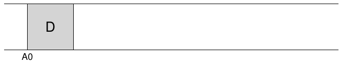

Tuy nhiên, khi user ghi data block, không chỉ data được ghi xuống disk; còn có metadata khác cần cập nhật. Trong trường hợp này, hãy ghi cả inode (I) của file xuống disk và cho nó trỏ tới data block D. Khi được ghi xuống disk, data block và inode sẽ có dạng gần như sau (lưu ý inode trông lớn bằng data block, dù thông thường không phải vậy; trong phần lớn hệ thống, data block có kích thước 4 KB, còn inode nhỏ hơn nhiều, khoảng 128 byte):

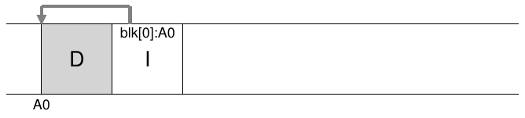

Ý tưởng cơ bản là đơn giản ghi mọi cập nhật (như data block, inode, v.v.) xuống disk theo thứ tự tuần tự, và đó chính là cốt lõi của LFS. Nếu hiểu điều này, bạn đã nắm ý tưởng cơ bản. Nhưng cũng như mọi hệ thống phức tạp, những khó khăn thực sự nằm ở chi tiết.

## 43.2 Ghi tuần tự và hiệu quả

Đáng tiếc là chỉ ghi tuần tự xuống disk thôi chưa đủ bảo đảm ghi hiệu quả. Chẳng hạn, hình dung ta ghi một block duy nhất tới address A tại thời điểm T. Sau đó chờ một lát rồi ghi xuống disk tại address A + 1 (block address kế tiếp theo thứ tự tuần tự), nhưng ở thời điểm T + δ. Trong khoảng In-between lần ghi đầu và lần thứ hai, disk không may đã quay; vì vậy, khi gửi lần ghi thứ hai, nó phải chờ gần trọn một vòng quay trước khi được commit (cụ thể, nếu một vòng quay mất thời gian T<sub>rotation</sub>, disk phải chờ T<sub>rotation</sub> − δ trước khi có thể commit lần ghi thứ hai xuống bề mặt disk). Hy vọng bạn có thể thấy rằng chỉ ghi xuống disk theo thứ tự tuần tự là chưa đủ để đạt peak performance; thay vào đó, phải gửi một lượng lớn các lần ghi liên tiếp (hoặc một lần ghi lớn) tới drive để đạt write performance tốt.

Để làm được điều đó, LFS dùng một kỹ thuật lâu đời gọi là write buffering[^1]. Trước khi ghi xuống disk, LFS theo dõi những cập nhật trong memory; khi đã nhận đủ số cập nhật, nó ghi tất cả xuống disk cùng lúc, nhờ đó bảo đảm sử dụng disk hiệu quả.

Phần cập nhật lớn mà LFS ghi trong một lần được gọi là segment. Dù thuật ngữ này bị over-used trong hệ thống máy tính, ở đây nó chỉ có nghĩa là một phần large-ish mà LFS sử dụng để gom các lần ghi. Vì vậy, khi ghi xuống disk, LFS giữ các cập nhật trong buffer thuộc một segment in-memory, rồi ghi toàn bộ segment xuống disk cùng lúc. Miễn segment đủ lớn, những lần ghi này sẽ hiệu quả.

Sau đây là ví dụ trong đó LFS giữ hai nhóm cập nhật trong buffer của một segment nhỏ; segment thực tế lớn hơn (vài MB). Cập nhật đầu tiên gồm bốn lần ghi block vào file j; cập nhật thứ hai bổ sung một block vào file k. Sau đó, LFS commit toàn bộ segment gồm bảy block xuống disk cùng lúc. Bố cục on-disk thu được của những block này như sau:

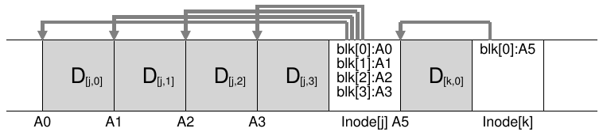

## 43.3 Cần giữ bao nhiêu trong buffer?

Điều này đặt ra câu hỏi: LFS nên giữ bao nhiêu cập nhật trong buffer trước khi ghi xuống disk? Dĩ nhiên, câu trả lời phụ thuộc vào chính disk, cụ thể là positioning overhead cao đến mức nào so với transfer rate; xem chương về FFS để có phân tích tương tự.

Chẳng hạn, giả sử việc định vị (tức rotation overhead và seek overhead) trước mỗi lần ghi mất khoảng T<sub>position</sub> giây. Giả sử thêm rằng disk transfer rate là R<sub>peak</sub> MB/s. Khi chạy trên disk như vậy, LFS nên giữ bao nhiêu trong buffer trước khi ghi?

Có thể suy nghĩ như sau: mỗi lần ghi, bạn phải trả positioning cost dưới dạng một overhead cố định. Vậy phải ghi bao nhiêu để phân bổ chi phí đó trên lượng công việc đủ lớn? Ghi càng nhiều càng tốt (rõ ràng là vậy), và càng tiến gần tới peak bandwidth.

Để có câu trả lời cụ thể, giả sử ta đang ghi D MB. Thời gian ghi phần data này (T<sub>write</sub>) bằng positioning time T<sub>position</sub> cộng thời gian truyền D (D/R<sub>peak</sub>), tức:

 (43.1)

Vì thế, tốc độ ghi hiệu dụng (R<sub>effective</sub>), đơn giản là lượng data được ghi chia cho tổng thời gian ghi nó, bằng:

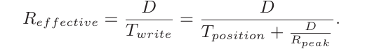 (43.2)

Điều ta quan tâm là đưa tốc độ hiệu dụng (R<sub>effective</sub>) tới gần tốc độ đỉnh. Cụ thể, ta muốn tốc độ hiệu dụng bằng một tỷ lệ F nào đó của tốc độ đỉnh, với 0 < F < 1 (F điển hình có thể là 0.9, tức 90% tốc độ đỉnh). Dưới dạng toán học, điều này nghĩa là ta muốn R<sub>effective</sub> = F × R<sub>peak</sub>.

Đến đây, ta có thể giải tìm D:

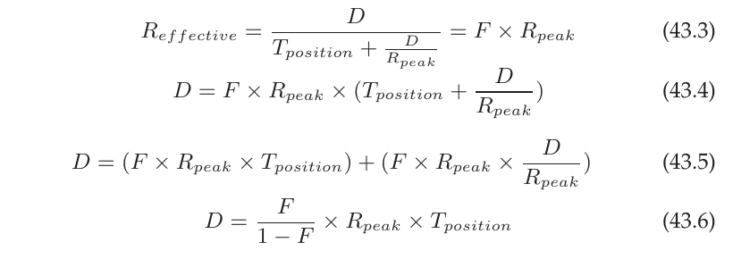

Hãy xét ví dụ với disk có positioning time 10 millisecond và peak transfer rate 100 MB/s; giả sử ta muốn effective bandwidth bằng 90% mức đỉnh (F = 0.9). Trong trường hợp này, D = 0.9/0.1 × 100 M B/s × 0.01 giây = 9 M B. Hãy thử những giá trị khác nhau để xem cần giữ bao nhiêu trong buffer nhằm tiến gần peak bandwidth. Cần bao nhiêu để đạt 95% mức đỉnh? 99%?

## 43.4 Vấn đề: Tìm inode

Để hiểu cách tìm inode trong LFS, hãy ôn ngắn gọn cách tìm inode trong UNIX file system điển hình. Trong file system điển hình như FFS, hoặc ngay cả file system UNIX cũ, tìm inode rất dễ vì chúng được tổ chức thành array và đặt tại những vị trí cố định trên disk.

Chẳng hạn, file system UNIX cũ giữ mọi inode tại một phần cố định của disk. Vì vậy, khi biết inode number và start address, để tìm inode cụ thể, bạn có thể tính chính xác disk address của nó bằng cách nhân inode number với kích thước inode, rồi cộng kết quả vào start address của array on-disk; cách đánh index array-based, khi biết inode number, nhanh và đơn giản.

Tìm inode từ inode number trong FFS chỉ phức tạp hơn một chút, vì FFS chia inode table thành nhiều phần và đặt một nhóm inode trong mỗi cylinder group. Do đó, phải biết kích thước mỗi phần inode và start address của từng phần. Sau đó, cách tính cũng tương tự và dễ dàng.

Trong LFS, mọi thứ khó khăn hơn. Tại sao? Vì ta đã rải inode khắp disk! Tệ hơn nữa, ta không bao giờ ghi đè tại chỗ, nên phiên bản mới nhất của inode (tức phiên bản ta muốn) liên tục di chuyển.

## 43.5 Giải pháp thông qua indirection: Inode map

Để khắc phục, các nhà thiết kế LFS thêm một lớp indirection giữa inode number và inode thông qua data structure gọi là inode map (imap). Imap nhận inode number làm đầu vào và tạo ra disk address của phiên bản inode mới nhất. Vì thế, có thể hình dung nó thường được triển khai dưới dạng array đơn giản, với 4 byte (một disk pointer) cho mỗi entry. Mỗi khi một inode được ghi xuống disk, imap được cập nhật với vị trí mới của nó.

> MẸO: SỬ DỤNG MỘT LỚP INDIRECTION
>
> Người ta thường nói rằng giải pháp cho mọi vấn đề trong Computer Science đơn giản là một lớp indirection. Điều đó rõ ràng không đúng; nó chỉ là giải pháp cho phần lớn vấn đề thôi (đúng vậy, nhận xét này vẫn quá mạnh, nhưng bạn hiểu ý rồi). Bạn hoàn toàn có thể xem mọi dạng virtualization đã học, như virtual memory hoặc khái niệm file, đơn giản là một lớp indirection. Và chắc chắn inode map trong LFS là một cách virtualization inode number. Hy vọng qua những ví dụ này, bạn thấy sức mạnh lớn lao của indirection: cho phép ta tự do di chuyển các cấu trúc (như page trong ví dụ VM, hoặc inode trong LFS) mà không cần thay đổi mọi reference tới chúng. Dĩ nhiên, indirection cũng có thể có nhược điểm: overhead bổ sung. Vì thế, lần tới khi gặp vấn đề, hãy thử giải quyết bằng indirection, nhưng nhớ nghĩ về overhead trước. Như câu nói nổi tiếng của Wheeler: “Mọi vấn đề trong computer science đều có thể được giải quyết bằng thêm một lớp indirection, dĩ nhiên ngoại trừ vấn đề có quá nhiều lớp indirection.”

Đáng tiếc là imap cần được lưu bền vững (tức ghi xuống disk); nhờ đó, LFS theo dõi được vị trí inode qua các lần crash và hoạt động như mong muốn. Vì thế, câu hỏi là: imap nên nằm ở đâu trên disk?

Dĩ nhiên, nó có thể nằm ở một phần cố định của disk. Đáng tiếc là vì được cập nhật thường xuyên, điều này đòi hỏi sau các cập nhật cấu trúc file phải ghi imap, khiến performance giảm (tức có thêm disk seek giữa mỗi cập nhật và vị trí cố định của imap).

Thay vào đó, LFS đặt các phần của inode map ngay cạnh nơi nó ghi mọi thông tin mới khác. Vì vậy, khi nối data block vào file k, LFS thực sự ghi data block mới, inode của file và một phần inode map cùng nhau xuống disk như sau:

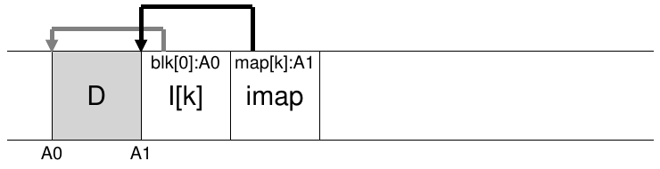

Trong hình này, phần imap array được lưu trong block đánh dấu imap cho LFS biết inode k nằm tại disk address A1; đến lượt inode này cho LFS biết data block D của nó nằm tại address A0.

## 43.6 Hoàn thiện giải pháp: Checkpoint region

Bạn đọc tinh ý (chính là bạn, đúng không?) có lẽ đã nhận ra một vấn đề ở đây. Làm thế nào tìm inode map khi các phần của nó giờ cũng nằm rải rác trên disk? Rốt cuộc, không có phép màu nào cả: file system phải có một vị trí cố định, đã biết trên disk để bắt đầu tìm file.

LFS có một vị trí cố định như vậy trên disk dành cho việc này, gọi là checkpoint region (CR). Checkpoint region chứa pointer tới (tức address của) những phần mới nhất của inode map, nên có thể tìm các phần inode map bằng cách đọc CR trước. Lưu ý checkpoint region chỉ được cập nhật định kỳ (chẳng hạn khoảng 30 giây một lần), do đó performance không bị ill-affected. Vì vậy, cấu trúc tổng thể của bố cục on-disk gồm checkpoint region (trỏ tới những phần mới nhất của inode map); mỗi phần inode map chứa address của các inode; inode trỏ tới file (và directory), giống UNIX file system điển hình.

Sau đây là ví dụ về checkpoint region (lưu ý nó nằm ngay đầu disk, tại address 0), cùng một phần imap, một inode và một data block. Dĩ nhiên, file system thực tế có CR lớn hơn nhiều (thực ra có hai vùng như vậy, như ta sẽ tìm hiểu sau), nhiều phần imap và tất nhiên nhiều inode, data block, v.v. hơn nữa.

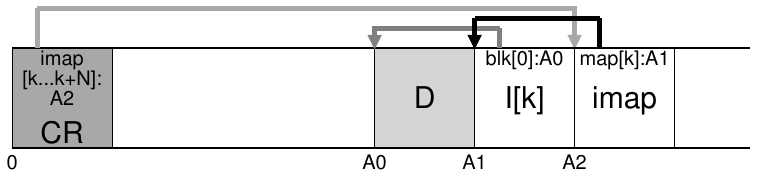

## 43.7 Đọc file từ disk: Ôn lại

Để bảo đảm bạn hiểu cách LFS hoạt động, bây giờ hãy đi qua những việc phải diễn ra để đọc file từ disk. Giả sử ban đầu không có gì trong memory. Data structure on-disk đầu tiên phải đọc là checkpoint region. Checkpoint region chứa pointer (tức disk address) tới toàn bộ inode map, nên sau đó LFS đọc toàn bộ inode map và cache nó trong memory. Từ lúc này, khi biết inode number của file, LFS chỉ cần tra ánh xạ inode-number sang inode-disk-address trong imap rồi đọc phiên bản inode mới nhất. Để đọc một block của file, lúc này LFS làm đúng như UNIX file system điển hình, sử dụng direct pointer, indirect pointer hoặc pointer doubly-indirect khi cần. Trong trường hợp phổ biến, LFS thực hiện cùng số I/O như file system điển hình khi đọc file từ disk; toàn bộ imap đã được cache, nên công việc bổ sung của LFS trong một lần đọc là tra address của inode trong imap.

## 43.8 Còn directory thì sao?

Đến đây, ta đã đơn giản hóa thảo luận một chút bằng cách chỉ xét inode và data block. Tuy nhiên, để truy cập file trong file system (như /home/remzi/foo, một trong những tên file giả ưa thích của chúng tôi), cũng phải truy cập một số directory. Vậy LFS lưu directory data như thế nào?

May mắn là directory structure về cơ bản giống UNIX file system cổ điển: directory chỉ là tập các ánh xạ (name, inode number). Chẳng hạn, khi tạo file trên disk, LFS phải ghi cả inode mới, một ít data, cũng như directory data và inode của directory tham chiếu file đó. Nhớ rằng LFS làm điều này tuần tự trên disk (sau khi giữ các cập nhật trong buffer một thời gian). Do đó, tạo file foo trong một directory dẫn tới những cấu trúc mới trên disk như sau:

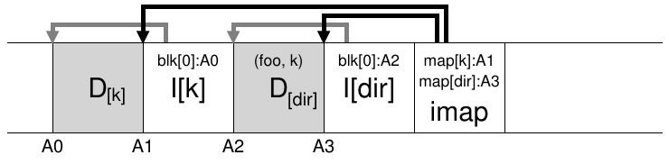

Phần inode map chứa thông tin vị trí của cả directory file dir lẫn file f newly-created. Vì thế, khi truy cập file foo (có inode number k), trước tiên bạn tra inode map (thường được cache trong memory) để tìm vị trí inode của directory dir (A3); sau đó đọc directory inode, từ đó biết vị trí directory data (A2); đọc data block này cho bạn ánh xạ name-to-inode-number là (foo, k). Tiếp theo, bạn lại tra inode map để tìm vị trí inode số k (A1), và cuối cùng đọc data block mong muốn tại address A0.

Còn một vấn đề nghiêm trọng khác trong LFS được inode map giải quyết, gọi là recursive update problem [Z+12]. Vấn đề xuất hiện trong mọi file system không bao giờ cập nhật tại chỗ (như LFS) mà chuyển các cập nhật tới vị trí mới trên disk.

Cụ thể, mỗi khi inode được cập nhật, vị trí của nó trên disk thay đổi. Nếu không cẩn thận, điều này còn kéo theo cập nhật directory trỏ tới file đó, rồi bắt buộc phải thay đổi parent của directory ấy, và cứ thế tiếp tục lên đến tận gốc file system tree.

LFS khéo léo tránh vấn đề bằng inode map. Dù vị trí inode có thể thay đổi, thay đổi ấy không bao giờ được phản ánh trong chính directory; thay vào đó, cấu trúc imap được cập nhật trong khi directory giữ nguyên ánh xạ name-to-inumber. Nhờ indirection, LFS tránh được recursive update problem.

## 43.9 Vấn đề mới: Garbage collection

Có lẽ bạn đã nhận ra một vấn đề khác của LFS: nó liên tục ghi phiên bản mới nhất của file (gồm inode và data) tới vị trí mới trên disk. Quá trình này tuy giúp các lần ghi hiệu quả nhưng cũng có nghĩa là LFS để lại những phiên bản cũ của cấu trúc file rải khắp disk. Ta gọi các phiên bản cũ này một cách khá thẳng thừng là garbage.

Chẳng hạn, hình dung ta có một file hiện có được tham chiếu bằng inode number k, trỏ tới một data block D0 duy nhất. Bây giờ ta cập nhật block đó, tạo ra cả inode mới lẫn data block mới. Bố cục on-disk thu được của LFS sẽ gần như sau (lưu ý ta bỏ imap và những cấu trúc khác cho đơn giản; một phần imap mới cũng phải được ghi xuống disk để trỏ tới inode mới):

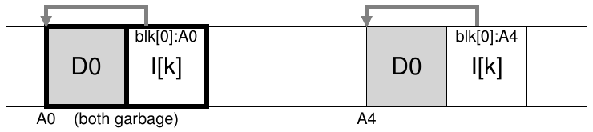

Trong sơ đồ, bạn có thể thấy cả inode lẫn data block đều có hai phiên bản trên disk: một phiên bản cũ (bên trái) và một phiên bản hiện hành, do đó còn live (bên phải). Chỉ với thao tác cập nhật data block (về mặt logic), LFS phải lưu bền vững một số cấu trúc mới, qua đó để lại các phiên bản cũ của những block ấy trên disk.

Xét ví dụ khác: thay vì cập nhật, ta nối thêm một block vào file k ban đầu. Trong trường hợp này, một phiên bản inode mới được tạo ra, nhưng inode vẫn trỏ tới data block cũ. Vì thế, block đó vẫn live và rõ ràng vẫn thuộc file system hiện tại:

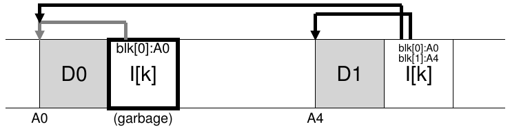

Vậy nên làm gì với những phiên bản inode, data block và các cấu trúc khác đã cũ này? Có thể giữ chúng và cho phép user khôi phục phiên bản file cũ (chẳng hạn khi vô tình ghi đè hoặc xóa file, khả năng này có thể khá hữu ích); file system như vậy gọi là versioning file system vì theo dõi các phiên bản khác nhau của file.

Tuy nhiên, LFS chỉ giữ phiên bản live mới nhất của file; vì thế, chạy ngầm ở nền, LFS phải định kỳ tìm các phiên bản cũ đã dead của file data, inode và những cấu trúc khác để dọn dẹp; việc dọn dẹp phải làm các block trên disk trống trở lại để sử dụng trong những lần ghi tiếp theo. Lưu ý quá trình dọn dẹp là một dạng garbage collection, kỹ thuật xuất hiện trong các ngôn ngữ lập trình tự động giải phóng memory không còn được chương trình sử dụng.

Trước đó, ta đã nói segment quan trọng vì đây là cơ chế cho phép những lần ghi lớn xuống disk trong LFS. Hóa ra segment cũng giữ vai trò thiết yếu đối với việc dọn dẹp hiệu quả. Hãy hình dung điều xảy ra nếu LFS cleaner chỉ lần lượt giải phóng từng data block, inode, v.v. khi dọn dẹp. Kết quả là file system có một số khoảng trống xen giữa những phần đã cấp phát trên disk. Write performance sẽ giảm đáng kể vì LFS không tìm được vùng liên tục lớn để ghi tuần tự xuống disk với performance cao.

Thay vào đó, LFS cleaner hoạt động theo cách segment-by-segment, nhờ đó giải phóng những phần không gian lớn cho các lần ghi tiếp theo. Quá trình dọn dẹp cơ bản diễn ra như sau. Định kỳ, LFS cleaner đọc một số segment cũ partially-used, xác định các block còn live trong đó, rồi ghi ra một tập segment mới chỉ chứa block live, giải phóng các segment cũ để ghi. Cụ thể, ta kỳ vọng cleaner đọc M segment hiện có, gom gọn nội dung thành N segment mới (với N < M), rồi ghi N segment xuống những vị trí mới trên disk. Sau đó, M segment cũ được giải phóng và file system có thể sử dụng chúng cho những lần ghi tiếp theo.

Tuy nhiên, giờ ta còn hai vấn đề. Đầu tiên là cơ chế: làm thế nào LFS phân biệt block nào trong segment còn live, block nào đã dead? Thứ hai là policy: cleaner nên chạy thường xuyên đến mức nào và nên chọn segment nào để dọn?

## 43.10 Xác định block liveness

Ta giải quyết cơ chế trước. Với data block D trong segment S on-disk, LFS phải xác định được D còn live hay không. Để làm vậy, LFS thêm một chút thông tin vào mỗi segment, mô tả từng block. Cụ thể, đối với mỗi data block D, LFS lưu inode number của nó (nó thuộc file nào) và offset (nó là block nào trong file). Thông tin này được ghi trong một cấu trúc ở đầu segment, gọi là segment summary block.

Với thông tin này, xác định block live hay dead rất đơn giản. Với block D nằm trên disk tại address A, hãy tra segment summary block để tìm inode number N và offset T của nó. Tiếp theo, tra imap để tìm N nằm ở đâu rồi đọc N từ disk (có lẽ nó đã nằm trong memory, như vậy càng tốt). Cuối cùng, dùng offset T để tra inode (hoặc một indirect block) xem inode cho rằng block thứ T của file nằm ở đâu trên disk. Nếu nó trỏ đúng tới disk address A, LFS kết luận block D còn live. Nếu nó trỏ tới nơi khác, LFS kết luận D không được sử dụng (tức đã dead), từ đó biết phiên bản này không còn cần thiết. Pseudocode tóm tắt quá trình được trình bày ở đây:

```
(N, T) = SegmentSummary[A];
inode  = Read(imap[N]);
if (inode[T] == A)
    // block D is alive
else
    // block D is garbage
```

Sau đây là sơ đồ minh họa cơ chế, trong đó segment summary block (đánh dấu SS) ghi nhận rằng data block tại address A0 thực ra là một phần của file k ở offset 0. Bằng cách tra imap cho k, bạn có thể tìm inode và thấy rằng nó quả thực trỏ tới vị trí đó.

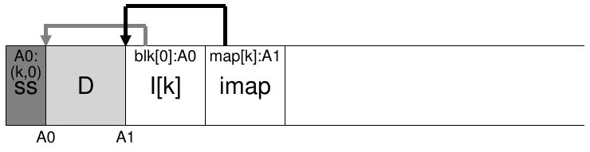

LFS sử dụng một số cách rút gọn để xác định liveness hiệu quả hơn. Chẳng hạn, khi file bị truncate hoặc xóa, LFS tăng version number của nó và ghi version number mới vào imap. Bằng cách ghi cả version number trong segment on-disk, LFS có thể bỏ qua phép kiểm tra dài hơn mô tả ở trên, chỉ cần so sánh version number on-disk với version number trong imap, nhờ đó tránh những lần đọc bổ sung.

## 43.11 Câu hỏi về policy: Dọn block nào và khi nào?

Bên trên cơ chế đã mô tả, LFS phải có một tập policy để xác định cả thời điểm dọn dẹp lẫn block nào đáng dọn. Xác định khi nào dọn dễ hơn: có thể định kỳ, trong thời gian nhàn rỗi hoặc khi buộc phải làm vì disk đầy.

Xác định block nào cần dọn khó hơn và đã là chủ đề của nhiều bài nghiên cứu. Trong bài báo LFS ban đầu [RO91], các tác giả mô tả cách cố tách hot segment và cold segment. Hot segment là segment có nội dung thường xuyên được over-written; vì thế, policy tốt nhất với loại segment này là chờ lâu trước khi dọn, vì ngày càng nhiều block được over-written (trong các segment mới), do đó được giải phóng để sử dụng. Ngược lại, cold segment có thể có vài block dead nhưng phần nội dung còn lại tương đối ổn định. Vì vậy, các tác giả kết luận nên dọn cold segment sớm hơn và hot segment muộn hơn, rồi phát triển heuristic thực hiện đúng điều đó. Tuy nhiên, cũng như phần lớn policy, policy này không hoàn hảo; các cách tiếp cận về sau cho thấy cách làm tốt hơn [MR+97].

## 43.12 Crash recovery và log

Một vấn đề cuối cùng: điều gì xảy ra nếu hệ thống crash trong lúc LFS ghi xuống disk? Như có thể nhớ từ chương trước về journaling, crash trong khi cập nhật là vấn đề phức tạp đối với file system, vì thế LFS cũng phải xem xét.

Trong hoạt động bình thường, LFS giữ các lần ghi trong buffer thuộc một segment, rồi ghi segment xuống disk (khi segment đầy hoặc sau một khoảng thời gian). LFS tổ chức những lần ghi này thành log, tức checkpoint region trỏ tới head segment và tail segment, còn mỗi segment trỏ tới segment tiếp theo sẽ được ghi. LFS cũng định kỳ cập nhật checkpoint region. Rõ ràng crash có thể xảy ra trong một trong hai thao tác (ghi vào segment, ghi vào CR). Vậy LFS xử lý crash khi ghi những cấu trúc này như thế nào?

Hãy xét trường hợp thứ hai trước. Để bảo đảm cập nhật CR diễn ra atomic, thực tế LFS giữ hai CR, mỗi đầu disk có một bản, và luân phiên ghi vào chúng. LFS còn triển khai một protocol cẩn thận khi cập nhật CR bằng những pointer mới nhất tới inode map và thông tin khác; cụ thể, trước tiên nó ghi header (có timestamp), sau đó ghi phần thân CR, cuối cùng ghi block kết thúc (cũng có timestamp). Nếu hệ thống crash trong lúc cập nhật CR, LFS có thể phát hiện nhờ thấy cặp timestamp không nhất quán. LFS luôn chọn CR mới nhất có timestamp nhất quán, nhờ vậy đạt được cập nhật CR nhất quán.

Bây giờ, hãy giải quyết trường hợp thứ nhất. Vì LFS ghi CR khoảng 30 giây một lần, consistent snapshot gần nhất của file system có thể khá cũ. Vì thế, khi reboot, LFS dễ dàng phục hồi chỉ bằng cách đọc checkpoint region, những phần imap mà nó trỏ tới và các file, directory tiếp theo; tuy nhiên, những cập nhật trong nhiều giây cuối sẽ bị mất.

Để cải thiện, LFS cố tái dựng nhiều segment trong số đó bằng kỹ thuật được cộng đồng database gọi là roll forward. Ý tưởng cơ bản là bắt đầu từ checkpoint region gần nhất, tìm cuối log (được ghi trong CR), rồi dùng thông tin đó để đọc qua những segment tiếp theo và xem có cập nhật hợp lệ nào trong đó không. Nếu có, LFS cập nhật file system tương ứng, nhờ vậy phục hồi phần lớn data và metadata được ghi kể từ checkpoint gần nhất. Xem luận án award-winning của Rosenblum để biết chi tiết [R92].

## 43.13 Tổng kết

LFS giới thiệu cách tiếp cận mới để cập nhật disk. Thay vì ghi đè file tại chỗ, LFS luôn ghi vào phần chưa sử dụng của disk, rồi sau đó thu hồi không gian cũ thông qua dọn dẹp. Cách này được gọi là shadow paging [L77] trong hệ thống database và đôi khi gọi là copy-on-write trong file-system-speak, cho phép ghi rất hiệu quả vì LFS có thể gom mọi cập nhật vào segment in-memory rồi ghi chúng cùng nhau theo thứ tự tuần tự.

> MẸO: BIẾN NHƯỢC ĐIỂM THÀNH ƯU ĐIỂM
>
> Mỗi khi hệ thống có một nhược điểm cơ bản, hãy xem có thể biến nó thành tính năng hoặc điều gì hữu ích không. WAFL của NetApp làm điều đó với nội dung file cũ; bằng cách cho truy cập các phiên bản cũ, WAFL không còn phải lo dọn dẹp thường xuyên như trước (dù cuối cùng vẫn xóa phiên bản cũ ở nền), nhờ vậy vừa cung cấp tính năng hay vừa loại bỏ phần lớn vấn đề dọn dẹp của LFS bằng một cách xoay chuyển tuyệt vời. Có ví dụ nào khác như vậy trong các hệ thống không? Chắc chắn có, nhưng bạn phải tự nghĩ ra, vì chương này đã kết thúc, với chữ “K” viết hoa. Kết thúc. Xong. Hết sạch. Chúng tôi dừng đây. Chào nhé!

Nhược điểm của cách này là tạo ra garbage; những bản sao data cũ nằm rải rác trên disk, và nếu muốn thu hồi không gian đó để sử dụng về sau, phải định kỳ dọn các segment cũ. Dọn dẹp trở thành trọng tâm của nhiều tranh cãi về LFS, và lo ngại về chi phí dọn dẹp [SS+95] có lẽ đã hạn chế tác động ban đầu của LFS trong lĩnh vực này. Tuy nhiên, một số file system thương mại hiện đại, bao gồm WAFL của NetApp [HLM94], ZFS của Sun [B07], Linux btrfs [M07], và ngay cả SSD flash-based hiện đại [AD14], áp dụng cách tiếp cận copy-on-write tương tự để ghi xuống disk; vì vậy, di sản tư tưởng của LFS vẫn tồn tại trong những file system hiện đại này. Đặc biệt, WAFL khắc phục vấn đề dọn dẹp bằng cách biến chúng thành tính năng; nhờ cung cấp phiên bản file system cũ qua snapshot, user có thể truy cập file cũ mỗi khi vô tình xóa file hiện tại.

## Tài liệu tham khảo

[AD14] “Operating Systems: Three Easy Pieces”

Chương: Solid State Drive Flash-based

Remzi Arpaci-Dusseau and Andrea Arpaci-Dusseau

Hơi thiếu tế nhị khi giới thiệu bạn đọc một chương khác ngay trong cuốn sách này, nhưng chúng tôi có tư cách gì để phán xét chứ?

[B07] “ZFS: The Last Word in File Systems”

Jeff Bonwick and Bill Moore

Có bản sao tại: http://www.ostep.org/Citations/zfs_last.pdf

Slide về ZFS; đáng tiếc là vẫn chưa có bài báo ZFS xuất sắc nào. Có lẽ bạn sẽ viết một bài để chúng tôi trích dẫn ở đây?

[HLM94] “File System Design for an NFS File Server Appliance”

Dave Hitz, James Lau, Michael Malcolm

USENIX mùa Xuân ’94

WAFL lấy nhiều ý tưởng từ LFS và RAID rồi tích hợp vào thiết bị NFS high-speed cho NetApp, công ty storage trị giá multi-billion đô la.

[L77] “Physical Integrity in a Large Segmented Database”

R. Lorie

ACM Transactions on Databases, 1977, Tập 2:1, trang 91-104

Ý tưởng ban đầu về shadow paging được trình bày ở đây.

[M07] “The Btrfs Filesystem”

Chris Mason

Tháng Chín 2007

Có tại: oss.oracle.com/projects/btrfs/dist/documentation/btrfs-ukuug.pdf

Một Linux file system copy-on-write gần đây, đang dần trở nên quan trọng hơn và được sử dụng nhiều hơn.

[MJLF84] “A Fast File System for UNIX”

Marshall K. McKusick, William N. Joy, Sam J. Leffler, Robert S. Fabry

ACM TOCS, tháng Tám, 1984, Tập 2, Số 3

Bài báo FFS ban đầu; xem chương về FFS để biết thêm chi tiết.

[MR+97] “Improving the Performance of Log-structured File Systems with Adaptive Methods”

Jeanna Neefe Matthews, Drew Roselli, Adam M. Costello,

Randolph Y. Wang, Thomas E. Anderson

SOSP 1997, trang 238-251, tháng Mười, Saint Malo, Pháp

Một bài báo gần đây hơn trình bày chi tiết những policy tốt hơn để dọn dẹp trong LFS.

[M94] “A Better Update Policy”

Jeffrey C. Mogul

USENIX ATC ’94, tháng Sáu 1994

Trong bài báo này, Mogul phát hiện rằng read workload có thể chịu tác động xấu khi giữ các lần ghi trong buffer quá lâu rồi gửi chúng xuống disk thành một đợt lớn. Vì vậy, ông khuyến nghị gửi các lần ghi thường xuyên hơn và theo lô nhỏ hơn.

[P98] “Hardware Technology Trends and Database Opportunities”

David A. Patterson

Bài diễn thuyết chính tại ACM SIGMOD ’98, trình bày ngày 3 tháng Sáu, 1998, Seattle, Washington

Có tại: http://www.cs.berkeley.edu/˜pattrsn/talks/keynote.html

Một bộ slide xuất sắc về các xu hướng công nghệ trong hệ thống máy tính. Hy vọng Patterson sẽ sớm tạo thêm một bộ như vậy.

[RO91] “Design and Implementation of the Log-structured File System”

Mendel Rosenblum and John Ousterhout

SOSP ’91, Pacific Grove, CA, tháng Mười 1991

Bài báo SOSP ban đầu về LFS, đã được hàng trăm bài báo khác trích dẫn và truyền cảm hứng cho nhiều hệ thống thực tế.

[R92] “Design and Implementation of the Log-structured File System”

Mendel Rosenblum

http://www.eecs.berkeley.edu/Pubs/TechRpts/1992/CSD-92-696.pdf

Luận án award-winning về LFS, chứa nhiều chi tiết không có trong bài báo.

[SS+95] “File system logging versus clustering: a performance comparison”

Margo Seltzer, Keith A. Smith, Hari Balakrishnan, Jacqueline Chang, Sara McMains, Venkata Padmanabhan

USENIX 1995 Technical Conference, New Orleans, Louisiana, 1995

Một bài báo cho thấy LFS performance đôi khi có vấn đề, đặc biệt với workload gọi fsync() nhiều (như database workload). Bài báo đã gây tranh cãi vào thời điểm đó.

[SO90] “Write-Only Disk Caches”

Jon A. Solworth, Cyril U. Orji

SIGMOD ’90, Atlantic City, New Jersey, tháng Năm 1990

Một nghiên cứu ban đầu về write buffering và lợi ích của nó. Tuy nhiên, giữ trong buffer quá lâu có thể gây hại: xem Mogul [M94] để biết chi tiết.

[Z+12] “De-indirection for Flash-based SSDs with Nameless Writes”

Yiying Zhang, Leo Prasath Arulraj, Andrea C. Arpaci-Dusseau, Remzi H. Arpaci-Dusseau FAST ’13, San Jose, California, tháng Hai 2013

Bài báo của chúng tôi về cách mới để xây dựng thiết bị storage flash-based. Vì FTL (flash-translation layer) thường được xây dựng theo kiểu log-structured, một số vấn đề xuất hiện trong LFS cũng nảy sinh ở thiết bị flash-based. Trong trường hợp này, đó là recursive update problem, được LFS giải quyết gọn gàng bằng imap. Cấu trúc tương tự tồn tại trong phần lớn SSD.

---

[^1]: Thực vậy, khó tìm được trích dẫn phù hợp cho ý tưởng này vì có lẽ nhiều người đã phát minh ra nó từ rất sớm trong lịch sử điện toán. Để tìm hiểu nghiên cứu về lợi ích của write buffering, xem Solworth và Orji [SO90]; để biết tác hại tiềm tàng, xem Mogul [M94].
