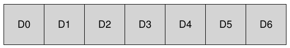
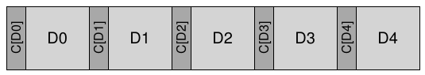
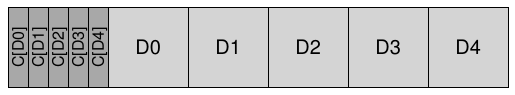
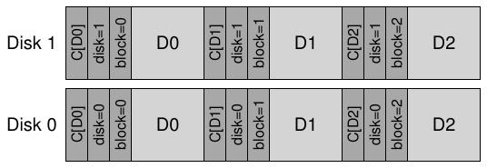

# 44 Data Integrity và bảo vệ data

Ngoài những tiến bộ cơ bản trong các file system đã học đến đây, còn có một số tính năng đáng tìm hiểu. Trong chương này, ta lại tập trung vào reliability (trước đó đã học về reliability của storage system trong chương RAID). Cụ thể, file system hoặc storage system nên bảo đảm data được an toàn như thế nào, xét đến bản chất không đáng tin cậy của thiết bị storage hiện đại?

Lĩnh vực tổng quát này được gọi là data integrity hoặc data protection. Vì vậy, bây giờ ta sẽ tìm hiểu các kỹ thuật dùng để bảo đảm data bạn đưa vào storage system vẫn giữ nguyên khi storage system trả lại cho bạn.

> VẤN ĐỀ CỐT LÕI: LÀM THẾ NÀO BẢO ĐẢM DATA INTEGRITY
>
> Hệ thống nên bảo đảm data ghi vào storage được bảo vệ như thế nào? Cần những kỹ thuật gì? Làm thế nào để những kỹ thuật đó hiệu quả, với overhead thấp về cả không gian lẫn thời gian?

## 44.1 Các failure mode của disk

Như đã học trong chương về RAID, disk không hoàn hảo và đôi khi có thể hỏng. Trong các hệ thống RAID đời đầu, mô hình lỗi khá đơn giản: hoặc toàn bộ disk hoạt động, hoặc nó hỏng hoàn toàn, và việc phát hiện lỗi như vậy rất đơn giản. Mô hình lỗi disk fail-stop này giúp việc xây dựng RAID tương đối đơn giản [S90].

Điều bạn chưa được học là mọi failure mode khác mà disk hiện đại có thể gặp. Cụ thể, như Bairavasundaram và cộng sự đã nghiên cứu rất chi tiết [B+07, B+08], đôi khi disk hiện đại có vẻ vẫn hoạt động phần lớn nhưng gặp khó khăn khi truy cập thành công một hoặc nhiều block. Đặc biệt, hai loại lỗi single-block phổ biến và đáng xem xét là latent-sector error (LSE) và block corruption. Bây giờ ta sẽ thảo luận chi tiết hơn từng loại.

|  | Giá rẻ | Đắt tiền |
|---|---|---|
| LSEs | 9.40% | 1.40% |
| Corruption | 0.50% | 0.05% |

Hình 44.1: Tần suất xuất hiện LSE và block corruption

LSE xuất hiện khi disk sector (hoặc nhóm sector) bị hư hại theo cách nào đó. Chẳng hạn, nếu disk head chạm vào bề mặt vì lý do nào đó (head crash, điều không nên xảy ra trong hoạt động bình thường), nó có thể làm hỏng bề mặt, khiến không thể đọc các bit. Tia vũ trụ cũng có thể làm lật bit, dẫn đến nội dung không chính xác. May mắn là drive sử dụng error correcting code (ECC) in-disk để xác định các bit on-disk trong block có chính xác hay không và, trong một số trường hợp, sửa chúng; nếu bit không chính xác và drive không có đủ thông tin để sửa lỗi, disk sẽ trả về lỗi khi nhận request đọc chúng.

Cũng có trường hợp disk block bị corrupt theo cách mà chính disk không phát hiện được. Chẳng hạn, disk firmware có bug có thể ghi block sai vị trí; trong trường hợp đó, disk ECC cho biết nội dung block vẫn ổn, nhưng từ góc độ client, block sai được trả về trong lần truy cập sau. Tương tự, block có thể bị corrupt khi được truyền từ host tới disk qua bus bị lỗi; data corrupt được disk lưu lại, nhưng đó không phải nội dung client mong muốn. Những lỗi này đặc biệt nguy hiểm vì là silent fault; disk không đưa ra dấu hiệu nào về vấn đề khi trả về data lỗi.

Prabhakaran và cộng sự mô tả cách nhìn hiện đại hơn này về lỗi disk bằng mô hình lỗi disk fail-partial [P+05]. Theo cách nhìn này, disk vẫn có thể hỏng toàn bộ (như trong mô hình fail-stop truyền thống); tuy nhiên, disk cũng có thể trông như vẫn hoạt động nhưng một hoặc nhiều block không thể truy cập được (tức LSE) hoặc chứa nội dung sai (tức corruption). Vì thế, khi truy cập disk seemingly-working, thỉnh thoảng nó có thể trả về lỗi khi cố đọc hoặc ghi một block cụ thể (partial fault non-silent), và thỉnh thoảng nó chỉ đơn giản trả về data sai (silent partial fault).

Cả hai loại lỗi đều tương đối hiếm, nhưng hiếm đến mức nào? Hình 44.1 tóm tắt một số kết quả từ hai nghiên cứu của Bairavasundaram [B+07,B+08].

Hình thể hiện tỷ lệ phần trăm drive xuất hiện ít nhất một LSE hoặc block corruption trong thời gian nghiên cứu (khoảng 3 năm, hơn 1.5 triệu disk drive). Hình còn sub-divides kết quả thành drive “giá rẻ” (thường là SATA) và drive “đắt tiền” (thường là SCSI hoặc FibreChannel). Như bạn có thể thấy, dù mua drive tốt hơn làm giảm tần suất cả hai loại vấn đề (khoảng một bậc độ lớn), chúng vẫn xảy ra đủ thường xuyên để bạn phải suy nghĩ cẩn thận về cách xử lý trong storage system. Một số kết quả bổ sung về LSE gồm:

• Drive đắt tiền có nhiều hơn một LSE có khả năng phát sinh thêm lỗi ngang với drive rẻ hơn

• Với phần lớn drive, tỷ lệ lỗi hằng năm tăng trong năm thứ hai

• Số LSE tăng theo disk size

• Phần lớn disk có LSE gặp ít hơn 50 lỗi loại này

• Disk có LSE dễ phát sinh thêm LSE hơn

• Có mức spatial locality và temporal locality đáng kể

• Disk scrubbing hữu ích (phần lớn LSE được tìm thấy bằng cách này)

Một số kết quả về corruption:

• Xác suất corruption khác nhau rất nhiều giữa các model drive trong cùng một loại drive

• Ảnh hưởng của thời gian sử dụng khác nhau giữa các model

• Workload và disk size ít ảnh hưởng đến corruption

• Phần lớn disk có corruption chỉ gặp một vài lần corruption

• Corruption không độc lập trong cùng một disk hoặc giữa các disk trong RAID

• Có spatial locality và một mức temporal locality nhất định

• Có tương quan yếu với LSE

Để hiểu thêm về những lỗi này, có lẽ bạn nên đọc các bài báo gốc [B+07,B+08]. Nhưng hy vọng ý chính đã rõ: nếu thực sự muốn xây dựng storage system đáng tin cậy, bạn phải có cơ chế phát hiện và phục hồi từ cả LSE lẫn block corruption.

## 44.2 Xử lý latent sector error

Với hai dạng partial disk failure mới này, bây giờ ta nên tìm hiểu có thể làm gì với chúng. Trước tiên, hãy giải quyết loại dễ hơn trong hai loại, đó là latent sector error.

> VẤN ĐỀ CỐT LÕI: CÁCH XỬ LÝ LATENT SECTOR ERROR
>
> Storage system nên xử lý latent sector error như thế nào? Cần thêm bao nhiêu cơ chế để xử lý dạng partial failure này?

Hóa ra latent sector error khá dễ xử lý vì theo định nghĩa, chúng dễ được phát hiện. Khi storage system cố truy cập block mà disk trả về lỗi, storage system chỉ cần sử dụng cơ chế redundancy hiện có để trả về data chính xác. Chẳng hạn, trong mirrored RAID, hệ thống nên truy cập bản sao còn lại; trong hệ thống RAID-4 hoặc RAID-5 dựa trên parity, hệ thống nên tái dựng block từ những block khác trong parity group. Vì vậy, có thể dễ dàng phục hồi những vấn đề dễ phát hiện như LSE bằng các cơ chế redundancy tiêu chuẩn.

LSE ngày càng phổ biến đã ảnh hưởng tới thiết kế RAID qua nhiều năm. Một vấn đề đặc biệt thú vị xuất hiện trong hệ thống RAID-4/5 khi full-disk fault và LSE xảy ra đồng thời. Cụ thể, khi cả một disk hỏng, RAID cố tái dựng disk (chẳng hạn trên hot spare) bằng cách đọc tất cả disk khác trong parity group và tính lại những giá trị bị thiếu. Nếu gặp LSE trên bất kỳ disk nào khác trong quá trình tái dựng, ta có vấn đề: không thể hoàn thành việc tái dựng thành công.

Để khắc phục, một số hệ thống bổ sung một mức redundancy. Chẳng hạn, RAID-DP của NetApp có mức tương đương hai parity disk thay vì một [C+04]. Khi phát hiện LSE trong quá trình tái dựng, parity bổ sung giúp tái dựng block bị thiếu. Như thường lệ, điều này có chi phí: duy trì hai parity block cho mỗi stripe tốn kém hơn; tuy nhiên, bản chất log-structured của file system NetApp WAFL giảm bớt chi phí ấy trong nhiều trường hợp [HLM94]. Chi phí còn lại là không gian, dưới dạng một disk bổ sung cho parity block thứ hai.

## 44.3 Phát hiện corruption: Checksum

Bây giờ, hãy giải quyết vấn đề khó hơn: silent failure do data corruption. Làm thế nào ngăn user nhận data lỗi khi corruption xuất hiện và khiến disk trả về data lỗi?

> VẤN ĐỀ CỐT LÕI: CÁCH DUY TRÌ DATA INTEGRITY DÙ CÓ CORRUPTION
>
> Xét bản chất âm thầm của những lỗi này, storage system có thể làm gì để phát hiện corruption khi nó xuất hiện? Cần những kỹ thuật gì? Làm thế nào triển khai chúng hiệu quả?

Khác với latent sector error, phát hiện corruption là vấn đề then chốt. Làm thế nào client biết một block đã hỏng? Một khi biết block cụ thể bị hỏng, recovery giống như trước: phải có một bản sao khác của block (và hy vọng bản sao đó không bị corrupt!). Vì vậy, ở đây ta tập trung vào các kỹ thuật phát hiện.

Cơ chế chính mà storage system hiện đại sử dụng để duy trì data integrity gọi là checksum. Checksum đơn giản là kết quả của một function nhận một phần data (chẳng hạn block 4KB) làm đầu vào và thực hiện phép tính trên data đó, tạo ra bản tóm lược nhỏ về nội dung data (chẳng hạn 4 hoặc 8 byte). Bản tóm lược này được gọi là checksum. Mục tiêu của phép tính là cho phép hệ thống phát hiện data đã bị corrupt hoặc thay đổi theo cách nào đó, bằng cách lưu checksum cùng data rồi xác nhận ở lần truy cập sau rằng checksum hiện tại của data khớp giá trị lưu ban đầu.

> MẸO: KHÔNG CÓ BỮA TRƯA MIỄN PHÍ
>
> “Không có bữa trưa nào miễn phí”, hay viết tắt là TNSTAAFL, là thành ngữ Mỹ lâu đời hàm ý rằng khi có vẻ nhận được thứ gì miễn phí, thực tế có lẽ bạn vẫn phải trả một cái giá. Nó bắt nguồn từ thời các quán ăn quảng cáo bữa trưa miễn phí để thu hút khách; chỉ khi bước vào, bạn mới nhận ra rằng muốn nhận bữa trưa “miễn phí”, phải mua một hoặc nhiều đồ uống có cồn. Dĩ nhiên, điều này có thể không thực sự là vấn đề, đặc biệt nếu bạn đang muốn trở thành người nghiện rượu (hoặc là sinh viên đại học điển hình).

### Những checksum function phổ biến

Có nhiều function khác nhau để tính checksum, khác nhau về độ mạnh (tức khả năng bảo vệ data integrity tốt đến đâu) và tốc độ (tức có thể tính nhanh đến mức nào). Ở đây xuất hiện một trade-off phổ biến trong hệ thống: thông thường, càng được bảo vệ nhiều, chi phí càng cao. Không có bữa trưa nào miễn phí.

Một checksum function đơn giản mà một số hệ thống sử dụng dựa trên exclusive or (XOR). Với checksum XOR-based, checksum được tính bằng cách thực hiện XOR trên từng phần của data block cần tính checksum, tạo ra một giá trị duy nhất đại diện cho XOR của toàn bộ block.

Để cụ thể hơn, hình dung ta đang tính checksum 4-byte cho block 16 byte (dĩ nhiên block này quá nhỏ để thực sự là disk sector hay block, nhưng vẫn dùng được cho ví dụ). 16 data byte ở dạng hex như sau:

```
365e c4cd ba14 8a92 ecef 2c3a 40be f666
```

Nếu biểu diễn chúng ở dạng binary, ta có:

```
0011 0110 0101 1110    1100 0100 1100 1101
1011 1010 0001 0100    1000 1010 1001 0010
1110 1100 1110 1111    0010 1100 0011 1010
0100 0000 1011 1110    1111 0110 0110 0110
```

Vì đã xếp data theo nhóm 4 byte mỗi hàng, dễ thấy checksum thu được sẽ là gì: thực hiện XOR trên từng cột để có checksum cuối cùng:

```
0010 0000 0001 1011    1001 0100 0000 0011
```

Kết quả ở dạng hex là 0x201b9403.

XOR là checksum hợp lý nhưng có hạn chế. Chẳng hạn, nếu hai bit ở cùng vị trí trong mỗi đơn vị được tính checksum thay đổi, checksum sẽ không phát hiện corruption. Vì lý do này, người ta đã nghiên cứu các checksum function khác.

Một checksum function cơ bản khác là phép cộng. Cách này có ưu điểm nhanh; tính toán chỉ cần thực hiện phép cộng 2’s-complement trên từng phần data, bỏ qua overflow. Nó có thể phát hiện nhiều thay đổi trong data, nhưng không hiệu quả nếu chẳng hạn data bị dịch vị trí.

Một thuật toán phức tạp hơn một chút được gọi là Fletcher checksum, đặt tên theo nhà phát minh John G. Fletcher [F82] (như có lẽ bạn đoán được). Nó khá đơn giản để tính, gồm tính hai check byte s1 và s2. Cụ thể, giả sử block D gồm các byte d1... dn; s1 được định nghĩa như sau: s1 = s1 + d<sub>i</sub> mod 255 (tính trên mọi d<sub>i</sub>); đến lượt s2 là: s2 = s2 + s1 mod 255 (cũng trên mọi d<sub>i</sub>) [F04]. Fletcher checksum được biết là gần mạnh bằng CRC (sẽ mô tả tiếp theo), phát hiện mọi lỗi single-bit, mọi lỗi double-bit và tỷ lệ lớn burst error [F04].

Một checksum commonly-used cuối cùng được gọi là cyclic redundancy check (CRC). Giả sử bạn muốn tính checksum cho data block D. Chỉ cần xem D như một số binary lớn (suy cho cùng nó chỉ là chuỗi bit) và chia cho một giá trị đã thống nhất (k). Phần dư của phép chia chính là giá trị CRC. Hóa ra có thể triển khai phép binary modulo này khá hiệu quả, vì thế CRC cũng phổ biến trong networking. Xem tài liệu khác để biết thêm chi tiết [M13].

Dù dùng phương pháp nào, rõ ràng không có checksum hoàn hảo: hai data block có nội dung non-identical vẫn có thể có checksum giống nhau, được gọi là collision. Điều này có thể hiểu trực quan: suy cho cùng, tính checksum là lấy một thứ lớn (chẳng hạn 4KB) rồi tạo ra bản tóm lược nhỏ hơn nhiều (chẳng hạn 4 hoặc 8 byte). Vì vậy, khi chọn checksum function tốt, ta cố tìm function giảm thiểu xác suất collision trong khi vẫn dễ tính.

### Bố trí checksum

Giờ đã hiểu đôi chút về cách tính checksum, tiếp theo hãy phân tích cách sử dụng checksum trong storage system. Câu hỏi đầu tiên phải giải quyết là bố trí checksum, tức nên lưu checksum trên disk như thế nào?

Cách cơ bản nhất chỉ lưu một checksum cùng mỗi disk sector (hoặc block). Với data block D, gọi checksum trên data đó là C(D). Vì vậy, nếu không có checksum, disk layout có dạng như sau:



Khi có checksum, bố cục bổ sung một checksum cho mỗi block:



Vì checksum thường nhỏ (chẳng hạn 8 byte), còn disk chỉ ghi theo từng phần sector-sized (512 byte) hoặc bội số của chúng, một vấn đề xuất hiện là làm thế nào tạo ra bố cục trên. Một giải pháp mà các nhà sản xuất drive sử dụng là format drive với sector 520-byte; 8 byte bổ sung trong mỗi sector có thể dùng để lưu checksum.

Với disk không có chức năng đó, file system phải tìm cách lưu các checksum được gom vào block 512-byte. Một khả năng như sau:



Trong cách này, n checksum được lưu cùng nhau trong một sector, theo sau là n data block, rồi tới checksum sector khác cho n block tiếp theo, và cứ thế. Cách này có lợi là hoạt động trên mọi disk nhưng có thể kém hiệu quả hơn; chẳng hạn, nếu file system muốn ghi đè block D1, nó phải đọc checksum sector chứa C(D1), cập nhật C(D1) trong đó, rồi ghi cả checksum sector lẫn data block D1 mới (tức một lần đọc và hai lần ghi). Cách trước (mỗi sector một checksum) chỉ thực hiện một lần ghi.

## 44.4 Sử dụng checksum

Sau khi quyết định bố trí checksum, ta có thể tiếp tục tìm hiểu cách thực sự sử dụng chúng. Khi đọc block D, client (tức file system hoặc storage controller) cũng đọc checksum của nó từ disk, C<sub>s</sub>(D), gọi là stored checksum (do đó có subscript C<sub>s</sub>). Sau đó, client tính checksum trên block D vừa lấy được, gọi là computed checksum C<sub>c</sub>(D). Lúc này, client so sánh stored checksum và computed checksum; nếu bằng nhau (tức C<sub>s</sub>(D) == C<sub>c</sub>(D), có lẽ data chưa bị corrupt, nên có thể trả về an toàn cho user. Nếu không khớp (tức C<sub>s</sub>(D) != C<sub>c</sub>(D)), điều đó hàm ý data đã thay đổi kể từ khi được lưu (vì stored checksum phản ánh giá trị data tại thời điểm đó). Trong trường hợp này, đã có corruption, và checksum giúp ta phát hiện.

Khi phát hiện corruption, câu hỏi tự nhiên là nên làm gì? Nếu storage system có bản sao dự phòng, câu trả lời rất dễ: thử dùng bản sao đó thay thế. Nếu storage system không có bản sao như vậy, câu trả lời có lẽ là trả về lỗi. Trong cả hai trường hợp, cần hiểu rằng phát hiện corruption không phải giải pháp thần kỳ; nếu không có cách khác lấy data non-corrupted, bạn đành bó tay.

## 44.5 Vấn đề mới: Misdirected write

Cơ chế cơ bản mô tả ở trên hoạt động tốt trong trường hợp tổng quát các block bị corrupt. Tuy nhiên, disk hiện đại có một vài failure mode bất thường đòi hỏi giải pháp khác.

Failure mode đầu tiên cần quan tâm gọi là misdirected write. Nó xuất hiện ở disk controller và RAID controller ghi data xuống disk chính xác, nhưng lại sai vị trí. Trong hệ thống single-disk, điều này nghĩa là disk ghi block D<sub>x</sub> không phải tới address x (như mong muốn) mà tới address y (do đó “làm corrupt” D<sub>y</sub>); ngoài ra, trong hệ thống multi-disk, controller còn có thể ghi D<sub>i,x</sub> không phải tới address x của disk i mà tới một disk j khác. Vì vậy, câu hỏi của ta là:

> VẤN ĐỀ CỐT LÕI: CÁCH XỬ LÝ MISDIRECTED WRITE
>
> Storage system hoặc disk controller nên phát hiện misdirected write như thế nào? Checksum cần có thêm những tính năng gì?

Không có gì ngạc nhiên, câu trả lời rất đơn giản: thêm một chút thông tin vào mỗi checksum. Trong trường hợp này, bổ sung physical identifier (physical ID) khá hữu ích. Chẳng hạn, nếu thông tin lưu trữ giờ chứa checksum C(D) cùng disk number và sector number của block, client dễ xác định thông tin chính xác có nằm trong block hay không. Cụ thể, nếu client đọc block 4 trên disk 10 (D<sub>10</sub><sub>,</sub><sub>4</sub>), thông tin lưu trữ phải chứa disk number và sector offset đó, như bên dưới. Nếu thông tin không khớp, một misdirected write đã xảy ra và giờ phát hiện được corruption. Sau đây là ví dụ về dạng của thông tin bổ sung này trong hệ thống two-disk. Lưu ý hình này, cũng như những hình trước, không theo tỷ lệ vì checksum thường nhỏ (chẳng hạn 8 byte), còn block lớn hơn nhiều (chẳng hạn 4 KB hoặc lớn hơn):



Từ định dạng on-disk, bạn có thể thấy giờ có khá nhiều redundancy trên disk: với mỗi block, disk number được lặp lại trong block, và offset của block đang xét cũng được giữ ngay bên cạnh chính block đó. Tuy nhiên, sự hiện diện của thông tin dư thừa không có gì đáng ngạc nhiên; redundancy là chìa khóa cho phát hiện lỗi (trong trường hợp này) và recovery (ở những trường hợp khác). Một chút thông tin bổ sung, dù không thực sự cần nếu disk hoàn hảo, có thể giúp ích rất nhiều để phát hiện tình huống có vấn đề nếu xảy ra.

## 44.6 Một vấn đề cuối cùng: Lost write

Đáng tiếc là misdirected write chưa phải vấn đề cuối cùng ta giải quyết. Cụ thể, một số thiết bị storage hiện đại còn có vấn đề gọi là lost write, xảy ra khi thiết bị báo cho layer phía trên rằng lần ghi đã hoàn tất nhưng thực tế chưa bao giờ lưu nó bền vững; vì thế, thứ còn lại là nội dung cũ của block thay vì nội dung mới đã cập nhật.

Câu hỏi hiển nhiên ở đây là: có chiến lược checksumming nào ở trên (chẳng hạn checksum cơ bản hoặc physical identity) giúp phát hiện lost write không? Đáng tiếc, câu trả lời là không: block cũ có lẽ vẫn có checksum khớp, và physical ID sử dụng ở trên (disk number và block offset) cũng chính xác. Vì vậy, vấn đề cuối cùng của ta là:

> VẤN ĐỀ CỐT LÕI: CÁCH XỬ LÝ LOST WRITE
>
> Storage system hoặc disk controller nên phát hiện lost write như thế nào? Checksum cần có thêm những tính năng gì?

Có nhiều giải pháp khả thi có thể giúp ích [K+08]. Một cách cổ điển [BS04] là thực hiện write verify hoặc read-after-write; bằng cách đọc lại data ngay sau lần ghi, hệ thống có thể bảo đảm data thực sự đã xuống bề mặt disk. Tuy nhiên, cách này khá chậm, làm tăng gấp đôi số I/O cần để hoàn thành một lần ghi.

Một số hệ thống thêm checksum ở vị trí khác trong hệ thống để phát hiện lost write. Chẳng hạn, Zettabyte File System (ZFS) của Sun đưa vào mỗi file system inode và indirect block một checksum cho từng block thuộc file. Vì thế, ngay cả khi lần ghi chính data block bị mất, checksum trong inode vẫn không khớp data cũ. Cách này chỉ thất bại khi cả lần ghi inode lẫn data đều bị mất đồng thời, một tình huống khó xảy ra (nhưng đáng tiếc vẫn có thể!).

## 44.7 Scrubbing

Sau tất cả những thảo luận này, có thể bạn tự hỏi: khi nào checksum thực sự được kiểm tra? Dĩ nhiên, một số kiểm tra diễn ra khi ứng dụng truy cập data, nhưng phần lớn data hiếm khi được truy cập, do đó không được kiểm tra. Data không được kiểm tra là vấn đề đối với storage system đáng tin cậy, vì bit rot cuối cùng có thể ảnh hưởng tới mọi bản sao của một phần data cụ thể.

Để khắc phục, nhiều hệ thống sử dụng các dạng disk scrubbing khác nhau [K+08]. Bằng cách định kỳ đọc mọi block trong hệ thống và kiểm tra checksum còn hợp lệ hay không, disk system có thể giảm khả năng mọi bản sao của một mục data nhất định đều bị corrupt. Hệ thống điển hình lên lịch quét hằng đêm hoặc hằng tuần.

## 44.8 Overhead của checksumming

Trước khi kết thúc, ta thảo luận một số overhead khi sử dụng checksum để bảo vệ data. Có hai loại overhead riêng biệt, như thường thấy trong hệ thống máy tính: không gian và thời gian.

Space overhead có hai dạng. Dạng thứ nhất nằm trên chính disk (hoặc phương tiện storage khác); mỗi checksum được lưu chiếm chỗ trên disk, khiến chỗ đó không thể dùng cho user data. Tỷ lệ điển hình có thể là một checksum 8- byte cho mỗi data block 4 KB, tương ứng space overhead on-disk là 0.19%.

Loại space overhead thứ hai nằm trong memory của hệ thống. Khi truy cập data, giờ phải có chỗ trong memory cho cả checksum lẫn chính data. Tuy nhiên, nếu hệ thống chỉ kiểm tra checksum rồi bỏ đi sau khi xong, overhead này là short-lived và không đáng lo lắm. Chỉ khi checksum được giữ trong memory (để bổ sung một lớp bảo vệ chống memory corruption [Z+13]) thì overhead nhỏ này mới có thể quan sát được.

Dù space overhead nhỏ, time overhead do checksumming gây ra có thể khá đáng kể. Tối thiểu, CPU phải tính checksum cho mỗi block cả khi lưu data (để xác định giá trị stored checksum) lẫn khi truy cập (để tính lại checksum và so sánh với stored checksum). Một cách giảm CPU overhead, được nhiều hệ thống sử dụng checksum áp dụng (kể cả network stack), là kết hợp sao chép data và checksumming thành một hoạt động liền mạch; vì dù sao cũng cần sao chép (chẳng hạn để sao chép data từ kernel page cache vào user buffer), kết hợp sao chép/checksumming có thể khá hiệu quả.

Ngoài CPU overhead, một số cơ chế checksumming có thể gây thêm I/O overhead, đặc biệt khi checksum được lưu tách biệt với data (do đó cần I/O bổ sung để truy cập) và khi cần I/O bổ sung cho scrubbing ở nền. Có thể giảm loại đầu bằng thiết kế; loại sau có thể được điều chỉnh để giới hạn ảnh hưởng, chẳng hạn bằng cách kiểm soát thời điểm scrubbing diễn ra. Giữa đêm, khi phần lớn (không phải tất cả!) người lao động làm việc hiệu quả đã đi ngủ, có thể là thời điểm tốt để scrubbing và tăng độ vững chắc của storage system.

## 44.9 Tổng kết

Ta đã thảo luận data protection trong storage system hiện đại, tập trung vào cách triển khai và sử dụng checksum. Các checksum khác nhau bảo vệ trước những loại lỗi khác nhau; khi thiết bị storage phát triển, chắc chắn sẽ xuất hiện failure mode mới. Có lẽ thay đổi đó sẽ buộc cộng đồng nghiên cứu và ngành công nghiệp xem lại một số cách tiếp cận cơ bản, hoặc phát minh cách tiếp cận hoàn toàn mới. Thời gian sẽ trả lời. Hoặc cũng có thể không. Thời gian vốn kỳ lạ như vậy đấy.

## Tài liệu tham khảo

[B+07] “An Analysis of Latent Sector Errors in Disk Drives”

Lakshmi N. Bairavasundaram, Garth R. Goodson, Shankar Pasupathy, Jiri Schindler

SIGMETRICS ’07, San Diego, California, tháng Sáu 2007

Bài báo đầu tiên nghiên cứu chi tiết latent sector error. Như mô tả trong tài liệu được trích dẫn tiếp theo [B+08], đây là sự hợp tác giữa Wisconsin và NetApp. Bài báo còn giành giải Kenneth C. Sevcik Outstanding Student Paper; Sevcik là nhà nghiên cứu xuất sắc và một con người tuyệt vời, đã qua đời quá sớm. Để cho các tác giả thấy có thể chuyển từ Mỹ sang Canada sống và yêu thích nơi đó, ông từng đứng dậy ngay giữa nhà hàng để hát quốc ca Canada cho chúng tôi nghe.

[B+08] “An Analysis of Data Corruption in the Storage Stack”

Lakshmi N. Bairavasundaram, Garth R. Goodson, Bianca Schroeder,

Andrea C. Arpaci-Dusseau, Remzi H. Arpaci-Dusseau

FAST ’08, San Jose, CA, tháng Hai 2008

Bài báo đầu tiên thực sự nghiên cứu disk corruption rất chi tiết, tập trung vào tần suất corruption xảy ra trong ba năm trên hơn 1.5 triệu drive. Lakshmi thực hiện công việc này khi là nghiên cứu sinh tại Wisconsin dưới sự hướng dẫn của chúng tôi, đồng thời hợp tác với các đồng nghiệp tại NetApp, nơi anh thực tập trong nhiều mùa hè. Đây là ví dụ rất hay về việc hợp tác với ngành công nghiệp có thể tạo ra nghiên cứu thú vị hơn và sát thực tế hơn nhiều.

[BS04] “Commercial Fault Tolerance: A Tale of Two Systems”

Wendy Bartlett, Lisa Spainhower

IEEE Transactions on Dependable and Secure Computing, Tập 1, Số 1, tháng Một 2004

Tác phẩm kinh điển về xây dựng hệ thống fault tolerant này là tổng quan xuất sắc về trình độ công nghệ tiên tiến của cả IBM lẫn Tandem. Thêm một tài liệu phải đọc cho những ai quan tâm lĩnh vực này.

[C+04] “Row-Diagonal Parity for Double Disk Failure Correction”

P. Corbett, B. English, A. Goel, T. Grcanac, S. Kleiman, J. Leong, S. Sankar

FAST ’04, San Jose, CA, tháng Hai 2004

Một bài báo ban đầu về cách redundancy bổ sung giúp giải quyết vấn đề kết hợp full-disk-failure/partial-disk-failure. Cũng là ví dụ hay về cách kết hợp công việc thiên về lý thuyết với thực tiễn.

[F04] “Checksums and Error Control”

Peter M. Fenwick

Có bản sao tại: http://www.ostep.org/Citations/checksums-03.pdf

Một bài hướng dẫn đơn giản, xuất sắc về checksum, dành cho bạn với cái giá tuyệt vời là miễn phí.

[F82] “An Arithmetic Checksum for Serial Transmissions”

John G. Fletcher

IEEE Transactions on Communication, Tập 30, Số 1, tháng Một 1982

Công trình ban đầu của Fletcher về checksum mang tên ông. Dĩ nhiên, ông không gọi nó là Fletcher checksum; thực ra ông chẳng đặt tên gì cho nó, nên người ta tự nhiên gọi theo tên nhà phát minh. Vì vậy, đừng trách ông bạn Fletch vì hành động có vẻ khoe khoang này. Giai thoại có thể khiến bạn nhớ đến Rubik và khối lập phương của ông; Rubik không bao giờ gọi nó là “khối Rubik”; thay vào đó, ông chỉ gọi là “khối lập phương của tôi”.

[HLM94] “File System Design for an NFS File Server Appliance”

Dave Hitz, James Lau, Michael Malcolm

USENIX mùa Xuân ’94

Bài báo tiên phong mô tả những ý tưởng và sản phẩm nằm ở trung tâm hoạt động cốt lõi của NetApp. Dựa trên hệ thống này, NetApp đã phát triển thành công ty storage trị giá multi-billion đô la. Nếu muốn tìm hiểu thêm về quá trình thành lập, hãy đọc tự truyện của Hitz, “How to Castrate a Bull: Unexpected Lessons on Risk, Growth, and Success in Business” (đó là tên sách thật, không đùa đâu). Thế mà bạn cứ tưởng theo Computer Science thì tránh được chuyện thiến bò.

[K+08] “Parity Lost and Parity Regained”

Andrew Krioukov, Lakshmi N. Bairavasundaram, Garth R. Goodson, Kiran Srinivasan,

Randy Thelen, Andrea C. Arpaci-Dusseau, Remzi H. Arpaci-Dusseau

FAST ’08, San Jose, CA, tháng Hai 2008

Công trình của chúng tôi, hợp tác với các đồng nghiệp tại NetApp, tìm hiểu những cơ chế checksum khác nhau hoạt động ra sao (hoặc không hoạt động) khi bảo vệ data. Chúng tôi chỉ ra một số thiếu sót thú vị trong các chiến lược bảo vệ hiện tại, một số phát hiện đã dẫn tới sửa đổi trong sản phẩm thương mại.

[M13] “Cyclic Redundancy Checks”

Không rõ tác giả

Có tại: http://www.mathpages.com/home/kmath458.htm

Không rõ ai viết, nhưng ở đây có mô tả CRC cực kỳ rõ ràng và súc tích. Hóa ra Internet đầy ắp thông tin.

[P+05] “IRON File Systems”

Vijayan Prabhakaran, Lakshmi N. Bairavasundaram, Nitin Agrawal, Haryadi S. Gunawi, Andrea C. Arpaci-Dusseau, Remzi H. Arpaci-Dusseau

SOSP ’05, Brighton, Anh, tháng Mười 2005

Bài báo của chúng tôi về các partial failure mode của disk, bao gồm nghiên cứu chi tiết cách những file system như Linux ext3 và Windows NTFS phản ứng với các lỗi đó. Hóa ra khá tệ! Trong công trình này, chúng tôi phát hiện nhiều bug, thiếu sót thiết kế và những điểm bất thường khác. Một số kết quả đã được phản hồi về cộng đồng Linux, góp phần tạo ra một nhóm file system mới vững chắc hơn để lưu data của bạn.

[RO91] “Design and Implementation of the Log-structured File System”

Mendel Rosenblum and John Ousterhout

SOSP ’91, Pacific Grove, CA, tháng Mười 1991

Lại một lần tham khảo bài báo ground-breaking này về cách cải thiện write performance trong file system.

[S90] “Implementing Fault-Tolerant Services Using The State Machine Approach: A Tutorial” Fred B. Schneider

ACM Surveys, Tập 22, Số 4, tháng Mười Hai 1990

Bài báo kinh điển này thảo luận tổng quát cách xây dựng dịch vụ fault tolerant và đưa ra nhiều định nghĩa thuật ngữ cơ bản. Tài liệu phải đọc cho người xây dựng distributed system.

[Z+13] “Zettabyte Reliability with Flexible End-to-end Data Integrity”

Yupu Zhang, Daniel S. Myers, Andrea C. Arpaci-Dusseau, Remzi H. Arpaci-Dusseau

MSST ’13, Long Beach, California, tháng Năm 2013

Công trình của chúng tôi về bổ sung data protection cho page cache của hệ thống, bảo vệ trước cả memory corruption lẫn corruption on-disk.
