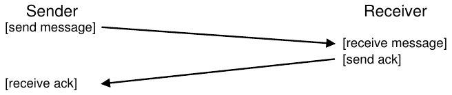
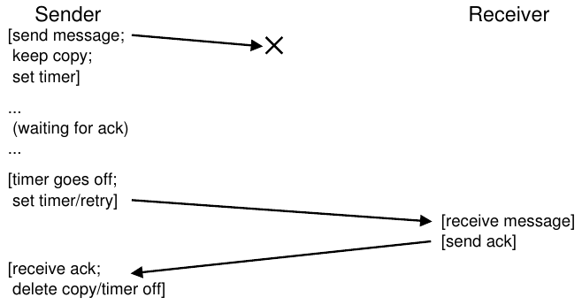
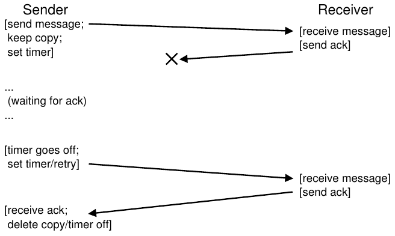

# 47 Distributed Systems

Distributed system đã thay đổi bộ mặt thế giới. Khi web browser của bạn kết nối với web server ở một nơi khác trên hành tinh, nó đang tham gia vào thứ có vẻ là một dạng client/server distributed system đơn giản. Tuy nhiên, khi liên hệ với web service hiện đại như Google hay facebook, bạn không chỉ tương tác với một máy duy nhất; đằng sau hậu trường, các dịch vụ phức tạp này được xây dựng từ một tập lớn (tức hàng nghìn) máy, cùng hợp tác để cung cấp dịch vụ cụ thể của site. Vì thế, điều khiến việc nghiên cứu distributed system thú vị hẳn đã rõ. Thực vậy, chủ đề này xứng đáng có cả một môn học riêng; ở đây, ta chỉ giới thiệu một vài chủ đề chính.

Có nhiều thách thức mới khi xây dựng distributed system. Thách thức chính mà ta tập trung là failure; máy, disk, network và software thỉnh thoảng đều hỏng, vì ta không biết (và có lẽ sẽ không bao giờ biết) cách xây dựng những component và hệ thống “hoàn hảo”. Tuy nhiên, khi xây dựng web service hiện đại, ta muốn nó trông như không bao giờ hỏng đối với client; làm thế nào đạt được điều đó?

> VẤN ĐỀ CỐT LÕI:
>
> CÁCH XÂY DỰNG HỆ THỐNG VẪN HOẠT ĐỘNG KHI COMPONENT HỎNG
>
> Làm thế nào xây dựng hệ thống hoạt động được từ những bộ phận không phải lúc nào cũng hoạt động chính xác? Câu hỏi cơ bản này hẳn gợi nhớ một số chủ đề đã thảo luận về RAID storage array; tuy nhiên, các vấn đề ở đây thường phức tạp hơn, và giải pháp cũng vậy.

Điều thú vị là dù failure là thách thức trung tâm khi xây dựng distributed system, nó cũng đem lại cơ hội. Đúng, máy có thể hỏng; nhưng chỉ riêng việc một máy hỏng không có nghĩa toàn hệ thống phải hỏng. Bằng cách tập hợp một nhóm máy, ta có thể xây dựng hệ thống trông như hiếm khi hỏng, dù các component thường xuyên hỏng. Thực tế này chính là nét đẹp và giá trị cốt lõi của distributed system, cũng là lý do chúng làm nền tảng cho hầu như mọi web service hiện đại bạn dùng, bao gồm Google, Facebook, v.v.

> MẸO: GIAO TIẾP VỐN KHÔNG ĐÁNG TIN CẬY
>
> Trong hầu hết hoàn cảnh, nên xem giao tiếp là hoạt động không đáng tin cậy về bản chất. Bit corruption, link và máy bị ngừng hoạt động hoặc non-working, cùng việc thiếu buffer space cho packet đến đều dẫn tới cùng kết quả: đôi khi packet không tới được destination. Để xây dựng dịch vụ đáng tin cậy trên network không đáng tin cậy như vậy, phải xem xét các kỹ thuật xử lý packet loss.

Cũng có những vấn đề quan trọng khác. System performance thường có vai trò quyết định; với network kết nối distributed system, nhà thiết kế hệ thống thường phải suy nghĩ kỹ về cách hoàn thành nhiệm vụ, cố giảm số message được gửi và làm giao tiếp hiệu quả nhất có thể (latency thấp, bandwidth cao).

Cuối cùng, security cũng là yếu tố cần xem xét. Khi kết nối tới remote site, có một mức bảo đảm rằng bên ở xa đúng là người họ tự nhận trở thành vấn đề trung tâm. Hơn nữa, bảo đảm bên thứ ba không thể theo dõi hoặc thay đổi giao tiếp on-going giữa hai bên khác cũng là thách thức.

Trong phần giới thiệu này, ta trình bày khía cạnh mới cơ bản nhất của distributed system: giao tiếp. Cụ thể, các máy trong distributed system nên giao tiếp với nhau như thế nào? Ta bắt đầu bằng primitive cơ bản nhất hiện có là message, rồi xây dựng một vài primitive higher-level bên trên. Như đã nói, failure sẽ là trọng tâm: communication layer nên xử lý failure như thế nào?

## 47.1 Cơ sở về giao tiếp

Nguyên lý trung tâm của networking hiện đại là giao tiếp vốn không đáng tin cậy. Dù trên Internet wide-area hay network local-area high-speed như Infiniband, packet thường xuyên bị mất, bị corrupt hoặc vì lý do khác không đến destination.

Có rất nhiều nguyên nhân gây packet loss hoặc corruption. Đôi khi trong quá trình truyền, một số bit bị lật do vấn đề điện hoặc những vấn đề tương tự. Đôi khi một phần tử trong hệ thống, như network link, packet router hoặc thậm chí remote host, bị hỏng theo cách nào đó hoặc không hoạt động chính xác; cáp network thực sự có thể vô tình bị đứt, ít nhất là đôi lúc.

Tuy nhiên, cơ bản hơn là packet loss do thiếu buffer trong network switch, router hoặc endpoint. Cụ thể, ngay cả khi có thể bảo đảm mọi link hoạt động chính xác và mọi component trong hệ thống (switch, router, end host) đều hoạt động như mong muốn, vẫn có thể xảy ra packet loss vì lý do sau. Hình dung packet tới router; để xử lý, packet phải được đặt trong memory ở đâu đó trong router. Nếu nhiều packet như vậy tới cùng lúc, memory của router có thể không chứa hết được. Lựa chọn duy nhất của router khi đó là loại bỏ một hoặc nhiều packet. Hành vi tương tự cũng xảy ra tại end host; khi gửi số lượng lớn message tới một máy, tài nguyên của máy dễ bị quá tải, và packet loss lại xảy ra.

```
// client code
int main(int argc, char *argv[]) {
    int sd = UDP_Open(20000);
    struct sockaddr_in addr, addr2;
    int rc = UDP_FillSockAddr(&addr, "machine.cs.wisc.edu", 10000);
    char message[BUFFER_SIZE];
    sprintf(message, "hello world");
    rc = UDP_Write(sd, &addr, message, BUFFER_SIZE);
    if (rc > 0) {
        int rc = UDP_Read(sd, &addr2, buffer, BUFFER_SIZE);
    }
    return 0;
}

// server code
int main(int argc, char *argv[]) {
    int sd = UDP_Open(10000);
    assert(sd > -1);
    while (1) {
        struct sockaddr_in s;
        char buffer[BUFFER_SIZE];
        int rc = UDP_Read(sd, &s, buffer, BUFFER_SIZE);
        if (rc > 0) {
            char reply[BUFFER_SIZE];
            sprintf(reply, "reply");
            rc = UDP_Write(sd, &s, reply, BUFFER_SIZE);
        }
    }
    return 0;
}
```

Hình 47.1: Ví dụ code client/server UDP/IP

Vì vậy, packet loss là vấn đề cơ bản trong networking. Câu hỏi trở thành: nên xử lý nó như thế nào?

## 47.2 Communication layer không đáng tin cậy

Một cách đơn giản là: không xử lý. Vì một số ứng dụng biết cách xử lý packet loss, đôi khi cho phép chúng giao tiếp bằng messaging layer cơ bản không đáng tin cậy là hữu ích; đây là ví dụ về end-to-end argument thường được nhắc tới (xem mục Bên lề ở cuối chương). Một ví dụ rất hay về layer như vậy là UDP/IP networking stack, hiện có trên hầu như mọi hệ thống hiện đại. Để dùng UDP, process sử dụng sockets API để tạo communication endpoint; process trên máy khác (hoặc cùng máy) gửi UDP datagram tới process ban đầu (datagram là message fixed-sized, không vượt quá một kích thước tối đa nào đó).

```
int UDP_Open(int port) {
    int sd;
    if ((sd = socket(AF_INET, SOCK_DGRAM, 0)) == -1) { return -1; }
    struct sockaddr_in myaddr;
    bzero(&myaddr, sizeof(myaddr));
    myaddr.sin_family      = AF_INET;
    myaddr.sin_port        = htons(port);
    myaddr.sin_addr.s_addr = INADDR_ANY;
    if (bind(sd, (struct sockaddr *) &myaddr, sizeof(myaddr)) == -1) {
        close(sd);
        return -1;
    }
    return sd;
}

int UDP_FillSockAddr(struct sockaddr_in *addr, char *hostName, int port) {
    bzero(addr, sizeof(struct sockaddr_in));
    addr->sin_family = AF_INET;          // host byte order
    addr->sin_port   = htons(port);      // short, network byte order
    struct in_addr *inAddr;
    struct hostent *hostEntry;
    if ((hostEntry = gethostbyname(hostName)) == NULL) { return -1; }
    inAddr = (struct in_addr *) hostEntry->h_addr;
    addr->sin_addr = *inAddr;
    return 0;
}

int UDP_Write(int sd, struct sockaddr_in *addr, char *buffer, int n) {
    int addrLen = sizeof(struct sockaddr_in);
    return sendto(sd, buffer, n, 0, (struct sockaddr *) addr, addrLen);
}

int UDP_Read(int sd, struct sockaddr_in *addr, char *buffer, int n) {
  int len = sizeof(struct sockaddr_in);
  return recvfrom(sd, buffer, n, 0, (struct sockaddr *) addr,
                  (socklen_t *) &len);
}
```

Hình 47.2: Thư viện UDP đơn giản

Hình 47.1 và 47.2 trình bày client và server đơn giản được xây dựng trên UDP/IP. Client có thể gửi message tới server, sau đó server phản hồi bằng reply. Chỉ với lượng code nhỏ này, bạn đã có mọi thứ cần thiết để bắt đầu xây dựng distributed system!

UDP là ví dụ rất hay về communication layer không đáng tin cậy. Nếu sử dụng nó, bạn sẽ gặp tình huống packet bị mất (bị loại bỏ), do đó không đến destination; sender không hề được thông báo về packet loss. Tuy nhiên, điều đó không có nghĩa UDP không bảo vệ trước bất kỳ failure nào. Chẳng hạn, UDP có checksum để phát hiện một số dạng packet corruption.

Tuy nhiên, vì nhiều ứng dụng chỉ muốn gửi data tới destination mà không phải lo packet loss, ta cần thêm cơ chế. Cụ thể, ta cần giao tiếp đáng tin cậy trên network không đáng tin cậy.

> MẸO: SỬ DỤNG CHECKSUM ĐỂ BẢO ĐẢM INTEGRITY
>
> Checksum là phương pháp commonly-used để phát hiện corruption nhanh và hiệu quả trong hệ thống hiện đại. Một checksum đơn giản là phép cộng: chỉ cần cộng các byte của một phần data; dĩ nhiên, nhiều checksum tinh vi hơn đã được tạo ra, gồm cyclic redundancy code (CRC) cơ bản, Fletcher checksum và nhiều loại khác [MK09].
>
> Trong networking, checksum được sử dụng như sau. Trước khi gửi message từ máy này tới máy khác, tính checksum trên các byte của message. Sau đó gửi cả message lẫn checksum tới destination. Tại destination, receiver cũng tính checksum trên message nhận được; nếu computed checksum này khớp checksum đã gửi, receiver có thể phần nào yên tâm rằng có lẽ data không bị corrupt trong quá trình truyền.
>
> Có thể đánh giá checksum theo nhiều phương diện khác nhau. Hiệu quả phát hiện là yếu tố chính: data thay đổi có khiến checksum thay đổi không? Checksum càng mạnh, thay đổi trong data càng khó lọt qua mà không bị phát hiện. Performance là tiêu chí quan trọng còn lại: tính checksum tốn kém tới mức nào? Đáng tiếc là hiệu quả phát hiện và performance thường mâu thuẫn, nghĩa là checksum chất lượng cao thường tốn kém để tính. Một lần nữa, cuộc sống không hoàn hảo.

## 47.3 Communication layer đáng tin cậy

Để xây dựng communication layer đáng tin cậy, ta cần một số cơ chế và kỹ thuật mới nhằm xử lý packet loss. Xét ví dụ đơn giản, trong đó client gửi message tới server qua connection không đáng tin cậy. Câu hỏi đầu tiên phải trả lời là: làm thế nào sender biết receiver thực sự đã nhận message?

Kỹ thuật ta sẽ dùng gọi là acknowledgment, hay viết tắt ack. Ý tưởng đơn giản: sender gửi message tới receiver; sau đó receiver gửi lại một message ngắn để xác nhận đã nhận. Hình 47.3 minh họa quá trình.



Hình 47.3: Message kèm acknowledgment

Khi sender nhận acknowledgment của message, nó có thể yên tâm receiver thực sự đã nhận message ban đầu. Nhưng sender nên làm gì nếu không nhận acknowledgment?



Hình 47.4: Message kèm acknowledgment: Request bị loại bỏ

Để xử lý trường hợp này, ta cần cơ chế bổ sung gọi là timeout. Khi gửi message, sender giờ đặt timer để kích hoạt sau một khoảng thời gian. Nếu trong khoảng đó không nhận được acknowledgment, sender kết luận message bị mất. Sau đó, sender chỉ cần retry thao tác gửi, gửi lại cùng message với hy vọng lần này sẽ tới nơi. Để cách này hoạt động, sender phải giữ một bản sao message phòng khi cần gửi lại. Sự kết hợp giữa timeout và retry khiến một số người gọi cách tiếp cận này là timeout/retry; dân networking đặt tên thật khéo nhỉ? Hình 47.4 trình bày ví dụ.

Đáng tiếc là timeout/retry ở dạng này chưa đủ. Hình 47.5 trình bày ví dụ packet loss có thể gây rắc rối. Trong ví dụ này, thứ bị mất không phải message ban đầu mà là acknowledgment. Từ góc độ sender, tình huống có vẻ giống hệt: không nhận ack, nên cần timeout và retry. Nhưng từ góc độ receiver thì rất khác: giờ cùng một message đã được nhận hai lần! Dù có trường hợp điều này chấp nhận được, nhìn chung thì không; hãy hình dung điều xảy ra khi bạn tải file mà có packet dư thừa bị lặp lại trong nội dung tải xuống. Vì thế, khi hướng tới reliable message layer, ta thường còn muốn bảo đảm mỗi message được receiver nhận đúng một lần.

Để receiver phát hiện việc truyền trùng message, sender phải định danh duy nhất từng message theo cách nào đó, còn receiver cần cách theo dõi xem đã gặp từng message trước đây hay chưa. Khi receiver thấy lần truyền trùng, nó chỉ ack message nhưng, điều quan trọng là, không chuyển message tới ứng dụng nhận data. Nhờ vậy, sender nhận ack nhưng message không được nhận hai lần, giữ nguyên semantics exactly-once đã nói ở trên.

Có vô số cách phát hiện message trùng. Chẳng hạn, sender tạo ID duy nhất cho mỗi message; receiver theo dõi mọi ID từng thấy. Cách này có thể hoạt động nhưng chi phí quá cao, đòi hỏi memory không giới hạn để theo dõi tất cả ID.



Hình 47.5: Message kèm acknowledgment: Reply bị loại bỏ

Một cách đơn giản hơn, cần ít memory, giải quyết được vấn đề, với cơ chế gọi là sequence counter. Với sequence counter, sender và receiver thống nhất giá trị ban đầu (chẳng hạn 1) cho counter mà mỗi bên duy trì. Mỗi khi gửi message, giá trị counter hiện tại được gửi cùng message; giá trị counter này (N) làm ID cho message. Sau khi gửi message, sender tăng giá trị lên (thành N + 1).

Receiver dùng giá trị counter của nó làm giá trị ID mong đợi cho message đến từ sender đó. Nếu ID của message nhận được (N) khớp counter của receiver (cũng N), nó ack message và chuyển lên ứng dụng; trong trường hợp này, receiver kết luận đây là lần đầu nhận message. Sau đó, receiver tăng counter (thành N + 1) và chờ message tiếp theo.

Nếu ack bị mất, sender sẽ timeout và re-send message N. Lần này, counter của receiver cao hơn (N + 1), nên receiver biết đã nhận message này. Vì thế, nó ack message nhưng không chuyển lên ứng dụng. Bằng cách đơn giản này, có thể dùng sequence counter để tránh trùng lặp.

Communication layer đáng tin cậy được sử dụng phổ biến nhất gọi là TCP/IP, hay viết tắt TCP. TCP tinh vi hơn rất nhiều so với mô tả trên, bao gồm cơ chế xử lý congestion trong network [VJ88], nhiều outstanding request và hàng trăm điều chỉnh cùng tối ưu nhỏ khác. Hãy đọc thêm nếu bạn tò mò; tốt hơn nữa, học một môn networking và nắm vững nội dung đó.

## 47.4 Communication abstraction

Với messaging layer cơ bản, giờ ta đến câu hỏi tiếp theo của chương: nên dùng communication abstraction nào khi xây dựng distributed system?

> MẸO: CẨN THẬN KHI ĐẶT GIÁ TRỊ TIMEOUT
>
> Như có lẽ bạn đoán được từ phần thảo luận, đặt timeout đúng là khía cạnh quan trọng khi dùng timeout để retry việc gửi message. Nếu timeout quá nhỏ, sender sẽ re-send message không cần thiết, làm lãng phí CPU time của sender và network resource. Nếu timeout quá lớn, sender chờ quá lâu mới re-send, khiến performance cảm nhận từ sender giảm. Vì thế, giá trị “đúng”, từ góc độ một client và server duy nhất, là chỉ chờ vừa đủ lâu để phát hiện packet loss, không lâu hơn.
>
> Tuy nhiên, distributed system thường có nhiều hơn một client và server, như sẽ thấy ở các chương sau. Khi nhiều client gửi tới một server, packet loss tại server có thể cho thấy server bị quá tải. Nếu đúng, client có thể retry theo cách thích nghi khác; chẳng hạn, sau timeout đầu tiên, client tăng timeout lên giá trị cao hơn, có thể gấp đôi ban đầu. Cơ chế exponential back-off như vậy, được tiên phong trong Aloha network đời đầu và áp dụng trong Ethernet đời đầu [A70], tránh tình huống tài nguyên bị quá tải vì quá nhiều lần re-sends. Hệ thống vững chắc cố tránh dạng quá tải này.

Qua nhiều năm, cộng đồng nghiên cứu hệ thống đã phát triển nhiều cách tiếp cận. Một hướng nghiên cứu lấy OS abstraction rồi mở rộng để hoạt động trong môi trường phân tán. Chẳng hạn, distributed shared memory (DSM) cho phép process trên các máy khác nhau chia sẻ một virtual address space lớn [LH89]. Abstraction này biến distributed computation thành thứ trông như ứng dụng multi-threaded; khác biệt duy nhất là các thread chạy trên những máy khác nhau thay vì trên các processor khác nhau trong cùng máy.

Phần lớn hệ thống DSM hoạt động thông qua virtual memory system của OS. Khi một page được truy cập trên một máy, có thể xảy ra hai trường hợp. Trong trường hợp đầu tiên (tốt nhất), page đã nằm cục bộ trên máy, nên data được lấy nhanh chóng. Trong trường hợp thứ hai, page hiện nằm trên máy khác. Page fault xảy ra, và page fault handler gửi message tới máy khác để lấy page, đưa nó vào page table của process yêu cầu rồi tiếp tục thực thi.

Cách này hiện không được sử dụng rộng rãi vì nhiều lý do. Vấn đề lớn nhất của DSM là cách xử lý failure. Chẳng hạn, hình dung một máy hỏng; các page trên máy đó sẽ ra sao? Nếu data structure của distributed computation trải trên toàn address space thì sao? Trong trường hợp này, những phần của các data structure đó bỗng không thể truy cập. Xử lý failure khi một phần address space biến mất rất khó; hãy hình dung linked list có next pointer trỏ tới một phần address space đã biến mất. Ôi chao!

Vấn đề khác là performance. Khi viết code, người ta thường giả định truy cập memory rẻ. Trong DSM, một số access ít tốn kém, nhưng những access khác gây page fault và phải lấy data tốn kém từ remote machine. Vì thế, lập trình viên của các hệ thống DSM phải hết sức cẩn thận tổ chức tính toán sao cho gần như không có giao tiếp, làm mất phần lớn ý nghĩa của cách tiếp cận này. Dù có nhiều nghiên cứu, ảnh hưởng thực tế rất ít; ngày nay không ai xây dựng distributed system đáng tin cậy bằng DSM.

## 47.5 Remote Procedure Call (RPC)

Trong khi OS abstraction hóa ra là lựa chọn kém để xây dựng distributed system, programming language (PL) abstraction hợp lý hơn nhiều. Abstraction chiếm ưu thế nhất dựa trên ý tưởng remote procedure call, viết tắt RPC [BN84][^1].

Các remote procedure call package đều có mục tiêu đơn giản: làm cho việc thực thi code trên remote machine đơn giản và dễ dàng như gọi local function. Vì thế, từ góc độ client, một procedure call được thực hiện và một lúc sau kết quả được trả về. Server chỉ định nghĩa những routine muốn export. Phần cơ chế còn lại do RPC system xử lý, thường gồm hai phần: stub generator (đôi khi gọi là protocol compiler) và thư viện run-time. Bây giờ, ta xem chi tiết hơn từng phần.

### Stub Generator

Nhiệm vụ của stub generator rất đơn giản: tự động hóa việc đóng gói function argument và kết quả vào message để bớt công sức. Điều này mang lại nhiều lợi ích: ngay từ thiết kế đã tránh những lỗi đơn giản thường xảy ra khi viết code như vậy bằng tay; hơn nữa, stub compiler có thể tối ưu code, nhờ đó cải thiện performance.

Đầu vào cho compiler như vậy chỉ là tập các call mà server muốn export cho client. Về khái niệm, nó có thể đơn giản như sau:

```
interface {
  int func1(int arg1);
  int func2(int arg1, int arg2);
};
```

Stub generator nhận interface như vậy rồi tạo ra một vài phần code khác nhau. Đối với client, nó tạo client stub chứa từng function được chỉ định trong interface; chương trình client muốn dùng RPC service này sẽ link với client stub và gọi vào đó để thực hiện RPC.

Bên trong, mỗi function trong client stub thực hiện mọi công việc cần thiết cho remote procedure call. Đối với client, code chỉ có vẻ là function call (chẳng hạn client gọi func1(x)); bên trong, code của func1() trong client stub làm như sau:

• Tạo message buffer. Message buffer thường chỉ là array byte liên tục có kích thước nào đó.

• Đóng gói thông tin cần thiết vào message buffer. Thông tin gồm một loại identifier cho function cần gọi, cùng mọi argument mà function cần (chẳng hạn trong ví dụ trên, một integer cho func1). Quá trình đưa tất cả thông tin này vào một buffer liên tục đôi khi được gọi là marshaling argument hoặc serialization message.

• Gửi message tới RPC server đích. Giao tiếp với RPC server và mọi chi tiết cần thiết để nó hoạt động chính xác do thư viện RPC run-time xử lý, sẽ được mô tả thêm bên dưới.

• Chờ reply. Vì function call thường synchronous, call sẽ chờ cho tới khi hoàn tất.

• Trích xuất return code và những argument khác. Nếu function chỉ trả về một return code duy nhất, quá trình này đơn giản; tuy nhiên, function phức tạp hơn có thể trả kết quả phức tạp hơn (chẳng hạn list), nên stub cũng phải trích xuất chúng. Bước này còn gọi là unmarshaling hoặc deserialization.

• Trả về caller. Cuối cùng, chỉ cần trở về từ client stub tới client code.

Code cũng được tạo cho server. Các bước thực hiện trên server như sau:

• Trích xuất nội dung message. Bước này, gọi là unmarshaling hoặc deserialization, lấy thông tin ra khỏi message đến. Function identifier và argument được trích xuất.

• Gọi function thực sự. Cuối cùng cũng đến bước remote function thực sự được thực thi! RPC runtime gọi function do ID chỉ định và truyền những argument mong muốn.

• Đóng gói kết quả. Các argument trả về được marshaling vào một reply buffer duy nhất.

• Gửi reply. Cuối cùng, reply được gửi tới caller.

Có một vài vấn đề quan trọng khác cần xem xét trong stub compiler. Đầu tiên là argument phức tạp, tức làm thế nào đóng gói và gửi data structure phức tạp? Chẳng hạn, khi gọi write() system call, ta truyền ba argument: integer file descriptor, pointer tới buffer và size cho biết cần ghi bao nhiêu byte (bắt đầu từ pointer). Nếu RPC package được truyền pointer, nó phải xác định được cách diễn giải pointer đó và thực hiện hành động đúng. Thông thường, điều này được thực hiện bằng type well-known (chẳng hạn buffer_t để truyền các phần data theo size cho trước, được RPC compiler hiểu), hoặc thêm chú thích thông tin vào data structure để compiler biết những byte nào cần được serialization.

Vấn đề quan trọng khác là cách tổ chức server về concurrency. Server đơn giản chỉ chờ request trong vòng lặp rồi xử lý lần lượt từng request. Tuy nhiên, như có lẽ bạn đoán được, cách này có thể cực kỳ kém hiệu quả; nếu một RPC call bị block (chẳng hạn chờ I/O), tài nguyên server bị lãng phí. Vì vậy, phần lớn server được xây dựng theo một dạng concurrent nào đó. Cách tổ chức phổ biến là thread pool. Theo cách này, một tập thread hữu hạn được tạo khi server khởi động; khi message đến, nó được chuyển cho một worker thread, thread đó thực hiện công việc của RPC call và cuối cùng trả reply; trong thời gian này, main thread tiếp tục nhận những request khác và có thể chuyển cho worker khác. Cách tổ chức này cho phép concurrent execution bên trong server, nhờ đó tăng mức sử dụng tài nguyên; đồng thời cũng có các chi phí thông thường, chủ yếu là độ phức tạp lập trình, vì RPC call giờ có thể cần lock và synchronization primitive khác để bảo đảm hoạt động chính xác.

### Run-Time Library

Thư viện run-time đảm nhiệm phần lớn công việc nặng nhọc trong RPC system; hầu hết vấn đề performance và reliability được xử lý tại đây. Bây giờ, ta thảo luận một số thách thức chính khi xây dựng layer run-time như vậy.

Một trong những thách thức đầu tiên phải vượt qua là cách xác định vị trí remote service. Vấn đề naming này phổ biến trong distributed system và ở một mức độ nào đó vượt phạm vi thảo luận hiện tại. Những cách đơn giản nhất dựa vào naming system có sẵn, chẳng hạn hostname và port number do internet protocol hiện tại cung cấp. Trong hệ thống như vậy, client phải biết hostname hoặc IP address của máy chạy RPC service mong muốn cùng port number mà nó sử dụng (port number chỉ là cách xác định một hoạt động giao tiếp cụ thể trên máy, cho phép nhiều communication channel cùng lúc). Protocol suite phải cung cấp cơ chế route packet tới một address cụ thể từ bất kỳ máy nào khác trong hệ thống. Muốn tìm hiểu kỹ về naming, bạn phải xem tài liệu khác, chẳng hạn đọc về DNS và name resolution trên Internet, hoặc tốt hơn là đọc chương xuất sắc trong sách của Saltzer và Kaashoek [SK09].

Khi client biết nên giao tiếp với server nào để sử dụng remote service cụ thể, câu hỏi tiếp theo là nên xây dựng RPC trên protocol transport-level nào. Cụ thể, RPC system nên dùng reliable protocol như TCP/IP hay được xây dựng trên communication layer không đáng tin cậy như UDP/IP?

Thoạt nhìn, lựa chọn có vẻ dễ: rõ ràng ta muốn request được chuyển tới remote server một cách đáng tin cậy, và muốn nhận reply đáng tin cậy. Vậy nên chọn reliable transport protocol như TCP, đúng không?

Đáng tiếc là xây dựng RPC trên communication layer đáng tin cậy có thể gây ra điểm kém hiệu quả lớn về performance. Nhớ lại cách reliable communication layer hoạt động ở trên: acknowledgment cộng timeout/retry. Vì thế, khi client gửi RPC request tới server, server phản hồi bằng acknowledgment để caller biết request đã được nhận. Tương tự, khi server gửi reply tới client, client ack để server biết đã nhận. Khi xây dựng request/response protocol (như RPC) trên communication layer đáng tin cậy, có hai message “bổ sung” được gửi.

Vì lý do này, nhiều RPC package được xây dựng trên communication layer không đáng tin cậy như UDP. Điều này cho phép RPC layer hiệu quả hơn, nhưng bổ sung trách nhiệm bảo đảm reliability cho RPC system. RPC layer thực hiện trách nhiệm đó ở mức mong muốn bằng cách dùng timeout/retry và acknowledgment, gần giống mô tả ở trên. Bằng cách dùng một dạng sequence numbering, communication layer có thể bảo đảm mỗi RPC diễn ra đúng một lần (khi không có failure), hoặc tối đa một lần (khi xảy ra failure).

### Những vấn đề khác

RPC run-time còn phải xử lý một số vấn đề khác. Chẳng hạn, điều gì xảy ra khi remote call mất nhiều thời gian để hoàn tất? Với cơ chế timeout, remote call long-running có thể trông như failure đối với client, kích hoạt retry, nên phải cẩn thận ở đây. Một giải pháp là dùng acknowledgment tường minh (từ receiver tới sender) khi reply chưa được tạo ngay; điều này cho client biết server đã nhận request. Sau đó, khi một khoảng thời gian trôi qua, client có thể định kỳ hỏi server còn đang xử lý request hay không; nếu server tiếp tục nói “có”, client có thể yên tâm tiếp tục chờ (suy cho cùng, đôi khi procedure call mất nhiều thời gian để thực thi xong).

Phần run-time cũng phải xử lý procedure call có argument lớn hơn mức một packet chứa được. Một số network protocol lower-level cung cấp fragmentation sender-side như vậy (chia packet lớn thành tập packet nhỏ hơn) và reassembly receiver-side (ghép các phần nhỏ thành một tổng thể logic lớn hơn); nếu không, RPC run-time có thể phải tự triển khai chức năng này. Xem bài báo RPC xuất sắc của Birrell và Nelson để biết chi tiết [BN84].

Một vấn đề nhiều hệ thống xử lý là byte ordering. Như có thể đã biết, một số máy lưu giá trị theo thứ tự gọi là big endian, trong khi máy khác dùng little endian. Big endian lưu các byte (chẳng hạn của integer) từ những bit có trọng số lớn nhất tới nhỏ nhất, giống cách viết số Ả Rập; little endian làm ngược lại. Cả hai đều là cách lưu thông tin số hợp lệ như nhau; câu hỏi ở đây là làm thế nào giao tiếp giữa các máy có endianness khác nhau.

> Bên lề: End-to-End Argument
>
> Lập luận end-to-end lập luận rằng level cao nhất trong hệ thống, tức thường là ứng dụng ở “đầu cuối”, rốt cuộc là nơi duy nhất trong layered system mà một số chức năng có thể thực sự được triển khai. Trong bài báo mang tính bước ngoặt, Saltzer và cộng sự lập luận qua ví dụ xuất sắc: truyền file đáng tin cậy giữa hai máy. Nếu muốn truyền file từ máy A tới máy B và bảo đảm các byte cuối cùng trên B giống hệt các byte ban đầu trên A, bạn phải có kiểm tra “end-to-end”; cơ chế đáng tin cậy lower-level, chẳng hạn trong network hoặc disk, không đưa ra bảo đảm đó.
>
> Cách đối lập cố giải quyết reliable-file-transfer problem bằng cách thêm reliability vào những layer thấp hơn của hệ thống. Chẳng hạn, giả sử ta xây dựng reliable communication protocol rồi dùng nó để truyền file đáng tin cậy. Communication protocol bảo đảm mỗi byte sender gửi sẽ được receiver nhận đúng thứ tự, chẳng hạn dùng timeout/retry, acknowledgment và sequence number. Đáng tiếc là sử dụng protocol như vậy chưa tạo nên cơ chế truyền file đáng tin cậy; hãy hình dung các byte bị corrupt trong memory của sender trước cả khi giao tiếp diễn ra, hoặc có chuyện xảy ra khi receiver ghi data xuống disk. Trong những trường hợp đó, dù các byte đã được truyền đáng tin cậy qua network, việc truyền file rốt cuộc vẫn không đáng tin cậy. Để xây dựng cơ chế truyền file đáng tin cậy, phải có kiểm tra reliability end-to-end, chẳng hạn sau khi truyền xong toàn bộ, đọc lại file trên disk của receiver, tính checksum và so sánh với checksum của file ở sender.
>
> Hệ quả của nguyên tắc này là đôi khi để layer thấp hơn cung cấp chức năng bổ sung thực sự có thể cải thiện system performance hoặc tối ưu hệ thống theo cách khác. Vì vậy, không nên loại bỏ khả năng đặt cơ chế như vậy tại lower-level trong hệ thống; thay vào đó, cần cẩn thận xem xét tính hữu ích của nó dựa trên cách cuối cùng nó được dùng trong toàn hệ thống hoặc ứng dụng.

RPC package thường xử lý bằng cách cung cấp endianness well-defined trong message format. Trong RPC package của Sun, XDR (eXternal Data Representation) layer cung cấp chức năng này. Nếu máy gửi hoặc nhận message có endianness khớp XDR, message chỉ được gửi và nhận như mong muốn. Tuy nhiên, nếu máy đang giao tiếp có endianness khác, mỗi phần thông tin trong message phải được chuyển đổi. Vì vậy, khác biệt về endianness có thể gây chi phí performance nhỏ.

Vấn đề cuối cùng là có nên bộc lộ bản chất asynchronous của giao tiếp cho client để cho phép một số tối ưu performance hay không. Cụ thể, RPC điển hình được thực hiện synchronous, tức khi client gửi procedure call, nó phải chờ procedure call trả về trước khi tiếp tục. Vì việc chờ này có thể lâu và client có thể còn việc khác để làm, một số RPC package cho phép gọi RPC asynchronously. Khi asynchronous RPC được gửi, RPC package gửi request rồi trả về ngay; client được tự do làm việc khác, như gọi RPC khác hoặc thực hiện tính toán hữu ích khác. Đến một lúc nào đó, client muốn xem kết quả asynchronous RPC; vì vậy nó gọi lại vào RPC layer, yêu cầu chờ những outstanding RPC hoàn tất, khi đó có thể truy cập các argument trả về.

## 47.6 Tổng kết

Ta đã được giới thiệu chủ đề mới là distributed system và vấn đề chính của nó: xử lý failure, giờ là sự kiện phổ biến. Như người ta nói trong Google, khi chỉ có máy desktop của mình, failure hiếm gặp; khi ở data center có hàng nghìn máy, failure xảy ra liên tục. Chìa khóa của mọi distributed system là cách bạn xử lý failure ấy.

Ta cũng đã thấy giao tiếp tạo nên cốt lõi của mọi distributed system. Abstraction phổ biến của giao tiếp là remote procedure call (RPC), cho phép client thực hiện remote call trên server; RPC package xử lý mọi chi tiết phức tạp, gồm timeout/retry và acknowledgment, để cung cấp dịch vụ gần giống local procedure call.

Dĩ nhiên, cách tốt nhất để thực sự hiểu RPC package là tự sử dụng. RPC system của Sun, dùng stub compiler rpcgen, là hệ thống phổ biến và được cung cấp rộng rãi trên những hệ thống hiện nay, kể cả Linux. Hãy thử và xem rốt cuộc nó có gì đáng chú ý.

## Tài liệu tham khảo

[A70] “The ALOHA System — Another Alternative for Computer Communications”

Norman Abramson

Fall Joint Computer Conference năm 1970

ALOHA network tiên phong trong một số khái niệm networking cơ bản, gồm exponential back-off và retransmit, tạo nền tảng cho giao tiếp trong Ethernet network shared-bus suốt nhiều năm.

[BN84] “Implementing Remote Procedure Calls”

Andrew D. Birrell, Bruce Jay Nelson

ACM TOCS, Tập 2:1, tháng Hai 1984

RPC system nền tảng mà mọi hệ thống khác dựa vào. Đúng vậy, lại một nỗ lực tiên phong của những người bạn tại Xerox PARC.

[MK09] “The Effectiveness of Checksums for Embedded Control Networks”

Theresa C. Maxino and Philip J. Koopman

IEEE Transactions on Dependable and Secure Computing, 6:1, tháng Một ’09

Một tổng quan hay về các cơ chế checksum cơ bản, cùng một số so sánh về performance và độ vững chắc giữa chúng.

[LH89] “Memory Coherence in Shared Virtual Memory Systems”

Kai Li and Paul Hudak

ACM TOCS, 7:4, tháng Mười Một 1989

Công trình giới thiệu shared memory software-based thông qua virtual memory. Chắc chắn là ý tưởng hấp dẫn, nhưng cuối cùng không bền vững hay hiệu quả.

[SK09] “Principles of Computer System Design”

Jerome H. Saltzer and M. Frans Kaashoek

Morgan-Kaufmann, 2009

Một cuốn sách xuất sắc về hệ thống, xứng đáng có trên mọi giá sách. Một trong số ít phần thảo luận tuyệt vời về naming mà chúng tôi từng thấy.

[SRC84] “End-To-End Arguments in System Design”

Jerome H. Saltzer, David P. Reed, David D. Clark

ACM TOCS, 2:4, tháng Mười Một 1984

Một phần thảo luận tuyệt vời về layering, abstraction và nơi cuối cùng chức năng phải được đặt trong hệ thống máy tính.

[VJ88] “Congestion Avoidance and Control”

Van Jacobson

SIGCOMM ’88

Một bài báo tiên phong về cách client nên điều chỉnh trước network congestion mà nó nhận thấy; chắc chắn là một trong những thành phần công nghệ then chốt làm nền tảng cho Internet, là tài liệu phải đọc cho bất kỳ ai nghiêm túc với hệ thống, và cả người thân của Van Jacobson, vì người thân thì nên đọc mọi bài báo của bạn chứ.

---

[^1]: Trong ngôn ngữ lập trình hiện đại, thay vào đó ta có thể nói remote method invocation (RMI), nhưng ai lại thích những ngôn ngữ ấy với tất cả những object cầu kỳ của chúng chứ?
