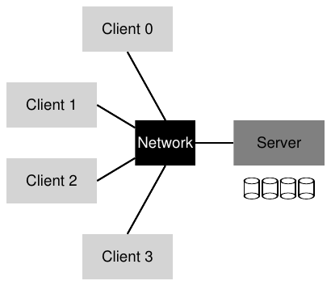
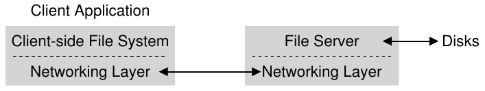
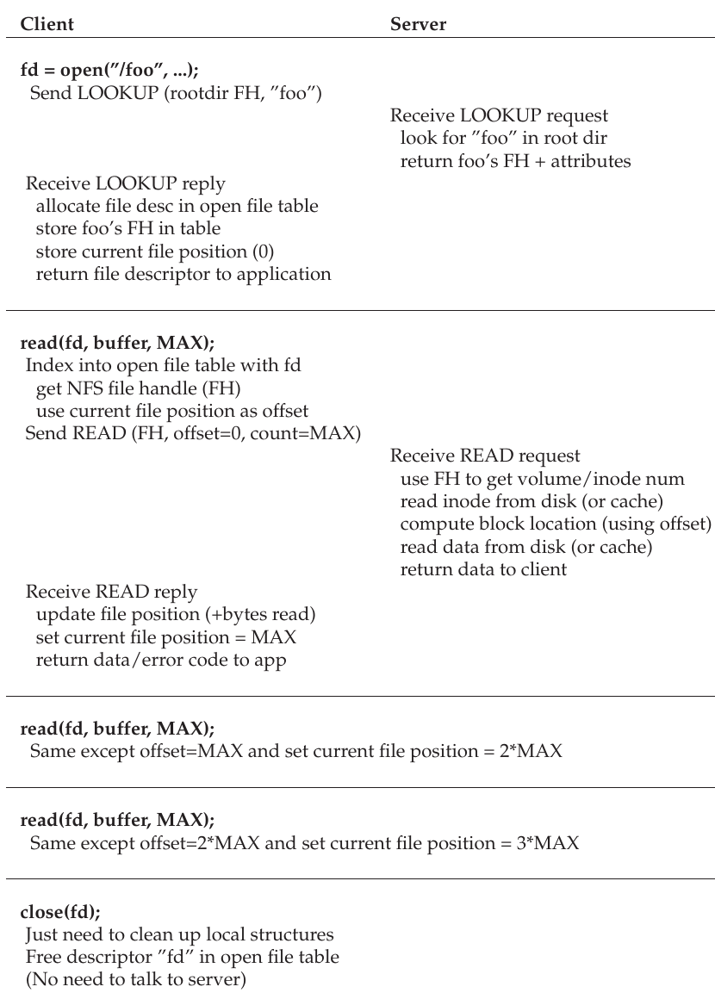
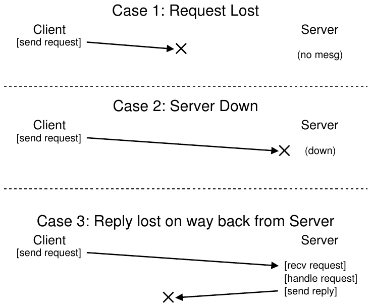
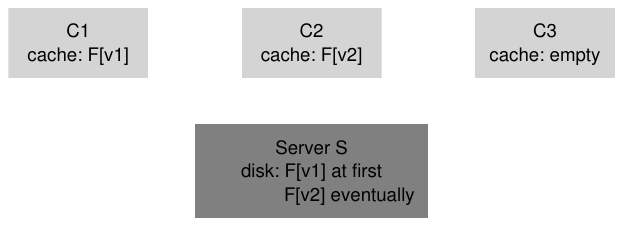

# 48 Network File System (NFS) của Sun

Một trong những ứng dụng đầu tiên của điện toán client/server phân tán thuộc lĩnh vực distributed file system. Trong môi trường như vậy, có nhiều máy client và một server (hoặc một vài server); server lưu data trên các disk của nó, còn client yêu cầu data qua những protocol message well-formed. Hình 48.1 mô tả cách tổ chức cơ bản.



Hình 48.1: Hệ thống client/server tổng quát

Như có thể thấy trong hình, server có các disk, còn client gửi message qua network để truy cập directory và file của mình trên những disk đó. Tại sao phải bố trí như vậy? (Tức tại sao không để client dùng local disk?) Chủ yếu vì cách này giúp dễ chia sẻ data giữa các client. Vì thế, nếu truy cập file trên một máy (Client 0) rồi sau đó dùng máy khác (Client 2), bạn vẫn thấy cùng một file system. Data của bạn tự nhiên được chia sẻ giữa những máy này. Lợi ích thứ hai là quản trị tập trung; chẳng hạn, có thể backup file từ một vài máy server thay vì vô số client. Một ưu điểm khác có thể là security; đặt mọi server trong phòng máy khóa kín ngăn một số loại vấn đề xuất hiện.

> VẤN ĐỀ CỐT LÕI: CÁCH XÂY DỰNG DISTRIBUTED FILE SYSTEM
>
> Làm thế nào xây dựng distributed file system? Cần suy nghĩ về những khía cạnh then chốt nào? Điều gì dễ làm sai? Có thể học được gì từ các hệ thống hiện có?

## 48.1 Distributed file system cơ bản

Bây giờ, ta nghiên cứu architecture của distributed file system được đơn giản hóa. Client/server distributed file system đơn giản có nhiều component hơn những file system đã học đến đây. Phía client có các client application truy cập file và directory thông qua file system client-side. Client application gửi system call tới file system client-side (như open(), read(), write(), close(), mkdir(), v.v.) để truy cập file lưu trên server. Vì thế, đối với client application, file system có vẻ không khác local file system (disk-based), có lẽ ngoại trừ performance; bằng cách này, distributed file system cung cấp transparent access tới file, một mục tiêu hiển nhiên; suy cho cùng, ai muốn dùng file system đòi hỏi bộ API khác hoặc gây phiền phức khi sử dụng?

Vai trò của file system client-side là thực hiện những hành động cần thiết để phục vụ các system call đó. Chẳng hạn, nếu client gửi request read(), file system client-side có thể gửi message tới file system server-side (hay thường được gọi là file server) để đọc block cụ thể; sau đó file server đọc block từ disk (hoặc cache in-memory của chính nó) và gửi message về client chứa data được yêu cầu. Tiếp theo, file system client-side sao chép data vào user buffer được truyền cho read() system call, nhờ đó request hoàn tất. Lưu ý data của lần read() tiếp theo trên cùng block ở client có thể được cache trong client memory, hoặc thậm chí trên disk của client; trong trường hợp tốt nhất như vậy, không cần tạo network traffic.



Hình 48.2: Architecture của distributed file system

Qua tổng quan đơn giản này, bạn có thể thấy hai phần software quan trọng trong client/server distributed file system: file system client-side và file server. Hành vi của chúng cùng quyết định hành vi của distributed file system. Giờ đến lúc nghiên cứu một hệ thống cụ thể: Network File System (NFS) của Sun.

> BÊN LỀ: TẠI SAO SERVER CRASH
>
> Trước khi đi vào chi tiết NFSv2 protocol, có thể bạn tự hỏi: tại sao server crash? Như có lẽ bạn đoán được, có rất nhiều lý do. Server có thể đơn giản bị mất điện tạm thời; chỉ khi có điện trở lại mới có thể khởi động lại máy. Server thường gồm hàng trăm nghìn, thậm chí hàng triệu dòng code; vì thế, chúng có bug (ngay cả software tốt cũng có vài bug trong mỗi trăm hoặc nghìn dòng code), và cuối cùng sẽ kích hoạt bug khiến chúng crash. Chúng cũng có memory leak; ngay cả memory leak nhỏ cũng khiến hệ thống cạn memory rồi crash. Cuối cùng, trong distributed system có network giữa client và server; nếu network hoạt động bất thường (chẳng hạn bị partition, trong khi client và server vẫn hoạt động nhưng không thể giao tiếp), có thể trông như remote machine đã crash, nhưng thực tế chỉ là hiện không thể tiếp cận nó qua network.

## 48.2 Đến với NFS

Một trong những distributed system sớm nhất và khá thành công được Sun Microsystems phát triển, gọi là Sun Network File System (hay NFS) [S86]. Khi định nghĩa NFS, Sun chọn cách khác thường: thay vì xây dựng hệ thống độc quyền, khép kín, Sun phát triển open protocol chỉ định chính xác message format mà client và server dùng để giao tiếp. Những nhóm khác nhau có thể phát triển NFS server riêng và cạnh tranh trong thị trường NFS mà vẫn duy trì interoperability. Cách đó hiệu quả: ngày nay có nhiều công ty bán NFS server (gồm Oracle/Sun, NetApp [HLM94], EMC, IBM và những công ty khác), và thành công rộng rãi của NFS có lẽ bắt nguồn từ cách tiếp cận “thị trường mở” này.

## 48.3 Trọng tâm: Server crash recovery đơn giản và nhanh

Trong chương này, ta thảo luận NFS protocol cổ điển (phiên bản 2, còn gọi là NFSv2), từng là tiêu chuẩn trong nhiều năm; có những thay đổi nhỏ khi chuyển sang NFSv3, còn những thay đổi protocol larger-scale khi chuyển sang NFSv4. Tuy nhiên, NFSv2 vừa tuyệt vời vừa gây bực bội, nên là trọng tâm của ta.

Trong NFSv2, mục tiêu chính khi thiết kế protocol là server crash recovery đơn giản và nhanh. Trong môi trường multiple-client, single-server, mục tiêu này rất hợp lý; mỗi phút server ngừng hoạt động (hoặc không khả dụng) khiến mọi máy client (và user của chúng) không hài lòng và không làm được việc. Vì thế, server thế nào thì toàn hệ thống cũng thế ấy.

## 48.4 Chìa khóa của crash recovery nhanh: Statelessness

NFSv2 hiện thực hóa mục tiêu đơn giản này bằng cách thiết kế thứ ta gọi là stateless protocol. Theo thiết kế, server không theo dõi bất cứ điều gì đang xảy ra tại từng client. Chẳng hạn, server không biết client nào đang cache block nào, file nào hiện mở ở mỗi client, vị trí file pointer hiện tại của file, v.v. Nói đơn giản, server không theo dõi client đang làm gì; thay vào đó, protocol được thiết kế để mỗi protocol request mang theo mọi thông tin cần thiết nhằm hoàn tất request. Nếu hiện chưa rõ, cách stateless này sẽ dễ hiểu hơn khi ta thảo luận protocol chi tiết bên dưới.

Để có ví dụ về stateful protocol (không phải stateless), xét open() system call. Với pathname cho trước, open() trả về file descriptor (một integer). Descriptor này được dùng trong các request read() hoặc write() tiếp theo để truy cập những file block khác nhau, như trong application code sau (lưu ý đã bỏ phần kiểm tra lỗi system call đúng cách để tiết kiệm chỗ):

```
char buffer[MAX];
int fd = open("foo", O_RDONLY); // get descriptor "fd"
read(fd, buffer, MAX);          // read MAX bytes from foo (via fd)
read(fd, buffer, MAX);          // read MAX bytes from foo
...
read(fd, buffer, MAX);          // read MAX bytes from foo
close(fd);                      // close file
```

Hình 48.3: Client code: Đọc từ file

Bây giờ, hình dung file system client-side mở file bằng cách gửi protocol message tới server, nói rằng “mở file ’foo’ và trả cho tôi một descriptor”. Sau đó file server mở file cục bộ ở phía nó và gửi descriptor về client. Trong các lần đọc tiếp theo, client application dùng descriptor đó để gọi read() system call; tiếp đó file system client-side chuyển descriptor trong message tới file server, nói rằng “đọc một số byte từ file được tham chiếu bằng descriptor tôi đang gửi ở đây”.

Trong ví dụ này, file descriptor là một phần shared state giữa client và server (Ousterhout gọi là distributed state [O91]). Như đã gợi ý, shared state làm crash recovery phức tạp hơn. Hình dung server crash sau khi lần đọc đầu hoàn tất nhưng trước khi client gửi lần thứ hai. Sau khi server hoạt động trở lại, client gửi lần đọc thứ hai. Đáng tiếc là server không biết fd tham chiếu file nào; thông tin đó chỉ tồn tại tạm thời (tức trong memory), nên mất khi server crash. Để xử lý tình huống, client và server phải tham gia một recovery protocol nào đó, trong đó client phải bảo đảm giữ đủ thông tin trong memory để cho server biết điều cần biết (ở đây là file descriptor fd tham chiếu file foo).

Mọi thứ còn tệ hơn khi xét rằng stateful server phải xử lý cả client crash. Chẳng hạn, hình dung client mở file rồi crash. Lời gọi open() dùng một file descriptor trên server; làm thế nào server biết có thể đóng một file nhất định? Trong hoạt động bình thường, cuối cùng client gọi close(), qua đó báo cho server nên đóng file. Tuy nhiên, khi client crash, server không bao giờ nhận close(), nên phải nhận biết client đã crash mới có thể đóng file.

Vì những lý do đó, các nhà thiết kế NFS chọn cách stateless: mỗi client operation chứa mọi thông tin cần thiết để hoàn tất request. Không cần crash recovery phức tạp; server chỉ cần chạy trở lại, và trong trường hợp xấu nhất, client có thể phải retry request.

## 48.5 NFSv2 protocol

Như vậy, ta đến định nghĩa NFSv2 protocol. Phát biểu vấn đề rất đơn giản:

> VẤN ĐỀ CỐT LÕI: CÁCH ĐỊNH NGHĨA STATELESS FILE PROTOCOL
>
> Làm thế nào định nghĩa network protocol để cho phép stateless operation? Rõ ràng, stateful call như open() không thể là một phần của protocol (vì đòi hỏi server theo dõi các file đang mở); tuy nhiên, client application muốn gọi open(), read(), write(), close() cùng những API call tiêu chuẩn khác để truy cập file và directory. Vì vậy, câu hỏi cụ thể hơn là: làm thế nào định nghĩa protocol vừa stateless vừa hỗ trợ POSIX file system API?

Một chìa khóa để hiểu thiết kế NFS protocol là hiểu file handle. File handle được dùng để mô tả duy nhất file hoặc directory mà một operation cụ thể sẽ thao tác; vì vậy, nhiều protocol request có file handle.

Có thể xem file handle gồm ba thành phần quan trọng: volume identifier, inode number và generation number; cùng nhau, ba mục này tạo thành identifier duy nhất cho file hoặc directory mà client muốn truy cập. Volume identifier báo cho server request tham chiếu file system nào (NFS server có thể export nhiều hơn một file system); inode number cho server biết request đang truy cập file nào trong partition đó. Cuối cùng, generation number cần thiết khi tái sử dụng inode number; bằng cách tăng nó mỗi khi inode number được tái sử dụng, server bảo đảm client có file handle cũ không thể vô tình truy cập file newly-allocated.

Sau đây là tóm tắt một số phần quan trọng của protocol; có thể tìm protocol đầy đủ ở tài liệu khác (xem sách của Callaghan để có tổng quan xuất sắc và chi tiết về NFS [C00]).

```
NFSPROC_GETATTR
  expects: file handle
  returns: attributes
NFSPROC_SETATTR
  expects: file handle, attributes
  returns: nothing
NFSPROC_LOOKUP
  expects: directory file handle, name of file/directory to look up
  returns: file handle
NFSPROC_READ
  expects: file handle, offset, count
  returns: data, attributes
NFSPROC_WRITE
  expects: file handle, offset, count, data
  returns: attributes
NFSPROC_CREATE
  expects: directory file handle, name of file, attributes
  returns: nothing
NFSPROC_REMOVE
  expects: directory file handle, name of file to be removed
  returns: nothing
NFSPROC_MKDIR
  expects: directory file handle, name of directory, attributes
  returns: file handle
NFSPROC_RMDIR
  expects: directory file handle, name of directory to be removed
  returns: nothing
NFSPROC_READDIR
  expects: directory handle, count of bytes to read, cookie
  returns: directory entries, cookie (to get more entries)
```

Hình 48.4: NFS protocol: Các ví dụ

Ta điểm qua những thành phần quan trọng của protocol. Đầu tiên, LOOKUP protocol message được dùng để lấy file handle, rồi dùng file handle đó để truy cập file data. Client truyền directory file handle và tên file cần tìm; server trả về client handle của file đó (hoặc directory) cùng các attribute của nó.

Chẳng hạn, giả sử client đã có directory file handle cho root directory của file system (/) (thực tế, handle này được lấy qua NFS mount protocol, cách client và server kết nối với nhau ban đầu; để ngắn gọn, ta không thảo luận mount protocol ở đây). Nếu ứng dụng chạy trên client mở file /foo.txt, file system client-side gửi lookup request tới server, truyền root file handle và tên foo.txt; nếu thành công, file handle (và attribute) của foo.txt sẽ được trả về.

Nếu bạn đang thắc mắc, attribute chỉ là metadata mà file system theo dõi về mỗi file, gồm các field như file creation time, last modification time, size, thông tin ownership và permission, v.v., tức cùng loại thông tin nhận được khi gọi stat() trên file.

Khi có file handle, client có thể gửi READ và WRITE protocol message đối với file để lần lượt đọc hoặc ghi file. READ protocol message đòi hỏi truyền file handle cùng offset trong file và số byte cần đọc. Sau đó, server có thể thực hiện lần đọc (suy cho cùng, handle cho biết volume và inode cần đọc, còn offset và count cho biết những byte nào trong file cần đọc), rồi trả data cho client (hoặc lỗi nếu có failure). WRITE được xử lý tương tự, ngoại trừ data được truyền từ client tới server và chỉ trả về success code.

Protocol message thú vị cuối cùng là GETATTR request; với file handle cho trước, nó chỉ lấy attribute của file đó, gồm thời điểm file được sửa gần nhất. Bên dưới, khi thảo luận caching, ta sẽ thấy vì sao protocol request này quan trọng trong NFSv2 (bạn đoán được vì sao không?).

## 48.6 Từ protocol đến distributed file system

Hy vọng giờ bạn đã hình dung được cách protocol này trở thành file system thông qua file system client-side và file server. File system client-side theo dõi các file đang mở và thường chuyển application request thành tập protocol message tương ứng. Server chỉ phản hồi từng protocol message, mỗi message đều có đủ thông tin cần thiết để hoàn tất request.

Chẳng hạn, xét ứng dụng đơn giản đọc một file. Trong sơ đồ (Hình 48.5), ta trình bày những system call mà ứng dụng thực hiện và những việc file system client-side cùng file server làm để đáp ứng các call đó.

Có một vài nhận xét về hình. Trước tiên, chú ý client theo dõi mọi state liên quan tới file access, gồm ánh xạ từ integer file descriptor sang NFS file handle và current file pointer. Điều này cho phép client chuyển mỗi read request (như có thể bạn nhận thấy, không chỉ định tường minh offset cần đọc) thành read protocol message properly-formatted, cho server biết chính xác những byte nào của file cần đọc. Khi đọc thành công, client cập nhật current file position; các lần đọc tiếp theo được gửi với cùng file handle nhưng offset khác.

Thứ hai, bạn có thể nhận thấy nơi diễn ra tương tác với server. Khi file được mở lần đầu, file system client-side gửi LOOKUP request message. Thực tế, nếu cần duyệt pathname dài (chẳng hạn /home/remzi/foo.txt), client gửi ba LOOKUP: một để tìm home trong directory /, một để tìm remzi trong home, cuối cùng một để tìm foo.txt trong remzi.

Thứ ba, bạn có thể nhận thấy mỗi server request có mọi thông tin cần thiết để hoàn tất trọn vẹn request. Điểm thiết kế này rất quan trọng để phục hồi suôn sẻ sau server failure, như ta sẽ thảo luận kỹ hơn ngay sau đây; nó bảo đảm server không cần state để phản hồi request.



Hình 48.5: Đọc file: Hành động của Client-side và file server

> MẸO: IDEMPOTENCY RẤT MẠNH MẼ
>
> Idempotency là thuộc tính hữu ích khi xây dựng hệ thống đáng tin cậy. Khi có thể gửi một operation nhiều hơn một lần, việc xử lý failure của operation dễ hơn nhiều; chỉ cần retry. Nếu operation không idempotent, mọi thứ khó khăn hơn.

## 48.7 Xử lý server failure bằng idempotent operation

Khi client gửi message tới server, đôi khi nó không nhận reply. Có nhiều lý do có thể khiến không có phản hồi. Trong một số trường hợp, message bị network loại bỏ; network thực sự làm mất message, nên request hoặc reply có thể bị mất và client không bao giờ nhận phản hồi.

Cũng có thể server đã crash, nên hiện không phản hồi message. Một lúc sau, server được reboot và chạy trở lại, nhưng trong thời gian đó mọi request đã bị mất. Trong tất cả trường hợp, client phải trả lời câu hỏi: nên làm gì khi server không phản hồi kịp thời?

Trong NFSv2, client xử lý mọi failure này theo một cách duy nhất, thống nhất và gọn gàng: chỉ retry request. Cụ thể, sau khi gửi request, client đặt timer để kích hoạt sau khoảng thời gian chỉ định. Nếu nhận reply trước khi timer kích hoạt, timer được hủy và mọi thứ ổn. Nhưng nếu timer kích hoạt trước khi nhận bất kỳ reply nào, client giả định request chưa được xử lý và gửi lại. Nếu server phản hồi, mọi thứ ổn và client đã xử lý vấn đề gọn gàng.

Client có thể đơn giản retry request (bất kể nguyên nhân failure) nhờ thuộc tính quan trọng của phần lớn NFS request: chúng idempotent. Operation được gọi là idempotent khi tác động của việc thực hiện nhiều lần tương đương tác động của thực hiện một lần duy nhất. Chẳng hạn, lưu một giá trị vào memory location ba lần giống như thực hiện một lần; vì thế, “lưu giá trị vào memory” là idempotent operation. Tuy nhiên, tăng counter ba lần cho kết quả khác với chỉ tăng một lần; do đó, “tăng counter” không idempotent. Tổng quát hơn, mọi operation chỉ đọc data rõ ràng idempotent; operation cập nhật data phải được xem xét kỹ hơn để xác định có thuộc tính này không.

Cốt lõi thiết kế crash recovery trong NFS là idempotency của những operation phổ biến nhất. LOOKUP và READ request hiển nhiên idempotent vì chỉ đọc thông tin từ file server, không cập nhật. Thú vị hơn, WRITE request cũng idempotent. Chẳng hạn, nếu WRITE thất bại, client chỉ cần retry. WRITE message chứa data, count và, điều quan trọng là, chính xác offset cần ghi data tới. Vì thế, có thể lặp lại và biết rằng kết quả nhiều lần ghi giống kết quả một lần ghi.



Hình 48.6: Ba loại mất mát

Theo cách này, client xử lý mọi timeout thống nhất. Nếu WRITE request chỉ bị mất (Trường hợp 1 ở trên), client retry, server thực hiện lần ghi và mọi thứ ổn. Điều tương tự xảy ra nếu server đang ngừng hoạt động khi gửi request, nhưng đã chạy trở lại khi request thứ hai được gửi; một lần nữa mọi thứ hoạt động như mong muốn (Trường hợp 2). Cuối cùng, server có thể thực sự nhận WRITE request, gửi lần ghi xuống disk của nó và gửi reply. Reply này có thể bị mất (Trường hợp 3), lại khiến client re-send request. Khi server nhận request lần nữa, nó chỉ làm đúng điều tương tự: ghi data xuống disk và phản hồi đã làm xong. Nếu lần này client nhận reply, mọi thứ lại ổn; nhờ vậy, client đã xử lý cả message loss lẫn server failure một cách thống nhất. Thật gọn!

Một lưu ý nhỏ: một số operation khó làm cho idempotent. Chẳng hạn, khi cố tạo directory đã tồn tại, bạn được thông báo mkdir request thất bại. Vì thế, trong NFS, nếu file server nhận MKDIR protocol message và thực hiện thành công nhưng reply bị mất, client có thể lặp lại rồi gặp lỗi đó, dù thực tế operation ban đầu thành công và chỉ thất bại khi retry. Cuộc sống quả không hoàn hảo.

> MẸO: SỰ HOÀN HẢO LÀ KẺ THÙ CỦA ĐIỀU TỐT (ĐỊNH LUẬT VOLTAIRE)
>
> Ngay cả khi thiết kế hệ thống đẹp đẽ, đôi khi không phải mọi corner case đều hoạt động đúng như mong muốn. Lấy ví dụ mkdir ở trên; có thể thiết kế lại mkdir với semantics khác để nó idempotent (hãy nghĩ cách làm); nhưng tại sao phải mất công? Triết lý thiết kế NFS bao quát phần lớn trường hợp quan trọng và nhìn chung khiến thiết kế hệ thống rõ ràng, đơn giản về xử lý failure. Vì vậy, chấp nhận cuộc sống không hoàn hảo mà vẫn xây dựng hệ thống là dấu hiệu của kỹ thuật tốt. Có vẻ lời khuyên này được gán cho Voltaire qua câu “... một người Ý khôn ngoan nói rằng cái tốt nhất là kẻ thù của cái tốt” [V72], nên ta gọi nó là Định luật Voltaire.

## 48.8 Cải thiện performance: Caching Client-side

Distributed file system có lợi vì nhiều lý do, nhưng gửi mọi read request và write request qua network có thể gây vấn đề performance lớn: network thường không nhanh đến thế, đặc biệt so với local memory hoặc disk. Vì vậy, lại có vấn đề: làm thế nào cải thiện performance của distributed file system?

Câu trả lời, như có lẽ bạn đoán được khi đọc những chữ to đậm ở sub-heading phía trên, là caching client-side. File system client-side của NFS cache file data (và metadata) đã đọc từ server trong client memory. Vì vậy, dù lần truy cập đầu tốn kém (tức đòi hỏi giao tiếp qua network), những lần truy cập sau được phục vụ khá nhanh từ client memory.

Cache còn làm buffer tạm thời cho các lần ghi. Khi client application lần đầu ghi vào file, client giữ data trong client memory buffer (cùng cache chứa data đã đọc từ file server) trước khi ghi ra server. Write buffering như vậy hữu ích vì de-couples write() latency của ứng dụng khỏi write performance thực tế, tức lời gọi write() của ứng dụng thành công ngay (và chỉ đưa data vào cache của file system client-side); mãi sau data mới được ghi ra file server.

Vậy NFS client cache data, performance thường rất tốt, và ta xong rồi, đúng không? Đáng tiếc là chưa hẳn. Thêm caching vào bất kỳ hệ thống nào có nhiều client cache đều đặt ra một thách thức lớn, thú vị mà ta gọi là cache consistency problem.

## 48.9 Cache consistency problem

Có thể minh họa cache consistency problem rõ nhất bằng hai client và một server. Hình dung client C1 đọc file F và giữ bản sao trong local cache. Giờ hình dung client khác, C2, ghi đè file F, thay đổi nội dung của nó; gọi phiên bản mới của file là F (phiên bản 2), hay F[v2], còn phiên bản cũ là F[v1] để phân biệt (nhưng dĩ nhiên file có cùng tên, chỉ khác nội dung). Cuối cùng, có client thứ ba C3 chưa truy cập file F.



Hình 48.7: Cache consistency problem

Có lẽ bạn thấy được vấn đề sắp xuất hiện (Hình 48.7). Thực tế có hai vấn đề con. Thứ nhất, client C2 có thể giữ các lần ghi trong cache một thời gian trước khi truyền tới server; khi đó, trong lúc F[v2] nằm trong memory của C2, bất kỳ truy cập F nào từ client khác (chẳng hạn C3) đều lấy phiên bản cũ của file (F[v1]). Vì vậy, giữ các lần ghi trong buffer tại client có thể khiến client khác nhận phiên bản file cũ, điều có thể không mong muốn; thực vậy, hình dung bạn đăng nhập máy C2, cập nhật F rồi đăng nhập C3 và thử đọc file, nhưng chỉ nhận bản sao cũ! Chắc chắn rất bực bội. Vì thế, gọi khía cạnh này của cache consistency problem là update visibility: khi nào cập nhật từ một client trở nên hiển thị với client khác?

Vấn đề con thứ hai của cache consistency là stale cache; trong trường hợp này, cuối cùng C2 đã flush các lần ghi tới file server, nên server có phiên bản mới nhất (F[v2]). Tuy nhiên, C1 vẫn có F[v1] trong cache; nếu chương trình chạy trên C1 đọc file F, nó nhận phiên bản cũ (F[v1]) thay vì bản sao mới nhất (F[v2]), điều thường không mong muốn.

Các triển khai NFSv2 giải quyết những vấn đề cache consistency này theo hai cách. Đầu tiên, để xử lý update visibility, client triển khai thứ đôi khi gọi là consistency semantics flush-on-close (còn gọi là close-to-open); cụ thể, khi client application ghi file rồi đóng nó, client flush mọi cập nhật (tức dirty page trong cache) tới server. Với consistency flush-on-close, NFS bảo đảm lần open tiếp theo từ node khác sẽ thấy phiên bản file mới nhất.

Thứ hai, để xử lý stale-cache problem, trước tiên NFSv2 client kiểm tra file đã thay đổi chưa trước khi dùng nội dung cache. Cụ thể, khi mở file, file system client-side gửi GETATTR request tới server để lấy attribute của file. Điều quan trọng là attribute chứa thông tin thời điểm file được sửa gần nhất trên server; nếu time-of-modification mới hơn thời điểm file được đưa vào client cache, client invalidate file, loại bỏ nó khỏi client cache và bảo đảm những lần đọc sau tới server để lấy phiên bản file mới nhất. Ngược lại, nếu client thấy mình có phiên bản mới nhất, nó tiếp tục dùng nội dung cache, nhờ đó tăng performance.

Khi nhóm ban đầu tại Sun triển khai giải pháp cho stale-cache problem, họ nhận ra vấn đề mới: đột nhiên NFS server bị ngập trong GETATTR request. Nguyên tắc kỹ thuật tốt là thiết kế cho trường hợp phổ biến và làm nó hoạt động tốt; ở đây, dù trường hợp phổ biến là file chỉ được truy cập từ một client (có thể lặp lại nhiều lần), client luôn phải gửi GETATTR request tới server để bảo đảm không ai khác thay đổi file. Vì vậy, client dồn dập hỏi server “có ai thay đổi file này chưa?”, trong khi phần lớn thời gian chẳng ai thay đổi.

Để phần nào khắc phục, attribute cache được thêm vào mỗi client. Client vẫn kiểm tra tính hợp lệ của file trước khi truy cập, nhưng phần lớn thời gian chỉ tra attribute cache để lấy attribute. Attribute của file cụ thể được đưa vào cache khi file được truy cập lần đầu, rồi timeout sau một khoảng thời gian (chẳng hạn 3 giây). Vì vậy, trong ba giây đó, mọi file access đều xác định có thể dùng cached file và làm vậy mà không cần giao tiếp qua network với server.

## 48.10 Đánh giá NFS cache consistency

Một vài lời cuối về NFS cache consistency. Hành vi flush-on-close được thêm vào để “hợp lý”, nhưng gây một vấn đề performance. Cụ thể, nếu file tạm thời hoặc short-lived được tạo trên client rồi sớm bị xóa, nó vẫn bị buộc gửi tới server. Triển khai lý tưởng hơn có thể giữ các file short-lived như vậy trong memory cho tới khi bị xóa, loại bỏ hoàn toàn tương tác với server và có lẽ tăng performance.

Quan trọng hơn, thêm attribute cache vào NFS khiến rất khó hiểu hoặc suy luận chính xác ta nhận được phiên bản file nào. Đôi khi bạn nhận phiên bản mới nhất; đôi khi lại nhận phiên bản cũ chỉ vì attribute cache chưa timeout, nên client vui vẻ đưa nội dung trong client memory cho bạn. Dù phần lớn thời gian như vậy vẫn ổn, đôi lúc nó từng gây (và vẫn đang gây!) hành vi bất thường.

Như vậy, ta đã mô tả sự kỳ quặc của NFS client caching. Đây là ví dụ thú vị trong đó chi tiết triển khai định nghĩa semantics user-observable, thay vì ngược lại.

## 48.11 Ảnh hưởng đối với write buffering Server-Side

Đến đây, trọng tâm là client caching, nơi xuất hiện phần lớn vấn đề thú vị. Tuy nhiên, NFS server thường cũng là máy well-equipped có nhiều memory, nên cũng phải quan tâm caching. Khi data (và metadata) được đọc từ disk, NFS server giữ nó trong memory, và những lần đọc tiếp theo của data (và metadata) đó không tới disk, có thể tăng performance một chút.

Thú vị hơn là trường hợp write buffering. NFS server tuyệt đối không được trả về thành công cho WRITE protocol request cho tới khi lần ghi được buộc xuống stable storage (chẳng hạn disk hoặc thiết bị persistent khác). Dù có thể đặt bản sao data trong server memory, trả về thành công cho client đối với WRITE protocol request có thể dẫn tới hành vi sai; bạn nghĩ ra vì sao không?

Câu trả lời nằm trong giả định về cách client xử lý server failure. Hình dung chuỗi ghi sau do client gửi:

```
write(fd, a_buffer, size); // fill first block with a’s
write(fd, b_buffer, size); // fill second block with b’s
write(fd, c_buffer, size); // fill third block with c’s
```

Những lần ghi này ghi đè ba block của file bằng một block các ký tự a, rồi b, rồi c. Vì thế, nếu ban đầu file có dạng:

```
xxxxxxxxxxxxxxxxxxxxxxxxxxxxxxxxxxxxxxxxxxxxxxxxxxxxxxxxxxxx
yyyyyyyyyyyyyyyyyyyyyyyyyyyyyyyyyyyyyyyyyyyyyyyyyyyyyyyyyyyy
zzzzzzzzzzzzzzzzzzzzzzzzzzzzzzzzzzzzzzzzzzzzzzzzzzzzzzzzzzzz
```

Ta có thể kỳ vọng kết quả cuối sau những lần ghi như sau, trong đó các ký tự x, y và z lần lượt bị ghi đè bằng a, b và c.

```
aaaaaaaaaaaaaaaaaaaaaaaaaaaaaaaaaaaaaaaaaaaaaaaaaaaaaaaaaaaa
bbbbbbbbbbbbbbbbbbbbbbbbbbbbbbbbbbbbbbbbbbbbbbbbbbbbbbbbbbbb
cccccccccccccccccccccccccccccccccccccccccccccccccccccccccccc
```

Bây giờ, để minh họa, giả sử ba lần ghi của client được gửi tới server dưới dạng ba WRITE protocol message riêng biệt. Giả sử server nhận WRITE message đầu tiên, gửi xuống disk và báo thành công cho client. Giờ giả sử lần ghi thứ hai chỉ được giữ trong memory buffer, nhưng server cũng báo thành công cho client trước khi buộc ghi xuống disk; đáng tiếc là server crash trước khi ghi xuống disk. Server nhanh chóng khởi động lại và nhận write request thứ ba, cũng thành công.

Vì thế, đối với client, mọi request đều thành công, nhưng ta bất ngờ thấy nội dung file như sau:

```
aaaaaaaaaaaaaaaaaaaaaaaaaaaaaaaaaaaaaaaaaaaaaaaaaaaaaaaaaaaa
yyyyyyyyyyyyyyyyyyyyyyyyyyyyyyyyyyyyyyyyyyyyyyyyyyyyyyyyyyyy <--- oops
cccccccccccccccccccccccccccccccccccccccccccccccccccccccccccc
```

Ôi chao! Vì server báo với client lần ghi thứ hai thành công trước khi commit xuống disk, một phần nội dung cũ vẫn còn trong file, có thể gây hậu quả nghiêm trọng tùy ứng dụng.

Để tránh vấn đề, NFS server phải commit mỗi lần ghi tới stable (persistent) storage trước khi báo thành công cho client; điều này cho phép client phát hiện server failure trong lần ghi và retry cho đến khi cuối cùng thành công. Nhờ vậy, ta bảo đảm không bao giờ có nội dung file trộn lẫn như ví dụ trên.

Vấn đề mà yêu cầu này gây ra khi triển khai NFS server là nếu không hết sức cẩn thận, write performance có thể trở thành performance bottleneck chính. Thực vậy, một số công ty (chẳng hạn Network Appliance) ra đời với mục tiêu đơn giản là xây dựng NFS server ghi nhanh; một thủ thuật họ dùng là trước tiên đưa các lần ghi vào memory battery-backed, cho phép nhanh chóng phản hồi WRITE request mà không lo mất data và không chịu chi phí ghi xuống disk ngay; thủ thuật thứ hai là dùng thiết kế file system chuyên để ghi xuống disk nhanh khi cuối cùng cần làm vậy [HLM94, RO91].

## 48.12 Tổng kết

Ta đã được giới thiệu NFS distributed file system. NFS xoay quanh ý tưởng recovery đơn giản và nhanh khi có server failure, đạt được bằng thiết kế protocol cẩn thận. Idempotency của operation là thiết yếu; vì client có thể an toàn replay operation thất bại, làm vậy là ổn dù server đã thực thi request hay chưa.

Ta cũng thấy thêm caching vào hệ thống multiple-client, single-server có thể khiến mọi thứ phức tạp. Cụ thể, hệ thống phải giải quyết cache consistency problem để hoạt động hợp lý; tuy nhiên, NFS làm điều đó theo cách hơi chắp vá, đôi khi dẫn tới hành vi kỳ lạ có thể quan sát được. Cuối cùng, ta thấy server caching có thể phức tạp: các lần ghi tới server phải được buộc xuống stable storage trước khi trả về thành công (nếu không, data có thể bị mất).

Ta chưa nói tới các vấn đề khác chắc chắn có liên quan, nổi bật là security. Security trong các triển khai NFS đời đầu rất lỏng lẻo; user bất kỳ trên client khá dễ giả làm user khác để truy cập hầu như mọi file. Việc tích hợp sau này với authentication service nghiêm túc hơn (chẳng hạn Kerberos [NT94]) đã khắc phục các thiếu sót hiển nhiên này.

## Tài liệu tham khảo

[C00] “NFS Illustrated”

Brent Callaghan

Addison-Wesley Professional Computing Series, 2000

Một tài liệu tham khảo NFS xuất sắc, cực kỳ đầy đủ và chi tiết về chính protocol.

[HLM94] “File System Design for an NFS File Server Appliance”

Dave Hitz, James Lau, Michael Malcolm

USENIX mùa Đông 1994. San Francisco, California, 1994

Hitz và cộng sự chịu ảnh hưởng sâu sắc từ công trình trước đó về log-structured file system.

[NT94] “Kerberos: An Authentication Service for Computer Networks”

B. Clifford Neuman, Theodore Ts’o

IEEE Communications, 32(9):33-38, tháng Chín 1994

Kerberos là authentication service đời đầu có ảnh hưởng rất lớn. Có lẽ một lúc nào đó chúng tôi nên viết một chương sách về nó...

[O91] “The Role of Distributed State”

John K. Ousterhout

Có tại: ftp://ftp.cs.berkeley.edu/ucb/sprite/papers/state.ps

Một thảo luận ít được trích dẫn về distributed state, đem lại góc nhìn rộng hơn về các vấn đề và thách thức.

[P+94] “NFS Version 3: Design and Implementation”

Brian Pawlowski, Chet Juszczak, Peter Staubach, Carl Smith, Diane Lebel, Dave Hitz

USENIX mùa Hè 1994, trang 137-152

Những thay đổi nhỏ làm cơ sở cho NFS phiên bản 3.

[P+00] “The NFS version 4 protocol”

Brian Pawlowski, David Noveck, David Robinson, Robert Thurlow

International System Administration and Networking Conference lần thứ 2 (SANE 2000)

Chắc chắn là bài báo giàu chất văn chương nhất từng được viết về NFS.

[RO91] “The Design and Implementation of the Log-structured File System”

Mendel Rosenblum, John Ousterhout

Symposium on Operating Systems Principles (SOSP), 1991

Lại LFS. Đúng vậy, bạn chẳng bao giờ thấy đủ LFS đâu.

[S86] “The Sun Network File System: Design, Implementation and Experience”

Russel Sandberg

USENIX mùa Hè 1986

Bài báo NFS ban đầu; dù đọc hơi khó, vẫn đáng tìm hiểu nguồn gốc của những ý tưởng tuyệt vời này.

[Sun89] “NFS: Network File System Protocol Specification”

Sun Microsystems, Inc. Request for Comments: 1094, tháng Ba 1989

Có tại: http://www.ietf.org/rfc/rfc1094.txt

Bản specification đáng sợ; hãy đọc nếu buộc phải đọc, tức được trả tiền để đọc nó. Hy vọng được trả nhiều. Tiền tươi đấy!

[V72] “La Begueule”

Francois-Marie Arouet a.k.a. Voltaire

Xuất bản năm 1772

Voltaire nói nhiều điều thông minh, và đây chỉ là một ví dụ. Chẳng hạn, Voltaire còn nói: “Nếu đất nước bạn có hai tôn giáo, hai bên sẽ cắt cổ nhau; nhưng nếu có ba mươi tôn giáo, họ sẽ sống hòa bình.” Những người Dân chủ và Cộng hòa nghĩ sao về điều đó?
